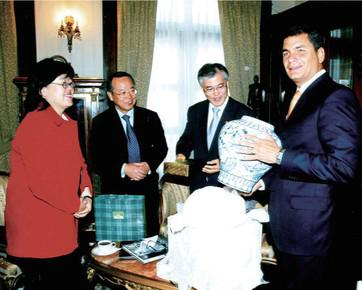

# 辞去民政首席

<b>辞去民政首席</b>

2006年5月，我又辞去了民政首席一职。在几个月之前我就表明了去意，直到这时才被接受。总统之所以接受，是希望我能在即将到来的地方选举中助一臂之力。我想去釜山给地方选举帮点忙，结果却意外卷入了一场口舌之争，着实被吓得不轻。我在参与政府五年内，无论在青瓦台内还是青瓦台外，像这样卷入口舌之争，当时是唯一的一次。这件事也让我更真切地感受到了政治的可怕，甚至产生了幻灭之感。

开放国民党釜山市分部准备搞一个记者见面会，要我去参加。釜山的地方选举形势一直打不开局面，他们拜托我发言时说点狠话，好给选举帮忙。釜山党内宣传负责人和发言人也一起参加了那次见面会。记者们向我提问道：“您对这次选举有什么预想？您希望这次成为一次什么样的选举？”我决定好好批评一下釜山市民的地域主义，于是说道：“我本来期待着卢总统的当选能够成为缓和釜山地域主义的一个契机，但遗憾的是，地域主义却变得更加牢固。总统是釜山出身，对釜山有着特别的感情，釜山市民应该觉得这是釜山的政权，应该对其充满热情，但现实似乎完全不是这样的。我不能够理解釜山市民为什么不觉得参与政府是釜山的政权。我希望这次地方选举最好能够打破如此牢固的地域主义。”其中可能有不精准的地方，但我发言的大意就是如此。

因为当时在场的只有釜山地区的记者与韩联社记者，一开始的报道篇幅也不是很大，只是简明扼要地报道了我发言的主要内容。但是报道出来的第二天，某当时并不在现场的报纸抓住我发言中的“釜山政权”大做文章，批评我强调釜山政权，煽动地域主义。

开放国民党的人看了这篇报道也很生气，义正词严地站出来批评我。说我的发言是助长了亡国性质的地域情绪，也有人说我是在侮辱国民，还有人说我忘记了参与政府是以光州为中心的湖南人的支持才造就的这个事实，是极为错误的。几乎所有媒体都大肆报道了这些批评，这很快就成了一个社会热点。

我既困惑又后悔。我困惑于我怎么能说出“釜山政权”这种容易引起误会和麻烦的话，我也深深地后悔答应人家为选举帮忙，参加了那次记者见面会。但更令我困惑的是开放国民党。记者见面会是该党釜山分部召开的，釜山分部的宣传负责人和发言人都跟我一起在现场，他们也不管我的发言内容与主旨，只是看了对我的批评报道也一起站出来批评我。我们本身就是岭南地区地域情绪的受害者，我怎么可能跑到岭南去煽动地域情绪？这从常识上也可以判断出来啊！

受了惊吓的釜山党部虽然也连忙拿出了资料，证明我发言的内容与主旨不是媒体报道的那样，但是毫无用处。就算我失言了，如果他们有同志意识，特别是当时处于选举时期，就应该站出来，为我澄清我发言的宗旨不是那个意思，将事态化解到最小程度……但是他们却扩大了事端，这让我难以理解。

这是我平生最遭人诟病的一件事，在我心中留下了大大的伤痕，让我更加讨厌并且恐惧政治。我听说，湖南地区开放国民党在与民主党对决之时，这次发言风波成为对方候选人攻击的一个素材，令开放国民党很是被动。真是对不起了，我向所有受害者道歉。

参与政府剩下的时间里，我不打算再做律师，决定干脆休息一段时间。不久以后，总统任命我为政务特别助理，使得当律师的想法变得更不可能了。我名义上虽然叫特别助理，但没有工资，也没有活动经费，没有车，没有办公室，甚至连公务手机都没有。我没有任何实际工作，也没什么事邀请我，虽然给我制作了名片，但根本没有使用的机会。在我后来当秘书室室长之前，一直都是政务特别助理，在这个官衔下，我唯一做过的事情就是以特使身份参加了南美洲厄瓜多尔科雷亚总统的就职典礼。

我这次出差就是以韩国总统派出的使节身份，参加厄瓜多尔总统的就职典礼活动，除此之外并没有什么事可做。但是厄瓜多尔方面似乎认为我这个“特别助理”级别很高，大体相当于美国白宫的“特别助理”。

要不然就是韩国驻当地大使把“特别助理”这个职务夸大了，我受到的礼遇竟比其他国家的部长还要高一级。其他部长都坐在一辆大巴内，而我乘坐的是单独准备的副总统级的专车。就职典礼上，跟总统问候、握手的顺序，我也是紧随其他国家元首、副总统之后，在美国部长之前。

总统就职典礼第二天，科雷亚总统的第一次公开活动就单独接见了我。来参加就职典礼的其他国家元首在典礼之前和典礼当天都会见完毕了，在下一个级别接见的人中，我是第一个。整个会面时间超过30分钟，可以说是非常长了。我也能感到，科雷亚总统为了跟我会谈做了充分的准备。

在谈到正式的经济合作与援助请求之前，我们先活跃了一下气氛。首先，为了拉近彼此的距离，我说科雷亚（Correa）总统的姓与韩国（Korea）的发音很相像，感觉特别亲切。他似乎已经预料到我会提起这个，说：“以前很多韩国人来到意大利生活，就是用‘科雷亚’这个姓，我也想知道，是不是我的祖先与韩国有什么特别的关系，才用了这个姓。”也刻意强调了自己与韩国的特殊关系。我们还提到了张夏准教授，总统说自己跟张教授上的是同一所大学，最近读了《踹开梯子（KICKING AWAY THE LADDER）》这本书，总统极口称赞这是一本非常了不起的书。总统为了与我会谈，竟然准备了如此多的谈话素材，这让我切实感受到韩国的国际地位确实有了很大的提升。我回国时途经巴拉圭，巴拉圭外交部长出于礼貌跟我见了面。那里情形也是一样，我能感受到在南美国家的心中，韩国的国际地位非常高。

我两次出任民政首席，还做过市民社会首席、秘书室室长，在青瓦台工作了四年，但是没有随总统出访过一次。民政首席也好，市民社会首席也罢，都是跟出访毫无关联的职位。其实如果想要找一个名头，比如参观海外侨胞的社会生活，也不是不可以，但是参与政府是不会做这种事的。当了秘书室室长后，总统不在时，我就要承担起看守青瓦台的职责。别说是跟着出去了，对我来说那时完全是特殊时期，任务更为艰辛。所以这个“特别助理”虽然只是名义上的，但我也算是沾了一点光。

2006年10月13日，我正在休息时，从新闻里听到了一个喜讯——前任外交部部长潘基文当选为联合国秘书长。我在青瓦台工作时就一直推动这件事，也很想知道结果如何，现在看来终于结出了丰硕的成果，真是可喜可贺。

  以韩国总统派出的使节身份，参加厄瓜多尔总统的就职典礼活动。但是厄瓜多尔方面似乎认为我这个“特别助理”级别很高，大体相当于美国白宫的“特别助理”。 

总统与青瓦台最开始并没有属意潘基文，也没有为其进行什么外交上的努力。最初是韩国驻美大使洪锡炫想要谋得这个职位。当时大家都认为下届联合国秘书长应该来自亚洲，他本人也倾注了很多努力；但是突然发生了“安企部X文件案件”监听磁带事件，使他无缘该职，于是潘基文部长就成了候选人。应该说潘基文运气非常好，从这时开始，参与政府做了所有“能做”的外交努力。总统每次出访，都拜托对方支持潘基文，总理出访国外时也是如此。总统还派青瓦台政策室长金秉准作为特使出访主要国家，拜托对方支持潘基文。临近选举，还给其他国家元首打了很多电话。

这些努力见到了效果，但是起决定性因素不是这些高级别的沟通。政府的外交努力不过是锦上添花而已，潘基文之所以能够当选联合国秘书长，还在于当时参与政府一贯奉行的均衡外交政策。在亚洲，要想当上联合国秘书长，中国的支持是不可或缺的。中国对卢总统与参与政府一贯奉行的均衡外交给予了很高的评价和信任。如果没有参与政府的均衡外交政策，我们很难获得中国的支持。其他第三世界阵营也是如此。当然了，没有美国与西方的帮助这件事也是完全不可能的。在伊拉克派兵等主要问题上，我们也强化了同盟间的信任，因此才能够得到广泛的支持。

不仅仅是潘基文秘书长一事，在六方会谈等朝核问题上我们也得到了中国的大力协助。如果没有中国的协助，我们很难说服朝鲜。

总统听说潘基文当选联合国秘书长非常开心，亲自打电话道贺，还说了很多温暖人心的话——这就是全部了。总统付出了这么多心血，最终见到了胜利的光芒，就算自傲一下也在情理之中，但是他却禁止青瓦台及各部门的人那么做。对于总统与政府在此期间付出的努力，他指示政府不得居功，就连庆祝活动都得克制。

KBS[注：KBS：韩国广播公司，韩国最早也是最大的国营广播电视台。——译者注]为了这个举国欢庆的大喜事，特意准备了一期节目，总统竟然不允许政府人员参加，理由只有一个——潘基文已经成了国际领导人，为了让他不忘初心，我们应该心态平和地把手放开。这个时候政府出来居功、炫耀， 影响他在国际上施展报负。这就是总统的良苦用心。
 

