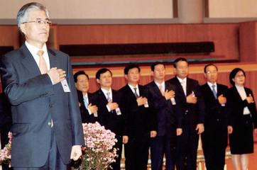

# 三进青瓦台

<b>三进青瓦台</b>

参与政府任期的最后一年，即2007年，总统再次召唤我，让我出任参与政府青瓦台最后一任秘书室室长——我“三进”青瓦台。我真心不想去。我很清楚，就算是总统卸任了之后，秘书室室长也要考虑很多事。老实说，我现在想要的是自由，想要回到我原来的生活中去。但是当时总统的政治处境很艰难，下届政权大换血是谁都能猜得到的。越是如此，收尾工作就越重要。每届政府到了收尾时期，人事安排都很不易，总统的选择余地也并不大。我心里想：干了又能怎么样？就跟着总统干到底吧！

我不能不如此悲壮。历届政府初期时神经总是绷得紧紧的，时刻不忘初心，紧抓风纪。接近后半期就不那么紧张了，氛围也有所缓和，结果就容易遭遇滑铁卢。我认为我们当前最重要的任务就是防止历史上这一幕重演，务必要把原则、初心，还有紧张的状态保持到最后一刻。

就职仪式上，我嘱咐了工作人员三件事：“第一，必须要坚信参与政府一定会成功，对参与政府感到自豪。第二，到总统任期的最后一天为止，不允许有一天虚度，不许有一日荒废。第三，把我们的道德操守坚持到底！”

接着，我又说：“经常有人把任期的后半段比喻为下山，我不这样看。参与政府，没有下山！我们的路线就是坚持不懈地往上走，一直走到任期最后一天，当我们最终停下脚步时，那才是我们要到达的顶峰！”实际上，我觉得工作人员也的确是以这样的心态奋斗到总统卸任的那一天的。

  历届政府初期时神经总是绷得紧紧的，时刻不忘初心，紧抓风纪。接近后半期就不那么紧张了，氛围也有所缓和，结果就容易遭遇滑铁卢。我认为我们当前最重要的任务就是防止历史上这一幕重演。 

总统秘书室室长这个职务与民政首席、市民社会首席有很大不同。我是法律专家，一辈子都在跟法律打交道，因此做民政首席感觉就是此前法律工作的延伸而已。市民社会首席也一样，我在市民社会领域活动了很久，与这个领域的人有很多的前缘，跟他们在一起自己也备感亲切。有了这个基础，我觉得与他们沟通、达成共识，这样的工作我还是力所能及的。

秘书室室长在政务活动中是非常重要的。当时青瓦台早早地废除了政务首席这个职位，把这方面的工作都交给了秘书室室长负责。这是我觉得最有负担的一份工作，也是我最缺乏自信的一个职位。

现在回过头来看，我觉得废除政务首席这个职位似乎有些不妥。我虽然意识到总统的目的是想严守“党青分离”原则，但是我认为，与政治圈的人，特别是执政党保持密切沟通还是非常有必要的，我们完全可以采取与过去不同的方式。而政务首席被取消后，一般性的政务工作就由秘书室室长负责，跟政策立法有关的国会、政党业务则交给了政策室长。我不觉得这种做法更高效。

在“党青分离”的状况下，我们与执政党的关系确实不如人意。总统刚一就职，就强调了“党青分离”原则。这个原则是总统在2002年竞选时提出的，是新政治、政治改革的精髓，旨在改变过去帝王性的总统兼总裁的局面，避免“政治缺失”与“政治隶属”问题的发生。这是政党民主主义的出发点。其实，总统当初将其列入竞选纲领并非出自总统的个人信念，而是国民的普遍要求。

总统从一开始就坚决贯彻“党青分离”，这既是他的政治哲学也是竞选纲领，因此，他觉得必须遵守。“党青分离”的核心就是总统要完全放开对党务工作者的任命权及公共推荐权。总统说自己只做一名普通党员，对党内职务的任命、公共推荐、党论决定、党的立法决定等，他遵守承诺一律不参与。但是，党与政府、青瓦台之间的政策协商、立法协商，则通过“党政青”以及“党青”会议进行，绝不偷懒。

青瓦台与党领导层、国会议员之间的对话也不再像过去那样一家独大，而是按照单位不同，分别见面沟通。即使这样，也有人提出不满，说：“根本就没有沟通，只是青瓦台单方面通知而已。”这是党内意见沟通结构的问题，青瓦台参谋们不擅长处理政务问题也是一大原因。

后来，总统对“党青分离”也或多或少表现出了悔意，他问：“这在我们的政治情况中是不是为时尚早啊？”不管是那个时候还是现在，我都是有些后悔的。开放国民党因弹劾而获利，成了多数党，一开始甚至还过了半数。但是不够高效，也不够强大，在改革立法、改革政策的确立上也没有做到稳扎稳打。我后悔的是，为了更大胆、更实质性地推动改革，我们没有与执政党进行更为密切的合作。

工作中，只要不是大家必须一起讨论、共同决定的事情，我都大胆地交给首席们去做。遇到重要的事件，我不光叫上首席，还把相关的秘书官们也叫到一起，听取大家的意见，然后讨论，最后得出结论。否则的话，事情就会积压，那是我所不能接受的。

即使是政府任期的最后一年，政治热点事件也非常多。2007年1月，总统在政治圈内提出了“一点（One Point）改宪”，他说：“请大家讨论一下修改宪法，让总统任期与国会议员任期保持一致……为此改总统任期为四年。”这个问题实在很遗憾。改宪是总统行为，在政界掀起轩然大波很正常。但事实上，这也不是什么天大的事，因为宪法赋予了总统改宪发起权，总统的改宪提案如果能够获得政治圈的同意也就罢了，如果政治圈不同意归根结底还是不行的。总统提出修改宪法，即使政治圈不同意，最后这个提案无疾而终，也不会对总统的权威造成特别大的伤害。更何况在此之前，舆论界就已经提出了有必要改宪的主张。

如果此时不提，再想提出修改宪法，让总统任期与国会议员任期一致非常不易，再加上这件事对卢总统来说没有任何获利可言，也不存在任何不利因素，可以说在这个时间点提出来是比较合适的。总统提出的“一点改宪”本身对国家也是有利的，这也是舆论界一直以来主张的内容。

对于改宪的必要性及名义，青瓦台内部很容易就达成了一致。但是那些口中一直说要改宪的人这时却好像没事人一样不理不睬，舆论界出于政治的目的骂声一片，大国家党就更不用说了，连执政党也没显示出什么诚意。

在大国家党看来，只要稳稳当当的，不出什么差错，下一届政府应该是自己的，所有只要是有变数的事情他们都绝对避免，即使是自己执政后对自己可能有利的事情，他们也尽可能避免。反过来，执政党则觉得自己没有必要费力气去做对大国家党有利的事情，他们的这种抵触情绪很强烈。所有人都有各自的政治目的，眼睁睁地看着有利于国家的大好机会从眼前溜走，真是令人扼腕。

当年4月，第18届国会举行会议，根据执政党、在野党一致要求推动改宪的协议，总统撤回了改宪提案。但是第18届国会并没有遵守这个协议，也没有哪家媒体指出这个问题——这真是个奇怪的政治圈、奇怪的舆论环境！

跟大选局面密切相关，更大的一场硬仗发生在记者室。我上任时，讨论已经全部结束，事情就等着进一步跟进了。宣传首席室与国政宣传处已经开始向总统详细汇报具体提案，这是我上任时才知道的。从宗旨和内容上看，这是一件好事。此前，各个部门的记者室都是以主流媒体为中心，封闭式运营，该提案要将其扩大整合为开放性、简报屋型记者室，旨在向更多的媒体与传媒人敞开门户，重新改写媒体采访的规则，这些我都能够理解。

但问题是时机不对。虽说都知道应该朝着这个方向改进，但当时参与政府的任期所剩无几。这件事本身不是简简单单就能解决的，随之产生的预算数目也不小。从各方面来讲，我觉得都不是很合适。我前后三次请求总统对这件事重新考虑，但总统的态度非常坚决。权力与舆论的粘连，过去的错误惯例，媒体的恣意妄为……对于这些，总统强烈希望能够打造一个系统，进行最基本的制约，哪怕只是最低限度的也行。我的劝说没有起效，因为这个领域不是我擅长的，我也不好再说什么。

后来，情况变得越来越糟，我也后悔自己当初没能多说几句。如果当时我的理解与认识能更为清晰的话，我就可以让所有与政务相关的首席室都参与到讨论中来，如果其他的首席也一起建议，也许总统能重新考虑。因为这件事，不仅总统本人，整个青瓦台都付出了十分沉重的代价，让参与政府在执政末期得不偿失。

我担任秘书室室长的最后一年，在青瓦台依然是不停地四方奔走。大大小小的热点问题层出不穷是一方面的原因，另一方面我们自己还是想把各项工作都坚持到底。内部环境与工作氛围同此前历届政府都有很大的不同。亲历过的人都一致表示，过去的青瓦台到了政府任期最后一年，完全是“大撒把”状态，甚至还有人说是“开着门不营业”。他们说这不是因为懒惰，而是在国民、政党、舆论界集中的批评之下，政府罹患“执政末期综合征”，就算是想做点事情也完全做不了。

我认为，参与政府之所以能够与前任政府不同，就是因为我们坚持了较高的道德要求，这可以说是我们力量的源泉。另一方面，总统本人在参与政府任期内，也坚定不移地把要做的各项改革课题进行到了最后一刻。

很多人说，一个政权在刚刚上台时应该趁着精力充沛把能做的改革全部干完，如果开始的几年没能做到，那么以后也就不可能做到了。这话很有道理。虽然如此，但国家的政策不是一蹴而就的。有些事情比较简单，刚开始做了，很快就能见效。有的事情要用整个任期去讨论，到了任期最后才可能出台法案。还有很多事情，讨论足够多了，效果却要到下一届政府才能够见到。有人认为，最初一两年内好好工作，后面的一两年只需把此前做过的事做个收尾就好，这种想法是不利于国家运转的。不管谁说什么，我们都按照我们的路线图、我们的原则，把我们应该做的事情默默地进行到底了。
 

