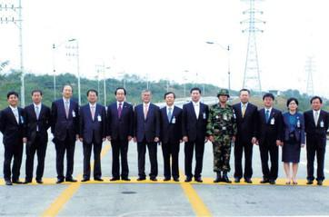

# 越过黄线

<b>越过黄线</b>

会谈决定下来之后，最重要的问题就是总统应该以何种方式去朝鲜。金大中总统在“六一五首脑会谈”时乘坐飞机前往朝鲜。他在机场与前来迎接的金正日委员长握手的场面，成为那次首脑会谈的标志性场景。我们想要选择一个能够促进韩朝关系良性发展的方法，最奢侈的想法就是修铁路。当时铁路已经通到了开城，货物可以通行，但是人员还不能够通行。如果总统能够坐火车前往朝鲜，那么韩朝才算是名副其实地将中断多年的铁路重新连接起来了。朝鲜方面也充分地表现出了谈判的诚意，他们强烈推荐铁路这一方式。但是他们说开城以北至平壤的线路不太通畅，短时间内难以修复。无奈之下，我们达成一致意见：将来北京奥运会时，韩朝共同助威团将通过铁路前往朝鲜。对此，我们感到很满意。

剩下的就是陆路交通了。如果总统从陆路越过军事分界线，在朝鲜居民的注视下，总统车队能够前往平壤，这也是非常具有历史意义的。但问题是，总统坐着专车越过军事分界线的场景过于波澜不惊。

即使有人建议加上一个场景——总统在越过军事分界线，离开之前对国民发表演说——也还是不能改变越过分界线时的平淡之感。我们为此很是苦恼，负责对朝接触的事务协议小组礼宾行政官吴城录提出了一个好主意——让总统步行通过军事分界线。

这个主意的绝妙之处就在于它完全颠覆了此前的思维方式。

很多人问道：“军事分界线这个地方到底是什么样？周围有没有铁丝网之类的？”吴城录说：“什么都没有，只是一条被封锁的道路，具体哪里是军事分界线也说不清楚。”于是人们又问：“那怎么样向大家展示总统步行通过军事分界线的场面呢？”他答道：“可不可以取得朝方的理解，临时在地上画一条线？”又有人继续追问：“朝方会理解吗？”他说：“虽然还没试过，但从谈判过程中朝鲜方面的态度来看，他们还是很配合的。”我心里想：就算谈不拢，可以委托国情院院长与朝方的统一战线部部长进行商讨，这么个问题应该可以解决。于是我们决定就用这个方案。

剩下的问题就落到总统身上了。总统平时非常讨厌各种表演性的活动以及虚情假意的仪式。韩朝首脑会谈时，因为对会谈成果没有把握，他表示从一开始就不要搞任何活动，甚至表示从青瓦台出发启程前往朝鲜时，对国民谈话之类的活动也不要搞。在会谈成果尚不明确的情况下，如果把前去会谈的样子弄得过于隆重，那会搞得会谈本身就是一大成果似的，他不想进行这种包装。包括我在内的很多人都说：“让首脑会谈能够持续下去非常重要，因此韩朝首脑见面本身就是一大成果。”但不管我们怎么说，总统还是不改初衷。

总统多次强调出发时不要搞任何活动，听到活动建议他还会斥责。所有人都担心总统不同意，事实上礼宾秘书官吴长浩曾提前向总统透露过这个想法，但是遭到了训斥。无奈之下，大家决定让我扛起这个重任。总统参加实际工作会议时，我报告说：“我们已经就此与朝方达成了协议。”总统万般无奈，这才接受了这个建议。所幸后来朝鲜方面也确实同意了临时画线以及步行通过军事分界线的方案，让我免予“虚假汇报”的罪名。

当天，总统夫妇步行越过黄线的一幕给人留下了深刻的印象。总统在黄线之前发表了内心的感想：“我现在以总统的身份跨过这条禁忌之线，我去了之后一定会有更多人去，将来这条禁忌之线一定会逐步消失！”之后，总统就在这条线之前向前来送行的我们挥手道别，越过黄线前往北方去了。我们站在南面，看到了北方人民手拿鲜花热烈欢迎总统夫妇的场面。总统一行人的身影消失后，有人提议：“我们也踩一次军事分界线吧！”我们小心翼翼地站在黄线上，合影留念，然后迅速离开。

  总统夫妇步行越过黄线的一幕给人留下了深刻的印象。总统在黄线之前发表了内心的感想：“我现在以总统的身份跨过这条禁忌之线，我去了之后一定会有更多人去，将来这条禁忌之线一定会逐步消失。” 

总统步行越过军事分界线的影响是十分巨大的。军事分界线用黄色油漆标示非常鲜明，电视上一直重复播放着当时的场景到总统访朝归来。从朝鲜方面传回其他最新进展之前，几乎只播放那一个场面。赴朝访问团一行也说，他们到了平壤百花园招待所，打开电视一看，全都是这个场景，大家感慨万千。不仅是韩国媒体，世界各大媒体的实时新闻也都连续播放着这个场面。总统跨过黄线的场面确实成了向全世界展现“一○·四首脑会谈”的代表性画面。

总统回来后，对这个场景也非常满意。后来表彰“一○·四首脑会谈”有功人员时，青瓦台方面的受表彰者就是最先提出这个主意的吴城录行政官。吴行政官从总统手中接过了“勤政表彰”，说：“这是整个家族的光荣。”我作为总统的参谋，能够参与到这具有历史意义的一幕中，又何尝不是我永远的骄傲呢！

卢总统去世一周年之际，50余位著名画家在首尔举办追悼画展，画展的名字就叫“越过黄线”。我参加了开幕式，讲话时我跟所有人分享了总统越过黄色军事分界线时的感动时刻，以及与之相关的秘史趣闻。

其实，我心里何尝不想跟总统去平壤，亲眼见证会谈的举行呢？但是我作为首脑会谈准备委员会委员长，必须得全程负责两位首脑要商讨的议题、共同声明、协议书的内容事项，做好各方面的准备工作。而且，在总统访朝期间，我得留守青瓦台，十分无奈。我必须做好万全的准备，以应对各种可能的突发状况。在紧张与激动交织的日子里，我时刻绷紧神经，关注着从朝鲜方面传来的任何消息。

我记得好像是在首脑会谈达成协议之前的几个小时，安保室室长白钟天传来了截至当时与朝鲜方面达成的实际工作协议草案。我读了之后觉得会谈成果斐然，就让秘书把草案的内容稍作了修改。

我对白室长嘱咐道：“回来的时候务必前往开城工业园，可以的话与金正日委员长一起，不行的话至少也要和金永南委员长一起，这一点必须执行！”几个小时后，最终协议出来了。我们在各个领域里想要推进的议题大部分在协议上都有所体现，我真想找个没人的地方高呼“万岁”，我真的是太感慨了，我们那些近乎奢侈的想法几乎都实现了，如果说有什么遗憾，那就是没能实现“首脑会谈的定期化”。

事实上，总统从一开始就觉得定期会谈不太可能。我预料以后的政府在处理韩朝关系上肯定比不上我们，所以我觉得只有把首脑会谈固定下来，才能防止韩朝关系出现倒退。我把自己的想法汇报给了总统，同时也仔细叮嘱白室长、金万福院长，但最终还是很遗憾。他们回来后，我问为什么没成，他们说我方提出来了，但朝方面露难色。朝方说，如果将首脑会谈长期固定下来，那么韩朝就应该交替出访对方，但金正日委员长还不适宜访韩。如果由金永南委员长代行出访，韩国方面一定会批评说这并非真正意义上的首脑会谈。总之，金正日委员长不喜欢有“下次该轮到自己访问首尔了”这种压力。我心想，那我们也可以跟他们商量：只要朝方愿意，永远都由我们赴朝会谈也可行啊！但一切都已经结束了。

因为在都罗山站举行首脑会谈的回国报告活动延长了，总统回到青瓦台的时间也被推迟。总统很晚才回到青瓦台，但他毫无疲惫之色，一直谈笑风生，人们纷纷表示祝贺，谈论着金正日委员长提议让总统再多住几天时，总统表现出的机敏，还说到了军事分界线“黄线的秘密”，还讲了很多故事桥段，现场其乐融融。

现在回过头来看，我觉得遗憾的是韩朝首脑会谈没能早点举行，其实并不是不可以。当六方会谈扫清了障碍，首脑会谈的时机刚刚成熟之时，爆发了美国财务部冻结BDA账户的事件，导致韩朝首脑会谈也惨遭搁置，之后一年的时间白白流逝。如果没有这个空白期，首脑会谈正常开始的话，韩朝关系一定会取得更大的进展。

更让人遗憾的是未曾得到国会的批准。当时首脑会谈虽然已经结束，但政府的任期所剩无几。在下届政府组建之前，我们应该把会谈的成果巩固下来。韩朝首脑间达成的协议从法律层面来说，属于国家间的协议。由于“一○·四共同声明”，国家让国民背负了沉重的财政负担。因此我强调，首脑会谈达成的协议最好提交国会，得到国会的批准。当时就连联合国大会也通过了支持决议，国际形势一片良好。如果我们向国会提交议案，想必大国家党也不敢再出于自己的政治目的提出反对，但时任国务总理的韩德洙始终没有这么做。他认为后续还会有一系列具体协议，财政负担的规模等最后确定下来再提交国会也为时不晚。结果，我们还是错过了时机。最终，随着政权的更迭，两位首脑辛苦达成的协议也付诸东流了。

说到首脑会谈的丰硕成果，政府组建以后，在对朝关系上费尽周折的几件事涌上了我的心头。事实上，五年里，朝核问题一直困扰着总统与我们。总统一直倡导用和平的、外交的手段解决朝核问题，我认为他的哲学、忍耐力与政治领导力应该得到相当高的评价。我甚至认为，当时他用他充满智慧的领导力拯救了国家。

他刚刚当选总统，朝核问题就演变成危机局面。美国停止对朝鲜提供重油，继而朝鲜退出《核不扩散条约》，重新启动核项目，还驱逐了核武器观察团。共和党布什政府的新保守主义分子们纷纷主张对朝强硬，甚至扬言要轰炸朝鲜。

总统在就任之前，当时的身份只是总统当选人，在外交上还没什么地位，就断然地发出了自己的声音：“朝核问题必须通过对话，用外交的手段解决。不许提对朝实施攻击，连攻击的可能性都不允许提，特别是没有韩国的同意，绝对不允许有任何动武行为。”他甚至还明确地反对美国的对朝封锁政策。

当时保守阵营与保守媒体纷纷表示忧虑，好像一旦与美国意见相左就会天塌下来一样，攻击卢当选人，但他丝毫不为所动。

因为卢总统的态度坚决，最终布什政府不得不抛弃“一边倒”的对朝强硬路线，最终走上了通过对话与外交手段解决问题的路径。在此过程中，我们也通过伊拉克派兵一事向美国表达了帮忙的诚意，提升了彼此的信任，定下了六方会谈的框架。通过六方会谈，我们达成了一个完整的无核化协议，朝鲜废弃所有核项目的同时，为实现东北亚永久和平，打造了朝鲜半岛和平体制的讨论框架。正是因为六方会谈有效地解决了朝核问题，在那个大环境下，韩朝首脑会谈才成为可能。

在这个漫长的过程中，我们坚持不懈地忍耐，与朝鲜构筑信赖基础，其成果就是首脑会谈的成功举行。韩朝之间的和平是通过信赖构建的，如果彼此不能够信任对方，想前进一步都无比艰难。准备首脑会谈的最后阶段，我感觉我们与朝方在彼此互信上取得了惊人的进展。即便没有韩朝首脑会谈，韩朝间的日常接触、交流也在参与政府期间取得了巨大的进步。
 

