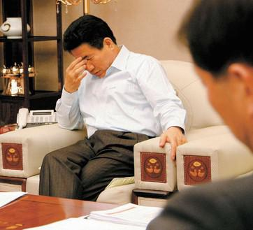

# 政治，政治

<b>政治，政治</b>

首脑会谈带来的激动并没有持续很久，国内政局很快正式进入大选角逐之中。这其中发生了很多站在青瓦台的角度上让总统难以启齿的事，这在任何政治圈都会遇到，我们束手无策，只能一忍再忍。

最令人心痛的是执政党议员提出所谓的“与总统划清界限”问题，这事其实要早于首脑会谈。虽说大家都身处政治圈，就算不提什么正义、原则，也要遵守最基本的政治信仰和做人的道理吧？可是我们感觉他们仿佛连这些都可以不要了。执政党看到总统和参与政府的支持率在降低，下届大选的前景比较暗淡，从领导层开始就纷纷表示与总统、参与政府对立。他们打算通过与参与政府、总统划清界限来巩固自身的位置。总统一方面感到愤怒，另一方面也深感惋惜。

卢总统参加大选是在2002年，当时金大中总统的支持率也很低，甚至比卢总统最后任期还要差。当时也有很多人以“整顿”的名义对金大中总统发起了攻击，与他划清界限，以此巩固自己的地位。卢总统对这种做法一直很反感，一次也没有攻击过金大中总统，更没有任何冒犯的言行。

这种划清界限的做法，国民由于一时没想通可能会鼓掌，但毕竟是一种短视的做法。国民终究还是看得长远的。这样做只会让人看到背叛，让人感到失望，无异于自毁长城。卢总统虽然不是东桥洞出身，但也绝不会落井下石。

但是，这次站出来的是与总统一道创建了开放国民党的几位核心人物，他们做得更过分。总统强烈地感到了人性的背叛，因此伤得更深。特别是总统寄以厚望的前任议长郑东泳的所作所为，实在是伤透了他的心。

  这次站出来的是与总统一道创建了开放国民党的几位核心人物，他们做得更过分。总统强烈地感到了人性的背叛，因此伤得更深。 

总统对郑东泳议长其实抱有特殊的感情与期待，他一直深深地记着他曾在大选角逐中陪着自己一直走到最后，对他心存感激，总想找个机会帮助他。无论是郑东泳任部长时，还是做党议长时，总统经常特别嘱咐青瓦台的参谋们：“如果能帮忙就尽最大的努力去帮他。”

当开放国民党面临分裂危机时，总统与郑东泳进行了一次重要的会晤。这是郑议长拜托我准备的，他那时的态度到今天我也难以理解。当时，郑议长方的议员已经先行退党了，他在这种情况下请求与总统会面，我觉得他应该带来避免分裂的方案，寻求总统的理解，请求总统出面协助。即使不是这样，我觉得二人也应该进行一场开诚布公的对话，内容应该是消除误会，增进双方对当时情况的相互理解。

可事情完全不是这样的。当总统问他是否要退党时，他一直反复回答说：“我觉得问题的根本不在于党籍。”这话明摆着就是他要退党了，看来，他要求会面就是为了通知总统他要退党。双方的谈话就此打住，见面很不愉快地结束了。当时我也在场陪同，在如此重要的时间点上，眼瞅着二人的见面一无所获，实在让人惋惜。一开始，二人闲聊时我偶尔还插几句嘴，活跃一下气氛，后来谈到退党话题，我就根本插不进话了。当时总统因为开放国民党的分裂危机伤心不已，面对苦心焦虑的总统，郑东泳只是跑来表示自己要退党，既然如此又何必要求见面呢？我实在无法理解。更令人气愤的是，结束后，我们本来约好这次属于秘密会谈，也不知是什么缘故，他竟然把见面的事告诉了媒体，还透露了部分谈话内容，说他曾建议卢总统对金大中前总统访朝提供支援，让二人的会面在结束之后还出现了不愉快。

那一天，总统也不是非得听他说“绝不退党，誓死守护开放国民党”这样的话，只要他像个创党元老那样，多少对党的分裂表现出忧虑之色，或者他能回答说“至少我不会带头分裂党！”“我不会率先退党！”之类的，二人的对话也可以继续进行。那天，我听了他的回答，以为他马上就会退党，可他实际上却是在之后两个月左右才退党的。我就更不明白了，他为什么那么急于跟总统撇清关系？这个本来能阻止我们阵营分裂的最后机会，就这么错过了。在当时的情况下，我觉得二人只有合作才能更好地为大选做准备。特别是对郑东泳候选人来说，他要想获得岭南地区的投票，就应该寻求与总统合作。从那以后，再也找不到那样的机会了，二人之间也不知从哪里出现了不和谐因素，误会一直到最后都无法消除，真是令人惋惜。

总统对开放国民党的分裂痛心疾首，甚至认为这是自己政治生涯的失败。他最痛心的不是大选失败，他觉得“力量不足，或者时运不济都可能导致失败，但是即使失败，我们也要坚信我们的价值观，这样下次才有希望。如果因为暂时出现不利局面就放弃我们的价值观，不但失败是肯定的，就连希望也丧失了”。这也是当时总统对进步、改革阵营分裂开放国民党这件事的看法。总统经常强调说：“从长远来看，即便是为了自己的利益，最好的道路就是成为一名不精于计算、抱朴守拙的政治家。”

他用自身的行动证明了这句话的正确，只要把眼光放长远，国民的眼睛是雪亮的，我真不明白为什么搞政治的人反而看不到这一点呢？

总统还经常强调说：“赢固然是好事，但是谁也不能只赢不输。大选可以输，如果失败了也应该有失败的样子，对下次心怀希望，这样的失败才是可取的。要想做到这一点，参加大选时就要坚守正义与原则。特别是不可以抛弃名誉，如果抛弃了正义、原则、名誉去参选，不仅很难获胜，失败后就连希望都没有了。”

开放国民党超越了过去民主党的地域局限，朝着全国性政党的道路前进，但是现在，所有成果都付诸东流，一切又回到了过去，这本身就是一种倒退。总统认为，如果真的是那样，就无法再给国民带来希望了。虽然他这么想，但开放国民党分裂时，他还是阻止了那些誓死捍卫党的人。虽然他坚信开放国民党的分裂不仅是一次错误的选择，而且也不会得到国民的支持，但他还是不希望我们整个进步、改革阵营发生分裂。
 

