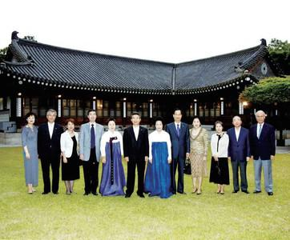
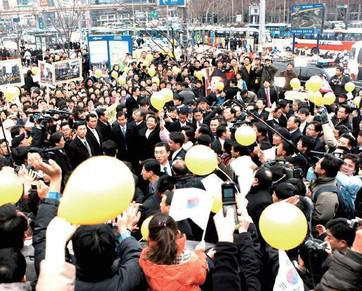

# 告别青瓦台

<b>告别青瓦台</b>

最后的几天是为了离别而到处奔走。曾经一起共事过的首席、秘书官、行政官、行政要员、职员们，我都跟他们一一合影留念。这些人都是我真心感谢的人。别人听说他们在青瓦台工作，以为有多么了不起，其实因为他们是在“卢武铉的青瓦台”工作，平时要格外小心、格外能忍、格外能挨骂，同时也格外地努力。对于他们，我所能做的就是与他们合影留念。如果他们以后看到照片能感到骄傲和自豪，那我就别无所求了。

2008年2月24日晚上，总统在青瓦台招待所有副部长级以上人员，共进最后的晚宴。结束后我回到了秘书室室长的官邸，当时妻子已经带着搬家行李先行去了梁山。回忆着过去的岁月，担心着今后的生活，我自己一个人黯然神伤地度过了参与政府的最后一夜。

2月25日，我陪总统去汝矣岛国会议事堂参加新一任总统的就职典礼。新总统在就职典礼上意气风发，但卸任总统却黯然退场，连个离职仪式都没有。当年我作为特使参加了厄瓜多尔总统的就职典礼，当时卸任总统的离职仪式在就职典礼前一天，前来祝贺的各国使节基本上也都参加了。卸任总统在演说中不厌其烦地列举了大量自己的政绩，即使这样，我也觉得专门搞的这个离职仪式很好。相比之下，我们国家的离职文化实在太无情了。

回到青瓦台总统府，我陪着总统及夫人从总统府前面的仁寿门走出来。这时，在这条从总统府入口处到青瓦台正门的路上，站着青瓦台所有的工作人员。他们为辛苦了这么多年的总统鼓掌，向他挥手致意，也有人用深深的低头礼作为道别，还有人流下了热泪。我们告别了这些工作人员，走向活动现场。

  2008年2月24日晚上，总统在青瓦台招待所有副部长级以上人员，共进最后的晚宴。结束后我回到了秘书室室长的官邸，当时妻子已经带着搬家行李先行去了梁山。回忆着过去的岁月，担心着今后的生活，我自己一个人黯然神伤地度过了参与政府的最后一夜。 

活动结束后我们来到了首尔站，总统与我们一起乘坐KTX（韩国高速列车）离开首尔。首尔站挤满了前来送行的人群。在人山人海之中，有一群人格外引人注目，他们怅然若失，痛哭着送别总统。他们是来自中国的、在韩国打工的朝鲜族同胞。好像是在2003年，他们因不公平的遭遇而奔走呼号，绝食抗议。总统不顾法务部等几个部门的多次反对，主动找到他们，鼓励他们。他们对此非常感激，特地过来为总统送行。

总统向前来送行的人群恭恭敬敬地道别，然后上了火车。很多人要陪总统去峰下村，也都上了火车。总统说没有那个必要，阻止大家上来，但前任及现任部长、副部长级的人，还有青瓦台的工作人员，很多人都上了火车。所有人都思绪万千，但依然在努力营造轻松的氛围。总统也想让他们放松心情，就在车厢里转悠，跟大家讲笑话、开玩笑。途经密阳火车站时，也有很多人前来送行。到了峰下村，那里更是已经挤满了一大群人。看到来了这么多人，总统的心情似乎也变好了。在欢迎活动上，他讲话结束前大喊了一句：“啊，心情真好！”我也在心里高呼：“啊，我也解放啦！”

我亲眼看着总统夫妇进了家门之后，才回到自己在梁山的家。当时已经是深夜了，家里乱得不成样子。我从青瓦台出来时太匆忙，对新家也没怎么在意，到了之后才发现房子内部的修理还没结束，连个放行李的地方都没有，睡觉的地方也让人很不满意。即使这样，我也喜欢。光是这种解放的感觉就足以让我忘记一切烦恼了。

  总统与我们一起乘坐KTX离开首尔。首尔站挤满了前来送行的人群。 
 

