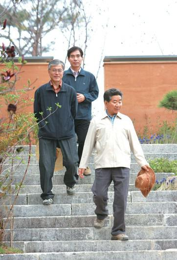
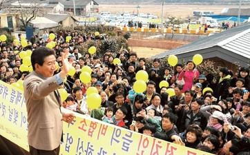

# 农夫卢武铉

<b>农夫卢武铉</b>

回到峰下村的总统也过着农夫的生活，我偶尔会去峰下村看望他。如果有人拜访总统，场合比较正式的话，我会去陪同，他有什么公开活动，我也去随行。这种时候有人陪同，总统也会比较有面子，因此只要峰下那边找我，我一定会过去。

我每次过去心情都很好。来峰下村的游客人数日渐增多，他们喜欢高声呼唤总统，让他从家里出来一起照相。总统一天要被喊出去好几次，跟游客们打招呼也是个辛苦活，但他还是很开心。

总统不仅喜欢跟游客打招呼，还喜欢跟他们聊家常。有时候聊到兴头上都忘记了时间。总统经常跟客人们聊上一个多小时，就像在大学讲课似的，花很长时间讲很高深的内容。如果他没有去世，我想他现在一定是一边干着农活，一边与普通市民无拘无束地聊天，给大学生、研究生们做讲座，过着朴素的生活。

当他谈起绿色农业、植树造林、花浦川复原等话题时，脸上是那样生机勃勃。他想从整体上对峰下村进行重新改造，把这里打造成富裕、宜居农村的成功典范。

卢武铉是一名普通的市民，也是前任总统，因此他构想了几件对国家有益的事情。首先，他创办了“民主主义2.0”网站，希望这能够成为一个具有高水平民主意识、能够讨论进步话题的空间，对社会有所贡献。结果失败了。上传的文章倒是不少，但没能形成高水准的讨论，讨论文化也没能上一个层次。文字一律都是批评李明博政府的，也不能包容不同意见的声音。这不是总统所期待的。他还上传了文章提出“即使批评也要有根有据，讲些水准”，但毫无用处，最终只能将网站关闭。

另外，总统还非常认真地搞花浦川复原运动与鸭子农耕法，这是他喜欢做的事。“卸任还乡”听起来很惬意，但实际上对总统与家人来说，生活上有很多不便。社会上出了什么问题，媒体就会蜂拥而至，总统想走出家门都很困难。尽管总统生活在各种各样的麻烦与不便之中，他土还是从绿色农业与花浦川复原这样的工作中找到了幸福感。最重要的是，国民非常喜欢这样一位卸任总统。

  

峰下村的幸福生活并没有持续很久，有些构想还没来得及开始，有些则不了了之。峰下村的游客日益增多，卢总统卸任以后人气不降反升，这在李明博政府眼里都被解读为带有政治色彩，成了后来各种不幸的前奏。但当时，我们丝毫没有察觉到。

  来峰下村的游客人数日渐增多，他们喜欢高声呼唤总统，让他从家里出来与他们一起照相。总统一天要被喊出去好几次，跟游客们打招呼也是个辛苦活，但他还是很开心。 
 

