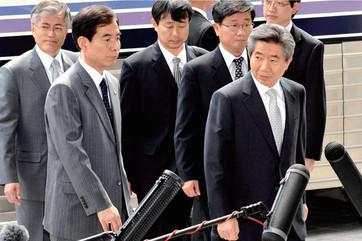

# 耻辱的一天

<b>耻辱的一天</b>

2009年4月30日早晨，总统到首尔大检察厅接受调查，这是耻辱的一天。很多人聚在一起，想阻止总统前来。夫人一言不发，强忍着泪水，总统面无表情。那些特地赶来给总统加油的人，还没等安慰总统，自己就已经哭成一团。反而是总统为了让他们安心，有一搭没一搭地说着各种笑话，努力活跃着气氛。

总统走出了自己的家。夫人一直以来都是强忍着泪水，但当她看到总统的背影时再也忍不住了，泪流不止。总统又重新走回来，轻轻拍了拍她。

总统乘坐的大巴上空就是坐着直升飞机拍摄的记者，后面还跟着很多记者的车辆。大巴内是异常沉重的安静，所有人都面色凝重，只有总统一路上始终面无表情。

终于到了检察厅。中央调查部部长李仁圭迎接总统，准备了一杯茶。他相当嚣张，虽然措辞还算恭敬，态度上却是满满的傲慢无礼与目中无人。中央调查部第一课长开始了调查。总统尽最大努力冷静地一一作答。总统的自制力真是惊人！看了检方的调查过程，我再一次确认检方并没有什么证据。除了朴渊次会长的陈述外，没有任何证据。总统与朴会长的陈述虽然有些出入，但他们根本没有证据证明朴会长的话是真实可靠的。甚至连通话记录都没有，没有通话记录就意味着不存在通话的事实。

  2009年4月30日早晨，卢武铉总统到首尔大检察厅接受调查，这是耻辱的一天。很多人聚在一起，想阻止总统前来。夫人一言不发，强忍着泪水，总统面无表情。那些特地赶来给总统加油的人，还没等安慰总统，自己就已经哭成一团。 

调查结束后，总统见到朴会长时表现出了更为惊人的控制力。首先，检方让朴会长与总统当面对质，但这一想法本身就是对前任总统极大的不尊重。如果总统否认的部分与朴会长的陈述有出入，那找出其他客观证据来判断出谁的话正确，才是检方应该做的事。提出当面对质是非常无理的。最终因为辩护律师的拒绝，对质没有进行。朴会长为了对质等了很久，我说跟他见面打个招呼吧，二人才有了这次相遇。总统温暖地和他打了招呼，在当时的场合下还安慰了他。

总统一直到去世，也没有埋怨过朴会长半句，更没有吐露什么不快的字眼。他能够理解，朴会长也坚持了很久，实在是被逼到穷途末路了才不得已为之。我认为总有一天朴会长获得了自由，就会将一切真相吐露出来。而总统之所以能理解朴会长窘迫的处境，还有一个原因，朴会长的女儿们也因涉嫌违反外汇管理法接受了调查。此外，据说检方还在调查泰光实业接受设施资金的融资等方面的问题。像这样一家老小，还有家族生意都攥在人家的手掌心里，谁都挺不过去。这件事我们也确有耳闻。

结束了检方的调查，我们坐大巴回程时也是一路沉寂。长时间的调查把人搞得太疲倦了，最重要的是大家的心情更加五味杂陈。当时的氛围也不适合再讲点轻松的话来逗总统开心了。

到那天为止的一系列过程，挺过来太不容易了，如果检方真的马上起诉，对于上法庭我还是有信心的。检方与媒体再怎么舆论审判或者政治审判，法律就是法律。调查记录的漏洞是不可能被掩盖的。事实带有无穷的力量，无理调查或者捏造事实始终是有局限性的。那件案子就是这样，我们一定能赢！在这个意义上，总统也相信“真相的力量”和“明明白白的事实所带有的力量”。

检方传唤总统接受调查已经是最后的一道程序了。正常来讲，紧接着马上就应该做出具体处理，不拘留起诉也好，无嫌疑处理也罢。但是他们没有这样，检方调查结束后，还是不做任何处理，一直把事情拖着。原因很简单，检方对于能否维持公诉做了一下判断，在那种情况下申请逮捕令当然很困难。一旦申请被驳回，检方此前所做的所有调查就都付诸东流了。就算是不拘留起诉，想维持公诉也很难。无奈之下，他们不做任何处理，只是一味地拖延。通过媒体继续进行羞辱与迫害，除此之外，他们也别无他法了。

护送总统到家之后已经是深夜了，我回到了自己的家，思绪万千，各种想法涌上心头。真是可怕的一天，因为每一秒都处于紧张状态，此时的我疲惫到了极点，但仍然睡不着觉。

总统是怎么一步步陷入今天这种困境的？我能够理解总统。他一直以来太穷了。贫穷让他拼命学习，贫穷让他走上了人权律师的道路。如果不曾贫穷，他可能就不会去关注那些像他一样辛苦的人们。他抱着一颗质朴的心要帮助穷人和那些被压迫的人们，于是走上了人权律师和民主化运动的道路。政治只是它们的延伸而已，正是对政治的真挚和热忱让他当上了总统。

但他依然没能摆脱贫穷。最开始做律师时勉强算是从贫穷中摆脱了出来，但自从他走上帮助其他穷人和蒙冤受难者的道路，就又再度陷入贫穷之中。即使峰下村地处偏僻，地价如此便宜，他也没钱盖房子，建筑费用还是找银行贷款的，也找朴渊次会长借了钱。总统曾对我说：“我自己虽然经受了政治锻炼，但我后悔的是没让家人也经受政治锻炼。”一切的一切还是因为总统根本没为自己卸任后的生活做好准备，才发生了这么多事。

总统去世后进行财产继承申请时才发现，他的负债竟比财产多了4亿韩元。
 

