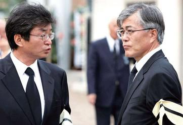

# 丧主文在寅

<b>丧主文在寅</b>

2009年5月23日，前总统卢武铉去世的消息给全体国民带来了巨大的冲击。参与政府的人士听到新闻后，陆续赶到了釜山大学医院。

人们不相信这个消息，一而再、再而三地向我发问。很多人怀疑，他真的是自己跳下去的吗？每次向人们解释的时候，我脑子里就会再一次浮现第一眼目睹的总统的惨状。考虑到夫人可能承受不了打击，医生对尸体做了一定程度的美化。在此之前，看见过惨状的只有警卫员、秘书文龙旭，还有我三个人。发表总统去世的消息，向人们解释事件的经过，这些对我来说都是极为残忍的。但这些事情只能由我来做，我真是痛恨自己这样的处境。

接到总统噩耗的同时，无数自责涌上了心头。总统去世前一周，我没有去峰下村。虽然也没什么特别的日程安排，但也没有非去不可的要紧事。当时总统已经接受了检方的调查，而检方也没做出什么决定。

最开始，我想着得做好准备，万一检方申请逮捕令怎么办？为此我经常去峰下。即使后来确认不可能申请逮捕令了，我觉得检方很可能马上就会提起不拘留起诉，也一直去峰下商量对策。可后来检方没有做任何决定，时间一长我觉得让总统对这件事别太在意，休息休息似乎更好。更何况总统见到我也觉得有些惭愧，我想还是尽量让他一个人休息比较好。

而且那段时间，无论是总统还是律师们，都坚信即使检方起诉结果也肯定是无罪的。任何人都想不到总统已经下定决心要把自己的一切全都抛弃掉。

后来我才听说，总统去世前最后一个周末是自己过的。他连写书都放弃了，《进步的未来》这本书是他始终不肯罢休的。19日上午，他还和与自己一起写书的尹太瀛、杨正哲两位秘书官说“辛苦你们了”，然后就把所有事情都放下了。见了几个人是他最后做的事情。21日傍晚，除了同村的朋友工会主席李载雨来待过一会儿，从19日下午到23日清晨，他谁也没见。前一天，他亲自到家中秘书官待的地方拿烟。就像做最后的告别似的，他出神地看了他们很久，但是什么也没说就离开了。然后就是23日清晨离开家，踏上了那条不归路。

他自己一个人承受着巨大的痛苦，度过了无比孤独的时光，一直到最后下定决心，包括我在内没有任何人在他的身边。当刚看到遗书的巨大冲击渐渐消退后，一个问题始终困扰着我——他从什么时候开始在头脑中酝酿这封遗书的？

这样的文章不可能是打开电脑后才开始思考的，总统一定是在所有人都不知道的情况下，在自己的心中酝酿许久了。

第一句“我欠了太多人的情”，是在下面的文字全部录入电脑后又打进去的。在生命的最后时刻，他还是把自己的遗书读了一遍又进行了修改，这很符合他的性格。总统最后到底酝酿了多久？这个想法至今还在折磨着我。

从什么时候开始的呢？他在主页上写下“大家应该抛弃我”这句话时，我都没能完全猜透他的心。他该有多么孤独啊！

连我都无法相信的事，别人怎么能够相信呢？无论是国民还是记者，没人能相信这是总统自己的决定。我让金秘书公开遗书全文，分发给记者。最早打印出来的那份，我给夫人过目后就放在了自己的怀里。直到现在我都把这份遗书放在我的记事本里带在身上。没有特别的理由，就是不能扔，仅此而已。

我和人们一起讨论应该把灵堂设在哪里。最后我们决定不在医院设置临时灵堂，马上回到峰下村，让峰下村那边立刻准备临时灵堂。当时正在峰下村的秘书官金正浩在村里人的帮助下急忙开始动手了。

妻子带着我的黑色西装、黑色领带，哭着赶到了医院。我现在成了办理总统丧事的丧主。

峰下村来消息说临时灵堂准备好了，天黑时分我们护送总统回到了那里。从早上出门散步到现在，不到12个小时他又回来了，但这一次，回来的是冰冷的尸体！

峰下村聚集了很多听闻噩耗赶过来的人们。我没有时间跟大家一起悲伤，因为我还要去村里开会准备葬礼的事。我主持了这个会议，大家一起讨论了很多具体工作，一直到清晨。

如此漫长的5月23日终于过去了。这是我生命中最漫长的一天。没有哪一天比那一天更让我后悔自己做了最后一任秘书室室长——从确认尸体到发布噩耗，再到主持治丧会议，我不能一个人独处，也不能哭……

  从确认尸体到发布噩耗，再到主持治丧会议，我不能一个人独处，也不能哭…… 
 

