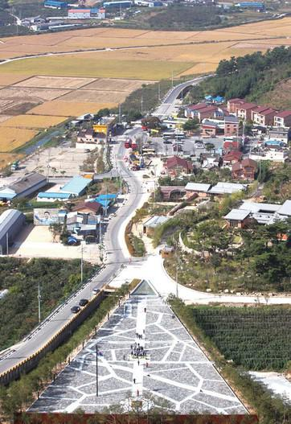

# 国民葬

<b>国民葬</b>

第二天的会上，前任总理李海瓒建议前任总理韩明淑担任治丧委员长。大家都表示了认可，韩明淑也同意了。我作为丧主，需要一直往返于治丧会议与灵堂两个地方。

越来越多的悼念人群让人肃然起敬。当天就不用说了，后来赶到峰下的人也是多得超乎想象。这么多人花上好几个小时赶过来，就为了一两分钟的吊唁。到了之后还要等上好几个小时。5月的骄阳和酷热，还有不期而至的暴雨，都没能把他们驱散。他们就像是在参观庄严神圣的宗教仪式。到底是什么力量在背后驱使着他们？

在讨论葬礼问题时，很多事情需要作出选择。在当时的条件下，夫人及家属不可能一起参会讨论，只能由我充当信使来回传递信息。

第一道难关就是选择“国民葬”[注：国民葬：为期7天，规格仅次于9天的国葬。2011年，李明博政府发布了将国葬和国民葬统一为国家葬礼的修正案。]还是家族葬的问题。总体上同意国民葬的人比较多，但是主张家族葬的人非常坚决，他们虽然人数少但寸步不让。包括丧主卢建昊在内的家属最开始也是主张家族葬的，我们反复劝了很久。

前总统金大中通过秘书室室长朴智元传达了自己的意见，他也认为国民葬比较好。首先，卢总统一生都在为国民的人权和民主主义事业奋斗；其次，是国民的支持才让他成为了总统；最后，他任职总统期间也是尽最大的努力为国民献身，应该让国民一起为他送行。金大中总统用他那特有的严谨，逻辑清晰地整理出了这三条理由。逐渐地，国民葬成了大势所趋，最后家属也接受了这个选择。

家属虽然同意了国民葬，但政府方面又对治丧委员会的构成提出了反对意见。最后的解决办法是，由政府和我们共同组成治丧委员会，由时任总理和前任总理韩明淑一起担任委员长。可是家属方面又表示不能接受，因为时任国务总理正是主持对卢总统进行调查的人。为此我们又劝说了很久。

接下来是关于遗体告别仪式在哪里举行的讨论。我最开始也是考虑到总统的精神和他的遗言——“给我在峰下立个小小的石碑吧”，觉得在总统故乡进永邑搞遗体告别仪式和路祭比较好。如果卢总统的去世不是那样的悲剧，我一定会把这个想法坚持到最后的。

可是，卢总统的死无异于政治谋杀。他的死凝聚着他所信奉的价值和他的精神所遭受的挫败。平凡的人们曾经从他的身上找到了政治理想，现在他们的理想也与他一起倒下了。

当然也有人会觉得这是前任总统为家属及周围人所犯下的错误而赎罪，或者把这看成是我们落后的政治文化所带来的必然结果。不管怎样看待他的去世，既然有这么多国民来参加葬礼，我们就有必要仔细思考一下他死亡的意义。国民创造了一个新词——“未守对”（未能守护您，真对不起），用来表达愧疚与悔恨交织的复杂心情，我觉得应该让所有国民一道，共同护送他走完最后一程。

这样看来，举行遗体告别仪式非常重要，但更重要的是选择一个合适的地点，能够让更多国民参加路祭，同时能够容纳灵车队伍。最终我们觉得在首尔广场举行路祭比较合适，就把遗体告别仪式的地点定在首尔了。这一点家属也比较容易接受。在首尔举行遗体告别仪式这个决定，也有助于他们接受国民葬。

家属们对于墓地选址问题也难以做出决断。照理来说，应该按照总统遗言选在峰下。但也有很多人反驳，表示这样对待前任国家元首是否有点过分。也有人主张，正因为总统是那样去世的，才更应该让他在国立显忠院[注：国立显忠院：是韩国安葬国家有功者的国立陵园，韩国前总统李承晚、朴正熙均安葬于此。]安息。也有很多人提出了更为现实性的担忧——以后墓地的管理也是个问题。最关键的是夫人一直拿不定主意。总统的遗言并不仅仅是他去世之前的一时冲动，而是从他决定退休回老家时就一直酝酿着的，这个想法由来已久，而且始终没变。

另一方面，总统这个人本来就不喜欢国立显忠院这种完全定型的特别待遇，夫人和我平时都是比较了解他的，于是最后我们决定遵照总统遗言的意思。

最困难的就是在峰下找具体的地点了。现在的场所并不符合我们的传统观念，家属也提议葬在自家后面左边的山脚。但这里很难打造成一个能让国民一起追悼总统、寄托哀思的空间。如果说山脚，其实现在墓地对面的山脚更合适，但是我们很难拿到那块地的土地所有权。

最后，我们把重点放在能让国民有追悼的空间上，选择了现在的位置。从最开始我们就考虑最好用石板的设计，能够让国民参与进来。夫人一直对一件事耿耿于怀，因为这里正对着悲剧的发生地——猫头鹰岩。我也是一样，但是没有更好的选择了。现在这个样子完成后，家属们也都很满意。

我站在烽火山狮子岩上往下看墓地，有一种感觉——这里好像就是命运为总统特意安排的安息之所。

墓地的形状是三角形，顺势而下的山麓就在水池，也就是三角形的顶点处，与人们生活的峰下村完美交汇。路对面有个莲花池，是总统回乡后到处寻访来莲花种子，亲自种下并打理的。现在这些莲花正好装饰了墓地的周围环境，一切像事先就被设计好了似的，命运的造化谁又能参透呢？

好不容易定下了大的思路，政府的小气又让我们犯了难。首先，政府反对在首尔广场举行路祭仪式，他们担心这会激化民众的感情进而引发大规模示威，因此一直到当天清晨都没定下来。我们只能这样去说服他们：“反正灵车队伍要经过首尔广场，如果政府不允许搞路祭，到时候肯定会有大量的人群挡住灵车队伍，进也不能进、退也不能退，很有可能会有人临时搞起路祭活动。我们也不希望到时候发生这种情况，那样的话政府会更为难。所以最好还是在我们的管理之下，让一切活动秩序井然地进行，按照我们计划的时间举行路祭。”听了这样的分析，政府也改变了最初的立场。

  墓地的形状是三角形，顺势而下的山麓就在水池，也就是三角形的顶点处，与人们生活的峰下村完美交汇。 

接下来挽幛[注：挽幛：为表达对逝者的悲痛之情，将所写的文章写在绸缎、纸上做成旗子一样的东西。在运送尸身去墓地的途中，挽幛被扛着跟在灵车之后。]又成了问题，因为悬挂挽幛的杆子很容易成为示威工具。总统去世造成了群情激愤，这个时候那东西在眼前晃来晃去容易让人产生联想。他们让我们把挽幛杆从木杆换成塑料管，而且扛着挽幛的人也必须经过身份确认，路祭一结束马上就把挽幛收回。我们说你们要是信不过我们，干脆派政府公务员来扛挽幛好了。我们话都说到了这个地步，他们也就接受了我们的立场。直到清晨，我们才勉强定下了所有问题。

执政者对每一件事都要斤斤计较，左右权衡。其实，我们比政府更希望遗体告别仪式能弄得既体现威严，又井然有序。我们特别小心谨慎，一点也不想把遗体告别仪式或者路祭弄成反政府游行示威，更不想用作其他政治目的。我觉得那样的话就违背了国民想要缅怀总统的善良初衷，总统也很难安心上路。我们请首尔的市民社会团体给予特别协助，他们也与我们的想法一致。我们都认识到，那天绝对不能有任何连累到总统的行动，至少那天不行！

估计政府方面对路祭时很多人聚到一起这件事本身就很反感，所以对在大汉门前设香堂一事的态度也是如此。既然政府已经同意了举行国民葬，虽说不可能强迫国民前往现场，但政府方面至少应该把追悼会的礼仪做到位，让国民们可以深情悼念前任总统，这才是正理，也只有这样才能称之为“国民葬”，不是吗？

但政府方面的态度似乎是万般阻挠，这着实让人感到遗憾。我们这边也不是没有阻挠心理。当时大国家党党代表朴熺太、前任党代表朴槿惠、国会议长金炯旿等执政党的人，以及韩昇洙总理等政府方面人士来到峰下村吊丧，就被人群挡在了路上。这样做其实很不应该，但激动的国民们当时连我们的话也不听。李明博总统也表达了要来峰下吊唁的意思，估计到时候场面可能不好看，被我们婉拒了。但我们特别小心地保护好了李明博总统送来的花圈，没有出现失礼的情况。

政府到最后也没同意由金大中总统在遗体告别仪式上致悼词。这本来是我的提议，所有人都很赞成。大家提出这个请求时还有点担心金大中总统的健康状况是否允许他出席，但金总统很痛快地答应了。

令人意外的是政府方面拒绝了。理由无比荒唐，说什么“史无前例”“与其他前任总统的情况不一致”。

试问，前任总统在继任总统的葬礼上连悼词都不允许说，这是什么道理？现任总统也是一样的。在前任总统的国民葬上，现任总统只是献花、上香而已。美国总统奥巴马参加参议员爱德华·肯尼迪的葬礼，还发表了悼词。而我们国家的现任总统都出席葬礼了，还不致悼词，弄得像司仪一样。虽然所属政党、党派不同，但前任总统的国民葬典礼上，由现任总统致悼词才正常，难道不是吗？其他应该与国民一道缅怀的葬礼也是如此没有道理。

金大中总统由于政府的拒绝，在遗体告别仪式前一天，拖着生病的身体，坐着轮椅亲自去了首尔站香堂，在这里发表了悼词。不仅如此，“Oh, My News”的禹相虎代表在出版《卢武铉，最后的访谈》时，金大中总统还将遗体告别仪式上未能发表的悼词作为推荐语送给了这本书。悼词开头是“卢武铉，就算你去世了也请不要死”，结尾处他说“只要我们保持清醒，卢武铉总统就算去世了，他也没有死”。这样的悼词是多么真切啊！我从内心深处无比感激金大中总统，虽然现在老人家也已经辞世了。
 

