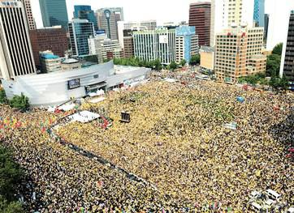
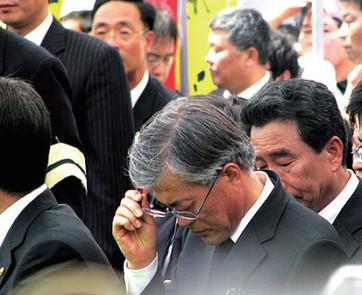

# 路祭：50万人的海洋

<b>路祭：50万人的海洋</b>

遗体告别仪式简直就是眼泪的汪洋。仔细想来，过去的几天里我都没有机会放声大哭，只是在峰下接受人们吊唁，见到哭泣的市民跟着流过泪而已，而且都是马上就得整理好情绪。

前任总理韩明淑悲痛欲绝的悼词又触发了我的眼泪，“总统！总统您现在在哪里？”听到这，我也泪流不止。

李明博总统敬献花圈时，发生了件小事。满腔怒火的白元宇议员突然起身，冲着总统高喊：“政治报复，谢罪！”我能理解他的心情，但是作为丧主，我得道歉。遗体告别仪式结束后，我以国民葬礼委员会运营委员长的身份向李明博总统道了歉，我低着头说：“是我们失礼了。我们对前来吊唁的客人礼数不周。”治丧委员长前任总理韩明淑也是同样的想法，跟着我一起道了歉。李总统回答道：“没关系，我能理解。你们不用放在心上。”后来检方还是对白元宇议员以妨碍葬礼罪提起了诉讼，最后又宣布无罪。

金大中总统献花后，来到了卢总统遗孀权良淑女士的身边，当时我就坐在后面，所以看得很真切。金大中总统可以说是这个国家最有威望的长者了，当时他已经控制不了伤心和悲痛，哭得整个脸都扭曲了。我还拜托老人家发表悼词，结果招致政府人员的反对，想起这个我就更加痛心。不仅是那一天，卢武铉总统去世后，金大中总统作为国家的长者和最高领导人所表现出的风度确实让人发自肺腑地钦佩。不久之后，金总统也撒手人寰，让我又经历了一次撕心裂肺的伤痛。他老人家本来身体状况就不好，再加上卢总统的事情，身心都遭受了巨大打击。他亲自前往首尔站香堂，接下来还参加了那么长时间的遗体告别仪式，这些都对他的身体造成了关键性的伤害。我一想起这些就愧疚不已。

  遗体告别仪式结束后，灵车队伍朝着首尔广场的方向前进，当时的场面真是人山人海。无数的市民从四面八方涌到了市中心，将这里挤得水泄不通。 

遗体告别仪式上，四大宗教团体负责人分别主持了宗教仪式。佛教是当时奉恩寺方丈明进大师，基督教是韩国基督教教会协会总务权五成牧师，天主教是宋基寅神父，圆佛教是首尔总教区长李善宗。我对他们几位都深表谢意，特别对不起的就是明进大师。当时大师正在奉恩寺进行千日闭关修行，距离一千天就剩下几天了，但他还是出了山门接受了我们的请求，这让我们不是一般地内疚。后来他还遭到了政治迫害，让我们更是深感不安。

遗体告别仪式结束后，灵车队伍朝着首尔广场的方向前进，当时的场面真是人山人海。无数的市民从四面八方涌到了市中心，将这里挤得水泄不通。我们当时跟在灵车后面，人们不断地鼓励我们“加油”。巨大的人潮和灵车一起朝着首尔广场徐徐移动，普通老百姓特别多，其中年轻女性相对较多，残疾人也有不少。我能感受到这些普通民众内心深处是多么地爱戴总统。很多人都恨不得亲手触碰一下灵车，这让我们的队伍行进得非常缓慢。

超过50万人一起参加了路祭。所有人都目不转睛地盯着舞台，一起唱歌，一起呐喊，一起哭泣。我哭得昏天黑地，根本不知道舞台上都发生了什么，只能感受到现场的氛围。

路祭时人们在天上看到了神秘的五彩云。我们都吃了一惊。这是我人生中第三次见到这样的神秘现象。

第一次是很久以前，具体时间记不太清了。当时数十万名天主教信徒聚集在汝矣岛广场召开信仰大会，好像是教皇若望·保禄二世访问韩国或者什么事情。母亲说要去参加，我就带着她去了，当时正对着广场的天空上十分鲜明地显现出了硕大的十字架。这件事在天主教内部也被奉为奇迹。

  所有人都目不转睛地盯着舞台，一起唱歌，一起呐喊，一起哭泣。 

第二次是2005年，曹溪宗总务院长法长大师的遗体告别仪式在曹溪寺举行。我以青瓦台代表的身份参加了。我做民政首席和市民社会首席时，是佛教与青瓦台联系的窗口，因此有缘拜会过大师几次。当年赐牌山隧道和千圣山隧道问题让参与政府很为难，大师曾经在中间做了很多工作。大师圆寂后，没有选择一般的佛教仪式——火化，而是参与了“分享生命运动”，将身体捐赠出来，令国民深受感动。他圆寂之前不是唱着《涅槃颂》，而是留下了一段名偈：“我有一个小行囊，没有口来没有底，装啊装啊装不满，倒啊倒啊倒不空。”这段话朗朗上口，深得人心。那天的仪式中途，人们明显地看到了平时难以见到的日晕——以太阳为中心，外围环绕着非常完美的圆环。所有人都觉得太神奇了，有人说只有汇聚了人们的精诚之气和虔诚之心，才会形成一股气，出现这种现象。

路祭结束后，当灵车再次启动时，市民一而再、再而三地抓住灵车不放，车到哪里人们就跟到哪里，路边被源源不绝的人潮挤得像铁桶一般。他们悲痛欲绝的样子看着都让人揪心，车也无法加速，过了首尔站才总算是与人潮作别了。临别之际，我作为代表对市民们说：“真是太感谢大家了！我们永远不会忘记的！”

水原火葬场。在无数国民的伤心与哀悼中，总统化成了一撮灰尘。我们让夫人与女儿静妍在外面等着，建昊与我将火葬后的遗骨收起来，仔细碾碎后放入骨灰盒中，完成了最后的程序。

直到第二天凌晨2点，我们才将总统的骨灰送到了峰下村净土院。本来按照习俗是不应该过12点的，我们原本也是这样计划的，但灵车在首尔市中心试图驶离追悼人群时花费了太多时间，我们也没办法。当我们把骨灰安置到净土院的仪式结束时，已经是凌晨3点钟了。国民葬就此结束。
 

