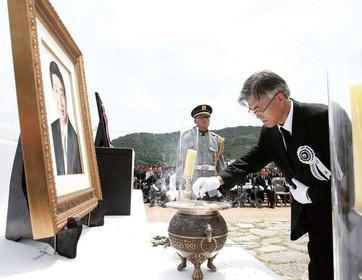

# 安葬在峰下村

<b>安葬在峰下村</b>

遗体告别仪式之后，到49祭和安葬仪式之前，我们每周都要举行祭奠活动。其间佛教界更是不辞辛苦地为我们提供了很多帮助，他们在总统去世后通过多种途径表达了心意。不仅是宗教团体，附近的通度寺、梵鱼寺、海印寺等大的寺庙都积极地帮助我们。师父们轮流来峰下举行仪式。49祭期间不仅是净土院，釜山庆南地区的所有寺庙也都同时举行49祭。

49祭是佛教与儒家思想相结合的一种仪式，也可以说是儒家的祖先崇拜思想与佛教的轮回思想折中的结果。

佛教在人死去后，每隔7天就要诵经祭祀，据说是为了祈求死去的人在这段时间内能够醒悟佛法，来生投胎到好地方。儒家则相信49日之内子孙应该为逝者的灵魂尽心祭祀，这样去世的父母或者祖先才能够凭借子孙的孝心，投到更好的地方转生为人，而且只有这样祖先的魂灵才能给子孙赐福。

管它意义如何，宗教仪式如何，有什么关系？总统的突然诀别让国民深陷悲痛，人们心里想的估计都一样——那就是总统现在终于可以放下所有的烦恼和时代的重负，希望他能就此安息，享受自由。除此之外，别无他求。我虽然是天主教信徒，但七次祭奠我都参加了，也对佛祖真心地行了礼，真心祈祷了。

从遗体告别仪式结束到举行安葬仪式，时间并不是很充裕，我们要在较短的时间内将墓地最基本的环境布置好。如果光靠我们的力量是完全不可能的，国内文化艺术界实力、名望、热情兼备的专家们组成了一个“梦之队”——小小石碑委员会，负责了这项任务。

这个名字取自总统的遗书，由前任文化遗产厅厅长俞弘濬所起。俞厅长说虽然压力很大，但觉得这是文化界应该做的，所以就毛遂自荐了。然后他又一一联系了各界专家组成这个委员会。

委员会汇集了俞弘濬教授、历史学者安秉旭、建筑学家郑奇镕和承孝相、美术家林玉尚和安奎哲、园林设计师郑荣善、诗人黄芝雨等，我也是委员。多亏了这几位，工作才得以圆满完成，将这个墓地装扮得如此美丽。

总统在遗书中提到“一块小小的石碑”，要想将这种精神具体表现出来可不容易。每个人的想法都各有千秋。如果完全按照总统留下的文字，那就是将骨灰散开，不建造墓地，然后在他家附近的地方立一个小小的悼念石碑。

但是更多人认为总统的遗言只是自己离世之际表现出的谦逊，虽然他这么说，但我们还是应该好好处理后事。也许再过上一段时间，完全遵照总统的遗言做可能会更有意义，但是眼前有五六百万的悼念群众，他们的心情该如何表达呢？“小小的石碑”必须成为让国民表达缅怀之情的地方。因此我们决定把骨灰安葬后建造墓地，但不用圆坟，而是像支石墓一样，放上一块磐石。也不再另立石碑，直接在磐石上刻上碑名，让这块磐石起到石碑的作用。

这是俞弘濬教授的主意。诗人黄芝雨说：“最好能在地面的石板上刻上国民的缅怀文字，没有比这更好的碑文了。”因此我们决定不在磐石上刻碑文，而是直接刻上“总统卢武铉”。

2009年7月10日，总统的安葬仪式在峰下村举行，当时有数万名前来吊唁的人共同见证了骨灰入土的场景。前一天峰下村还一直在下暴雨，当天清晨雨却突然停了，就好像从来没下过雨一样。我们将此前放置于净土院的总统骨灰放在白瓷器和莲花石函中下葬了。

石函内有两件随葬品，一件是总统去世后拍摄的悼念人群的影像，另一件是《参与政府五年记录》，这是分为五部分的纪录片DVD。悼念影像里承载了国民对总统的缅怀和离别的眼泪。我们这是为了告诉总统：国民没有抛弃您！

  石函内有两件随葬品，一件是总统去世后拍摄的悼念人群的影像，另一件是《参与政府五年记录》，这是分为五部分的纪录片DVD。 

纪录片记录的是总统鞠躬尽瘁的五年。他当年离开青瓦台时，人们指责他是“失败的总统，失败的政府”。进步阵营也批评他是导致进步事业失败的罪魁。但是我们相信，历史会给予我们公正的评价。那五年的记录可以成为日后评价的基础。总统独自背负着所有的一切，离开了我们。他拒绝人间的审判，选择了历史的法庭。为了历史法庭能够做出公正的宣判，这五年的记录很重要。这是总统平时经常强调的。为此，我们特意把这个作为随葬品安放到他身边。

最后的告别仪式并不长，把磐石放到骨灰安葬地的上方，总统的葬礼就此结束了。那个时候墓地还没有布置完毕，看起来很荒凉、简陋。这让我很难受。剩下的事就是继续修缮墓地，装点墓地周边的环境了。
 

