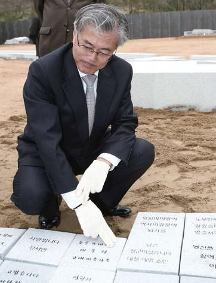

# 缅怀石板，国民的心

<b>缅怀石板，国民的心</b>

从安葬仪式结束到一周年之间，大概有10个月的时间里，我们都在全力以赴地布置墓地周边环境。有18000名市民将自己缅怀总统的文字刻在石板上，铺在了墓地周围。设计概念是建筑学家承孝相的构想，石板的摆放则出自美术家林玉尚的设计。

石板的征集活动刚一开始，立刻就收到了人们的回应，所以征集活动很快就结束了。后来很多人因未能申请到而提出不满，我们又更换了设计，增加了石板的数量。市民们发自肺腑的缅怀文字，每一句读起来都让人动容。就像黄芝雨诗人所说的，哪一个诗人能想出比这更好的碑文呢？现在还能看到有市民和家人一起来到墓地，将自己缅怀的话语刻在石板上，同时也欣赏别人留下的石板。我觉得这个国民参与型墓地的设计别具一格。

我与妻子也申请了一片石板，字只有一行——“请安息吧”。我想说的话就这一句。我觉得对于总统去世的惋惜和悲痛，别人已经表达得够充分了，我没有必要再做补充。我的遗憾就是，他从当上总统那一刻一直到生命的最后时分，过得实在太辛苦了。那时也好，现在也罢，我的心愿只有一个——盼他能够好好休息。

安葬仪式结束后，看着墓地周围什么都没有，只有一马平川的土地、那块磐石，还有孤零零的曲墙[注：曲墙：陵园、墓地里在坟后边堆砌的矮墙。]，我看着心里无限惆怅。太简陋了，我太惭愧了！到了一周年时，墓地周围有点模样了，我心中才算好过点。最后看到石板摆放整齐，像个真正的陵园了，我这才算是安下心来。

但即使这样，我还是感觉不踏实，觉得那里是那么冰冷、贫瘠，可能是周边的环境布置得还不够充分吧。将来再多植些树，等到树木郁郁葱葱成林了，可能就会有那种安静、祥和的感觉了吧。这就是我们接下来的课题了。

  我与妻子也申请了一片石板，字只有一行——“请安息吧”。我想说的话就这一句。 
 

