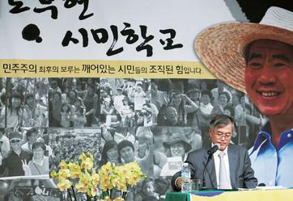

# “峰下财团”监事

<b>“峰下财团”监事</b>

葬礼全部结束后，为了今后能够持续进行追悼卢总统的活动，我们在峰下设立了“峰下财团”，在全国设立了“卢武铉财团”。我担任了“峰下财团”的监事，“卢武铉财团”的常任理事。我觉得这是在一切尘埃落定之前我所应该承担的责任。

我一周要抽出两天的时间用于这边，有些对不住综合律师事务所办公室的同事，但是大家都能理解。我住在釜山，每周都要去一次首尔，虽然时间有些紧张，但是看到悼念活动一件件都做得很好，结出了成果，我自己也觉得很有意义。

一周年纪念活动结束后，几位继承了总统遗志的朋友们在地方选举中结出了丰硕的成果。其中，金斗官、安熙正、李光载三位的飞跃性发展让人不由得感慨万千。安熙正的名誉也得以恢复了，即使抛开公理正义，从个人角度来讲我也无比高兴。我想天堂里的卢总统也一定很欣慰。

现在很多人都在谈论卢武铉的精神与他的价值。我非常感谢。但是不管人们对他的去世赋予了多么崇高、多么神圣的意义，这都比不上他活在我们身边啊！

在一周年纪念活动上，演员明桂南一边哭着一边埋怨：“您要是活着该多好啊！”是啊，我也是这么想。当时总统所不能承受的不是他个人的失败，而是整个进步、改革阵营都因他而受到牵累。自己让周围太多的人承受苦痛，这让总统心痛不已。

但如果把眼光再放长远些，真相最终还是会大白于天下的，这也应该通过法律去阐明。我真觉得他应该忍一忍，再忍一忍，留在我们身边，能做的事还有那么多……

我偶尔会梦见他。一次是讨论布置墓地时，意见多得让我不知如何是好。梦中有一个仓库存放着布置墓地所使用的材料，总统和我一起去了仓库，看了准备情况很高兴。虽然只是个梦，但我也自我安慰道：“看来我们的布置方式，总统也觉得还不错嘛。”想到这我才稍微安心了些。

梦里，我还回到了青瓦台。当时在处理人事审核，做着做着突发了什么问题，我陪着总统去了什么地方调查。大法院对江原道道知事李光载做出裁决的前一天晚上我也做梦了，是个非常愉快的梦，总统和我们在一起，好像有人把一句汉语翻译成韩语，翻译得一塌糊涂，总统看了之后开了一个他特有的玩笑，让在座的人哄堂大笑，所有人都很开心。梦里的情景太开心了，以至于我醒来后还在久久回味着那种愉悦。今天有什么好事吗？我一想是大法院宣判李知事的日子。我们都期待着好消息，但结果却适得其反。虽然那只是一个梦，可我多么希望能够再见上他一面啊！

要是喝点酒我偶尔会想起过去。我问自己，在我的人生中，卢武铉是什么？我不清楚。反正他对我的生活改变很大。如果没有遇见他，我的生活肯定跟现在大不相同。从这一点上来看，一切都是命运。但如果要问，一定是好事吗？我觉得不好回答。因为疲惫、痛苦真的是太多了。

但又能如何呢？从与他相遇，到一路同行，再到最后的离别，这都不是我的计划，也不是我所能躲避的。现在也是一样。如果说他留下了未完的课题，谁又能从那个时代赋予的责任中解脱出来呢？

我更是这样，我必须得主动积极地把这些课题揽过来，走完我的余生。我做了财团理事长，奔波于各种卢武铉财团的纪念活动，也是出于同样的原因。这件事似乎不是到我们这一代就能结束的。即使那样，我也想要努力打好基础让其健康发展下去。而且我觉得回首参与政府的五年，对它做出评价、反省，是我们无法回避的责任。

  在我的人生中，卢武铉是什么？我不清楚。反正他对我的生活改变很大。如果没有遇见他，我的生活肯定跟现在大不相同。从这一点上来看，一切都是命运。 
 

