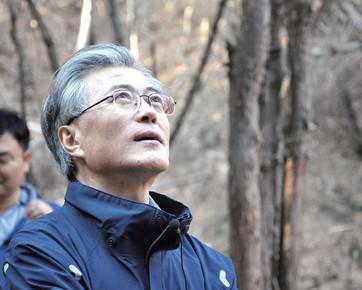

# 回首来时路

<b>回首来时路</b>

卢武铉总统的去世与李明博政权的严重倒退成了国民新的话题。很多人为国家的未来担忧，我也感受到了严重的危机，为此深表忧虑。对于未来该怎么走，人们纷纷提出了各种真知灼见，我觉得这很有必要，但仍然存在着一些遗憾。

卢武铉总统在任期内算是做到了鞠躬尽瘁。人们可以说他能力不足，或者想法不周全，但他一直都是非常努力，绝无半点私心杂念的。

我个人也是一样的。想当初我对国家政务完全没有经验，连民政首席室是个什么地方都不知道。正是因为我此前工作努力，毫无私心，才能够担负起交给我的这份重任。投身于参与政府的其他人士也大抵如此。

但是，卢总统与我们离开青瓦台时，听到的是批评——一个失败的总统，一届失败的政府。进步阵营也批评我们是破坏整个阵营的罪魁祸首。一段时间内，无数的悔恨甚至让我思虑：我们付出的所有努力到底是为了什么？一切都太荒谬了！

问题出在了哪里？我们的不足又在哪里？我们需要冷静地反省，用围棋复盘的方式去思考，从中找到经验教训。不是随波逐流，也不是耿耿于怀，而是用一颗冷静的心去分析成功与挫败的教训。如果不这样，那么包括参与政府五年在内的民主政府十年[注：民主政府十年：指金大中政府和卢武铉政府合在一起的十年。]，就都会沦落成“失去的十年”。决不能这样！

因此我强调对参与政府的五年进行“复盘”。既然要“复盘”，那我觉得就不仅仅是曾经执掌政权的我们，还应该有“泛在野圈”、市民社会团体阵营、劳动运动阵营，乃至整个进步、改革阵营一起。只有这样，才能让卢武铉的成与败、参与政府的成与败得到升华。遗憾的是，我们的社会似乎把这个过程给省略了。

  不是随波逐流，也不是耿耿于怀，而是用一颗冷静的心去分析成功与挫败的教训。如果不这样，那么包括参与政府五年在内的民主政府十年，就都会沦落成“失去的十年”。决不能这样！ 

参与政府最后的一段时间，有一种倾向就是不管什么都归结为“参与政府的错”，都是“卢武铉的错”，根本不能做出正确的反省。卢总统去世后，氛围出现了反转，一切都变好了，现在大家好像又觉得没必要反省了。

现在我们说的是今后的希望——执政的方法论问题。但是我很担心，谈到执政之前，进步、改革阵营到底发生了多少变化？想到这我就有些害怕。与2003年参与政府执政的时候相比，现在我们进步、改革阵营的力量与执政能力到底提高了多少？统合整个阵营力量的领导智慧又增加了多少呢？

我觉得就连2002年卢总统的当选，都不是我们阵营集体实力或能力的结果。所有人的努力都很有意义，但国民给予卢总统个人的希望和支持才是参与政府得以成立的原因。就像上天有意为之似的，过程是戏剧性的，偶然性因素也起了很大的作用。如果认为卢总统的当选依赖的是进步、改革阵营的力量，我觉得只能说正确了一半。

如果提到对总统大选的希望，我们应该先审视一下自己现在的情况。参与政府五年，再往远了说民主政府这十年里，我们应该从成功与挫败中找到我们的力量与局限，然后重新出发。

当然了，作为曾经执掌过政权的人，我们应该站在审视与反省的第一线。“我们尽了最大的努力吗？”我们需要对此进行透彻的审视与深刻的反省。假如国民再次把政权委任给我们，我们应该对整个国家政务的管理和运营制定出完备的计划。我们不仅要看道德水准，还要汇聚能力卓越的人才。如果你问我参与政府时期青瓦台做到这一点了吗？我会谦虚地回首过去，那时候包括我在内谁都没有经验，所有人虽然都精神可嘉，可能力上我们真的是最好的辅助阵容吗？恐怕我们有愧于总统了。我们能力的不足，对业务的生疏，理想与现实的差距……都不是一星半点，这是我们不能否认也无法回避的。

那么，进步、改革阵营所设想的那个层次的“改革”“福利国家”，光靠政权的力量就能够实现吗？我想在我们今天的社会政治环境中这绝非易事。我觉得参与政府所证明的与所留下的教训也就在这里。

在我们社会的底层，汹涌奔流着的依然是保守势力的大潮，主导舆论的也是无比坚固的保守势力，卢总统与参与政府在其中就像一座“孤岛”，改革到处都遭到保守势力与既得利益阶层的抵抗与阻挠。

“小政府就是善，大政府就是恶”，在这种保守理念根深蒂固的社会氛围中，即使想推行福利政策，也始终有着无法逾越的壁垒。进步、改革阵营的力量即使都能汇聚在一起，也依然是社会的少数派，更何况阵营内部还四分五裂的。

参与政府遭受了来自左右两派的攻击。要是挨了保守阵营的骂，进步阵营应该给予鼓励才是，可是进步阵营也恶语相加，对我们避之唯恐不及。当年的“抵抗”与“壁垒”现在消失了吗，还是大大缩小了？因为李明博政府本来就做得不够好，得不到人民的支持，可能有些人产生了那样的错觉，觉得风平浪静了。但是一旦掌了权，“抵抗”肯定又会重新凸显，“壁垒”也会陡然增高。我想要强调的是，如果不能汇聚进步、改革阵营全体之力，不管哪个民主改革政府执政，都只能是重蹈覆辙而已。

比如参与政府时期失败了的《国家保安法》废除问题。总统、执政党、市民社会上下一心，要将其废除，但最终还是失败了。当年总统面对保守阵营的各种非难，还曾坚决表示“要把国保法送进博物馆”。开放国民党将“国保法废除问题”放在四大立法改革之首，市民社会也组成了“国保法废除国民协会”，不仅签了名，还搞占领示威，倾注了各种努力。再加上当时开放国民党还在议会中超过半数，后来虽然失去了几个议席，与民主劳动党联合的话还是过半数的，即使这样也没能将其废除，问题究竟出在了哪里？

我认为是立法改革的重要时期“国会构成”协议存在问题，即不应该把国会司法委员长这个职位交给在野党。最关键的原因是我们出于“良心”的驱动，没有进行职权提交，最终也就未能推动立法改革。在那种情况下，如果说完全废除“国保法”有困难，至少应该强烈要求通过滥用条例的修改方案吧？可我们进步阵营所讲究的“根本主义”又不能允许这种妥协。

从更根本的层次上来看，即使汇聚了所有进步、改革阵营的力量也不足以废除《国家保安法》，这就是我们的客观现实。开放国民党虽然是多数党，但党内部反对废除《国家保安法》的人，或者对此持消极态度的议员不在少数。我觉得我们得先接受了这个客观现实再出发。

阵营内部都不能做到团结一心，政府方面再怎么努力，仅仅依靠政府力量进行的改革势必有局限。

目前，检察改革已经成为了时代性的课题。检察系统权力过大，过分政治化，不受任何限制，已经到了无所不为的地步，这是一个极为严重的问题。

现在好像大家都统一了认识，根本的改革方案就是像其他国家那样，将一般性案件的调查权交给警察。这其实是参与政府曾经推动但最终失败了的。问题是参与政府的推动方法是最佳方案吗？

从我个人的角度上，我非常后悔没能把“检警调查权调整”[注：检警调查权调整：将检方独自拥有的检察开始权让渡于警察，通过废除检方的警察调查指挥权，废除警察对检方的服从义务等，使过度集中于检方的权力得以分化。]问题纳入司法改革的框架之下，一起推动二者的改革。但当年参与政府推动这件事时，“民辩”和“参与协会”等市民社会团体并未表示过关注，可能是因为所有人都对警察抱有深深的不信任感。在市民社会的一片冷漠之中，政府独自努力最终还是归于失败了。

高级公职腐败搜查处问题也是一样，这个方案本来可以成为对检方的牵制力量，但是在国会碰了壁，没能立法。市民社会团体阵营里也只有一部分市民团体赞成，大部分都是无所谓的态度，对立法没有给予任何支援。

参与政府最大程度上保障了检察系统在政治上的中立性与独立性。虽然当时检方内部还没能下定决心，但总统和参与政府靠着坚强的意志与自我节制做到了。当然这也是市民社会要求的一项改革议题。但是进入李明博政府之后，瞬间又回到了参与政府之前的老样子。

可以说参与政府苦心营造了检察系统的政治中立性与独立性，但我们的社会未能守护住这个成果。即使这样，进步、改革阵营里依然有人说参与政府的检察改革失败了。参与政府时期，确实应该将检察改革进行得更深入、更彻底，没能做成也确实是事实。但是用一句话就把这些都归结于参与政府的责任，这样的评价恐怕有失偏颇。

进步阵营第一次背叛参与政府就是在伊拉克派兵一事上。我觉得市民社会反对伊拉克派兵是正常的，但是作为政府，如果想要用和平的、外交的途径解决朝核危机，就不得不接受现实——派出最低限量的兵。

而且从实际情况来看，派兵的决定对使用外交途径——六方会谈解决朝核问题起了很大的作用。如果六方会谈的九一九声明能够得到切实执行，“朝鲜完全弃核”“朝鲜无核化”“朝美关系和朝日关系正常化”，乃至缔结韩朝和平协定，对韩朝和平造成威胁的所有问题都有可能一举清除掉。这样我们所获得的国家利益，比因为伊拉克派兵所失去的东西，要大得多得多。

即使是这样，我也能够理解，市民社会本来就是固守一种单纯的理念，对政府的派兵决定可以反对到底，对决定派兵的政府表示失望也很正常。但就因为这件事，就可以从反对与失望直接上升到背叛参与政府吗？

更何况我们已经考虑到了市民社会的反对，大幅减小了派兵规模，而且去的都是非战斗部队，从事的也是支援性质的和平重建工作，也就是说派去的部队都在安全地带。

我认为进步阵营如果不想永远只做少数派，就应该对国家、对国家经营，进而对外交、安保问题表现出更有担当的姿态。

进步阵营背叛参与政府的另一个理由是，指责参与政府崇奉新自由主义。我不想否认参与政府的确是处于全世界新自由主义潮流之中。但说卢总统与参与政府也奉行新自由主义，我却是不能苟同的。

如果说我们没能逆新自由主义的潮流与之对抗，也许还有点道理，但是作为新自由主义的重要标志——市场绝对主义、小政府、减税、民营化、劳动力灵活性等，这绝不是参与政府所追求的路线。

参与政府一直固守“出资总额限制”与“金融资本、产业资本分离”等市场制度。反对小政府，对富人阶层实施重税、加税，从国民政府时期开始就一直进行的民营化也全部终止。劳动力灵活化在参与政府时期自然也是进行不下去的，不仅如此，我们还利用《非正规职位保护法》等法律法规将其叫停。

从进步阵营的主张来看，似乎韩美FTA也是新自由主义的产物，就像连否认新自由主义的左派政府也搞开放一样，我觉得这个主张有失偏颇。如果说FTA就是新自由主义，那么中国、印度的FTA，欧洲福利国家的FTA又该作何解释呢？

进步阵营给参与政府贴上新自由主义的标签，这跟反对派给参与政府贴上“亲朝左派”的标签，其根本属性是完全一致的。

我觉得参与政府本应该做得更好，但是没能做得更好的领域是教育。当然这其中参与政府的责任很大，而且是排在第一位的。

我们想通过教育革新委员会推动教育改革，但是革新委未能从国民那里激发推动改革的动力。革新委在一轮又一轮的讨论之后，没能做到让教育部接受他们所准备的改革方案。青瓦台也没有专门设置主管教育的首席秘书官，因此领导教育改革的力量有些薄弱。

更为决定性的原因是，全教组本来应该成为政府教育改革的伙伴，但是双方围绕教育行政信息系统（NEIS）产生了一些矛盾，从最开始就步调不一致。导致在最初的一年多——这本应是改革进行得最热火朝天的时间，所有人都陷入了对NEIS问题的争论，结果浪费了大好时光，就连主张改革的部长最后也下了台。

NEIS有可能会侵犯学生的个人隐私权，这的确是个重要问题，但当时比这更重要、更根本性的改革议题堆积成山，更何况NEIS试运行之后如果出现问题，再进行完善也不是不可以的。

我每次遇到全教组的老师们，都会抓住这个话题说：“更重要的改革议题有多少啊！你们就抓着一个NEIS不放，将来部长也累了，其他改革都没法进行！你们这么逼教育部长，将来想再找有改革意向的部长就难了，以后肯定只能选择求安稳的人了。教育改革到头来就是一场空！”所有人都同意我说的话。也有很多老师对全教组执行部门的刚愎自用表示担忧，但是也不过如此，等他们回到了自己的组织里，还是不能摆脱组织的那套逻辑。

我并不想批评当时的执行部门，他们对参与政府的教育改革抱有殷切的期待，而且付出了辛苦的努力。事实上，2002年大选时，全教组的老师们对卢候选人的当选做出了很大贡献，他们也有资格对参与政府的教育改革抱有比较高的期待。我想说的是，为了自己所期盼的改革，他们没能选择更具有策略性的方法，对于这一点我很遗憾。

劳动领域也留下了很多遗憾。参与政府刚一成立，劳动界大面积的罢工停业就接连不断，什么铁路罢工、货运协会罢工、朝兴银行罢工，等等。其中，铁路罢工与货运协会罢工第一次举行时，政府正处于舆论批评的风口浪尖上，但还是在相当大的程度上同意了他们提出的条件。但不久以后他们又掀起了第二次罢工，结果导致第一次罢工的成果也全都付诸东流了。

而且政府不顾企业与经济界的反对，推行每周40小时工作制（每周5天工作制）和公务员劳动组织合法化的时候，劳动界明明是受惠的一方，却还高喊着“政府下台”，反对得更为激烈，理由就是对政府的议案不满。

正是因为参与政府对劳动组织抱有更大的善意，他们就把目标定得更高，逼得更紧，想要得到的成果也更多，我理解他们的这份贪心。但是，劳动界的心急气躁事实上却削弱了参与政府的决心。劳动界的无理要求反而阻碍了改革的步伐。

参与政府在劳动领域的改革都出自劳资政委员会[注：劳资政委员会：1998年韩国金融危机时，劳动者、资产所有者、政府为了讨论劳动政策及相关事项而组成的社会协商机构。现在名称为“经济社会发展劳资委员会”。]的讨论。但是民主劳总[注：民主劳总：全国民主劳动组合总联盟的简称。]并没有参加劳资政委员会，我想他们应该有自己的理由和原因。可也就是因为这样，很多本可以完成的改革都没有做成。

在两极化与非正规职位的问题上，参与政府的反应有许多令人遗憾的地方。虽然制定了《非正规职位保护法》，但是未能提前有效防止以外部劳务等形式逃脱该法适用范围的行为。我觉得应该把两极化与非正规职位对策放在政策最优先的位置上。但在如此重要的问题上，参与政府与劳动界未能安静地坐下来好好商议，这也是参与政府自身的局限性所导致的。

最近首尔大学曹国教授出版的《进步执政方案》成了社会热点，我觉得这是一本非常好的书。他把我们社会将来的发展方向，以通俗易懂的方式梳理出来了。曹国教授本来就是首尔大学法学院的人气教授，由他来讲解进步与福利，对于向民众启蒙这些概念可以说是效果满分。但是我看了这本书，不能不产生另一方面的忧虑。

当下一次进步、改革政府执政时，书中所讲到的改革课题有多少能够做到？人们总觉得只要政府有决心就一定能做到，但一届政府就算是很努力，在五年任期内能够做到的事情也不过是一小部分而已。到时会怎样呢？保守阵营会攻击你不应该搞改革、搞福利，进步、改革阵营又会攻击你这两样搞得都不够好，这样腹背受敌的政府岂不是又重蹈了参与政府的覆辙？

以《进步执政方案》为代表，所有人都在讨论进步、改革政府应该做些什么，但是却很少讨论怎么去实现的问题。现在对我们来说，重要的不是“该干什么”，而是“该怎么干”。

在今天保守的政治环境下，我们应该如何解决既得利益者的抵抗与反对？如何获得国民的支持与同意？政府该如何推进，市民社会团体阵营如何在支持的同时有效引导政府？改革议题这么多，先后顺序如何规划？不同的时期工作的范畴又该如何界定？

我觉得对于这些议题，我们应该进行仔细的讨论形成一个共识，以此作为联合的基础。只有这样，在执政之后才不会分裂。

就在参与政府成立时，首尔大学朴世逸教授曾经出了一本书叫《总统成功的条件》，内容是关于总统秘书室应该如何改革才能在提高效率的同时，打造更民主、更脱离权威主义的青瓦台等的。这本书本来是为保守派上台做准备的，实际上却让我们汲取了书中很多营养。我并不觉得按书中所说的秘书室改革就一定会成功。增设人事助理等内容固然很好，但不那么好的地方也有很多。

特别是他提到要取消部门首席制，目的是消除目前青瓦台首席凌驾于部门之上的弊端。如果是处在一个比较稳定的时期也许还可行，但在目前改革等各项工作都急需青瓦台强有力领导的时期，是否还可行就让人心存疑问了。我想强调的事实是，当年保守阵营的确为执政做了很多准备。

当年参与政府交接委员会时期，有一位后来在李明博政府做了高官的学校前辈给了我一份资料。内容相当庞大，有好几本书那么多。这份资料是为大国家党候选人李会昌制定的从当选当天一直到卸任为止的国政运营项目计划书。

计划书中每年、每季度、每月都安排有具体的国政改革议题，再进一步，每周、每天的计划也都进行了详细的分类。在制定重要的改革计划时，还考虑到了选举日程等因素，此外每项议题都配备有相应的宣传计划。其中不乏非常具体的方案，比如一旦获胜，在胜选典礼上李候选人也不要在党部里稳坐钓鱼台，要出去与附近居民一起庆祝，顺便听听他们对政务的嘱托，正式上任之前每周都要到地方去和大学生喝啤酒聊天等。

前辈表示既然李会昌候选人落选了，这个东西就成了无用之物，不如送给我们，也许还能做个参考。其实，他的国政改革方向、改革范围与我们的相差很远，我们也用不上。但是，这份资料确实让我们学习到了应该如何管理总统日程。虽然现在我们无法知道如果他当选是否会严格按计划行事，但他们在执政前就做了如此细致周密的计划，这一点让我深感震惊。

坦白说，参与政府在接手政权时并没有做这样的准备，只是总统一个人努力学习准备了而已。我们这边政党也好，研究所也罢，没有一个地方做过那样细致的准备工作。我觉得这就是我们的不足，也是我们的局限。

现在人们都在讨论为了能够执掌政权，进步、改革阵营有必要统合或联合起来。4月27日二次补选展现了在野候选人单一化的威力，同时也暴露了到目前为止，单一化这种通过党际竞争上位的方式所存在的局限—— 一方面单一化过程本身就会经历阵痛，另一方面即使单一化成功了，也很难发挥出协同增效的效果。

有感于此，我觉得统合各方力量是一个切实可行的方案。当然了，这种情况下我们应当充分考虑到民主党与其他政党之间存在的较为明显的力量对比。也就是说，我们必须找到一个方案，让其他政党感觉到统合不是被民主党吸收、被消灭，要消除他们的这种疑虑。

统合之所以是更为妥善的办法，也体现在执政之后。如果光靠单一化很难阻止执政后的分裂。单一化这个东西，只有大家都有一个共同目标——阻止大国家党继续执政时才可行，而且达成协议的纲领必须保证最小化。但是执政后，仅仅依靠于此想继续互相扶持就很困难了。如果想要保证执政后能够同心合力，把改革的动力保持下去，那就需要更高层次的合作了。

我认为，在目前韩国社会的政治环境里，在进步倾向成为社会主流的背景下，进步、改革阵营内部即使有对主导权的争夺，至少也不会改变大的趋势。这种状态形成之前，比较理想的情况是，在统合政党的框架下，组成不同政治派别间的联合政府。

卢武铉总统在参与政府时期，曾一度想让民主劳动党推荐的人士以劳动部部长的身份入阁。总统说如果是民劳党推荐的人选，可以让他保持党籍，以个人身份入阁。他认为这样做，参与政府的劳动政策就能从劳动界获得更为稳固的支持，民劳党也可以在积累国家政务经验的同时，表现出更为负责任的态度。

在第17届国会选举中，借助弹劾风潮的效应，开放国民党过了半数，民劳党也实现了飞跃性前进。从这时起，有那么两三次改组内阁时，总统都跟我说过上面那些话。但是这些话根本不能公开提，因为他觉得在当时的政治文化下，接受民劳党的可能性为零。首先，民劳党的党员就不能同意。毫无疑问，就算他们的党领导部门能够正确看待这件事，也会遭到党员的猛烈抨击。我们这边十有八九也会听到什么政治操作、狼狈为奸这样的批评声音。

我觉得今后也是同样，为了逾越现实中存在着的各种壁垒，我们有必要从最开始就仔细考虑一下统合与联合政府的构想。
 

