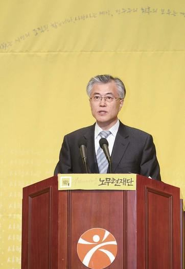

# 一切都是命运

<b>一切都是命运</b>

最终，就像是命中注定一般，我还是担任了“卢武铉财团”的理事长一职。第一位担任这个职务的是前任总理韩明淑女士，她因为要竞选首尔市长，所以选择了辞职。其实她不仅没有辞职的必要，这个职位对她竞选市长反而更为有利。我劝说了好多次，但她总是担心可能会给财团增添负担。就是因为她的这个精神洁癖，不管我们怎么挽留也无济于事。无奈之下，我才继任了这个职务。我觉得这也是命运，不管职位如何，只要是与“卢武铉财团”有关的事，我都躲不了。

“卢武铉财团”不仅组织各种对卢总统的追悼和纪念活动，更是致力于继承和发扬他的精神与价值。

这是他走后，我们这些留下来的人应该做的。这不仅仅是因为我和他有很深的缘分，我喜欢他这个人，更是因为继承和发扬他的精神与价值符合今天我们社会的时代精神。

卢武铉的精神与价值就包含在他政治生涯中经常用到的一个口号——“人活着的世界”里。“人活着的世界”是他1988年参加第13届国会选举时提出的竞选口号。后来，他不管何时何地总喜欢说这句话。给别人题词时也经常写“人活着的世界”。当了总统之后、卸任之后也是一样。可能他觉得就算是自己当了总统，眼前的世界与“人活着的世界”还是有很长一段距离，还需要这个口号。

他只有一次题词时用了“像江水一样”，希望人们不管遭遇什么样的挫折，都坚决不放弃奔向大海的路，表达了他要走自己的路的坚定意志。

  最终，就像是命中注定一般，我还是担任了“卢武铉财团”的理事长一职。我觉得这也是命运，不管职位如何，只要是与“卢武铉财团”有关的事，我都躲不了。 

“人活着的世界”用现在时髦的话来说就是“福利国家梦”。当然了，总统的意思要更深远，不仅指经济上的福利，还要不分贫富贵贱，让所有人都能过上有尊严的生活。其基础可以说就是打造福利国家。卢总统卸任后，本想利用余生的时间研究“进步民主主义”，其实质就是一种以福利国家为目标的民主主义。可见他最开始踏入政界时的初心，一直到他卸任之后都未曾改变。

这样看来，“卢武铉财团”的目标可以概括为打造福利国家。具体来说，就是让国民都能够接受实现福利国家的进步民主主义，让福利国家成为我们社会的普遍价值，并为此而打造合适的土壤。

一提到“福利”两个字，我就会想起我小时候的一件事，那个场景是我终生都难以忘怀的。

初中一年级的夏天，一个周日的凌晨，母亲把我唤醒，说让我跟她一起去釜山火车站。我稀里糊涂地跟着去了。那天很早，公共汽车还没出来，四周一片漆黑，我们一起走到了釜山站。那个距离对年龄不大的我来说已经很远了，六七公里，或者七八公里的样子。路上我听母亲说，周日去首尔的特急（当时“特急”就是最快的）列车车票比较稀少，提前把票买下来，加了价之后再卖给没买上票的人就能赚钱，当然了，她这也是听别人说的。

其实，这就是倒卖火车票的“黄牛”。我们到了火车站，当时还没到售票时间，我们就干等着。过了一会儿开始售票了，母亲在旁边看了好久，也没买票，就跟我说“回去吧”。

于是我们又走回了家，到家时已经过了早饭时间，我饿得不行，到附近的店里买了几个西红柿吃，才算勉强填饱了肚子。我不知道当时母亲为什么就那么回来了。那件事情也就到此为止了，母亲后来再也没做过“黄牛”生意。

家人中只有母亲和我知道这件事。我们母子之间后来从没提起过。这次写书，我特意问了母亲，当年为什么就那么回来了。母亲回答说：“跟听到的不一样。”我没再细问。这种能赚钱的事要是被大家都知道了，要么是有很多人来做，要么是被取缔，所以肯定跟她第一次听说时的情况不一样了。或者母亲可能觉得跟年幼的儿子一起做这件事有点不舒服。

现在每当遇到生活困难的人，我就会想起当年我们母子俩。当然，现在我们不困难了。当年一起来南方的亲戚们现在也大都过得很好。这主要得归功于父母对教育的重视，咬紧牙关也要让子女们好好学习。

但现在仍然有很多人像过去的我们一样困难。我们之所以能够挺过那段艰难的岁月，是因为我们得到了各方的帮助。教堂里有配给的救护物资，学校里有免费伙食。我们家的孩子们在学业上也拿了不少奖学金，有慈善家出资的奖学金，也有咸镜南道道民会或兴南市民会提供的奖学金。我大姐还拿过五一六奖学金。

现在想来，这些都是福利。那个时候国家太贫穷，不可能搞出像样的福利，于是民间人士挺身而出帮助生活有困难的人。人生在世，谁都会遇到困难。我们一家是因为战乱，但失业、疾病、意外、育儿、老龄化等很多原因都会让人一时之间陷入困境。这时如果国家能够伸出援手，人们就能挺过难关，走出困境。一个国家如果能把这样的事情做好就是一个福利国家了。

小时候的贫穷历经岁月的流逝，成了我人生的一笔宝贵财富。我不想再过那种贫穷的生活了，但我也不想自己一个人过上好日子。就像小时候我们接受了别人的帮助那样，我希望我也能够帮助那些身处困境的人。后来大了，我从事学生运动也好，当人权律师也罢，都不能说与此无关。

我的人生曲曲折折，并不平坦。回首往事，我觉得是神的旨意，或者说是像命运一样的东西引领着我来到了今天的位置上。

这其中，有我跟卢武铉律师的相遇。他小时候比我更困难，连大学都没上过。但是他对待困难的人却比我更热情，对帮助他人也更为热忱。

如果未曾遇见他，我的人生可能会比较舒适，我也会不时地帮助别人。是他的热情，让我时刻保持警醒！

就连他的去世也是这样——又把我引领到他的路上来。总统在遗书中说，都是命运。我心里想，我何尝不是如此呢？

您现在已经摆脱了命运，获得了自由，但我却依然要在您所留下的课题中小心前行。
 

