# 附录

<b>附录</b>

照片提供 张哲英 金洙镇

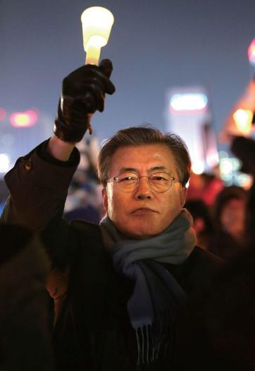  2016年11月，光化门烛光示威。11月韩国民众组织了两次烛光集会，抗议“干政门”事件，要求政府给民众一个答复。 

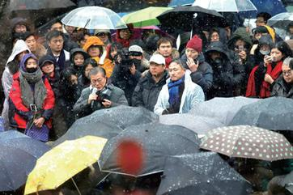  2016年11月，在路边发表演说，呼吁人们关注政府动态。 

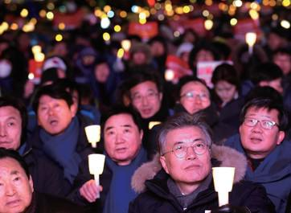  2017年2月，烛光示威。韩国民众组织的第15次集会，要求停职的朴槿惠下台。 

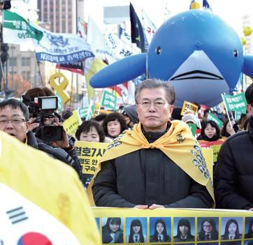  2016年12月，世越号悼念集会。世越号事件造成296人死亡，民众要求政府对此问题有所交代。 

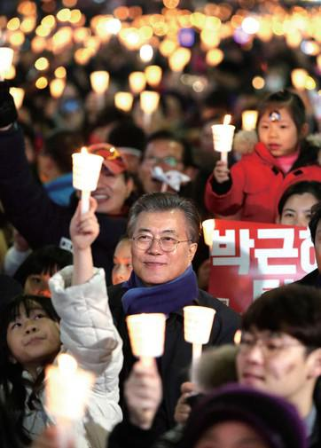  2016年12月，光州烛光集会。烛光集会在韩国呈燎原之势，光州等地与首尔一样多次举行集会。 

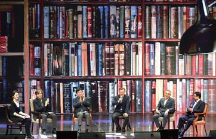  

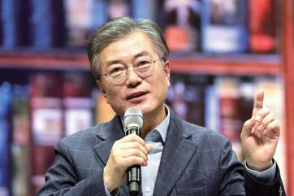  2017年3月，读书音乐会。读书音乐会（Book Concert）是以书和音乐为媒介的大型亲民活动，这一活动深受20—50岁选民欢迎。 

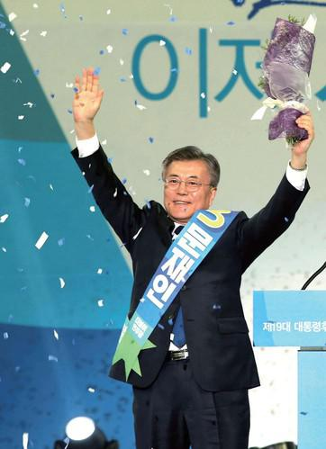  2017年4月，成为共同民主党大选候选人。他在党内的支持率一路遥遥领先，由此踏上通往总统的道路。 

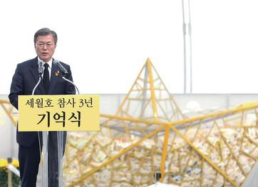  2017年4月，世越号三周年纪念大会。发表演说，呼吁人们不要忘记这个悲惨的日子。 

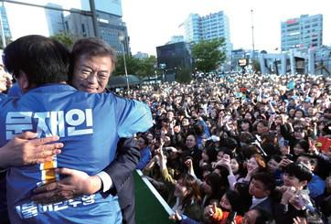  2017年4月，仁川富平路边演讲。仁川是除首尔外地域和影响力都比较大的城市，此次演讲引起了比较大的反响。 

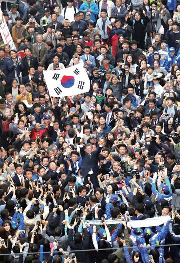  2017年4月，在光州发表路边竞选演说，光州是进步、民主阵营的堡垒，演说引起的反响意义非凡。 

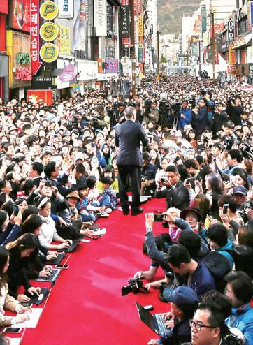  2017年4月，釜山路边演讲。釜山是从政之路的起点，也是与卢武铉总统一起奋斗过的地方，釜山演讲现场可谓盛大。 

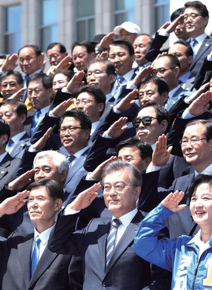  2017年4月，“千军万马国防安保特别辅助团队”成立仪式。 

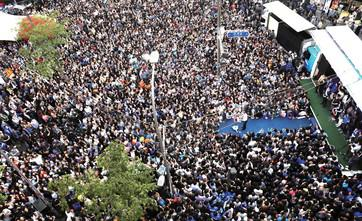  2017年4月，在新村发表竞选演说。新村是大学生聚集地，是国家的希望，他们代表国家未来的选择。 

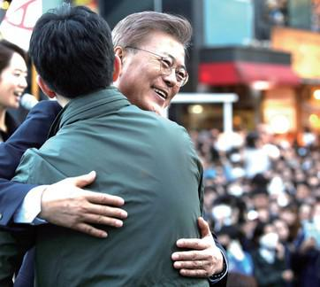  2017年5月，弘益大学，自由拥抱（Free Hug）。 

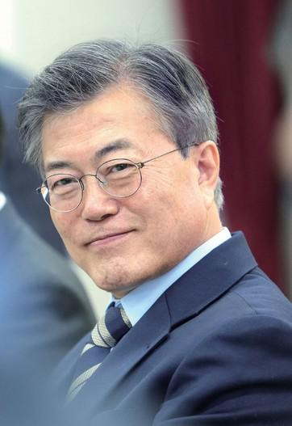  
   

