# 1、很靠近却很不一样

## （1）格兰德河经济学

诺加雷斯市被一道围墙分成两半。如果你站在围墙旁边往北看，你会看到亚利桑那州诺加雷斯，位于圣塔克鲁兹郡境内。这里的家庭年平均收入约三万美元。大多数十几岁的少年男女都在学校念书，大多数成人都有高中学历。尽管有许多人批评美国医疗体系多么不足够，此地居民相对来说算是颇为健康，预期寿命以全球标准来看都算高。许多居民年龄超过六十五岁，享有联邦医疗保险计划的保障。这只是由政府提供、被许多人视为理所当然的服务之一，还有例如电力、电话、污水处理系统、公共卫生、与该地区其他城市和美国其他地方连接的道路网，以及同样不可或缺的治安等等。亚利桑那州诺加雷斯市民可以从事每天的活动，毋须害怕生命危险和其他安全威胁，也不必担心随时遭盗窃、被征用，或其他危及他们在事业上和住家上的投资。同样重要的，亚利桑那州诺加雷斯的居民视为理所当然的是，他们的政府虽然效率低落，且偶尔发生贪渎，却是他们的代理人。他们可以投票更换市长、众议员和参议员；他们可以在总统选举中投票决定谁来领导国家。民主是他们的第二天性。

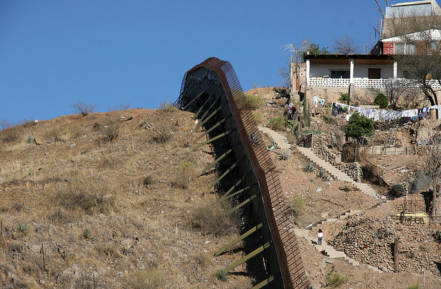

几英尺外的围墙南方情况却大不相同。墨西哥索诺拉省诺加雷斯市的居民虽然生活在该国相对富裕的部分，但此地家庭的年平均收入只有亚利桑那州诺加雷斯的三分之一。大部分索诺拉省诺加雷斯市的成年人没有高中学历，许多青少年不在学校就读。母亲必须担心很高的婴儿死亡率。落后的公共卫生条件意味着索诺拉省诺加雷斯的居民寿命不及北方的邻居。他们也无缘利用许多公共设施。围墙南方的道路状况极差，治安水平更是低落。犯罪率很高，在此地创立事业是高风险的活动。不只是可能遭匪徒劫掠，还要取得各种许可和贿赂许多人，光是开业就已经不容易。索诺拉省诺加雷斯的居民每天得与政治人物的贪渎和无能共同生活。

相较于北方的邻居，民主是此地居民晚近才有的体验。在公元2000年的政治改革前，索诺拉省的诺加雷斯市就和墨西哥的其他地方一样，是由贪腐的宪政革命党所掌控。

一个城市的两边为什么会有如此大的差异？就地理和气候来看，两边没有差别，该地区流行的疾病种类也一致，因为细菌在穿越美国与墨西哥边境上不受任何人为规定的限制。当然，居民的健康状况大不相同，但这与疾病环境没有关系，而是因为边境南方的人民生活的卫生条件较差，且缺乏足够的医疗。

然而也许两边的居民就有很大的差异。有没有可能亚利桑那州诺加雷斯市的居民是欧洲移民的后裔，而南方的居民则是阿兹特克人的后代？并非如此。边境两边人民的背景相当类似。墨西哥在1821年脱离西班牙独立后，诺加雷斯附近地区就成为墨西哥旧加利福尼亚省的一部分，甚至到1846—48年的美墨战争后仍保持如此。直到1853年的哥斯登购买计划后，美国边界才延伸到此一地区。当时勘察边界的密契勒中尉曾提到这个“诺加雷斯的漂亮小山谷”。亚利桑那州诺加雷斯和索诺拉省诺加雷斯的居民有相同的祖先，享用相同的食物，听相同的音乐，还有我们可以大胆说，有着相同的“文化”。

当然，有一个简单而明显的理由可以解释诺加雷斯两边的差异，而且你可能早就猜到了：那道隔开两边的墙。亚利桑那州诺加雷斯是在美国境内，它的居民可以利用美国的经济制度，使他们能够自由选择职业、入学接受教育和学习技术，雇主被鼓励投资于最好的科技设备，因而可以支付员工较高的薪资。他们也能利用政治制度，参与民主的过程，选举自己的代表，并在他们行为不当时将他们换掉。其结果是，政治人物会提供市民要求的基本服务（从公共卫生、道路、到法治等内容）。索诺拉省诺加雷斯的居民则没有这么幸运，他们生活在一个由不同制度所塑造的不同世界。这些不同的制度为诺加雷斯两边的居民和愿意投资的创业家与企业，制造出不同的诱因。这些由两个诺加雷斯及两个国家不同的制度制造的诱因，就是边界两边经济繁荣差异的原因。

为什么美国的制度比墨西哥制度更加有利于经济成功，甚至比拉丁美洲其他国家都是如此？这个问题的答案存在于早期殖民时代不同社会形成的方式。制度性的分歧在当时就发生，其影响一直持续至今。要了解这种差异，我们必须从北美洲与拉丁美洲设立殖民地之时开始探究。

## （2）建立布宜诺斯艾利斯

1516年初，西班牙航海家迪索利斯航行到南美洲东岸一片宽广的河口。他登上岸边，宣告该地为西班牙领土，并把那条河命名为拉普拉塔河，意即“银之河”，因为当地人拥有白银。河口两边的原住民——住在今日乌拉圭的查鲁尔人，和住在今日阿根廷彭巴草原上的奎兰地人——敌视这些新来者，他们是小聚落形式生活的狩猎采集者，没有强大的集中式政治组织。当迪索利斯勘探这片他企图为西班牙占领的新土地时，一群查鲁尔人用棍棒把他打死。

1534年，仍然抱着希望的西班牙派遣第一批殖民者，在迪门多萨的率领下从西班牙出发，同年他们在布宜诺斯艾利斯的所在位置兴建一座城镇。

那里应该是欧洲人理想的地方，字义是“好空气”的布宜诺斯艾利斯气候温和宜人，但第一批到达那里的西班牙人却没有住太久，他们要的并非好空气，而是想榨取资源和可胁迫的劳工。不过，查鲁尔人和奎兰地人并未乖乖就范，他们拒绝提供食物给西班牙人，被抓到时拒绝工作。他们以弓箭攻击新来的移民。西班牙人陷于饥饿，因为他们没有料到必须自己供应食物。布宜诺斯艾利斯并非他们原来梦想的样子，他们无法胁迫当地人提供劳力。那个地区没有白银或黄金可供开采，迪索利斯发现的白银实际上来自西边远方安第斯山脉的印加帝国。

挣扎求生的西班牙人开始派出探险队，寻找能提供更多财富和更容易胁迫的劳力的新地方。1537年，其中一支探险队在迪阿育拉斯率领下溯巴拉纳河而上，寻找一条通往印加的路线。这支探险队在路上与一个称作瓜拉尼的土著族群接触，这些人过着以玉米和树薯为主食的农业经济。迪阿育拉斯立刻发现瓜拉尼人是与查鲁尔人和奎兰地人完全不同的族群，经过短暂的冲突后，西班牙人克服了瓜拉尼人的抵抗，并建立了一座城镇亚松森，那里直到今日仍是巴拉圭的首都。这些西班牙征服者娶了瓜拉尼公主，并且很快封自己为新贵族。他们采用瓜拉尼人既有的强征劳工和进贡制度，只是改由他们掌握大权。这种做法类似他们想建立的殖民地，于是在四年内布宜诺斯艾利斯被放弃，在该地殖民的西班牙人全都迁到这个新城镇。

有“南美洲巴黎”之称的布宜诺斯艾利斯，是一个有欧洲式林荫大道的城市，建立在彭巴草原富饶的农业财富基础上；但那里直到1580年才再度有西班牙人进驻。放弃布宜诺斯艾利斯和征服瓜拉尼人凸显了欧洲人在美洲殖民的逻辑。我们将看到，早期的西班牙人和英国殖民者对自己耕种土地不感兴趣，他们要别人为他们耕种，他们要的是劫掠金银财宝。

## （3）从卡哈马卡……

早在迪索利斯、迪门多萨和迪阿育拉斯的探险之前，已有更著名的哥伦布在1492年10月12日看到巴哈马群岛中的一个岛屿，以及其他人的许多探险行动。西班牙在美洲的扩张和殖民从1519年柯尔特斯入侵墨西哥后开始积极进行，十五年后皮萨罗的探险队进入秘鲁，两年后迪门多萨的探险队进入拉普拉塔河。接下来的一个世纪，西班牙征服并殖民南美洲的中部、西部和南部，而葡萄牙则占据东部的巴西。

西班牙人的殖民策略极为有效。这套策略最早由柯尔特斯在墨西哥发展成形，其基础是：西班牙人发现，压制反抗最有效的方法是俘虏原住民的首领。该策略让西班牙人得以占有首领积蓄的财富，并且胁迫原住民进贡和提供食物。下一步是封自己为原住民社会的新菁英，并控制既有的征税、纳贡，特别是强制劳动的方法。

当柯尔特斯和他的部下在1519年11月8日抵达宏伟的阿兹特克首都特诺奇提特兰时，他们受到阿兹特克皇帝蒙特祖玛的欢迎，因为他接受身边谋士的建议，决定以和平方式迎接西班牙人。接下来发生的事，在1545年后由圣方济会教士德萨哈冈，详细记载在他的著名的佛罗伦丁抄本里。

“他们（西班牙人）立刻紧紧抓住蒙特祖玛……接着所有枪支齐发……恐惧压倒一切。就像每个人吞下了自己的心。即使尚未天黑，人们感到恐怖、惊讶和忧虑，人们陷于惊吓中。

”天一亮，（西班牙人）就宣布所有要求的东西，白玉米饼、烤火鸡、蛋、淡水、木头、木柴、木炭……蒙特祖玛只能乖乖就范。

“当西班牙人安顿好后，他们随即询问蒙特祖玛城里所有的财宝……他们热烈地搜寻黄金。蒙特祖玛带领西班牙人时，他们围绕着他……每个人握着他，每个人紧紧抓住他。

”当他们来到提欧卡库的藏宝所，他们拿出所有灿烂华丽的东西，凤尾绿咬鹃羽毛头冠、玩物、盾牌、金盘子……金鼻环、金腿环、金臂环、金额环。

“黄金被剥下……他们很快点起火，焚烧所有宝物。它们全部烧毁，而西班牙人把黄金另外铸成条块……然后西班牙人到处行走……他们拿走所有东西，一切他们认为的好东西。

“然后他们来到蒙特祖玛自己的藏宝所……在称作托托卡库的地方……他们取出（蒙特祖玛的）财产……所有的宝物；有垂饰的项链、有凤尾绿咬鹃羽簇的臂环、黄金臂环、手镯、有贝壳的金环……象征统治者的绿宝石皇冠。他们全都拿走。”

对阿兹特克人的军事征服在1521年完成。已当上新西班牙省总督的柯尔特斯开始通过“赐封”制度瓜分最有价值的资源，即原住民。赐封最早在十五世纪出现在西班牙，是再征服摩尔人（八世纪后移民到该国南部的阿拉伯人）的产物。在新世界，它采用一种远为有害的形式：把原住民赏赐给称作赐封主的西班牙人。原住民必须进贡和提供劳役，以交换赐封主让他们皈依成基督教徒。

一项对赐封主角色的鲜活记录由道明会教士拉斯卡萨斯流传到今日，他是最早也最强烈批评西班牙殖民制度的人士之一。拉斯卡萨斯在1502年搭乘新总督德奥万多的船队抵达西班牙人占领的伊斯帕尼奥拉岛。他对每天目睹的残酷对待和剥削原住民愈来愈感到幻灭和不安。1513年，他担任西班牙征服古巴军队的随行教士，甚至因为他的服务而获得赐封。不过，他放弃赐封，并展开呼吁改革西班牙殖民制度的长期运动。他的努力以1542年写成的著作《印地毁灭简述》达到最高点。他记述在尼加拉瓜看到的赐封如下：

“每个殖民者接受分派（或者如法律上的用语叫‘赐封’）给他的镇上居民，安排这些居民为他工作，窃占他们已经匮乏的食物为己有，并接管本地人向来拥有和耕种作物的土地。殖民者对待所有本地人——贵族、老人、女人和小孩——犹如他自己家庭的成员，并因此要他们为他的个人利益日夜操劳，不给任何休息。”

对新格拉纳达（今日的哥伦比亚）的征服者，拉斯卡萨斯叙述西班牙采取的策略：

“为了达成搜括所有黄金的长期目的，西班牙人运用他们惯常采用的分配（或他们所说的赐封）城镇及其居民的策略……然后一如既往，对待他们犹如奴隶。探险队的总指挥官自己抓住整个国土的国王，囚禁他六或七个月，以非法手段向他要求愈来愈多的黄金和宝石。这位波哥大的国王非常害怕，为了从施酷刑者的夹具获得解脱，他答应交出装满整个房子的黄金；为了履行承诺，他派他的子民出去寻找黄金，然后一点一点连同许多宝石一起带回来。但是黄金还没装满，西班牙人宣称将以违背承诺处死他。那位指挥官建议应该由他来裁夺，因为他代表法律，当他们依照指示正式指控国王时，他宣判如果国王继续不履行交易，将遭受酷刑。他们以吊刑折磨他，在他肚子上浇滚烫的牛脂，用铁箍将他的双腿吊在木杆上，脖子吊在另一根木杆上，两个人抓住他的手，开始烧他的脚底。指挥官偶尔会来巡视，并重复说除非他拿出更多黄金，否则他们会慢慢折磨他至死。他们说到做到，国王最后屈服于他们加诸在他身上的痛楚而死去。”

在墨西哥操演到完美的征服策略与惯例，很快就被西班牙帝国其他地方采用。没有一个地方比皮萨罗征服秘鲁更有效果。拉斯卡萨斯在他的记述中说：

“在1531年，另一名大恶徒带着一群人旅行至秘鲁王国。他决心模仿他的同伙探险家在新世界其他地方使用的策略和技巧。”

皮萨罗从靠近秘鲁的城镇通贝斯附近的海岸出发，开始往南前进。到1532年11月15日，他来到山城卡哈马卡，印加皇帝阿塔华巴和他的军队驻扎在该地。第二天，不久前才在父王卡帕克驾崩后的继承权竞争中打败兄弟的阿塔华巴，与他的随从来到西班牙人扎营的地方。阿塔华巴很生气，因为他已听到西班牙人犯下暴行的消息，例如侵犯太阳神印蒂的神庙。接下来发生的事已广为人知，西班牙人设下陷阱，杀了阿塔华巴的护卫和随从，可能多达两千人，并且捕获了国王。为了获得自由，阿塔华巴不得不承诺装满一个房间的黄金，和两倍多的银子。他照做了，但西班牙人违背承诺，在1533年将他勒死。那年十一月，西班牙人占领印加首都库斯科，那里的印加贵族受到跟阿塔华巴一样的待遇，被囚禁直到他们拿出黄金和白银。当他们无法满足西班牙人的要求时，就被活活烧死。库斯科伟大的艺术宝藏如太阳庙，里面的黄金尽遭劫掠，并熔铸成金块。

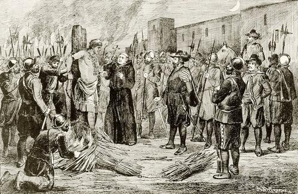    

这时西班牙人把注意力转向印加帝国的人民。和在墨西哥一样，人民被分派到赐封地，由跟随皮萨罗的每一个征服者各分得一块。赐封是殖民时代早期用来控制和组织劳动力的制度，但它很快就面对一个强有力的竞争者。1545年，一个叫瓜尔巴的本地人在今日玻利维亚境内的安第斯山高地寻找原住民神殿时，被一阵突然刮起的强风吹倒在地，然后看到眼前有一块被掩盖住的银矿石。这是一座大银山的一部分，西班牙人将这座银山取名为“富山”。不久后在它四周兴起一座叫波托西的城市，到1650年最巅峰时的人口高达十六万人，比当时的里斯本或威尼斯还多。

为了开采这些银子，西班牙人需要矿工，许许多多的矿工。他们派遣迪托雷多担任新总督，即西班牙殖民地的最高首长，他的主要任务是解决劳工问题。迪托雷多在1569年抵达秘鲁，先花五年时间巡视各地，并调查他的新领地。为了找到他需要的劳工，迪托雷多迁移几乎所有原住民，把他们集中在称作“控制营”的新城镇，以方便假西班牙国王之名剥削劳动力。然后，他重新启用和修改一种称作米塔的印加劳动制度，米塔在印加语言克丘亚语的意思即“轮流”。根据米塔制度，印加人曾利用强迫劳动的方式经营专门提供食物给神庙、贵族和军队的农场。印加菁英则反过来提供饥荒时的赈济与安全。但在迪托雷多统治下的米塔制，尤其是在波托西，变成了西班牙殖民时期规模最大、也最繁重的劳动力剥削制度。迪托雷多划出一片广大的管辖区，从今日秘鲁中部一路涵盖到大部分现代玻利维亚的国土，面积广达约二十万平方英里。在这个地区里刚抵达的男性原住民，有七分之一必须在波托西的矿场工作。波托西的米塔制在整个殖民时期持续运作，直到1825年才废除。地图1显示西班牙征服时期米塔管辖区叠放在印加帝国上的样子。它显示米塔与帝国心脏地区重叠的程度，也涵盖了首都库斯科。

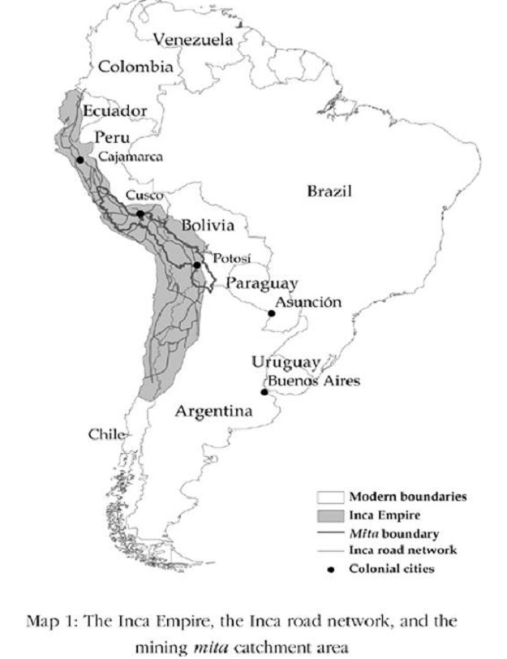    

奇特的是，今日仍可在秘鲁看到米塔制度的残留。举卡尔卡省和临近的雅科马育省的差异为例，这两个省份看起来似乎没有什么不同，两省都在山地高处，分别居住操克丘亚语的印加后代，然而雅科马育省远为贫穷，居民的消费比卡尔卡省居民少三分之一。这些居民也了解这些情况。在雅科马育，他们问难得来到该地的外国人：“你们不知道这里人比卡尔卡的人穷吗？你们怎么会想到来这种地方？”难得是因为从地区首府库斯科（也是古代印加帝国的首都）到雅科马育，比到卡尔卡困难得多。往卡尔卡的道路很平坦，往雅科马育的道路却崎岖不平。要到偏远的雅科马育需要骑马或骑骡子。卡尔卡和雅科马育的居民都种同样的作物，但在卡尔卡民众会拿到市场上出售换钱，在雅科马育，居民种植作物只供自己食用。这些对外人和本地人都明显可见的不平等，可以从制度的差异来理解——一些可追溯到迪托雷多和他有效剥削原住民劳动力的计划等历史根源的制度性差异。雅科马育和卡尔卡主要的历史差异是，雅科马育位于波托西的米塔管辖区内，而卡尔卡不在其中。

除了集中劳力和利用米塔制外，迪托雷多把赐封制整合成人头税，每个成年男性每年要以白银缴纳一笔固定额度的税。这是另一项设计来强迫人们进入劳动市场并压低西班牙地主支付薪资的计划。另一项制度叫“产品配销“，也在迪托雷多任内逐渐普及。这项制度是以西班牙人决定的价格，强迫出售产品给当地人。最后，迪托雷多拟定并实施”达拉欣”制——字意即“负担”——以利用原住民为西班牙菁英的事业背负沉重的产品，例如葡萄酒、古柯叶或纺织品，取代役用的牲畜。

在西班牙人的美洲殖民地各处，类似的制度和社会架构纷纷兴起。在初期的掠夺和搜刮金银后，西班牙人建立了一套为剥削原住民而设计的制度。赐封制、米塔制、产品配销制和达拉欣制的设计，都是为了把原住民的生活压到勉强维生的水平，并为西班牙人榨取所有超过此一水平的剩余所得。征收他们的土地、强迫他们工作、对劳动服务提供低薪资、课重税，甚至对非自愿购买的产品收取高价，都是为了达到这个目的。虽然这些制度为西班牙皇室创造了许多财富，并让征服者和他们的后代变得十分富裕，但他们也把拉丁美洲变成世界上最不平等的大陆，并大幅削弱它的经济潜力。

## （4）来到詹姆斯镇

当西班牙人在1490年代开始征服美洲时，英格兰还是欧洲较小的国家，刚从一场内战的破坏逐渐复原，即玫瑰战争，因此英格兰无法在各国争夺美洲的战利品和黄金以及剥削原住民中取得优势。几乎一百年后的1588年，西班牙国王菲利普二世率领西班牙无敌舰队侵略英格兰意外溃败，引发整个欧洲政治的大震撼。英格兰的胜利虽然来得幸运，但这也象征英格兰终于获得自主的制海权，能够参与殖民帝国扩张的大势。

因此英格兰人在同一时期开始在北美殖民并非巧合。但他们已经是后来者，选择北美不是因为那里吸引人，而是因为那里是仅有的选择。美洲“较好的”部分，有许多原住民可以利用、有黄金和白银矿可供开采的地方都已被占领。英格兰人只得到剩余的东西。十八世纪英国作家兼农业学家杨格（Arthur Young）讨论到有利润的“主要食用产品”（指的是可供出口的农业产品）在哪里生产时说：

“整体看来，我们殖民地的主要食用产品价值离太阳愈远就愈降低。在西印度群岛，也就是最热的地方，每个人可以生产八英镑十二先令一便士。在南方大陆，只有五英镑十先令。在中部大陆，金额是九先令六又二分之一便士。在北方的殖民地，数值只有二先令六便士。这些数值暗示一个最重要的教训——避免在北方纬度高的地方殖民。”

英格兰人最先尝试在北卡罗莱纳的洛亚诺克建立殖民地，时间是1585年到1587年间，但以彻底失败收场。1607年他们再度尝试。将近1606年年底，忠实苏珊号（Susan Constant）、神速号（Godspeed）和发现号（Discovery）三艘船在纽波特船长指挥下驶向弗吉尼亚。这些殖民者在弗吉尼亚公司资助下，开进切萨皮克湾（Chesapeake Bay），沿着一条他们以英王詹姆斯一世命名的河流而上。1607年5月14日，他们建立了殖民地詹姆斯镇。

虽然弗吉尼亚公司拥有的船所载的殖民者是英格兰人，但他们的殖民模式深受柯尔特斯、皮萨罗和迪托雷多建立的样板的影响。他们最初的计划是抓住当地的酋长，利用他来取得补给品，并胁迫原住民为他们生产食物和财富。

英格兰殖民者第一次踏上詹姆斯镇时，他们不知道自己是进入一片由波瓦坦联盟拥有主权的领土，这个联盟由约三十个政治体组成，效忠于瓦罕苏纳科克国王。瓦罕苏纳科克的首都位于韦洛伍柯摩克镇，距离詹姆斯镇只有二十英里。殖民者的计划是先研究清楚整个形势。如果无法劝诱当地人提供食物和劳力，殖民者至少有可能和他们交易。殖民者似乎从未想过他们可能得工作和种植自己的食物。这不是新世界征服者的做法。

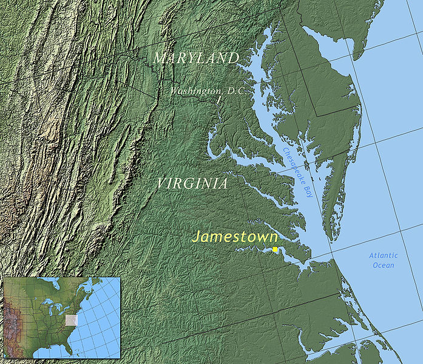    

瓦罕苏纳科克很快察觉殖民者的出现，并以极度怀疑的眼光看待他们的意图。他统治的领土对北美洲来说是一个相当大的帝国，但他有许多敌人，而且缺乏像印加帝国那样的高度集权政治掌控。瓦罕苏纳科克决定弄清楚英格兰人的意图，先是派遣使者说他愿意与他们保持友好关系。

随着1607年冬季临近，詹姆斯镇的殖民者食物储备渐少，殖民地的统治委员会指定的领导人温菲尔德变得犹豫不决。这种情况最后靠史密斯上校解救才化险为夷。史密斯是个传奇人物，他的记述是我们有关早期殖民地发展的主要信息来源之一。他出生于英格兰林肯郡的乡下，后来违抗父亲要他从商的愿望而成为一名佣兵。他先在荷兰与英格兰军队一起打仗，之后加入奥地利部队在匈牙利服役，对抗鄂图曼帝国的军队。史密斯在罗马尼亚遭俘虏，被当作奴隶卖到农场工作。有一天他打倒主人，偷走主人的衣服和马匹，逃回奥地利领土。他在往弗吉尼亚的航行途中惹出麻烦，因为违抗温菲尔德的命令而被囚禁在忠实苏珊号上。当船抵达新世界后，原本的计划是要审判他。然而大出温菲尔德、纽波特和其他殖民地领导层意料的是，当他们打开密封的命令时，发现弗吉尼亚公司早已任命史密斯担任治理詹姆斯镇的统治委员会成员之一。

由于纽波特已航行回英格兰载运补给品和更多殖民者，温菲尔德不确定该怎么做，所以全靠史密斯救了殖民地。他进行一连串的交易任务，取得重要的食物补给。在其中一次任务中，他被瓦罕苏纳科克的弟弟欧佩参卡诺格俘虏，并被带至国王所在的韦洛伍柯摩克。他是第一个回见瓦罕苏纳科克的英格兰人，而根据一些记述，史密斯能够保全性命全赖瓦罕苏纳科克的小女儿宝嘉康蒂的干预。史密斯在1608年元月2日获释，他回到詹姆斯镇，那里的食物仍然极度匮乏，幸好纽波特在同一天稍晚从英格兰及时返回。

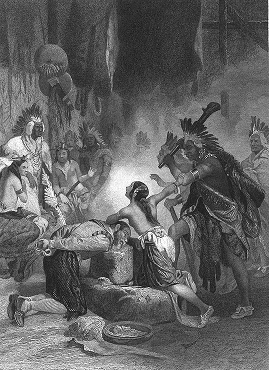 宝嘉康蒂

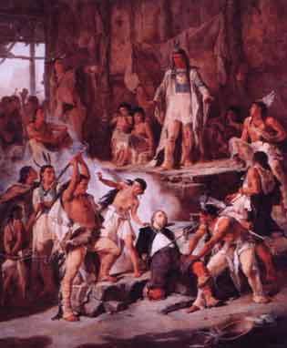 宝嘉康蒂

詹姆斯镇的殖民者没有从这段初期经验学到多少东西。随着时间进入1608年，他们继续寻找黄金和贵金属。他们似乎还不明白，若要生存，他们无法靠当地人供养，不论是通过威胁或交易。史密斯最先了解到，柯尔特斯和皮萨罗用起来得心应手的殖民模式，在北美洲就是不管用，原因是基本环境差异太大。史密斯写到，和阿兹特克与印加不同，弗吉尼亚没有黄金。他在日记中说：“你得知道，粮食就是他们所有的财富。”留下大量日记的早起移民之一托德基尔，生动地描述史密斯和其他人发现这一点时的沮丧：

“没有交谈、没有希望，没有工作，只有挖黄金，提炼黄金，搬运黄金。”

当纽波特1608年4月航行回英格兰时，他带着一批俗称愚人金的黄铁矿。他在九月底返回，带着弗吉尼亚公司的命令，要他们加强控制当地人。他们的计划是为瓦罕苏纳科克加冕，希望如此能让他臣服于英王詹姆斯一世。他们邀请他到詹姆斯镇，但瓦罕苏纳科克对殖民者深具戒心，不想冒被俘虏的危险。史密斯记录瓦罕苏纳科克的回答：“即使你们的国王送我礼物，我也是国王，而这是我的国土……你的国王来见我，不是我去见他，更不是到你的要塞，我不会咬这种诱饵。”

如果瓦罕苏纳科克不肯“咬这种诱饵”，纽波特和史密斯就必须到韦洛伍柯摩克来进行这项加冕礼。这整件事似乎以彻底失败收场，唯一的结果是瓦罕苏纳科克决定该是除去殖民地的时候了。他实施贸易制裁，詹姆斯镇再也不能交易补给品。瓦罕苏纳科克决心以饥饿打败他们。

纽波特在1608年12月再度扬帆回英格兰，带着一封史密斯写的信，恳求弗吉尼亚公司的主管改变他们对殖民地的想法。在弗吉尼亚不可能采用像墨西哥和秘鲁一样的通过剥削快速致富的方法，这里没有黄金和贵金属，而且无法强迫原住民工作或提供食物。史密斯发现，如果想建立能够存活的殖民地，殖民者就必须工作。因此他恳求主管派遣合适的人来：“你们再派人来时，我恳求你们派三十名木匠、农夫、园丁、渔夫、铁匠、泥瓦匠，以及砍树及挖根者，各带充足的补给品，那么我们就有一千名这种人。”

史密斯不想再有更多无用的金匠。詹姆斯镇再一次因为他的临机应变而存活下来。他设法哄骗和威吓当地原住民与他交易，当他们不愿意交易时，他只好另觅他途。回到殖民地，史密斯完全掌控大局，他实施“不工作便没食物吃”的规定。詹姆斯镇活过了第二个冬天。

弗吉尼亚公司原本是一家营利性企业，但两个多灾多难的年头没有赚进分文。公司主管决定他们需要新的管理模式，于是以单一的总督取代统治委员会。第一个被任命担任这个职务的人是盖兹爵士。公司当局听从史密斯的部分警告，并且发现他们必须尝试一些新方法，特别是因为1609至1610年冬季（即所谓的“饥饿期”）发生的事件而加强了这层体认。新的管理模式让史密斯没有发挥的空间，他懊恼地在1609年秋季返回英格兰。少了他的足智多谋，加上瓦罕苏纳科克紧紧控制食物供应，詹姆斯镇的殖民者慢慢饿死。在进入冬季的五百人中，只有六十人捱到三月。形势恶劣到他们被迫吃人肉。

盖兹和他的助手戴尔爵士在殖民地实施的“新方法”，是一套对英格兰殖民者极其严厉的工作制——当然不包括管理殖民地的菁英们。戴尔推行的“神圣、道德与军事法”包括如下的条款：

•男人或女人都不得从殖民地逃跑投靠印第安人，违者应处以死刑。

•任何人若抢夺公共或私人园圃，或葡萄园，或偷盗玉米穗，应处以死刑。

•殖民地成员不得出售或给予任何本殖民地的商品给船长、船员或水手，以运送出本殖民地，供他私人的用途，违者处以死刑。

弗吉尼亚公司认为，如果无法剥削原住民，也许可以剥削殖民者。在新的殖民开发模式下，弗吉尼亚公司拥有所有土地，居民都住在营房里，由公司发给规定的配给品。工作队也由公司编排，各队由一名公司代理人负责监督。那很接近戒严状态，死刑是最先采用的惩罚。前述第一项条款在建立殖民地的新制度上十分重要；公司威胁要处死逃跑的人，因为在新工作制下，对必须工作的殖民者来说，逃跑并投靠当地人变成愈来愈吸引人的选项。此外，由于当时在弗吉尼亚即使是原住民的人口密度也很低，独自在荒野生活以逃避弗吉尼亚公司控制也非不可能。公司的力量在面对这些选项时十分有限，无法胁迫靠着仅能维生的配给品生活的英国殖民者卖力工作。

地图2显示在西班牙征服时期美洲不同地区的人口密度估计。美国的人口密度除了几个地点外，每平方英里最多只有四分之三个人。在中墨西哥或安第斯山秘鲁，人口密度高达每平方英里四百人，是美国的五百多倍。在墨西哥或秘鲁可能办到的事，在弗吉尼亚却不可能。

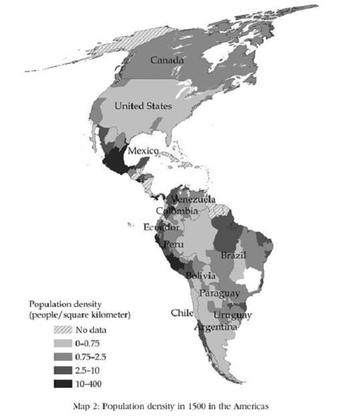    

弗吉尼亚公司花了很长的时间才承认，他们初期的殖民模式在弗吉尼亚不管用，而且也经过很久才明白“神圣、道德与军事法”的失败。从1618年起，该公司才开始采用一套大不相同的新策略。由于无法胁迫当地人或殖民者，唯一的变通方法是给殖民者诱因。该公司在1618年开始实施“人头权制”（head-right system），给每名男性殖民者五十英亩土地，每多一名家庭成员则再给五十英亩，他们带至弗吉尼亚的仆人也并入计算。殖民者可以获得房屋，并且解除合约的束缚；而在1619年，大议会（General Assembly）成立，实际上赋予所有成年男性制订治理殖民地的法律与制度的权力。这是美国民主制度的起源。

弗吉尼亚公司花了十二年的时间才学到，西班牙人在墨西哥和中南美洲管用的方法，在北方却行不通。十七世纪剩下的时间则是学习第二个教训的漫长奋斗；殖民地想经济上能够生存的唯一方法是，创造能提供诱因的制度，让殖民者愿意投资和努力工作。

随着北美洲逐渐开发，英格兰菁英不断尝试设立严格限制经济与政治权利的制度，只赋予特权给殖民地居民中的少数，就像西班牙人的做法。然而每一次这种模式都以失败收场，正如在弗吉尼亚的经验。

其中一次最具野心的尝试始于弗吉尼亚公司改变策略后不久。在1632年，切萨皮克湾北边数千万英亩的土地，由英王查理一世授予巴尔的摩男爵卡尔弗特。马里兰宪章给巴尔的摩男爵完全的自由，可以根据他的意愿建立政府，其中第七条规定，巴尔的摩有“完全、充分且绝对的权力，为上述政府的利益与福祉，根据本法的要旨，而规定、制订和执行任何法律的权力”。

巴尔的摩草拟了一份建立一个庄园社会的详细计划，是十七世纪理想农业英格兰在北美洲的翻版。内容是把土地分割成数千英亩的小块，由地主来管理。地主将招募佃农，而佃农将耕种土地，并交租给控制土地的特权阶级菁英。另一个类似的企图发生在1663年，当时有八个业主创建卡罗莱纳，其中包括艾胥黎古柏。艾胥黎古柏和他的秘书、伟大的英国哲学家洛克（John Locke），创制了卡罗莱纳基本宪法。这份文件和之前的马里兰宪章一样，擘画了一个由地主菁英控制的阶级社会。宪法序文说：“这片领土的政府之建立完全符合君主政体，我们就生活在君主政体中，这片领土也从属于君主政体；我们可以避免建立纷杂的民主政体。”

基本宪法的条文制订出一个僵化的社会结构，最底层是“农奴”（leet-men），第二十三条规定：“所有农奴的子女生来都是农奴，且世世代代如此。”农奴没有政治权力，上面一层是领主（landgrave）和酋长（cazique），这两类人组成贵族。领主各可获分配四万八千英亩土地，酋长可获得二万四千英亩。这份蓝图也包括成立议会，领主和酋长拥有代表席次，但只允许辩论八位业主事先同意的法案。

正如尝试在弗吉尼亚实施严苛的规定归于失败，在马里兰和卡罗莱纳建立类似制度的计划也无疾而终，理由大同小异。每个例子都证明，无法强迫殖民者接受僵化的阶级社会，因为他们在新世界有太多选择了。相反的，必须提供他们诱因才能让他们工作。而且很快地他们就要求更多经济自由，和更大的政治权利。在马里兰也一样，殖民者坚持获得自己的土地，他们迫使巴尔的摩男爵建立议会。1691年，议会促成英王宣布马里兰成为直辖殖民地，因而撤除巴尔的摩和所属贵族的政治特权。类似的长期抗争也发生在南、北卡罗莱纳，同样的，业主都遭挫败。南卡罗莱纳在1729年变成直辖殖民地。

到1720年代，所有后来组成合众国的十三个殖民地都有类似的政府结构。每个州各有一名总督，和一个以男性财产拥有者特许权为基础的议会。它们并非民主政治；女性、奴隶和无财产者不得投票。但比起同一时代的其他地方，政治权利已相当普及。这些议会和它们的领袖在1774年联合起来召开第一次大陆会议（First Continental Congress），揭开美国独立的序幕。议会相信他们有权选出自己的成员，也有权征税。而我们知道，这为英国殖民政府带来了问题。

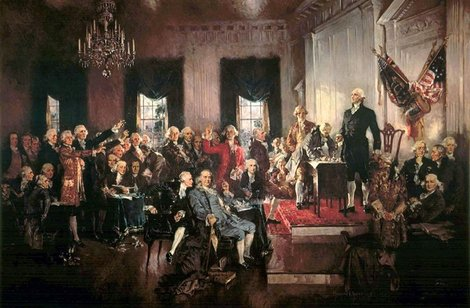

第一次大陆会议，通过并颁布《独立宣言》，自由美利坚诞生

## （5）两部宪法的故事

现在应该已经很清楚的是，美国（而非墨西哥）采用并实施支持民主原则的宪法、节制政治权力的使用，并把权力广泛分配给社会并非偶然。1787年各殖民地代表在费城开会撰写的文件，是一段始于1619年詹姆斯镇成立大议会的漫长过程的结果。

美国独立时期发生的宪政过程，以及不久后墨西哥发生的情况，两者间有着极为鲜明的对比。1808年2月，拿破仑的法国军队入侵西班牙。到5月，他们已经攻下西班牙首都马德里。9月时，西班牙国王费迪南德被俘虏并退位，全国性的中央军政府（Junta Central）取代他的角色，高举对抗法国的火炬。军政府先在阿兰惠斯集结，但在面对法国军队时往南方撤退。最后部队退到加的斯（Cadiz），在那里虽然遭到拿破仑的军队围城但仍坚守阵地。军政府在这里组织称作柯尔蒂斯（Cortes）的国会。到1812年，这个国会制订了后世所知的加的斯宪法（Cadiz Constitution），根据人民主权的概念要求创建立宪君主制度。该宪法也要求结束特权，并采用法律平等对待的制度。这些要求都深受南美洲的菁英厌恶，他们所统治的制度环境仍然由赐封、强迫劳动，以及由这些菁英与殖民国家掌控的绝对权力所构成。

拿破仑入侵导致的西班牙国家崩溃，在拉丁美洲各殖民地造成一场宪政危机。当时有许多要不要承认中央军政府权威的争议，许多拉丁美洲人的反应是开始组织自己的军政府。他们迟早会意识到真正脱离西班牙独立的可能性。最早宣告独立的地方是1809年玻利维亚的拉巴斯，虽然很快就被从秘鲁派出的西班牙军队镇压。在墨西哥，菁英阶层的政治态度受到1810年希达尔哥神父领导的起义运动影响。希达尔哥的军队9月23日劫掠了瓜纳华多，并杀死高层殖民官员，然后开始不加区别地滥杀白人。情况变得更像阶级战争甚至种族战争，而不像独立运动，它使得所有菁英团结成反对力量。如果独立运动容许群总参与政治，那么地方菁英也持反对态度，不只是西班牙人反对而已。结果是，墨西哥菁英以极度怀疑的态度，看待通往群众参政的加的斯宪法；他们绝不承认它合法。

1815年，拿破仑的欧洲帝国崩垮，西班牙国王费迪南德七世重掌大权，加的斯宪法遭废除。当西班牙王权开始尝试收复它的美洲殖民地时，它在反独立的墨西哥并未碰上麻烦。但在1820年，一支在加的斯集结准备搭船到美洲恢复西班牙权威的西班牙军队，反叛了费迪南德七世。全国各地的军队纷纷加入他们，费迪南德被迫恢复加的斯宪法，并重新召开科尔蒂斯。新科尔蒂斯甚至比制订加的斯宪法的旧国会还激进，它提议废止所有形式的胁迫劳动，此外也攻击一些特权——例如，军方在自己的法庭接受审判的权利。当墨西哥最后受迫接受这份文件时，地方菁英决定分道扬镳，宣告独立。（并非所有独立都是对民众有利的，这就是一例。）

这场独立运动由曾在西班牙军队服役的伊图尔比德领导，1821年2月24日，他公布自己的墨西哥独立蓝图伊瓜拉计划。该计划采用立宪君主制，搭配一位墨西哥皇帝，并废除墨西哥菁英认为会危及他们地位和特权的加的斯宪法。计划立即获得支持，西班牙很快发现无法阻止大势。但伊图尔比德不只策划了墨西哥的分离，他很快发现这个权力真空，并利用军方的支持自立为皇帝。伟大的南美洲独立革命领袖玻利瓦尔形容伊图尔比德“蒙上帝和刺刀的恩典”而登上皇帝宝座。伊图尔比德并未受到像美国总统受到的政治制度束缚；他很快变成独裁者，到1822年10月，他解散宪法认可的国会，以他自己挑选的军人集团取代。虽然伊图尔比德在位不久，这种模式的事件在十九世纪的墨西哥却不断反复发生。

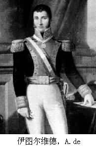    

美国宪法并未创造一个现代标准的民主政体。谁能在选举中投票留给各州自己决定。虽然北方的州很快把投票权交给所有白人男性，不管他们赚多少钱或拥有多少财产，南方各州却是逐步赋予这项权利的。没有一州给女性或奴隶投票权，而且虽然解除了白人男性的财产和财富限制，限缩黑人男性的明文规定却反而更加严苛。当然，美国宪法在费城制订的当时，奴隶被视为合乎宪法，而最卑劣的协商是有关众议院在各州的席次分配。席次原本是要按照各州的人口来分配，但南方州的代表要求奴隶应计算在内，北方反对。众议院席次分配的妥协结果是，一个奴隶被算成五分之三个自由人。美国北方与南方的冲突在宪政过程中受到抑制，就是因为达成五分之三的规则和其他妥协。后来陆续增添一些修正——例如，密苏里妥协规定，一个支持奴隶制的州和一个反对奴隶制的州必须同时加入联邦，以便保持支持与反对奴隶制的势力在参议院的平衡。这些伪饰让美国政治制度得以和平运作，直到内战终于以有利于北方的方式解决这个冲突。

    

美国内战既血腥又极具破坏力，但在内战之前和之后都有充足的经济机会提供给大部分人口，尤其是在美国北部和西部。墨西哥的情况则大不相同。如果美国在1860年到1865年间经历了五年的政治不稳定，墨西哥则是在独立的头五十年经历了持续不断的不稳定。桑塔安纳的生涯就是最好的写照。

桑塔安纳是韦拉克鲁斯一名殖民官员的儿子，在独立战争中以为西班牙而战闻名。1821年他投效伊图尔比德，从此未再回头。1833年5月他首度担任墨西哥总统，但只行使权力不到一个月就让位给法里亚斯。法里亚斯的任期只持续了十五天，桑塔安纳再度复位重掌权力。不过，这次复位和第一次上任一样短暂，到七月初又被法里亚斯取代。桑塔安纳和法里亚斯的双人舞蹈持续到1835年桑塔安纳被巴拉干取代。但桑塔安纳不是轻易放弃的人，他在1839年、1841年、1844年、1847年都回来再当总统，最后一次是从1853年到1855年间。总共算起来，他十一度担任总统，在任期间墨西哥打输了阿拉莫战役和德克萨斯独立战争，以及惨烈的美墨战争，后者导致丧失后来变成新墨西哥州和亚利桑那州的土地。从1824年到1867年，墨西哥共有五十二位总统，其中只有很少人按照宪法规定的程序取得权力。

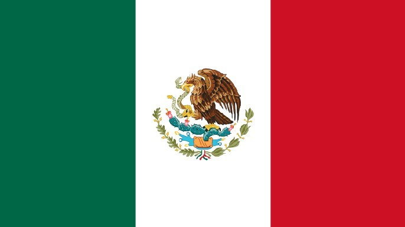    

空前不稳定的政治对经济制度和诱因的影响十分明显，这种不稳定导致财产权的高度不安全，并且严重削弱墨西哥的政府，使其缺乏征税和提供公共服务的权威及能力。即使桑塔安纳是墨西哥的总统，一大部分国土也不在他的控制下，使美国得以趁机吞并德克萨斯。此外，正如前面提到，墨西哥宣告独立背后的动机是为了保护殖民时期发展出来的那套经济制度，用伟大的德意志探险家兼拉丁美洲地理学家洪堡的话来说，那导致墨西哥变成“不平等的国度”。这些制度把社会建立在剥削原住民和创立垄断事业的基础上，因此而阻碍广大人口的经济诱因和创造力。当美国在十九世纪上半叶开始经历工业革命时，墨西哥正变得更贫穷。

## （6）创意、创立企业、取得贷款

工业革命始于英国，最早的成功是使用新机器带来棉布生产的巨大变革，新机器原本由水车推动，而后改由蒸汽引擎推动。棉布生产机械化先是造成纺织工人生产力大增，后来扩大到其他产业。创新是经济各领域的科技突破的动力，带头的人是渴望采用新创意的创业家和企业人士。初期的革命很快就跨越北大西洋，散播到美国。人们看到采用在英国发展的新科技可以创造极大的经济机会，他们也受到激励而努力开发自己的发明。

我们可以通过哪些人取得专利权来了解这些发明的性质。保护创意财产权的专利制度，最早是在1623年英格兰国会通过的独占法当中被制度化，部分原因是要阻止国王随意授予“专利书”给他钦定的人选，亦即授予从事特定活动或事业的独家权利。美国的专利记录令人惊讶的是，获准取得专利的人来自各行各业和各种背景，不限于富人和菁英阶层。许多人借由专利致富。以爱迪生为例，他发明留声唱片与灯泡、并创立了至今仍是全球大企业的通用电气公司。他是家中七个孩子的老小，父亲塞缪尔•爱迪生从事过许多职业，从拆除屋顶木瓦盖、裁缝到经营旅店。爱迪生没受过多少正式教育，而是由母亲在家教育长大。

 爱迪生

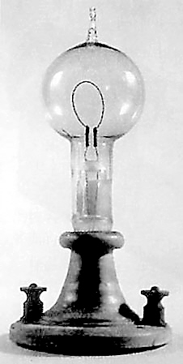 第一盏电灯

从1820年到1845年，美国的专利所有权人中只有19%其父母是专业人士，或来自知名的地主家族。在同一期间，获得专利权的人有40%只受过初级或更低的教育，就像爱迪生。此外，他们通常创立公司来利用他们的专利，这也像爱迪生那样。正如美国在19世纪比当时绝大多数国家在政治上更民主，美国在创新方面也比其他国家民主。这对美国在经济上迈向全世界最创新国家的道路极其重要。

如果你是有创意的穷人，要取得专利并不难，因为申请专利不必花太多钱，但要利用专利赚钱却是另一回事。当然，其中一个方法是把专利卖给别人。这是爱迪生初期的做法，为了筹措资本，他把他的四路多工电报专利以一万美元卖给西方联盟公司。但销售专利只有对像爱迪生这样的人才划算，因为他产生创意的速度比他实际应用它们还快。（他在美国拥有1093项专利，在全世界有1500项专利，都打破世界纪录）从专利通往赚钱最好的道路是自己创立企业。但创立企业需要资金，需要银行借钱给你。

美国的发明家再一次地相当幸运。在19世纪期间，金融中介和银行业迅速扩张，提供了经济快速成长和工业化的重要助力。在1818年，美国营运中的银行有338家，总资产为一亿六千万美元；到1914年，银行数目达到27864家，总资产二百七十三亿美元。美国的潜在发明家有现成的资金渠道帮助其开创自己的事业。此外，美国银行和金融机构的激烈竞争，意味可获得相当低利率的资本。

墨西哥的情况却大不相同。事实上，在墨西哥革命开始的1910年，墨西哥只有四十二家银行，其中两家控制着所有银行资产的60%。和美国竞争激烈的环境不同，墨西哥银行业几乎没有竞争可言。缺乏竞争意味银行可以向顾客收取很高的利率，并且通过只借钱给有权势和已经很富有的人，使他们得以利用这些信用渠道强化自己对许多经济部门的掌控。

墨西哥银行业在19世纪和20世纪的营运形式，是独立后墨西哥政治制度的直接结果。经历桑塔安纳时代的混乱后，接着是法国皇帝拿破仑三世徒劳无功地尝试在墨西哥建立殖民政权，从1864年到1867年间扶持麦克西米连皇帝。法国人被驱逐后，墨西哥制订了一部新宪法。但由胡亚雷斯和他死后的特哈达建立的政府，很快遭到年轻的军头迪亚斯的挑战。迪亚斯将军在对抗法国的战争中战功彪炳，并开始对权力存有野心。他组织一支反抗军，并在1876年11月的特科亚克战役中打败政府军。次年五月，他设法让自己当选总统，并以大体上未中断、且愈来愈独裁的方式统治墨西哥，直到三十四年后在爆发的革命中被推翻。

和伊图尔比德和桑塔安纳一样，迪亚斯从担任军事指挥官发迹。从军人跨入政坛在美国也可见到，美国第一任总统华盛顿在独立战争中也是战功辉煌的将领。南北战争联邦军的常胜将领之一格兰特，在1869年当上总统；二战欧洲盟军的最高统帅艾森豪威尔，从1953年到1961年担任美国总统。不过与伊图尔比德、桑塔安纳和迪亚斯不同的是，美国的军事将领都未以武力取得权力，也未仗恃武力逃避交出权力。他们行动做事都遵守宪法。虽然墨西哥在19世纪也有宪法，但对限制伊图尔比德、桑塔安纳和迪亚斯的行为却没有作用。只有以这些人取得权力的相同方法，才能让他们交出权力：也就是使用武力。

迪亚斯侵犯人民的财产权，擅自征用广大的土地，并授予各种商业经营独占权和优惠权给他的支持者，包括银行业。这种行为并非新鲜事，这与过去西班牙征服者的做法如出一辙，桑塔安纳只是追随他们的脚步。

美国银行业对促进国家经济富裕的帮助远比墨西哥银行业大，原因与银行业业主动机的差异无关。支撑墨西哥银行业独占特性的获利动机，在美国也存在，但这种获利动机却以不同方式被引导，原因是美国的制度与墨西哥大不相同。美国的银行家面对的是不同的经济制度，而这些制度让他们处在远为激烈的竞争中。这主要是因为制订银行业法规的政治人物本身也面对大不相同的诱因，而这些诱因则由不同的政治制度所形成。没错，在18世纪末美国宪法开始运作不久，一种类似后来墨西哥的银行体系也开始崛起。政治人物尝试建立州层次的银行独占，以便授予他们的朋友和伙伴，交换部分独占获利。这些银行也很快开始放款给制订法规的政治人物，就像墨西哥一样。但这种情况在美国无法长久持续，因为尝试建立这种银行垄断的政治人物必须面对选举和改选，不像墨西哥的政治人物不必接受选举考验。对政治人物来说，建立银行独占，然后放款给政治人物是很划算的生意，然而这对人民不是什么好事。和墨西哥不同，美国人民可以节制政治人物，并淘汰那些利用职权为自己牟利或为亲信制造独占的政客。其结果是，银行独占跟着崩垮。美国的政治权利较为普及，尤其是与墨西哥相比较，因此保证了获得融资和贷款的平等权利。这也反过来确保有创意和发明的人，能从创意和发明中获益。

## （7）路径依赖式的改变

世界在1870年代和1880年代发生了改变，拉丁美洲也不例外。迪亚斯建立的制度，与桑塔安纳或西班牙殖民国家的制度没有两样。世界经济在19世纪下半叶蓬勃发展，蒸汽船和铁路等运输上的创新促使世界贸易大幅扩张。这一波全球化意味资源丰富的国家如墨西哥——或更贴切地说是这类国家里的菁英阶层——可以出口原料和自然资源给工业化中的北美和西欧，并从中牟取利益。迪亚斯和他的亲信因此发现自己处在一个不同且快速演变的世界。他们意识到墨西哥也必须改变，但这不表示必须革除殖民式的制度，并以类似美国的制度取代。他们选择的“路径依赖”（path-dependent）式改变，只导致已造成拉丁美洲既贫穷又不平等的制度演进至下一个阶段。

全球化使美洲的大片旷野，即所谓的开放边疆（open frontiers）变得价值非凡。这些边疆的开放通常只是虚构的，因为有被残暴剥削的原住民居住在那里。但争夺这里突然变得有价值的资源是19世纪下半叶美洲最具重要性的过程之一。这些有价值的边疆突然开放并没有让美国和拉丁美洲走上类似的路径，反而带来由既有制度的差异所形成的更大分歧，尤其是有关谁有权取得土地这个议题。在美国，一连串的立法行动，从1785年的土地法（Land 0rdinance）到1862年的公地放领法案（Homestead Act），都大开取得边疆土地的门。虽然原住民一直被排挤在外，但这些发展创造了平等且经济上充满活力的边疆。然而，在大多数拉丁美洲国家，政治制度制造出极为不同的结果，边疆土地被分配给有政治权势者、有钱人和有关系者，让这些人变得更有权势。

迪亚斯也开始废除许多阻碍国际贸易的殖民制度残留，因为他预期国际贸易能让他和他的支持者获得许多利益。不过，他的模式仍然与格兰德河北边邻国的经济发展模式不同，而是和柯尔特斯、皮萨罗及德托雷多等人相同，即菁英可获得庞大的利益，其余所有人则被排除在外。当菁英投资时，经济会稍微成长，但这种经济成长注定会令人失望，同时在这种新秩序下，缺乏权利的人也被牺牲了，就像诺加雷斯内地索诺拉省的雅基人。从1900年到1910年，大约三万名雅基人遭到驱逐，他们基本上都沦为奴工，被送往尤加敦的黄条龙舌兰农场工作。（黄条龙舌兰的纤维是一种有价值的出口产品，可以用来制造绳子和麻线。）

阻碍墨西哥和拉丁美洲成长的特定制度模式一直持续到20世纪，这一点由以下事实清楚展现：就像在19世纪，这个模式导致各方争夺由权力带来的利益，制造出经济迟滞、政治不稳定、内战和政变。迪亚斯终于在1910年被革命军推翻。墨西哥革命之后，其他国家也相继革命，包括1952年的玻利维亚、1959年的古巴，和1979年的尼加拉瓜。另一方面，哥伦比亚、萨尔瓦多、危地马拉和秘鲁陷于长期内战。征收或威胁征收资产仍然经常发生，玻利维亚、巴西、智利、哥伦比亚、危地马拉、秘鲁和委内瑞拉，都推行大规模的农地改革（或企图改革）。革命、征收和政治不稳定伴随着军政府，以及各种类型的独裁统治。虽然拉丁美洲也逐步迈向更开放的政治权利，但一直到1990年代大部分拉丁美洲国家才变成民众政体，而且即使如此也还经常陷于不稳定。

这种不稳定常伴随大规模镇压和谋杀。智利1991年的真相与和解国家委员会报告证实，在1973年到1990年的皮诺切特独裁统治期间，有2279人因为政治原因被杀害，另外有五万人可能遭囚禁和酷刑，还有数十万人被革职。1999年危地马拉的历史澄清委员会报告确认，总共有42275名受害者，虽然有其他人宣称从1962年到1996年有二十万人在危地马拉遭谋杀，其中有七万人在里奥斯将军统治期间遭杀害，但里奥斯非但未因其罪行而受到惩罚，甚至还在2003年出马竞选总统；所幸他并未当选。阿根廷的失踪者国家调查委员会估算从1976年到1983年，被军方谋杀的人数约九千人，但该报告声明实际人数可能更高。（人权组织估计的人数约三万人。）

## （8）赚一、二十亿

殖民社会的组织和这些社会制度的残留，造成了深远的影响，形成今日美国和墨西哥的差异，因此而有两边截然不同的诺加雷斯。比尔盖茨和施林（Carlos Slim）两人如何变成全球首富的对照——巴菲特是另一个例子——说明了背后运作的力量。盖茨和微软公司崛起的故事家喻户晓，但盖茨是全球首富和全球顶尖创新科技公司创办人的身份，并未阻止美国司法部在1998年5月8日对微软公司提起民事控告，声称微软滥用独占势力。争议的焦点是微软将其IE浏览器与Windows操作系统捆绑在一起。政府注意盖茨已经很久，最早在1991年美国联邦贸易委员会就已启动调查，想确定微软是否滥用它在个人电脑操作系统上的垄断地位。2001年11月，微软与司法部达成和解协议；即使惩罚比许多人要求的轻微，但微软的气焰已受到压制。

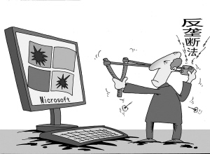

美国反垄断法——谢尔曼法不是吃素的

在墨西哥，施林并不是靠创新赚得他的财富。早期他在股市交易获利丰硕，收购并改造困难企业也颇为成功。他一鸣惊人的出击是收购墨西哥电信公司（Telmex），也就是1990年被萨林纳斯总统民营化的独占电信事业。政府在1989年9月宣布有意出售墨西哥电信51%的投票股权（所有股票的20.4%），并在1990年11月接受投标。虽然施林所投并非最高标，以他的卡索集团为首的集团却赢得了这次标售。施林没有立即支付价款买下股票，而是设法延迟付款，利用墨西哥电信本身的股利来偿付股票。过去是国营独占事业的公司，现在成了施林的独占事业，而且获利高得惊人。

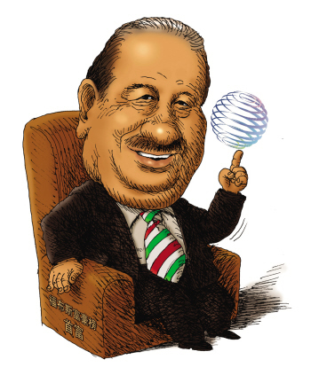

同墨西哥政治菁英结盟的施林，将墨西哥电信玩弄于股掌之上

造就施林的经济制度和美国的经济制度大不相同。如果你是墨西哥创业家，进入障碍会在你事业的每个阶段扮演重要角色。这些障碍包括必须取得昂贵的执照、必须穿越繁琐的程序、政治人物和市场中已存在的经营者会蛮横阻挡你的前进道路，以及因为金融业与你的竞争对手结伙而使你难以取得融资。这些障碍可能无法克服，使你难以进入高利润的领域，或者成为你最好的助力，让你的竞争者无法靠近。两种情况的差别当然是你认识谁、你可以影响谁——以及，没错，你可以贿赂谁。施林是一位有才干且野心勃勃的人，来自相对平凡的黎巴嫩移民背景，但他是取得独家合约的大师；他设法垄断了墨西哥获利丰厚的电信市场，然后把触角延伸到拉丁美洲各处。

施林墨西哥电信的垄断不断遭到挑战，但这些挑战一直没有成功。1996年长途电话服务商阿凡电信（Avantel）向墨西哥竞争委员会诉请调查墨西哥电信是否垄断电信市场；1997年该委员会宣布墨西哥电信在地方电话业务、全国长途电话和国际长途电话等领域，都有强大的垄断势力。但墨西哥监管当局尝试限制这种垄断的努力却毫无结果，原因之一是施林和墨西哥电信利用所谓的“保护诉请”程序，亦即向当局提出诉请，宣称特定法律不适用于当事人。保护诉请的概念可以回溯到1857年的墨西哥宪法，原本是为了保护个人的权利和自由。然而在墨西哥电信和其他墨西哥独占企业手中，它成了巩固垄断地位的可怕工具。保护诉请非但没有保护人民的权利，反而提供法律公平性的漏洞。

施林靠墨西哥经济致富主要归功于他的政治关系。他尝试在美国创业就没有那么成功了。1999年，他的卡索集团买下电脑零售商美国电脑公司（CompUSA），而美国电脑公司先前已授权一家叫COC服务的公司在墨西哥销售产品。施林立刻就违背合约在墨西哥成立自己的连锁商店，排除COC的竞争，但COC在达拉斯法院控告美国电脑公司。达拉斯没有保护诉请程序，所以施林败诉，并被罚款四亿五千四百万美元。代表COC的律师维纳（Mark Werner）事后说：“这项判决传达的信息是，在全球经济的版图中，想来美国市场的企业必须遵守美国的规则。”当施林面对美国的制度，他惯用的赚钱伎俩就不管用了。

## （9）解释世界不平等的理论尝试

我们生活在不平等的世界，各国之间的差异类似于诺加雷斯两边的不同，只是规模更大。在富裕国家，民众的身体更健康、更长寿，而且受的教育高得多。他们生活中也有渠道利用各种设施和选择，从度假到就业机会等等，而这些都是贫穷国家难以企及的。富国的人民也能在没有坑洞的公路上开车、使用抽水马桶和电力，家里也有自来水。他们通常也有不会随便逮捕和骚扰人民的政府，反而政府会提供各种服务，包括教育、卫生医疗、道路以及治安。另外值得一提的是，公民可以在选举中投票，对国家的政治方向有发言权。

世界不平等的悬殊差异清楚呈现在所有人面前，即使是生活在许多没有电视和网络的穷国人民也都知道。这种对差异的认知促使许多人非法越过格兰德河或地中海，以便体验富国的生活水平和机会。这种不平等不只是影响穷国个人的生活，也导致不满和憎恨，对美国和其他国家产生严重的政治后果。了解这些差异为什么存在和造成它们的原因，就是本书探讨的焦点。发展这种了解的目的不只在于了解这件事本身，同时也是为了构思更好的点子以跨出第一步去改善数十亿贫困者的生活。

诺加雷斯围墙两边的不一致只是冰山的一角。正如整个墨西哥北部都受惠于与美国贸易往来（虽然并非所有贸易都属合法），诺加雷斯的居民比其他墨西哥人更富裕，一般墨西哥人的平均年家庭收入只有五千美元。索诺拉省诺加雷斯的相对富裕，主要归功于集中在工业园区的加工出口工厂；而第一个工业园区是由加州一名篮子制造商坎贝尔所兴建。第一家进驻的工厂则是亚利桑那州诺加雷斯的笛子与萨克斯风制造商业主博斯拥有的乐器公司柯因亚特。柯因亚特之后，紧接着梅瑞思（Memorex，电脑缆线）、阿凡特（Avent，医院制服）、格兰特（Grant，太阳镜）、钱柏林（Chamberlain，车库门开关装置），以及新秀丽（Samsonite，旅行箱）。重要的是，这些全都是美国企业和企业人士，使用美国资本和技术。因此，索诺拉省诺加雷斯相对于墨西哥其他地方较为富裕，其来源是外国。

不过，美国和墨西哥的差异相较于世界其他国家还算较小。美国人民平均的财富是墨西哥人民平均的七倍，是秘鲁或中美洲人民平均的十倍以上。美国人比下撒哈拉非洲人民平均富裕约二十倍，而且是住在马里、埃塞尔比亚和塞拉利昂等非洲最穷国家人民的近四十倍。不只是美国如此，有一小群富裕国家——主要在欧洲和北美，加上澳大利亚、日本、新西兰、新加坡、韩国和台湾——它们的人民都享有与世界其他国家人民大不相同的生活。

亚利桑那州诺加雷斯远比索诺拉省诺加雷斯富裕的原因很简单：因为边界两边有着大不相同的制度，为诺加雷斯两边的居民创造了极为不同的诱因。今日的美国远比墨西哥或秘鲁富裕，也是因为它的经济和政治制度为企业、个人和政治人物塑造了诱因。每一个社会都依照一套经济和政治规范在运作，这套规范由国家和公民集体创造并执行。经济制度塑造经济诱因：接受教育、储蓄和投资、创新和采用新科技的诱因等等。是政治程序决定了人民生活在何种经济制度下，而政治制度决定了这个程序如何运作。例如，一个国家的政治制度决定公民有没有能力控制政治人物并影响他们如何行为。这又反过来决定政治人物是否为人民的代理人（尽管并非完美），或者能滥用委托他们行使的权力，或他们会不会篡夺权位以聚敛财富、追求自己的目标而危害人民的利益。政治制度包括、但不限于形诸文字的宪法，也不限于该社会是否为民主政体，政治制度包括国家规范和管理社会的权力和能力。我们也必须更广泛地考量决定政治权力在社会里如何分配的因素，尤其是不同群体以集体行动追求自己的目标、或阻止其他人追求目标的能力。

正如制度会在现实生活影响行为和动机，它们也能决定国家的成功或失败。个人才能在社会每个层面都很重要，但仍然需要一个制度架构来将它转换成有用的力量。盖茨和其他信息科技的传奇人物一样，有极高的才能和野心，但他的所作所为终究是回应诱因。美国的教育体系让盖茨和类似他的人，能获得独特的技术来搭配他们的天分；美国的经济制度能让这些人轻易开创企业，不必面对无法攀越的障碍；美国劳动力市场让他们能雇佣合格的员工，而相对开放竞争的市场环境则让他们能扩展公司和行销产品。这些创业家从一开始就有信心能够执行他们梦想的计划：他们信任制度和法治，而且不担心他们财产权的安全问题。最后，这套政治制度确保稳定性和持续性。这样一来，这些创业家可以确定没有独裁者能掌控权力并改变游戏规则、征收他们的财富、囚禁他们，或威胁他们的生命和生计。他们也可以确定社会没有特定的利益集团能操纵政府往经济上极度不利的方向走，因为政治权力受到节制且分散够广泛，因此一套能为繁荣创造诱因的经济制度得以出现。

本书将说明，虽然经济制度对决定国家的贫穷或富裕极其重要，但决定国家经济制度的是政治和政治制度。归根结底，美国良好的经济制度来自于1619年起逐步发展而来的政治制度。我们解释世界不平等的理论说明，政治与经济制度如何交互影响而造成了贫穷或富裕，以及世界不同的部分如何产生不同的制度。我们对美洲历史的简短回顾，提示了塑造政治和经济制度的几股力量。今日不同模式的制度都有深植的历史根源，因为一旦社会以特定的方式架构后，就倾向会长久延续。我们将说明这个事实源自政治和经济制度交互影响的方式。

这种长久延续以及造成这种情形的力量，也解释了何以想消除世界的不平等和让穷国变富裕如此困难。虽然制度是造成两个诺加雷斯的差异以及墨西哥与美国不同的关键，但这不表示墨西哥人能达成改变制度的共识。一个社会并不必然会发展或采用最能增进经济增长或人民福祉的制度，因为其他制度对控制政治和政治制度的人可能更有利。社会中掌握权势的人和无权势者往往对应该保留何种制度、应该改变何种制度看法分歧。施林不会乐于看到他的政治关系消失，或保护他事业的进入障碍被撤除——尽管新企业进入市场能让数百万墨西哥赚钱。因为没有这种共识，社会最后的规则就取决于政治：谁有权力和这种权力可以如何运作。施林有权力得到他想要的东西，相较之下盖茨的权力则受到许多限制。这是为什么我们的理论不只牵涉经济、也牵涉政治的原因。我们谈的是制度对国家成功或失败的影响——亦即贫困与富裕的经济学；我们谈的也是制度如何形成又如何随着时间演变，以及即使它们为数百万人带来贫穷和不幸却为何无法改变——亦即贫困与富裕的政治学。
