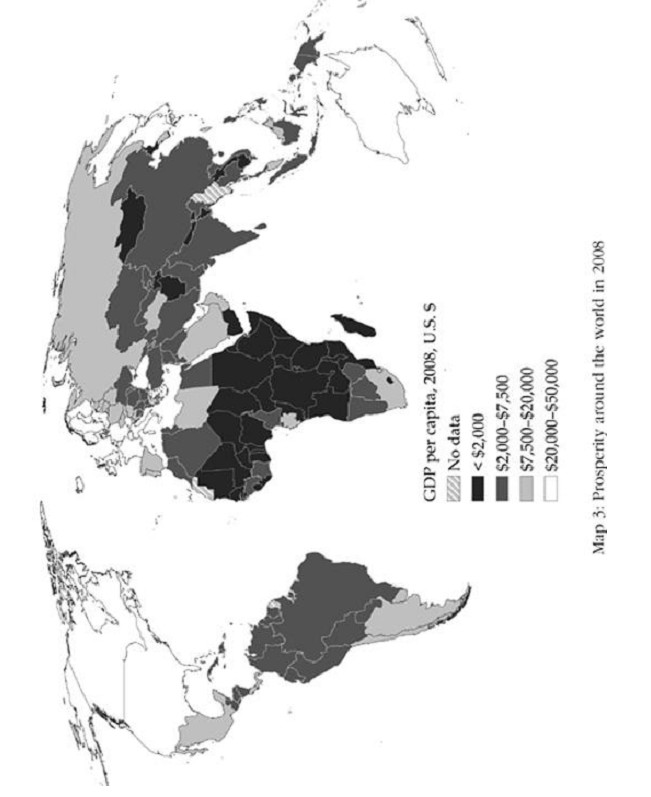
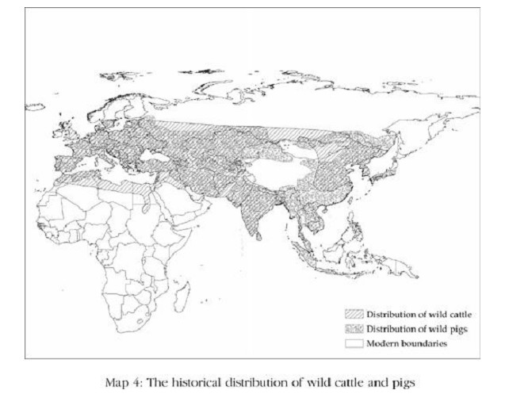
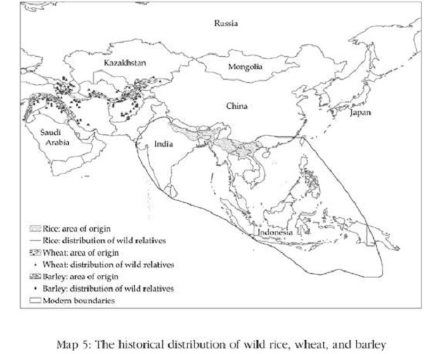
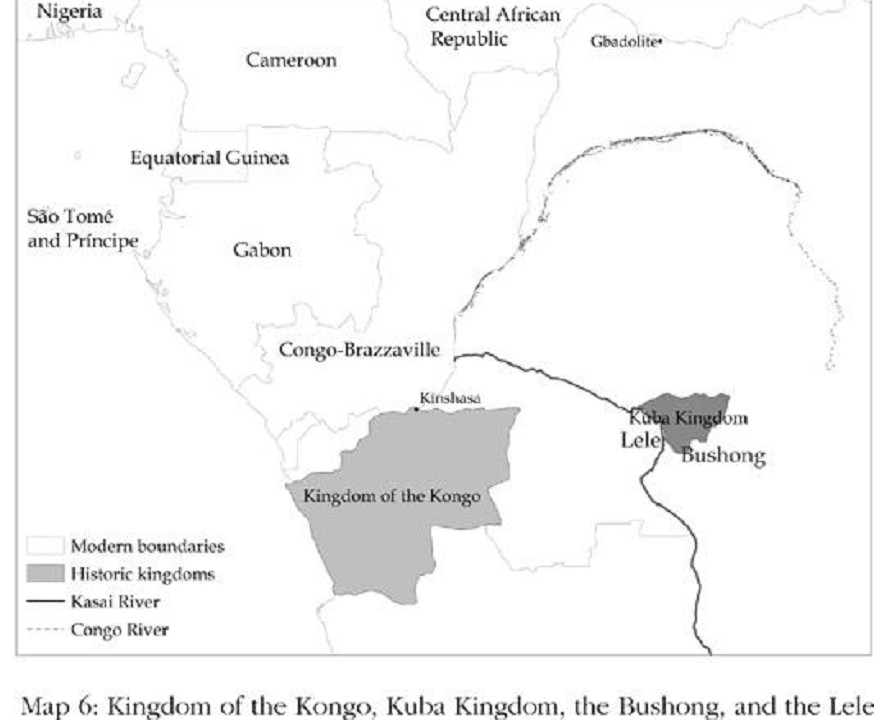

# 2、 无效的理论

## （1）世界情形

本书的焦点是解释世界的不平等，以及其中一些明显可见的普遍模式。第一个经历持续经济成长的国家是英国——或称大不列颠，指的是1707年以后英格兰、威尔士和苏格兰的联盟。18世纪下半叶，出自重大科技突破并将之应用到工业上的工业革命逐渐发挥影响，经济成长也随之缓慢浮现。英国的工业化很快散播到大多数西欧国家和美国。英国的富裕也快速扩散到英国的移民殖民地（settler colonies）如加拿大、澳大利亚和新西兰。我们可以列出今日三十个富裕国家的清单，除了上述国家外，也包括日本、新加坡和韩国。后面三国的富裕属于一种更广泛的模式，许多东亚国家经历快速成长都是这种模式，包括中国台湾和后来的中国大陆。

世界上收入排名殿后的国家呈现的图景，也和排名顶端的国家一样鲜明。如果你列出今日全世界最贫穷的三十个国家，你会发现它们几乎全都在下撒哈拉非洲，加上不在非洲的阿富汗、海地和尼泊尔，后面这几个国家都有某些与非洲国家相同的关键性质，我们稍后将解说。如果你回到五十年前，顶端的三十国和底部的三十国跟现在没有太大差异。当时的新加坡和韩国不在富国之列，底部三十国会有一些和今日不同的国家，但整体图景会与今日所见的相当一致。如果回溯到一百年前或一百五十年前，你会发现两个类别几乎都是相同的国家。

地图3显示2008年的情况。颜色最深的国家代表世界上最贫穷的国家，年人均国内生产总值不到2000美元。大多数非洲国家属这种颜色，阿富汗、海地和部分东南亚国家（如柬埔寨和老挝）也是。朝鲜也在这一组国家里。白色代表最富裕的国家，年人均国内生产总值20000美元以上。我们在这一组看到常见的国家：北美、西欧国家、澳大利亚和日本。

    

我们可以在美洲发现另一个有趣的模式。列一张从最富有到最贫穷的美洲国家清单，你将发现最上面是美国和加拿大，其次是智利、阿根廷、巴西、墨西哥和乌拉圭，或许还有委内瑞拉，视原油价格而定。再下来有哥伦比亚、多米尼加共和国、厄瓜多尔和秘鲁。垫底的是另一些明显贫穷很多的国家，包括玻利维亚、危地马拉和巴拉圭。回到五十年前，你会发现完全一致的排名。一百年前：一样。一百五十年前：还是一样。因此不只是美国和加拿大比拉丁美洲富裕；拉丁美洲之内的富国和穷国也有一个明确和持续的差距。

最后一个有趣的模式是在中东。我们在中东发现蕴藏丰富石油的国家如沙特阿拉伯和科威特，它们的人均国内生产总值接近三十个富国。但如果油价下跌，它们会很快从排名滑落。只有很少石油或没有石油的中东国家如埃及、约旦和叙利亚，人均国内生产总值水平全都类似危地马拉和秘鲁。没有石油的中东国家也都很穷，尽管它们跟中美洲与安第斯山国家一样，还不像下撒哈拉非洲国家那么穷。

虽然今日我们看到这些富裕模式有相当高的延续性，但这些模式并非没有改变或不会改变。第一，正如我们已经强调过，大多数目前世界的不平等始于18世纪末，是工业革命以后发生的。截至18世纪中叶，贫富国的差距不只小得多，而且当时贫富的排名也与后来一直保持稳定的排名不一样。例如在美洲，过去一百五十年我们看到的排名与五百年前完全不同。第二，许多国家经历了数十年的快速成长，像二战后的多个东亚国家，和晚近的中国大陆。也有许多国家在成长之后转而变成衰退，例如阿根廷快速成长直到1920年，变成世界最富裕的国家之一，但之后便开始长期滑落。苏联是更值得注意的例子，它在1930年到1970年间成长迅速，但随后急速崩跌。

什么原因造成贫穷与富裕以及成长模式的重大差异？为什么西欧国家和西欧移民进驻的殖民地在19世纪开始成长，此后一直维持好景？什么原因让美洲国家的不平等排名持久不变？为什么下撒哈拉非洲和中东国家未能创造出西欧那样的经济成长，而许多东亚国家则出现飞跃的经济成长？

有人可能认为，世界的不平等差距如此大、模式如此截然不同，表示一定有一个众人都能接受的解释，但实际上并非如此。大多数社会科学家对贫穷与富裕根源的假设完全说不通，无法让人信服地解释这样的情形。

## （2）地理假说

世界不平等的原因有一个广被接受的理论，即地理假说，该假说宣称富国与穷国的巨大分野是由地理差异造成的。许多穷国如非洲、中美洲和南亚国家，都位于南北回归线间的热带。对照之下，富国往往位于温带地区。穷国与富国的地理集中性赋予地理假说一种肤浅的吸引力，许多社会科学家和学者就以这种假设来做为理论和观点的基础。可惜这无法使错误变正确。

早在18世纪伟大的法国政治哲学家孟德斯鸠就已发现，富裕与贫穷呈现出地理的集中，并为这种现象提出一种解释。他宣称热带气候下的人民倾向较懒惰，缺乏探究的精神，因此不努力工作，不知创新，这是他们贫穷的原因。孟德斯鸠也推论，懒惰的人倾向被专制君主统治，暗示热带地理位置不仅可解释贫穷，也能说明一些与经济失败有关的政治现象，例如独裁政治。

 孟德斯鸠

热带国家原本就容易贫穷的理论，虽然与近来经济快速成长的国家如新加坡、马来西亚和博茨瓦纳相矛盾，仍旧被一些人大力提倡，例如经济学家萨克斯。这个观点的现代版不强调气候对工作努力或思考过程的直接影响，而是强调两项额外的论点：第一，特别是疟疾等热带疾病对健康有极不利的影响，因此也影响劳动生产力；第二，热带土壤不容许高生产力的农耕。不过，结论是相同的：温带气候比热带和亚热带地区有相对优势。

然而，世界的不平等无法以气候或疾病、或任何版本的地理假说来解释。只要想想诺加雷斯就知道，造成这个城市两边差异的不是气候、地理或疾病的环境，而是美国与墨西哥的边界。

如果地理假说无法解释诺加雷斯北边和南边，或朝鲜（北韩）与韩国（南韩），或柏林围墙倒塌前的东德与西德的差异，这套理论还能用来解释北美洲和南美洲的不同吗？或欧洲与非洲的差异？当然不能。

历史显示，气候或地理与经济成功没有单纯或持久的关联。例如，热带并非总是比温带贫穷。我们在上一章提到，在哥伦布征服美洲时，北回归线以南和南回归线以北的地区，也就是今日涵盖墨西哥、中美洲、秘鲁和玻利维亚的地区，是伟大的阿兹特克和印加文明的所在地。这些帝国在政治上集权而复杂，他们兴建道路，提供饥馑的赈济。阿兹特克人使用钱币和文字，印加人虽然缺少这两种技术，却以称作奇普的结绳记载大量信息。呈现鲜明对比的是，在阿兹特克和印加帝国的时代，阿兹特克人和印加人居住的地区以北和以南，即今日包括美国、加拿大、阿根廷和智利的地方，大多居住着缺乏这些技术的石器时代文明。美洲热带地区当时比温带富裕得多，这意味热带贫穷这个“明显的事实”既不明显、也非事实。而今日美国和加拿大远为富裕，与欧洲人初到美洲时的情况完全逆转。

这种逆转显然与地理毫无关系，而且正如我们已经谈到，是与这些地区遭到殖民的方式有关。这种逆转也不局限于美洲。南亚尤其是印度次大陆，以及中国大陆的人民，曾经比亚洲其他地方的人更富裕，比澳大利亚和新西兰的原住民更是如此。但那种情况也已大幅逆转，韩国、新加坡和日本兴起成为亚洲的富国，澳大利亚和新西兰的富裕更超越几乎所有亚洲国家。即使在下撒哈拉非洲也有类似的逆转发生。在欧洲开始与非洲频繁接触之前，非洲南部地区都是一些人口最稀疏、开发程度最低的国家，对它们的领土只有最松散的控制。但南非现在是下撒哈拉非洲最富裕的国家之一。再回溯更早些的历史，我们又看到热带曾经繁华一时，部分前现代文明如今日柬埔寨的吴哥窟、印度南部的毘迦叶那迦罗王朝，和埃塞俄比亚阿克苏姆，都在热带繁荣兴盛；伟大的印度河谷文明摩亨佐达罗和今日巴基斯坦的哈拉帕也是。历史因此证明，毫无疑问的，热带地理位置与经济成功之间没有单纯的关系。

热带疾病显然造成许多非洲人饱受病痛之苦，婴儿死亡率也较高，但它们不是非洲贫穷的原因。疾病大体上是贫穷的结果，也因为政府没有能力或不愿采取必要的公共卫生措施来消灭疾病。19世纪的英国也是很不健康的地方，但政府逐步投资在干净的水源、妥善处理污水和废水，最后还提供有效的公共卫生服务。健康和预期寿命提升不是英国经济成功的原因，而是英国先前的政治与经济变革的成果之一。亚利桑那州诺加雷斯的情况也是如此。

地理假说的其他部分是，热带较贫穷是因为热带农业原本就不具生产力。热带土壤较薄，无法保持养分；这个假说还强调，这种土壤有多容易被暴雨侵蚀。这种说法当然有一定道理，但我们将阐明，许多贫穷国家（尤其是在下撒哈拉非洲）的农业生产力——每英亩土地的农业产出——如此低的主要原因，与土壤品质无关，而是土地所有权结构的结果，以及政府和制度为农民创造的诱因所造成。我们也将阐明，世界的不平等无法以农业生产力的差异来解释。现代世界从19世纪发生的不平等扩大，是由工业科技与制造业生产的散播不平均所造成，而非源自农业生产表现的分歧。

另一个有影响力的地理假说版本，是由生态学家兼演化生物学家戴蒙所提倡。他宣称在五百年前的现代初期跨越各大陆的不平等，根源于动植物物种具备的不同历史特性，并因而影响了农业生产力。在某些地方如今日中东的肥沃新月地区，有许多物种可被人类驯化。而在其他地方如美洲，却缺少这类物种。有许多物种可供驯化对社会从狩猎采集生活转型为农业生活帮助很大。其结果是，肥沃新月地区发展发展农耕比美洲早。人口密度增加，有助于促进劳动的专业化、贸易、都市化和政治发展。很重要的是，在农业为主的地方，科技创新发展比世界其他地方更快。因此，根据戴蒙的说法，动物和植物物种可得性的差异制造了农业发展程度的差异，导致不同大陆间的技术发展与富裕程度的不同。

虽然戴蒙的理论可以解开他所专注的谜题，但它无法用来解释现代世界的不平等。例如，戴蒙宣称西班牙之所以能支配美洲的文明，是因为他们有更悠久的农耕历史和由此而来的较优越技术。但我们现在必须解释，为什么住在以前阿兹特克和印加土地的墨西哥人和秘鲁人现在很贫穷。虽然拥有小麦、大麦和马匹可能让西班牙人比印加人更富有，但两者的收入差距并不是很大。西班牙人的平均收入可能是印加帝国人民的不到两倍。戴蒙的理论暗示，一旦印加人有机会接近所有物种，以及他们过去无法自己发展的技术后，应该就能很快达到和西班牙人一样的生活水平。然而这种情况并未发生。相反的，在19世纪和20世纪，西班牙和秘鲁的收入差距变得更大。今日的西班牙人比秘鲁人富有六倍以上。这种收入差距与现代工业技术散播的不平均息息相关，但是与动植物驯化的潜力、或与西班牙和秘鲁土地本身的农业生产力差异无关。

当西班牙（有点落后地）采用蒸汽动力、铁路、电力、机械化和工厂生产的技术时，秘鲁并未跟着采用，或至少采用的速度很迟缓和不完全。这种技术差距持续到今日，并随着新科技出现而自动造成更大幅度的差距，特别是与信息有关的科技诞生后，更进一步助长许多已开发国家和部分快速发展国家的领先形势。戴蒙的理论并未告诉我们为什么这些重要的科技并没有四处散播以及缩小世界各地的收入差距，也未解释北半边的诺加雷斯为什么远比围墙的南半边富裕，即使两边在五百年前都属于同一个文明。

诺加雷斯的故事凸显戴蒙理论的另一个重大问题：正如我们已经讨论到，不管印加和阿兹特克帝国在1532年时有什么弱点，当时秘鲁和墨西哥无疑比后来变成美国和加拿大的那部分美洲繁荣得多。北美洲变富裕的原因就是它积极采用了工业革命的技术与进展。那里的人口教育程度提升，铁路扩散到大平原各地，与南美洲的情况成鲜明的对比。这无法从北美洲和南美洲的地理条件差异来解释，因为南美洲的地理条件显然比北美洲具有优势。

现代世界的不平等大体上源自科技应用与散布的不平均，而戴蒙的理论的确包含有关这一点的重要论述。例如他跟随在历史学家迈克尼尔之后主张，东西向的欧亚大陆让许多作物、动物和创新，从肥沃新月地区传播到西欧，而南北向的美洲则使在墨西哥发明的文字系统，无法散播到安第斯山或北美洲。然而大陆的方向无法提供今日世界不平等的解释。想想非洲，尽管撒哈拉沙漠确实构成货物和思想从北传到下撒哈拉非洲的重大阻碍，这却并非完全无法克服。葡萄牙人和当时其他的欧洲人沿着海岸航行，并在一个收入差距比今日小很多的时代消弭了知识上的鸿沟。但后来非洲并未赶上欧洲，反而现在大多数非洲国家和欧洲国家之间的收入差距变得更大。

我们也必须说明，戴蒙有关各大陆不平等的理论无法解释大陆内部的差异，而这是现代世界不平等的基本部分。例如，虽然欧亚大陆的方向可能解释英国如何从中东的创新获益，而无需自己从头创新，但它未解释为什么工业革命发生在英国而非像摩尔多瓦这类地方。此外，正如戴蒙自己指出，中国和印度从极丰富的动物和植物物种、以及欧亚大陆的方向获益良多，但今日世界大部分的贫穷人口却在这两个国家。

事实上，了解戴蒙理论的界限最好的方法，是从他自己的解释变数着手。地图4显示现代猪的祖先野猪和现代牛的祖先原牛的分布。两种物种都遍布欧亚大陆甚至非洲北部。地图5显示某些现代驯化作物如亚洲种植稻米的原种水稻，以及现代小麦和大麦的原种分布。它显示稻米的野生原种广泛分布在南亚和东南亚，而大麦和小麦原种的分布则呈一个长拱形，从地中海东部穿过伊朗，到阿富汗和数个“斯坦”国家（土库曼斯坦、塔吉克斯坦、吉尔吉斯斯坦）。这些原种遍布欧亚大陆的许多地方，但它们的广泛分布意味欧亚大陆内部的不平等无法以物种发生率为基础的理论来解释。

     

地理假说不但无助于解释有历史以来的富裕根源，它的主要论点大体上也不正确，而且无法解释我们在本章开头提出的世界贫富情形问题。有人可能会说，任何持续的模式（例如美洲各国的收入等级，和欧洲与中东呈现鲜明而悬殊的差距）都可以用不变的地理因素来解释，但实际情况并非如此。我们已谈过美洲内的模式不太可能由地理因素所造成。在1492年之前，墨西哥中部谷地、中美洲和安第斯山的文明，都拥有比北美或阿根廷与智利等地更高的技术和生活水平。虽然地理条件没有改变，欧洲殖民者实施的制度却制造出“命运逆转”的发展。出于同样的理由，地理也不太可能解释中东的贫穷。毕竟中东曾在新石器革命带领世界，并在今日伊拉克的地区发展出第一批城镇。铁最早在土耳其被人冶炼，而直到中古世纪，中东的技术都十分发达。我们将在第五章看到，不是中东的地理条件造成新时期革命在世界的那个部分蓬勃展开，也不是地理因素导致中东贫穷。事实上，鄂图曼帝国的扩张和统一，以及帝国留下的制度才是让中东贫穷至今的原因。

最后，地理因素不但无助于解释今日世界各部分的差异，也无法说明为什么像日本和中国等许多国家先经历长期停滞、然后展开快速成长的过程。我们需要另一个更好的理论。

## （3）文化假说

第二个广为接受的理论是文化假说，认为富裕与文化有关。文化假说就像地理假说一样有着显赫的渊源，至少可以追溯到伟大的德国社会学家韦伯，他宣称宗教改革和它激发的新教伦理，在西欧现代工业社会的崛起中扮演关键角色。文化假说不再只以宗教为基础，而是也强调其他种类的信仰、价值和伦理。

 马克斯•韦伯

虽然公开说出口是政治不正确的，但许多人心里仍认为非洲人贫穷是因为他们缺乏良好的工作伦理，和迷信巫术和魔法，或抗拒新西方技术。许多人也相信拉丁美洲永远不会富裕，因为那里的人民天生就是又穷又爱挥霍，同时因为他们受到“伊比利亚”文化或“明天再说”文化的毒害。当然，许多人曾认为，中国文化和儒家价值不利于经济成长，然而现在中国人的工作伦理却被认为是中国、香港和新加坡的成长引擎，其重要性受到大声宣扬。

文化假说对了解世界不平等有帮助吗？有，但也没有。说有是从社会规范来说，而社会规范与文化有关，很重要而且难以改变，同时它们有时候也支持制度性差异，即本书对世界不平等的解释。但大部分时候没有帮助，因为那些经常被强调的文化面向——宗教、民族的伦理、非洲的或拉丁的价值——对了解我们如何演变至今，和为什么世界的不平等长期延续，并不重要。其他面向如人们彼此信任的程度、或能不能互相合作虽然重要，但它们大多是制度的结果，而非独立的原因。

让我们回到诺加雷斯。正如前面提过，围墙的北边和南边在文化的许多面向上相同。然而在实际运作、规范和价值上可能有一些显著的差异，虽然这些差异并非原因，而是两个地方走上分歧发展道路的结果。例如，墨西哥人在调查中说他们信任别人，程度上低于美国人说他们信任别人。但墨西哥人缺乏信任并不令人意外，因为他们的政府无法消灭贩毒集团，也无法提供运作良好且不偏颇的司法制度。我们下一章将讨论的北韩和南韩情况也一样，南韩是世界的富国之一，而北韩则经常发生饥馑且深陷贫穷中。虽然今日的南北韩“文化”大不相同，但它并非两韩经济强弱的原因。朝鲜半岛有悠久的共同历史，在朝鲜战争和双方以北纬38度线划分边界前，两韩在语言、人种和文化上没有任何差别。就像在诺加雷斯一样，差别在于那道边界。在边界北方是一个不同的政权，实施不同的制度，制造不同的诱因。因此，穿越诺加雷斯两边或南北韩间的边界造成的任何文化差异，并不是贫富差距的原因，而是结果。

那么，非洲和非洲文化呢？从历史看，下撒哈拉非洲比世界大部分地区贫穷，而且那里的古文明没有发展出轮子、文字（埃塞俄比亚和索马里是例外）或耕犁。虽然这些技术直到19世纪末和20世纪初的欧洲殖民正式开始才被普遍采用，但非洲社会很早就知道这些技术了。欧洲人在15世纪末开始环非洲西岸航行，而亚洲则从更早的时代就已持续航行到非洲东部。

我们从刚果王国的历史，就可以了解为什么这些科技并未被采用。刚果王国位于刚果河口，今日的刚果民主共和国就是根据它而命名。地图6显示当时刚果所在的位置，以及另一个重要的中非洲国家库巴王国的位置，我们将在本书稍后讨论到这个国家。

    

葡萄牙航海家卡欧1483年首度来到刚果后，刚果开始与葡萄牙人密切接触。当时刚果以非洲的标准来看是一个高度集权的国家组织，首度姆班扎有六万人口，规模与葡萄牙首度里斯本差不多，比伦敦更大，伦敦在1500年的人口大约五万。刚果国王恩库武改信天主教，并改名为约翰一世。后来姆班扎的名称改为圣萨尔瓦多。拜葡萄牙人所赐，刚果人学会使用轮子和犁，葡萄牙人甚至在1491年和1512年派出农耕队来鼓励他们采用。但这些措施后来全归于失败。不过，刚果人整体而言一点都不厌恶现代科技，他们很快就采用一项令人敬畏的西方发明：枪。他们利用这项新颖而强大的工具来回应市场诱因：捕捉和出口奴隶。没有迹象显示非洲的价值或文化阻碍了新科技和做法的采用。随着刚果人与欧洲人的接触加深，他们也采用其他西方做法：文字书写、衣着和住房设计。在19世纪，许多非洲社会也借由改变生产模式来利用工业革命带来的经济机会。在非洲西部出现以出口棕榈油和花生为主的快速经济发展；在非洲南部各地，非洲人发展出口产品，卖到南非兰德快速扩张的工业区和矿业区。但这些富于潜力的经济实验的灭绝并不是因为非洲文化，也不是因为非洲人没有能力为自利采取行动，而是先遭到欧洲殖民主义的破坏，继之则被独立后的非洲政府压制。

刚果人未采用较优越的技术真正的原因是，他们缺少这么做的诱因。他们面对所有生产成果被权力极大的国王没收和课税的高度风险，而这与国王是否皈依天主教会无关。事实上，不只是他们的财产不安全，他们的生存也岌岌可危。许多刚果人被俘虏并卖为奴隶——完全不是能鼓励投资来增进长期生产力的环境。国王也没有诱因大规模采用犁、或把增进农业生产力列为他的优先要务，因为出口奴隶获利远高于此。

今日来看非洲人信任彼此的程度低于世界其他地方可能是真的，但这是过去长期的制度破坏了非洲人权与财产权的结果。被捕获并卖为奴隶的可能性，无疑影响了过去非洲人对彼此的信任程度。

韦伯的新教伦理又有什么影响？虽然新教徒占优势的国家如荷兰和英国确实是最早获得经济成功的国家，但宗教与经济成功却没有多大关系。法国是天主教占优势的国家，但也很快在19世纪模仿荷兰和英国的经济表现，而意大利今日也和其他国家一样繁荣富裕。再往更远的东方看，你会发现东亚的经济成功都与任何形式的基督教无关，因此也没有证据支持新教伦理与经济成功有特别的关系。

再来看热衷于文化假说的人士偏爱的一个地区：中东。中东国家主要信仰伊斯兰教，而正如我们已经提到，其中的非产油国都相当贫穷。产油国很富裕，但这种天赐的财富对沙特阿拉伯或科威特建立多元化的现代经济却没有多大帮助。这些事实不是可以充分证明宗教有关系吗？听起来似乎有道理，但这种说法也不正确。没错，像叙利亚和埃及这些国家很穷，他们的人口主要是穆斯林，但这些国家也在许多方面不同于其他国家，而这些方面对于繁荣富裕更是重要得多。例如，它们都曾是鄂图曼帝国的省份，而这对他们的发展方向造成极大的不利影响。在鄂图曼统治崩溃后，中东被吸收到英国和法国殖民帝国，两者又再阻碍了中东国家发展的可能性。独立以后，它们跟随许多前殖民国家的脚步，发展出阶层式的独裁政权，采用的政治和经济制度在我们看来大多无助于创造经济成功。这种发展道路大体上受到鄂图曼和欧洲统治的历史所塑造。伊斯兰宗教与中东贫穷的关系大体上是捏造出来的。

这些历史事件（而非文化因素）在塑造中东经济轨道上扮演的角色，也可以从暂时脱离鄂图曼帝国和欧洲强权的部分中东地区看出，例如1805年到1848年间的埃及在穆哈穆德•阿里在拿破仑时代占领埃及的法国军队撤退后夺得权力，他利用鄂图曼统治埃及领土的弱点，建立了自己的王朝，此后这个王朝以不同的形式统治直到1952年纳赛尔发动埃及革命。阿里的改革虽然是胁迫性的，却为埃及带来成长；国家官僚制度、军队、税制都被现代化，且农业和工业都出现成长。尽管如此，这个现代化和成长的过程在阿里死后便陷于停顿，使埃及落入欧洲的掌控。

但这或许是思考文化的错误方法，也许有关系的文化因素不是宗教，而是特定的“民族文化”。也许英国文化的影响很重要，可以解释为什么美国、加拿大和澳大利亚能如此繁荣富裕。虽然这种想法一开始很吸引人，但它也说不通。是的，加拿大和美国曾是英国殖民地，但塞拉利昂和阿尔及利亚也曾经是。前英国殖民地的富裕程度差异极大，就像世界各地的富裕程度差异一样大。英国的影响不是北美洲成功的原因。

文化假说还有一个版本：也许关系重大的不是英国与非英国的差别，而是欧洲与非欧洲的不同。欧洲人较优越可不可能是因为他们的工作伦理、人生观、犹太—基督教价值或罗马传承？西欧和北美的人口确实以欧洲后代为主，而两地是世界最富裕的部分。优越的欧洲文化传承也许就是富裕的根源——也是文化假说最后的庇护所。可惜这个版本的文化假说和其他假说一样缺乏说服力。阿根廷和乌拉圭属于欧洲裔的人口比例，比加拿大和美国还高，但阿根廷和乌拉圭的经济表现只能以不理想来形容。日本和新加坡的居民绝少欧洲后裔，但两国的富裕程度不亚于西欧许多部分。

中国的经济和政治体系尽管有许多缺点，却是过去三十年成长最迅速的国家。中国在毛泽东去世前的贫穷与中国文化没有关系，而是毛泽东以惨烈的方式管理经济和控制政治的结果。在1950年代，毛泽东推行大跃进，这项激烈的工业化政策导致大规模饥荒。1960年代，他展开文化大革命，对知识分子和受过教育的人——任何对党的忠诚遭到怀疑者——进行大规模迫害。这再度带来恐怖和社会才能与资源的巨大浪费。同样的，现在中国的成长与中国人的价值或中国文化的改变无关，而是源自邓小平和他的盟友推动改革所引发的经济转型过程；他们在毛泽东死后逐步放弃社会主义经济政策和制度，先是从农业着手，然后扩大到工业。

和地理假说一样，文化假说也对解释今日世界情形的许多面向没有帮助。美国和拉丁美洲在信仰、文化态度和价值上当然有差异，但正如亚利桑那州诺加雷斯和索诺拉省诺加雷斯之间、或南韩和北韩之间，这些差异是两边不同的制度和制度的历史发展的结果。强调源自西班牙帝国的“西班牙”或“拉丁”文化因素，无法解释拉丁美洲内的差异——例如，为什么阿根廷和智利比秘鲁和玻利维亚富裕。其他类型的文化理论——例如强调当代原住民文化的说法——也同样难以成立。阿根廷和智利的原住民人口比秘鲁和玻利维亚少，虽然这是事实，但以原住民文化当做解释也不成立。哥伦比亚、厄瓜多尔和秘鲁的收入水平相当，但今日哥伦比亚的原住民人口很少，而厄瓜多尔和秘鲁则很多。最后，大体说来改变很缓慢的文化态度也很难单独解释东亚和中国的成长奇迹。虽然制度也会长期延续，在特定情况下它们确实会快速改变，这一点我们也会谈到。

## （4）无知假说

最后一个解释为何某些国家贫穷、某些国家却富裕的流行理论是无知假说，认为世界不平等的存在是因为我们或我们的统治者不知道如何让穷国变富裕。这是大多数经济学家抱持的看法，而他们的概念则源自英国经济学家罗宾斯1935年提出的著名定义：“经济学是把人类行为当作目的与具有各种不同用途的稀缺手段之间的一种关系来研究的科学”。

从这个定义只要踏一小步，就可以认定经济学应该专注于以最佳方式利用稀缺手段、以满足社会的目的。的确，经济学中最著名的推论就是所谓的第一福利定理，定义了在哪些情况下“市场经济”的资源配置从经济观点来看是合乎社会要求的。市场经济是一个抽象概念，是用来描述一种所有个人与企业可以自由生产、购买和出售任何产品与服务的情景。当第一福利定理定义的这些情况不存在时就出现“市场失灵”。这种失灵提供了世界不平等的理论基础，因为愈多这种市场失灵未加解决，一个国家就可能愈贫穷。无知假说认为，穷国之所以贫穷，是因为它们有许多市场失灵，而经济学家和政策制定者不知道如何解决它们，而且在过去曾听从错误的建议。富国之所以富裕，是因为它们拟出更好的政策，并成功地消除这种失灵。

无知假说能解释世界不平等吗？非洲国家比世界其他地方贫穷，有没有可能是因为他们的领导人在治理国家时抱持相同的错误观念，导致国家陷于贫困，而西欧领导人则知识较充足且获得较佳的建议，而这说明了他们相对的成功？虽然有一些著名例子是由领导人误判政策的结果，因而采取造成灾难的政策，但无知最多只能解释一小部分的世界不平等。

表面上看来，加纳从英国独立后很快陷于经济长期衰退是无知造成的。当时英国经济学家基立克担任恩克鲁玛政府的顾问，他详细记录了许多问题。恩克鲁玛的政策专注在发展国营企业，结果证明效率很低。基立克回忆说：

“这家鞋子工厂……准备与北部一家肉品工厂结盟，由后者把兽皮运送到南方（距离超过五百英里）的皮革厂（现在已停工）；皮革再运回位于该国中部的库马西，距离皮革厂约两百英里。由于主要的鞋子市场是在阿克拉都市区，鞋子必须再运送两百英里回到南方。”

基立克委婉地说明，这是一家“因为设厂位置不良而危及其生存”的企业。这家鞋厂只是许多类似的计划之一，另外有一家芒果罐头工厂设在加纳不生产芒果的地区，它的产能却超过全世界对这种产品的需求。一连串非理性的经济发展，并非恩克鲁玛或他的顾问信息不足、或不了解正确的经济政策所造成。他们有像基立克这样的人才，诺贝尔奖得主刘易斯甚至曾担任顾问，他很清楚那些政策的缺失。那些经济政策之所以形成的原因是，恩克鲁玛必须用它们来收买政治支持，以维系他非民主的政权。

加纳独立后令人失望的表现，以及无数明显错误的经济举措，都无法单纯地解释为无知。毕竟如果问题是无知，善意的领导人很快会学到哪些政策可以增进人民的收入和福祉，并改采那些政策。

想想美国和墨西哥发展路径的分歧。将这种差异怪罪到领导人的无知，完全无法取信于人。不是因为史密斯上尉和柯尔特斯两人知识和意图的差异在殖民时代埋下了分歧的种子；也不是因为后来的美国总统如老罗斯福或威尔逊以及迪亚斯的知识差距，导致墨西哥在19世纪末和20世纪初选择让菁英获利并牺牲其他人福祉的制度，而罗斯福和威尔逊则选择相反的制度。真正的原因是两国的总统与菁英面对的不同制度限制。同样的，过去半个世纪饱受不安全的财产权与经济制度危害而让大部分人民变穷的非洲国家，它们的领导人并非因为认为那些是好的经济政策所以采用，而是因为他们可以牺牲他人为自己图利并逃过制裁，或者因为他们认为那些经济政策是好的政治策略，可以借由收买重要菁英阶层的支持而维系自己的权力。

加纳总理布西亚1971年的经验，说明了无知假说会有多误导人。布西亚面对一场凶险的经济危机，在1969年取得权力后，他像之前恩克鲁玛一样，追求无法长久持续的扩张经济政策，并通过产销协会维系多种产品的价格控制，以及维持过度高估的汇率。虽然布西亚过去是恩克鲁玛的反对者，并且领导一个民主政府，但他面对许多相同的政治束缚。和恩克鲁玛一样，他采用那些经济政策是因为它们对政治有好处，让布西亚能够转移资源给政治权力强大的群体，例如在都市地区需要被满足的人。价格控制榨取农业，把便宜的食物卖给都市选民，并创造收入供政府支出。但这些控制无法长期持续，加纳很快陷入一连串的收支危机和外汇短缺。面对这些困境，布西亚在1971年12月27日与国际货币基金组织（IMF）签订协议，协议中也包括使加纳货币大幅度贬值。

国际货币基金组织和世界银行（World Bank）和整个国际社会，施压要求布西亚执行贷款协议包含的改革。虽然国际机构不知道严重性，但布西亚知道他下了一个重大的政治赌注。货币贬值的即刻结果是暴动和加纳首都阿克拉人民的不满，导致形势失控，直到布西亚被军方推翻，领导政变的艾钦朋上校立即回复货币的汇率。

无知假说与地理和文化假说不同，它附带如何“解决”贫穷问题的现成建议：如果无知让我们陷于今日的情况，那么开明而信息充足的统治者和政策制定者就能带我们摆脱问题，我们应该能借由提供正确的建议并说服政治人物怎样是好的经济政策，通过“设计”来使世界达到富裕。然而布西亚的经验凸显一个事实，采用能减少市场失灵和鼓励经济成长的政策，最主要的障碍不是政治人物的无知，而是他们所处社会的政治与经济制度制造的诱因与限制。

虽然无知假说仍然支配大多数经济学家的观念，并盛行于西方决策圈——这些决策者几乎只关注设计富裕——但这只是另一个不管用的假说。它无法解释世界各地富裕的根源，也说明不了我们周遭的情况——例如，为什么像墨西哥和秘鲁这些国家采用了会造成大部分人民贫穷的制度和政策，而美国或英国则没有；以及为什么几乎整个下撒哈拉非洲和大部分中美洲远比西欧和东亚贫穷。

当国家打破带给它们贫穷的制度模式，努力踏上经济成长的道路时，那不是因为它们无知的领导人突然变得更有知识或比较不顾私利，也不是因为他们获得更高明的经济学家的建议。以中国为例，中国是从造成数亿人贫穷与饥饿的经济政策转向鼓励经济成长的政策，但正如我们稍后会更详细讨论到的，这个转变不是因为中共终于了解农地和工业的公有制会带来糟糕的经济诱因，而是因为邓小平和他的盟友——他们和别人一样自利，只是有不同的利益和政治目标——打败了他们在党内的强劲对手，策划一场政治革命，整个改变党的领导班子和方向。他们的经济改革跟着政治革命登场，先是在农业继而在工业创造出市场诱因。是政治决定了中国从共产主义转向市场诱因，而非更好的建议或更了解经济如何运作。

我们将讨论到，要了解世界的不平等，就必须了解为什么有些社会以极低效率和不利于社会的方式组成。国家有时候确实会采用有效率的制度并达成繁荣富裕，可惜这是罕见的例子。大多数经济学家和政策制定者专注在“做对”事情，而真正需要的其实是解释为什么穷国会“做错”。做错大部分不是因为无知或文化因素。我们将说明，贫穷国家之所以贫穷，是因为有权力的人做出制造贫穷的选择。他们做错不是出于犯错和无知，而是有意做错。要了解这一点，你必须超越经济学和专家对于怎么做最好的建议，去研究“那些决定是如何做成的、谁有权力做决定、以及为什么那些人决定要做他们所做的事”。这是在研究政治和政治过程。传统上经济学向来忽略政治学，但了解政治对解释世界的不平等极为重要。正如经济学家勒纳在1970年代指出：“经济学借选择已解决的政治问题做为其领土，而获得社会科学皇后的头衔。”

我们将主张，达成富裕取决于解决一些基本的政治问题。就是因为经济学假设政治问题已经解决，所以它无法对世界不平等得出有说服力的解释。解释世界不平等，仍然需要经济学，来了解不同类型的政策和社会制度如何影响经济诱因与行为，但它也需要政治学。
