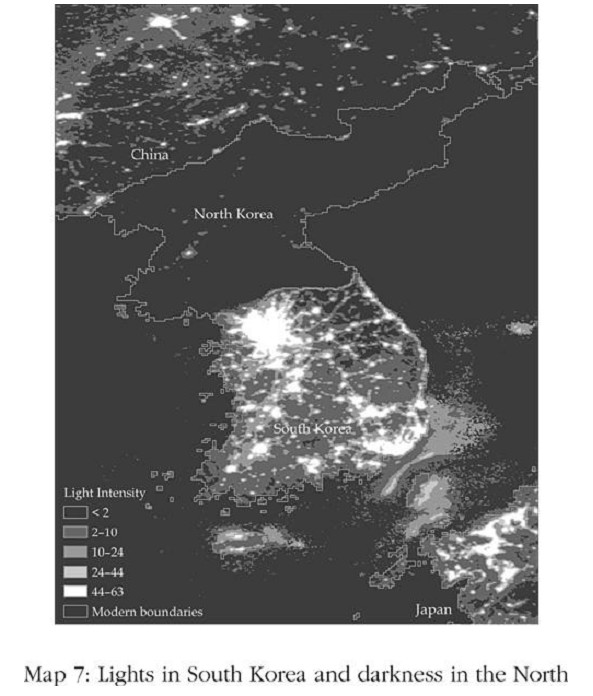
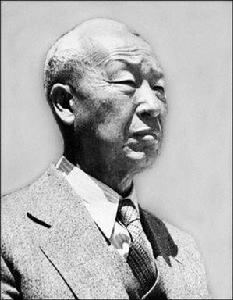
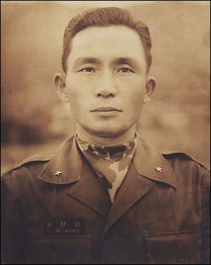
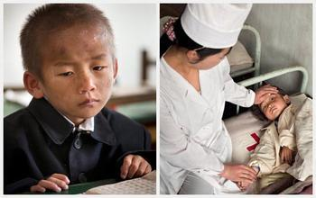
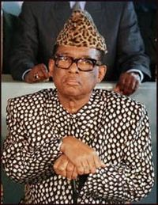
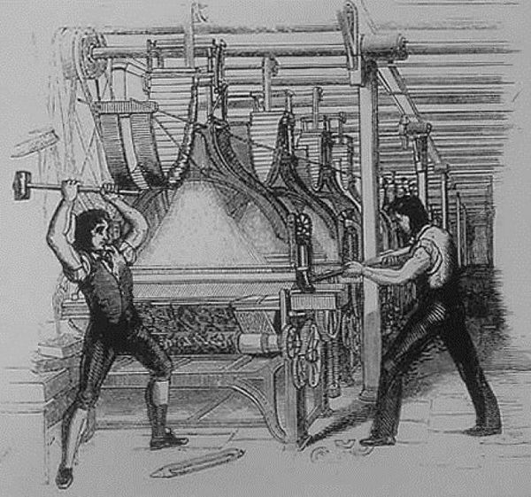

# 3、 富裕与贫穷的形成

## （1）北纬三十八度线经济学

1945年夏季，二战接近尾声，日本在朝鲜半岛的殖民地开始崩溃。日本8月15日无条件投降不到一个月，半岛以北纬三十八度线被划分成两个势力区，南部由美国管理，北部由苏联管理。1950年6月北韩军队入侵南韩，粉碎了冷战不安定的和平。虽然初期北韩军队快速挺近，攻陷南韩首都汉城（今日的首尔），但到了秋季就全线撤退。就在这时候黄平元和他的哥哥失散了。黄平元设法躲了起来，没有被北韩军队强征带走。他留在南方，从事药剂师的工作。他哥哥原本在汉城为南韩军队治疗受伤的士兵，但被撤退的北韩军队掳走。这对1950年失散的兄弟，五十年后的2000年在首尔重逢，因为南北韩政府终于同意有限度开放家人重聚。

黄平元的哥哥身为医生，后来为北韩的空军工作，在军事独裁政府下算是个不错的职位。但即使在北韩享有特权的人生活也不富裕。两兄弟重逢时，黄平元问哥哥在三十八度线以北的生活情形。他自己有一辆汽车，但他哥哥没有。他问哥哥：“你有电话吗？”他哥哥说：“没有。我女儿在外交部工作，有一部电话，但如果你不知道密码就没办法打电话。”黄平元回忆说，在重逢时所有北方来的人都要钱，所以他提议给哥哥一些钱。但他哥哥说：“如果我带着钱回去，政府会说‘把钱交给我们’。你还是自己留着吧。”黄平元注意到他哥哥的大衣已经很破旧，他建议说：“把大衣脱下来丢了吧，回去的时候就穿我这件。”他哥哥回答：“我不能这么做，这是向政府借来穿到这里的。”黄平元回忆他们道别时，他哥哥始终紧张不安，好像有人在偷听。他比黄平元想象的还要穷。他哥哥说自己生活很好，但黄平元心想，他看起来很憔悴，而且骨瘦如柴。

南韩人民的生活水平类似葡萄牙和西班牙。而国名为朝鲜民主主义人民共和国的北韩生活水平和下撒哈拉非洲国家相似，只有南韩平均生活水平约十分之一而已。北韩人的健康情况甚至更恶劣，北韩人的平均预期寿命比三十八度线以南的亲人少十年。地图7以戏剧化的方式显示南北韩的经济鸿沟，根据卫星摄影的夜晚灯光密度资料画出，北韩因为缺电几乎一片黑暗，南韩则处处亮光。

    

这些鲜明的差异并非自古以来就是如此，事实上，它们在二战前并不存在。但1945年以后，北方和南方不同的政府采用大不相同的方式管理经济。哈佛和普林斯顿大学大学出身、坚决反共的李承晚，在美国的大力支持下领导战后的南韩，建立了初期的政治和经济制度，并在1948年被选为总统。历经朝鲜战争洗礼、并饱受共产主义扩散到三十八度线以南威胁的南韩并不民主，李承晚和同样与他著名的继任者朴正熙将军，在历史上的定位都是威权总统，但两人都实行市场经济和私有财产制度，朴正熙甚至在1961年后以国家力量当作快速经济成长的后盾，大力提供信贷和补贴给成功的企业。

 李承晚

 朴正熙

三十八度线以北的情况不同。金日成是二战时期反日的共产党领导人，到1947年确立了独裁者的地位，并在苏联的扶持下开始采用一套僵化的中央计划经济，是所谓“主体”系统的一部分。私有财产被宣告违法，市场遭禁止。自由不仅在市场受到剥夺，北韩人生活的每一个层面都遭到限制——除了金日成和他儿子兼继承人金正日身边极少数的统治精英以外。

南韩和北韩的经济命运出现尖锐的对比不应让我们感到惊讶，金日成的中央计划经济和主体系统很快证明是一场灾难。行事诡秘的北韩不提供详细的统计数据，然而可得的证据证实我们从频繁发生的饥馑看到的情况：北韩不但工业生产未能起飞，实际上连农业生产力都大幅滑落。缺少私有财产意味很少人有诱因投资或努力增进、甚至维持生产力。窒息式的压迫政权对创新和采用新科技极为不利，然而金日成、金正日和他们的亲信无意改革制度，也不想引进私有财产、市场、私人契约，或改变经济与政治制度。北韩的经济发展长期处于迟滞状态。

在同一时期，南方的经济制度鼓励投资和贸易。南韩政治人物投资在教育上，提高识字率和就学率。南韩企业迅速利用教育程度相对较高的人口、鼓励投资与工业化、出口，以及技术转移的政策。南韩很快崛起成为东亚的“经济奇迹”，全球最快速成长的国家之一。

到1990年代末，经过大约半个世纪，南韩的成长和北韩的迟滞导致这个曾经统一的国家两边出现十倍的差距——想象一、两个世纪可以造成多大的差距。北韩造成数百万人饥荒经济灾难，与南韩的经济成功对比之下十分惊人：文化、地理和无知都无法解释南北韩今日命运如此悬殊的原因。我们必须从制度找寻答案。

## （2）榨取式和广纳式的经济制度

国家在经济成功上的差异是因为制度不同，也就是影响经济运作的规则，以及激励人的诱因不同。想象一下北韩和南韩的青少年和他们对人生的期待。北韩的青少年在贫穷中长大，缺少创业的动力、创造力或足够的教育来为他们做好从事高技术工作的准备。他们在学校接受的教育大部分是纯粹的宣传，目的是强化政权的正当性；学校里的书籍很少、更不用说有电脑。学校毕业后，每个人必须入伍当兵十年。这些青少年知道他们将不能拥有财产、创立事业或变得更富有，即使有许多人从事非法的民间经济活动维生。他们也知道不会有合法的市场渠道，让他们可以利用自己的技术或收入来购买需要和想拥有的产品。他们甚至无法确定自己可以享有哪些人权。

 北韩军人

 北韩饥饿儿童

在南韩的青少年可以接受良好教育，有许多诱因鼓励他们努力在选择的职业中表现杰出。南韩是市场经济，建立在私人财产的基础上。南韩的青少年知道，如果他们将来成为成功的创业家或员工，就可以享有投资和努力的成果；他们可以改善生活水平和购买汽车、房屋和医疗。

在南韩，国家支持经济活动，因此创业家可以向银行和金融市场借钱，外国企业可以与南韩公司成立合资事业，个人可以用贷款的方式购买房屋。在南韩，大体说来你可以自由开创任何你喜欢的事业。在北韩，你没有这种自由。在南韩，你可以雇佣员工，销售你的产品或服务，在市场上花钱买任何你要的东西。在北韩只有黑市。这些不同的规则就是北韩人和南韩人生活在其中的制度。

 南韩少年

像南韩或美国这种广纳式的经济制度，容许并鼓励绝大多数人民参与经济活动，发展才能和技术，让他们个人做想要的选择。要成为广纳式经济制度，必须具备安全的私有财产、公正的法律制度，并且提供公共服务让所有人可以在公平的规则下交易和缔结契约；经济制度也必须允许新企业进入，并让人们自由选择职业。

南北韩及美国和拉丁美洲的鲜明对比，展现了一个概括的原则。广纳式的经济制度助长经济活动、生产力成长和经济繁荣。安全的私有财产权是核心，因为只有拥有这种权利的人愿意投资和增进生产力。企业家若预期他的生产会被窃取、征收或因为课税而当然无存，将失去工作的诱因，当然更不会有投资和创新的动机。但这种权利必须赋予社会中绝大多数人。

1680年，英格兰政府在西印度群岛殖民地巴巴多斯做人口普查，发现这个小岛的总人口约六万，其中将近三万九千人是非洲奴隶，由其余三分之一人口所拥有。他们大部分是一百七十五位最大蔗糖农场主的财产，而农场主也拥有大部分土地。这些大农场主对名下的土地、甚至拥有的奴隶都有安全且妥善执行的财产权。如果某位农场主想出售奴隶给其他农场主，他可以这样做，并且可以预期法院会执行这类出售合约或任何他签下的合约。为什么？岛上的四十名和治安官中，有二十九名就是大农场主。但尽管岛上的菁英有明确、安全且妥善执行的财产权和合约，巴巴多斯并没有广纳式的经济制度，因为三分之二的人口是奴隶，没有享受教育或经济机会的渠道，也没有能力或诱因利用他们的才能或技术。广纳式的经济制度需要安全的财产权和经济机会，不只是给菁英，也要开放给社会的各领域。

安全的财产权、法律、公共服务和自由签订合约与交易都仰赖政府，仰赖强制能力的机构来维持秩序，防止盗窃和诈欺，并使民间各方当事人遵守合约。社会要有效运作，也需要其他公共服务：道路和交通网络，以便货物能流畅运输；要有公共基础建设以便经济活动可以活分地进行；有某种基本规章一避免诈欺和不法行为。虽然许多这类公共服务可以由市场和民间个人来提供，但有效运作所需的协调规模往往大到必须由中央的权威机构来执行。政府因此无可逃避地与经济制度紧密交织，且往往是公共服务的关键提供者。广纳型的经济制度需要、且实际上借助政府的力量。

北韩或拉丁美洲殖民地的经济制度——之前提到的米塔、赐封或产品配销——并没有这些性质。私有财产在北韩不存在。在拉丁美洲殖民地，西班牙人拥有私有财产，但原住民的财产相当不安全。这两种社会都有大量人口无法自由做经济决定；他们受制于高压胁迫。这两种社会的政府力量都没有用来提供可促进富裕的公共服务。在北韩，政府建立教育制度来灌输政治宣传，却没有能力阻止饥馑发生。在拉丁美洲殖民地，政府专注于胁迫原住民。两种社会都没有公平的竞争环境或公正的法律制度。北韩的法律制度是共产党执政者的工具，拉丁美洲的法律则用来歧视广大的人民。相对于我们称为广纳式的特质，这类制度我们称为榨取式的经济制度——因为这类制度的设计是为了向社会的一部分人榨取收入和财富，以使另一部分人获利，所以称为榨取。

## （3）富裕的引擎

广纳式的经济制度创造广纳式的市场，不但给人自由以从事最适于个人才能的职业，也提供平等的环境让人有机会这么做。有好点子的人可以开创事业，工作者则倾向从事自己较有生产力的活动，缺乏效率的公司可能被更有效率的公司取代。对照人们在广纳式市场中选择职业的方式，殖民时代米塔制度下的秘鲁和玻利维亚有许多人被迫在银矿和水银矿场工作，不管他们有什么才能或有没有意愿。广纳式的市场不只是自由市场，十七世纪的巴巴多斯也有市场，但因为财产权并未遍及所有人，而只限于少数农场主，所以它的市场并不是广纳的；奴隶市场实际上是巴巴多斯经济制度的一部分这套制度有系统地胁迫大部分人口，剥夺他们选择职业和发挥才能的能力。

广纳式的经济制度也为另外两种富裕的引擎铺路：科技和教育。持续的经济成长几乎总是伴随着科技进步，使得人（劳动力）、土地和既有的资本（建筑物、既有的机器等等）变得更有生产力。想想约一百年前我们的曾曾祖父辈，他们没有今日我们视为理所当然的飞机、汽车或各种药物与医疗，当然也没有室内的水管、空调、购物中心、收音机或电影，更别提信息科技、机器人或电脑控制的机器。再继续回溯几代，科技知识和生活的水平还更落后，甚至让我们无法想象大部分人是如何捱过艰苦的生活。这些改善来自科学和像爱迪生这类创业家，他们应用科学创造赚钱的事业。创新的过程因为有合宜的经济制度而变为可能，这种经济制度鼓励私有财产、确保合约履行、创造公平的环境，并鼓励把新科技带进生活的新事业跨入市场。因此我们不应惊讶能产生爱迪生的是美国社会，而非墨西哥或秘鲁的社会；能产生像三星和现代这种科技创新公司的是南韩，而非北韩。

    

与科技息息相关的是劳动人口的教育、技术、能力和知识，包括从学校、家庭和职场中得来的。我们的生产力已比一个世纪前提高很多，不只是因为机器使用更好的科技，同时也因为员工具备更多知识。如果没有懂得如何操作的员工，全世界的科技就无法发挥多少功效。但技术和能力并不局限于操作机器的能力，劳动人口的教育和技术创造出科学知识，奠定了我们进步的基础，并带来科技在商业各领域的改进和应用。虽然我们在第一章读到，工业革命和其后的许多发明家如爱迪生并未接受很高的教育，但那些发明比现代科技简单得多。今日的科技变革需要发明家和工人两方都受到良好的教育。我们从这里也看到创造公平环境的经济制度的重要。美国可以产生或从外国吸引像盖茨、乔布斯、布林、佩吉和贝佐斯这样的人才，以及成千上万在信息科技、核动力、生物科技和其他领域做出重大贡献的科学家，他们的发现更为创业家建立事业提供了基础。社会有充分的人才可供运用，因为美国大多数的青少年只要愿意，就能获得他们想要的就学机会。现在再想象一个不同的社会，例如刚果或海地，那里有大部分人口没有就学渠道，或者即使能够就学，教学的品质也十分低下，老师经常旷职，或者即使老师来到课堂，也可能没有用来教学的书籍。

贫穷国家的教育水平低下，是因为经济制度未能为父母创造教育子女的诱因，也因为政治制度未能促使政府兴建、资助和支援学校，满足父母和儿童的渴望。这些国家为人口教育水平低下和缺少广纳式市场，付出的代价十分高昂。他们无法促发人才幼苗结为果实。他们有许多潜在的盖茨，或者一、两位未受教育的贫穷农民有着爱因斯坦的天才，但被胁迫做他们不想做的工作，或被强征在军队服役，因为他们永远没有机会实现一生的志向。

经济制度运用广纳式市场的潜力、鼓励科技创新、投资人才，以及促发大量个人的才能与技术的能力，对经济成长极为重要。本书的核心主题就是要解释，何以许多经济制度无法达成这个简单的目标。

## （4）榨取式与广纳式政治制度

所有经济制度都由社会创造，例如，北韩的经济制度是由1940年代接管国家的共产党强加于人民，而拉丁美洲殖民地的经济制度则由西班牙征服者强加于原住民。南韩创造出与北韩大不相同的经济制度，原因是不同的人基于不同的利益和目标，做出如何构建社会的决定。换句话说，南韩有不同的政治。

政治就是社会选择管理社会之规则的过程。政治与经济制度密切相关的原因很简单，虽然广纳式的制度可能对国家的经济繁荣有益，但某些人或群体，例如北韩的共产党菁英或巴巴多斯殖民地的蔗糖农场主，可能从榨取式的制度获得更大利益。当为了制度而发生冲突时，事情会如何发展取决于哪些人或群体在政治比赛中获胜——谁能获得更多的支持、取得额外的资源，以及形成更有效的联盟。简单地说，谁获胜取决于政治权力在社会中的分配。

社会的政治制度是这个比赛的关键决定因素，政治制度是支配政治诱因的规则。政治制度决定政府如何选出，以及政府的哪一部分有权力做什么事。政治制度决定谁在社会中有权力，以及权力可以用来做什么。如果权力的分配很狭窄和局限，那么这种政治制度就属于专制（absolutist）制度，例如历史上世界各地出现的专制君主政权。在专制的政治制度下，例如北韩和拉丁美洲殖民地，能使用权力的人就能设立经济制度来为自己谋利和扩大自己的权力，而由社会付出代价。对照之下，在社会中广泛分配权力、并使权力受到节制的政治制度，就属于多元（pluralistic）制度。在这种制度下，政治权力并非只授予单一个人或狭窄的群体，而是取决于一个涵盖广泛的联盟或多个群体。

政治多元化和广纳式经济制度显然有紧密的关系，但要了解南韩和美国为什么有广纳式经济制度，关键不只在于它们的多元政治制度，而也要了解它们有足够集权和强大的政府。东非国家索马里是一个很好的对照说明。我们将在本书后面看到，索马里的政治权力长期以来就分配很广泛——几近多元政治。但没有实质的权威可以控制或制裁任何人的行为，社会分裂为强烈敌对的宗族，彼此无法互相支配。一个宗族的权力，只能受其他宗族的武力所限制。这种权力分配并未带来广纳式的制度，反而使混乱，而其根源就是索马里的政府缺少任何形式的政治集权或政府集权，因此无法执行最起码的治安以支援经济活动、贸易，甚至保障人民的基本安全。

我们在前面章节介绍过的韦伯提供了最著名、且广被接受的国家定义，指出它是社会中“正当使用暴力的独占权”。没有这种独占权和它需要的集权，政府无法扮演维持治安的角色，更不可能提供公共服务并鼓励和规范经济活动。当政府无法达成任何政治集权时，社会迟早会陷于混乱中，就像索马里。

我们将把足够集中化和多元化的政治制度称为广纳式政治制度。如果这两种条件有任何一种付之阙如，我们会把这套制度称为榨取式政治制度。

经济与政治制度间有强大的相互促进效应。榨取式政治制度集中权力在少数菁英手中，权力的行使很少受到节制。经济制度通常也由这些菁英建立，用以从社会其他人那里榨取资源。榨取式经济制度因此自然伴随着榨取式政治制度。事实上，它们生来就必须依赖榨取式政治制度才能存活。广纳式政治制度广泛地授予权力，通常能消除剥夺多数人资源、建立进入障碍、和压制市场机能以为少数人谋利的经济制度。

例如，在巴巴多斯，建立在剥削奴隶基础上的农场制度，如果没有压制并将奴隶完全排除在政治过程之外的政治制度，就不可能存在。造成数千万人陷于贫穷、只造福少数共产党菁英的北韩经济制度，若非在共产党的绝对政治支配下，势必令人感到匪夷所思。

榨取式经济制度与榨取式政治制度的互相促进关系，把人们带进一个强有力的反馈环：政治制度让控制权力的菁英，得以选择没什么限制或对手的经济制度。它们也让菁英得以建构未来的政治制度，及其演进。榨取式经济制度反过来为同一批菁英谋利，而他们的经济财富和权力将协助巩固他们的政治支配力。例如在巴巴多斯或拉丁美洲，殖民者能利用政治权力实施一套为他们赚进庞大财富而牺牲其余人口利益的经济制度。这些经济制度创造的资源让菁英得以组织军队和防卫武力，以保护他们对政治权力的专制独占。其中的含义当然是榨取式政治与经济制度彼此支持，且往往长期得以延续。

榨取式经济与政治制度间其实不只是彼此效力，当既有的菁英在榨取式政治制度下遭到挑战，且新来者突破压制时，新来者也同样只受到极少束缚。他们因此有诱因维持这种政治制度，并创造类似的经济制度，就像迪亚斯和围绕他的菁英在十九世纪末在墨西哥的做法。

另一方面，广纳式经济制度是在广纳式政治制度奠立的基础上形成的，权力在社会中广泛分配，且权力的独断行使受到节制。这种政治制度也让其他人较难篡夺权力而导致广纳式制度的根基受损害。控制政治权力的人无法轻易利用它来建立榨取式经济制度供其图利。广纳式经济制度反过来创造较平等的资源分配，促进广纳式政治制度长期续存。

弗吉尼亚公司1618年授予土地和自由，给原本他们用严苛合约束缚、想要胁迫剥削的殖民者；第二年的大议会再允许殖民者开始自治，这一切的发生都不是偶然。如果没有政治权力，殖民者就不会信任他们获得的经济权利，因为殖民者长期以来看到弗吉尼亚公司不断尝试胁迫他们。这些经济体也无法保持稳定和长久存活。事实上，榨取式和广纳式制度的混合通常并不稳定。在广纳式政治制度下的榨取式经济制度不太可能长期存在，正如我们讨论的巴巴多斯所呈现的。

类似的，广纳式经济制度将不会支持榨取式政治制度，也不会得到榨取式政治制度的支援。要不是转变成榨取式经济制度，为握有权力的少数人牟利，不然就是它们创造的经济动能将动摇榨取式政治制度，打开广纳式政治制度兴起的大门。广纳式经济制度也倾向会削弱榨取式政治制度下的少数统治菁英所能享受的经济利益，因为这些制度将面对市场的竞争，且将受到社会其他人的合约与财产权的限制。

## （5）为什么不总是选择富裕

政治与经济制度终究是社会的选择，它们可能是广纳式的，会鼓励经济成长，或者可能是榨取式的，将变成经济成长的阻碍。获得榨取式政治制度支援的榨取式经济制度会阻碍甚至禁止经济成长，这种国家将衰亡。但这意味制度的选择——亦即制度的政治学——是我们探索国家成功和失败原因的核心。我们必须了解，为什么有些社会的政治带来促进经济成长的广纳式制度，而从古至今绝大多数社会的政治却带来阻碍经济成长的榨取式制度。

创造能促进富裕的经济制度应该是每个人都感兴趣的，这似乎是显而易见的道理。难道不是每个公民、每个政治人物、甚至每个剥削人民的独裁者，都希望让自己的国家尽可能富裕吗？

让我们回到先前讨论过刚果王国。虽然这个王国17世纪灭亡了，1960年从比利时殖民统治独立的现代国家仍以它命名。独立后的刚果在1965年到1997年由蒙博托统治期间，经历几乎未间断的经济衰退和贫穷加深。蒙博托被卡比拉推翻后，衰退仍然持续。蒙博托创造一套高度榨取式的经济制度，人民变得日渐贫穷，但蒙博托和身边的菁英（人称“大蔬菜”的一群人）却变得极其富有。蒙博托在自己的出生地刚果北部的毕多来建立一座宫殿，有一个机场大到足以降落超音速协和号喷气式客机，是他经常向法国航空公司租来到欧洲旅游用的。在欧洲，他购买城堡，并拥有比利时首都布鲁塞尔的大片地产。

 蒙博托

如果蒙博托建立能增加刚果人财富、而非让他们更贫穷的经济制度，那不是更好吗？如果蒙博托增进全国人的财富，他不是可以有更充裕的经费可以买一架协和号、而非只是租用，还可以买更多城堡和豪宅，甚至拥有更大、更强的军队吗？对世界上许多国家的人民来说很不幸运的是，答案是否定的。创造经济进步诱因的经济制度可能同时造成收入与权力的再分配，导致喜好掠夺的独裁者和其他拥有政治权力的人受到威胁。

根本的问题是，经济制度必然引发争议和冲突，不同的制度会在国家的富裕程度、财富的分配，以及谁拥有权力上造成不同的结果。制度促进的经济成长会同时制造出赢家和输家，这在奠定今日世界富裕国家繁荣基础的英国工业革命期间已明显呈现。工业革命的核心是蒸汽动力、运输和纺织生产上一连串突破性的科技变革。虽然机械化带来总收入的突飞猛进，最后变成现代工业社会的基石，但当时曾遭到许多人激烈反对。那不是因为无知和短视，刚好相反，反对经济成长本身有一套很不辛地前后一致的逻辑。经济成长和科技改变伴随着伟大的经济学家熊彼得所称的创造性破坏，它们以新事物取代旧事物，新产业从旧产业吸走资源，新公司抢走旧公司的生意，新科技让老旧的技术和机器变得过时。经济成长的过程和它立基其上的广纳式制度，在政治竞技场和在经济市场都创造出输家和赢家。对创造性破坏的恐惧往往是反对广纳式经济与政治制度的根源。

欧洲历史为创造性破坏的影响提供了一个鲜活的例证。在18世纪工业革命之前，大多数欧洲国家的由贵族和传统菁英控制，他们的主要收入来源是拥有土地，或因为君主赐与的独占权与设置的进入障碍而享有的交易特权。如同创造性破坏的概念所描述的，工业、工厂与城镇的扩散把资源从土地吸走，降低了地租，并提高地主必须支付给佃农的工资。这些菁英也眼看新企业家和商人崛起，侵蚀他们的交易特权。整体来说，他们是工业化中很明显的经济输家。都市化和具有社会意识的中产与劳工阶级兴起，也挑战地主贵族的政治独占权。因此随着工业革命扩散，贵族不只是经济输家，他们也有变成政治输家的风险，拥有的政治权力可能随之丧失。在经济和政治权力受到威胁的情况下，这些菁英往往形成一股反对工业化的强大力量。

贵族不是工业化唯一的输家，手工技术被机器取代的工匠也反对工业普及。许多工匠组织起来反对工业化，暴动并破坏他们认为应该为抢走他们生计负责的机器。他们是卢德派人士，这个词今日已变成抗拒科技变革的同义词。1733年英国发明家凯伊发明飞梭，是纺织机械化第一次重大进步之一，他的房子在1753年被卢德派人士纵火烧毁。珍妮纺纱机是另一项改善纺织的革命性发明，它的发明者哈格里夫斯也遭到类似的待遇。

    

在现实中，工匠反对工业化的成效远低于地主和菁英。卢德派人士没有地主贵族拥有的政治权力——能影响政治结果、对抗其他群体愿望的能力。在英国，工业化大步迈进，无视于卢德派人士的反对，因为贵族虽然反对，声浪却很小。在奥匈帝国和俄罗斯帝国，专制君主与贵族的损失远为惨重，工业化因而遭到阻挡。其结果是，奥匈和俄罗斯的经济陷于停滞，落后于其他从19世纪开始经济成长起飞的欧洲国家。

从特定群体的成功或失败可以得到一个清楚的教训：有权力的群体通常反对经济进步和开往富裕的火车头。经济成长不只是更多更好的机器、以及更多受更好教育的人的过程，也是与创造性破坏普及有关的转型和动荡的过程。因此只有在预期会丧失经济特权的经济输家、和担心政治权力遭到侵蚀的政治输家没有阻挡成功的情况下，经济才会向前迈进。

争夺稀有资源、收益和权力的冲突，转变成对游戏规则、经济制度（这会决定经济活动，以及谁可以从中获利）的冲突。当冲突产生时，各方的愿望无法同时满足，有些人将被打败和受挫，另一些人将成功获得他们想要的收益。这种冲突的赢家是谁，对国家的经济发展轨道有根本的影响；如果反对成长的群体是赢家，他们就能成功阻挡经济成长，经济将陷于停滞。

为什么有权力的人不见得愿意建立促进经济成长的经济制度，其中的逻辑很容易适用于政治制度的选择。在专制政权中，有些菁英可以利用权力建立他们偏好的经济制度。他们会有兴趣改变政治制度，让它们变得更多元化吗？通常不愿意，因为这只会稀释他们的政治权力，让他们更难以、甚至不可能建造能增进自己利益的经济制度。我们在这里又看到明显的冲突来源。榨取式经济制度的受害者无法期待专制统治者自愿改变政治制度，并重新分配社会中的政治权力。改变这类政治制度的唯一方法是，迫使菁英建立更多元化的制度。

与政治制度没有理由自动变为多元化的道理一样，也没有往政治集权发展的自然倾向。任何社会确实都有创造更集权化政府体制的诱因，尤其是从未有过这种集权化的国家。例如，在索马里如果一个宗族建立起能在全国执行法令的中央集权政府，就可能带来经济利益，并使这个宗族更富裕。什么东西阻止了这种情况发生？政治集权化的主要阻碍是某种形式的害怕改变：任何宗族、群体或政治人物若尝试集中国家的权力，也会把权力集中在他们手中，而这可能触怒其他宗族、群体和个人，因为他们不想在这个过程中变成政治输家。缺乏政治集权不只意味在大部分领土缺乏治安，也代表有许多参与者有足够的权力阻止或破坏事情，而担心这些人的反对和暴力行动往往会让潜在的集权者裹足不前。政治集权只有在一个群体的权力比其他群体大到能建立政府时才会发生。在索马里，权力保持相对平衡，没有一个宗族能强加意志在其他宗族头上，因此缺乏政治集权的状况持续着。

## （6）刚果长期的痛

没有比刚果更好、更令人沮丧的例子可以用来说明，为什么在榨取式制度下经济富裕如此罕见，也没有比刚果更适宜的例子可以解释榨取式经济与政治制度如何携手运作。15和16世纪来到刚果的葡萄牙人和荷兰人，描述那里“悲惨的贫穷”：技术水平以欧洲的标准来看还在初级阶段，刚果人没有文字、轮子和耕犁。刚果的贫穷以及当地农民不愿采用学到的更好技术，可以从现存的历史记录找到解释：是由于该国经济制度的榨取性质。

我们已讨论过，刚果王国是由位于姆班扎（后改名圣萨尔瓦多）的国王所统治，而远离首都的地区则由菁英所统治，他们扮演王国不同地区的总督角色。这些菁英的财富来自环绕姆班扎（圣萨尔瓦多）的奴隶市场，以及向王国其他地区课税。奴隶是经济的核心，菁英利用奴隶来耕种农场土地，海岸地区的欧洲人也使用奴隶。课税由统治者任意决定，甚至有一项税是每次国王的贝雷帽掉下来就向人民课征。如果想变富裕，刚果人必须储蓄和投资，例如购买犁。但这么做很划不来，因为他们采用更好的技术增加的生产都会被国王和他的菁英征收。因此刚果人不投资增加生产，也不在市场出售他们的产品，而是把村庄搬到远离市场的地方；他们尝试尽可能远离道路，以减少遭受劫掠的次数，和逃离奴隶贩子可及的范围。

刚果的贫穷因此是榨取式经济制度阻挡了所有富裕火车头、甚至让它们反方向开的结果。刚果政府提供给人民的公共服务很少，连基本服务如安全的财产权或治安也付诸厥如，反而政府本身人民财产与人权的最大威胁。奴隶制度意味所有市场中最基本的劳动市场不存在，而可以让人们选择职业或工作的广纳式劳动市场，对富裕社会却极其重要。此外，国王控制长途的贸易和商业活动，只对与他有关系的人开放。虽然葡萄牙人引进文字后菁英阶级很快便能识字书写，但国王并未尝试让识字普及到广大的人口。

尽管如此，虽然“悲惨的贫穷”十分普遍，刚果的榨取式制度却有自己的完美逻辑：这套制度让少数握有政治权力的人极度富有。在16世纪，刚果国王和贵族有能力进口欧洲奢侈品，过着仆役和奴隶围绕四周的生活。

刚果社会的经济制度源自社会里政治权力的分配，因此追根究底是源自政治制度的特性。除了叛乱以外，没有人可以阻止国王拿走人民的财物和身体。虽然叛乱的威胁真的存在，但那不足以保障人们的财产安全。刚果的政治制度极为专制，国王和菁英几乎不受任何节制，而人民对社会的组织方式完全没有置喙的余地。

当然，我们不难看出刚果的政治制度，与权力受节制且广泛分配的广纳式政治制度呈现鲜明对比。刚果的专制制度靠军队来维系，在17世纪中叶，国王有一支五千人的常备军，其核心是五百名配备毛瑟枪的士兵，这在当时是一支可畏的武力。为什么国王和贵族急于采用欧洲的火器也很容易理解了。

这套经济制度下不可能有持续的经济成长，即使是创造短期成长的诱因也很有限。改革经济制度以提升个人财产权可以让整体刚果社会变得富裕，但菁英不太可能从普遍的富裕获益。第一，这种改革将因为减少奴隶贸易和奴隶农场带给菁英的获利，而让他们变成经济输家。第二，这种改革只有在国王和菁英的政治权力受到节制下才可能发生。举例来说，如果国王继续指挥他的五百名毛瑟枪兵，谁会相信废除奴隶制度的宣告？如何才能确保国王以后不会改变主意？唯一真正的保证是改变政治制度，人民取得一些制衡的政治权力，使他们对课税或毛瑟枪兵该做什么拥有发言权。但在这种情况下，维系国王和菁英的消费与生活方式会不会被人民列为优先要务就大有疑问了。因此能为社会创造更佳经济制度的改变，势必让国王和贵族同时变成政治输家和经济输家。

五百年前经济与政治制度的交互影响，对了解今日现代刚果依旧陷于悲惨的贫穷仍然很有帮助。欧洲统治开始在这个地区出现，以及19世纪末在“瓜分非洲”时期欧洲势力更深入刚果河盆地，导致人身与财产权的安全更加饱受威胁，超过刚果被殖民前的时期。此外，新统治者复制了榨取式制度与专制政治模式，由少数人掌握权力与财富，牺牲广大人民，只不过现在的统治者变成了比利时殖民者，其中最著名的是利奥波德国王。

刚果在1960年独立时，同意模式的经济制度、诱因和表现又一次自我复制。刚果的这些榨取式经济制度再度获得榨取式政治制度的支持。情况还更加恶化，因为欧洲殖民主义制造出的这个国家组织（刚果）是由前殖民时期的许多不同国家和社会所组成，而新成立的国家政府（从金沙萨统治）却难以掌管这些地区。虽然蒙博托总统利用政府来为自己和亲信牟利——例如在1973年通过国有化计划大规模征收外国人的经济资产——但他掌管的是一个没有政治集权的政府，对刚果大部分地区没有实质管辖权，且在1960年代必须请求外国协助来阻止卡谭加省和卡赛省的分离。缺少政治集权几乎达到政府全面崩溃的程度，这是刚果与许多下撒哈拉非洲国家共同的特性。

现在的刚果民主共和国依然贫穷，因为其经济制度仍然缺少能使社会富裕的基本诱因。不是地理、文化、人民和政治人物的无知导致刚果贫穷，而是榨取式经济制度。榨取式经济制度经过这么多世纪仍然存在，因为政治权力依旧集中在少数菁英手里，而没有诱因促使他们努力确保人民拥有安全的财产权、提供可以改善生活品质的基本公共服务，或鼓励经济进步。菁英也未利用手上的权力来建立政治集权的政府，因为这么做将和促进经济成长一样，招致反对和政治挑战的问题。此外，和大部分下撒哈拉非洲国家相同，敌对群体为了掌控榨取式制度而产生的内斗，摧毁了原本可能存在的任何政治集权倾向。

刚果王国和较近期的刚果历史，生动地展现政治制度如何决定政治制度，而且通过经济制度，也决定了经济诱因和经济成长的可能性。它也显示专制政治与牺牲多数人利益、赋予少数人权力及财富的经济制度之间的共生关系。

## （7）榨取式政治制度下的成长

今日刚果缺乏法治和财产权高度不安全是一个极端的例子，不过，这种极端状况大部分时候不符合菁英的利益，因为那会摧毁所有经济诱因，只产出很少的资源可供榨取。本书的核心论题是，经济成长和富裕与广纳式经济和政治制度有关联，而榨取式制度通常导致迟滞和贫穷。但这并不意味榨取式制度完全无法制造成长，也不代表所有榨取式制度都是相同的。

榨取式政治制度中的成长可能以两种不同但互补的方式发生。第一，即使经济制度是榨取式的，菁英能直接分配资源给他们控制的高生产力活动时，成长仍可能发生。这类榨取式制度下成长的著名例子之一，是16世纪到18世纪间的加勒比群岛。大多数人是奴隶，在条件很可怕的农场工作，过着仅能维持生存的生活。许多人因为营养不良和过劳而死亡。在17世纪和18世纪的巴巴多斯、古巴、海底和牙买加，少数的农场主菁英控制所有政治权力，拥有所有资产，包括所有奴隶。大多数人都没有权利，而农场主菁英的财产和资产则受到严密的保护。尽管榨取式经济制度残暴地剥削绝大部分人口，但这些群岛却是世界最富裕的地方之一，因为它们生产糖并销售到世界市场。一直到必须转型为新的经济活动，并因而威胁到农场主菁英的收益和政治权力时，这些群岛才出现迟滞的情况。

另一个例子是，苏联从1928年第一个五年计划到1970年代的经济成长和工业化。当时苏联的政治与经济制度具有高度榨取性，市场受到层层限制。尽管如此，苏联仍能达成快速经济成长，因为它利用政府的力量把资源从（资源利用效率极低的）农业转移到工业。

第二种榨取式政治制度下的成长，出现在政治制度允许某种程度的广纳式经济制度发展的情况。许多具有榨取式政治制度的社会会避开广纳式经济制度，因为担心创造性破坏的影响，但各个社会的菁英独占权力的程度都不相同，某些社会的菁英可能有相当安全的地位，使他们得以允许一些朝向广纳式经济制度靠近的做法，因为他们相当确信如此不会危及其政治权力。或者，历史的形势正好为一个榨取式政治政权带来一个相当广纳式的经济制度，而他们决定不加以阻挡。这提供了第二种在榨取式政治制度下可以发生成长的方式。

南韩在朴正熙将军统治下的快速工业化就是一个例子。朴正熙在1961年的军事政变中取得政权，但当时的社会获得美国充分支援，且经济制度基本上是广纳式的。虽然朴正熙的政权是威权制度，但它感到安全到可以促进经济成长，而且实际上十分积极推动成长——也许部分原因是该政权并非直接受到榨取式经济制度的支援。与苏联和大多数榨取制度下的成长例子不同，南韩在1980年代从榨取式政治制度转型为广纳式政治制度。这个成功的转型是许多因素汇聚的结果。

到1970年代，南韩的经济制度已变得相当有广纳性，足以削弱维持榨取式政治制度的一项理由——经济菁英从自己或军方对政治的掌控当中得不到多少利益。南韩的收入相对平等也意味，菁英较不必担心政治多元化和民主。美国的关键性影响，尤其是在北韩的威胁下，也代表挑战军方独裁的强大民主运动无法被长期压制。虽然朴正熙在1979年遭暗杀后，另一个由全斗焕领导的军事政变紧接着发生，但全斗焕挑选的接班人卢泰愚进行一连串政治改革，带来1992年后全面的多元化民主政治。当然，苏联并未发生这类转型，因此苏联的成长渐渐失去动力，经济在1980年代开始崩溃，到了1990年代更进一步完全瓦解。

中国今日的经济成长与苏联和南韩的经验都有一些共同点。中国成长的早期阶段是由农业部门的激进生产改革带头，工业部门的改革则较为缓和。即使到今日，政府和共产党在决定哪些部门和哪些公司可获得额外资本与可以扩张，仍然扮演核心角色，并在这个过程中，决定产业和公司的成功与失败。和全盛时期的苏联一样，中国正快速成长，但这仍然是榨取式制度和政府控制下的成长，尚未出现朝向广纳式政治制度转轨的迹象。中国的经济制度距离充分广纳仍然相当遥远，这也意味南韩式的转型比较不会在中国发生，但也非完全不可能。

值得注意的是，政治集权是在榨取式政治制度下能否发生成长的关键。如果没有某种程度的政治集权，巴巴多斯、古巴、海地和牙买加的农场主菁英将无法维持治安，保护他们自己的资产和财产。如果没有相当的政治集权和紧紧掌控政治权力，南韩的军事菁英和中国共产党不会感觉足够安全到愿意推动经济改革、同时仍能够紧握住权力。如果没有政治集权，苏联或中国将无法调节经济活动，把资源转移到高生产力的领域。因此不同的榨取式政治制度间有一条重大的分界线，即政治集权的程度。如果没有政治集权，例如像下撒哈拉非洲国家那样，连有限的成长都很难达成。

即使榨取式制度可以创造一些成长，它们往往无法创造持续稳定的经济成长，而且一定不是伴随创造性破坏而来的那种成长。当政治与经济制度都属榨取式，不会产生可以带来创造性破坏和科技变革的诱因。政府可能短期间借命令分配资源和人员而创造快速的经济成长，但这个过程本质上就是有限的。当达到极限时，成长将停止，就像1970年代苏联的情况。即使在苏联达成快速经济成长时，经济的各层面也很少发生科技变革，虽然借着投资大量资源在军方，他们得以发展出军事科技，甚至有一段时间在太空和核武竞赛中领先美国。然而这种缺乏创造性破坏、没有广泛科技创新的成长无法长期持续，终究会走到尽头。

此外，在榨取式政治制度下支持经济成长的措施本质上就是脆弱的——它们可能崩溃，或者很容易被榨取式制度本身产生的内斗所摧毁。事实上，榨取式政治与经济制度一般会产生内斗的倾向，因为它们导致财富和权力集中在少数菁英手中。如果另一个群体可以压倒或胜过这群菁英而接管政府，他们讲成为享受这些财富和权力的人。因此，正如我们后面会讨论到的罗马帝国和玛雅城市的崩溃所显示，政府掌控权的争夺无时无刻不在台面下进行，而且会定期加剧并导致政权的毁灭，它可能转变成内战，有时候甚至造成政府完全崩溃。这种情况的影响之一是，即使一个榨取式制度下的社会初期达成若干程度的政府集权，也无法持久。事实上，为了掌控榨取式制度的内斗往往导致内战和大范围的法治荡然无存的状态，使得初期缺乏政府集权变成常态，就像许多下撒哈拉非洲国家和拉丁美洲与南亚的部分国家一样。

最后，当榨取式政治制度下的经济制度具备广纳的特性、而且发生成长时（就像南韩的情况），永远会有经济制度转变得更具榨取性，并使成长停止的危险。政治权力的控制者最后将发现，利用他们的权力限制竞争、扩大他们享有的大饼，甚至窃取和掠夺他人利益，对他们自身的获利会比支持经济进步更有利。分配和行使权力的能力最后会摧毁经济富裕的基础，除非政治制度也从榨取式的变成广纳式的。
