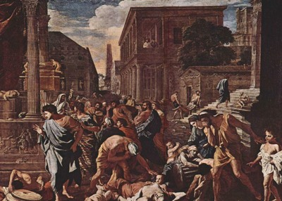
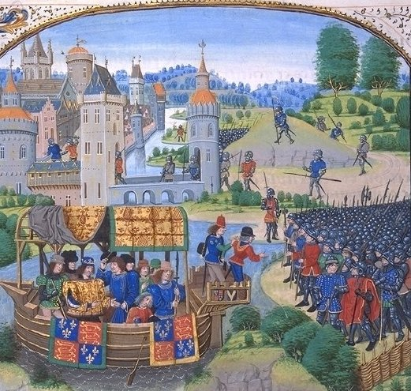
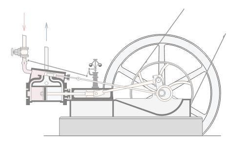
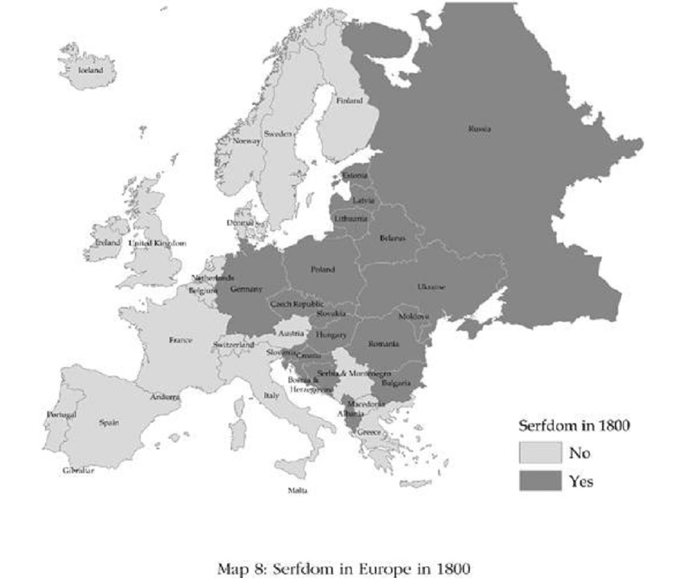
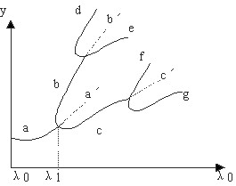
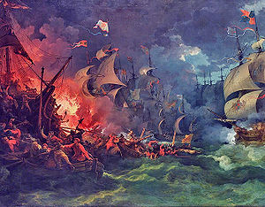
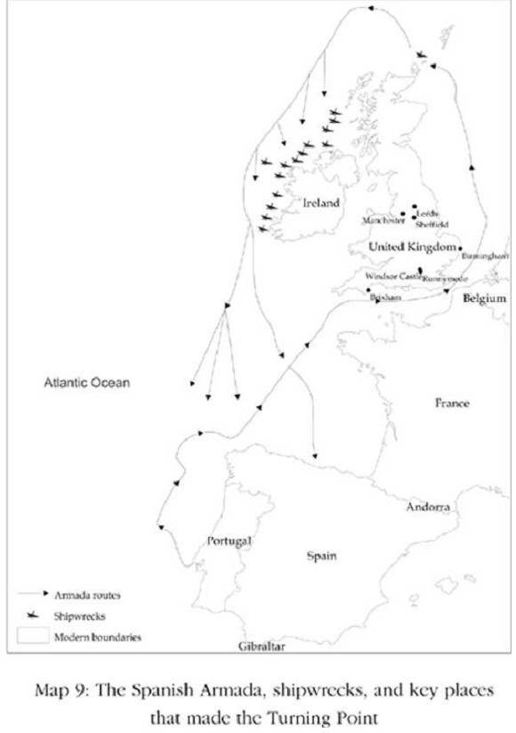

# 4、 小差异和关键时期：历史的重量

## （1）瘟疫创造的世界

1346年，俗称黑死病的腺鼠疫抵达顿河流入黑海的河口的城市塔纳（Tana）。这场以老鼠身上的跳蚤为媒介的瘟疫源自中国，经由当时横越亚洲商业动脉丝绸之路的商旅传播。拜热那亚商人所赐，那些老鼠很快把跳蚤和瘟疫从塔纳散播到整个地中海地区。到1347年，瘟疫已传至法国、北非，并从意大利南部曼衍到北部。这场瘟疫杀死所经地区的约一半人口，它抵达意大利城市佛罗伦萨的情况有意大利作家薄伽丘亲眼目睹。他日后回忆说：

“在它肆虐的时候，穷尽人之智慧和才能都无法阻挡它……瘟疫以恐怖而极端的方式展开，让它悲惨的影响展露无遗。它未以在东方的形式表现，在那里任何人要是鼻子流血就是必死的前兆。相反的，它最早的症状是在腹股沟或腋下出现肿块，有时候呈蛋状，有时候大小犹如常见的苹果……后期的症状会改变，许多人手臂、大腿和身体其他部分开始出现黑色大斑点和淤血……针对这些病症，所有医生的建议和所有医药的效力都毫无用处……在大部分的例子里，从出现我们描述的症状到死亡约在三天内。”

    

英格兰人知道瘟疫正往他们的方向传播，而且很清楚即将降临的厄运。1348年8月中旬，爱德华三世国王要求坎特伯雷大主教安排许多祈祷仪式，有许多主教写信要求教士在教堂选读祈祷词，以协助人们因应即将面对的遭遇。贝斯主教西鲁斯贝里写信给他的教士：

“全能的上帝从祂的宝座以雷和闪电和其他重击，蹂躏祂想救赎的子民。因此自从可怕的瘟疫从东方散播到临近的王国，我们便极度担心除非我们虔诚地不停祈祷，类似的瘟疫也将伸展它的毒手到这个地方，并且击倒和吞噬这里的居民。因此我们所有人必须来到主的面前忏悔，唱诵圣诗。”

这个方法不管用，瘟疫入侵并且很快扫掉约一半的英格兰人口。这种大灾难可能对社会制度产生重大影响。不难想见的是，有许多人陷于疯狂。薄伽丘写道：“有人坚称阻止这种骇人的恶疾最可靠的办法是大量喝酒，尽可能享受人生，大声唱歌作乐，一有机会就满足人的渴望，并把一切事情视为大笑话般不放在心上……而这解释了为什么那些复原的女性可能在随后的期间较不贞洁。”然而瘟疫也对中古欧洲社会造成社会层面、经济层面和政治层面的冲击和转变。

进入14世纪时，欧洲维持着一种封建秩序，这是罗马帝国崩溃后从西欧兴起的社会组织。它以国王与他辖下的领主间的等级次序关系为基础，底层是农民。国王拥有土地，并赏赐给领主，以交换后者的军事服务。领主然后把土地分配给农民，以交换农民履行繁重的义务劳动，并必须缴纳许多罚款和税金。农民因为他们“奴仆”的地位而被称作农奴，他们与土地绑在一起，未得领主允许不得迁居到它处；而领主不只是地主，也是法官、陪审团和警察。这是高度榨取式制度，财富从众多农民往上流向少数领主。

瘟疫造成劳动力大规模短缺，摇撼了封建秩序的基础，并鼓励农民要求改变。例如，在恩斯罕修道院，农民要求降低许多罚款和义务劳役。他们得偿所愿，在他们的新合约开始就声明：“发生于1349年的死亡或瘟疫期间，庄园仅剩两名佃农，他们表达想离去的意愿，除非庄园住持兼领主尤普顿的尼可拉斯修士与他们签订新协议。”他签了新协议。

恩斯罕发生的事也在每个地方发生，农民开始从强制劳动服务和许多对领主的义务中自我解放。工资水平开始上扬，政府尝试阻止这个趋势，并在1351年通过劳动法。上面开宗明义说：

“鉴于大部分人，尤其是工人和仆役已死于该瘟疫，部分人看到主人的困境和仆人的缺乏都不愿意提供劳务，除非他们获得额外的工资……我们认为此等可能源自特别是农夫和这类劳工短缺的严重不方便……必须加以规范：英格兰王国的所有男人和女人……应为他们原本应提供劳务者工作，且应只接受他们提供之劳务原本应接受的薪资、奖赏与酬劳，其标准以英格兰王统治的第二十年（爱德华三世国王于1327年1月25日加冕，因此这里指1347年）或之后五、六年习于接受的薪资为准。”

这项法令实际上尝试把薪资固定在黑死病发生前的水平。英格兰菁英特别担心的是领主尝试以“诱因”从别的领主那里吸引稀少的农民。解决办法是以监禁来惩罚未经雇主同意就擅离工作岗位的行为：

“如果收割人或刈草人或其他为他人担任劳务的工人与仆役，在约定的期限结束前离弃其劳务，且未经允许或具合理之原因，他应受监禁之惩罚，以杜绝支付或允许支付给任何人超过前述习惯之薪资、奖赏与报酬。”

英格兰政府尝试阻止黑死病引发的制度与薪资改变并未奏效。1381年爆发农民起义，反叛者在泰勒（Wat Tyler）的领导下甚至一度占据伦敦大部分地区。虽然他们最后被打败，泰勒遭到处死，但此后便未再尝试实施劳工法。封建劳动服务逐渐式微，广纳式劳动市场开始在英格兰兴起，工资水平随之上扬。

 瓦特•泰勒起义

这场瘟疫似乎席卷了世界大部分地方，所到之处都有类似比例的人口死亡，因此对东欧人口造成的冲击也和英国与西欧一样。其间运作的社会力量和经济力量大同小异，劳工一样短缺，人们开始要求更大的自由。但在东欧，一个更强大的相反趋势兴起，较少的人口意味较高的工资和广纳式劳动市场，但这给领主更大的诱因想让劳动市场维持榨取性，让农民维持农奴地位。在英格兰，这个动机也在运作，反映在劳工法的制订，但劳工有足够的力量可以挣脱压制。东欧的情况却不同，在瘟疫过后，东欧的地主开始接管大片土地并扩张原本就比西欧大的放租地。城镇变得衰弱，城镇的人口也减少，劳工非但没有变得更自由，反而看到原本拥有的自由遭侵犯。

这种效应在1500年后变得尤其明显，当时西欧对东欧生产的农产品如小麦、黑麦和牲口的需求正开始增加。阿姆斯特丹进口的黑麦有80%来自易北河、维斯图拉河和奥德河的河谷。很快地，荷兰欣欣向荣的贸易有一半来自东欧。随着西方需求扩张，东欧地主也加紧对劳动力的控制以增加供应。后来这被称为第二次农奴制（Second Serfdom），与中世纪早期原本的农奴制截然不同，且远为严厉。领主对耕种土地的佃农提高课税，并拿走半数的总产品。在波兰科尔琴，所有为领主做的事在1533年都可领取工资，但到1600年，将近一半的工作变成不支付工资的强制劳动。现今德国东部的梅克伦堡在1500年时，劳工一年只要提供少数几天不领取薪水的劳动服务；到1550年变成一周一天，而到1600年已变成一周三天。个人的子女必须免费为领主工作数年。在匈牙利，地主于1514年完全掌控土地，并立法规定每名劳工一周提供一天不领取薪水的劳动服务。1550年，这个规定提高到每周两天；到世纪结束时则是三天。这个时候，受制于这些规定的农奴占农村人口的90%。

 俄国农奴制

虽然西欧和东欧的政治与经济制度在1346年没有多大差异，但到1600年已是截然不同的两个世界。在西欧，劳工已不受封建税金、罚款和规范的束缚，逐渐变成勃兴的市场经济中一个重要的部分。在东欧，他们也参与在这个经济体当中，但扮演的是受胁迫的农奴，种植西欧需求的粮食和其他农产品。这是一个市场经济，但不是广纳式市场。这种制度上的不同是某种刚开始似乎不明显的差异造成的结果：在东欧，各领主间稍微比较有组织，他们的权力也稍微多了一点，手上的土地更统合。而城镇比较弱也比较小，农民则较无组织。但东西欧的这些小差异对其人口的生活的影响却很深远，对日后封建秩序受黑死病冲击时的制度发展极具重要性。

黑死病是“关键时期”的鲜活例子，亦即一个重大事件或众多因素汇聚、破坏了社会既有的经济与政治平衡的时期。关键时期是一把双刃剑，可能造成国家轨道的大幅转向。从一方面看，它可以打破榨取式制度的循环、促使更多广纳式制度兴起，就像英格兰。或者它可能强化榨取式制度，正如东欧的第二次农奴制。

了解历史与关键时期如何塑造经济与政治制度的方向，能让我们对贫穷与富裕差异的起源有一套更完整的理论。此外，它让我们得以解释今日的情况，以及为什么部分国家转型到广纳式经济和政治制度，而其他国家却未走上这条发展道路。

## （2）广纳式制度的形成

英格兰在17世纪经济成长突飞猛进令各国刮目相看。在重大的经济变动之前，先有一场政治革命带来了截然不同的经济与政治制度，比之前任何一个社会的制度都具有更大的广纳性。这些制度的深刻影响不只是带来经济诱因和促进繁荣富裕，同时也攸关由谁获得富裕的利益。这种发展并非以共识为基础，而是激烈冲突的结果：不同的群体竞争权力，挑战他人的权威，并尝试建立对自己有利的制度。16世纪和17世纪制度斗争的最高潮是两个具有里程碑意义的事件：1642年到1651年的英格兰内战，以及尤其重要的是1688年的光荣革命（Glorious Revolution）。

光荣革命限制国王和行政长官的权力，并把决定经济制度的权力交给国会。另一方面，它对更广泛的社会部门开放政治，让更多人对政府运作的方式有更大的影响力。光荣革命是创造多元化社会的基础，它本身则以一个政治集权的过程为基础，并加速这个过程。它创造出全世界第一套广纳式政治制度。

其结果是，经济制度也开始变得更具有广纳性。封建中古时代的奴隶和严苛的经济束缚如农奴制，已不存在于17世纪初的英格兰。尽管如此，人们能从事的经济活动仍然受到许多限制，国内和国际经济都受到各种独占权的扼制，政府仍可恣意征税并操纵法律体系。大部分土地仍受到古老的财产权形态的束缚，几乎不可能出售，或有极高的投资风险。

光荣革命让这些情况为之改观。政府采取一套为投资、贸易和创新提供诱因的经济制度，坚定地执行财产权，包括赋予创意以专利权体现的财产权，因此大力刺激了创新。政府也保障治安。英格兰法律开始史无前例地适用于所有公民。任意独断的征税减少了，独占权也几乎全部取消。英格兰政府积极促进商业活动，并致力促进国内工业，不只去除工业活动扩张的障碍，也动用海军的全部军力以保护商业利益。借由财产权的合理化，英格兰得以推动基础建设，特别是道路、运河和后来的铁路，这些将证明对工业成长极其重要。

这些基石彻底改变了给人的诱因，进而推动了富裕的引擎，为工业革命奠定基础。第一也是最重要的，工业革命凭借的是利用过去几个世纪欧洲积累的知识基础而获得的重大科技进展。它是跟过去的彻底断裂，由于科学研究和少数独特个人的才能而实现。这场革命的强大力量来自于为科技的开发与应用创造出获利机会的市场，因为市场的广纳式性质容许人们把才能投入到合适的商业类别。它也仰赖教育和技术，因为通过较高水平的教育（至少以当时的标准看），有远见在事业上采用新科技、并雇用有技术的工人来运用新科技的创业家才得以崛起。

工业革命起源于光荣革命后数十年的英格兰绝非巧合，伟大的发明家如瓦特（James watt，改良蒸汽引擎）、特里维西克（Richard Trevithick，建造第一辆蒸汽火车头）、阿克莱特（Richard Arkwright，发明纺织机）和布鲁内尔（Isambard Kingdom Brunel，发明数种革命性蒸汽船），得以利用他们的创意带来的经济机会，并且他们对自己的财产权得到尊重一事很有信心，并且有渠道通达市场，让他们的发明能够出售获利并得到使用。1775年，当瓦特重新申请的蒸汽机（他自己取名为“火机”\[Fire Engine\]）专利获准后，他写信给父亲：

“亲爱的父亲，

经过一连串来自各方的反对，我终于获得一项国会法案授予新火机的财产权给我和我的让渡者，范围及于整个大不列颠及其殖民地未来二十五年期间，我希望这将带给我很大的利益，因为目前已经有可观的需求。”

这封信透露两件事，第一，瓦特受到他预期的市场机会的激励，即大不列颠及其海外殖民地的“可观需求”。第二，他能够影响国会而获得他想得到的东西，因为国会支持个人和发明家的请求。

 詹姆士•瓦特

    卫星照片

科技进步、事业扩张和投资的动力，以及技术和才能的有效利用，全都因为英格兰发展出广纳式经济制度而变为可能。这些经济制度则建基于英格兰广纳式政治制度。

英格兰发展出这些广纳式政治制度是由于两个因素。第一是政治制度（包括政治集权）让英格兰能够采取下一个激进的——事实上是史无前例的——步骤，迈向光荣革命的肇始的广纳式制度。这个因素虽然让英格兰有别于世界上大多数国家，却在未让它和法国与西班牙等西欧国家有太大差异。更重要的是第二个因素。光荣革命之前的许多事件造就出一个广泛而强大的联盟，足以对君主及其官员的权力设置持久的束缚，使他们被迫接受这个联盟的要求。这奠定了多元政治制度的基础，进而促成支撑第一次工业革命的经济制度的发展。

## （3）影响深远的小差异

世界不平等随着英国的（或者说是英格兰的）工业革命而大幅度升高，因为世界上只有部分国家采用阿克莱特和瓦特及许多后继者发明的创新与科技。这波科技进步攸关不同国家是深陷贫困或达成持续的经济成长，但各国的反应大体上取决于它们制度的不同历史发展。到了18世纪中叶，世界各国在政治和经济制度上已出现显著的差异，但这些差异从何而来？

比起法国和西班牙，英格兰的政治制度在1688年正朝向更多元化发展，但如果我们把时间往前推一百年到1588年，这种差异几乎缩小到零。三个国家都有相当专制的君主统治：英格兰的伊丽莎白一世、西班牙的菲利普二世，和法国的亨利三世。他们都与公民组成的议会争斗，例如英格兰的国会，西班牙的科尔蒂斯和法国的三级会议，这些议会都要求更多的权利以及对王室政府更大的掌控。这些议会拥有的权力和规制略有不同，例如，英格兰国会和西班牙科尔蒂斯掌握征税的权力，三级会议则没有。这在西班牙影响不大，因为1492年以后的西班牙王室掌控广大的美洲帝国，并从那里找到的黄金和白银获得厚利。英格兰的情况大不相同，伊丽莎白一世在财政上远为不独立，她必须央求国会征更多的税。国会则以要求让步做为交换，尤其是限制伊丽莎白授予独占权的权力。这是一场国会逐渐获胜的冲突。在西班牙，科尔蒂斯却打输类似的冲突：贸易不只是被垄断，而且是由西班牙王室垄断。

这些差别刚开始看起来很小，但到17世纪开始变得非同小可。虽然美洲已在1492年被发现，达伽马也在1498年绕过非洲南端的好望角抵达印度，但世界贸易一直到1600年之后才开始大幅扩张，尤其是在大西洋上。1585年，英格兰在北美洲第一个殖民地在今日北卡罗来纳州罗亚诺克建立，1600年英格兰东印度公司成立，1602年荷兰也建立东印度公司。1607年，弗吉尼亚公司建立詹姆斯镇。到1620年代，加勒比海地区已被殖民，巴巴多斯群岛在1627年被占领。法国也在大西洋扩张，1608年建立魁北克市，做为新法国（今日加拿大）的首都。这次经济扩张对制度造成的影响，在英格兰大大不同于西班牙和法国，原因是初期的小差异。

伊丽莎白一世和她的继任者无法独占与美洲的贸易，其他欧洲王室却可以。因此大西洋的贸易和殖民在英格兰开始创造一大群与王室没什么关系的富商，而西班牙和法国却未发生这种情况。英格兰贸易商厌恶王室控制，并要求改变政治制度和限制王室的特权。他们在英格兰内战和光荣革命中扮演关键角色。类似的冲突也在每个地方发生，例如法国国王在1648年到1652年面对投石党叛乱（Fronde Rebellion）。不同的是，在英格兰，专制统治的反对者似乎远为壮大，因为他们比西班牙和法国的反对者较富裕，人数也较多。

英格兰、法国和西班牙社会在17世纪走上分歧的道路，说明了关键时期与微小制度差异之间的相互作用十分重要。在关键时期，一个重大事件或许多因素的汇聚破坏了国家内部的政治或经济力量的平衡。这可能只影响单一国家，例如中国领导人毛泽东于1976年的去世，刚开始只为中国制造了一个关键时期。不过，关键时期通常影响一连串的社会，举例来说，就像殖民和后来的去殖民全世界的影响。

这种关键时期很重要，因为渐进式改善会碰到强大的障碍，障碍来自榨取式政治与经济制度的合力运作及两者的相互支援。这种反馈环会制造恶性循环，从现况得利的人既富裕又有组织，他们可以有效对抗会抢走他们经济特权和政治权力的重大变革。

一旦关键时期出现，那些重要的小差异便是引发极为不同反应的初始制度分歧。这就是为什么英格兰、法国和西班牙间相当小的制度差异，会引导各国走上从根本上分歧的发展道路。这些道路的源头是，大西洋贸易带给欧洲人的经济机会所创造的关键时期。

即使微小制度差异在关键时期影响重大，但并非所有制度差异都很小，当然，较大的制度差异在关键时期会导致更加分歧的模式。英格兰和法国在1588年的制度差异很小，西欧和东欧的差异就大多了。在西欧，强大的集权国家如英格兰、法国和西班牙有潜在的宪政制度（国会、三级会议和科尔蒂斯）。经济制度上也有根本的类似处，例如，没有农奴制。

东欧的情况大不相同，例如波兰——立陶宛王国由一个称作施拉赫塔的菁英阶级统治，他们的权力大到甚至采用选举的方式来选国王。这不像法国太阳王路易十四的专制统治，而是由一群菁英领导的专制统治，但仍然属于榨取式政治制度。施拉赫塔统治一个以农奴为主的农业社会，农奴没有迁徙和寻找经济机会的自由。往更远的东边，俄国沙皇彼得大帝也把专制统治变得更加严密和更具榨取性，远超过路易十四的作为。地图8提供一个简单的方法，可以看出19世纪初西欧和东欧间的差异。它画出各国在1800年是否仍存在农奴制。颜色较深者代表有农奴制，较浅者没有。东欧颜色较深，西欧较浅。

    

然而西欧的制度并非一直以来就与东欧如此不同。正如我们稍早谈到，它们从14世纪黑死病在1346年侵袭后才开始分道扬镳。之前的西欧和东欧的政治和经济制度只有一些小差异，英格兰和匈牙利甚至是由同一个叫安吉温（Angevin）的家族成员统治。在黑死病后出现的较重大制度差异，才为东西欧在17世纪、18世纪和19世纪创造出显著的分歧。

但是开启这个分歧过程的微小制度差异最早是怎么产生的？为什么东欧在14世纪有与西欧不同政治和经济制度？为什么在英格兰，王室与国会的权力平衡不同于在法国和西班牙？我们将在下一章看到，即使比现代社会远为不复杂的社会，也会创造出对成员的生活有强大影响力的政治和经济制度。这甚至在狩猎采集社会也是如此，这是我们从现代博茨瓦纳的桑人（San）等存活至今的社会所了解到的（桑人不从事农耕，甚至不住在永久的聚落）。

没有两个社会创造出相同的制度，它们都会有独特的习俗、不同的财产权制度、不同的分享猎物或从其他群体劫掠财物的方式。有些社会承认老年人的权威，有的不承认；部分社会很早就发展出政治集权，但其他社会则没有。社会不断发生经济和政治冲突，并以各不相同的方式解决，原因是社会有历史差异、个人的角色不同、或只是随机因素。

这些差异在开始时都很小，但它们不断累积，制造出一个制度漂移的过程。就像两个孤立的物种群体会在一个遗传漂移的过程中，因为随机的遗传突变不断累积而慢慢漂离，两个原本类似的社会也会在制度上逐渐漂离。不过制度漂移和遗传漂移一样没有预设的道路，甚至不见得是累积的；经过几个世纪的时间，它可能导致明显的、有时候很重要的差异。制度漂移造成的差异尤其影响重大，因为它们影响社会在关键时期对经济和政治环境改变的反应方式。

世界各地经济发展丰富的分歧模式，取决于关键时期和制度漂移的交互作用。既有的政治和经济制度——有时候由长期的制度漂移塑造，有时候由前一个关键时期的分歧反应造成——奠定了未来改变的基础。黑死病和1600年后世界贸易的扩张，都是欧洲权力的重要关键时期，它们与不同的初始制度交互作用，创造出极悬殊的分歧。因为1346年在西欧的农民拥有的权力和自主权比东欧农民多，结果是黑死病在西欧造成封建制度瓦解而在东欧导致第二次农奴制。由于东欧和西欧在14世纪已开始分歧，17世纪、18世纪和19世纪的新经济机会因此对不同部分的欧洲也有截然不同的意义。因为1600年英格兰的王室权力比法国和西班牙的王室弱，大西洋贸易便为英格兰打开了创造更多元化新制度的道路，反之却强化了法国和西班牙的王室权力。

 小差异在关键时期发展成大差异

## （4）偶然的历史发展

在关键时期，事件的结果是由历史的重量来塑造的，正如既有的经济与政治制度会塑造权力的平衡，并勾勒政治上的各种可能性。不过，这种结果并非历史注定，而是偶然的。制度在这种期间的发展方向取决于相抗势力的哪一方会胜出、哪些群体能够形成有效的联盟，以及哪些领导人能以对他们有利的方式来影响事情的方向和进程。

偶然的角色可以用英格兰广纳式政治制度的起源来说明。希望节制王室权力，并争取更多元制度的群体，能够在1688年光荣革命中获胜不仅不是历史注定的，而且导致这场政治革命的整体路径还是靠许多偶发事件所促成。这些群体的胜利无疑与大西洋贸易兴起带来的关键时期有关，大西洋贸易不仅让许多商贾致富，且敢于与王室对抗。但在一个世纪前，英格兰有没有能力控制海权、在加勒比海和北美洲许多地方殖民，或攫取与美洲及东方贸易的庞大利益还大有疑问。伊莉莎白一世或在她之前的其他都铎王朝君主，都未建立一支强大而统一的海军。英格兰海军仰赖私人武装船和独立的商船，威力比西班牙海军差很多，尽管如此，大西洋的获利吸引这些私人武装船，挑战西班牙独霸的海权。1588年，西班牙决定终结这些对其独霸海权的挑战，并阻止英格兰干预当时正抗反西班牙、争取独立的西属尼德兰。

西班牙国王菲利普二世派遣强大的无敌舰队（Armada），由西多尼亚公爵指挥。各方原本预期西班牙会彻底打败英格兰，巩固他们在大西洋上的霸权，且可能推翻伊莉莎白一世的统治，甚至最终控制不列颠群岛。然而形势的发展大出所料，恶劣的天气和西多尼亚错误的策略——他在一位更有经验的指挥官过世后，临时被指派接任——导致西班牙无敌舰队丧失优势。背水一战的英格兰人击沉强大对手的许多船舰。现在大西洋已以更均等的形势对英格兰人开放，如果不是英格兰人获得这场看似不可能获胜的胜利，英格兰发生的许多造就关键时期、并形成1688年后独特的多元政治制度的事件就不会逐一发生。地图9显示无敌舰队在不列颠群岛周围，遭追逐和击沉的路线。

 西班牙无敌舰队的覆灭

    

当然，在1588年没有人能预见英格兰人幸运获胜的影响。当时可能很少人了解那将创造一个关键时期，并导向一个世纪后的重大政治革命。

 西班牙腓力二世

 英国伊莉莎白一世

我们不应假设任何关键时期都会导致成功的政治革命，或会让世界变得更好。历史充满许多例子，在革命和激进的运动推翻暴君后，却由另一个暴君取代。这个模式被德国社会学家米歇尔斯（Robert Michels）称为寡头铁律（iron law of oligarchy），是一种特别有害的恶性循环。二战后数十年间殖民主义的终结，为许多前殖民地创造了关键时期，不过，在下撒哈拉非洲国家和亚洲许多国家，独立后的政府只是重复米歇尔斯书中描述的情节，重演并加强过去政权的恶行，且往往严重窄化政治权力的分配，取消制衡，和摧毁经济制度中原已稀少的诱因，而这些诱因却攸关投资与经济进步。只有少数几个例子（如博茨瓦纳社会）的关键时期被善加利用，并展开一个为经济成长奠定基础的政治与经济变革。

关键时期也可以导致趋向（而非远离）榨取式制度的重大改变。广纳式制度虽然也有自己的反馈环，即良性循环，但它们也会因为关键时期的挑战而反转方向并逐渐变得更具榨取性——这种情况是否发生同样也是偶然的。我们将在第六章讨论的威尼斯共和国，在中古时期就曾大步迈向广纳式政治与经济制度，然而1688年光荣革命后这类制度在英格兰变得更壮大的时候，威尼斯却已转变成榨取式制度，受到少数独占经济机会与政治权力的菁英所控制。

## （5）了解今日的情形

建基于广纳式制度与长期经济成长的市场经济在18世纪的英国兴起，带来传遍全世界的影响，不只是因为它让英国得以在世界许多地方殖民。虽然英国经济成长的影响传遍全世界，创造这种成长的经济与政治制度却未自动传遍世界。工业革命的散播对世界各地的影响方式各不相同，正如黑死病对西欧和东欧造成的冲击，以及大西洋贸易的扩张对英格兰和西班牙的效应也不同。决定其影响的是世界各地采用的不同制度，而且这些制度确实南辕北辙——小差异经过关键时期不断放大的结果。这次制度差异和它们的影响，往往因为恶性和良性的循环而延续至今（尽管不会全然如此），同时也是了解世界不平等如何兴起、以及今日我们周边世界情况的关键。

世界的部分地方发展出很接近英国的制度，但却是经由极不相同的路径。这在部分欧洲的“移民殖民地”尤其明显，例如澳大利亚、加拿大和美国，虽然它们的制度还在成形的时候工业革命已经开始。正如我们在第一章谈到，一个始于1607年建立詹姆斯镇殖民地、并以独立战争和实施美国宪法达到最高点的过程，与英格兰国会对抗王室的长期抗争有许多共同的特点，因为它也引导到一个有着多元政治制度政治集权政府。然后工业革命迅速散播到这类国家。

经历许多同样历史过程的西欧，在工业革命时期拥有类似英国的制度。英国与其他国家有一些微小却影响深远的差异，这正是工业革命发生在英国而非法国的原因。这个革命接着创造出全新的情况，并为其他欧洲政权带来大不相同的挑战，进而衍生新类型的冲突，并以法国大革命达到最高潮。法国大革命是另一个关键时期，引导西欧的制度与英国的制度汇聚，并加深与东欧的分歧。

世界其他地方步上各不相同的制度轨道，欧洲人的殖民为美洲的制度分歧奠定基础；美国与加拿大发展出广纳式制度，相对于拉丁美洲兴起榨取式制度，这也解释了今日我们在美洲看到的不平等模式。西班牙征服者在拉丁美洲实施的榨取式政治与经济制度延续至今，造成该地区大部分地方的贫穷。不过，阿根廷和智利的情况比该区大部分国家好，两国的原住民和“矿产财富”较少，因而被西班牙人“忽视”，当时他们把重心放在阿兹特克、玛雅和印加文明占据的地方。阿根廷最贫穷的地区是西北部，是该国当年唯一被并入西班牙殖民经济的部分，这并非巧合。那里因为榨取式制度留下的长期贫穷，与玻利维亚和秘鲁波托西地区的米塔制造成的情况类似。

在世界各地区中，非洲国家的制度最难以从工业革命带来的机会获利。除了一小部分地方和有限的期间，过去至少一千年间，非洲在科技、政治发展和富裕方面落后世界其他地区。那是世界上政治集权政府形成最晚也最薄弱的地方，即使形成政治集权，也属于高度专制像刚果一样，且往往存活时间很短，很快就瓦解。非洲缺乏政府集权的发展轨道，和阿富汗、海地及尼泊尔类似，它们全都无法在领土内执行秩序并创造起码的稳定，以达成哪怕是些许的经济进步。阿富汗、海地和尼泊尔虽然散布在世界不同地区，它们在制度上却与下撒哈拉非洲大多数国家有许多共同点，也因此它们都是世界上最贫穷的国家。

非洲的制度如何演变成今日榨取性的形式，再度展现了偶尔出现关键时期的制度漂移过程，但在非洲的例子往往呈现极度不利的结果，尤其是大西洋奴隶贸易扩大的期间。欧洲商人抵达时，刚果王国曾有新的经济机会。改变欧洲的长程贸易也改变了刚果王国，但再一次的，初始的制度差异产生影响。刚果的专制制度原本是完全支配性的社会，借由榨取式经济制度攫取人民所有的农业产品，在这时候进一步变形成把人们当成奴隶，并将他们卖给葡萄牙人，以便刚果的菁英交换枪支和奢侈品。

英格兰和刚果的初始差异，意味新的长程贸易机会为英格兰创造了迈向多元政治制度的关键时期，却也消灭了专制在刚果被打败的所有希望。在非洲许多地方，可以从奴隶获得的实质利润不仅导致奴隶制变本加厉，财产权更加不安全，也带来更激烈的战争并摧毁许多既有的制度；在几个世纪中，所有政府集权的进程都为之反转，且许多非洲国家大体上已经崩溃。虽然有一些新的、有时候也很强大的政府形成以利用奴隶贸易，但它们的存在全靠战争和劫掠。发现美洲的关键时期可能帮助英格兰发展出广纳式制度，但它反而让非洲的制度变得更具榨取性。

虽然奴隶贸易在1807年后大多已结束，随后的欧洲殖民统治不仅使部分非洲南部和西部刚萌芽的经济现代化为之逆转，同时也斩断了任何本土制度改革的可能性。这意味即使是在刚果、马达加斯加、纳米比亚和坦桑尼亚等劫掠、大规模破坏、甚至全面屠杀司空见惯的地区之外，非洲也毫无机会改变它的制度方向。

更糟的是，殖民统治的结构在1960年代为非洲留下更复杂和有害的制度，比殖民时期初始更甚。许多非洲殖民地的政治与经济制度的发展意味着，独立非但没有创造出有利于发展的关键时期，反而为狂妄的领导人制造了机会，让他们接管并强化欧洲殖民者所统辖的榨取式制度。这些结构制造出的政治诱因带来一种政治形式，会复制过去不安全且无效率的财产权，政府带着强烈的专制倾向，却在管辖的领土上缺乏集中的权威。

工业革命仍未散播到非洲，因为非洲大陆经历榨取式政治与经济制度延续与再造的长期恶性循环。博茨瓦纳是例外。我们将在后面的章节讨论到，博茨瓦纳独立时的第一任首相哈玛的祖父哈玛国王，在19世纪推动制度变革，展开他部族的政治与经济制度的现代化。极为独特的是，这些变革在殖民时期并未被摧毁，部分原因是哈玛和其他部落首领以巧妙的方式挑战殖民当局。脱离殖民统治而独立所带来的关键时期与这些制度交互作用，为博茨瓦纳的经济和政治成功奠立基石。这又是一个小历史差异产生大影响的例子。

有一种将历史事件视为根深蒂固的力量造成的无法避免结果的倾向。虽然我们很强调过去的经济与政治制度制造出恶性和良性的循环，但偶发性总是扮演一个重要角色，就像我们在讨论英国制度的发展所强调的。首相哈玛1940年代在英国求学，爱上一个白人女子威廉姆斯（Ruth Williams）。因此南非的种族隔离政权说服英国政府禁止哈玛踏上当时称作百川纳兰的属地（其管辖属于南非高级高级行政官署），于是他放弃了国王的身份。当他回国领导反殖民政权的抗争时，他的目标并非保护传统制度，而是让它们顺应现代世界。哈玛是卓越出众的人物，对个人财富没有兴趣，而献身于建设自己的国家。大部分非洲国家没有这么幸运。两项因素都很重要——博茨瓦纳制度的历史发展，以及引导这些制度步向现代化（而非推翻或扭曲它们，就像许多别非洲国家的情况）的偶发因素。

在19世纪，在非洲或东欧差别不大的专制统治也在许多亚洲国家阻碍工业化的路径。在中国，政府极其专制，独立的城市、商人和工业家若非不存在，就是政治力量微弱。中国曾是强大的海权国家，比欧洲人早几百年就大量从事长程贸易。但它在不对的时机把注意力从海洋转移开，14世纪末和15世纪初的明朝皇帝认为，不断扩展的长程贸易以及可能随之而来的创造性破坏会威胁他们的统治。

在印度，制度漂移运作的方式不同，并且发展出一种独特而僵化的世袭种姓制度，限制了市场的功能及劳动力在各职业的分配，其严重性远超过中世纪欧洲的封建秩序。它也支持蒙兀儿王朝的另一种强大专制形式。大多数欧洲国家在中世纪也有类似的制度，现代盎格鲁撒克逊姓氏如贝克尔（Baker）、库柏（Cooper）和史密斯（Smith）都是世袭职业类别的直系后裔。贝克尔烤面包，库柏制造桶子，史密斯则铸造金属。但这些类别从来不像印度种姓制度那样泾渭分明，且后来对于区别一个人的职业逐渐变得毫无意义。虽然印度商人确实在印度洋各地从事贸易，也发展出繁荣的纺织业，种姓制度和蒙兀儿王朝的专制统治却严重阻碍广纳式经济制度在印度的发展。到了19世纪，情况对工业化甚至更加不利，因为印度已变成英国榨取的殖民地。中国从未正式被欧洲强权殖民，但自从英国在1839年到1842年的鸦片战争，以及1856年到1860年的英法联军之役打败中国人后，中国签订了一连串屈辱的条约，并允许欧洲出口产品进入中国。由于中国、印度和其他国家未能把握商业与工业机会的好处，除了日本以外整个亚洲便被大步前进的西欧远抛在后。

日本在19世纪的制度发展道路，同样也展现出关键时期与制度漂移制造的小差异之间的交互影响。和中国一样，日本当时也在专制统治下，德川家族在1600年取得大权，统治一个同样禁止国际贸易的封建制度。日本也面临西方干预带来的关键时期，1853年有四艘美国战舰在佩里率领下进入江户湾，要求类似英国在鸦片战争中从中国取得的优惠贸易条件。但这个关键时期在日本导致的结果却非常不同。尽管中国与日本在地理上很接近，且互动很频繁，但两国的制度到了19世纪已经漂移很远。

尽管德川在日本的统治既专制又具榨取性，但对辖下其他主要封建领主只有薄弱的控制力，且很容易遭到挑战。虽然偶尔发生农民叛乱和内部倾轧，但中国的专制统治却强大得多，反对势力也较缺乏组织和自律。中国不像日本那样有其他藩主有能力可以挑战皇帝的专制统治并选择不同的制度轨道。中国跟日本的这个制度差异，与它们两国跟西欧之间的差异比起来虽然不算大，却在两国遭遇英国和美国的船坚炮利带来的关键时期，造成了决定性的结果。中国在鸦片战争后继续其专制的道路，而美国的威胁在日本团结了反对德川统治的势力，促成一场政治革命，即我们将在第十章中谈到的明治维新。这场政治革命促使日本发展出较广纳式的政治制度与更加广纳式的经济制度，奠定了随后日本的快速成长，而中国继续沉沦于专制统治。

日本以展开根本制度转变的过程来回应美国战舰的威胁，这帮助我们了解今日世界情形的另一个层面：如何从停滞转变为快速成长。南韩、台湾和后来的中国大陆，各自通过类似日本曾走过的道路，达成了二战以来飞速的经济成长。在这些例子中，各国在成长之前都经历过经济制度的重大改变……虽然政治制度未必有改变，就像中国大陆的例子。

快速成长如何突然结束和反转的道理也与此有关。就像采取决定性的措施迈向广纳式经济制度可以引燃快速经济成长，突然转离广纳式制度可能导致经济停滞。不过更常发生的是，快速成长突然停顿，例如阿根廷或苏联，是因为榨取式制度下的成长已走到尽头。我们已经讨论过，这种情形的原因可能是争夺榨取战利品的内斗导致政权崩溃，或因为榨取式制度本身缺少创新和创造性破坏，导致持续成长受到限制。苏联如何撞上这个极限将在下一章更详细讨论。

如果拉丁美洲在过去五百年间的政治与经济制度是由西班牙殖民主义所塑造，那么中东的制度就是由鄂图曼殖民主义所形成。穆罕默德二世苏丹统治下的鄂图曼在1453年占领君士坦丁堡，并且定为首都。在15世纪的其余时间，鄂图曼政府巴尔干大部分地区和土耳其的其他地方。16世纪上半叶，鄂图曼的统治遍及中东和北非。到1566年伟大的苏雷曼一世苏丹去世时，鄂图曼帝国已涵盖从东边的突尼斯往西经埃及、一直到阿拉伯半岛的麦加，抵达今日的伊拉克。鄂图曼是专制国家，苏丹的权力不受任何节制，也不与任何人分享。鄂图曼实施的经济制度具有高度榨取性，土地没有私有权，完全属于国家拥有。从土地和农业生产课征的税收，加上战争的掠夺，就是政府的主要收入来源。不过，鄂图曼政权对中东的掌控不像它对安那托利亚心脏地带那样严密，甚至不如西班牙政权对拉丁美洲社会的支配。鄂图曼政权不断遭到贝都因人和阿拉伯半岛上的其他部落势力的挑战。它不但缺少足以在大部分中东地区实施稳定秩序的能力，也没有执行征税的行政能力。因此它把权力“出租”给个人，任由有本事者用自己的方式收税。这些包收租税者拥有自治权，而且势力逐渐坐大。当时中东领土上的税率极高，从农民生产的一半到三分之二不等。大部分税收由包收租税者留下。由于鄂图曼政权未能在这个地区建立稳定的秩序，财产权一点也不安全，武装的群体争夺控制权导致法治荡然无存和盗贼横行。例如在巴勒斯坦，情形严重到从16世纪末开始农民便纷纷离开最肥沃的土地，迁往更能防备盗贼的山区。

在鄂图曼帝国城市地区的榨取式经济制度也一样令人窒息。商务都由政府控制，职业由行会和独占者严格管控。其结果是在工业革命时期，中东的经济制度充满榨取性，该地区的经济因而停滞不前。

到1840年代，鄂图曼帝国尝试改革制度，例如，开始取消包收租税并加强对地方自治群体的控制，但专制统治持续到第一次世界大战，而改革努力同样受到对创造性破坏的恐惧，以及菁英阶层忧虑可能变成经济或政治输家所阻碍。虽然鄂图曼的改革者谈到引进土地私有权以提振农业生产力，但政治控制和征税的渴望使旧制度始终持续不坠。鄂图曼殖民之后紧接着是1918年后的欧洲殖民，当欧洲的控制结束后，和我们在下撒哈拉非洲看到的相同动力已经生根，独立的菁英阶层接管了榨取式殖民制度。在某些例子，如约旦王室，菁英是殖民势力的直接产物，而正如我们后面会讨论到的，这种情形在非洲也经常发生。今日不产油的中东国家的收入水平类似贫穷的拉丁美洲国家，它们未曾受到像奴隶贸易这类迫害力量的荼毒，反而曾长期接受来自欧洲的科技洗礼。在中世纪，中东本身也是世界上经济相当进步的部分，因此今日它不像非洲那般贫穷，但大多数人民仍生活在贫穷中。

我们已看到，地理、文化或无知的理论都无助于解释今日世界的情况。它们无法对世界不平等的显著模式提出令人满意的解释。这个不平等的模式是：从18和19世纪的英国工业革命开始，并进一步扩散到西欧和欧洲移民殖民地的经济差异过程；美洲不同地区之间持续的分歧；非洲或中东的贫穷；东欧与西欧的分歧；以及从迟滞到成长的转变，与有时候戛然而止的快速成长。我们的制度理论能够提供解释。

在剩下的章节中，我们将更详细讨论这套制度理论的运用方式，并举例说明它能解释的广泛现象，涵盖从新石器革命的起源到数个文明的崩溃，而崩溃的原因若不是榨取式制度本身的成长极限，就是迈向广纳式制度的努力未竟其功。

我们将看到英格兰光荣革命期间他们为何与如何迈向朝向广纳式政治制度的步伐。我们也将更具体地讨论以下问题：

•广纳式制度如何从大西洋贸易创造的关键时期与既存英格兰制度间的交互影响中兴起。

•这些制度如何延续并强化，因而为工业革命奠定了基础；部分原因是良性循环，部分原因则是偶发的幸运发展。

•有多少采用专制统治与榨取式制度的政权，坚定地抗拒工业革命所释放的新科技的散播。

•欧洲人本身如何在他们征服的许多地方扼杀了经济成长的可能性。

•恶性循环和寡头铁律如何为榨取式制度的延续制造一股强大的倾向，并因而使工业革命未能散播到的国家长期困在相对贫穷中。

•为什么工业革命和其他新科技为散播，也不太可能散播到今日世界上连最起码的政治集权程度都没有达到的国家。

我们的讨论也将显示，若干把制度朝更广纳方向转变的地去如法国和日本，或避免了榨取式制度建立的地区如美国和澳大利亚，它们较易接受工业革命的散播，进而领先其他国家。正如在英格兰的情况，这并非总是一帆风顺的过程，途中克服了许多对广纳式制度的挑战，有时候是拜良性循环的动力所赐，有时候则归功于历史的偶然事件。

最后，我们也将讨论今日国家的失败如何受到其制度历史的重大影响，有多少政策建议是基于错误且可能造成误导的假设，以及国家如何仍然能够掌控关键时期，并打破窠臼以改革制度，踏上迈向富裕的道路。
