# 10、 富裕的扩散

## （1）盗贼之光

18世纪，英国——或说得更恰当一点，1707年英格兰、威尔士与苏格兰合并之后的大不列颠——在犯罪处理的问题上做了一个简单的决策：为了眼不见、心不烦，或者至少是省得麻烦，干脆将罪犯流放到帝国的罪犯殖民地去。北美独立战争前，判决定罪的罪犯主要都是送往美洲殖民地。1783年之后，独立的美国不再欢迎英国的罪犯，英国当局只好为他们另觅新家。第一个想到的就是西非。但气候加上致命的疾病如霍乱及黄热病，欧洲人根本没有抵抗力，环境太过于恶劣，当局于是决定，纵使是罪犯，把他们送达“白人的坟场”去，还是有所不宜。第二个选项则是澳大利亚。这块帝国东边的海上疆域已经由大航海家库克船长发现。1770年4月29日，库克登陆一处美丽的海湾，因当地物种丰盛，随行博物学家誉之为博特尼湾。对英国的政府官员来说，这块地方正是再好不过，气候温和之外，由于其远在天边，的确是可以令人眼不见心不烦。

    

1788年1月，一支由十一艘船组成的船队满载罪犯，在船长菲利普的指挥下首航。1月26日，亦即今天的澳大利亚日，他们扎营悉尼湾，也就是今日悉尼市的核心，并将此一殖民地命名为新南威尔士。其中一船名为亚历山大号，船长为辛克莱，船上有一对罪犯夫妇，亨利与苏珊娜•凯博。苏珊娜犯的是盗窃罪，最初被判死刑，后来改刑十四年，流放北美殖民地，但因美国独立而作罢。同一时期，在诺维奇堡监狱，苏珊娜与狱友亨利相恋。1787年，苏珊娜被选中移送澳大利亚新的罪犯殖民地，并将随第一支船队前往。但亨利并不在其列。此时，苏珊娜与亨利已经育有一子，名字也叫亨利。当局的决定意味着一个家庭行将遭到拆散。苏珊娜移监到一艘停泊在泰晤士河的囚船上时，慈善家凯德根女士获悉这段悲惨故事，立刻发起一项促成凯博夫妻重聚的活动并获得成功。于是，两夫妻得以带着小亨利一同移送澳大利亚。同时，凯德根女士募得二十英镑，为他们购置物品，于抵达澳大利亚时取货。但抵达博特尼湾时，货物包裹却不翼而飞，至少辛克莱船长是这样说的。

凯博夫妇能怎样呢？按照英国法律，能做的事情不多。纵使在1787年，英国就有广纳式政治与经济制度，但此一广纳性并未包括罪犯，罪犯实际上完全没有权利。他们既不能拥有财产，当然也不能诉诸于法院。事实上，他们甚至连向法院提交证据都不能。辛克莱清楚这一点，并有可能窃取了包裹。尽管他从未承认，但他的确放过话，说凯博夫妇根本告不了他。按照英国法律，他说得一点都没错，而且，若是不列颠，整件事情就会到此结束。但在澳大利亚却不然。当地军法官柯林斯收到了一纸书状：

“兹有亨利•凯博及其妻子，此地之新住民，离开英格兰之前，有一包裹载运于邓肯•辛克莱船长之亚历山大号，内有衣物及其他供彼等使用之品项，全系众多慈善人士收集及购买，以备上述亨利•凯博及其妻儿之用。为请求现停泊本港之亚历山大号船长返还上述包裹，虽已行文数次却均无效果，除上述包裹所包括的几本书外，其余较为贵重的物品仍然留在前述所说的亚历山大号上，该船船长似乎有意忽视，不使原物交付前述可敬之物主。”

由于亨利与苏珊娜都不识字，无法在书状上签名，只能在底下画上“十字架”。“此地之新住民”几个字后来被涂掉，但意义重大。有人把话说在前头，凯博夫妇如果被说是罪犯，这个案子根本就连法院的大门都进不去。于是有人出点子，说他们是新住民。这对柯林斯法官来说可能有点棘手，那几个字很可能就是他给划掉的。但那份书状有效。柯林斯没把案子给丢掉，而是召集开庭，还有陪审团，全部都由军人担任。辛克莱出庭应讯。尽管柯林斯并不是十分热心，陪审团的成员又都是派到澳大利亚来看守凯博夫妇这类人犯的，但凯博夫妇还是赢了。辛克莱以凯博夫妇是罪犯为由力争，但裁决成立，他必须付十五英镑。

柯林斯法官做出这项裁决，并非根据不列颠法律；事实上，他完全不理会英国的法律。这是澳大利亚的第一桩民事判决。至于澳大利亚的第一桩刑事案件，对不列颠岛的子民来说恐怕也是同样怪异。一名罪犯偷窃另一名罪犯的面包被判有罪，面包价值二便士。在那个时代，这种案子根本上不了法庭，因为罪犯无权拥有任何东西，偷窃罪无由成立。但澳大利亚不是不列颠，法律不光只是照着英国的走。不久，澳大利亚在民刑法以及许多政经制度上也都和英国分道扬镳。

新南威尔士的流放殖民地，最初只有罪犯和看守他们的守卫，多数是军人。1820年代之前，澳大利亚的“自由住民”少之又少，在新南威尔士，罪犯移送虽然到1840年代以及停止，但在西澳，却一直持续至1868年为止。罪犯必须从事“强制工作”，实际上就是强迫劳动的另一说法，而警卫则从中捞钱。最初，罪犯都没有酬劳，做工所得就只是一日三餐，所有产品尽归警卫所有。但一如弗吉尼亚公司在詹姆斯镇所做的实验，这套制度并不怎么有效，由于罪犯缺乏（努力工作的）动机，工作起来既不求多也不求好。但无论是鞭打或驱逐到诺福克岛——方圆只有十三平方英里，位于澳大利亚以东一千英里的太平洋当中——照样起不了作用，只有另起炉灶，给他们诱因。这对军人和警卫来说并不是一种自然而然的主意，罪犯就是罪犯，再怎么说他们既不能出卖劳力也不能有自己的财产。但在澳大利亚，就没有其他的人可以做活了。虽然有原住民，当时在新南威尔士，为数可能多达一百万，但却散布在广袤的大陆上，以新南威尔士的人口密度，光靠剥削他们根本不足以创造出经济效益。这也就是说，拉丁美洲的那一套在澳大利亚行不通。因此，警卫走自己的路，最后搞出来的制度，广纳性甚至比不列颠国内的还高。每个罪犯都分派有工作，但若有多余时间，便可以做自己的事，生产的东西可以拿出来卖钱。

罪犯得到了新的经济自由，但警卫也得到了好处。产品增加了，但罪犯想要买东西，则由警卫掌握独占权。其中最有赚头的就是兰姆酒。这时候新南威尔士和英国其他殖民地一样，由英国政府任命的总督统治。1806年，英国任命的是布莱。十七年前，1789年，在著名的“慷慨号叛变事件”中，此人即是慷慨号的船长。布莱非常重视纪律，叛变之所以发生，极有可能正是他的这种特质造成的。这一次，他脾气依然未改，一上任便向兰姆酒独占者开战。这一来又引起一次叛变，主角则是独占者，领导者是退役军人麦克阿瑟。在这次人称兰姆酒之变的事件中，布莱再度沦为叛军手下败将，只不过这次是在陆地上而不是在船上。麦克阿瑟囚禁布莱。英国当局随即派遣大军前来处理叛变，逮捕麦克阿瑟，遣送回英国，但不久获释，重返澳大利亚，并在此一殖民地的政治与经济上扮演重要角色。

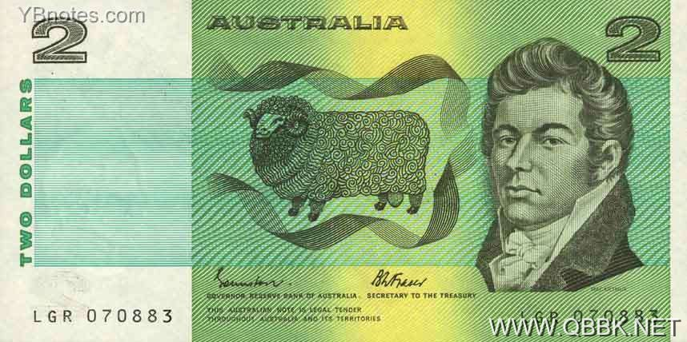 1985年版澳大利亚币2元正面，约翰•麦克阿瑟的头像。

兰姆酒之变的祸根是经济性的。让罪犯有工作的动机，这一策略让麦克阿瑟这类人赚饱了钱。1790年随第二支船队抵达澳大利亚，麦克阿瑟还只是一介武夫。1796年自军中辞职，专心做生意，当时已经拥有自己的第一批羊群，深知蓄养羊只及出口羊毛的商机无限。从悉尼往内陆走，中间有蓝色山脉，1813年终于跨越山脉，发现了另一边广袤空旷的草原。那儿是羊群的天堂。麦克阿瑟很快就成为澳大利亚首富，但他和他那些畜羊巨头却都成了所谓占地户，因为他们放牧的土地并不是他们的，而是属于英国政府的。但刚开始时，这些都还只是小事一桩。占地户毕竟都是澳大利亚的菁英阶层，或说得更恰当一点，堪称是占地贵族。

即使有占地贵族，新南威尔士却一点都不像东欧或南美殖民地的那些专制政权，不像奥匈帝国及俄罗斯有农奴，也不像墨西哥及秘鲁有大量原住民可供剥削。在许多方面，新南威尔士反而像弗吉尼亚的詹姆斯镇，菁英阶层到头来发现，唯有创造比奥匈帝国、俄罗斯、墨西哥及秘鲁更为广纳式的经济制度，才是自己的利益所在。罪犯是唯一的劳动力，而唯一能让他们有工作动机的，则是付工资给他们。

很快的，罪犯也可以创业，并雇用其他罪犯。更重要的是，服完刑期后，他们甚至分得土地，并恢复所有的权利。其中有些人开始致富，甚至不识字的亨利•凯博都不例外。到1798年时，他拥有一家旅馆，命名为疯马，还有一间店铺，又买了一艘船，做海豹皮买卖。到1809年，他至少拥有九处农场，面积约四百七十英亩，同时在悉尼拥有多处店面及房屋。

接下来，新南威尔士爆发了新一波的冲突，一方是菁英阶层，另一方则是罪犯、服刑期满的罪犯，以及他们的家人。菁英阶层带头的都是过去的警卫及军人，诸如麦克阿瑟之类，另外就是一些自由住民，都是因为羊毛经济发达受到吸引而来到殖民地的人。多数的财富仍然掌握在菁英阶层手中，更生人及他们的后代所要的，包括停止流放、有机会由自己同类的人组成陪审团，以及无偿使用土地。然而，菁英阶层一概不予同意。他们关心的是为自己占用的土地取得合法地位。整个情况有点类似两个多世纪前北美洲发生的那次事件。如我们在第一章所见，契约工反抗弗吉尼亚公司获得了胜利，接着，斗争更在马里兰及卡罗莱纳发生。在新南威尔士，麦克阿瑟及占地户分别扮演的就是巴尔的摩男爵及艾胥黎古柏的角色，英国政府这一次照样站在菁英阶层这边，但他们也担心，有朝一日麦克阿瑟与占地户有可能也会宣布独立。

1819年，英国政府特派比格针对当地的发展主持一个调查委员会。比格对罪犯所享有的权利大感震惊，此外，对此一流放殖民地的经济制度竟然如此之广纳也大感惊讶。他建议来一次彻底的整顿：罪犯不得拥有土地，任何人从此不得付工资给罪犯，赦免不得浮滥，应有限制，刑期服满，更生人不得配给土地，违者加重处罚。在比格眼里，占地户简直成了澳大利亚现成的贵族，放眼未来，他则看到了一个由他们支配的专制社会。这还得了。

比格想要倒转时钟，更生人及他们的儿女却要求更多权利。最重要的是，又和美国的情形一样，他们了解，若要充分巩固自己的经济及政治权利，就需要建立一种政治制度，将他们也包含在决策过程中。因此，他们要求能够公平参与的选举，要求代议制度以及他们能够获得席位的议会。

领导更生人及其子女的是温特沃斯，一个人生多彩多姿的作家、探险家兼新闻记者。第一支穿越蓝色山脉的探险队，他也是领队之一，从此为占地户打开了广袤的草原，群山中有一个小镇迄今仍以他为名。他之所以同情罪犯，或许是因为他自己的父亲曾经被控公路抢劫，为了逃避受审，免掉可能的牢狱之灾，才自愿流放到澳大利亚来。这时候，温特沃斯大力主张比较广纳的政治制度，包括选举产生的代表大会、由更生人及其家人组成的陪审团裁判，以及停止将罪犯流放到新南威尔士。他办了一份《澳大利亚人报》，大肆攻击现行政治制度。麦克阿瑟讨厌温特沃斯，对他的主张更是深恶痛绝，并将他的支持者列了一份清单，其特征表列如下：

被判绞刑，流落至此者

拖行车后，饱尝鞭挞者

伦敦犹太人

最近被撤销资格的犹太税务员

因买卖奴隶流放至此的拍卖人

在此地饱尝鞭挞者

双亲皆罪犯的儿子

负债累累的骗子

美洲投机分子

品行不端的讼棍

最近落魄至此卖唱的异乡人

岳父母皆为罪犯的人

娶以前为铃鼓女郎的罪犯做妻子的人

尽管有麦克阿瑟及占地户的反对，澳大利亚的这股潮流却挡不住。要求代议制度的呼声强大到无法压制。1823年之前，统治新南威尔士的总督简直可以为所欲为，但到了那一年，英国政府任命的地方议会成立，他的权力从此受到了限制。刚开始，英国政府任命的都是占地户及非罪犯的菁英阶层，麦克阿瑟即为其中一员，但这情形并不长久。1831年，总督博尔科向压力屈服，首度让更生人坐上了陪审团的席位。更生人，事实上还要加上许多新来的自由住民也希望停止从英国流放罪犯，因为那会增加劳动力市场的竞争，导致工资下降。占地户喜欢的是低工资，但他们未能如愿。1840年，流放罪犯至新南威尔士的措施停止，1842年，立法机构成立，其中三分之二成员由选举产生（其余为任命）。更生人有选举权也有被选举权，条件是必须拥有相当财产，在这方面，符合资格的人极多。

到了1850年代，澳大利亚已经实施成年男性白人参政。公民、更生人及其家人的要求当时已经远远超出温特沃斯最初所能想到的程度。事实上，他那时反倒是站在保守派的一边，坚持上议院应为非民选的。但正如之前的麦克阿瑟，温特沃斯也阻挡不了潮流，大势之所趋，政治制度乃益趋广纳。1856年，维多利亚省及塔斯马尼亚省成为全世界第一个实行选举秘密投票的地方，买票及强制投票的行为因而为之遏止。直到今天，提到选举秘密投票的规矩，仍然称之为“澳式投票”。

在新南威尔士的悉尼，最初的情况非常类似一百八十一年前弗吉尼亚的詹姆斯镇，唯一不同的是，詹姆斯镇的新住民多数时契约工而非罪犯。在这两个地方，最初的情况都没有为榨取式的殖民制度提供空间。两个殖民地都没有稠密的原住民可供剥削，没有可以轻易取得的贵金属如金矿或银矿，也没有可供奴隶经济运作的土壤与作物。1870年代，奴隶贸易仍然活跃，如果有利可图的话，新南威尔士可能早就充满了奴隶。但事实上并没有。无论是弗吉尼亚公司或新南威尔士的军人及自由新住民都向压力低头，逐步打造了广纳式经济制度，进而与广纳式政治制度串联成一体。犹有甚者，此一发展在新南威尔士引发的斗争程度弗吉尼亚更低，而随后企图扑灭此一趋势的倒退也未能得逞。

澳大利亚之走上广纳式制度，其历程同美国一样，却异于英格兰。在英格兰，内战及后来的光荣革命都曾动摇英格兰的国本，但在美国及澳大利亚，就不需要这类的革命，因为这两个国家立国的情形不同，当然这并不表示，广纳式制度的建立未曾经历任何冲突，事实上，美国就是推翻了英国的殖民主义才走出来的。在英格兰，专制统治历史悠久，根深蒂固，需要革命才能予以铲除。在美国及澳大利亚，就没有这种情形。尽管马里兰的巴尔的摩男爵及新南威尔士的麦克阿瑟有可能都有这样的雄心想建立专制统治，但若要实现，他们却都力有不及。在美国及澳大利亚，广纳式制度一旦建立，意味着工业革命将会快速在这些土地上发芽，繁荣也就随之而来。而这些国家所走的道路，殖民地如加拿大及新西兰亦步亦趋跟了上来。

当然，要达到广纳式制度还有别的道路。西欧大部分地方走的就是第三条道路，在法国大革命的刺激下，走上了广纳式制度。法国大革命推翻了法国的专制政权，接着又制造了一系列的国际冲突，将制度的改革散布到西欧大部分地区。至于改革所产生的经济结果，则是西欧大部分地区开始出现广纳式经济制度、工业革命及经济成长。

## （2）冲破障碍：法国大革命

1789年之前，专制王朝统治法国长达三个世纪。法国社会分成三个部分，亦即所谓的阶级。第一阶级是教士，第二阶级是贵族，其他所有人则是第三阶级。不同的阶级遵行不同的法律，前两个阶级拥有权利，其余的人则一无所有。贵族及教士不必纳税，而老百姓却要缴纳苛捐杂税，一如所有榨取式政权之所为。事实上，教会不仅免税，本身还拥有大量土地，可以向农民征税。君王、贵族及教士享受奢华的生活，而大部分第三阶级则活在悲惨的贫穷之中。不同的法律不仅保证贵族及教士拥有极度优越的经济地位，而且也赋予他们政治权力。

18世纪法国的城市生活既艰难又病态。制造业由强大的行会把持。行会除了为自己的会员谋取良好的收入，同时不准外人进入自己的行业，或经营新的生意。此一所谓的“旧制度”很以自己的持续性及稳定性自豪。任何大生意人及有才能的人开创新的行业都会制造不稳定，是无法容忍的。城市生活固然艰难，农村生活犹有过之。就我们所知，当此一时期，农奴制度最极端的形式——把人跟土地绑在一起，强迫他们为封建主劳动，收成还要上缴——在法国已经没落多时，但迁移还是受到限制，封建负担依然庞大，法国农民仍要向君主、贵族及教会纳贡。

在这样的背景下，法国大革命是根本的大事。1789年8月4日，国民制宪会议颁布了一部新宪法，法国的法律彻底改头换面。第一条明定：

“国民会议特此完全废除封建制度，特令所有现行的权利与收益，包括领地及租税，一切土地及农奴制度相关者均无偿予以废止。”

第九条继续申明：

“税负方面，无论人或土地，所有特权一律废止。所有公民、所有土地皆应一体一式纳税。制度设计应着眼于税赋由全体人民按比例分担，即便今年剩下的六个月亦然。”

如此这般，法国革命一举废除了封建制度，将其强加于人民的所有义务与规费扫进历史灰烬，并取消了贵族与教士的免税。但其中最激进的却是第十一条，当时甚至根本无法想象，其申明如下：

“所有公民，不分出身，均得以出任任何公职或名分，无论其为教会的、文官的或军方的；任何行业均应杜绝腐化堕落。”

所以，法律之前如今人人平等，日常生活上如此，商业上如此，政治上也如此。8月4日之后，革命的改革持续推动，其结果是取消教会征收特别税的权利，教士改吃政府薪俸。根深蒂固的政治及社会角色既遭废除，经济活动的障碍随之根绝，行会及一切的职业限制都废止，城市中开始出现良性的竞争。

所有这些都是终结法国专制王朝的第一步。8月4日人权宣言公诸于世，接下来虽然是数十年的动荡与战争，但无可逆转的一步已经踏出，从此摆脱了专制及榨取式制度，走上了广纳式政治及经济制度，随之而来的则是其他的经济改革，并于1870年的第三共和达到巅峰，而且一如光荣革命之于英格兰，它为法国带来了议会制度。法国大革命固然制造了不少的暴力、痛苦、动荡与战争，但不可否认的，法国却也因此跳出了榨取式制度的陷阱，不至于像东欧的专制政权如奥匈帝国及俄罗斯，断绝了经济的成长及繁荣。

法国的专制王朝怎么会走上了1789年的革命呢？尽管经济停滞、社会动荡，许多专制政权毕竟还是存活了很长的时间。一如历史上多数的革命与巨大变革，法国大革命之所以水到渠成，乃是多种因素汇集所致，而所有这些又与英国的快速工业化有着密切的关系。当然，一如往常，发展是难以预知的，尽管君王努力想要稳住政权却失败了，结果证明，无论在法国或欧洲其他地方，在制度的改变上，革命都比1789年的人所能想象的还要成功。

法国的许多法律及特权都是中世纪的残余，相较于绝大多数的百姓，不仅对第一及第二阶级较为有利，而且也让他们拥有可以与君主分庭抗礼的特权。太阳王路易十四统治法国五十四年，在位期间巩固王权，更进一步强化数个世纪前就已经确立的专制统治。在过去，许多君王通常都还会召开显贵会议谘商国政。由君王亲自挑选重要贵族组成的显贵会议，大体上虽然仅备咨询，但对王权仍然具有小幅的牵制作用，基于此一理由，路易十四干脆不召开会议。在他的统治下，法国通过某些手段，诸如大西洋及殖民地贸易，在经济成长上的确达成了某些成就。当时才干过人的财政大臣柯尔贝尔又非常留心政府创办的或政府控制的产业，但这些都是典型的榨取式成长，受益的又几乎全都是第一及第二阶级。另一方面，为了支应经常的战争、大量的常备部队，以及君主自己的豪华排场、消耗及宫室，政府财政也常常吃紧，因此，路易十四也有意将法国的税制合理化。但王室的征税能力低落，甚至连小贵族都掐住了国库的收入。

1774年路易十六即位，当时虽然已有小幅经济成长，但社会的变化却非常巨大。此外，之前的财务问题已经演变成财务危机，1756年至1763年之间的英法七年战争尤其所费不赀，还让法国丢掉了加拿大。为了重整债务及增加税收以平衡王室的收支，许多重量级人士都参与其事，包括当时最有名的经济学家之一杜尔阁、革命后同样也扮演了重要角色的内克尔，以及加隆。但全都没有成功。加隆的策略之一是说服路易十六召开显贵会议。国王和他的谋士都寄望显贵会议支持改革，一如查理一世1640年召开英格兰国会，寄望他们同意拨款组织一支军队征讨苏格兰。没想到显贵会议却决议，唯有一个具有代表性的团体，也就是三级会议才能够为这类改革背书。

三级会议迥然不同于显贵会议。后者是由贵族组成，大体上都是国外钦点的主要贵族，前者则包括所有三个阶级的代表，最后一次召开是在1614年。1789年，三级会议在凡尔赛召开，一开议就知道根本不可能达成任何协议。因为其间存在着无可妥协的分歧。第三阶级把这次会议视为增加自身政治权力的机会，要求在三级会议中拥有更大的表决权，而贵族与教士则坚决反对。会议在1789年5月5日结束，没有达成任何决议，唯一的决定是召开权力更高的国民会议，因此更加深了政治上的危机。第三阶级，特别是店家、商人、技师及工匠这些要求更大权力的人，无不把此一发展视为增加自身影响力的机会，因此在议程中要求更多发言的机会，在大会中要求更多的权利。全国人民在这些发展的鼓励之下，更是风起云涌，走上街头，成为他们的后盾，结果导致三级会议改组，并于7月9日成立国民立宪会议。

同时，整个国家，尤其是巴黎，民情愈趋极端。路易十六身边的保守派展开反扑，说服他罢黜改革派财政大臣内克尔，此举加深了街头的激进情绪，结果是1789年7月14日著名的攻占巴士底狱。从此开始，革命一发不可收拾。内克尔重获任用，革命分子拉法叶特奉命出掌巴黎国家卫队。

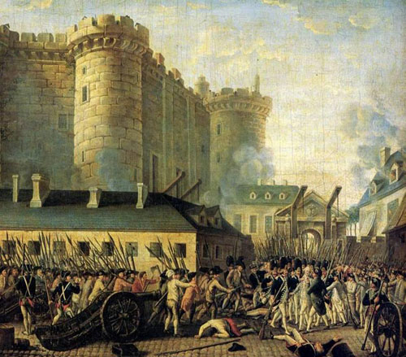 巴黎起义者攻占巴士底狱

但还有比攻占巴士底狱更为重要的，那就是国民立宪会议的冲劲，1789年8月4日，立宪会议鼓起刚建立的信心，通过新宪法，废除了封建制度以及第一、第二阶级的一切特权。此一极端的演变却导致立宪会议内讧，因为，对社会究竟应该采取何种形态，冲突的意见分陈。第一步是地方性的社会团体先后成立，其中最有名的是激进的雅各宾俱乐部，后来甚至拿下了革命的主控权。同时，贵族开始大批逃亡，亦即所谓的流亡者；另有许多人鼓动国王解散立宪会议，采取行动，自行奋起或寻求外国协助，譬如奥地利——王后玛丽•安多奈特的母国，也是多数流亡者逃亡的地方。街头的群众眼看过去两年的革命成果受到威胁，激进的步调开始加速。1791年9月29日，国民立宪会议通过新宪法的最后版本，把法国变成一个君主立宪国，全民一律平等，没有封建义务与规费，行会所规定的一切限制全都终止。法国仍然是一个君主国，但国王既没有地位，事实上，甚至没有自己的自由。

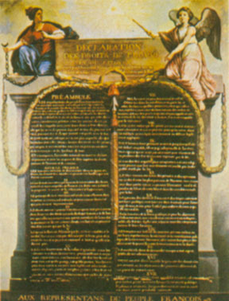 《人权与公民权宣言》

但是，1792年法国与以奥地利为首的“第一次反法同盟”爆发战争，无可逆转地扭转了革命的冲劲。战争加强了革命分子及群众的决心与激进（群众又被称为“无套裤汉”，因为他们买不起那种当时时髦的及膝短裤），其结果就是史称的恐怖时期，在罗伯斯庇尔及圣茹思特的领导下，处决了路易十六及玛丽皇后之后，雅各宾派犹如脱缰野马，不仅大肆处决了数十名贵族及反革命派，甚至连革命阵营中几名重量级人物也一并遭到不测，包括之前受爱戴的领袖布瑞索特、丹东及德穆兰。

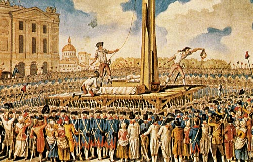

<em>“第一次反法同盟”以解救路易十六的名义对新法国发动攻击，实际上害了路易十六。路易十六和王后都被革命者处死。</em>

<em>路易十六的王后，奥地利公主，玛丽•安托瓦奈特，生活上穷奢极欲，有“赤字夫人”的绰号。</em>

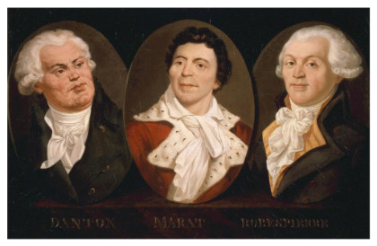

丹东、马拉和罗伯斯庇尔（自左至右）

圣茹斯特，绰号“恐怖大天使”、“革命大天使”，终年28岁。

恐怖很快一发不可收拾，到了1794年7月，连自己的领袖包括罗伯斯庇尔及圣茹思特都遭到处决才告一个段落。接下来的时期相对安定许多，先是1795年至1799年之间的督政府，然后是权力更为集中的三人执政团，由杜寇、西艾耶及拿破仑组成。督政府时期，年轻将军拿破仑就已经因战功而扬名，1799年之后，影响力更是有增无减，没有多久，执政团便成为拿破仑的个人统治。

从1799年至1815年拿破仑王朝结束前，法国获得一连串重大的军事胜利，包括奥斯特里茨、耶拿—奥斯泰德、及华格瑞姆等战役，整个欧洲望风披靡，拿破仑的意志、改革与法典畅行无阻。1815年，拿破仑彻底失败后，法国走了一段时期的回头路，政治权利遭到较大的限制，王室复辟，路易十八登基。但所有这一切都只是延迟广纳式政治制度的出现而已。

1789年的革命冲垮并终结了法国的专制统治，尽管在时间上慢了些，仍然无可避免地走向广纳式制度。除了法国本身，再加上革命、改革的输出的地方，部分欧洲乃于19世纪加入了已然上路的工业革命。

## （3）革命输出

1789年法国大革命前夕，整个欧洲都对犹太人施以重重限制。以德意志城市法兰克福为例，规范犹太人的法令可以追溯到中世纪。在法兰克福，犹太人家庭不足五百，全都必须住在犹太人区“犹太巷“的围墙内，夜里不准踏出围墙一步，礼拜日或任何基督教的节庆亦然。

犹太巷之狭窄令人难以想象，长四分之一英里，宽却只有十二英尺，有些地方仅十英尺而已。犹太人经年生活在压迫与管制之下。每一年最多只有两户人家准许住进犹太人区，最多只有十二对新人准许结婚，而且两人都要超过二十五岁才行。犹太人不准务农，也不准买卖武器、香料、酒类和谷物。1726年之前，每个人都必须佩带特定的标志，男人是两个黄色的同心圆，女人则是条纹面罩。所有犹太人都必须付人头税。

法国大革命爆发时，一个成功的年轻商人罗斯柴尔德住在犹太巷。1780年代早期，他已经是法兰克福首屈一指的钱币、金属及古董生意人。但和城内所有的犹太人一样，犹太人区以外的地方，他不仅不准做生意，甚至连居住都不准。

但很快的，一切都改变了。1791年，法国国民会议解放了法国犹太人，同时，法国军队则占领了莱茵兰，解放了德意志西部的犹太人。至于法兰克福，其结果却显得比较突然，甚至有点无心插柳。1796年，法国炮击法兰克福，过程中，犹太巷有一半遭到摧毁，约有两千犹太人无家可归，不得不搬出犹太人区。一旦脱离了牢笼，又摆脱了不准创业的重重限制，他们大展宏图的机会来了。这里面包括一项供应奥地利军队谷物的合约，若在以前，这根本就是无法想象的事情。

十年不到的时间，罗斯柴尔德不仅已是法兰克福最富有的犹太人，而且也成了知名的商人。1806年，拿破仑改组德意志，戴伯格被任命为法兰克福大公；在他手里，完全的解放终于完成，时在1811年。罗斯柴尔德当时对儿子说：”现在，你是一个公民了。“

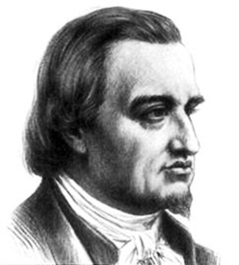 梅耶•罗斯柴尔德，家族创始人。

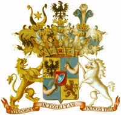 “红盾家族”的族徽。罗斯柴尔德家族又被称为“红盾家族”。

但为解放犹太人所做的努力到此并未结束，因为接下去仍然有反动出现，特别是1815年维也纳会议所打造的后拿破仑时代的政治局势。尽管如此，罗斯柴尔德并没有重回犹太人区；没有多久，他和他几个儿子已经拥有19世纪欧洲最大的银行，在法兰克福、伦敦、巴黎、那不勒斯及维也纳都设有分行。

这种情形并非特例。法国革命军及拿破仑先后侵入的欧洲大陆大部分地区，当时的制度几乎全是中世纪的残余，权力全都在国王、亲王和贵族手中，并严格限制贸易，包括城市及乡村的贸易。在这些地区的许多地方，农奴制度及封建制度的重要性远高于法国本身。在东欧，包括普鲁士及奥匈帝国的匈牙利部分，农奴是跟土地绑在一起的。在西欧，这种形式的农奴制度早已经消失，但农民还是要向封建领主缴交各式的规费、税赋并服劳役。举例来说，在拿骚—乌辛根，农民名下要缴付的各种费用、规费及要做的劳务就多达二百三十种。以规费来说，连宰杀一只动物都要缴税，称为血税，另外还有蜜蜂税及蜂蜡税。买卖一项资产，领主也有钱要拿。在城市里，行会管制着一切经济活动，其强大的程度也远超过法国。在德意志西部城市科隆及阿亨，行会禁止采用纺织机器。从瑞士的伯尔尼到意大利的佛罗伦萨，许多城市都是被少数几个家族把持。

法国大革命的领袖，以及后来的拿破仑，都向这些地方输出革命，推翻专制，终结封建的土地关系，废除行会，实行法律面前的人人平等，亦即非常重要的法治观念，关于这方面，下一章还会详谈。因此，法国大革命不仅使为法国，更是为欧洲其他地方做好了准备，迎接即将萌芽的广纳式制度及经济成长。

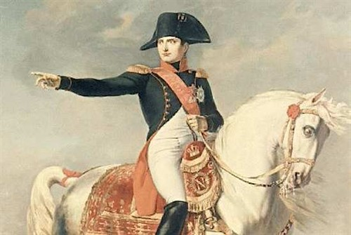 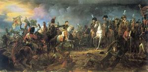 奥斯特里茨战役中的拿破仑和他的将军们

如前所述，法国的发展导致警讯频传，以奥地利为核心，好几个欧洲强国组织了起来，于1792年对法国展开攻击，表面上是要解救路易十六，实际上却是要粉碎法国大革命，指望临时拼凑上阵的革命军很快兵败如山倒。但经过开始的几次失败之后，新成立的法兰西共和国军队初期采取守势，却在战斗中取得胜利。尽管严重的组织问题有待克服，但法国却走在其他国家前面，实施一项新的创举：大规模征兵。1793年8月开始实施的大规模征兵，甚至在拿破仑著名的军事谋略还没有上场之前，就已经使法国能够部署大规模的部队，进而发展出超强的军事优势。

初期的军事成功鼓舞了共和国的领导阶层，企图扩大法国的疆界，打算在新共和国与敌对的君主国普鲁士及奥地利之间建立一个有效的缓冲。很快的，法国就拿下奥地利辖下的尼德兰及联合七省，基本上是今天的比利时及荷兰，同时也夺下了今日瑞士的大部分地区，并在整个1790年代稳稳控制这三个地方。

刚开始时，德意志人还雄心勃勃，但到了1795年，法国牢牢地控制住莱茵兰，亦即德意志西部莱茵河左岸的部分，普鲁士人不得不签下巴塞尔条约承认此一事实。1795年至1802年间，法国虽然占领了莱茵兰，但并未握有德意志其他地区。1802年，莱茵兰正是并入法国。

1790年代后半，意大利仍然是主要的战场，对手则是奥地利。1792年，萨瓦为法国所并，双方陷入僵局，直到拿破仑1796年入侵才改观。1797年年初，拿破仑发动首次欧陆战役，几乎征服了整个北意大利，唯一例外的是威尼斯，当时是由奥地利占领。到1797年10月，法国与奥地利签订坎波佛米奥条约，结束了第一次反法同盟战争，并承认了意大利北部许多由法国控制的共和国。合约虽然签订，法国却继续控制意大利，并侵入教皇国，于1798年3月建立罗马共和国。1799年1月又占领那不勒斯，建立帕特诺柏共和国。至此，整个意大利半岛成为法国的囊中之物，有的是直接控制，如萨瓦，有的则是通过卫星国间接控制，如南阿尔卑斯、利古里亚、罗马及帕特诺柏等共和国，唯有威尼斯仍然为奥地利人所据。

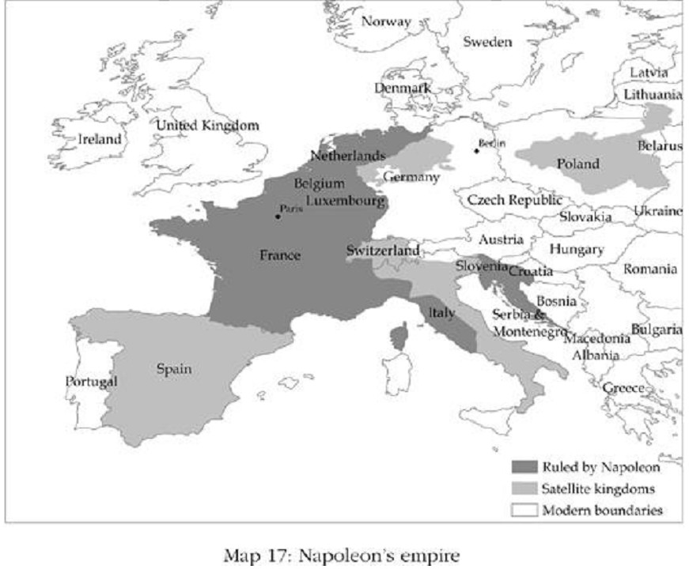    

1798年至1801年间的第二次反法同盟战争，双方进一步折冲，到头来仍然是法国主控全局。法国革命军迅速在他们所征服的地方动手改革，扫除农奴制度的残余及封建的土地关系，落实法律面前人人平等。教士的特殊地位与权势遭到拔除，城市地区的行会不是彻底湮灭就是苟延残喘。1795年的入侵之后，在法国建立巴达维亚共和国的奥属尼德兰及联合七省，这种情形马上就发生，其政治制度几乎和法国如出一辙。瑞士的情况也一样，行会、封建领主及教会一败涂地，封建特权取消，行会瓦解崩盘。

法国革命军之所为，拿破仑继之，方式则不尽相同。拿破仑最感兴趣的莫过于把自己征服的地方玩弄于股掌之上，有时候他假手于当地的菁英，有时候则是交给家人及同僚，像他短暂控制西班牙及波兰的时期就是如此。但是，长期深化革命的改革也是他的真心所愿。最重要的是，他把罗马法及法律面前人人平等的理念加以法制化，编入法典，亦即著名的拿破仑法典，并将这部法典视为自己最伟大的遗产，希望落实到每一处他控制的领土。

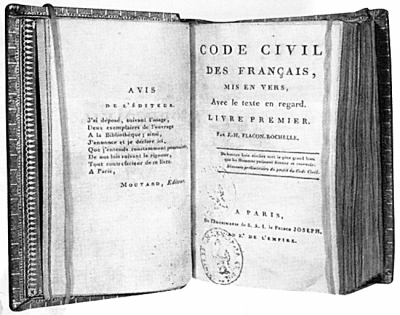 《拿破仑法典》，正式名称《法国民法典》

当然，法国革命军及拿破仑所实施的改革并非不可逆转。有些地方，如德意志的汉诺威，拿破仑一垮台，旧时的菁英阶层便重新掌权，大部分的法国建树从此销声匿迹。但在其他许多地方，封建制度、行会及贵族倒真的是就此完全消失或一蹶不振。即使法国人退走，拿破仑法典依然通行的也不乏其例。

总而言之，在欧洲，法国军队固然制造了不少苦难，但也激烈改变了政治生态。在欧洲许多地方，从此消失的包括封建的关系、行会的力量、君主及亲王的专制，以及以出身定人高下的不平等”旧制度“。有了这些改变，广纳式经济制度才得以产生，也才使这些地方得以工业化。19世纪中叶，凡是法国控制过的地方，工业化几乎都已经上路，至于法国未能征服的地方，如奥匈帝国及俄罗斯，或法国仅短暂或局部控制的地方，如波兰及西班牙，大体上则仍然处于停滞状态。

## （4）追求现代化

1867年秋，日本封建幕府萨摩藩的重臣大久保利通，从首府江户（现在的东京）前往地方城市山口。他在10月14日会见了长州藩的领袖，提出一个建议：共同发兵江户，推翻日本的统治者幕府将军。当时，大久保利通已经联络好土佐藩及肥前藩的领袖，一旦强大的长州同意，秘密的萨长同盟便宣告组成。

1868年的日本，在经济上仍然是一个低度开发国家。德川家族1600年开始统治日本，1603年取得将军的头衔，日本天皇则被边缘化，成为纯粹仪式性的角色。德川将军为众封建领主之首，封建领主则各领其藩地并征税，其中统治萨摩的为岛津家族。领主又各拥武装家臣，亦即武士，管理一个类似中世纪欧洲的社会，行业界限分明，贸易限制重重，农民税负沉重。幕府以江户为首城，垄断并管制外国贸易，禁止外国人入国。政治与经济制度皆为榨取式的，国家是贫穷的。

但幕府的统治并非完全。德川家族虽然在1600年接管了国家，却无法管到每一个人。国之南边，萨摩藩的自主性就非常高，可以从琉球群岛跟外面的世界独立从事贸易。1830年，大久保利通就是出生在萨摩的首府鹿儿岛。身为武士之子，他后来也成为一名武士。由于自幼聪颖，很早就受到萨摩领主岛津齐彬的注意，也特意拔擢他。当时，岛津齐彬已经成竹在胸，准备以萨摩军推翻幕府，最终的目的则是要跟亚洲及欧洲进行贸易，废除老旧的封建经济制度，建立一个现代的日本国。1858年，岛津齐彬骤逝，这个计划胎死腹中。他的继承人岛津久光较为谨慎，至少初期如此。

这时候，大久保利通愈来愈相信，日本只有推翻封建的幕府才有明天，最后他也说服了岛津久光。为了师出有名，他们以不满天皇被边缘化为包装。大久保利通与土佐藩签署的协约强调：“一国无二君，一家无二长，政府只交付给一个统治者。”但真正的目的并非只是恢复天皇的权力，而是要彻底改变政治与经济的制度。土佐那边，坂本龙马为签约人之一。正当萨摩与长州动员军队时，坂本龙马向将军提出一项为数八点的计划，敦促将军辞职下野以避免内战。计划极为激进，尽管第一点明言：“国家的政治权力应回归皇室，一切号令应出于皇室。”但其内容远不止于天皇复位，第二、三、四、五点分别申明：

二、建立两个立法机构，一上院，一下院，政府一切措施均应本诸民意。

三、贤能之士，无分王公、贵族、平民皆得为国建言，已经失去作用的传统机构则予废除。

四、外交事务之执行应依循适当规范，并以民意为基础。

五、过时之立法与规范应予废止，择取一部新而完备的法典。

德川庆喜将军同意下野，1868年1月3日，宣布明治维新；孝明天皇逝世后一个月，其子明治即位。这时候，萨摩和长州的军队虽然已经占领江户及皇城京都，却仍担心德川幕府夺权并恢复将军统治。按照大久保利通的希望，德川幕府最好就此走入历史，于是说服天皇废除德川藩并没收其领地。1月27日，前将军德川庆喜对萨摩及长州军队发动攻击，内战爆发，双方缠斗至夏天，德川幕府覆灭。

明治维新之后，日本进入制度改革的过程。1868年，封建制度废除，政府接管三百处封地，改划为府县，任命官员治理。税务由中央集中管理，现代化的官僚体系取代旧有的封建体系。1869年法律面前所有社会阶级一律平等开始实施，迁移及贸易限制取消。武士阶级废除，此举不无防止叛乱的作用。私有土地财产权开始实施，人民可以自由就业并从事任何买卖。政府开始投入基本建设，一反专制政权对铁路的态度，1869年，日本当局开辟了东京至大阪的轮船航线，并在东京与横滨间兴建第一条铁路。制造业也开始发展，大久保利通时任大藏大臣，负责工业化之推动。在这方面，萨摩藩主早已领袖一方，兴建工厂，生产陶器、大炮及棉线，进口英国纺织机，1861年就创办了全日本第一家棉纺工厂，还兴建了两座现代化造船厂。1890年，日本成为亚洲第一个接受成文宪法的国家，产生了君主立宪、民选的国会及独立的司法。在亚洲，这些改变是使日本成为工业革命主要受惠者的关键因素。

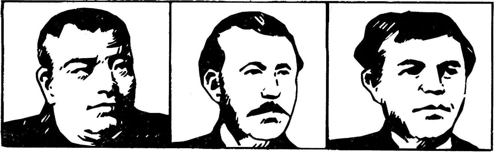

日本维新三杰：西乡隆盛、大久保利通和木户孝允

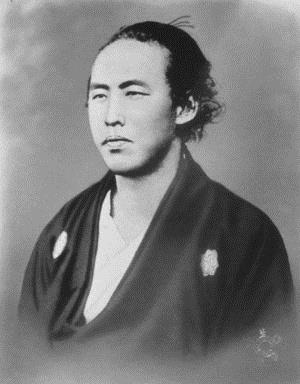 坂本龙马

19世纪中叶，中国与日本都是贫穷国家，因专制统治而积弱不振。多个世纪以来，中国的专制君主一直忌惮改变。中国与日本之间虽有相似之处——德川幕府在17世纪也禁止海外贸易，一如更早时期的中国皇帝，抗拒经济及政治的改变——但也有显著的政治差异。中国是一个由皇帝统治的集权官僚帝国，但在权力上皇帝也有力所不能之处，而其中最重要的是叛乱的威胁。1850年至1864年之间，整个中国南方遭受太平天国之乱肆虐，战争加上饥荒，死亡数以百万计。但皇帝所遭到的反对并非制度面的。

日本的政治制度结构则不同。幕府将天皇边缘化，但如前面所说，德川的权力并非绝对，诸如萨摩藩这样的地方不仅维持独立，还能按照自己的利益大做外国生意。

和法国一样，对中国及日本来说，英国工业革命一项重要的结果就是彰显了他们在军事上的不堪一击。1839年至1842年之间，第一次鸦片战争，英国的海上力量让中国人抬不起头来，同样地，1853年美国海军舰队司令佩里率领战舰驶入江户湾，对日本人来说，何尝不是如此。经济的落后导致军事上的落后，此一现实不仅刺激岛津久光推翻幕府将军，同时也推动改变，最后导致明治维新。萨摩藩的领袖们明白，经济的成长——乃至日本的生存——唯赖制度改革才足以达成，但幕府将军却抗拒改革，因为他知道自己的权力与现行制度是不可分的。既要改革，就必须推翻幕府将军，而他确实被推翻了。中国的情况相同，但政治机制却有别，推翻皇帝谈何容易，事情也只有等到1911年才成功。中国人不思制度的改革，只想要进口现代武器跟英国人一较高下；日本人却不同，他们建立了自己的军火工业。

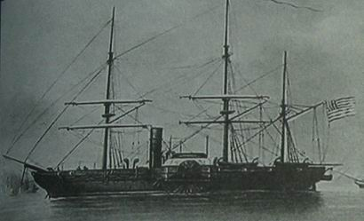    

<em>美国佩里舰队的旗舰“萨斯喀那号”（Susquehanna），蒸汽明轮护卫舰，1850年建造，排水量2450吨，搭载9门炮，船员300人。</em>

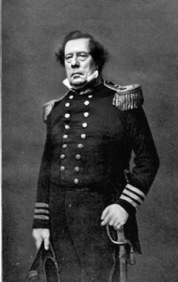

<em>1853年7月8日，日本嘉永六年六月三日，美国东印度舰队司令官马修•佩里率领4艘战舰，出现在扼守江户湾要冲的浦贺近海，船上的大炮瞄准了岸上的炮台，随之而来的是佩里率300名全副武装的美国士兵登陆。第二年的2月11日，佩里率领7艘军舰、200门大炮和1000多名战斗人员再次来到江户湾。在武力威逼之下，幕府在3月31日与美国签订了《日美神奈川条约》，两个月后又追加签订了《下田条约》。西洋各国闻到日本开国后接踵而至，短短几个月的时间里，日本又先后同俄、英、荷等国签订了类似的“和亲条约”。到1858年，德川幕府还与美、俄、英、荷、法五国签订了有关开港、领事裁判权、居留地等内容的《安政五国条约》。从此，日本正式地步中国的后尘而开国了。</em>

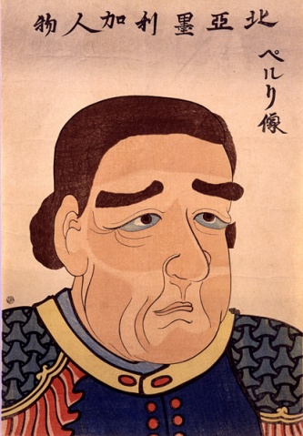

<em>日本民族没有中国人那种“天朝大国”的心态，不把外民族统统视为“蛮夷”。面对列强挑战时，不是盲目抵制，而是明智地选择了开放国门，并采取向西方学习的积极态度。值得深思的是，佩里率领舰队粗暴地踢开了日本的国门，但日本人不仅没有把他当作侵略者，还将其作为开国的恩人来纪念。</em>

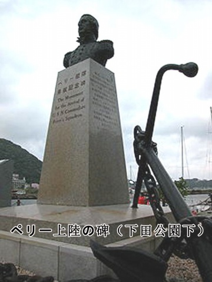

<em>不仅在横须贺市建立了一座佩里公园，还在当年美国黑船登陆的地方，树立了一座纪念碑，上面有日本首相伊藤博文的亲笔手书“北米合众国水师提督培理上陆纪念碑”。日本近代著名思想家福泽谕吉更是写道：“美国人跨海而来，仿佛在我国人民的心头上燃起了一把烈火，这把烈火一经燃烧起来便不会熄灭。”</em>

对于19世纪的挑战，由于一些初始的差异，每个国家的回应也就不同，因此，面对工业革命所带来的关键时期，日本与中国便出现了巨大的差别。当日本的制度正在转型，经济正在快速成长之际，在中国，推动制度改变的力量却相对薄弱，榨取式制度持续当道，最后在1949年毛泽东的共产革命下转向更糟的方向。

## （5）世界不平等的根源

这一章和前面三章告诉我们一项事实：英国先有了广纳式经济及政治制度，才会有工业革命，同时又跟我们解释了一个现象：为什么有的国家会受惠于工业革命并走上成长的道路，而有的国家却没有，甚至从一开始就坚决排斥工业化。一个国家是否走上工业化道路，大体上取决于它的制度。以美国来说，经历了类似光荣革命的转型，到了18世纪末叶，在经济及政治上已经发展出独特的广纳式制度，因此才会成为利用英伦群岛新技术的第一个国家，而且很快就超越了英国，成为工业化及技术变革的领先者。澳大利亚是另一个典型。尽管在时间上晚了一点，也比较不受到注意，澳大利亚同样走上了广纳式制度的道路，而且和英美一样，也是靠人民奋力争取才得来的。一旦广纳式制度到位，经济成长就水到渠成。澳大利亚和美国能够工业化及快速成长，都得力于制度具有足够的广纳性，惟其如此，才不致阻断新的技术、创新和创造性破坏。

至于欧洲其他殖民地，绝大多数却非如此。这些地方的发展条件大不同于澳大利亚和美国。在澳大利亚和美国，由于本土没有原住民及资源可供榨取，殖民政策也迥不相同，虽然政治的权利及广纳式制度还是靠人民自己艰苦奋斗才赢得的。但在摩鲁佳，一如亚洲其他地方、加勒比海及南美洲的许多欧洲殖民地，人民就算是想要战斗，却也没有赢的机会。在这些地方，欧洲殖民者不是强力实施新的榨取式制度，就是顺理成章接手旧有的榨取式制度，其目标无非是榨取有价值的资源，从香料、糖到白银及黄金，所到之处，大幅变更制度，彻底封杀了广纳式制度出现的可能。有些地方，眼看已经有工业或广纳式经济制度在萌芽，但殖民者摆明了就是要将之打压灭绝。像这些地方，19世纪乃至于20世纪工业化的好处于他们是没份的。

在欧洲其他部分，发展动力也迥然不同于澳大利亚和美国。18世纪末叶，正当工业革命在英国加速启动时，多数欧洲国家却是在专制政权统治之下，君主及贵族大权在握，其主要收入的来源若非土地所得，就是靠进入障碍所建立起来的贸易特权。工业化过程所产生的创造性破坏，会侵蚀领导阶层的利益，并夺走他们的土地资源及劳动力。因此，工业化使贵族成为经济的输家。更重要的是，工业化的过程势必破坏旧有秩序，造成不稳定，并对政治权力的垄断形成挑战，他们也将在政治上沦为输家。

但是，英格兰的制度转型及工业革命还是为欧洲国家带来了新的机会和挑战。西欧尽管是专制当道，但一千年来影响过英格兰的制度漂移，这个地区也曾经历过。倒是东欧、鄂图曼帝国及中国的情况则大不相同。也正是这些不同，大大影响了工业化的传播。就和黑死病和大西洋贸易的兴起一样，工业化所产生的关键时期加深了许多欧洲国家始终都存在的制度矛盾，其中一个主要因素是1789年的法国大革命。专制政权解体为法国的广纳式制度开了路，终于走上工业化及快速经济成长的道路。事实上，法国大革命的成就并不止于此。随着法军的侵略，法国的新制度跟着输出，强迫几个临近国家改革其榨取式制度。因此，法国大革命不仅是在法国为工业化开路，在比利时、荷兰、瑞士，以及德意志部分地区及意大利，也扮演了相同的角色。更往东边则不同，如同黑死病之后所做出的回应，封建制度非但没有崩溃，反而更得到强化。奥匈帝国、俄罗斯及鄂图曼帝国，经济上虽然变得更为落后，其专制王朝却安稳如故，一直存在到第一次世界大战。

和东欧一样，世界其他地方的专制政权也坚决抗拒。中国尤其如此，明清两朝交替，建立了一个稳定的农耕社会，根本敌视国际贸易。但在亚洲，还是有不同的制度发生了作用。如果说中国对工业革命的回应与东欧如出一辙，那么日本的回应则类似于西欧。跟法国一样，日本采取的是改革制度的革命手段，但不同于法国，日本的主角是贵族，是来自萨摩、长州、土佐及肥前的封建领主。叛乱的领主们推翻幕府将军，促成了明治维新，将日本带上了制度改革及经济成长的道路。

同样的，专制政权在孤立的埃塞俄比亚也是抵死抗拒。至于这块大陆的其他地方，同样一股在17世纪帮助英格兰制度转型的力量——国际贸易——却把西非和中非统统五花大绑起来，通过奴隶贸易成为高度榨取式的制度，在某些地方，社会因此变成废墟，有些地方则产生榨取式的奴隶国家。

哪些国家利用了19世纪以来的大好机会，哪些国家却没能这么做，这一切都取决于我们所阐述的制度因素。今天我们所看到的世界不平等，其根源就在于此一分歧：今天的富裕国家，19世纪时都走上了工业化及科技变革的道路，而贫穷国家则都是那些没有走上这条道路的，而且绝少例外。
