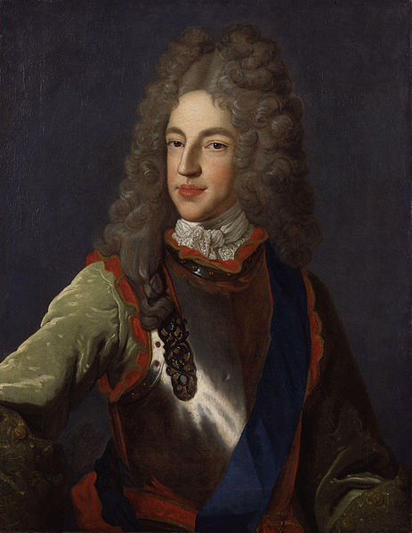
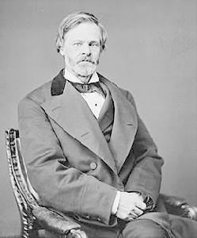
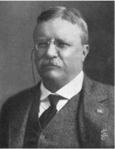
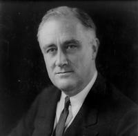
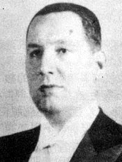

# 11、 良性循环

## （1）黑面法案

温莎堡位于伦敦之西，是英国最堂皇的王家宅邸。18世纪初期，城堡周围曾是一大片森林，林中多鹿，但今已存留无几。1722年，一名名叫南恩的森林守卫，陷入了一场暴力冲突。他在6月27日写下记录：

“晚上有黑面进来，开了我三枪，两颗子弹射中房间窗户，我答应三十日到克劳索恩给他们五基尼金币。“

南恩日记记述的另一次入侵是这样的：”又一次恐吓，一个伪装的人送来一张扬言破坏的字条。“

枪击南恩、索取金钱、要挟恐吓，这些神秘的”黑面“都是些什么人呢？他们其实都是当地人，把脸涂黑，趁着夜色掩盖容貌，这一段时期经常在英格兰南部一带出没，宰杀肢解鹿只及其他动物，焚烧草堆谷仓，破坏围墙鱼池。表面看来，这些都只是违法行为，但其实不然。狩猎（盗猎）国王或贵族土地上的鹿只的情形早已有之。1640年代内战时期，温莎堡的鹿群就几乎被斩尽杀绝。1660年复辟之后，查理二世登基，鹿苑才又恢复。但黑面盗猎鹿只并不光只是为了食其肉，更是要进行破坏，但目的何在呢？

国会代表的各种利益具有多元性，乃是1688年光荣革命的关键基石之一。因此，无论是商人、实业家、社会名流，或与奥兰治的威廉及1714年继承安妮女王的汉诺威王室站在一条阵线上的贵族，都不可能具有足够的力量片面贯彻自己的意志。

整个18世纪，斯图亚特王朝复辟的努力未曾停止过。1701年詹姆斯二世去世后，法国、西班牙、教宗，加上英格兰和苏格兰斯图亚特王室的支持者（所谓的”詹姆斯党人“）都承认其子詹姆斯•法兰西斯•爱德华•斯图亚特（亦即“老僭王”）为英国王位的合法继承人。1708年，老僭王在法国军队的支持下企图夺回王位，但没有成功。接下来的十年间，詹姆斯党发动过好几次革命，其中以1715年及1719年两次规模最大。1745年到1746年间，老僭王之子查理•爱德华•斯图亚特（称为“小僭王”）又企图夺回王位，但遭英军击败。

詹姆斯.弗朗西斯.爱德华.斯图亚特，詹姆斯二世之子，老王位觊觎者

查理•爱德华•斯图亚特，老王位觊觎者之子，小王位觊觎者

前面提到过的辉格党成立于1670年代，代表的是新兴的商人及其经济利益，也是光荣革命背后的主要团体，并在1714年至1760年间主导国会。一旦得势之后，该党便利用新建立起来的地位掠取别人的权益，抢夺别人手上的大饼，其行径与斯图亚特诸王无异，但其权力远非绝对。他们的权力一方面受到国会内部竞争团体的制衡，尤其是为了对抗辉格党而成立的托利党，另一方面也受到他们过去奋斗得来的制度所限制，这些制度是为了强化国会、避免新的专制出现，以及防止斯图亚特王室复辟而设立。光荣革命成就了社会的多元性质，同时也表示大部分老百姓获得了权力，纵使在国会中没有正式代表亦然。因此，一般民众眼看自己的权益遭到辉格党人侵害，“黑面”群起其实是对此情况的反应。

辉格党人因侵犯老百姓的权益而导致黑面四起，最好的例子就是卡多根将军。卡多根在1701年至1714年的西班牙王位继承战争及剿平詹姆斯党人叛乱中立有战功，两度受英王乔治一世册封，1716年受封男爵，1718年再封伯爵，并在上议院辅政会议中位居要津，职司总理，过问重大国政。他在温莎堡西边约二十英里的凯佛夏姆买下大片地产，占地约一千亩。他建了一栋大宅与林荫庭园，又设置一个广达二百四十亩的鹿苑。但如此一来，却侵犯了庄园周围住户的权益。老百姓被迫迁离，放牧牲畜、收集泥炭及柴火的权益遭到剥夺。为此触怒了黑面。先是1722年元月1日，然后在7月，骑马武装的黑面劫掠了鹿苑。第一次攻击杀死了十六只鹿。但遭殃的并不只有卡多根伯爵，许多显赫的地主和政治人物，其庄园也受到黑面的劫掠。

辉格党政府当然不会坐视。1723年5月，国会通过黑面法案，判处绞刑的罪新增加五十条，不仅携带武器有罪，就连把脸涂黑也犯法。事实上，这项法律很快就做了修正，连把脸涂黑也可以处以绞刑。辉格党的菁英阶层大张旗鼓准备实施这项法律。南恩在温莎森林建立了一个线民网，揭发黑面的身份，没多久就逮捕了好多人。从逮捕再到绞死，事情应该很简单。毕竟黑面法案已经上路，辉格党掌握了国会，而国会又掌握国家，至于一干黑面，不过是跟某些大权在握的辉格党人作对而已。更何况，连当时的首相华博尔——他跟卡多根一样，身居上议院辅政会议之要津——也都牵涉其中。华博尔在伦敦西南方的里奇蒙庭园就拥有既得利益，而里奇蒙庭园则是查理一世利用公有地弄出来的，同样也侵犯了当地居民放牧牲畜、狩猎野兔，及采集柴火的固有权益。只不过这些规矩并未严格执行，放牧狩猎照常，直到华博尔安排自己的儿子出任庭园管理，情况才急转直下。庭园关闭，新的围墙建立起来，并布置了捕捉入侵者的陷阱。华博尔自己喜欢猎鹿，又在园内的霍顿为自己盖了一间猎屋。这一切立刻点燃了当地黑面的怒火。

1724年11月10日，庭园外面一个名叫亨特里奇的当地居民，被控协助盗鹿者并鼓动黑面生事，两项罪名都可处以绞刑。指控是直接从上面交下来，带头的是由华博尔及卡多根掌握的上议院辅政会议。华博尔一不做、二不休，亲自询问告密者布莱克本，套取亨特里奇的犯罪证据。罪名应该早已经预定，但结果却并非如此。经过八或九个小时的审讯，法官裁决亨特里奇无罪，部分理由是程序上的，因为搜证的方式违法。

但并非所有的黑面或同情他们的人都跟亨特里奇一样幸运。尽管也有人获得开释或减刑，许多人还是遭到绞死，或者被流放到北美洲殖民地；事实上，这项条例一直都保留在英国法律中，至1824年才废止。然而，亨特里奇的胜利还是非比寻常。陪审团并不是同亨特里奇一伙的，而是大地主及士绅名流，按理说是应该站在华博尔那一边，但时代毕竟不再是17世纪，当年的法院会直接依照斯图亚特诸王的想法处理，形同他们打击对手的压迫工具，国王若不满意判决，还可以免除法官的职务。如今，辉格党人也得遵守法治，亦即法律之使用不应有选择性、不得主观专断，以及任何人都不得凌驾法律之上的原则。

环绕着黑面法案所发生的种种事情，充分显示光荣革命已经建立了法治，同时也凸显此一观念在英格兰及不列颠更形强烈，菁英阶层受到此一观念制约远远超过了他们自己的想象。值得注意的是，法治（rule of law）有别于依法统治（rule by law）。辉格党纵使可以通过严刑峻法镇压老百姓的抗争，但因为法治，他们却必须应付重重的制约。光荣革命以及随之而来的政治制度变迁拆毁了“神授”的君权及菁英阶层的特权，个人的权利已经确立，而辉格党的法律与这种权利乃是背道而驰的。在这种情形下，法治就意味着菁英及非菁英阶层都会抗拒这种法律的实施。

从历史的角度思考，法治乃是一个极为陌生的概念。法律之前为什么应该人人平等？既然国王与贵族政治大权在握，其他人一无所有，国王与贵族当然可以予取予求，至于其他人必须受到禁止或处罚，这乃是极其自然的事。专制政治制度下，法治的确是无法想象的事。法治是多元政治制度以及支持此种政治多元化的广大结盟的产物，唯有许多个人及团体在决策上拥有发言权，也拥有政治权力可以在台面上有其位置，大家都应该受到公平对待的理想才有意义。到18世纪初叶，英国已经逐渐充分多元化，辉格党发现法律及制度也会制约他们，如同法治的观念所确立的。

但辉格党人及国会议员为什么要接受这类约束？为什么不利用自己对国会及政府的控制，毫不妥协地强制执行黑面法案，并推翻不合己意的法院判决呢？答案要归诸光荣革命的本质——为什么它不是以一个新的专制政权取代旧有的政权——亦即政治多元化与法治的结合，另外加上良性循环的动力。如同我们在第七章所见，光荣革命并不是由一个菁英阶层推翻另一个菁英阶层，而是士绅名流、商人及实业家，加上辉格党人和托利党人的团队，组成一个广大的联盟，对专制政权所发起的革命。多元政治制度的出现，就是此一革命的结果。法治则是此一过程中出现的副产品。既然台面上有许多党派分食权力，为了避免一党一派集太多的权力于一身，到头来破坏了政治多元化的基础，大家就都必须受到法律的制约乃是极其自然的事情。因此，统治者必须受到限制与约束的理念——这是法治的精髓——乃是出于政治多元化的内在逻辑，而这政治多元化则是各方人马为反对斯图亚特专制统治而组成广大联盟的所造成的。

从这个角度看，若说法治的原则，加上君权并非神授的理念，实际上乃是反抗斯图亚特专制统治的关键，这绝非意外。诚如英国历史学家汤普森所说，在反抗斯图亚特王朝的斗争中，

“竭尽所能……打造一种形象，亦即统治阶级自愿接受法治，其合法性则是建立在平等以及一切依法行事的基础上。严格说，统治者无论愿意或不愿意，全都要对自己的承诺负责；行使权力必须严守法律界限，不可破坏规矩，否则就会打乱阵脚。”

打乱阵脚的结果则是制度失衡，将会为广泛结盟中的小团体打开专制之路，甚至有导致斯图亚特复辟的危险。国会之所以无法防止新的专制，用汤普森的话来说，那是因为：

“法律出现真空，王室特权……有可能卷土重来，淹没人民的财产和生命。”

此外，

“他们（那些跟王室作对的贵族、商人等）为保护自己所选择的手段，其本质是不会丧失的。法律就其形式和传统而言，需要的是平等及普适性……并必须扩及各式各样人等。”

法治的观念一旦落实，不仅可以防止专制，同时可以造成一种良性循环，这也就是说，如果法律面前人人平等，那么，任何个人或团体，不论其为卡多根或华博尔，都不可能凌驾于法律之上，老百姓就算被控侵犯私人产业，也有接受公平审判的权利。

广纳式经济与政治制度是如何出现的，我们已经谈过了。但它们为何能够持续存在呢？黑面法案以及限制其执行的故事充分显示，在这些制度面临破坏的企图时，良性循环，亦即一股沛然的正向反馈机制便会出而维护，事实上，甚至会鼓动风潮，开创更大的广纳性。良性循环之所以可能，部分原因在于广纳式制度建立在两个事实上，其一是权力的行使受到制约，其二是社会上政治权力的分配是多元的，这一点内含在法治里。一个团体若能强加其意志于他人而不受到任何制约，即使这些他人是亨特里奇之类的小老百姓，制衡也就遭到了威胁。农民抗议菁英阶层侵犯了他们的公有地，如果不马上处理，又怎么保证下一次不会再被搁置？既然下一次又遭到了搁置，又怎么能够防止王权与贵族卷土重来，拿回实业家、商人及士绅名流介入半个世纪所得到的成果呢？事实上，下一次的搁置，有可能就是政治多元化整个进程的土崩瓦解，因为一套狭隘的利益将会因此成为刀俎，而广大的联盟则将就此沦为鱼肉。但政治的机制并不会走上此一险境，反而会使政治多元化及其所蕴含的法治成为英国政治制度持久不衰的特色。我们也将看到，政治多元化及法治一旦建立，对于政治多元化及政治参与的要求只会变得更大。

良性循环不仅是政治多元化及法治的必然趋势，更是因为广纳式政治制度很自然地会支持广纳式经济制度，如此一来，将导致收入的分配更为平等，社会中更多的人将因此而获得权利，进而使政治领域也更趋于平等。这将限制想以篡夺政治权力而出头的人，也可以打消复辟榨取式政治制度的企图。英国之所以会出现真正民主的政治制度，这些都是重要因素。

政治多元化也创造了一个更为开放的系统，使独立的媒体得以繁荣滋长，也比较容易使关心广纳式制度能否延续的团体提高警觉，组织起来对抗各种威胁。1688年之后，英格兰政府停止审查媒体，意义极为重大。在赋予人民权力上，以及良性循环在美国制度发展上的持续不断，媒体也都扮演了同样重要的角色，这一方面本章将会讨论。

良性循环虽然有利于广纳式制度的持续存在，但这却非必然也不是不可逆转的。无论在英国或美国，广纳式经济及政治制度都遭遇过许多挑战。1745年，小僭王就曾一路杀到达比，距伦敦仅一百英里之遥，意图颠覆光荣革命时期所建立的政治制度。比这种外来挑战更为严峻的则是来自内部的潜在挑战，同样也有可能导致广纳式制度的崩解。例如在前面提过的1819年曼彻斯特彼得鲁屠杀，以及接下来将更详细讨论的事件中，英国的政治菁英阶层就曾经想要以高压手段遏止政治系统的进一步开放，但到头来都悬崖勒马。同样的，广纳式经济及政治制度在美国也遭遇过严峻的挑战，而且大有成功的机会，但却没有。当然，所有这些挑战并非注定失败。英国及美国的广纳式制度能够存活并随着时间益趋壮大，不只是良性循环的结果，同时也有其历史的偶然。

## （2）民主的缓慢进程

对黑面法案所做出的回应让英国老百姓明白，他们所拥有的权利其实比自己以前所了解的要多。通过请愿与游说，他们可以在法院及国会捍卫自己的权利与经济利益。但是，这样的多元政治还没有产生实际有效的民主。多数的成年男人还不能投票；妇女也不行；在当时的民主政治结构中仍然存在着许多的不平等。所有这一切都会改变。广纳式制度的良性循环不仅保留了已经成就的成果，而且对更大的广纳性敞开了门户。18世纪的英国菁英阶层未曾遭遇过严重的挑战，仍然紧紧抓着权力不放，但形势却对他们不利。这一批菁英阶层的崛起，靠的是挑战君权神授，并打开了人民参政的大门，但当时他们只把这种权利给了极少的少数人。当然，愈来愈多老百姓要求参与政治的权利只是个时间问题而已。等时间来到1831年，他们就起而要求了。

19世纪的前三个十年，英国的社会动荡不断增加，其起因则是不断增加的经济不平等，以及公民权遭到剥夺的民众要求更大的政治参与权。1811年至1816年的卢德派暴乱，起因是工人相信新技术的引进将减少他们的收入，因此起而抗争；接下来的暴乱，包括1816年的伦敦斯帕广场暴乱及1819年的彼得鲁屠杀，则明显是政治权利的要求。1830年，农业劳工抗议生活水平下降及新技术的引进，发生了斯温暴乱。同一时间在巴黎，1830年的七月革命爆发。菁英阶层开始形成共识，认为不满已经达到了沸点，若要缓解社会的不安并防止革命发生，唯一的方法就是满足群众的要求，进行国会改革。

一点都不令人意外，1831年的选举几乎只有一个议题：政治改革。在华博尔爵士死后将近一百年，辉格党对老百姓的希望做出了较大的回应，以扩大投票权为竞选的主要诉求。但实际上只是要小幅增加选民而已。普选，甚至只是男性，根本还谈不上。结果辉格党赢得选举，党魁格雷伯爵成为首相。说到激进，格雷还差得远。他和辉格党推动改革，并不是认为放宽公民资格是该做的事，也不是想要分权。英国的民主并不是靠菁英阶层的施舍得来，而是英格兰及英国其他地区的平民百姓，从过去几个世纪的政治洗礼中得到了力量，奋力争取得来的。光荣革命促成了政治制度的质变，他们因此而受到鼓舞。同时，改革被认为是可行的，因为菁英阶层知道，要延续自己的统治，唯一的道路就是改革，即使只是稍微放宽一点也行。格雷伯爵在国会发表他支持政治改革的著名演讲，就把这一点说得很清楚：

”说到反对国会每年一选、普选及投票，没有人比我更坚决的。我的目标不在于支持，而是要打消这样的希望和念头……我的改革原则，无非是避免走上革命……改革，为的是要保存而不是推翻。“

人民当然不会以投票为满足，而是要取得席位以保护自己的利益。对此，宪章运动知之甚深。这一派人马在1838年之后推动普选，因采纳人民宪章而以宪章为名，并欲以此与大宪章媲美。普选及全民投票，对人民之所以意义重大，宪章派的史蒂芬斯做了生动说明：

”普选的问题……是一个刀子和叉子的问题，一个面包和奶酪的问题……说到普选，我要说的是，一如身上有一件好外套、头上有一顶好帽子、为家人遮风蔽雨有一个好屋顶、桌上有一顿好晚饭，乃是这块土地上每个劳动者的一项权利。“

史蒂芬森再清楚不过，要使英国老百姓拥有更大的权利，保证每个劳动者都有一件外套、一顶帽子、一个屋顶及一顿晚饭，普选乃是最为可长久的办法。

最后，格雷伯爵的两个如意算盘都得逞了，一方面通过了第一改革法案，另一方面，毋须大费周章弄什么普选就缓解了革命的浪潮。1832年的改革算是最温和的，公民投票人数虽然加倍，却只是从8%的男性成人增加到16%（从人口的2%增加到4%）。另外则是取消了有名无实的选区，把独立代表给了新兴工业城市如曼彻斯特、里兹和谢菲尔德。但没有解决的问题还是一箩筐。没过多久，要求更大投票权的呼声以及更进一步的社会动荡便随之而来。为了做出回应，进一步的改革也随之而来。

英国的菁英阶层为什么会向这些要求让步？格雷伯爵为什么会觉得局部改革——真的很局部——是保存现行制度的唯一办法？他们为什么会两害相权——改革或革命——取其轻，而不是一意孤行，不做任何改革，继续维持自己的权力？西班牙征服者在南美洲的所作所为；数十年后，当改革的要求兴起时，奥匈帝国和俄罗斯君王的所作所为；以及英国自己在加勒比海和印度的所作所为，亦即用武力镇压这些要求，他们难道做不到吗？所有这些问题，答案只有一个：良性循环。经济及政治改变在英国已经发生，对菁英阶层来说，武力镇压已经毫无吸引力，可行性也愈来愈低。诚如汤普森所说：

“1790年至1832年的抗争放出了信号，均势已然改变，英格兰的统治者面对着紧要的抉择，要么把法治摆到一边，拆掉他们精心设计的宪法架构，撤回他们的承诺，遂行武力统治，要么就是交出统治，放下霸权……举步之初，虽然不免踌躇……但到了最后，他们总算没有糟蹋自己的形象，不曾践踏一百五十年的宪法合法性，而是在法律面前俯首。“

从另一方面看，在黑面法案时期，同一股使英国菁英阶层不致推倒法治大厦的力量，也曾经使他们回避了镇压及武力统治，才没有使整个体系陷入动荡的险境。当时，如果破坏法治，强制实施黑面法案，势必削弱由商人、实业家及士绅名流在光荣革命中建立起来的制度，同样的，1832年如果树立的是一个高压的独裁政权，其结果必然也是一样。事实上，法治的重要性，以及法治在那段期间对英国政治制度的象征意义，当时支持国会改革、组织推动抗争的人心中非常清楚，并不遗余力地阐明这一点。在追求国会改革的第一波中，有一个组织名叫汉普顿俱乐部用的是一个国会议员的名字。如本书第七章所述，当年，汉普顿第一个跳出来反对查理一世的船税，结果导致反抗斯图亚特专制统治的第一次起义。

此外，广纳式经济及政治制度之间具有正向反馈的功能，使这一类的行动具有吸引力。广纳式经济制度使广纳式市场得以发展，进而促成更有效率资源分配，成为一种更大的动力，鼓励人们接受教育、学习技术，并进一步创新技术。到1831年时，在英国，所有这些力量都动了起来。打压公众的要求，对广纳式政治制度进行变革，都会毁掉这些成就，而菁英阶层反对更大的民主化及更大的广纳性，到头来则可能发现，自己的富贵也将一并埋葬于废墟之中。

这种正向的反馈还有另一个面向，亦即在广纳式经济及政治制度之下，权力的控制比较不集中。在奥匈帝国及俄罗斯，如本书第八章所述，由于未能工业化及改革，到头来，君主及贵族所失去的更多。相反的，19世纪初的英国，广纳式经济制度得以发展，加上没有农奴，劳动力市场的强制性相对比较小，受到进入障碍保护的垄断也不多，情况就没有那么严重。就英国的菁英阶层而言，抓着权力不放其实没有什么价值。

良性循环还有另外一层道理，亦即高压手段的可行性愈来愈低，这也是因为广纳式经济及政治制度之间的正向反馈的结果。在资源的分配上，广纳式经济制度比榨取式制度来得公平。就此而言，便有利于公民的壮大，因而创造了一个比较公平的竞争局面，即使角逐的是权力亦然。这样一来，少数的菁英就比较不容易欺压人民大众，反而会对他们的要求让步，或至少做某些退让。英国的广纳式制度也孕育了工业革命，这又使得英国高度都市化。都市人集中居住，多少有其组织及自主性，这样的一群人，相较于农民或没有自主性的农奴，想要施以压制自然困难得多。

因此，良性循环在1832年为英国带来了第一改革法案。但这还只是开头而已，真正的民主还有很长的一段路要走，因为菁英阶层1832年所交出来的东西，都是他们心目中不得不放手的，至于其他的则免谈。国会改革的议题要到1838年才由宪章运动提出，他们的人民宪章包括以下条款：

“凡年满二十一岁、心智正常、不在服刑中的男性，皆拥有投票权。

投票——保障选举人选举权的行使。

国会议员无任何资格限制——惟其如此，选民得以不论贫富选出自己中意的人选。

国会议员为有给职，惟其如此，才得以使诚实的商人、劳动者或其他人等服务选区，放下自己的事业，专心于国家利益。

选区平等，确保同样数量的选举人拥有相同数量的代表，不致使小选区吞掉大选区。

国会每年一选，惟其如此，才能最有效地检验贿赂及恫吓，以免收买选民一买就是七年（甚至连选票一起），十二个月的任期（在普选制度下），任谁的钱包都买不起一个选区；如此一来，任期只有一年，国会议员便不至于像现在这样蔑视并出卖选民。“

这里的“投票”，指的是秘密投票，终结亮票行为，以免选民遭到收买或胁迫。

宪章运动发起了一系列群众示威，这段期间，国会则在不断讨论未来改革的可能。1848年之后，宪章运动虽然分裂，但1864年及1865年先后有国家改革同盟及改革联盟继起。1866年7月，海德公园举行支持改革的活动，演变成重大暴乱，再度将改革权利拉升到政治议程的首位，所造成的压力全都成了1867年第二改革法案的红利：选民总数加倍，劳工阶级选民成为所有都市选区的多数。不久之后，秘密投票实施，并大力扫除腐败的选举行为，譬如“招待”（主要是买票，以选民接受招待做为交换，通常包括金钱、食物和酒类）。到1884年的第三改革法案，选民数又加倍，60%的成年男性获得了选举权。随着第一次世界大战结束，1918年的人民代表法明定，所有年满二十一岁的成年男性都具有投票权，年满三十的女性纳税人或嫁给纳税人的女性亦同。到了1928年，所有女性的投票权条件终于与男性完全相同。二战期间，1918年的各项措施付诸协商，这中间反映了政府与劳工阶级的交换，因为在从军打仗及军火生产上，政府都需要后者。另一方面，政府或许也警觉到了俄国革命的激进主义。

随着广纳式政治制度的逐渐发展，更为广纳式的经济制度也在同步前进。第一改革法案的重大结果之一是谷物法于1846年废除。如本书第七章所述，谷物法禁止谷类及麦类进口，使这类食品价格居高不下，大地主仍有暴利可图。曼彻斯特及伯明翰选出的国会议员要的是廉价的谷物及低价的劳工，他们获胜，使地主利益蒙受重大损失。

19世纪一路下来，选举及其他政治制度的改变相继发生，更多的改革随之而来。1871年，自由党首相格拉斯顿开启公开招考公务人员的大门，人事任用是依照才能，都铎时期即已开始的政治集权过程及政府体制建构也因此延续。这段时期中，自由党及托利党政府在劳动力市场方面都订定了相当多的法律。举例来说，雇主依法可以限制工人流动的主人与仆役法遭到废除，就此改变了劳动关系，变成对工人有利。1906年至1914年间在阿斯奎兹及劳合•乔治的领导下，自由党开始运用政府的力量提供更多的公共服务，包括健康及失业保险、政府出资的养老年金、最低工资，并承诺重新分配税负。这些财政改革的结果，在19世纪的最后三十年中，税收在国民生产总值中所占比例增加超过一倍，而且在20世纪的最初三十年再度加倍。税制也随之“进步”，比较富有的人税负较高。

同时，原来的教育体系不是由宗教派别经营、仅供菁英阶层就读，就是穷人子弟必须缴费，到后来才对平民百姓比较开放；1870年的教育法首次明定政府实施全民教育。1891年，教育成为免费。1893年将毕业年龄定为十一岁，1899年增至十二岁，并未穷困家庭儿童订定特别条款。这些改变的结果是，十岁儿童的入学比例从1870年令人失望的40%，到1900年增加为100%。最后到1902年的教育法大幅扩充学校资源，并引进文法学校，后来成为英国中级教育的基础。

事实上，英国的例子充分展示了广纳式制度的良性循环，并为“渐进的良性循环”提供了一个范例，其政治改变是朝更广纳式的政治制度迈进，而且是人民力量展现的结果。但这一切改变也是渐进的。每十年一步，有的大，有的小，朝民主前进。每一步的踏出都有冲突，其结果都因各自的情况而异。但不管怎么说，良性循环产生的力量降低了权力争夺所衍生的风险，同时有利于法治的落实，因此，当老百姓要求菁英阶层自己曾经向斯图亚特王朝要求的东西时，动用武力的可能性就比较低，冲突不太大可能演变成全面摊牌的革命，以更大的广纳性收场反而比较可能。这种渐进的改变有极大的好处。就菁英阶层而言，相较于全盘推翻整个体系，其威胁性小得多。由于每踏出去的一步都不大，面对要求时，让步的可能性才大于全面摊牌谷物法的废除未曾造成重大冲突，部分原因在此。到了1846年，地主再也无法控制国会立法，这就是第一改革法案的结果。但话又说回来，在1832年的选举权扩大中，如果把自治市的改革及谷物法的废除同时搬上台面，地主的抗拒可能就会强烈得多。正是因为第一次的改革幅度不大，谷物法的废除后来列入议程时才没有酿成冲突。

渐进的改变也可以避免冒险闯入未经勘探的领域。既然是用暴力推翻一个体系，那就意味着要建立一个全新的东西来取代已经拔除掉的。法国大革命就是一个例子，第一次的民主实验结果演变成了恐怖统治，然后又开倒车，两度退回专制君主，直到1870年才有法国的第三共和。俄罗斯革命也是如此。大家心里想要的，不过是一个比俄罗斯帝国更公平的新体系，结果却来了一个一党专政，其暴力、血腥及邪恶尤胜于遭到取代的专制王朝。在这些社会中，渐进的改革之所以可行而且可欲，则要归功于光荣革命所带来的政治多元化，以及因此而建立的法治。

英国保守派政论家柏克坚决反对法国大革命，他在1790年这样写道：“一栋大厦，长久以来勉强还可以满足社会的共同目标，而眼下又还没有证明可靠的典型及模范时，居然有人敢冒风险将之拆除或重建，不管是谁，都应千万小心谨慎才对。”若就大处着眼，柏克此言差矣。法国大革命所废掉的毕竟是一栋破败的大厦，更何况还为广纳式制度开出了一条道路，使法国乃至大部分的西欧都得到好处。但话又说回来，柏克的提醒却也不无道理。英国的政治改革就是渐进的，这个过程从1688年开始，到柏克死后三十年才加快脚步，但也因为是渐进的，所以才更有力量，更难阻挡，也才更为持久。

## （3）粉碎托拉斯

在美国，广纳式制度源自殖民时期弗吉尼亚、马里兰及卡罗莱纳的抗争，后来又经美国宪法加强，辅之以制衡及分权。但宪法并不是广纳式制度发展的终点，和英国一样，以良性循环为基础的正面反馈过程，仍然不断在强化广纳式制度。

在美国，到了19世纪中叶，虽然不包括妇女及黑人，全部的白人男性都已经可以投票。经济制度愈来愈广纳，举例来说，1862年通过的公地放领法案就容许拓垦者占有新开辟的疆土，而不是把这些土地分配给政治菁英。但也和英国一样，广纳式制度所遭遇的挑战从来未曾停止过。美国内战结束，北方开启了飞跃的经济成长。随着铁路、工业及商业的扩展，颇有一些人发了大财。挟着经济成果的优势，这些人及他们拥有的公司愈来愈肆无忌惮，“流氓大亨”（Robber Barons）之名不胫而走。因为这些精明务实的生意人目标是巩固垄断局面，不让任何潜在的竞争者进入市场，或站在平等的地位做生意。其中最恶名昭彰的是范德比尔特（Cornelius Vanderbilt），他就说过一句名言：“我干嘛在乎法律？权力难道不是在我的手里？”

另外一个是洛克菲勒（John D. Rockefeller），1870年成立标准石油公司，很快就将克利夫兰的竞争对手排除，企图垄断运输、石油零售及石化产品。到1882年，他创造了一个垄断怪兽，用当时的话来说叫做托拉斯（trust）。到1890年，标准石油控制了88%在美国流通的汽油，1916年，洛克菲勒成为世界上第一个身价十亿美元的富翁。同时代的漫画把标准石油公司画成一只章鱼，紧紧抓着的不仅是石油工业，还包括美国的国会山庄。

几乎同样恶名昭彰的还有摩根（John Pierpont Morgan），他是摩根银行集团创始人，经过数十年的并购之后，最后成了摩根大通（J. P. Morgan Chase）。1901年，摩根与卡内基（Andrew Carnegie）成立了美国钢铁公司，是第一个资本价值超过十亿美元的公司，也是当时有史以来世界最大的钢铁公司。1890年代，几乎每个行业都开始出现大托拉斯，当中有许多都控制着该行业70%以上的市场，其中包括好几个家喻户晓的名字，譬如杜邦（Dupont）、柯达（Eastman Kodak）及国际收割机（International Harvester）。就历史来说，美国，至少是北部及中西部的美国，拥有相对竞争的市场，而且比起该国其他部分，尤其是南部，要平等得多。但在这个时期，竞争让位给了垄断，财富的不平等迅速加大。

对于这种侵犯，美国的多元政治系统已经使社会的一大部分壮大，具备了对抗的能力。饱受流氓大亨垄断行为欺凌，或反对他们肆无忌惮独霸业界的人，开始组织起来，平民派（Populist）于此时出现，然后则是进步运动（Progressive movements）。

平民运动的出现，肇因于1860年代后期即已肆虐中西部的长期耕地危机。全国农业保护协会，人称“种田佬”（Granger），成立于1867年，展开农民的动员，对抗不公不义的商业行为。1873年及1874年，种田佬控制了中西部十一个州的州议会，随着农村的不满达到高峰，1892年组成人民党，并在当年的总统大选中赢得8.5%的选票。接下来两届选举，平民派支持民主党候选人布莱恩，布莱恩将他们的议题纳入自己的政见，但两次均告失败。这时候，反对托拉斯扩散的草根力量已经组织起来，全力反制洛克菲勒及其他流氓大亨对国家政治的影响力。

渐渐的，这些政治运动发挥了效果，开始对政治态度乃至于立法产生影响，特别是对于政府在规范垄断上应该扮演的角色。1887年，第一项重要的立法州际商业法案通过，州际商业委员会成立，开始执行联邦对产业界的规范。紧接着，1890年通过谢尔曼反托拉斯法案（Sherman Antitrust Act），成为打击流氓大亨托拉斯的根本，至今仍是美国反托拉斯的主力规范。而连续数任总统，包括罗斯福（Theodore Roosevelt，绰号泰迪“Teddy”，1901年至1909年在任）、塔夫脱（William Taft，1909年至1913年在任）及威尔逊（Woodrow Wilson，1913年至1921年在任），也都承诺改革并遏止流氓大亨坐大，选后都大力展开反托拉斯行动。

 约翰•谢尔曼

反托拉斯背后的关键力量及推动联邦规范业界的动能，主要还是农村的选票。1870年代早期，各州分别对铁路所做的规范就是来自农民团体。事实上，谢尔曼法案实施前，五十九件送进国会有关托拉斯的陈情案，几乎全都来自农业州，推广的工作也都是农民同盟、农民联盟、农民互助协会及牧业保护协会这类团体。农民在反对产业界的垄断中找到了共同的利益。

平民派倾全力支持民主党后，本身实力大幅衰落，残余分子另组进步派，继续推动许多相关议题的改革。刚开始，进步运动以泰迪•罗斯福为核心。泰迪是麦金利的副总统，并在麦金利遭刺身亡后接任总统，时在1901年。跻身中央之前，罗斯福曾任纽约州长，作风强硬，扫除贪腐与“机器政治”\*不遗余力。在首次国会演讲中，他把注意力转移到托拉斯上，强调美国的富裕是立基于市场经济及商人的灵活，但同时，

“期间不乏邪恶之辈……而且美国人民的心中都相信，以托拉斯闻名的大公司，就其特质与倾向来说，皆有害于全民福祉。这并非出自嫉妒或恶意，也不是不以大产业的成就为荣，无视于他们为国家之商业力量领先诸国所付出的努力，更不是因为无知而不晓得有必要以新方法迎合不断变化的贸易形势，也不是明知世界的进步有赖大事业的成就，而故意忽视集结资本乃努力完成大事业之必不可少。所有这一切只是因为深信，集结与集中不是该予以禁止，而是应该置于理性控制的监督之下，且依我个人的判断，此一信念乃是正确的。”

加下去，他说道：“凡为追求社会更为美好者，都应该消弭商界巧取豪夺之恶，一如整个国家之消弭暴力之恶。”他的结论是：

“为了全民之利益，政府的力量固然不宜介入，但也应该运用监督的力量规范所有从事州际业务的公司，特别是那些在生意上以垄断手段或倾向而致富的公司。”

罗斯福建议国会设立一个联邦机构，赋予其调查大公司业务的权力，必要时不惜通过宪法修正案，借以成立此一单位。1902年，罗斯福动用谢尔曼法案解散北方证券公司，影响到摩根大通的利益，接下来又对杜邦、美国烟草公司及标准石油公司提出诉讼。1906年，罗斯福以海普伯恩法案增强州际商业法案，以此提升州际商业委员会的权力，特别准许其检查铁路的财务账目，并将其权力扩张到其他领域。继罗斯福出任总统的塔夫脱对托拉斯的整治更不留情，并以1911年解散标准石油公司达到高峰。塔夫脱同时也推动其他重大改革，例如联邦所得税的实施就是1913年宪法第十六修正案批准的结果。

 泰迪•罗斯福

随着威尔逊在1912年当选，进步运动的改革达到高峰。威尔逊在他1913年出版的《新自由》中写道：“如果垄断继续存在，政府将为垄断所宰制。我可不希望看到垄断依然故我。这个国家里面，如果有人真的大到足以拥有美国政府，他们迟早会将之占为己有。”

1914年，威尔斯促成了克莱顿法案的通过，并成立联邦贸易委员会落实这项法律。此外，在路易斯安那州众议员普乔领导下，普乔委员会对“金融托拉斯”展开调查，威尔逊乃趁势加强了对金融界的规范，1913年成立联邦储备委员会，负责规范金融业的垄断活动。

如本书第三章所见，19世纪末、20世纪初，流氓大亨及托拉斯之兴起充分说明一项事实：市场本身并不保证会有广纳式制度。市场可以被少数几家公司宰制，索取过高的价格，阻挡更有竞争力的对手及新的技术进入。在他们的摆布之下，市场将不再广纳，只会愈来愈成为经济与政治霸权的囊中之物。广纳式经济制度需要的不只是市场而已，更需要的是能为大多数人创造公平竞争环境及经济机会的广纳式市场。在菁英阶层的政治权力支持下，无孔不入的垄断与此完全背道而驰。但对垄断托拉斯采取的反制也说明了一个现象，那就是，只要政治制度是广纳的，对于偏离广纳式市场的经济行为，政治制度会产生反作用力。这就是良性循环在发挥作用。广纳式经济制度可以为广纳式政治制度的繁荣打下基础，但经济活动偏离广纳式经济制度时，广纳式政治制度又会反过来发挥约束的效果。在美国，托拉斯遭到了遏阻，对照墨西哥的情况，便充分说明了良性循环的作用。在墨西哥，政府体制无能约束电信巨子谢林的垄断，但在美国，谢尔曼及克莱顿法却在上个世纪反复发挥效果，严加管束托拉斯、垄断及卡特尔，确保市场的持续广纳。

20世纪上半叶的美国经验，同时也凸显了自由媒体在壮大社会大众及促进良性循环上所扮演的角色。1906年，罗斯福取材自班扬的《天路历程》中一个“喜欢揭人丑事”（muckrake）的角色，创造了“扒粪客”（muckraker）一词，用来形容他口中那种侵略性强的新闻记者。这个词就此流传了下来，同时也象征新闻记者虽然无孔不入但也有效揭发了流氓大亨的过分行径，以及地方与联邦政客的腐败。最有名的扒粪客当推塔贝尔（Ida Tarbell），1904年出版的《标准石油公司史》使他成为舆论反对洛克菲勒及其公司利益的关键角色，最后导致标准石油公司在1911年解体。另一个重要的扒粪客是律师兼作家布兰迪斯（Louis Brandeis），后来被威尔逊总统提名为最高法院大法官。在《银行家怎么用别人的钱》一书中，他铺陈了一系列的金融丑闻，影响普乔委员会至深。此外，报业巨头赫斯特（William Randolph Hearst）扮演的扒粪客角色也相当突出。在他办的《大都会》杂志中，1906年发表了一系列由菲利普（David Graham Phillips）执笔的文章，名为“参议院的背叛”，提升了推动参议院直选的声势，促成1913年美国宪法第十七修正案的通过，是为进步运动另一次重要的改革。

政治人物采取行动反对托拉斯，扒粪客扮演了重要的角色。对流氓大亨而言，扒粪客犹如眼中钉肉中刺，但美国的政治制度却使他们无法将这些人拔除或噤声。广纳式政治制度容许自由的媒体繁荣发展，但回过头来，自由的媒体也比较能够让有害于广纳式制度的威胁曝光并广为人知，促使社会对之采取抗拒行动。相对地，在榨取式政治制度、专制政权或独裁统治下，这类的自由根本就不可能，因为它们动辄压制反对力量的形成。自由媒体所提供的信息在20世纪上半叶的美国显然关系重大。如果没有这类信息，流氓大亨的肆无忌惮及胡作非为，美国老百姓将无从知道，也就无法动员起来反对托拉斯了。

\* 19世纪末到20世纪中期，美国都市区的政治组织（政治机器）以各种方式掌握了许多底层民众的选票，而投票对象则由领导组织的老大决定，称为“机器政治”。

## （4）买通法院

民主党候选人富兰克林•罗斯福（Franklin D. Roosevelt）是泰迪•罗斯福的表兄弟，他在1932年于大萧条中当选总统，带着全民的托付上任，准备拿出一套对抗大萧条的大方略。1933年年初就任时，四分之一的劳动人口没有工作，许多人沦为赤贫。自1929年大萧条以来，工业生产下降逾半，投资完全崩溃。为对抗此一形势，罗斯福祭出了所谓的“新政”（New Deal）。他所赢得的胜利是压倒性的，获得57%的选票，民主党在众议院及参议院又都是多数，足够让新政通过立法。但其中有些法案却引发了宪法争议，在最高法院触礁，罗斯福因胜选所获得的授权没有发生作用。

 富兰克林•罗斯福

新政的主要支柱之一是国家工业复苏法案，第一条开宗明义，阐明工业复苏的要旨。罗斯福总统及其团队认为，抑制工业竞争，赋予劳动组织工会的更大权利，以及调整工作标准，乃是致力复苏的关键。第二条是成立公共工程署，提出基础建设计划，诸如费城第十三街火车站、纽约三区大桥、大古力水坝，以及连接佛罗里达基韦斯特与美国本土的跨海公路。1933年6月16日，罗斯福签署法案，工业复苏法案正式上路，但很快就面临法院的挑战。1935年5月27日，最高法院一致通过，法案的第一条违宪，裁决书郑重指出：“非常情况或许需要非常方法解决，但……非常情况并不等于创造或扩大宪法的权力。”

法院裁决尚未出炉，罗斯福便已踏出下一步，签署了社会安全法，将现代的福利国家引进美国，包括退休年金、失业津贴、有子女家庭补助，以及公共卫生照顾及残障津贴，同时，又签署了国家劳动关系法，进一步加强劳工组织工会、参与集体谈判及对雇主发动罢工的权利。所有这些措施同样也都遭到最高法院的挑战。就在司法程序进行的过程中，罗斯福1936年获选连任，而且是大获全胜，得票率高达61%。

挟高人气的新纪录，罗斯福实在不愿意让最高法院打乱他的既定政策。1937年3月9日，在他定期现场播出的收音机节目“炉边谈话”（Fireside Chats）中，他和盘托出自己的计划，开宗明义指出，在他的第一任期中，极端迫切的政策就只差没过最高法院这一关。他继续说道：

“这让我想起四年前，我首次在收音机中向大家提出报告的那个三月的夜晚。那时候我们正处于重大金融危机。没过多久，得到国会的授权，我们要求整个国家把私人拥有的黄金全都交给美国政府换成美元。今天的复苏，证明那项政策完全正确。但几乎就在两年之后，案子送到了最高法院，它的合宪性却只得到五票对四票的支持。只要一票改变，就会将这伟大国家的一切全都抛回绝望的大混乱。事实上，四位法官所裁定的是，私人契约所规定的权利即使不合理但却合法，其神圣性甚至更胜过宪法的主要目标：建立一个可长久的国家。”

话讲得再明白不过，这种事情不应该再犯。罗斯福继续说道：

“上星期四，我曾经说过，美国政府的形式是宪法为美国人民准备的一个三匹马团队。当然，这三匹马就是政府的三个分支，亦即立法、行政和司法。其中的两匹，立法与行政，今天已经协同一致向前，第三匹则尚未。”

罗斯福接着指出，美国宪法并未赋予最高法院挑战法律合宪性的权利，但最高法院却在1803年挑起了此一角色。当时，布什若德•华盛顿法官裁定，最高法院“在未经证明（一条法律）确定违宪之前”必须“从其合法性做为推定”。罗斯福随即反击：

“法令的效力优先于一切合理的怀疑，过去四年中，此一良善的规定已经遭到弃置，法院已经不是裁判单位，而成了一个决策单位。”

罗斯福宣称，他有选民授权改变此一状态，“经过深思之后，唯一合宪的改革方法……就是给我国的法院注入新血。”同时他辩称，最高法院法官工作过重，对年长的法官而言，其负担实在太过——而打击他立法的正是这些人。于是他提案，所有法官年满七十岁都必须强迫退休，并由他提名六名新的法官。罗斯福这个司法重组议案，将可以移除那些早先由保守政府任命并坚决反对新政的法官。

为了赢得民意支持，罗斯福使出浑身解数，但民调结果只有40%赞成。这时候，布兰迪斯已经是最高法院法官，他虽然同情罗斯福的许多法案，但对于总统要削最高法院的权力，以及他的法官工作过重之说却不表同意。罗斯福的民主党在参众两院虽然都是多数，但众议院却不太买他的帐。罗斯福于是转向参议院。法案送进参议院司法委员会，会议中引发高度争议，意见分歧。最后决议送回参议院院会，附带一份不利的报告，指称该法案“弃宪法原理于不顾，没有必要，没有效果，且十足危险……既无先例也无正当理由。”院会以70票对20票将之退回委员会修改，“最高法院改造”方案撤销，最高法院加诸罗斯福的权力约束依然纹丝不动。尽管如此，期间仍有折衷，社会安全法及国家劳工关系法双双由法院裁定合宪。

两个法案虽然过关，但更重要的是整件事情带来的教训。严重偏离广纳式经济制度的现象一旦出现，广纳式政治制度不仅会加以阻止，而且会对任何想要破坏其本身延续性的企图加以抗拒。往法院里塞人并确保新政的法案得以过关，攸关民主党参众两院的利益。但18世纪初碰到同样情形时，英国的政治菁英就了解，搁置法治将会危及他们好不容易从君主政体那里争来的权益，参众两院也了解，如果总统能够破坏司法独立，制度内的权力制衡也就为之瓦解，从此不但他们会被总统控制，多元政治制度的延续也将失去保障。

罗斯福或许会认为，争取立法机关的多数，既要做太多让步而且耗费太多时日，因此以后就可能诉诸行政命令，完全破坏政治多元化及美国的政治制度。国会当然不会同意，但到时候，罗斯福可以诉诸国民，说国会企图阻挠对抗大萧条的必要措施。他可以动用警察关闭国会。听起来似乎不大可能？但1990年代，这种情形却真的在秘鲁及委内瑞拉发生了。总统藤森及查维斯诉请国民授权，关闭不合作的国会，接下去便修改宪法，大幅增加总统的权力。正是因为多元政治制度下的分权者担心会发生这种灾难性的陡降，1720年代华博尔才不至于擅自推翻英国法院的判决，美国国会也才没有支持罗斯福的“最高法院改造”计划。罗斯福遭遇的是良性循环的力量。

但这个逻辑未必永远行得通，在具有某些广纳特质但榨取性却相当广泛的社会中尤其如此。这样的动力我们已经看过罗马及威尼斯的先例，罗斯福企图在法院塞人结果失败，阿根廷也做过非常类似的努力，背景是阿根廷基本上属于榨取式的经济及政治制度。

根据1853年阿根廷宪法所产生的最高法院，其职权类似美国最高法院。1887年通过一项决议，容许阿根廷法院扮演和美国最高法院相同的角色，裁决个别的法律是否合宪。理论上来说，在阿根廷，最高法院可以发展成为一个广纳式政治制度的重要单位，但该国其他政治及经济体系仍然处于高度榨取状态，而且缺乏政治多元化，也没有在社会广泛分配权力。和在美国一样，最高法院在阿根廷的宪法角色也受到了挑战。1946年，庇隆经过民主选举当选为阿根廷总统，庇隆原为上校军官，1943年军事政变后首次成为全国知名人物，并被任命为劳工部长。在此一职务上，与工会及劳工运动组成联盟，成为他后来角逐总统的关键。

 胡安•庇隆

获胜之后不久，庇隆在下议院里的支持者提案弹劾最高法院五名法官中的四人，针对最高法院的指控有数项，其中一项是承认1930年及1943年两次军事统治的正当性违宪——讽刺的是，庇隆在和面那次政变中扮演关键角色。另一项针对的则是法院对法律的否决——一如美国最高法院之所为，特别的是，就在庇隆竞选总统之前，最高法院发表一项决议，裁定庇隆新成立的全国劳资关系委员会违宪。一如罗斯福在1936年竞选连任活动中对最高法院的强烈批判，庇隆在1946年的竞选活动中对此也炮火猛烈。弹劾提出九个月之后，下议院弹劾了三明法官，第四个人则已经辞职。上议院通过动议，接着庇隆便任命了四名新法官。最高法院的变天显然有效解除了庇隆的政治约束，从此大可施展其无限制的权力，与他任职总统前后的军事统治如出一辙。譬如他新任命的大法官就依宪法裁定庇隆的主要反对党激进党党魁包斌有罪，罪名则是蔑视国家元首庇隆。实际上，庇隆的统治就是独裁。

由于庇隆成功把人塞进了最高法院，在阿根廷，任何新任总统亲自挑选自己的最高法院法官也就成为常态。如此一来，一种本来可以制衡行政权的政治制度也就随之死亡。庇隆政权1955年被另一次政变推翻，接下来的一段长时间里，是军事与文人统治之间的转移。但无论军事或文人统治，法官都是任命自己的人。但在阿根廷，即便不是军事与文人统治之间的转移，挑选最高法院法官的情形照常。1990年，阿根廷终于经历了一次两个民选政府之间的转移，接在一个民选政府之后的是另一个民选政府。但这一次的民选政府碰到最高法院时，其作为与军事政权并没有太大差异。新任总统是庇隆党的梅内姆。现任的最高法院是1983年转移给民选政府后由激进党总统阿尔方辛任命的。由于这次的政权转移是民主转移，梅内姆没有必要任命自己的最高法院。但筹备竞选期间，梅内姆就已经露出狐狸尾巴。尽管并不成功，他不断鼓励（甚至威胁）法院的成员辞职。他以大使的职位贿赂法官费特，但遭到拒绝，费特的回应是送他一本自己写的书《法律与伦理》，题词是：“请注意，这是我写的。”但梅内姆丝毫不见气馁，就任不到三个月就向下议院提交了一项法律，建议扩大最高法院，将成员从五名增加至九名，其论调则和1937年罗斯福所用的如出一辙：最高法院法官工作过重。很快地，法律在上院与下院都通过了，梅内姆得以任命四名新法官，因此也拥有了多数。

梅内姆抗衡最高法院获得胜利，也启动了我们之前讲过的灾难性陡降的动能，他的下一步就是修宪，拿掉限制他竞选连任的条款。再度当选后，他又要修宪，但这一次遭到了阻止，不是因为阿根廷的政治制度，而是栽在庇隆党内的派系，他们对他的个人统治展开反击。

拉丁美洲所受的制度问题之苦，阿根廷自独立以来几乎全都尝到了，陷在一种恶性而非良性的循环中。其结果是，正向的发展如建立一个独立的最高法院，始终连第一步都未曾站稳。在政治多元化之下，就不会有任何团体企图或胆敢推翻别人的权力，因为害怕自己的权力将会随之遭到挑战。另一方面，权力的广泛分布也会使这种推翻变得困难。如果有来自社会各方面的大力支持，最高法院自会具备力量，并愿意推开任何想要败坏其独立性的企图。美国的情况就是如此，但阿根廷则否。立法者明明知道，破坏了司法终将危机立法者的地位，但他们却乐此不疲。原因之一是，在榨取式制度下，削弱了最高法院，获利将会更多，其潜在利益值得冒险一试。

## （5）正向反馈与良性循环

广纳式经济与政治制度不会自己出现。菁英阶层抗拒经济成长及政治变革，另一方面则有人想要阻止菁英阶层的经济及政治权力，两者之间因此发生重大冲突，才会产生广纳式经济与政治制度。通常在重大的关键时期，诸如英格兰的光荣革命，或詹姆斯镇殖民地在北美洲的建立，一连串因素弱化了菁英阶层对权力的掌握，强化了他们的对手，为多元社会的形成制造了动因，广纳式制度乃应运而生。许多历史事件，事后观察似乎是不可避免的，但政治冲突的结果往往不确定，历史的道路是不可预知的。然而一旦成了气候，广纳式经济与政治制度往往会形成良性循环，亦即一种正向反馈的过程，使这类制度得以持续甚至扩张。

良性循环的运作有赖于几种机制。其一，在多元政治制度的逻辑下，独裁者、政府内部派系，甚至大有作为的总统，想要独揽大权都会变得比较困难，例如富兰克林•罗斯福想要消除最高法院加诸他的权力限制，以及华博尔企图草率执行黑面法案时所发现的。两个个案都是想要把权力更进一步集中到个人或小团体手上，其结果势将破坏多元政治制度的基础，而政治多元化正是防止这类企图的最佳利器。政治多元化也保障了法治的观念，这种观念认为法律面前人人平等，而在君主专制统治下，这是绝对不可能的事。而法治还意味着，法律不能仅由一个团体掌控并用来侵犯别人的权利。更重要的是，法治原则不仅强调法律面前的平等，也特别注重政治体系中的平等，因此乃为更大的政治参与及更大的广纳性开启了大门。整个19世纪，英国的政治体系之所以很难阻挡强烈要求更大民主的呼声，打开了逐步向所有成年人开放选举权之路，法治原则居功至伟。

其次，如我们之前所见，广纳式政治制度与广纳式经济制度是互为支持的。由此乃产生了良性循环的另一个机制。广纳式经济制度可以扫除最恶名昭彰的榨取式经济关系，譬如奴隶及农奴制度，减少独占的重要性，创造有活力的经济，所有这些，至少短期内，可以减少政治权力窃夺者的经济获利。英国到了18世纪，由于经济制度已经足够广纳，菁英阶层靠抓取权力所能获取的利益已经不多，事实上，对要求更大民主的人施压，损失反而更大。这种良性循环使民主政治在19世纪英国得以渐进发展，不仅对菁英阶层的威胁较小，其成功的机会也较大。相对于专制政权，如奥匈帝国或俄罗斯帝国，其经济制度仍然是榨取式的，结果便是19世纪末要求较大的政治广纳性时就遭到了压制，因为菁英阶层分享权力会蒙受的损失实在太大。

最后，广纳式政治制度使自由媒体得以兴盛，而自由的媒体往往会提供相关的信息，并动员反对力量抗衡对广纳式制度的威胁，譬如美国19世纪的最后二十五年及20世纪的最初二十五年，流氓大亨的经济宰制力大增，对广纳式经济制度构成根本性的威胁时，自由媒体就发挥了力量。

冲突始终都存在，尽管其结果无法预知，良性循环通过这些机制将会产生一种追求广纳式制度持久延续的强烈倾向，对抗各种挑战，并将广纳式制度持续扩张，如我们在英美两国所见。不幸的是，下一章我们将看到，榨取式制度同样也产生了无与伦比的驱动力，持续其恶性循环的过程。
