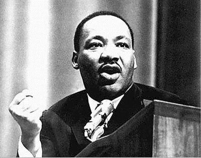

# 14、打破窠臼

## （1）三个非洲酋长

1895年9月6日，坦特伦古堡号邮轮停泊在英国南方的普利茅斯，三个非洲酋长，恩瓜托的卡玛、恩瓜克策的巴桐及奎那的赛博，下船后搭乘八点十分的特快车直奔伦敦帕廷顿车站。三位酋长此行到英国是有任务的，目的是要保住他们自己的及另外五个邦不被罗德斯夺走。恩瓜托、恩瓜克策及奎那地属茨瓦纳（Tswana），而茨瓦纳共包括八个邦，构成当时的贝专纳兰，亦即1966年独立后的博茨瓦纳。

几乎整个19世纪，部落都在与欧洲人做生意。1840年代，著名的苏格兰传教士利文斯顿走遍了贝专纳兰，并领着奎那的国王希凯勒皈依了基督教。圣经第一次翻译成非洲的语言，就是茨瓦纳的塞茨瓦纳语。1855年，英国宣布贝专纳兰为保护国。1853年，布尔人为逃避英国人的殖民，数以万计向内地展开大迁徙，茨瓦纳人就跟他们发生过冲突。另一方面，英国人也有自己的算盘，希望控制此一地区以堵住布尔人进一步的扩张及德国人可能的扩张。后者当时吞并了西南非相当于今天纳米比亚的地方。英国并不认为全民殖民化是值得去做的。高级专员雷伊1885年就清楚地概述了英国政府的态度：“除了开条路通往内地以外，我们对北边的马乐普——亦即贝专纳兰保护国——根本就没有兴趣；因此，我们目前会约束自己，以免保护国的部分受到入侵或外国势力的占领，无论管理或垦殖都尽可能少有作为。”

但对茨瓦纳来说，事情到了1889年有了变化，罗德斯的不列颠南非公司开始从南非向北扩张，掠夺了大片土地，亦即后来成为南、北罗德西亚，今天的赞比亚和津巴布韦。到1895年，也就是三位酋长访问伦敦那一年，罗德斯盯上了罗德西亚西南方的领土，亦即贝专纳兰。酋长们都知道，如果土地落到了罗德斯的手里，灾难和剥削就在眼前。对他们来说，要以军事力量击败罗德斯根本就是不可能的事，但决心跟他周旋到底。最后他们决定两害相权取其轻：宁愿让英国统治也不要被罗德斯吞并。在伦敦传道会的协助下，他们千里迢迢来到伦敦，想要说服维多利亚女王及殖民大臣张伯伦，扩大对贝专纳兰的控制，免遭罗德斯的进犯。

1895年9月11日，与张伯伦首次会晤，赛博首先发言，再来是巴桐，最后使卡玛。张伯伦表明，他会考虑用英国的控制阻止罗德斯。在此同时，三位酋长马上开始进行一次全国的旅行演说，竭力争取公众支持他们的要求。他们走访伦敦附近的温莎及雷丁并演说；他们去到南部的滨海城市南安普顿，去到张伯伦的政治大本营，中部地区的莱塞斯特及伯明翰；他们向北去到工业城市的约克夏、谢菲尔德、里兹、哈利法克斯及布莱福德；他们还往西去到布里斯托，然后往北到曼彻斯特及利物浦。

同一时间，远在南非，罗德斯已经箭在弦上，不顾张伯伦的强烈反对，准备对布尔人的德兰士瓦共和国展开武装攻击，亦即后来惨烈的詹姆森突袭。事情发展至此，除了对酋长们的艰难处境益发同情外，张伯伦已经不做他想。11月6日，他们再度在伦敦会晤张伯伦。酋长是通过翻译发言：

张伯伦：我要和酋长谈土地的事，以及酋长领土内要遵守的法律……现在让我们看看地图……我们只要建铁路用的土地，其他都不动。

卡玛：我要说的是，如果是张伯伦先生自己要土地，我没话说。

张伯伦：请告诉他，建造铁路的事我会自己来，会派一个人去看着，而且只拿需要的，如果拿的是有价值的，也会做出补偿。

卡玛：我想要知道铁路开到哪里。

张伯伦：会经过他的领土，但会围起来，我们不会拿土地。

卡玛：我相信你会像我自己一样做这件事，并相信你会公平对待我。

张伯伦：我会看好你的利益的。

第二天，在殖民署，费尔菲尔德把张伯伦的决定做了更详细的说明：

“三个酋长卡玛、赛博及巴桐，每个人都会有一个从此置于女王保护下的国家。女王将指派一名官员驻守，酋长将统治自己的人民一如现在。”

对于三个酋长的出奇制胜，罗德斯的反应可想而知。在一封发给属下的电报中，他说：“被三个伪善的野蛮人打败，我当然不会咽下这口气。”

事实上，三个酋长的成就相当有价值，他们挡住了罗德斯，随之而来的是他们挡住了英国的间接统治。19世纪时，茨瓦纳诸邦已经发展了一套核心的政治制度，包括政治上的中央集权及集体决策，光这两样，若以下撒哈拉非洲的标准来看，都是了不起的成就，甚至可以视为一种初始形态的政治多元化。一如大宪章之促成贵族参与政治决策，为英格兰的君主加上了一些约束，茨瓦纳的政治制度，尤其是“科加勒”（kgotla），也鼓励政治参与及约束酋长。科加勒的运作，南非人类学者沙培拉描述如下：

“所有有关部族的政策，最后都要提交到酋长的科加勒（议场），在由成年男性组成的大会中讨论。这类会议经常举行……讨论的事情……包括部落争议、酋长与其亲属之间纷争、新捐税的征收、新公共事务的推行、酋长公布的新政令……酋长的希望遭到驳回时有所闻。由于任何人都能发言，这些会议可以让他了解民情，有机会让民众陈述冤屈。如果情况需要，他和他的参谋可能还会有苦头吃，因为大家都不怕把话讲出来。”

科加勒之外，茨瓦纳的酋长职位并非严格世袭，而是开放给任何有才能的人。详细研究过茨瓦纳另一个邦——拉隆——政治历史的人类学者卡马洛夫指出，关于茨瓦纳酋长的继承，表面上确有清楚的规定，但实际上，这些规定旨在说明如何罢免不好的统治者，让有才能的人成为酋长。他的研究显示，赢得大位要看成就，要经得起考验，有真材实料的竞争者才享有继承的权利。茨瓦纳有一句格言，颇有一点君主立宪的精神：“君因民之拥戴而王。”

伦敦回来之后，茨瓦纳的酋长们继续努力维持自己的独立，保留自己的本土制度，不让英国插手。他们同意在博茨瓦纳修建铁路，但限制英国在经济及政治方面的介入。他们之所以不反对铁路的兴建，当然不能跟奥匈帝国及俄罗斯帝国阻挡铁路的理由相提并论。他们心里明白，铁路和英国的其他政策一样，只要是置于殖民控制之下，就不会为贝专纳兰带来发展。博茨瓦纳独立后担任总统（1980年至1998年）的马西雷，他的早年经验就是最好的说明。1950年代，马西雷还是个农民，非常有事业心，发展出新的高粱培育技术，并发现一个颇有可为的客户，弗雷堡碾谷，一家跨越边界设在南非境内的公司。他到贝专纳兰的娄贝兹火车站找站长，要求租两节车厢，要把收成运送到弗雷堡去。站长拒绝了。于是他请以为白人朋友介入。站长勉强同意，但索取的费用却是白人的四倍。马西雷放弃了，并得到一个结论：“禁止非洲人拥有自己的土地或持有贸易执照，使黑人无法在贝专纳兰发展事业的，不只是法律而已，还有白人的实际作为。”

总的来说，酋长们乃至茨瓦纳的人民，运气算是好的。或许是他们豁出去了，总算阻止了罗德斯的掠夺，又因为英国几乎不插手贝专纳兰的统治，在塞拉利昂上演并造成恶性循环的间接统治也不曾在那里出现。另外，在南非内地进行的殖民扩张他们也逃过了，因此才使这片土地没有沦为白人矿主与农场的廉价劳工库。对多数社会来说，殖民化过程的初期阶段最是紧要关头，对于经济及政治的后续发展，这一时期内的事件具有深远的影响。如同我们在第九章所讨论的，下撒哈拉非洲的多数社会和南美及南亚一样，在殖民化过程中也见证了榨取式制度的建立与强化。但茨瓦纳却逃过了两次劫数，其一是高压的间接统治，另一则是遭到罗德斯吞并的毒手。但不管怎么说，这绝不是瞎猫碰上死耗子纯靠运气得来，而是又一次现行制度交互作用的结果，茨瓦纳人民的制度漂移，与殖民主义带来的关键时期都影响着它。三个酋长的幸运是靠他们自己打造出来的。他们采取主动，造访伦敦，而他们之所以做得到这一点，则是因为茨瓦纳部族在政治上所成就的中央集权，相较于下撒哈拉非洲的部族领导人，使他们拥有不同于一般的权威，或许也是因为在他们部族制度中早已深植了政治多元化的根苗，使他们在合法性上具有不同一般的程度。

殖民时代末期，是另一个使广纳式制度得以发展的关键时期，这对博茨瓦纳的成功是更为核心的关键。1966年贝专纳兰以博茨瓦纳之名独立，酋长赛博、巴桐和卡玛的幸运及成功已经是久远之前的事了。在那一段时间，英国对贝专纳兰所做的投资极少。博茨瓦纳独立时，堪称是世界最贫穷的国家之一，整个国家，路面经过铺设的道路总共十二公里，大学毕业的国民总共二十二名，中学毕业的一百名。而最最严重的问题，则是它几乎完全被白人统治的国家——南非、纳米比亚及罗德西亚——包围，所有这些政权对黑人治理的独立非洲国家都充满敌意。没有几个人看好这个国家。但四十五年过去，博茨瓦纳却是世界上成长最快速的国家之一。今天在下撒哈拉非洲，博茨瓦纳是人均收入最高的国家，其成就媲美成功的东欧国家如爱沙尼亚及匈牙利，以及最成功的拉丁美洲国家如哥斯达黎加。

博茨瓦纳打破了窠臼，它是如何做到的？答案是，独立之后快速建立广纳式经济及政治制度。独立以来，它始终维持民主，定期举行公平竞争的选举，从未经历过内战或军人干政。政府建立强化财产权的经济制度，确保总体经济的稳定，鼓励广纳式市场经济的发展。当然，话又说回来，更具挑战性的问题是，当绝大部分非洲国家反其道而行时，博茨瓦纳却能建立稳定的民主及多元的制度，选择了广纳式的经济制度，它是怎么做到的？要回答这个问题，我们就必须先了解，在殖民统治结束时的紧要关头，博茨瓦纳的现行制度是如何发挥作用的。

在大部分下撒哈拉非洲，譬如塞拉利昂及津巴布韦，独立时一个机会，但却失落了，因为随之而来的是殖民时期榨取式制度的复辟。独立的初期阶段，博茨瓦纳的情形却大不相同，这又得归功于茨瓦纳传统制度所建立的环境。在这方面，博茨瓦纳有许多地方与光荣革命之前的英格兰相似。英格兰在都铎王朝统治下快速达成政治上的中央集权，又有大宪章和国会的传统，对压制君权及确保某种程度的政治多元化有起码的渴望。博茨瓦纳也有相当的中央集权及相对多元的部族制度逃过了殖民主义的毒手。英格兰有新近形成的广泛联盟，由大西洋贸易商、实业家及商业取向的士绅名流组成，追求的是财产权的不容侵犯。博茨瓦纳也有联盟，茨瓦纳的酋长们以及拥有主要经济资产牛只的菁英阶层，他们都追求稳定的程序权利。土地虽属公有，但在茨瓦纳各邦，牛只是私有财产，菁英阶层也都赞成财产权的不容侵犯。所有这一切，当然也不能否认有历史的偶然。在英格兰，如果议会里面那些一方之霸及新任的君主企图利用光荣革命篡夺权力，事情的发展就有可能完全不同。同样的，在博茨瓦纳，如果不是幸好有卡玛或马西雷这样的领袖，决定通过选举竞争取得权力，而不是像下撒哈拉非洲许多独立后的领袖那样破坏选举制度，事情的演变可能也会大不相同。

在独立之时，茨瓦纳的制度就已经具有限制酋长权力对人民负责的传统。当然，在非洲，这种制度传统并非茨瓦纳独有，但特别是，经过殖民时期，在非洲仍然能够完好保留这些制度的就只有茨瓦纳而已。英国的统治几乎完全没有进来。当时，英国对贝专纳兰的治理放在南非境内的梅富根，只有到1960年代转移到独立的那段期间，才有建立首都哈伯罗内的计划提出。建都及新构架并不是要打掉原住民的制度，反而是把它们当成基础；哈伯罗内的建设，就伴随着新“科加勒”的规划。

独立的进行也是循序渐进。推动独立的首要力量是1960年由马西雷及卡玛所建立的博茨瓦纳民主党。卡玛是卡玛三世之孙，取名Seretse，意思是“粘合团结的粘土”，名字取得再恰当不过。卡玛继承的是恩瓜托的酋长，而大部分茨瓦纳的酋长及菁英阶层都加入了博茨瓦纳民主党。博茨瓦纳没有产销协议会，因为英国对这块殖民地根本没有兴趣。很快的，博茨瓦纳民主党在1967年成立了一个名之为博茨瓦纳肉品委员会，但目的不是要剥削牧场及家畜养殖户，而是在畜牧业的发展中扮演一个核心角色，建立口蹄疫的防线，促进外销，对经济发展及广纳式经济制度的促进都有贡献。

博茨瓦纳早期的成长几乎全都依赖肉品外销，但当钻石发现时，一切都不一样了。在博茨瓦纳，自然资源的管理也与其他非洲国家显著不同。殖民时期，茨瓦纳的酋长都反对在贝专纳兰勘探矿产，因为他们都明白，欧洲人一旦找到珍贵的金属或宝石，他们的自治也就玩完了。第一颗大钻石在卡玛的故乡恩瓜托发现。发现宣布之前，卡玛促使修改法令，使所有的地下矿物权都属于国家而非部族。如此一来，确保钻石的财富不至于在博茨瓦纳制造巨大的不平等，同时利用钻石的收入加速推动政府中央集权，建立国家的官僚体系及基础建设，并投资教育事业。在塞拉利昂及许多下撒哈拉非洲国家，钻石点燃了不同派系间的冲突，成为内战持续的燃料，为了控制钻石，战争带来屠杀，因而贴上了血钻石的恶名。但在博茨瓦纳，钻石的收入却造福了国民。

地下矿物权的改变并不是卡玛政府唯一的建国政策。最后，在独立之前，立法会议1965年通过酋长法，1970年又通过酋长法修正案，继续推动政治中央集权的过程，取消酋长分地的权利，视情况的需要总统得罢黜酋长，以此强化政府及民选总统的权力。政治中央集权化的另一项作为则是努力促进国家统一，举例来说，通过立法确定学校只教塞茨瓦纳语及英语。今天，博茨瓦纳看起来是一个同质性极高的国家，没有族群及语言的分歧，完全不像其他许多非洲国家。此一结果正是语言统一之功，学校只教英语及一种国语塞茨瓦纳语，以此减少不同族群及社会团体的冲突。人口普查问到族群问题的最后一次是1946年的那一次，结果充分显示，博茨瓦纳的族群其实相当异质。举例来说，在恩瓜托，认同自己是恩瓜托人的就仅有20%；茨瓦纳固然有其他部落，母语不是塞茨瓦纳语的非茨瓦纳族群也不在少数。这种潜在的异质得以调和，除独立后政府的政策之外，还要归功于茨瓦纳族群的制度相当具有广纳性，举例来说，很像英国的异质性，譬如威尔士与英格兰，因不列颠政府而获得调和。博茨瓦纳政府也扮演了同样角色。独立之后，人口普查就再也没有问过族群的问题，因为大家都是茨瓦纳人。

独立后的博茨瓦纳成就了相当高的成长率，关键在于卡玛、马西雷及博茨瓦纳民主党把博茨瓦纳带上了广纳式经济及政治制度之路。1970年代钻石开始生产，不仅没有引发内战，而且为政府提供了坚实的财政基础，大量投资公共建设，想要推翻政府并控制国家的诱因相当少。广纳式政治制度带来政治的安定，成为广纳式经济制度的后盾。如同第十一章所讲的良性循环，广纳式经济制度回过头来又增强了广纳式政治制度的活力与持久性。

博茨瓦纳打破了窠臼，因为掌握了关键时期——殖民结束后的独立——并建立了广纳式制度。博茨瓦纳民主党与传统的菁英阶层，包括卡玛本人，并未试图成立一个专制政权或建立榨取式制度，肥了自己而牺牲社会。这又是关键时期与现行制度之间互动的结果。如我们所见，几乎不同于所有的下撒哈拉非洲国家，博茨瓦纳已经拥有相当中央集权并包含多元特质的部族制度。此外，由于私有财产确立，国家的菁英阶层所拥有的已经极为丰厚。

同样重要的是，历史的不确定性也站在博茨瓦纳这一边。特别值得庆幸的是，卡玛及马西雷都不是史蒂芬斯及穆加贝。前者以茨瓦纳的部族制度为基础努力而忠实地建立广纳式制度，使博茨瓦纳更为顺利地迈向广纳式制度。而这一方面，绝大多数的下撒哈拉非洲，有的是连尝试的机会都没有，有的则是才起步就失败了。

## （2）南方榨取式制度的末日

1955年12月1日。阿拉巴马州蒙哥马利市，拘票上登录的犯罪时间是下午六点六分。公交车司机布莱克遇到麻烦，打电话报警，警官戴伊与迈可森来到现场。他们的报告是这样写的：

“我们接到一通电话后赶来，公交司机说，车上有个有色人种女性坐在白人区，不愿往后移，我们……也看到了她。公交司机给她开了一张拘票。罗莎•帕克斯依蒙哥马利市市规第六章十一条被控有罪。”

    

<em>罗莎•帕克斯。“No, I will not.”当时四十二岁的罗莎对要她从白人座位区挪开的公交司机说。2005年10月24日，帕克斯夫人去世，终年92岁。</em>

罗莎•帕克斯所犯的罪行是坐在克利夫兰大道公共汽车上为白人保留的区域，一项根据阿拉巴马州的吉姆•克劳法所定的罪。罗莎•帕克斯被处十美元罚金，外加诉讼费四美元。但罗莎并不是个简单人物，她当时已经是全国有色人种进步协会阿拉巴马分会秘书。为打破美国南方的制度，全国有色人种进步协会已经奋斗多年。对她的逮捕引发一场群众运动——抵制蒙哥马利公共汽车运动——发起人为马丁•路德•金。12月3日，金联合其他黑人领袖组织一项抵制运动，说服所有的黑人都拒绝搭乘蒙哥马利市内的任何公交车。抵制运动大获成功，一直持续到1956年12月20日，最后以最高法院裁定阿拉巴马及蒙哥马利公交车种族隔离违宪告终。

 马丁路德金

在美国南方的民权运动中，抵制蒙哥马利公交车运动是最关键的一役。一连串的事件及变化最后终于打破南方的窠臼，导致制度上的基本变革。如我们在第十二章所见，内战之后，南方地主菁英阶层成功复辟内战前支配南方的榨取式经济及政治制度。这些制度的细节虽然已经改变，譬如奴隶制度已经是昨日黄花，但对南方的经济动机及繁荣的负面影响未减，南方的贫穷明显甚于美国其他地方。

1950年代起，南方的制度开始把这个区域推向较为快速的发展。美国南方榨取式制度的最后终结，形式上不同于博茨瓦纳独立前的殖民制度，启动其没落的关键时期在形式上也不相同，但却有几处共通的地方。从1940年代开始，饱受歧视及榨取式制度冲击的人，譬如罗莎•帕克斯，已经拥有更好的组织对抗这些压迫。同时，美国最高法院及联邦政府终于也动起来，开始有系统介入改革南方的榨取式制度。因此，促成南方改变的关键时期，其主要因素实际上有两个，其一是南方的美国黑人获得了动能，其二则是南方菁英阶层无可动摇的支配权走上了末路。

南方的政治制度，无论内战前后，都有一个思路清晰的逻辑，和南非的种族隔离统治并没有太大差别，也就是要为庄园储备廉价劳工。但到1950年代，此一逻辑愈来愈站不住脚。首先由于大萧条与二战的缘故，黑人已经开始从南方大量外移，1940年及50年代中间，达到平均每年十万人。同时，农业新科技发明出现，尽管采用的速度很慢，但已经降低了种植大户对廉价劳工的依赖。大部分劳工都用于棉花收成，1950年时，几乎南方全部的棉花都还是使用手摘，但机械化摘棉已经开始降低这种手工方法的需求。到了1960年，主要的州如阿拉巴马、路易斯安那及密西西比，几乎已经半数产量机械化。在南方，黑人固然愈来愈难找到，但对种植大户来说，这些黑人不再不可或缺也是事实。因此，对菁英阶层来说，为维持旧日榨取式经济制度而奋战的理由愈来愈少。但话又说回来，这并不代表他们就心甘情愿接受制度改变。相反的，耗费时日的持久战开打。南方的黑人与广纳式联邦制度组合起来，形成一个不同寻常的联盟，产生强大力量，摆脱南方的制度，为南方的黑人争取平等的政治权及公民权，最后终于移除了美国南部经济成长的主要障碍。

最重要的改革动力则来自民权运动。如同在蒙哥马利所为，挑战身边的榨取式制度，为争取应得的权利而抗争而动员，南方黑人获得了动能。此外，他们不是孤军奋战，因为美国南部并不是另一个国家，南方的菁英阶层也无法像危地马拉的菁英阶层那样为所欲为。既然是美利坚合众国的一部分，南方就得服从美国宪法与联邦法律。又因为民权运动能够在南方以外的地方发声，因此而唤起联邦政府的注意，南方的改革运动最后终于得到美国行政、立法与最高法院的支持。

联邦介入南方的制度改革，首见于1944年最高法院裁决初选仅限白人投票为违宪。如我们所见，1890年代，黑人因受限人头税及识字测验，政治公民权遭到剥夺。这些例行的测验是对黑人的歧视，因为白人纵使贫穷不识字照样能够投票。1960年代就有一个著名的例子，路易斯安那州一个白人接受测验，对一个有关州宪法的问题作答，答案是“FRDUM FOOF SPETGH”，居然还是被裁定识字。最高法院1994年的裁决有如重炮轰击，为黑人的长期政治抗争打开了一条出路，法院明白解除白人对政治控制的重要性。

此一裁决之后，接着来的是1954年的布朗控告教育局案，最高法院裁决，州政府授权学校及其他公共场所种族隔离违宪。1962年，最高法院又敲掉了白人菁英阶层政治支配的一根支柱：立法机关代表名额分配不公。立法机关代表名额分配不公——和英格兰第一改革法案之前的“衰废市镇”一样——某些区域或地区的代表名额超出人口应分配数。这种情形指的就是南方农业地区，种植大户菁英阶层的大本营，相对于都市地区，分配的代表往往超额。1962年，最高法院针对贝克控告卡尔案做出裁决，将这种情形予以终结，因此才开始实施“一人一票”制。

但最高法院的裁决如果没有落实，那就等于什么都没有。事实上，1890年代联邦就已经立法给予南方黑人选举权，但却没有实施，关键在于地方执法的权力掌握在菁英阶层及民主党手中，联邦政府乐得事情顺其自便。但当黑人开始揭竿而起反对南方菁英阶层时，此一支持吉姆•克劳的堡垒崩溃，民主党也在非南方成员的领导下转而反对种族隔离。脱党的南部民主党成员乃另起炉灶，高举州权民主党的大旗，角逐1948年的总统选举。他们的候选人特尔孟德拿下四个州，在选举人团中获得三十九票。相较于统一的民主党在全国政治中的力量，这徒然凸显他们的不成气候，也充分显示，光凭南部菁英阶层是掌握不了民主党的。特尔孟德的竞选全力质疑联邦政府干预南部制度的能力，他说：“女士们、先生们，想要强迫南部人民解除种族隔离，让黑人进入我们的戏院，进入我们的泳池，进入我们的家，进入我们的教堂，我老实告诉你们，根本没有足够的军队可以做到。”

但他显然错了。最高法院的裁决明白表示，教育机构必须解除种族隔离，包括牛津的密西西比大学之内。1962年，经过长时间的争讼之后，联邦法院裁决，“密大”必须接收梅里迪斯，一名年轻的黑人空军退伍军人。对裁决执行的反对力量汇聚成所谓的公民会议，195（6？）4年会议首次召开于密西西比州印第安诺拉，反对南部废除种族隔离。9月13日，州长巴奈特在电视上公开反对法院的种族隔离解除令，并宣布说，州立大学宁愿关门也不会解除种族隔离。最后，巴奈特与总统约翰•肯尼迪及司法部长罗伯特•肯尼迪在华盛顿谈判，联邦政府将强制实施此项裁决。日子决定了，美国司法警察陪同梅里迪斯前往牛津。预先获知消息，白人至上主义者开始组织起来。9月30日，梅里迪斯预定出现的前一天，美国司法警察进入大学校园，包围行政大楼。为数大约两千五百人的群众前来抗议，很快就演变成暴乱，司法警察用瓦斯枪驱散暴乱群众，但立刻遭到攻击。到晚上十点时，军队进城维持秩序。不过短短时间，牛津城内已有两万军队及一万一千国民警备队。总计有三百人被捕。梅里迪斯决定留在学校，由美国司法警察及三百名军人保护其人身安全，最后念到毕业。

 密西西比大学

在南部的制度改革中，联邦法律扮演关键角色。1957年民权法案通过的过程中，当时已经是参议员的特尔孟德为阻止法案通过，或至少达到拖延的目的，曾不停地连续发言二十四小时又十八分钟。发言当中，无论抓到什么，从《独立宣言》到各种电话薄，他都照念不误。但无济于事。1957年的法案以1964年的民权法案达到最高点。新法宣告所有种族隔离州所订的相关法律及政令皆为非法。1965年的投票权法案宣布，识字测验、人头税及其他剥夺南部黑人公民权的办法皆为非法，并将许多联邦的监督制度引入州的选举。

所有这些事件影响所及，造成南部经济及司法制度的重大变革。举例来说，在密西西比，1960年投票时，黑人合格选民大约只有5%，到1970年时，此一数字增加至50%；在阿拉巴马及南卡罗莱纳，也从1960年的10%左右增加到1970年的50%。这种情形改变了选举的本质，包括地方性的及全国性的公职。更重要的是，占优势的民主党改变政策，对歧视黑人的榨取式制度从此不再支持。接下来，整个形势开启了一系列经济制度的改变。1960年代制度变革前，纺织厂的工作几乎全面排斥黑人。1960年，南部纺织厂的员工，黑人仅占5%，民权立法打破了这种歧视。到1970年，这一部分增加到15%；1990年，则为25%。经济上对黑人的歧视开始减少，黑人的教育机会大为改善，南部的劳工市场变得比较具有竞争性。随着广纳式制度的快速增加，南部的经济获得改善。1940年，南部州的人均收入仅为全美的一半。这种情形在1940年及50年代开始改变，到1990年，差距基本上已经消失。

和博茨瓦纳一样，在美国南部，广纳式政治及经济制度的发展是关键。这种情形得力于两种现象，其一，对于南部的榨取式制度加诸他们的痛苦，黑人的不满增加；其二，民主党在南部的一党独大走向衰落。同样的，这又是现行制度在为改变铺路。在这里，很重要的关键是，南部的制度存在于广纳式的联邦制度之内，惟其如此，南部的黑人最后才能动员联邦政府及制度支持他们的运动。整个过程之所以得以进行，还得力于另一个现象：黑人大量迁出南部及棉花生产的机械化造成重大的经济变化，也使南部菁英阶层更没有意愿继续奋力抵抗。

## （3）中国的重生

1949年，毛泽东领导的共产党终于推翻蒋介石的国民党政权，10月1日，中华人民共和国宣布成立。1949年后产生的政治及经济制度都是高度榨取式的。政治上，中国共产党一党专政，从此以后，中国不容许其他任何政治组织存在。毛泽东则完全掌握共产党及政府，直到1976年去世。在威权统治下，榨取式政治制度就是高度榨取式经济制度。毛泽东一上台，立即将土地国有化，一举废除所有形式的财产权。地主，以及其他有可能威胁到他的政权的人，他一律处死。市场经济实质上已经完全不存在。农村地区人民逐渐纳入人民公社。货币及工资由“工分”取代。工分可以用来交易货物。1956年，为强化政治及经济控制，实施路条制，未经上级许可不得在国内旅行。所有的工业同样国有化，毛泽东野心勃勃，模仿苏联模式，提出所谓的“五年计划”，企图快速推动经济发展。

有了榨取式制度，毛泽东乃打算从他一手控制的广大国度榨取一切资源。和塞拉利昂政府的产销协议会如出一辙，中国共产党垄断一切产品的销售，诸如稻米及其他谷类，并对农民课以重税。1958年后，随着第二个五年计划的推出，工业化的野心变成臭名昭著的“大跃进”。毛泽东大言不惭地说，以小规模的土法炼钢为根本，钢铁的产量将在一年内倍增，并宣称中国可以在十五年内赶上英国的钢铁产量。唯一的问题是，根本找不到可行的办法达到此一理想。为了达成计划的目标，即使一小片铁块都不放过，人民必须烧融自己的锅盆，甚至农具如锄头及犁。原本应该照顾田地的人，如今却毁了自己的犁去炼钢，如此一来，连喂饱他们自己及这个国家的能力也一并毁了。其结果是中国农村饥荒成灾。相较于同一时期的干旱影响，尽管有学者为毛泽东的政策辩护，但毫无疑问的，这段期间多达二千万至四千万人的死亡，大跃进难辞其咎。到底死了多少人，我们无从得知，因为毛泽东统治下的中国根本不留记录，唯恐留下暴政的恶名。至于人均收入，下跌大约四分之一。

大跃进的结果之一，是曾经发动“反右”运动，大肆屠杀“反革命”的革命名将兼中共元老邓小平改变了想法。1961年在中国南方广州的一次会议上，他主张“不管黑猫白猫，会抓老鼠的就是好猫。”政策不管是不是共产主义的，中国需要的政策是鼓励生产以养活老百姓。

但没过多久，邓小平新提出来的实用主义就吃到苦头了。1966年5月16日，毛泽东宣称，“资产阶级”的利益正在威胁革命，破坏中国的共产主义社会，复辟资本主义。为此，他宣布了开始无产阶级文化大革命，一般称为文革，以“十六条”做为张本。开宗明义说：

“资产阶级虽然已经被推翻，但是，他们企图用剥削阶级的旧思想、旧文化、旧风俗、旧习惯，来腐蚀群众，征服人心，力求达到他们复辟的目的。无产阶级恰恰相反，必须迎头痛击资产阶级在意识形态领域里的一切挑战，用无产阶级自己的新思想、新文化、新风俗、新习惯，来改变整个社会的精神面貌。在当前，我们的目的是斗垮走资本主义道路的当权派，批判资产阶级的反动学术”权威“，批判资产阶级和一切剥削阶级的意识形态，改革教育，改革文艺，改革一切不适应社会主义经济基础的上层建筑，以利于巩固和发展社会主义制度。”

很快的，一如大跃进，文革开始大肆破坏经济及人民的生活，红卫兵在全国组成，清算斗争政敌，无数人遭到杀害、囚禁及下放。有人忧虑暴力过了头，毛泽东反驳道：“希特勒这个人更残忍，愈残忍愈好，你不觉得吗？杀人愈多愈是革命。”

邓小平发现自己被贴上第二号资本主义同路人的标签，1967年下狱，1969年下放江西，在一家农村拖拉机工厂落户。1974年获得平反，毛泽东接受总理周恩来的建议，任命邓小平为副总理。1975年，邓小平受命拟定三份党的文件，若经采纳，将成为党的新路线。文件呼吁恢复高等教育活力，工业及农业奖励重回物质鼓励，以及消除党内的“左派”。同一时期，毛泽东的健康状况恶化，权力逐渐向邓小平亟欲拔除的极左派集中。包括毛的妻子江青及其三名亲密战友，亦即大力支持文革的四人帮，企图继续走共产党专政的老路线。1976年4月5日，民众自发地在天安门广场集会悼念周恩来，转变成为一场反政府示威。四人帮指控邓小平幕后指使，邓再度遭到罢黜，所有职位均被剥夺。周恩来死后，毛泽东任命华国锋代理总理，邓小平继续遭到冷落。华国锋利用此一权力真空累积个人实力。

同年9月，关键时期出现：毛泽东去世。毛领导中国共产党，大跃进及文化大革命都是由他一手主导，毛一撒手，真正的权力真空才出现，因未来路线走向，内部出现不同观点与不同信念的斗争。四人帮要继续文革的政策，以此为巩固共产党执政的唯一途径。华国锋虽想放弃文革，但由于自己也是靠文革才能够在党内蹿起，因此又不能自外于文革太远。于是，他致力回到一种两面光的毛泽东观点，1977年在中共党报《人民日报》上提出“两个凡是”，强调“凡是毛主席做出的决策，都必须维护，凡是毛主席的指示，都不能违反。”

邓小平自己就是因革命而掌权的一分子，当然不希望罢黜共产党政权，而是代之以广纳式市场经济。他与他的支持者认为，即使达成重大经济成长，应也不至于危及政权的控制，也就是说，由于中国老百姓极度渴望改善生活水平，而且在毛泽东统治及文革期间，所有反对共产党的势力都已经被扫荡一空，在这种榨取式政治制度下，成长将不致变成威胁。为了做到这一点，要扬弃的不仅是文化大革命，还包括毛泽东留下来的大部分制度。他们明白，唯有走向广纳式经济制度，经济才有可能成长，因此，经济改革并强化诱因与市场力量的角色就成了当务之急。另一方面，也要扩大私有财产的范围，降低共产党在社会及政府中的角色，扬弃阶级斗争的观念。同时要向外资及国家贸易打开门户，融入国际经济体系。但限制还是有的，建立真正广纳式经济制度，彻底放松党对经济的控制，时候尚未到。

这时候，华国锋的权力以及他愿意跟四人帮对抗，成了中国的转折点。毛泽东死后不到一个月，华对四人帮发动攻势，全数予以逮捕，并于1977年3月再度请邓小平出山。事情的进展，乃至接下去发生的重大变化，并非是必然趋势，而是华国锋自己在政治上技不如人，败给了邓小平。邓鼓励公开批判文化大革命，并把和他一样在同一时期吃过苦头的人请出来，占据党内各阶层的重要职位。华则因为没和文革划清界线，使自己落居下风。加上他在权力中心毕竟是个新人，缺乏关系网络，不像邓小平早已经营多年。通过一连串的讲话，邓开始批评华的政策。1978年9月，邓公开批评“两个凡是”指出，与其凡是听毛的，“实事求是“才正确。

同时，邓开始运用舆论对华国锋施压，其中最有力的则属1978年的北京西单民主墙，让老百姓大吐苦水。1978年7月，胡耀邦提出经济改革原则，其中包括：应赋予公司更大的主动权及决策权决定自身的产出；价格应随供需浮动，而非由政府决定；政府对经济的管制应该降低。所有这些建议都相当激进，但邓已经大权在握。1978年11月及12月，第十一届党中央委员会第三次全体会议做出了突破性的决定。不顾华的反对，决议此后党的核心目标不再是阶级斗争而是经济现代化。全会宣布了一些实验性做法，包括在某些省份实施”包产到户责任制“，打算把集体农业赶回老家，将经济刺激引进农村。次年，中央委员会确认”实事求是“为党的核心，同时宣告文化大革命为中国人民的灾难。这段时期内，邓小平放手任命自己人进入党政军高层。对于华国锋在中委会里面的支持者，他不急于处理，而是采取平行到位。1980年，华国锋被迫辞去总理，赵紫阳取而代之。1982年，华国锋从中委会除名。但邓小平还有动作。1982年第十二次中国共产党全国代表大会，然后是1985年9月全国人民代表大会，邓小平终于完成党政高干的全面洗牌，引进更为年轻、更有心改革的人。拿1980年与1985年做个比较，政治局里，二十六个走掉了二十一个，中央书记处书记，十一个换掉八个，十八个副总理换了十一个。

至此，邓小平及改革派的政治改革大功告成，采取一系列动作，进一步改革经济制度。他们从农业着手。胡耀邦构想的包产到户，为农村经济提供激励，1983年已经全面采行。1985年，废除政府收购谷粮，由一套比较自愿的合约体系取代，政府对农产品价格的控制大幅放宽。在城市经济方面，国营企业获得更大的自主权，选定十四个”开放城市“，全力吸引外国投资。

首先起飞的是农村经济，经济刺激的引进导致产量大幅提升。尽管农业人口相对较少（？），1984年谷类生产还是比1978年高出三分之一。农村人口开始转移到新的农村工业，亦即所谓的乡镇企业。1979年之后，新公司允许成立，并得以与国营企业竞争，这类企业便开始在国营体系之外成长，逐渐的，经济激励也开始引进工业部门，特别是国营事业的运作，尽管当时还看不见民营化的迹象，那是1990年代中期以后的事了。

中国的重生随之而来的是重大的转移，从一套最高度的榨取式经济制度转向比较广纳的制度。市场对农业及工业的激励，继之以外来的投资与技术，使中国走上了经济快速成长的道路。但总的来说，这都还是榨取式制度下的成长，尽管其压迫性已远低于文革及其以前，经济制度也已经局部广纳。然而，我们决不能因此低估了中国经济制度改变的激烈。如同博茨瓦纳及美国南部，关键的改变出现在关键时期——以中国来说，亦即毛泽东去世之后。此外，其间也有历史的偶然，高度的历史偶然，四人帮权力斗争失败并非命中注定，如果他们没有倒台，中国就不可能经历过去三十年来持续的经济成长。倒是大跃进及文化大革命造成的灾难与痛苦制造了足够的改变要求，才使邓小平及其支持者得以赢得政治上的斗争。

一如英格兰光荣革命、法国大革命及日本明治维新，博茨瓦纳、中国与美国南部都很生动地说明历史并非命定。尽管恶性循环难破，榨取式制度还是能够被广纳式制度取代。但事情绝不会自动发生，也绝非轻而易举。各种因素的汇合，特别是关键时期加上推动改革的力量与有利的现行制度所形成的广泛联盟，在一个国家迈向更广纳式制度的过程中实属不可或缺。另外，运气也是关键，因为历史往往都是以偶然的方式揭开序幕。
