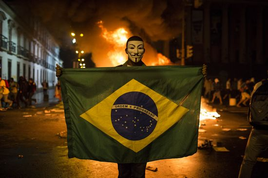

# 15、理解富裕与贫困

## （1）历史的源头

走遍整个世界，生活水平的差异巨大。在美国，纵使是最贫穷的人，不仅有收入，还可以接受医疗照顾、教育及公共服务，经济及社会机会更是远远大过生活在下撒哈拉非洲、南亚及中美洲的广大人群。南韩与北韩、两个诺加雷斯、以及美国与墨西哥之间的对比在提醒我们，这些都只是晚近的现象。五百年前，墨西哥——阿兹特克王国的故乡——无疑比起北边的国度富裕，美国要到19世纪才赶上墨西哥。两个诺加雷斯之间的差距甚至是更为晚近的事。南韩与北韩在经济、社会与文化上的截然不同，则是二战后以北纬三十八度线分隔开来才形成的。同样的，今天我们放眼所见的经济差异，绝大部分也都是过去两百年来才出现的。

所有这些都是必然的吗？过去两百年来，西欧、美国、日本的富裕远远超过下撒哈拉非洲、拉丁美洲及中国，难道是由历史、地理、文化或种族预先决定的？工业革命18世纪从英国开始，然后扩展到西欧，又开枝散叶至北美及澳大利亚，这难道也是命定的？假设有一个世界，光荣革命及工业革命都发生在秘鲁，然后秘鲁人殖民欧洲并奴役白人，这有可能吗，或只是历史科幻小说的虚构？

要回答这些问题——甚至只是推论——都需要有一套理论来说明为什么有些国家会繁荣富裕，有些则是失败而贫穷。这套理论既要能够清楚说明打造或妨碍繁荣富裕的因素，也要能够指出其历史的源头。本书就是在提出这样一套理论。任何复杂的社会现象，譬如世界上数以百计的政治体系之所以各有不同的经济及政治轨道，若要追究起来，原因当然很多，因此，对于不同时空出现的类似结果，凡是将之归于单一因素、过于简单且一概而论的理论，多数社会科学家都不会加以采纳，而是会寻求个别的解释。但我们却反其道而行，对新石器革命以来世界上经济及政治发展的主要轮廓提出了一个简单的理论。我们做这样的选择，当然不是天真到以为这样一个理论可以说明一切，而是相信它能使我们专注于比较，虽然不免因此牺牲掉许多有趣的细节。但成功的理论不一定忠实地复制细节，而是为许多过程提供有用且可靠的解释，同时厘清是什么样的力量在运作。

为了要达到这样的目标，我们的理论在两个层面上着手。其一，厘清榨取式和广纳式经济与政治制度之间的区别。其二，说明广纳式制度为什么会在某些地方出现，其他地方则否。理论的第一个层面谈的是制度的历史面，第二个层面是历史如何塑造国家的制度。

广纳式经济及政治制度与繁荣富裕的关系是我们理论的核心。广纳式经济制度强化财产权，打造公平的游戏平台，鼓励新科技与新技术的投资，助长经济成长，不像榨取式经济制度则是少数人榨取多数人资源的体系，既无法保障财产权，也不为经济活动提供诱因。广纳式经济制度与广纳式政治制度互相支持。在政治权力分配上，广纳式政治制度倾向于多元，且能达到某种程度的政治集权，并以此建立法治，为财产权及广纳式市场经济奠定基础。同样的，榨取式经济制度与榨取式政治制度也是互相支援。在权力分配上，榨取式政治制度将权力集中于少数人手中，这些人因此有动机为谋取私利维持和发展榨取式经济制度，并运用所得的资源巩固自己的政治权力。

纵使倾向如此，并不表示榨取式经济与政治制度就一定和经济繁荣无关。相反的，人同此心，菁英阶层也鼓励尽可能地成长，以便榨取更多。政治上，榨取式制度至少达成了低度的中央集权，因此，有能力达成某种程度的成长。但问题是，榨取式制度下的成长无法持久，其关键有二：其一，持久的经济成长需要创新，创新又与创造性破坏不可分。而所谓创造性破坏，不仅经济上以新代旧，政治上也颠覆既有的权力关系。菁英阶层抓着榨取式制度不放，最害怕创造性破坏，抗拒唯恐不及，因此，任何由榨取式制度培育出来的成长终究会是短命的。其二，宰制榨取式制度的人无不是牺牲社会上的多数人以图利自己，因此，在榨取式制度下，政治权力成为垂涎的目标，团体与个人争相夺取。其结果是，在榨取式制度下，永远都有强大力量把社会推向政治动荡。

榨取式经济制度与榨取式政治制度合作无间，其结果就是恶性循环，榨取式制度一旦站稳了，就会没完没了。而同样的，广纳式经济制度与广纳式政治制度互动则产生良性循环。但话又说回来，无论恶性循环或良性循环都不是绝对的。事实上，有些国家历史上虽然是以榨取式制度为主，但因为能够打破窠臼并朝广纳式制度转型，所以今天得以活在广纳式制度之下。我们是从历史的角度来解释这种转型，但并非为历史所决定。重大的经济改变有赖于重大的制度改变，重大的制度改变则是现行制度与关键时期互动的结果。关键时期是指一个社会中崩解既有政治与经济平衡的大事件，如14世纪在欧洲许多地区导致将近半数人口死亡的黑死病；又如大西洋贸易路线的打开，为许多西欧国家制造了巨大的获利机会；或如工业革命，为全世界的经济结构提供既快速又具破坏性的改变。

社会的现行制度之所以各异，取决于过去的改变。每个社会的制度改变各不相同，原因又是什么呢？答案是制度漂移。一如生物种群的基因会因为在演化或基因的漂移过程中随机突变而逐渐漂离，两个本来相同的社会也会在制度上分道扬镳，但同样也是缓慢的。利益与权力的冲突，以及间接的制度冲突，在任何社会都是常态。这种冲突经常会带来难以预料的结果，甚至尽管它所发生的游戏场合并不公平。冲突结果导致制度漂移，但这不一定是个累积过程。换句话说，某一个点出现的小差异不一定会随着时间而变大。相反的，一如第六章讨论罗马统治下的不列颠，小的差异发生，但又消失，然后又再出现。但不管怎么说，当关键时期来临，这些因制度漂移出现的小差异就有可能举足轻重，引导本来完全相似的社会分道扬镳。

如我们在第七及第八章所见，尽管英格兰、法国与西班牙之间存在着许多相似之处，但大西洋贸易此一关键时期独对英格兰形成最大的转型冲击，却只是因为一些小小的差异——其实就只是15及16世纪的发展：在海外贸易这一块上，英格兰王室根本无法掌控，但在法国及西班牙，这一块绝大部分是由王室独占。如此一来，在法国及西班牙，大西洋贸易及殖民地扩张产生的巨大利益全都进了君主及其同党的口袋，但英格兰，在此一关键时期制造的经济机会中得利的却是强烈对抗君主的群体。制度漂移导致的虽然只是小小的差异，但与关键时期交互影响的结果却造成了制度的分道扬镳，而分道扬镳的结果又制造出当下更重大的制度差异，等着被下一个关键时期牵引。

这当中，历史是关键，因为整个来说就是一个历史过程，经由制度的漂移产生了差异，差异又在关键时期出现时扮演了重大的角色。关键时期则是历史的转折点。恶性及良性循环则告诉我们，必须研究历史才能了解制度差异的本质，因为所有这些差异都是历史所建构的。但我们的理论并不主张历史决定论，或任何其他的决定论。正因为如此，对于我们在本章一开头提出的问题，我们所给的答案是否定的，也就是说，秘鲁之所以远比西欧及美国贫困绝非历史的必然。

首先，相较于地理及文化假说，秘鲁绝不是因为地理及文化才注定了贫困。依我们的理论，秘鲁今天之所以远比西欧及美国贫困，完全是制度所致，而要了解此中的原因，则需要了解秘鲁制度发展的历史过程。如我们在第二章所见，五百年前的印加帝国，也就是今天秘鲁所占之地，无论其富庶、科技发展或权力的集中，都远远胜过当时占有北美之地的那些小政治体。转折点则在于此一地区被殖民的方式与北美的殖民形成了强烈的对比，而此一结果并非历史的决定，而是在关键时期来临时，好几次关键性制度发展所产生的偶然性结果。整个过程中，至少有三个因素可能改变其轨道，使长期的发展得到十分不同的结果。

第一，15世纪时，美洲内部的制度差异决定了这些地区被殖民的方式。北美所循的制度轨道大不同于秘鲁，基本上，殖民前的北美洲只有零星的定居社会，而且所吸引前来的移垦者，这批人当时成功地起来抵抗如弗吉尼亚公司及英国王室制造出来的菁英实体。相对之下，西班牙征服者来到秘鲁时，碰到的是一个中央集权的榨取式国家，他们大可取而代之，并接收其众多的人民，将之投入矿场与庄园从事劳作。欧洲人抵达时，美洲内部的情况也不是由地理决定的。如我们在第五章所见，在布尚人国王夏姆领导下所出现的中央集权国家，乃是重大制度创新乃至政治革命的结果，同样的，位于秘鲁境内的印加帝国及此一地区内的广大人民也都是重大制度创新的结果。在北美洲，诸如密西西比流域甚至美国东北地区这些地方，这种情形也很有可能发生。如果情形真是这样，欧洲人在安第斯山面对的就有可能是空旷的大地，而在北美洲碰到的则是中央集权国家，这样一来，秘鲁与美国的角色可能就会对调了。在秘鲁，欧洲人定居下来，占多数的移垦者和菁英阶层发生冲突，很有可能就此产生了广纳式制度，而北美则走上相反的命运，随之而来的经济发展之路也就大异其趣了。

其次，一如舰队司令佩里的船舰抵达江户湾时日本之所为，印加帝国也有可能起而抗拒欧洲殖民主义。尽管和日本德川幕府相较，印加帝国的压榨性更严重，在秘鲁想要搞出一场类似明治维新的政治革命当然不太可能，但若说印加帝国之完全屈服于欧洲人的统治乃是历史的必然却也未必。假若他们对于此一威胁的回应是起而抗争，甚至是在制度上进行现代化，那么，整个新世界的历史进程，乃至整个世界的历史，或许都会因之而大不相同。

其三，也是最根本的，欧洲人之所以成为世界的殖民者，绝不是历史或地理或文化所决定。中国人甚至印加人也都有可能殖民全世界。当然，如果是从15世纪的角度来看这个世界，这种情形根本就不可能发生，因为当时的西欧已经挺近美洲，而中国却转而向内退缩。但话又说回来，15世纪的西欧本身就是制度漂移的不确定过程加上关键时期的产品，这中间没有任何事情是必然的。西欧强权之所以能够冒出头来征服世界，有赖于几个历史性的转折点，其中包括：封建制度所采取的独特路径，一路下来取代了奴隶制度，弱化了君权；进入第一个千禧之年后的数百年间，独立的以及在经济上有自治能力的城市在欧洲兴起；对于海外贸易，欧洲君主不像中国明朝的帝王，既不视之为威胁，因此也不曾加以打压；以及黑死病的肆虐动摇了封建秩序。所有这些如果都不曾发生而是另有发展，今天我们生活的世界就有可能大为不同，一个生活于秘鲁的人或许比欧洲或美国的人活得更为富足。

由于小差异与偶然性扮演了很关键的角色，因此很自然的，不管什么理论，预测能力都是有限的。广纳式制度的重大突破居然会发生在英格兰，15世纪甚至16世纪固然没有人预料到，遑论罗马帝国崩溃后的那几百年之间。这一切全都有赖于大西洋贸易的打开，制造了独特的制度漂移过程及关键时期才得以成为可能。1970年代文化大革命期间，没有几个人敢说中国不久就会走上经济制度的巨变以及随之而来的快速成长。同样的，未来的五百年情况会出现什么变化，也不可能有人预测得准。然而这不是我们理论的缺点。到目前为止，我们所做的历史陈述都在清楚指出，任何以历史决定论为基础的论述——地理、文化的或甚至其他历史因素的——都是不恰当的。小差异及偶然性不仅是我们理论的一部分，也是历史形成的一部分。

相较于其他社会，哪一种社会将会走向繁荣，尽管很难做出精确的预测，但整本书一路下来，世界各国的繁荣或贫穷，我们的理论已经清楚说明了其间的差异。接下去的数十年，哪一型的社会比较有可能达成经济成长，我们将在本章剩下来的篇幅中提出一些准则。

首先，恶性循环及良性循环都有其持续性与迟滞性。毫无疑问的，未来五十年甚至一百年之内，美国与西欧以其广纳式经济及政治制度为基础，都将比下撒哈拉非洲、中东、中美洲或东南亚更为富裕，而且是相当程度的富裕。但不管怎么说，下一个世纪，这中间一定会有重大的制度变革，某些国家将打破窠臼，从贫穷转型成富裕。

政治上几乎没有发展出中央集权的国家，诸如索马里及阿富汗，或那些政府腐败无能的国家，如过去数十年来的海地——早在2010年大地震摧毁全国基础设施之前——在榨取式制度下，当然不太可能达成经济成长，也不可能做出重大改变走向广纳式制度。相反的，那些已经达到某种程度中央集权的国家——虽然可能是榨取式制度统治——却十分可能在未来数十年中获得成长。在下撒哈拉非洲，包括有长期中央集权经历的国家如布隆迪、埃塞俄比亚、卢旺达，以及中央集权制度已经上路的坦桑尼亚，或至少在独立之后已经为中央集权做好准备的国家。在拉丁美洲，则包括巴西、智利及墨西哥，不仅政治上已经达成中央集权，而且在政治多元化方面也已经跨出了重大的步伐。至于哥伦比亚，按照我们的理论，则不太可能。

我们的理论也认为，榨取式政治制度下的成长，譬如中国，无法带来持续的成长，有可能会后继无力。在这些案例之外，还有许多不确定的地方。例如，古巴有可能会转向广纳式制度，经历一次重大的经济转型，但也有可能踌躇不前，仍然死守着榨取式政治及经济制度。亚洲的北韩及缅甸的情况也一样。因此，就算我们的理论为制度的转变、改变之后的结果以及这种改变的本质——小差异及偶然性——提供了思考的工具，想要做成更为精确的预测仍有其困难。

要从富裕与贫困之根源这样广泛的解释当中拟定政策建议，有必要更加留心谨慎。关键时期的影响，其关键在于现行制度，因为社会如何回应一个政策的介入，完全要看当时在位的制度。当然，我们的理论谈的是国家如何追求繁荣富裕——将国家的制度从榨取式的转型成为广纳式的。但从一开始我们就说过，要做到此一转型并非轻而易举。首先，光是恶性循环就足以说明制度之改变绝非看起来那么容易。尤其特别的是，榨取式制度会戴上不同的假面自我复制，譬如第十二章所谈的寡头铁律就是。因此，穆巴拉克总统的榨取式政权虽然在2012年2月遭到人民推翻，却不能保证埃及从此就会走向比较广纳式的制度。相反的，榨取式制度仍然可能复制自己，完全不把民主运动的活力与期望放在眼里。其次，由于历史的道路是偶然的，现行的制度差异与关键时期的交互作用，到底会导致更广纳还是更榨取的制度，其实很难预料。不过能使政策建议朝广纳式制度改变，这是很重要的事情。无论如何，我们的理论对于政策分析还是十分有用的，至少拟定政策时可以使我们认清那些建议是不好的，是根据错误的假设，或是对制度改变的理解不够充分所致。这一方面，一如在大部分的事情上，不犯错误的重要性绝不下于解决问题，甚至还更切合实际。关于这种情形，最清楚明白的就是基于中国过去几十年的成功成长经验，而鼓吹“威权式成长”的政策建议。我们要指出的是，这种政策建议其实是一种误导，中国的成长，就其到目前为止的表现来看，只是榨取式成长的另一种形式，不可能演变成持续的经济成长。

## （2）威权式成长难以抗拒的吸引力

城市的繁荣在中国是迟早的事，戴国芳很早就看清了这一点。1990年代，新的高速公路、商业中心、住宅区及摩天大楼在中国有如雨后春笋四处兴起，戴国芳看好未来十年的快速成长，心里盘算着，他的公司江苏铁本钢铁大可利用低生产成本，特别是相较于国营钢铁厂的缺乏效率，一举拿下广大的市场。他筹划了一间真正的大钢厂，争取到常州市委书记的支持，并于2003年动工。然而到了2004年3月，北京的中共当局命令他停工，并以莫须有的理由将他逮捕，总以为从他的口供当中给他冠上一个罪名。接下来的五年，戴国芳先后遭到囚禁与软禁，到了2009年才以一桩小罪定案。但他真正的罪名其实是他妄图和国营企业竞争，而且没有得到共产党更高层的批准。这案子倒是给其他人上了一课。

对于戴国芳这一类的企业家，共产党这样的反应一点都不令人意外。陈云，邓小平之亲密战友之一，早期市场改革的总策划人，就曾经总结过大部分党内同志的观点，把经济比喻成“笼中鸟”：中国的经济是鸟，党的控制则是笼子，笼子必须加大，好让鸟儿更健康、更有活力，但千万得锁住不能放，免得鸟飞了。江泽民1989年出任中共总书记后不久，更进一步总结说，党对企业家不放心，说他们无非是群“只顾自家的商贩，偷抢拐骗，贿赂，逃税，什么都干得出来。”整个1990年代，纵使外国投资蜂拥进入中国，国营企业也获准扩大营业，私人企业还是受到怀疑，许多企业家财产遭到没收，甚至锒铛入狱。江泽民对企业家所持的观点，虽然已经大幅淡化，但在中国仍然相当普遍。用中国经济学者的话来说：“大国营公司可以大肆扩充，但私营公司若也这样搞，尤其是要和国营公司竞争时，麻烦就从四面八方来了。”

今天在中国，尽管有不少民营公司获利，许多的经济要素还是掌控在党的手里。根据新闻记者麦克格里格报道，中国每家最大国营公司头头的桌上都有一部红色电话，一旦响起来，就是党下达命令要公司做什么，该在哪里投资，或指示公司的目标。所有这些大公司仍然在党的控制之下，当党决定要更换公司主管时，无论免职或升迁，全都不需要理由。

当然，过去三十年中国大步迈向广纳式经济制度，成就了令人刮目的成长率，并不能因为这些事情就予以抹杀。大多数的企业家多少还是安全的，因为，无论是地方干部或北京的共产党菁英阶层，他们都下过功夫，搞好了关系。大部分国营企业也开始盈利，并投入国际市场的竞争。相形于毛泽东统治下的中国，这可是惊天动地的巨变。如我们在前一章所见，中国之所以开始成长，是因为邓小平改革了最榨取式的经济制度，走向广纳式经济制度。尽管速度缓慢，随着中国的经济制度日趋广纳，成长不断持续。另一方面，中国之成长也收益于大量廉价劳工以及外国的市场、资金与技术。

相较于三十年前，中国今天的经济制度纵使广纳得多，中国的成长经验却是榨取式政治制度下的产品。在中国，最近所强调的虽然都是创新与科技，但其基础是建立在现行制度上的快速投资，而非创造性破坏。关于这一点，有一个重要的面向，那就是财产权在中国还不是完全可靠。就和戴国芳一样，企业家的财产遭到没收的事情时有所闻。劳动力移动的管制极为严格，最基本的财产权——按个人希望出卖自己的劳动力——仍然极不完备。经济体系的广纳度仍极为不足，无论男女，没有得到地方上党的干部，更重要的是北京的支持，没有人敢冒险从事商业活动。商业与党之间的关系是合则两利。商人如果有党的支持，所得到的合约条件都比较有利，可以驱赶一般老百姓，夺取他们的土地，违反法律及规则也可以免责。谁要是挡了这类商人的路，都会被踩到脚底下，甚至坐牢或丧命。

共产党势力的无孔不入以及榨取式的制度，不免让人把中国今天的成长与1950年及60年间苏联的成长联想到一块，两者之间的相似度实在太高，只不过其间也有显著的差异。苏联之所以能够在榨取式经济及政治制度下达到成长，关键在于运用一个高度集权的指挥架构强迫分配资源，特别是把资源分配到军火工业及重工业。这种成长之所以可能，部分原因在于太多地方有成长的空间。当创造性破坏还没有必要时，榨取式制度下的成长就比较容易。中国的经济制度确实比苏联的来得广纳，问题是中国的政治制度仍然是榨取式的。在中国，共产党是全能的，控制着整个国家的官僚体系、军队、媒体及绝大部分的经济。中国人民没有什么政治自由，也很难参与政治过程。

许多人始终相信，成长可以为中国带来民主及更大的政治多元性。有人真的以为，1989年的天安门示威会带来更大的开放甚至共产党政权的崩溃。但结果却是坦克开进来镇压示威，而不是和平革命收场，史书上称为天安门广场屠杀。天安门事件后，中国的政治制度在许多方面日趋于榨取，改革派——如当时支持天安门学生的总书记赵紫阳——遭到罢黜，党愈加热衷于钳制民间的自由派人士与压制自由。赵紫阳遭到软禁，一关就是十五年，民间声望逐渐销蚀，支持政治改革的人士甚至也不再视他为象征。

时至今日，党对媒体的控制——包括网络——达到空前的地步。之所以如此，则要拜自我审查之赐：媒体都知道，赵紫阳或刘晓波都碰不得。刘晓波强烈批评政府，要求更大的民主，甚至在获得诺贝尔和平奖之后遭到逮捕，至今身系囹圄。自我审查的背后有一个乔治•奥威尔式的机构，监听谈话与通信，关闭网站与报纸，甚至选择性地封锁网络上的特定新闻。2009年，党总书记胡锦涛的儿子遭到指控贪污的消息爆发时，所有这一切就公然上演。党机关立刻动起来，不仅制止中国的媒体报道这个案子，还设法封锁《纽约时报》及《金融时报》网站有关这则消息的报道。

由于经济制度受到党的掌控，创造性破坏也就大幅减少，非等到重大的政治改革发生，这种情形不会有所变化。和苏联一样，在榨取式政治制度下，中国的成长经验之所以大有可为，关键在于太多的地方还有成长的空间，需要迎头赶上。相对于美国和西欧，中国的人均收入仍然瞠乎其后就是一例。当然，中国的成长比苏联多样，并非只依赖军火及重工业，中国的企业家也表现出相当的灵活性。但不管怎么说，除非榨取式政治制度向广纳式制度让步，否则这种成长终将后继乏力。只要政治制度维持榨取式，成长就有其本身的限制，所有这类个案无一例外。

关于中国未来的成长，以及更重要的，威权式成长的有利性及可行性，中国经验还引出了几个有趣的问题。相对于“华盛顿共识”，这种成长变成了另类模式，而且还非常受欢迎。华盛顿共识强调市场及贸易自由化的重要，并主张许多低度开放地区唯有制度改革才能达成经济成长。而威权式成长的部分诉求则是在跟华盛顿共识唱反调，这对掌握榨取式制度的统治者而言，或许更有吸引力，因为这样一来，他们可以为所欲为，维持甚至强化他们所掌握的权力，并合法化他们的榨取。

如我们的理论所揭示的，这种榨取式制度下的成长模式是可能的，对许多国家而言，甚至是最有可能实现的剧本，特别是一些中央集权已经做到相当程度的国家，从柬埔寨及越南到布隆迪、埃塞俄比亚及卢旺达。很明显的是，一如所有榨取式制度下的成长，这种成长是无法长久的。

以中国为例，成长的过程是立基于追赶效应（catch-up）、输入外国技术，以及输出低端产品，这种成长可能会维持一阵子，但也可能无以为继，特别是中国达到中等收入国家的生活水平时。对中国共产党以及愈来愈有权力的经济菁英而言，未来数十年他们或许还有可能继续大权在握。但如果是这样的话，按照历史及我们的理论，具有创造性破坏及真正创新精神的成长就无法出现，中国令人刮目的成长就将逐渐萎缩。然而，这种结果绝非注定的，如果中国在其榨取式制度下的成长达到极限之前转变成广纳式的政治制度，还是可以避免的。但话又说回来，想要中国自动或毫无痛苦地转变成广纳式政治制度，实在有点缘木求鱼，这一点接下去我们就会谈到。

中国共产党内部已经有声音，承认未来前途艰难，已经在散播政治改革的理念，用我们的话来说，就是转变成更广纳式的政治制度。总理温家宝最近就提出警告，经济成长将遇到瓶颈，除非政治改革立刻上路。我们认为温家宝的看法是先见之明，尽管有人怀疑他的诚心。但西方却有人不认同温家宝的说法。他们以为，在持续经济成长上，在广纳式经济及政治制度之外，中国走出了一条另类的道路，亦即威权式的。但他们错了。我们已经明白，中国之所以成功，其根源在于跳脱死硬的共产党经济制度，为生产及贸易的增加提供了诱因。从这个角度看，相对于那些已经摆脱榨取式制度走向广纳式的国家，中国的经验基本上并没有什么差别，纵使以中国来说是发生在榨取式政治制度之下。因此中国之达到经济成长，绝不是拜其榨取式政治制度之赐，相反：过去数十年来成功的成长经验全是因为摆脱了榨取式的经济制度，走向更为广纳式的经济制度所致，但因为高度威权性榨取式制度的存在，此一趋势变得更困难而非容易。

另一种支持威权式成长的理论虽然承认其本质并非可取，但却宣称威权统治只是过渡而已。此一观点可以追溯到一项政治社会学的经典理论，亦即李普塞提出的现代化理论。现代化理论主张，所有的社会在成长过程中都会走向更现代、更开放和更文明，特别是会朝向民主发展。认同此一理论的人又说，广纳式制度就和民主一样，是成长过程的副产品，会随着成长而出现。此外，尽管民主政治和广纳式政治制度不是同一个东西，定期选举及开放的竞争还是会促进广纳式政治制度的发展。其他的现代化理论也宣称，高教育水平的劳动力很自然地会导致民主及较优质的制度。另外还有后现代式的现代化理论，《纽约时报》专栏作家托马斯•弗里德曼甚至有这样的说法：“一个国家一旦有了够多的麦当劳，民主政治和制度就会应运而生。”所有这些都描绘出一幅乐观的美景。过去六十年中，多数国家，甚至许多榨取式制度的政权，都见证了劳动力的教育程度提升，因此劳工收入及教育水平持续升高，如此一来，所有其他的好事情，诸如民主、人权、公民自由及稳固的财产权也都会随之而来。

无论在学术圈内外，现代化理论广受支持。举例来说，最近美国对中国的态度就深受这项理论的影响。对于中国的民主，老布什谈到美国的态度时就曾经扼要地说：“与中国自由贸易，时间对我们有利。”意思和现代化理论如出一辙，亦即中国既与西方展开了自由贸易，它就会成长，而成长又会为中国带来民主及优质的制度。然而，1980年代以来，美中贸易尽管快速增加，对中国的民主却少有贡献，未来十年当中，就算两国会有更紧密的关系，同样也难产生作用。

在以美国为首的入侵之后，对于伊拉克社会与民主的前景，许多人同样因为相信现代化理论而持乐观的态度。尽管在萨达姆的统治下，伊拉克的经济表现恶劣，但以2002年来说，却也不致穷到下撒哈拉非洲的程度，而且人民的教育水平也比较高，因此，大家都相信，伊拉克乃是一块有利民主与公民自由乃至政治多元化发展的沃土。

但面对失败国家榨取式制度的主要问题，现代化理论既不正确也没有帮助。现代化理论最强有力的论据之一就是，富裕国家都是那些拥有民主政治、尊重民权与人权、有着运作良好的市场及广纳式经济制度的国家。然而把这种推论拿来支持现代化理论，根本就忽略了广纳式经济及政治制度对经济成长的重要影响。诚如我们在整本书中的论述，有着广纳式制度的社会，是经过逾三百年的成长，今天才会变得相对富裕。由此可以让我们清楚知道其间毕竟还是有差别的：过去建立广纳式经济及政治制度的国家，虽然花了好几个世纪才成就可长可久的经济成长，而威权式统治只花了六十年或一百年就达成更为快速的成长，但却不像李普塞的现代化理论所宣称的，因此变得更为民主。其实这并不令人意外。榨取式制度下的成长之所以可能，关键在于成长本身与这种制度并不是不相容的，相反的，掌控榨取式制度的人不但不会把成长看成威胁，反而会将之看成是有利于统治的助力，中国共产党1980年以来的所作所为就是如此。同样不令人意外的是，因自然资源的价值增加而带来的成长，诸如加蓬、俄罗斯、沙特阿拉伯及委内瑞拉，往往也不会使这些威权统治发生根本的转型，走向广纳式制度。

历史记录对现代化理论更为无情。不少相当富裕的国家都成了独裁政权及榨取式制度的帮凶。20世纪前半叶，德国及日本都是最富裕、最工业化的国家，人民的教育水平也非常高，但这一切却无法阻止国家社会党（纳粹）在德国的兴起，也挡不住日本军国统治通过战争扩张领土的野心，使两国政治及经济制度都一百八十度大转弯地走向了榨取式制度。19世纪时，得全世界资源价格飞涨之力，阿根廷也是世界上最富有的国家之一，其富裕甚至可以和英国媲美，人民的教育水平也是拉丁美洲最高的，但相对于拉丁美洲大部分地方，其民主与政治多元却不见得成功，如我们在十一章所见，政变接二连三，甚至民选元首也成了贪婪的独裁者。即使到最近，由于在广纳式经济制度上少有进展，和我们在第十三章所见，21世纪的阿根廷政府仍然剥削老百姓的财富，还可以全身而退。

所有这些例子在在说明了几个重要的观点。首先，威权统治（中国榨取式政治制度）下的成长虽然可以持续一段时间，但少了广纳式经济制度及创造性破坏的支持，势将无法转型成为长久的成长。其次，不同于现代化理论的主张，我们不认为威权式成长会带来民主与广纳式政治制度。中国、俄罗斯及其他一些威权政权尽管目前正经历某些成长，但除非他们能够将政治制度转型，变得更为广纳，其菁英阶层有意愿或内部有力量促使这样的改变，否则其成就终是有限的。其三，就长久而言，威权式成长既非人民所愿也不可行，因此国际社会不应予以鼓励，使其不致成为拉丁美洲、亚洲及下撒哈拉非洲的模范，许多国家之所以会选择这条道路，其实只是因为它符合经济及政治菁英阶层的利益。

## （3）繁荣富裕不是设计出来的

不同于我们在本书提出的理论，对于如何“解决”贫穷问题，无知假说早有现成的建议：我们虽然无知，英明睿智的领袖与决策者却可以带领我们走出来，只要提供正确的建议，让政治人物相信好的经济理论，便可以在世界上“设计”繁荣。在第二章讨论此一假说时，我们曾以1970年代初期加纳总理布西亚为例特别强调，减少市场失灵并鼓励经济成长的政策最常碰到的阻碍并非无知的政客，而是社会的政治与经济制度加诸于他们的诱因与限制。然而，无知假说至今仍然主宰西方决策圈的高层，他们几乎完全不管别的东西，只在乎如何设计繁荣。

设计之说，通常有两种模式。其一，是国际组织如国际货币基金组织经常提倡的，他们认为贫穷是经济政策及制度的产物，因此由这类国际组织提出一套改善措施，诱使贫穷国家接受（华盛顿共识就有一套做法）。这类改善措施主要着眼于高度敏感事务，诸如总体经济的稳定，以及看似吸引人的总体经济目标，诸如政府规模的瘦身、灵活的汇率及资本项目自由化。同时也着眼于更倾向个体经济的目标，诸如民营化、公共服务效能的改进，此外或许也会提出建议，诸如加强反贪腐措施以改善政府运作。虽然就本身来看这些改革都是合理的，但华盛顿、伦敦、巴黎及其他地方国际组织却还是一味埋在错误的观点中，无法认清政治制度的角色以及它们加诸决策的限制。国际机构威胁利诱贫穷国家接受较好的政策及制度企图设计经济成长，之所以无法成功，并非贫穷国家的领袖无知，而是因为没有从脉络中去解释为何坏政策与坏制度在此生成。因此再好的政策既没被采用也没有落实，要不然就是徒具虚名。

举例来说，全世界不知有多少国家表面上采纳了这些改革，尤其是拉丁美洲国家，但整个1980年至1990年代却全都停滞不前。事实上，在所有被迫接受这类改革的国家中，政治照样一成不变。因此，纵使改革已经上路，原来的用意却遭到扭曲，要不然就是政治人物使了别的手段弱化改革的冲击。国际机构为了达成总体经济稳定所建议的一项关键“措施”——中央银行独立——就可以充分说明这种情形。这项建议不是徒具理论虚名就是根本没有落实，要不就是被其他政策工具给破坏殆尽。这种情形完全可以理解。世界上有太多的政治人物花钱都超过赋税收入，然后又强迫中央银行印钞票补足这个落差，结果则是通货膨胀制造了不稳定及不确定。理论上就和德国的联邦银行一样，独立的中央银行是要抗拒政治压力以限制通货膨胀的。津巴布韦总统穆加贝决定听从国际的建议，1995年宣布津巴布韦中央银行独立。在此之前，津巴布韦通货膨胀大约盘旋于20%左右，但到2002年，却成了140%，2003年，600%，2007年，66000%，到了2008年，冲到了百分之两亿三千万！在一个连总统都会诈中彩券的国家，法律煞有介事地通过中央银行独立的文本不过是废纸一张，这本不应奇怪。津巴布韦中央银行总裁或许知道，塞拉利昂和他坐同样位子的人，因为不同意史蒂芬斯的做法，结果从中央银行顶楼“摔落”的下场，因此，无论央行是否“独立”，为了保住自己的健康与生命，最好听从总统的命令，国家经济的健康已不在考虑之中。当然，并不是所有国家中央银行的命运都和津巴布韦一样。在阿根廷及哥伦比亚，中央银行也于1990年代独立，而且也确实扮演好了压低通货膨胀的角色。不过既然这两个国家的政治没有发生变化，政治菁英阶层就用别的方法买选票，维护自己的利益，并大大奖赏自己及他们的追随者。由于无法印钞票，他们便另辟蹊径。两个国家都一样，中央银行独立的同时，政府的开销也大幅扩张，资金绝大部分来自借贷。

另外一种设计富裕繁荣的途径今天尤其流行。这一派的人承认，要把一个国家从贫穷拉拔到繁荣绝非一夕之功，甚至花个几十年也不见得奏效。所以他们宣称，许多“微型市场失灵”可以经由优质的建议获得矫正，如果决策者善用机会的话，还是可以获致繁荣——当然又是在经济学家及其他人协助及指导下达成的。这一派人宣称，在贫穷国家，微型市场失灵无所不在，譬如存在于教育体系、卫生保健服务以及市场组成的方式。没错，情形确实如此。但问题是，这些微型市场失灵只是冰山的一角，只是榨取式制度下社会运作深层问题的症状而已。贫穷国家的总体经济政策不良绝非巧合，同样的，他们的教育体系失调也绝非巧合。这一类的市场失灵决不能单独归咎于无知。应该要执行良善建议的决策者及官僚，本身或许就是问题之所在，而负责的人没有优先解决贫穷的制度性诱因，即使企图改正这些效能不彰的事情，最后可能正好导致完全相反的结果。

非政府组织的曼迪尔介入印度拉贾斯坦邦卫生保健系统的改善，正好可以用来说明这些问题。在印度，卫生保健服务之缺乏效率与失灵可以说根深蒂固。政府所提供的卫生保健既容易取得又廉价，至少在理论上如此，医护人员通常也都是领有证照的专业人士。但实际上，政府的卫生保健设施甚至连最贫穷的印度人都不使用，人们宁愿选择既昂贵许多甚至有缺陷的非正规民间医疗。然而，这并不是某种非理性作祟，而是因为人民根本无法从政府得到任何医疗照顾，其症结则在于政府的卫生保健设施形同虚设。老百姓如果到政府的卫生机构去，那里不仅没有护士，甚至可能不得其门而入，因为卫生设施大部分时间都是关闭的。

2006年，曼迪尔及一群经济学者设计了一套诱因方案，鼓励拉贾斯坦邦乌代浦尔地区的护士重返工作岗位。想法很简单：曼迪尔采用打卡钟，护士来上班要打日期和时间，每天打卡三次，以确保准时上班、人在现场、准时下班。如果计划落实，保健服务的质与量都增加了，由此就可以证明关键问题很容易解决的理论是成立的。

到头来，此一介入出现了非常不同的结果。计划刚实施不久，护士的出勤明显增加。但那只是昙花一现。大约一年多一点时间，地区的卫生机关故意破坏曼迪尔引进的诱因方案。出勤情况回到平常的水平，“休息日”——护士可以不要上班的日子——明显增加，但这是地方卫生机关批准的。此外，“机器问题”——打卡钟故障——也明显增加，但曼迪尔却无法加以更换，因为地方卫生机关不肯合作。

强迫护士每天打卡三次并不算是什么创新的点子。事实上，这是所有业界，甚至印度的业界，都在采用的措施，现在只不过是要用到卫生机关做为一种解决问题的办法。乍看之下，对这样一种简单的诱因方案的无知，应该不至于导致其无疾而终。但计划进行期间所发生的事却完全证实了这一点。卫生机关的阴谋破坏要负最大责任，在这个地方性的旷职问题上，他们与护士狼狈为奸，既不愿意看到诱因方案强迫护士返回工作岗位，也不希望她们不致因不出勤领不到薪水。

这个故事充分说明，有意义的改革之所以变得举步维艰，问题完全出在制度。在这个个案当中，破坏曼迪尔及发展经济学家的诱因法案，不是贪腐的政客或有力的商人而是地方的卫生机关及护士，由此可见，微型市场失灵轻而易举就可以解决或许只是空想而已。这也就是说，制度结构如果可以制造微型市场失灵，同样也可以在微观层次扼杀改革的介入。想要制造繁荣却不去面对问题的症结——亦即榨取式制度以及保护其存在的政治状况——一切都只是徒然。

## （4）外援的失灵

2001年9月11日，基地组织对美国发动攻击之后，以美国为首的联军挥兵阿富汗，迅速推翻庇护基地组织成员的专制政权塔利班。2001年12月，与美军合作的阿富汗圣战组织前领导人及阿富汗犹太人的主要成员，包括卡尔扎伊，拟定了一项建立民主政权的计划。第一步是成立大会议，选举卡尔扎伊领导的临时政府。对阿富汗来说，事情极为乐观。绝大多数阿富汗人民都渴望把塔利班抛诸脑后。国际社会认为，当时阿富汗最需要的就是大批外援的注入。联合国及几个非政府组织的代表很快就来到首都喀布尔。

接下来的演变实在不令人惊讶，特别是过去五十年来外援失灵及政府失灵的印鉴历历在目。但不管惊讶与否，老调依旧重弹。数十个援助团队及随行人员搭乘自己的私人飞机抵达，各种非政府组织蜂拥而至，展开各自的计划，政府与国际团体代表之间的高层会谈开始进行。数以十亿计的美元涌入阿富汗，但用在基础建设、学校或其他公共服务上的却微乎其微，广纳式制度的推展或治安的恢复尤其受到忽略。尽管大部分的基础建设仍然残破不堪，第一笔钱居然是用来委托一家航空公司，来回载运联合国及其他国际官员。第二件要务则是司机及翻译。于是他们又雇佣了极少数能够说英语的公务人员及阿富汗学校仅存的教师，开车陪着他们四处跑，收入是当时阿富汗薪资的好几倍。随着少数专业公务人员改换跑道去服务外国援助团体，援助也流失了，根本没有用在阿富汗的基础建设上，因此，原来以为可以改头换面的阿富汗政府却开始从根烂起。

阿富汗中部山谷偏远地区的村民从收音机上听说，一项数百万元的新计划将为他们建设新家。隔了好长一段时间，总算盼到了几根木条，由大名鼎鼎的前军阀伊斯梅尔•可汗所垄断的运输业及阿富汗政府官员送了进来，但又太过巨大，根本无法在当地使用，村民只好把它们用在唯一能用的地方：当柴火烧了。所以说，承诺村民的数百万美元跑哪儿去了呢？20%拿去用在联合国日内瓦总部，余下来的转包给一个非政府组织，又用掉20%在布鲁塞尔该组织的总部上，如此这般，另外三个单位又各拿到大约20%，把剩下来的分了。至于进入阿富汗的一点点钱，则是拿去向西边的伊朗买木材，其中大部分又用来支付飞涨的运费，进了伊斯梅尔•可汗的运输公司的账上。而这些国外进口的木条居然还能送到村民手上，那也算是一项奇迹了。

阿富汗中部山谷的情形并非孤立事件，许多研究估计，真正用到目标上的援助只有10%，顶多20%。指控联合国及地方官员捞钱的调查多达数十项，但绝大部分外国援助的浪费还不是舞弊所造成，而是因为无能或甚至更糟：这对援助组织而言不过就是一笔生意。

相较于其他地方，阿富汗的援助经验还算是成功的。过去五十年来，以“发展”援助名义付给世界上许多政府的金钱多达数十兆美元，和阿富汗的情形一样，大部分都因为经常开支及贪污而浪费掉了。更严重的是，很多钱进了独裁者的口袋，譬如蒙博托就是靠着西方金主的援助，一方面收买支持者巩固自己的政权，一方面自己吃得饱饱的。下撒哈拉非洲其他地方的情形也大致如此。倒是危难时期的人道援助，如最近的海地及巴基斯坦，其成效较为显著，尽管在发放方面还是有同样的瑕疵。

尽管记录不佳，但在对抗世界的贫穷上，以“发展”为名的援助还是西方政府、国际组织如联合国以及各种非政府组织最常用的政策。当然，外国援助的失灵经验也就一再上演。为解决下撒哈拉非洲、加勒比海、中美洲及南亚的贫穷，西方国家应该提供大量“发展援助”，根本上来说，就是因为误解了贫穷发生的原因才会产生的想法。像阿富汗这类国家，其所以贫穷是因为榨取式制度，根本的症结在于没有财产权，缺乏治安或健全的司法体系，以及政治及经济生活完全为全国性的（更常见地方性的）菁英阶层所宰制。制度问题同样导致外援的失效，因为援助遭到盗用，根本无法送到该去的地方。最糟的情形是为虎作伥，徒然养壮了造成问题症结的政权。可长久的经济成长既然有赖于广纳式制度，援助榨取式制度的政权当然不能解决问题。不可否认，人道援助之外，把钱拿到没有学校的地方去盖学校，拿到请不起教师的地方去付教师的工资，的确有很大的用处。援助团体涌入喀布尔，但在改善阿富汗老百姓的生活方面，大部分团体却什么都没做，比较值得注意的是，在建学校方面算是相当成功，对塔利班统治时期甚至之前完全失学的女孩子来说尤其如此。

有一个解决方式最近变得比较受欢迎，部分原因是这种方式承认制度与繁荣富裕甚至援助之间确实有着某种关系，因此应是“有条件”的。按照此一观点，若要继续对外援助，接受援助的政府就必须符合一定的条件，譬如市场自由化或政治民主化。小布什政府以千禧年挑战账户为起点，朝这种有条件的外援迈出了一大步，未来的援助都将以经济及政治几个发展面向的改善程度为依据。但有条件援助的效果显然并不比无条件援助来得高明。未能符合条件的国家所接受的援助还是一样。理由很简单：无论在发展或人道方面，它们都需要更大的援助。结果完全可以预料，有条件援助对国家制度照样发生不了作用。不管怎么说，如果因为要多得一点外援，塞拉利昂的史蒂芬斯或刚果的蒙博托就废掉自己的榨取式制度，那才真叫人惊奇。在下撒哈拉非洲，即使外援在许多政府的预算中占相当大分量，但千禧年挑战账户成立后，援助的条件增加，一个独裁者以折损自己权力为代价所得到的额外援助不仅不多，拿自己的国家统治权或生命冒险也不值得。

但这并不代表人道援助以外的对外援助就应该停止。结束对外援助既不切合实际也可能造成更多的人受苦。之所以不切合实际，是因为许多西方国家人民对于世界上的经济及人道灾难都会感到罪恶和不安，对外援助可以使他们觉得，在问题的处理上自己到底做了一些事情。纵使所做的事情未必非常有效，他们却有心继续下去，同样的道理，对外援助也是如此。国际组织及非政府组织的庞大与复杂也会不停要求并动员资源以确保现状的维持。此外，对那些有迫切需要的国家切断援助未免太过无情。没错，大多数都浪费掉了。但每给出一美元的援助，若有十分钱到了世界上最穷苦的人手中，十分钱也好过他们之前有的，可以解一时之急，胜过一无所有。

这里有两个重要启示。其一，要应付如今世界上诸多的失败国家，外援并非十分有效的方法。根本还差得远。要打破贫穷的循环，只有靠广纳式经济及政治制度才有可能。外援在这方面通常帮不上什么忙，而且目前用的方法也不对。重要的是要理解世界上不平等与贫穷的根源所在，才不至于对错误的承诺抱持任何希望。既然根源在于制度，在受援国既定制度的架构内，外援其实不太能做什么以刺激持续成长。其二，既然广纳式经济及政治制度才是关键所在，利用现有外援，至少是其中一部分，去促进这方面的发展，应该是有用的。如我们所见，由于有条件的外援要求现任统治者让步，因此并不能解决问题。因此，反过来做，用外援把权力圈之外的团体及领袖带进决策过程，让广大人民得到权力，或许还比较有效果。

## （5）赋权

1978年5月12日，巴西圣保罗州博纳多市，斯卡尼亚卡车工厂看似平常的一天。但工人却不平静。1864年军方推翻古拉特总统的民主政府以来，巴西就禁止罢工。但刚传来的消息说，政府公布的通货膨胀数据显示，生活开销的增加遭到低估。早上七点上班时间开始，工人却放下了工具。八点，厂内员工兼工会组织人梅内泽斯召集工会。圣伯纳多金属加工工会的理事长是个激进分子，年方三十三，名叫卢拉•达•席尔瓦，人称卢拉。中午时分，卢拉人在工厂，公司要求他说服工人回去工作，他拒绝了。

斯卡尼亚的罢工是第一波，接下来，罢工浪潮横扫巴西。表面上，罢工诉求的是薪水，但卢拉后来强调：

“我认为我们不能把经济和政治分开……争的是薪水，但在争薪水的过程中，工人阶级赢得了一场政治胜利。”

巴西劳工运动的再起只不过是广大社会群众对十五年军事统治反弹的一部分。和卢拉注定在民主再生之后成为巴西总统一样，左派知识分子卡多索在1973年强调，当众多反对军事统治的社会团体集结起来时，就是巴西创造民主的时候。他说，巴西最需要的就是“公民社会……职业团体、工会、教会、学生组织及舆论界，亦即社会运动的活化”，换句话说，一个以再创民主并改变巴西社会为目标的广泛联盟。

斯卡尼亚为此一联盟的形成打了头阵。到1978年下半年，卢拉开始有了成立新政党劳工党的想法，但他坚持，这个党并不应只属于工会，而应该是所有受薪阶层及全体穷人的。由此出发，工会领袖组织一个政治平台的企图动了起来，开始把纷纷冒出头的社会运动结合起来。1978年8月18日，一次为组织劳工党的研讨会在圣保罗举行，集合了前反对阵营的政治人物、工会领袖、学生、知识分子，以及一百个1970年代在全巴西成立的社会运动的代表。1979年10月，代表所有这些团体的劳工党正式在圣伯纳多的圣球德塔迪欧饭店成立。

尽管军方老大不愿意，政治的开放很快就让劳工党有了斩获。1982年的地方选举中，该党首度推出候选人，赢得两席市长选举。整个1980年代，民主风气逐渐在巴西复苏，劳工党拿下的地方政府愈来愈多。到1988年，该党控制的大城市已经多达三十六个，包括大都会如圣保罗及阿里格雷港。1989年，军事政变以来首次总统选举，第一轮竞选，卢拉获得16%的选票，在与科洛尔进行的对决中，得票44%。

拿下许多地方政府后，事情在1990年代加速变化，劳工党与许多地方性的社会运动开始进入一种共生关系。在阿里格雷港，1988年之后第一次执政的劳工党推行所谓“参与式预算”，容许一般市民参与都市优先支出的拟定，打造了一个可靠而负责的地方政府体系，大幅改善公共服务及城市生活品质，足堪为世界典范。该党在地方上的政绩反映到全国的层次，获得了更大的政治动力与成功。尽管卢拉在1994年及1998年的总统选举中败给了卡多索，却在2002年当选为巴西总统。从此以后，劳工党执政至今。

各种社会运动与劳工组织团体集结，在巴西形成了一个广泛联盟，对巴西的经济产生了重大影响，1990年起，经济快速成长，到2006年，贫穷人口从45%降至30%。军方统治期间快速升高的不平等开始急速下降，劳工党执政后尤其显著，教育大幅扩充，人民受教育的平均年数，从1995年的六年增加到2006年的八年。巴西如今已名列“金砖四国”（BRIC，巴西、俄国、印度、中国），成为拉丁美洲第一个在国际外交圈举足轻重的国家。

    

<em>2013年6月17日，巴西里约的示威者上街抗议交通费上涨。据称全国有二十万民众参与示威活动。巴西女总统罗塞夫在一个声明中态度温和，“和平的示威是合法的，年轻人示威是很正常的。”她还表示，示威是“民主的一部分，年轻人适合去示威”。然而巴西体育部长阿尔多•里贝罗警告称，政府不会容忍示威者破坏联合会杯以及明年的世界杯，“政府有责任办好这两件体育盛事，并且为之感到荣幸，我们将会尽全力保障游客、球迷的安全。”</em>

1970年代以来，巴西的兴起既不是国际机构的经济学家指导巴西决策者如何设计较佳政策或避免市场失灵所致，也不是因为外援的注入而达成，更不是现代化的结果，而是各种人民团体勇敢地建立了广纳式制度的成果。所有这一切最后又导致了更广纳式的制度。巴西的转化，一如17世纪的英格兰，是以创造广纳式政治制度为开端。但社会要如何才能建立广纳式政治制度？

如我们所知，改革运动屈服于寡头铁律，以更有害的政权取代榨取式制度的事例，历史上所在多有。1688年的英格兰，1789年的法国，1868年的明治维新时期的日本，都是政治革命启动了打造广纳式政治制度的过程。但这种政治革命通常都会制造大的破坏及困局，结果是否成功，不确定性极高。布尔什维克革命口口声声推翻沙皇俄罗斯的剥削经济体系，代之以更公正、更有效率的制度，为千千万万俄罗斯人带来自由与繁荣。结果呢？完全相反。布尔什维克推翻了政府，取而代之的却是更压迫更榨取的制度。中国、古巴及越南如出一辙。许多非共产党国家的彻底改革同样也越改越糟。纳赛尔信誓旦旦要在埃及建立一个现代的平等社会，但如我们在第十三章所见，结果却只带来穆巴拉克的贪腐政权。在许多人眼里，穆加贝是一个自由斗士，驱逐了史密斯高度榨取式的罗德西亚种族主义政权。但换成了津巴布韦，其榨取式制度依然，经济表现甚至比独立前更糟糕。

在北美、19世纪英国及独立后的博茨瓦纳，政治革命成功地为广纳式制度及渐进的制度改革铺路，同时也显著强化了广纳式政治制度，其共通点是他们都为社会广大的多元层面赋予了政治权力。广纳式政治制度基石——政治多元化，需要社会普遍享有政治权力，从少数菁英阶层包办权力的榨取式制度走出一条路来，而这则需要一个赋权的过程。如同我们在第七章强调的，这也是光荣革命有别于菁英阶层互斗的地方。以光荣革命来说，政治多元化的根苗是在推翻詹姆斯二世，以商人、实业家、士绅，甚至许多和王室结盟的英格兰贵族组成的广泛联盟为首的政治革命中。如我们所见，光荣革命的动力来自一个广泛联盟的动员及赋权，更重要的是，回过头来，它又为更广泛的社会部门带来更进一步的赋权——尽管此一部门和整个社会相比非常渺小，英格兰离真正的民主也还要再等两百年。在北美殖民地，如我们在第一章所见，引导广纳式制度出现的因素也很相似。同样的，有愈来愈广泛的社会部门获得赋权，一路从弗吉尼亚、卡罗莱纳、马里兰及马塞诸塞，通往独立宣言，直到广纳式政治制度在美国得到巩固。

法国大革命亦然，也是社会有更多部门获得赋权的例子，它起而反对法国的旧制度，并为更多元的政治体系铺路。但法国大革命的插曲，特别是罗伯斯庇尔高压杀戮的恐怖统治，也充分显示出赋权的过程并非不会误入歧途。然而，罗伯斯庇尔及其雅各宾派最终还是遭到唾弃，法国革命最重要的遗产并非断头台，而是革命在法国及欧洲其他地方所带动的广泛改革。

这些历史上的赋权过程，和巴西1970年代以来的情况，有许多可供对比的地方。在巴西，工会运动固然是劳工党的根苗之一，但领导人物如卢拉，以及许多支持该党的知识分子及反对派政治人物，打从一开始就在寻求广泛联盟的组成。随着地方性的社会运动，这些动力开始向全国扩散，一旦该党拿下了地方政府，不仅激励了民间的参与者，同时也在整个国家的治理上掀起了一股革新的风潮。在巴西，不同于17世纪的英格兰及18世纪之交的法国，没有一夕之间点燃政治制度转变过程的剧烈革命，但在圣伯纳多工厂中开始的赋权过程照样影响深远，部分原因是它所造成的根本政治变革是全国性的。举例来说，将军事统治转变成民主政治。更重要的是，由于巴西的赋权是来自草根层面，因此也就确保民主转型会朝着广纳式政治制度的方向发展，这是导致一个致力提供公共服务、教育及公平竞争平台的政府诞生的关键因素。如我们所见，民主并不保证政治多元化。拿巴西政治多元制度的发展来和委内瑞拉的经验相比，脉络就看的更清楚了。1958年之后，委内瑞拉也转型为民主，但此一转变未经草根层面的赋权，因此也就没有创造多元的政治权力分配。相反的，贪污、贿赂支持者及掠夺时与民间的冲突在委内瑞拉始终不辍，结果某种程度上，选民投票时甚至心甘情愿支持查维斯这类专制者，究其原因，极可能是他们认为只有他能够对抗委内瑞拉传统的菁英阶层。所以，委内瑞拉仍然在榨取式制度下受苦，而巴西则打破了窠臼。

 查维斯

到底可以做什么去启动，或者也许只要推动赋权的进行，因而使广纳式政治制度得以发展？当然，最诚实的答案就是根本没有任何秘方。很自然的，要使赋权过程比较容易上路，还是有某些显而易见的因子，其中包括：某种程度的中央集权，惟其如此，社会运动挑战现行制度时，才不致立刻陷入无政府状态；某些传统的政治制度中已经具备了少量的政治多元化，譬如博茨瓦纳传统的政治制度，惟其如此，广泛联盟才能够形成且持久；以及要有能够协调民众需求的民间社会机构（civil society institutions）出现，惟其如此，反对运动才不致轻易就被在位的菁英阶层击垮，也才不会变成另一群体控制现行榨取式制度的工具。但在这些要素中，有许多是历史已经预定，要不然就是缓慢形成的。巴西的例子充分显示，民间社会机构及相关的政党组织的建立不是问题，但这个过程极为缓慢，而且在不同的情况下如何才能成功，其机制也不是很清楚。

另外还有一个或一组因子，可以在赋权过程中扮演转化的角色，那就是媒体。对于有权力的人在经济及政治上是否滥用权势，如果欠缺广泛的信息传播，社会赋权往往难以协调及持续。在第十一章，我们就看到媒体扮演守门人角色，把美国国内企图破坏广纳式制度的势力告知公众，并协调他们的诉求。同样的，在第十一章的讨论中我们也看到，在引导社会广泛部门的赋权成为更持久的政治改革上，特别是在英国民主化的过程中，媒体也扮演了关键角色。

在英格兰的光荣革命、法国大革命以及英国19世纪迈向民主的过程中，小册子与书籍在告知与激励上都扮演了重要角色。同样的，因信息科技的进步，在伊朗人民反抗2009年内贾德的选举舞弊及随后的镇压中，扮演核心角色的则是新形式的媒体，如网络博客、匿名聊天、脸书（face book）及推特（twitter），而在本书完成之际仍在进行的阿拉伯之春抗议中，这些也都扮演了同样核心的角色。

威权统治通常都会特别注意自由媒体的重要性，而且不遗余力地予以打压。最有名的例子就是藤森在秘鲁的统治。尽管最初是通过民主选举而掌权，但没多久藤森就建立了一个独裁政权，1992年仍然在职期间就发动了一次政变。此后，选举虽然继续，藤森却建立了一个贪腐政权，以压迫与贿赂遂行统治，并极端依赖得力助手秘鲁情报头子蒙特西诺斯，政府收买效忠所花的每一笔钱都有翔实记录，许多贿赂的经过甚至都有录像存证。之所以这样做是有道理的。除了单纯保留记录之外，这些证据也确保大家都成了共犯，藤森与蒙特西诺斯要是有罪，所有人都跑不掉。藤森政权垮台之后，这些记录分别落入新闻记者及官方之手。媒体在独裁者眼里的价值因而曝光。记录显示，最高法院法官的价钱是每月五千至一万美元，同党或他党的政治人物价位相当。但到了报纸或电视台，金额动辄百万。为了控制电视台，藤森与蒙特西诺斯有一次付了九百万美元，还有一次超过一千万美元，付给一家主流报纸的也超过一千万美元，至于其他报纸，每一则头条价码是三千至八千美元不等。他们认为，抓住媒体更胜于控制政治人物及法官。蒙特西诺斯的跟班贝罗将军在一卷录影带中总结说：“如果不能控制电视，我们就什么都做不了。”

中国目前的榨取式制度也极度依赖当局对媒体的控制，就我们所知，在这方面，其精密复杂的程度令人咋舌。中国一名评论家扼要地说：“要维持党在改革中的领导地位，有三个原则必须把握：党要控制军队；党要控制党员；党要控制新闻。”

当然，自由媒体与新的信息科技充其量只能处于边缘，为追求更广纳式制度的人提供信息并协调其需求与行动。这些方面的支援若想要产生有意义的改变，唯有赖社会广泛部门的动员并组织起来影响政治发生变化，而且这样行动时，绝不是基于派系理由，也不是要控制榨取式制度，而是要把榨取式制度转型成为更广纳的制度。这样的一个过程是否能够上路，并为进一步的赋权及可长可久的改革敞开门户，如我们在许多不同例子中所见，有赖于经济及政治制度的历史进展，许多虽然微小却重要的差异，以及历史非常偶然的行径。
