# So Close And Yet So Different · 第1章　很靠近却很不一样

## The Economics Of The Rio Grande · 格兰德河经济学

The city of Nogales is cut in half by a fence. If you stand by it and look north, you’ll see Nogales, Arizona, located in Santa Cruz County. The income of the average household there is about $30,000 a year. Most teenagers are in school, and the majority of the adults are high school graduates.

> 诺加雷斯市被一道围墙分成两半。如果你站在围墙旁边往北看，你会看到亚利桑那州诺加雷斯，位于圣塔克鲁兹郡境内。这里的家庭年平均收入约三万美元。大多数十几岁的少年男女都在学校念书，大多数成人都有高中学历。

Despite all the arguments people make about how deficient the U.S. health care system is, the population is relatively healthy, with high life expectancy by global standards. Many of the residents are above age sixty-five and have access to Medicare. It’s just one of the many services the government provides that most take for granted, such as electricity, telephones, a sewage system, public health, a road network linking them to other cities in the area and to the rest of the United States, and, last but not least, law and order.

> 尽管有许多人批评美国医疗体系多么不足够，此地居民相对来说算是颇为健康，预期寿命以全球标准来看都算高。许多居民年龄超过六十五岁，享有联邦医疗保险计划的保障。这只是由政府提供、被许多人视为理所当然的服务之一，还有例如电力、电话、污水处理系统、公共卫生、与该地区其他城市和美国其他地方连接的道路网，以及同样不可或缺的治安等等。

The people of Nogales, Arizona, can go about their daily activities without fear for life or safety and not constantly afraid of theft, expropriation, or other things that might jeopardize their investments in their businesses and houses. Equally important, the residents of Nogales, Arizona, take it for granted that, with all its inefficiency and occasional corruption, the government is their agent. They can vote to replace their mayor, congressmen, and senators; they vote in the presidential elections that determine who will lead their country. Democracy is second nature to them.

> 亚利桑那州诺加雷斯市民可以从事每天的活动，毋须害怕生命危险和其他安全威胁，也不必担心随时遭盗窃、被征用，或其他危及他们在事业上和住家上的投资。同样重要的，亚利桑那州诺加雷斯的居民视为理所当然的是，他们的政府虽然效率低落，且偶尔发生贪渎，却是他们的代理人。他们可以投票更换市长、众议员和参议员；他们可以在总统选举中投票决定谁来领导国家。民主是他们的第二天性。

Life south of the fence, just a few feet away, is rather different. While the residents of Nogales, Sonora, live in a relatively prosperous part of Mexico, the income of the average household there is about one-third that in Nogales, Arizona. Most adults in Nogales, Sonora, do not have a high school degree, and many teenagers are not in school. Mothers have to worry about high rates of infant mortality.

> 几英尺外的围墙南方情况却大不相同。墨西哥索诺拉省诺加雷斯市的居民虽然生活在该国相对富裕的部分，但此地家庭的年平均收入只有亚利桑那州诺加雷斯的三分之一。大部分索诺拉省诺加雷斯市的成年人没有高中学历，许多青少年不在学校就读。母亲必须担心很高的婴儿死亡率。

Poor public health conditions mean it’s no surprise that the residents of Nogales, Sonora, do not live as long as their northern neighbors. They also don’t have access to many public amenities. Roads are in bad condition south of the fence. Law and order is in worse condition. Crime is high, and opening a business is a risky activity.

> 落后的公共卫生条件意味着索诺拉省诺加雷斯的居民寿命不及北方的邻居。他们也无缘利用许多公共设施。围墙南方的道路状况极差，治安水平更是低落。犯罪率很高，在此地创立事业是高风险的活动。

Not only do you risk robbery, but getting all the permissions and greasing all the palms just to open is no easy endeavor. Residents of Nogales, Sonora, live with politicians’ corruption and ineptitude every day. In contrast to their northern neighbors, democracy is a very recent experience for them. Until the political reforms of 2000, Nogales, Sonora, just like the rest of Mexico, was under the corrupt control of the Institutional Revolutionary Party, or Partido Revolucionario Institucional (PRI).

> 不只是可能遭匪徒劫掠，还要取得各种许可和贿赂许多人，光是开业就已经不容易。索诺拉省诺加雷斯的居民每天得与政治人物的贪渎和无能共同生活。相较于北方的邻居，民主是此地居民晚近才有的体验。在公元2000年的政治改革前，索诺拉省的诺加雷斯市就和墨西哥的其他地方一样，是由贪腐的宪政革命党所掌控。

How could the two halves of what is essentially the same city be so different? There is no difference in geography, climate, or the types of diseases prevalent in the area, since germs do not face any restrictions crossing back and forth between the United States and Mexico. Of course, health conditions are very different, but this has nothing to do with the disease environment; it is because the people south of the border live with inferior sanitary conditions and lack decent health care.

> 一个城市的两边为什么会有如此大的差异？就地理和气候来看，两边没有差别，该地区流行的疾病种类也一致，因为细菌在穿越美国与墨西哥边境上不受任何人为规定的限制。当然，居民的健康状况大不相同，但这与疾病环境没有关系，而是因为边境南方的人民生活的卫生条件较差，且缺乏足够的医疗。

But perhaps the residents are very different. Could it be that the residents of Nogales, Arizona, are grandchildren of migrants from Europe, while those in the south are descendants of Aztecs? Not so. The backgrounds of people on both sides of the border are quite similar. After Mexico became independent from Spain in 1821, the area around “Los dos Nogales” was part of the Mexican state of Vieja California and remained so even after the Mexican-American War of 1846–1848.

> 然而也许两边的居民就有很大的差异。有没有可能亚利桑那州诺加雷斯市的居民是欧洲移民的后裔，而南方的居民则是阿兹特克人的后代？并非如此。边境两边人民的背景相当类似。墨西哥在1821年脱离西班牙独立后，诺加雷斯附近地区就成为墨西哥旧加利福尼亚省的一部分，甚至到1846—48年的美墨战争后仍保持如此。

Indeed, it was only after the Gadsden Purchase of 1853 that the U.S. border was extended into this area. It was Lieutenant N. Michler who, while surveying the border, noted the presence of the “pretty little valley of Los Nogales.” Here, on either side of the border, the two cities rose up. The inhabitants of Nogales, Arizona, and Nogales, Sonora, share ancestors, enjoy the same food and the same music, and, we would hazard to say, have the same “culture.”

> 直到1853年的哥斯登购买计划后，美国边界才延伸到此一地区。当时勘察边界的密契勒中尉曾提到这个“诺加雷斯的漂亮小山谷”。亚利桑那州诺加雷斯和索诺拉省诺加雷斯的居民有相同的祖先，享用相同的食物，听相同的音乐，还有我们可以大胆说，有着相同的“文化”。

Of course, there is a very simple and obvious explanation for the differences between the two halves of Nogales that you’ve probably long since guessed: the very border that defines the two halves. Nogales, Arizona, is in the United States. Its inhabitants have access to the economic institutions of the United States, which enable them to choose their occupations freely, acquire schooling and skills, and encourage their employers to invest in the best technology, which leads to higher wages for them. They also have access to political institutions that allow them to take part in the democratic process, to elect their representatives, and replace them if they misbehave.

> 当然，有一个简单而明显的理由可以解释诺加雷斯两边的差异，而且你可能早就猜到了：那道隔开两边的墙。亚利桑那州诺加雷斯是在美国境内，它的居民可以利用美国的经济制度，使他们能够自由选择职业、入学接受教育和学习技术，雇主被鼓励投资于最好的科技设备，因而可以支付员工较高的薪资。他们也能利用政治制度，参与民主的过程，选举自己的代表，并在他们行为不当时将他们换掉。

In consequence, politicians provide the basic services (ranging from public health to roads to law and order) that the citizens demand. Those of Nogales, Sonora, are not so lucky. They live in a different world shaped by different institutions. These different institutions create very disparate incentives for the inhabitants of the two Nogaleses and for the entrepreneurs and businesses willing to invest there. These incentives created by the different institutions of the Nogaleses and the countries in which they are situated are the main reason for the differences in economic prosperity on the two sides of the border.

> 其结果是，政治人物会提供市民要求的基本服务（从公共卫生、道路、到法治等内容）。索诺拉省诺加雷斯的居民则没有这么幸运，他们生活在一个由不同制度所塑造的不同世界。这些不同的制度为诺加雷斯两边的居民和愿意投资的创业家与企业，制造出不同的诱因。这些由两个诺加雷斯及两个国家不同的制度制造的诱因，就是边界两边经济繁荣差异的原因。

Why are the institutions of the United States so much more conducive to economic success than those of Mexico or, for that matter, the rest of Latin America? The answer to this question lies in the way the different societies formed during the early colonial period. An institutional divergence took place then, with implications lasting into the present day. To understand this divergence we must begin right at the foundation of the colonies in North and Latin America.

> 为什么美国的制度比墨西哥制度更加有利于经济成功，甚至比拉丁美洲其他国家都是如此？这个问题的答案存在于早期殖民时代不同社会形成的方式。制度性的分歧在当时就发生，其影响一直持续至今。要了解这种差异，我们必须从北美洲与拉丁美洲设立殖民地之时开始探究。

## The Founding Of Buenos Aires · 建立布宜诺斯艾利斯

Early in 1516 the Spanish navigator Juan Díaz de Solís sailed into a wide estuary on the Eastern Seaboard of South America. Wading ashore, de Solís claimed the land for Spain, naming the river the Río de la Plata, “River of Silver,” since the local people possessed silver. The indigenous peoples on either side of the estuary—the Charrúas in what is now Uruguay, and the Querandí on the plains that were to be known as the Pampas in modern Argentina—regarded the newcomers with hostility. These locals were hunter-gatherers who lived in small groups without strong centralized political authorities. Indeed it was such a band of Charrúas who clubbed de Solís to death as he explored the new domains he had attemped to occupy for Spain.

> 1516年初，西班牙航海家迪索利斯航行到南美洲东岸一片宽广的河口。他登上岸边，宣告该地为西班牙领土，并把那条河命名为拉普拉塔河，意即“银之河”，因为当地人拥有白银。河口两边的原住民——住在今日乌拉圭的查鲁尔人，和住在今日阿根廷彭巴草原上的奎兰地人——敌视这些新来者，他们是小聚落形式生活的狩猎采集者，没有强大的集中式政治组织。当迪索利斯勘探这片他企图为西班牙占领的新土地时，一群查鲁尔人用棍棒把他打死。

In 1534 the Spanish, still optimistic, sent out a first mission of settlers from Spain under the leadership of Pedro de Mendoza. They founded a town on the site of Buenos Aires in the same year. It should have been an ideal place for Europeans. Buenos Aires, literally meaning “good airs,” had a hospitable, temperate climate. Yet the first stay of the Spaniards there was short lived. They were not after good airs, but resources to extract and labor to coerce. The Charrúas and the Querandí were not obliging, however. They refused to provide food to the Spaniards, and refused to work when caught.

> 1534年，仍然抱着希望的西班牙派遣第一批殖民者，在迪门多萨的率领下从西班牙出发，同年他们在布宜诺斯艾利斯的所在位置兴建一座城镇。那里应该是欧洲人理想的地方，字义是“好空气”的布宜诺斯艾利斯气候温和宜人，但第一批到达那里的西班牙人却没有住太久，他们要的并非好空气，而是想榨取资源和可胁迫的劳工。不过，查鲁尔人和奎兰地人并未乖乖就范，他们拒绝提供食物给西班牙人，被抓到时拒绝工作。

They attacked the new settlement with their bows and arrows. The Spaniards grew hungry, since they had not anticipated having to provide food for themselves. Buenos Aires was not what they had dreamed of. The local people could not be forced into providing labor. The area had no silver or gold to exploit, and the silver that de Solís found had actually come all the way from the Inca state in the Andes, far to the west.

> 他们以弓箭攻击新来的移民。西班牙人陷于饥饿，因为他们没有料到必须自己供应食物。布宜诺斯艾利斯并非他们原来梦想的样子，他们无法胁迫当地人提供劳力。那个地区没有白银或黄金可供开采，迪索利斯发现的白银实际上来自西边远方安第斯山脉的印加帝国。

The Spaniards, while trying to survive, started sending out expeditions to find a new place that would offer greater riches and populations easier to coerce. In 1537 one of these expeditions, under the leadership of Juan de Ayolas, penetrated up the Paraná River, searching for a route to the Incas. On its way, it made contact with the Guaraní, a sedentary people with an agricultural economy based on maize and cassava.

> 挣扎求生的西班牙人开始派出探险队，寻找能提供更多财富和更容易胁迫的劳力的新地方。1537年，其中一支探险队在迪阿育拉斯率领下溯巴拉纳河而上，寻找一条通往印加的路线。这支探险队在路上与一个称作瓜拉尼的土著族群接触，这些人过着以玉米和树薯为主食的农业经济。

De Ayolas immediately realized that the Guaraní were a completely different proposition from the Charrúas and the Querandí. After a brief conflict, the Spanish overcame Guaraní resistance and founded a town, Nuestra Señora de Santa María de la Asunción, which remains the capital of Paraguay today. The conquistadors married the Guaraní princesses and quickly set themselves up as a new aristocracy. They adapted the existing systems of forced labor and tribute of the Guaraní, with themselves at the helm. This was the kind of colony they wanted to set up, and within four years Buenos Aires was abandoned as all the Spaniards who’d settled there moved to the new town.

> 迪阿育拉斯立刻发现瓜拉尼人是与查鲁尔人和奎兰地人完全不同的族群，经过短暂的冲突后，西班牙人克服了瓜拉尼人的抵抗，并建立了一座城镇亚松森，那里直到今日仍是巴拉圭的首都。这些西班牙征服者娶了瓜拉尼公主，并且很快封自己为新贵族。他们采用瓜拉尼人既有的强征劳工和进贡制度，只是改由他们掌握大权。这种做法类似他们想建立的殖民地，于是在四年内布宜诺斯艾利斯被放弃，在该地殖民的西班牙人全都迁到这个新城镇。

Buenos Aires, the “Paris of South America,” a city of wide European-style boulevards based on the great agricultural wealth of the Pampas, was not resettled until 1580. The abandonment of Buenos Aires and the conquest of the Guaraní reveals the logic of European colonization of the Americas. Early Spanish and, as we will see, English colonists were not interested in tilling the soil themselves; they wanted others to do it for them, and they wanted riches, gold and silver, to plunder.

> 有“南美洲巴黎”之称的布宜诺斯艾利斯，是一个有欧洲式林荫大道的城市，建立在彭巴草原富饶的农业财富基础上；但那里直到1580年才再度有西班牙人进驻。放弃布宜诺斯艾利斯和征服瓜拉尼人凸显了欧洲人在美洲殖民的逻辑。我们将看到，早期的西班牙人和英国殖民者对自己耕种土地不感兴趣，他们要别人为他们耕种，他们要的是劫掠金银财宝。

## From Cajamarca … · 从卡哈马卡……

The expeditions of de Solís, de Mendoza, and de Ayolas came in the wake of more famous ones that followed Christopher Columbus’s sighting of one of the islands of the Bahamas on October 12, 1492. Spanish expansion and colonization of the Americas began in earnest with the invasion of Mexico by Hernán Cortés in 1519, the expedition of Francisco Pizarro to Peru a decade and a half later, and the expedition of Pedro de Mendoza to the Río de la Plata just two years after that. Over the next century, Spain conquered and colonized most of central, western, and southern South America, while Portugal claimed Brazil to the east.

> 早在迪索利斯、迪门多萨和迪阿育拉斯的探险之前，已有更著名的哥伦布在1492年10月12日看到巴哈马群岛中的一个岛屿，以及其他人的许多探险行动。西班牙在美洲的扩张和殖民从1519年柯尔特斯入侵墨西哥后开始积极进行，十五年后皮萨罗的探险队进入秘鲁，两年后迪门多萨的探险队进入拉普拉塔河。接下来的一个世纪，西班牙征服并殖民南美洲的中部、西部和南部，而葡萄牙则占据东部的巴西。

The Spanish strategy of colonization was highly effective. First perfected by Cortés in Mexico, it was based on the observation that the best way for the Spanish to subdue opposition was to capture the indigenous leader. This strategy enabled the Spanish to claim the accumulated wealth of the leader and coerce the indigenous peoples to give tribute and food. The next step was setting themselves up as the new elite of the indigenous society and taking control of the existing methods of taxation, tribute, and, particularly, forced labor.

> 西班牙人的殖民策略极为有效。这套策略最早由柯尔特斯在墨西哥发展成形，其基础是：西班牙人发现，压制反抗最有效的方法是俘虏原住民的首领。该策略让西班牙人得以占有首领积蓄的财富，并且胁迫原住民进贡和提供食物。下一步是封自己为原住民社会的新菁英，并控制既有的征税、纳贡，特别是强制劳动的方法。

When Cortés and his men arrived at the great Aztec capital of Tenochtitlan on November 8, 1519, they were welcomed by Moctezuma, the Aztec emperor, who had decided, in the face of much advice from his counselors, to welcome the Spaniards peacefully. What happened next is well described by the account compiled after 1545 by the Franciscan priest Bernardino de Sahagún in his famous Florentine Codices. [At] once they [the Spanish] firmly seized Moctezuma … then each of the guns shot off … Fear prevailed. It was as if everyone had swallowed his heart. Even before it had grown dark, there was terror, there was astonishment, there was apprehension, there was a stunning of the people.

> 当柯尔特斯和他的部下在1519年11月8日抵达宏伟的阿兹特克首都特诺奇提特兰时，他们受到阿兹特克皇帝蒙特祖玛的欢迎，因为他接受身边谋士的建议，决定以和平方式迎接西班牙人。接下来发生的事，在1545年后由圣方济会教士德萨哈冈，详细记载在他的著名的佛罗伦丁抄本里。“他们（西班牙人）立刻紧紧抓住蒙特祖玛……接着所有枪支齐发……恐惧压倒一切。就像每个人吞下了自己的心。即使尚未天黑，人们感到恐怖、惊讶和忧虑，人们陷于惊吓中。

And when it dawned thereupon were proclaimed all the things which [the Spaniards] required: white tortillas, roasted turkey hens, eggs, fresh water, wood, firewood, charcoal … This had Moctezuma indeed commanded. And when the Spaniards were well settled, they thereupon inquired of Moctezuma as to all the city’s treasure … with great zeal they sought gold. And Moctezuma thereupon went leading the Spaniards. They went surrounding him … each holding him, each grasping him.

> ”天一亮，（西班牙人）就宣布所有要求的东西，白玉米饼、烤火鸡、蛋、淡水、木头、木柴、木炭……蒙特祖玛只能乖乖就范。“当西班牙人安顿好后，他们随即询问蒙特祖玛城里所有的财宝……他们热烈地搜寻黄金。蒙特祖玛带领西班牙人时，他们围绕着他……每个人握着他，每个人紧紧抓住他。

And when they reached the storehouse, a place called Teocalco, thereupon they brought forth all the brilliant things; the quetzal feather head fan, the devices, the shields, the golden discs … the golden nose crescents, the golden leg bands, the golden arm bands, the golden forehead bands. Thereupon was detached the gold … at once they ignited, set fire to … all the precious things. They all burned. And the gold the Spaniards formed into separate bars … And the Spanish walked everywhere … They took all, all that they saw which they saw to be good.

> ”当他们来到提欧卡库的藏宝所，他们拿出所有灿烂华丽的东西，凤尾绿咬鹃羽毛头冠、玩物、盾牌、金盘子……金鼻环、金腿环、金臂环、金额环。“黄金被剥下……他们很快点起火，焚烧所有宝物。它们全部烧毁，而西班牙人把黄金另外铸成条块……然后西班牙人到处行走……他们拿走所有东西，一切他们认为的好东西。

Thereupon they went to Moctezuma’s own storehouse … at the place called Totocalco … they brought forth [Moctezuma’s] own property … precious things all; the necklaces with pendants, the arm bands with tufts of quetzal feathers, the golden arm bands, the bracelets, the golden bands with shells … and the turquoise diadem, the attribute of the ruler. They took it all. The military conquest of the Aztecs was completed by 1521. Cortés, as governor of the province of New Spain, then began dividing up the most valuable resource, the indigenous population, through the institution of the encomienda.

> “然后他们来到蒙特祖玛自己的藏宝所……在称作托托卡库的地方……他们取出（蒙特祖玛的）财产……所有的宝物；有垂饰的项链、有凤尾绿咬鹃羽簇的臂环、黄金臂环、手镯、有贝壳的金环……象征统治者的绿宝石皇冠。他们全都拿走。”对阿兹特克人的军事征服在1521年完成。已当上新西班牙省总督的柯尔特斯开始通过“赐封”制度瓜分最有价值的资源，即原住民。

The encomienda had first appeared in fifteenth-century Spain as part of the reconquest of the south of the country from the Moors, Arabs who had settled during and after the eighth century. In the New World, it took on a much more pernicious form: it was a grant of indigenous peoples to a Spaniard, known as the encomendero. The indigenous peoples had to give the encomendero tribute and labor services, in exchange for which the encomendero was charged with converting them to Christianity.

> 赐封最早在十五世纪出现在西班牙，是再征服摩尔人（八世纪后移民到该国南部的阿拉伯人）的产物。在新世界，它采用一种远为有害的形式：把原住民赏赐给称作赐封主的西班牙人。原住民必须进贡和提供劳役，以交换赐封主让他们皈依成基督教徒。

A vivid early account of the workings of the encomienda has come down to us from Bartolomé de las Casas, a Dominican priest who formulated the earliest and one of the most devastating critiques of the Spanish colonial system. De las Casas arrived on the Spanish island of Hispaniola in 1502 with a fleet of ships led by the new governor, Nicolás de Ovando. He became increasingly disillusioned and disturbed by the cruel and exploitative treatment of the indigenous peoples he witnessed every day.

> 一项对赐封主角色的鲜活记录由道明会教士拉斯卡萨斯流传到今日，他是最早也最强烈批评西班牙殖民制度的人士之一。拉斯卡萨斯在1502年搭乘新总督德奥万多的船队抵达西班牙人占领的伊斯帕尼奥拉岛。他对每天目睹的残酷对待和剥削原住民愈来愈感到幻灭和不安。

In 1513 he took part as a chaplain in the Spanish conquest of Cuba, even being granted an encomienda for his service. However, he renounced the grant and began a long campaign to reform Spanish colonial institutions. His efforts culminated in his book A Short Account of the Destruction of the Indies, written in 1542, a withering attack on the barbarity of Spanish rule.

> 1513年，他担任西班牙征服古巴军队的随行教士，甚至因为他的服务而获得赐封。不过，他放弃赐封，并展开呼吁改革西班牙殖民制度的长期运动。他的努力以1542年写成的著作《印地毁灭简述》达到最高点。

On the encomienda he has this to say in the case of Nicaragua: Each of the settlers took up residence in the town allotted to him (or encommended to him, as the legal phrase has it), put the inhabitants to work for him, stole their already scarce foodstuffs for himself and took over the lands owned and worked by the natives and on which they traditionally grew their own produce. The settler would treat the whole of the native population—dignitaries, old men, women and children—as members of his household and, as such, make them labor night and day in his own interests, without any rest whatsoever.

> 他记述在尼加拉瓜看到的赐封如下：“每个殖民者接受分派（或者如法律上的用语叫‘赐封’）给他的镇上居民，安排这些居民为他工作，窃占他们已经匮乏的食物为己有，并接管本地人向来拥有和耕种作物的土地。殖民者对待所有本地人——贵族、老人、女人和小孩——犹如他自己家庭的成员，并因此要他们为他的个人利益日夜操劳，不给任何休息。”

For the conquest of New Granada, modern Colombia, de las Casas reports the whole Spanish strategy in action: To realize their long-term purpose of seizing all the available gold, the Spaniards employed their usual strategy of apportioning among themselves (or en-commending, as they have it) the towns and their inhabitants … and then, as ever, treating them as common slaves. The man in overall command of the expedition seized the King of the whole territory for himself and held him prisoner for six or seven months, quite illicitly demanding more and more gold and emeralds from him.

> 对新格拉纳达（今日的哥伦比亚）的征服者，拉斯卡萨斯叙述西班牙采取的策略：“为了达成搜括所有黄金的长期目的，西班牙人运用他们惯常采用的分配（或他们所说的赐封）城镇及其居民的策略……然后一如既往，对待他们犹如奴隶。探险队的总指挥官自己抓住整个国土的国王，囚禁他六或七个月，以非法手段向他要求愈来愈多的黄金和宝石。

This King, one Bogotá, was so terrified that, in his anxiety to free himself from the clutches of his tormentors, he consented to the demand that he fill an entire house with gold and hand it over; to this end he sent his people off in search of gold, and bit by bit they brought it along with many precious stones. But still the house was not filled and the Spaniards eventually declared that they would put him to death for breaking his promise. The commander suggested they should bring the case before him, as a representative of the law, and when they did so, entering formal accusations against the King, he sentenced him to torture should he persist in not honoring the bargain.

> 这位波哥大的国王非常害怕，为了从施酷刑者的夹具获得解脱，他答应交出装满整个房子的黄金；为了履行承诺，他派他的子民出去寻找黄金，然后一点一点连同许多宝石一起带回来。但是黄金还没装满，西班牙人宣称将以违背承诺处死他。那位指挥官建议应该由他来裁夺，因为他代表法律，当他们依照指示正式指控国王时，他宣判如果国王继续不履行交易，将遭受酷刑。

They tortured him with the strappado, put burning tallow on his belly, pinned both his legs to poles with iron hoops and his neck with another and then, with two men holding his hands, proceeded to burn the soles of his feet. From time to time, the commander would look in and repeat that they would torture him to death slowly unless he produced more gold, and this is what they did, the King eventually succumbing to the agonies they inflicted on him. The strategy and institutions of conquest perfected in Mexico were eagerly adopted elsewhere in the Spanish Empire.

> 他们以吊刑折磨他，在他肚子上浇滚烫的牛脂，用铁箍将他的双腿吊在木杆上，脖子吊在另一根木杆上，两个人抓住他的手，开始烧他的脚底。指挥官偶尔会来巡视，并重复说除非他拿出更多黄金，否则他们会慢慢折磨他至死。他们说到做到，国王最后屈服于他们加诸在他身上的痛楚而死去。”在墨西哥操演到完美的征服策略与惯例，很快就被西班牙帝国其他地方采用。

Nowhere was this done more effectively than in Pizarro’s conquest of Peru. As de las Casas begins his account: In 1531 another great villain journeyed with a number of men to the kingdom of Peru. He set out with every intention of imitating the strategy and tactics of his fellow adventurers in other parts of the New World.

> 没有一个地方比皮萨罗征服秘鲁更有效果。拉斯卡萨斯在他的记述中说：“在1531年，另一名大恶徒带着一群人旅行至秘鲁王国。他决心模仿他的同伙探险家在新世界其他地方使用的策略和技巧。”

Pizarro began on the coast near the Peruvian town of Tumbes and marched south. On November 15, 1532, he reached the mountain town of Cajamarca, where the Inca emperor Atahualpa was encamped with his army. The next day, Atahualpa, who had just vanquished his brother Huáscar in a contest over who would succeed their deceased father, Huayna Capac, came with his retinue to where the Spanish were camped.

> 皮萨罗从靠近秘鲁的城镇通贝斯附近的海岸出发，开始往南前进。到1532年11月15日，他来到山城卡哈马卡，印加皇帝阿塔华巴和他的军队驻扎在该地。第二天，不久前才在父王卡帕克驾崩后的继承权竞争中打败兄弟的阿塔华巴，与他的随从来到西班牙人扎营的地方。

Atahualpa was irritated because news of atrocities that the Spanish had already committed, such as violating a temple of the Sun God Inti, had reached him. What transpired next is well known. The Spanish laid a trap and sprang it. They killed Atahualpa’s guards and retainers, possibly as many as two thousand people, and captured the king. To gain his freedom, Atahualpa had to promise to fill one room with gold and two more of the same size with silver.

> 阿塔华巴很生气，因为他已听到西班牙人犯下暴行的消息，例如侵犯太阳神印蒂的神庙。接下来发生的事已广为人知，西班牙人设下陷阱，杀了阿塔华巴的护卫和随从，可能多达两千人，并且捕获了国王。为了获得自由，阿塔华巴不得不承诺装满一个房间的黄金，和两倍多的银子。

He did this, but the Spanish, reneging on their promises, strangled him in July 1533. That November, the Spanish captured the Inca capital of Cusco, where the Incan aristocracy received the same treatment as Atahualpa, being imprisoned until they produced gold and silver. When they did not satisfy Spanish demands, they were burned alive. The great artistic treasures of Cusco, such as the Temple of the Sun, had their gold stripped from them and melted down into ingots.

> 他照做了，但西班牙人违背承诺，在1533年将他勒死。那年十一月，西班牙人占领印加首都库斯科，那里的印加贵族受到跟阿塔华巴一样的待遇，被囚禁直到他们拿出黄金和白银。当他们无法满足西班牙人的要求时，就被活活烧死。库斯科伟大的艺术宝藏如太阳庙，里面的黄金尽遭劫掠，并熔铸成金块。

At this point the Spanish focused on the people of the Inca Empire. As in Mexico, citizens were divided into encomiendas, with one going to each of the conquistadors who had accompanied Pizarro. The encomienda was the main institution used for the control and organization of labor in the early colonial period, but it soon faced a vigorous contender.

> 这时西班牙人把注意力转向印加帝国的人民。和在墨西哥一样，人民被分派到赐封地，由跟随皮萨罗的每一个征服者各分得一块。赐封是殖民时代早期用来控制和组织劳动力的制度，但它很快就面对一个强有力的竞争者。

In 1545 a local named Diego Gualpa was searching for an indigenous shrine high in the Andes in what is today Bolivia. He was thrown to the ground by a sudden gust of wind and in front of him appeared a cache of silver ore. This was part of a vast mountain of silver, which the Spanish baptized El Cerro Rico, “The Rich Hill.” Around it grew the city of Potosí, which at its height in 1650 had a population of 160,000 people, larger than Lisbon or Venice in this period.

> 1545年，一个叫瓜尔巴的本地人在今日玻利维亚境内的安第斯山高地寻找原住民神殿时，被一阵突然刮起的强风吹倒在地，然后看到眼前有一块被掩盖住的银矿石。这是一座大银山的一部分，西班牙人将这座银山取名为“富山”。不久后在它四周兴起一座叫波托西的城市，到1650年最巅峰时的人口高达十六万人，比当时的里斯本或威尼斯还多。

To exploit the silver, the Spanish needed miners—a lot of miners. They sent a new viceroy, the chief Spanish colonial official, Francisco de Toledo, whose main mission was to solve the labor problem. De Toledo, arriving in Peru in 1569, first spent five years traveling around and investigating his new charge. He also commissioned a massive survey of the entire adult population. To find the labor he needed, de Toledo first moved almost the entire indigenous population, concentrating them in new towns called reducciones—literally “reductions”—which would facilitate the exploitation of labor by the Spanish Crown.

> 为了开采这些银子，西班牙人需要矿工，许许多多的矿工。他们派遣迪托雷多担任新总督，即西班牙殖民地的最高首长，他的主要任务是解决劳工问题。迪托雷多在1569年抵达秘鲁，先花五年时间巡视各地，并调查他的新领地。为了找到他需要的劳工，迪托雷多迁移几乎所有原住民，把他们集中在称作“控制营”的新城镇，以方便假西班牙国王之名剥削劳动力。

Then he revived and adapted an Inca labor institution known as the mita, which, in the Incas’ language, Quechua, means “a turn.” Under their mita system, the Incas had used forced labor to run plantations designed to provide food for temples, the aristocracy, and the army. In return, the Inca elite provided famine relief and security. In de Toledo’s hands the mita, especially the Potosí mita, was to become the largest and most onerous scheme of labor exploitation in the Spanish colonial period.

> 然后，他重新启用和修改一种称作米塔的印加劳动制度，米塔在印加语言克丘亚语的意思即“轮流”。根据米塔制度，印加人曾利用强迫劳动的方式经营专门提供食物给神庙、贵族和军队的农场。印加菁英则反过来提供饥荒时的赈济与安全。但在迪托雷多统治下的米塔制，尤其是在波托西，变成了西班牙殖民时期规模最大、也最繁重的劳动力剥削制度。

De Toledo defined a huge catchment area, running from the middle of modern-day Peru and encompassing most of modern Bolivia. It covered about two hundred thousand square miles. In this area, one-seventh of the male inhabitants, newly arrived in their reducciones, were required to work in the mines at Potosí. The Potosí mita endured throughout the entire colonial period and was abolished only in 1825. Map 1 shows the catchment area of the mita superimposed on the extent of the Inca empire at the time of the Spanish conquest. It illustrates the extent to which the mita overlapped with the heartland of the empire, encompassing the capital Cusco.

> 迪托雷多划出一片广大的管辖区，从今日秘鲁中部一路涵盖到大部分现代玻利维亚的国土，面积广达约二十万平方英里。在这个地区里刚抵达的男性原住民，有七分之一必须在波托西的矿场工作。波托西的米塔制在整个殖民时期持续运作，直到1825年才废除。地图1显示西班牙征服时期米塔管辖区叠放在印加帝国上的样子。它显示米塔与帝国心脏地区重叠的程度，也涵盖了首都库斯科。

Remarkably, you still see the legacy of the mita in Peru today. Take the differences between the provinces of Calca and nearby Acomayo. There appears to be few differences among these provinces. Both are high in the mountains, and each is inhabited by the Quechua-speaking descendants of the Incas. Yet Acomayo is much poorer, with its inhabitants consuming about one-third less than those in Calca. The people know this.

> 奇特的是，今日仍可在秘鲁看到米塔制度的残留。举卡尔卡省和临近的雅科马育省的差异为例，这两个省份看起来似乎没有什么不同，两省都在山地高处，分别居住操克丘亚语的印加后代，然而雅科马育省远为贫穷，居民的消费比卡尔卡省居民少三分之一。这些居民也了解这些情况。

In Acomayo they ask intrepid foreigners, “Don’t you know that the people here are poorer than the people over there in Calca? Why would you ever want to come here?” Intrepid because it is much harder to get to Acomayo from the regional capital of Cusco, ancient center of the Inca Empire, than it is to get to Calca. The road to Calca is surfaced, the one to Acomayo is in a terrible state of disrepair.

> 在雅科马育，他们问难得来到该地的外国人：“你们不知道这里人比卡尔卡的人穷吗？你们怎么会想到来这种地方？”难得是因为从地区首府库斯科（也是古代印加帝国的首都）到雅科马育，比到卡尔卡困难得多。往卡尔卡的道路很平坦，往雅科马育的道路却崎岖不平。

To get beyond Acomayo, you need a horse or a mule. In Calca and Acomayo, people grow the same crops, but in Calca they sell them on the market for money. In Acomayo they grow food for their own subsistence. These inequalities, apparent to the eye and to the people who live there, can be understood in terms of the institutional differences between these departments—institutional differences with historical roots going back to de Toledo and his plan for effective exploitation of indigenous labor. The major historical difference between Acomayo and Calca is that Acomayo was in the catchment area of the Potosí mita. Calca was not.

> 要到偏远的雅科马育需要骑马或骑骡子。卡尔卡和雅科马育的居民都种同样的作物，但在卡尔卡民众会拿到市场上出售换钱，在雅科马育，居民种植作物只供自己食用。这些对外人和本地人都明显可见的不平等，可以从制度的差异来理解——一些可追溯到迪托雷多和他有效剥削原住民劳动力的计划等历史根源的制度性差异。雅科马育和卡尔卡主要的历史差异是，雅科马育位于波托西的米塔管辖区内，而卡尔卡不在其中。

In addition to the concentration of labor and the mita, de Toledo consolidated the encomienda into a head tax, a fixed sum payable by each adult male every year in silver. This was another scheme designed to force people into the labor market and reduce wages for Spanish landowners. Another institution, the repartimiento de mercancias, also became widespread during de Toledo’s tenure. Derived from the Spanish verb repartir, to distribute, this repartimiento, literally “the distribution of goods,” involved the forced sale of goods to locals at prices determined by Spaniards.

> 除了集中劳力和利用米塔制外，迪托雷多把赐封制整合成人头税，每个成年男性每年要以白银缴纳一笔固定额度的税。这是另一项设计来强迫人们进入劳动市场并压低西班牙地主支付薪资的计划。另一项制度叫“产品配销“，也在迪托雷多任内逐渐普及。这项制度是以西班牙人决定的价格，强迫出售产品给当地人。

Finally, de Toledo introduced the trajin—meaning, literally, “the burden”—which used the indigenous people to carry heavy loads of goods, such as wine or coca leaves or textiles, as a substitute for pack animals, for the business ventures of the Spanish elite. Throughout the Spanish colonial world in the Americas, similar institutions and social structures emerged. After an initial phase of looting, and gold and silver lust, the Spanish created a web of institutions designed to exploit the indigenous peoples.

> 最后，迪托雷多拟定并实施”达拉欣”制——字意即“负担”——以利用原住民为西班牙菁英的事业背负沉重的产品，例如葡萄酒、古柯叶或纺织品，取代役用的牲畜。在西班牙人的美洲殖民地各处，类似的制度和社会架构纷纷兴起。在初期的掠夺和搜刮金银后，西班牙人建立了一套为剥削原住民而设计的制度。

The full gamut of encomienda, mita, repartimiento, and trajin was designed to force indigenous people’s living standards down to a subsistence level and thus extract all income in excess of this for Spaniards. This was achieved by expropriating their land, forcing them to work, offering low wages for labor services, imposing high taxes, and charging high prices for goods that were not even voluntarily bought. Though these institutions generated a lot of wealth for the Spanish Crown and made the conquistadors and their descendants very rich, they also turned Latin America into the most unequal continent in the world and sapped much of its economic potential.

> 赐封制、米塔制、产品配销制和达拉欣制的设计，都是为了把原住民的生活压到勉强维生的水平，并为西班牙人榨取所有超过此一水平的剩余所得。征收他们的土地、强迫他们工作、对劳动服务提供低薪资、课重税，甚至对非自愿购买的产品收取高价，都是为了达到这个目的。虽然这些制度为西班牙皇室创造了许多财富，并让征服者和他们的后代变得十分富裕，但他们也把拉丁美洲变成世界上最不平等的大陆，并大幅削弱它的经济潜力。

## … To Jamestown · 来到詹姆斯镇

As the Spanish began their conquest of the Americas in the 1490s, England was a minor European power recovering from the devastating effects of a civil war, the Wars of the Roses. She was in no state to take advantage of the scramble for loot and gold and the opportunity to exploit the indigenous peoples of the Americas. Nearly one hundred years later, in 1588, the lucky rout of the Spanish Armada, an attempt by King Philip II of Spain to invade England, sent political shockwaves around Europe. Fortunate though England’s victory was, it was also a sign of growing English assertiveness on the seas that would enable them to finally take part in the quest for colonial empire.

> 当西班牙人在1490年代开始征服美洲时，英格兰还是欧洲较小的国家，刚从一场内战的破坏逐渐复原，即玫瑰战争，因此英格兰无法在各国争夺美洲的战利品和黄金以及剥削原住民中取得优势。几乎一百年后的1588年，西班牙国王菲利普二世率领西班牙无敌舰队侵略英格兰意外溃败，引发整个欧洲政治的大震撼。英格兰的胜利虽然来得幸运，但这也象征英格兰终于获得自主的制海权，能够参与殖民帝国扩张的大势。

It is thus no coincidence that the English began their colonization of North America at exactly the same time. But they were already latecomers. They chose North America not because it was attractive, but because it was all that was available. The “desirable” parts of the Americas, where the indigenous population to exploit was plentiful and where the gold and silver mines were located, had already been occupied. The English got the leftovers. When the eighteenth-century English writer and agriculturalist Arthur Young discussed where profitable “staple products,” by which he meant exportable agricultural goods, were produced, he noted:

> 因此英格兰人在同一时期开始在北美殖民并非巧合。但他们已经是后来者，选择北美不是因为那里吸引人，而是因为那里是仅有的选择。美洲“较好的”部分，有许多原住民可以利用、有黄金和白银矿可供开采的地方都已被占领。英格兰人只得到剩余的东西。十八世纪英国作家兼农业学家杨格（Arthur Young）讨论到有利润的“主要食用产品”（指的是可供出口的农业产品）在哪里生产时说：

It appears upon the whole, that the staple productions of our colonies decrease in value in proportion to their distance from the sun. In the West Indies, which are the hottest of all, they make to the amount of 8l. 12s. 1d. per head. In the southern continental ones, to the amount of 5l. 10s. In the central ones, to the amount of 9s. 6 1/2d. In the northern settlements, to that of 2s. 6d. This scale surely suggests a most important lesson—to avoid colonizing in northern latitudes.

> “整体看来，我们殖民地的主要食用产品价值离太阳愈远就愈降低。在西印度群岛，也就是最热的地方，每个人可以生产八英镑十二先令一便士。在南方大陆，只有五英镑十先令。在中部大陆，金额是九先令六又二分之一便士。在北方的殖民地，数值只有二先令六便士。这些数值暗示一个最重要的教训——避免在北方纬度高的地方殖民。”

The first English attempt to plant a colony, at Roanoke, in North Carolina, between 1585 and 1587, was a complete failure. In 1607 they tried again. Shortly before the end of 1606, three vessels, Susan Constant, Godspeed, and Discovery, under the command of Captain Christopher Newport, set off for Virginia. The colonists, under the auspices of the Virginia Company, sailed into Chesapeake Bay and up a river they named the James, after the ruling English monarch, James I. On May 14, 1607, they founded the settlement of Jamestown.

> 英格兰人最先尝试在北卡罗莱纳的洛亚诺克建立殖民地，时间是1585年到1587年间，但以彻底失败收场。1607年他们再度尝试。将近1606年年底，忠实苏珊号（Susan Constant）、神速号（Godspeed）和发现号（Discovery）三艘船在纽波特船长指挥下驶向弗吉尼亚。这些殖民者在弗吉尼亚公司资助下，开进切萨皮克湾（Chesapeake Bay），沿着一条他们以英王詹姆斯一世命名的河流而上。1607年5月14日，他们建立了殖民地詹姆斯镇。

Though the settlers on board the ships owned by the Virginia Company were English, they had a model of colonization heavily influenced by the template set up by Cortés, Pizarro, and de Toledo. Their first plan was to capture the local chief and use him as a way to get provisions and to coerce the population into producing food and wealth for them. When they first landed in Jamestown, the English colonists did not know that they were within the territory claimed by the Powhatan Confederacy, a coalition of some thirty polities owing allegiance to a king called Wahunsunacock.

> 虽然弗吉尼亚公司拥有的船所载的殖民者是英格兰人，但他们的殖民模式深受柯尔特斯、皮萨罗和迪托雷多建立的样板的影响。他们最初的计划是抓住当地的酋长，利用他来取得补给品，并胁迫原住民为他们生产食物和财富。英格兰殖民者第一次踏上詹姆斯镇时，他们不知道自己是进入一片由波瓦坦联盟拥有主权的领土，这个联盟由约三十个政治体组成，效忠于瓦罕苏纳科克国王。

Wahunsunacock’s capital was at the town of Werowocomoco, a mere twenty miles from Jamestown. The plan of the colonists was to learn more about the lay of the land. If the locals could not be induced to provide food and labor, the colonists might at least be able to trade with them. The notion that the settlers themselves would work and grow their own food seems not to have crossed their minds. That is not what conquerors of the New World did.

> 瓦罕苏纳科克的首都位于韦洛伍柯摩克镇，距离詹姆斯镇只有二十英里。殖民者的计划是先研究清楚整个形势。如果无法劝诱当地人提供食物和劳力，殖民者至少有可能和他们交易。殖民者似乎从未想过他们可能得工作和种植自己的食物。这不是新世界征服者的做法。

Wahunsunacock quickly became aware of the colonists’ presence and viewed their intentions with great suspicion. He was in charge of what for North America was quite a large empire. But he had many enemies and lacked the overwhelming centralized political control of the Incas. Wahunsunacock decided to see what the intentions of the English were, initially sending messengers saying that he desired friendly relations with them.

> 瓦罕苏纳科克很快察觉殖民者的出现，并以极度怀疑的眼光看待他们的意图。他统治的领土对北美洲来说是一个相当大的帝国，但他有许多敌人，而且缺乏像印加帝国那样的高度集权政治掌控。瓦罕苏纳科克决定弄清楚英格兰人的意图，先是派遣使者说他愿意与他们保持友好关系。

As the winter of 1607 closed in, the settlers in Jamestown began to run low on food, and the appointed leader of the colony’s ruling council, Edward Marie Wingfield, dithered indecisively. The situation was rescued by Captain John Smith. Smith, whose writings provide one of our main sources of information about the early development of the colony, was a larger-than-life character. Born in England, in rural Lincolnshire, he disregarded his father’s desires for him to go into business and instead became a soldier of fortune.

> 随着1607年冬季临近，詹姆斯镇的殖民者食物储备渐少，殖民地的统治委员会指定的领导人温菲尔德变得犹豫不决。这种情况最后靠史密斯上校解救才化险为夷。史密斯是个传奇人物，他的记述是我们有关早期殖民地发展的主要信息来源之一。他出生于英格兰林肯郡的乡下，后来违抗父亲要他从商的愿望而成为一名佣兵。

He first fought with English armies in the Netherlands, after which he joined Austrian forces serving in Hungary fighting against the armies of the Ottoman Empire. Captured in Romania, he was sold as a slave and put to work as a field hand. He managed one day to overcome his master and, stealing his clothes and his horse, escape back into Austrian territory. Smith had got himself into trouble on the voyage to Virginia and was imprisoned on the Susan Constant for mutiny after defying the orders of Wingfield.

> 他先在荷兰与英格兰军队一起打仗，之后加入奥地利部队在匈牙利服役，对抗鄂图曼帝国的军队。史密斯在罗马尼亚遭俘虏，被当作奴隶卖到农场工作。有一天他打倒主人，偷走主人的衣服和马匹，逃回奥地利领土。他在往弗吉尼亚的航行途中惹出麻烦，因为违抗温菲尔德的命令而被囚禁在忠实苏珊号上。

When the ships reached the New World, the plan was to put him on trial. To the immense horror of Wingfield, Newport, and other elite colonists, however, when they opened their sealed orders, they discovered that the Virginia Company had nominated Smith to be a member of the ruling council that was to govern Jamestown. With Newport sailing back to England for supplies and more colonists, and Wingfield uncertain about what to do, it was Smith who saved the colony. He initiated a series of trading missions that secured vital food supplies.

> 当船抵达新世界后，原本的计划是要审判他。然而大出温菲尔德、纽波特和其他殖民地领导层意料的是，当他们打开密封的命令时，发现弗吉尼亚公司早已任命史密斯担任治理詹姆斯镇的统治委员会成员之一。由于纽波特已航行回英格兰载运补给品和更多殖民者，温菲尔德不确定该怎么做，所以全靠史密斯救了殖民地。他进行一连串的交易任务，取得重要的食物补给。

On one of these he was captured by Opechancanough, one of Wahunsunacock’s younger brothers, and was brought before the king at Werowocomoco. He was the first Englishman to meet Wahunsunacock, and it was at this initial meeting that according to some accounts Smith’s life was saved only at the intervention of Wahunsunacock’s young daughter Pocahontas. Freed on January 2, 1608, Smith returned to Jamestown, which was still perilously low on food, until the timely return of Newport from England later on the same day.

> 在其中一次任务中，他被瓦罕苏纳科克的弟弟欧佩参卡诺格俘虏，并被带至国王所在的韦洛伍柯摩克。他是第一个回见瓦罕苏纳科克的英格兰人，而根据一些记述，史密斯能够保全性命全赖瓦罕苏纳科克的小女儿宝嘉康蒂的干预。史密斯在1608年元月2日获释，他回到詹姆斯镇，那里的食物仍然极度匮乏，幸好纽波特在同一天稍晚从英格兰及时返回。

The colonists of Jamestown learned little from this initial experience. As 1608 proceeded, they continued their quest for gold and precious metals. They still did not seem to understand that to survive, they could not rely on the locals to feed them through either coercion or trade. It was Smith who was the first to realize that the model of colonization that had worked so well for Cortés and Pizarro simply would not work in North America. The underlying circumstances were just too different.

> 詹姆斯镇的殖民者没有从这段初期经验学到多少东西。随着时间进入1608年，他们继续寻找黄金和贵金属。他们似乎还不明白，若要生存，他们无法靠当地人供养，不论是通过威胁或交易。史密斯最先了解到，柯尔特斯和皮萨罗用起来得心应手的殖民模式，在北美洲就是不管用，原因是基本环境差异太大。

Smith noted that, unlike the Aztecs and Incas, the peoples of Virginia did not have gold. Indeed, he noted in his diary, “Victuals you must know is all their wealth.” Anas Todkill, one of the early settlers who left an extensive diary, expressed well the frustrations of Smith and the few others on which this recognition dawned: “There was no talke, no hope, no worke, but dig gold, refine gold, load gold.”

> 史密斯写到，和阿兹特克与印加不同，弗吉尼亚没有黄金。他在日记中说：“你得知道，粮食就是他们所有的财富。”留下大量日记的早起移民之一托德基尔，生动地描述史密斯和其他人发现这一点时的沮丧：“没有交谈、没有希望，没有工作，只有挖黄金，提炼黄金，搬运黄金。”

When Newport sailed for England in April 1608 he took a cargo of pyrite, fool’s gold. He returned at the end of September with orders from the Virginia Company to take firmer control over the locals. Their plan was to crown Wahunsunacock, hoping this would render him subservient to the English king James I. They invited him to Jamestown, but Wahunsunacock, still deeply suspicious of the colonists, had no intention of risking capture. John Smith recorded Wahunsunacock’s reply: “If your King have sent me presents, I also am a King, and this is my land … Your father is to come to me, not I to him, nor yet to your fort, neither will I bite at such a bait.”

> 当纽波特1608年4月航行回英格兰时，他带着一批俗称愚人金的黄铁矿。他在九月底返回，带着弗吉尼亚公司的命令，要他们加强控制当地人。他们的计划是为瓦罕苏纳科克加冕，希望如此能让他臣服于英王詹姆斯一世。他们邀请他到詹姆斯镇，但瓦罕苏纳科克对殖民者深具戒心，不想冒被俘虏的危险。史密斯记录瓦罕苏纳科克的回答：“即使你们的国王送我礼物，我也是国王，而这是我的国土……你的国王来见我，不是我去见他，更不是到你的要塞，我不会咬这种诱饵。”

If Wahunsunacock would not “bite at such a bait,” Newport and Smith would have to go to Werowocomoco to undertake the coronation. The whole event appears to have been a complete fiasco, with the only thing coming out of it a resolve on the part of Wahunsunacock that it was time to get rid of the colony. He imposed a trade embargo. Jamestown could no longer trade for supplies. Wahunsunacock would starve them out.

> 如果瓦罕苏纳科克不肯“咬这种诱饵”，纽波特和史密斯就必须到韦洛伍柯摩克来进行这项加冕礼。这整件事似乎以彻底失败收场，唯一的结果是瓦罕苏纳科克决定该是除去殖民地的时候了。他实施贸易制裁，詹姆斯镇再也不能交易补给品。瓦罕苏纳科克决心以饥饿打败他们。

Newport set sail once more for England, in December 1608. He took with him a letter written by Smith pleading with the directors of the Virginia Company to change the way they thought about the colony. There was no possibility of a get-rich-quick exploitation of Virginia along the lines of Mexico and Peru. There were no gold or precious metals, and the indigenous people could not be forced to work or provide food. Smith realized that if there were going to be a viable colony, it was the colonists who would have to work.

> 纽波特在1608年12月再度扬帆回英格兰，带着一封史密斯写的信，恳求弗吉尼亚公司的主管改变他们对殖民地的想法。在弗吉尼亚不可能采用像墨西哥和秘鲁一样的通过剥削快速致富的方法，这里没有黄金和贵金属，而且无法强迫原住民工作或提供食物。史密斯发现，如果想建立能够存活的殖民地，殖民者就必须工作。

He therefore pleaded with the directors to send the right sort of people: “When you send againe I entreat you rather to send some thirty carpenters, husbandmen, gardeners, fishermen, blacksmiths, masons, and diggers up of trees, roots, well provided, then a thousand of such as we have.” Smith did not want any more useless goldsmiths. Once more Jamestown survived only because of his resourcefulness.

> 因此他恳求主管派遣合适的人来：“你们再派人来时，我恳求你们派三十名木匠、农夫、园丁、渔夫、铁匠、泥瓦匠，以及砍树及挖根者，各带充足的补给品，那么我们就有一千名这种人。”史密斯不想再有更多无用的金匠。詹姆斯镇再一次因为他的临机应变而存活下来。

He managed to cajole and bully local indigenous groups to trade with him, and when they wouldn’t, he took what he could. Back in the settlement, Smith was completely in charge and imposed the rule that “he that will not worke shall not eat.” Jamestown survived a second winter.

> 他设法哄骗和威吓当地原住民与他交易，当他们不愿意交易时，他只好另觅他途。回到殖民地，史密斯完全掌控大局，他实施“不工作便没食物吃”的规定。詹姆斯镇活过了第二个冬天。

The Virginia Company was intended to be a moneymaking enterprise, and after two disastrous years, there was no whiff of profit. The directors of the company decided that they needed a new model of governance, replacing the ruling council with a single governor. The first man appointed to this position was Sir Thomas Gates. Heeding some aspects of Smith’s warning, the company realized that they had to try something new. This realization was driven home by the events of the winter of 1609/1610—the so-called “starving time.”

> 弗吉尼亚公司原本是一家营利性企业，但两个多灾多难的年头没有赚进分文。公司主管决定他们需要新的管理模式，于是以单一的总督取代统治委员会。第一个被任命担任这个职务的人是盖兹爵士。公司当局听从史密斯的部分警告，并且发现他们必须尝试一些新方法，特别是因为1609至1610年冬季（即所谓的“饥饿期”）发生的事件而加强了这层体认。

The new mode of governance left no room for Smith, who, disgruntled, returned to England in the autumn of 1609. Without his resourcefulness, and with Wahunsunacock throttling the food supply, the colonists in Jamestown perished. Of the five hundred who entered the winter, only sixty were alive by March. The situation was so desperate that they resorted to cannibalism.

> 新的管理模式让史密斯没有发挥的空间，他懊恼地在1609年秋季返回英格兰。少了他的足智多谋，加上瓦罕苏纳科克紧紧控制食物供应，詹姆斯镇的殖民者慢慢饿死。在进入冬季的五百人中，只有六十人捱到三月。形势恶劣到他们被迫吃人肉。

The “something new” that was imposed on the colony by Gates and his deputy, Sir Thomas Dale, was a work regime of draconian severity for English settlers—though not of course for the elite running the colony. It was Dale who propagated the “Lawes Divine, Morall and Martiall.” This included the clauses No man or woman shall run away from the colony to the Indians, upon pain of death. Anyone who robs a garden, public or private, or a vineyard, or who steals ears of corn shall be punished with death.

> 盖兹和他的助手戴尔爵士在殖民地实施的“新方法”，是一套对英格兰殖民者极其严厉的工作制——当然不包括管理殖民地的菁英们。戴尔推行的“神圣、道德与军事法”包括如下的条款：•男人或女人都不得从殖民地逃跑投靠印第安人，违者应处以死刑。•任何人若抢夺公共或私人园圃，或葡萄园，或偷盗玉米穗，应处以死刑。

No member of the colony will sell or give any commodity of this country to a captain, mariner, master or sailor to transport out of the colony, for his own private uses, upon pain of death. If the indigenous peoples could not be exploited, reasoned the Virginia Company, perhaps the colonists could. The new model of colonial development entailed the Virginia Company owning all the land. Men were housed in barracks, and given company-determined rations. Work gangs were chosen, each one overseen by an agent of the company. It was close to martial law, with execution as the punishment of first resort.

> •殖民地成员不得出售或给予任何本殖民地的商品给船长、船员或水手，以运送出本殖民地，供他私人的用途，违者处以死刑。弗吉尼亚公司认为，如果无法剥削原住民，也许可以剥削殖民者。在新的殖民开发模式下，弗吉尼亚公司拥有所有土地，居民都住在营房里，由公司发给规定的配给品。工作队也由公司编排，各队由一名公司代理人负责监督。那很接近戒严状态，死刑是最先采用的惩罚。

As part of the new institutions for the colony, the first clause just given is significant. The company threatened with death those who ran away. Given the new work regime, running away to live with the locals became more and more of an attractive option for the colonists who had to do the work. Also available, given the low density of even indigenous populations in Virginia at that time, was the prospect of going it alone on the frontier beyond the control of the Virginia Company. The power of the company in the face of these options was limited. It could not coerce the English settlers into hard work at subsistence rations.

> 前述第一项条款在建立殖民地的新制度上十分重要；公司威胁要处死逃跑的人，因为在新工作制下，对必须工作的殖民者来说，逃跑并投靠当地人变成愈来愈吸引人的选项。此外，由于当时在弗吉尼亚即使是原住民的人口密度也很低，独自在荒野生活以逃避弗吉尼亚公司控制也非不可能。公司的力量在面对这些选项时十分有限，无法胁迫靠着仅能维生的配给品生活的英国殖民者卖力工作。

Map 2 shows an estimate of the population density of different regions of the Americas at the time on the Spanish conquest. The population density of the United States, outside of a few pockets, was at most three-quarters of a person per square mile. In central Mexico or Andean Peru, the population density was as high as four hundred people per square mile, more than five hundred times higher. What was possible in Mexico or Peru was not feasible in Virginia.

> 地图2显示在西班牙征服时期美洲不同地区的人口密度估计。美国的人口密度除了几个地点外，每平方英里最多只有四分之三个人。在中墨西哥或安第斯山秘鲁，人口密度高达每平方英里四百人，是美国的五百多倍。在墨西哥或秘鲁可能办到的事，在弗吉尼亚却不可能。

It took the Virginia Company some time to recognize that its initial model of colonization did not work in Virginia, and it took a while, too, for the failure of the “Lawes Divine, Morall and Martiall” to sink in. Starting in 1618, a dramatically new strategy was adopted. Since it was possible to coerce neither the locals nor the settlers, the only alternative was to give the settlers incentives.

> 弗吉尼亚公司花了很长的时间才承认，他们初期的殖民模式在弗吉尼亚不管用，而且也经过很久才明白“神圣、道德与军事法”的失败。从1618年起，该公司才开始采用一套大不相同的新策略。由于无法胁迫当地人或殖民者，唯一的变通方法是给殖民者诱因。

In 1618 the company began the “headright system,” which gave each male settler fifty acres of land and fifty more acres for each member of his family and for all servants that a family could bring to Virginia. Settlers were given their houses and freed from their contracts, and in 1619 a General Assembly was introduced that effectively gave all adult men a say in the laws and institutions governing the colony. It was the start of democracy in the United States.

> 该公司在1618年开始实施“人头权制”（head-right system），给每名男性殖民者五十英亩土地，每多一名家庭成员则再给五十英亩，他们带至弗吉尼亚的仆人也并入计算。殖民者可以获得房屋，并且解除合约的束缚；而在1619年，大议会（General Assembly）成立，实际上赋予所有成年男性制订治理殖民地的法律与制度的权力。这是美国民主制度的起源。

It took the Virginia Company twelve years to learn its first lesson that what had worked for the Spanish in Mexico and in Central and South America would not work in the north. The rest of the seventeenth century saw a long series of struggles over the second lesson: that the only option for an economically viable colony was to create institutions that gave the colonists incentives to invest and to work hard. As North America developed, English elites tried time and time again to set up institutions that would heavily restrict the economic and political rights for all but a privileged few of the inhabitants of the colony, just as the Spanish did. Yet in each case this model broke down, as it had in Virginia.

> 弗吉尼亚公司花了十二年的时间才学到，西班牙人在墨西哥和中南美洲管用的方法，在北方却行不通。十七世纪剩下的时间则是学习第二个教训的漫长奋斗；殖民地想经济上能够生存的唯一方法是，创造能提供诱因的制度，让殖民者愿意投资和努力工作。随着北美洲逐渐开发，英格兰菁英不断尝试设立严格限制经济与政治权利的制度，只赋予特权给殖民地居民中的少数，就像西班牙人的做法。然而每一次这种模式都以失败收场，正如在弗吉尼亚的经验。

One of the most ambitious attempts began soon after the change in strategy of the Virginia Company. In 1632 ten million acres of land on the upper Chesapeake Bay were granted by the English king Charles I to Cecilius Calvert, Lord Baltimore. The Charter of Maryland gave Lord Baltimore complete freedom to create a government along any lines he wished, with clause VII noting that Baltimore had “for the good and happy Government of the said Province, free, full, and absolute Power, by the Tenor of these Presents, to Ordain, Make, and Enact Laws, of what Kind soever.”

> 其中一次最具野心的尝试始于弗吉尼亚公司改变策略后不久。在1632年，切萨皮克湾北边数千万英亩的土地，由英王查理一世授予巴尔的摩男爵卡尔弗特。马里兰宪章给巴尔的摩男爵完全的自由，可以根据他的意愿建立政府，其中第七条规定，巴尔的摩有“完全、充分且绝对的权力，为上述政府的利益与福祉，根据本法的要旨，而规定、制订和执行任何法律的权力”。

Baltimore drew up a detailed plan for creating a manorial society, a North American variant of an idealized version of seventeenth-century rural England. It entailed dividing the land into plots of thousands of acres, which would be run by lords. The lords would recruit tenants, who would work the lands and pay rents to the privileged elite controlling the land. Another similar attempt was made later in 1663, with the founding of Carolina by eight proprietors, including Sir Anthony Ashley-Cooper.

> 巴尔的摩草拟了一份建立一个庄园社会的详细计划，是十七世纪理想农业英格兰在北美洲的翻版。内容是把土地分割成数千英亩的小块，由地主来管理。地主将招募佃农，而佃农将耕种土地，并交租给控制土地的特权阶级菁英。另一个类似的企图发生在1663年，当时有八个业主创建卡罗莱纳，其中包括艾胥黎古柏。

Ashley-Cooper, along with his secretary, the great English philosopher John Locke, formulated the Fundamental Constitutions of Carolina. This document, like the Charter of Maryland before it, provided a blueprint for an elitist, hierarchical society based on control by a landed elite. The preamble noted that “the government of this province may be made most agreeable to the monarchy under which we live and of which this province is a part; and that we may avoid erecting a numerous democracy.”

> 艾胥黎古柏和他的秘书、伟大的英国哲学家洛克（John Locke），创制了卡罗莱纳基本宪法。这份文件和之前的马里兰宪章一样，擘画了一个由地主菁英控制的阶级社会。宪法序文说：“这片领土的政府之建立完全符合君主政体，我们就生活在君主政体中，这片领土也从属于君主政体；我们可以避免建立纷杂的民主政体。”

The clauses of the Fundamental Constitutions laid out a rigid social structure. At the bottom were the “leet-men,” with clause 23 noting, “All the children of leet-men shall be leet-men, and so to all generations.” Above the leet-men, who had no political power, were the landgraves and caziques, who were to form the aristocracy. Landgraves were to be allocated forty-eight thousand acres of land each, and caziques twenty-four thousand acres. There was to be a parliament, in which landgraves and caziques were represented, but it would be permitted to debate only those measures that had previously been approved by the eight proprietors.

> 基本宪法的条文制订出一个僵化的社会结构，最底层是“农奴”（leet-men），第二十三条规定：“所有农奴的子女生来都是农奴，且世世代代如此。”农奴没有政治权力，上面一层是领主（landgrave）和酋长（cazique），这两类人组成贵族。领主各可获分配四万八千英亩土地，酋长可获得二万四千英亩。这份蓝图也包括成立议会，领主和酋长拥有代表席次，但只允许辩论八位业主事先同意的法案。

Just as the attempt to impose draconian rule in Virginia failed, so did the plans for the same type of institutions in Maryland and Carolina. The reasons were similar. In all cases it proved to be impossible to force settlers into a rigid hierarchical society, because there were simply too many options open to them in the New World. Instead, they had to be provided with incentives for them to want to work. And soon they were demanding more economic freedom and further political rights.

> 正如尝试在弗吉尼亚实施严苛的规定归于失败，在马里兰和卡罗莱纳建立类似制度的计划也无疾而终，理由大同小异。每个例子都证明，无法强迫殖民者接受僵化的阶级社会，因为他们在新世界有太多选择了。相反的，必须提供他们诱因才能让他们工作。而且很快地他们就要求更多经济自由，和更大的政治权利。

In Maryland, too, settlers insisted on getting their own land, and they forced Lord Baltimore into creating an assembly. In 1691 the assembly induced the king to declare Maryland a Crown colony, thus removing the political privileges of Baltimore and his great lords. A similar protracted struggle took place in the Carolinas, again with the proprietors losing. South Carolina became a royal colony in 1729.

> 在马里兰也一样，殖民者坚持获得自己的土地，他们迫使巴尔的摩男爵建立议会。1691年，议会促成英王宣布马里兰成为直辖殖民地，因而撤除巴尔的摩和所属贵族的政治特权。类似的长期抗争也发生在南、北卡罗莱纳，同样的，业主都遭挫败。南卡罗莱纳在1729年变成直辖殖民地。

By the 1720s, all the thirteen colonies of what was to become the United States had similar structures of government. In all cases there was a governor, and an assembly based on a franchise of male property holders. They were not democracies; women, slaves, and the propertyless could not vote. But political rights were very broad compared with contemporary societies elsewhere.

> 到1720年代，所有后来组成合众国的十三个殖民地都有类似的政府结构。每个州各有一名总督，和一个以男性财产拥有者特许权为基础的议会。它们并非民主政治；女性、奴隶和无财产者不得投票。但比起同一时代的其他地方，政治权利已相当普及。

It was these assemblies and their leaders that coalesced to form the First Continental Congress in 1774, the prelude to the independence of the United States. The assemblies believed they had the right to determine both their own membership and the right to taxation. This, as we know, created problems for the English colonial government.

> 这些议会和它们的领袖在1774年联合起来召开第一次大陆会议（First Continental Congress），揭开美国独立的序幕。议会相信他们有权选出自己的成员，也有权征税。而我们知道，这为英国殖民政府带来了问题。

## A Tale Of Two Constitutions · 两部宪法的故事

It should now be apparent that it is not a coincidence that the United States, and not Mexico, adopted and enforced a constitution that espoused democratic principles, created limitations on the use of political power, and distributed that power broadly in society. The document that the delegates sat down to write in Philadelphia in May 1787 was the outcome of a long process initiated by the formation of the General Assembly in Jamestown in 1619. The contrast between the constitutional process that took place at the time of the independence of the United States and the one that took place a little afterward in Mexico is stark.

> 现在应该已经很清楚的是，美国（而非墨西哥）采用并实施支持民主原则的宪法、节制政治权力的使用，并把权力广泛分配给社会并非偶然。1787年各殖民地代表在费城开会撰写的文件，是一段始于1619年詹姆斯镇成立大议会的漫长过程的结果。美国独立时期发生的宪政过程，以及不久后墨西哥发生的情况，两者间有着极为鲜明的对比。

In February 1808, Napoleon Bonaparte’s French armies invaded Spain. By May they had taken Madrid, the Spanish capital. By September the Spanish king Ferdinand had been captured and had abdicated. A national junta, the Junta Central, took his place, taking the torch in the fight against the French. The Junta met first at Aranjuez, but retreated south in the face of the French armies. Finally it reached the port of Cádiz, which, though besieged by Napoleonic forces, held out.

> 1808年2月，拿破仑的法国军队入侵西班牙。到5月，他们已经攻下西班牙首都马德里。9月时，西班牙国王费迪南德被俘虏并退位，全国性的中央军政府（Junta Central）取代他的角色，高举对抗法国的火炬。军政府先在阿兰惠斯集结，但在面对法国军队时往南方撤退。最后部队退到加的斯（Cadiz），在那里虽然遭到拿破仑的军队围城但仍坚守阵地。

Here the Junta formed a parliament, called the Cortes. In 1812 the Cortes produced what became known as the Cádiz Constitution, which called for the introduction of a constitutional monarchy based on notions of popular sovereignty. It also called for the end of special privileges and the introduction of equality before the law. These demands were all anathema to the elites of South America, who were still ruling an institutional environment shaped by the encomienda, forced labor, and absolute power vested in them and the colonial state.

> 军政府在这里组织称作柯尔蒂斯（Cortes）的国会。到1812年，这个国会制订了后世所知的加的斯宪法（Cadiz Constitution），根据人民主权的概念要求创建立宪君主制度。该宪法也要求结束特权，并采用法律平等对待的制度。这些要求都深受南美洲的菁英厌恶，他们所统治的制度环境仍然由赐封、强迫劳动，以及由这些菁英与殖民国家掌控的绝对权力所构成。

The collapse of the Spanish state with the Napoleonic invasion created a constitutional crisis throughout colonial Latin America. There was much dispute about whether to recognize the authority of the Junta Central, and in response, many Latin Americans began to form their own juntas. It was only a matter of time before they began to sense the possibility of becoming truly independent from Spain. The first declaration of independence took place in La Paz, Bolivia, in 1809, though it was quickly crushed by Spanish troops sent from Peru.

> 拿破仑入侵导致的西班牙国家崩溃，在拉丁美洲各殖民地造成一场宪政危机。当时有许多要不要承认中央军政府权威的争议，许多拉丁美洲人的反应是开始组织自己的军政府。他们迟早会意识到真正脱离西班牙独立的可能性。最早宣告独立的地方是1809年玻利维亚的拉巴斯，虽然很快就被从秘鲁派出的西班牙军队镇压。

In Mexico the political attitudes of the elite had been shaped by the 1810 Hidalgo Revolt, led by a priest, Father Miguel Hidalgo. When Hidalgo’s army sacked Guanajuato on September 23, they killed the intendant, the senior colonial official, and then started indiscriminately to kill white people. It was more like class or even ethnic warfare than an independence movement, and it united all the elites in opposition. If independence allowed popular participation in politics, the local elites, not just Spaniards, were against it. Consequentially, Mexican elites viewed the Cádiz Constitution, which opened the way to popular participation, with extreme skepticism; they would never recognize its legitimacy.

> 在墨西哥，菁英阶层的政治态度受到1810年希达尔哥神父领导的起义运动影响。希达尔哥的军队9月23日劫掠了瓜纳华多，并杀死高层殖民官员，然后开始不加区别地滥杀白人。情况变得更像阶级战争甚至种族战争，而不像独立运动，它使得所有菁英团结成反对力量。如果独立运动容许群总参与政治，那么地方菁英也持反对态度，不只是西班牙人反对而已。结果是，墨西哥菁英以极度怀疑的态度，看待通往群众参政的加的斯宪法；他们绝不承认它合法。

In 1815, as Napoleon’s European empire collapsed, King Ferdinand VII returned to power and the Cádiz Constitution was abrogated. As the Spanish Crown began trying to reclaim its American colonies, it did not face a problem with loyalist Mexico. Yet, in 1820, a Spanish army that had assembled in Cádiz to sail to the Americas to help restore Spanish authority mutinied against Ferdinand VII.

> 1815年，拿破仑的欧洲帝国崩垮，西班牙国王费迪南德七世重掌大权，加的斯宪法遭废除。当西班牙王权开始尝试收复它的美洲殖民地时，它在反独立的墨西哥并未碰上麻烦。但在1820年，一支在加的斯集结准备搭船到美洲恢复西班牙权威的西班牙军队，反叛了费迪南德七世。

They were soon joined by army units throughout the country, and Ferdinand was forced to restore the Cádiz Constitution and recall the Cortes. This Cortes was even more radical than the one that had written the Cádiz Constitution, and it proposed abolishing all forms of labor coercion. It also attacked special privileges—for example, the right of the military to be tried for crimes in their own courts. Faced finally with the imposition of this document in Mexico, the elites there decided that it was better to go it alone and declare independence.

> 全国各地的军队纷纷加入他们，费迪南德被迫恢复加的斯宪法，并重新召开科尔蒂斯。新科尔蒂斯甚至比制订加的斯宪法的旧国会还激进，它提议废止所有形式的胁迫劳动，此外也攻击一些特权——例如，军方在自己的法庭接受审判的权利。当墨西哥最后受迫接受这份文件时，地方菁英决定分道扬镳，宣告独立。（并非所有独立都是对民众有利的，这就是一例。）

This independence movement was led by Augustín de Iturbide, who had been an officer in the Spanish army. On February 24, 1821, he published the Plan de Iguala, his vision for an independent Mexico. The plan featured a constitutional monarchy with a Mexican emperor, and removed the provisions of the Cádiz Constitution that Mexican elites found so threatening to their status and privileges. It received instantaneous support, and Spain quickly realized that it could not stop the inevitable.

> 这场独立运动由曾在西班牙军队服役的伊图尔比德领导，1821年2月24日，他公布自己的墨西哥独立蓝图伊瓜拉计划。该计划采用立宪君主制，搭配一位墨西哥皇帝，并废除墨西哥菁英认为会危及他们地位和特权的加的斯宪法。计划立即获得支持，西班牙很快发现无法阻止大势。

But Iturbide did not just organize Mexican secession. Recognizing the power vacuum, he quickly took advantage of his military backing to have himself declared emperor, a position that the great leader of South American independence Simón Bolivar described as “by the grace of God and of bayonets.” Iturbide was not constrained by the same political institutions that constrained presidents of the United States; he quickly made himself a dictator, and by October 1822 he had dismissed the constitutionally sanctioned congress and replaced it with a junta of his choosing. Though Iturbide did not last long, this pattern of events was to be repeated time and time again in nineteenth-century Mexico.

> 但伊图尔比德不只策划了墨西哥的分离，他很快发现这个权力真空，并利用军方的支持自立为皇帝。伟大的南美洲独立革命领袖玻利瓦尔形容伊图尔比德“蒙上帝和刺刀的恩典”而登上皇帝宝座。伊图尔比德并未受到像美国总统受到的政治制度束缚；他很快变成独裁者，到1822年10月，他解散宪法认可的国会，以他自己挑选的军人集团取代。虽然伊图尔比德在位不久，这种模式的事件在十九世纪的墨西哥却不断反复发生。

The Constitution of the United States did not create a democracy by modern standards. Who could vote in elections was left up to the individual states to determine. While northern states quickly conceded the vote to all white men irrespective of how much income they earned or property they owned, southern states did so only gradually. No state enfranchised women or slaves, and as property and wealth restrictions were lifted on white men, racial franchises explicitly disenfranchising black men were introduced.

> 美国宪法并未创造一个现代标准的民主政体。谁能在选举中投票留给各州自己决定。虽然北方的州很快把投票权交给所有白人男性，不管他们赚多少钱或拥有多少财产，南方各州却是逐步赋予这项权利的。没有一州给女性或奴隶投票权，而且虽然解除了白人男性的财产和财富限制，限缩黑人男性的明文规定却反而更加严苛。

Slavery, of course, was deemed constitutional when the Constitution of the United States was written in Philadelphia, and the most sordid negotiation concerned the division of the seats in the House of Representatives among the states. These were to be allocated on the basis of a state’s population, but the congressional representatives of southern states then demanded that the slaves be counted. Northerners objected. The compromise was that in apportioning seats to the House of Representatives, a slave would count as three-fifths of a free person.

> 当然，美国宪法在费城制订的当时，奴隶被视为合乎宪法，而最卑劣的协商是有关众议院在各州的席次分配。席次原本是要按照各州的人口来分配，但南方州的代表要求奴隶应计算在内，北方反对。众议院席次分配的妥协结果是，一个奴隶被算成五分之三个自由人。

The conflicts between the North and South of the United States were repressed during the constitutional process as the three-fifths rule and other compromises were worked out. New fixes were added over time—for example, the Missouri Compromise, an arrangement where one proslavery and one antislavery state were always added to the union together, to keep the balance in the Senate between those for and those against slavery. These fudges kept the political institutions of the United States working peacefully until the Civil War finally resolved the conflicts in favor of the North.

> 美国北方与南方的冲突在宪政过程中受到抑制，就是因为达成五分之三的规则和其他妥协。后来陆续增添一些修正——例如，密苏里妥协规定，一个支持奴隶制的州和一个反对奴隶制的州必须同时加入联邦，以便保持支持与反对奴隶制的势力在参议院的平衡。这些伪饰让美国政治制度得以和平运作，直到内战终于以有利于北方的方式解决这个冲突。

The Civil War was bloody and destructive. But both before and after it there were ample economic opportunities for a large fraction of the population, especially in the northern and western United States. The situation in Mexico was very different. If the United States experienced five years of political instability between 1860 and 1865, Mexico experienced almost nonstop instability for the first fifty years of independence. This is best illustrated via the career of Antonio López de Santa Ana.

> 美国内战既血腥又极具破坏力，但在内战之前和之后都有充足的经济机会提供给大部分人口，尤其是在美国北部和西部。墨西哥的情况则大不相同。如果美国在1860年到1865年间经历了五年的政治不稳定，墨西哥则是在独立的头五十年经历了持续不断的不稳定。桑塔安纳的生涯就是最好的写照。

Santa Ana, son of a colonial official in Veracruz, came to prominence as a soldier fighting for the Spanish in the independence wars. In 1821 he switched sides with Iturbide and never looked back. He became president of Mexico for the first time in May of 1833, though he exercised power for less than a month, preferring to let Valentín Gómez Farías act as president. Gómez Farías’s presidency lasted fifteen days, after which Santa Ana retook power.

> 桑塔安纳是韦拉克鲁斯一名殖民官员的儿子，在独立战争中以为西班牙而战闻名。1821年他投效伊图尔比德，从此未再回头。1833年5月他首度担任墨西哥总统，但只行使权力不到一个月就让位给法里亚斯。法里亚斯的任期只持续了十五天，桑塔安纳再度复位重掌权力。

This was as brief as his first spell, however, and he was again replaced by Gómez Farías, in early July. Santa Ana and Gómez Farías continued this dance until the middle of 1835, when Santa Ana was replaced by Miguel Barragán. But Santa Ana was not a quitter. He was back as president in 1839, 1841, 1844, 1847, and, finally, between 1853 and 1855. In all, he was president eleven times, during which he presided over the loss of the Alamo and Texas and the disastrous Mexican-American War, which led to the loss of what became New Mexico and Arizona.

> 不过，这次复位和第一次上任一样短暂，到七月初又被法里亚斯取代。桑塔安纳和法里亚斯的双人舞蹈持续到1835年桑塔安纳被巴拉干取代。但桑塔安纳不是轻易放弃的人，他在1839年、1841年、1844年、1847年都回来再当总统，最后一次是从1853年到1855年间。总共算起来，他十一度担任总统，在任期间墨西哥打输了阿拉莫战役和德克萨斯独立战争，以及惨烈的美墨战争，后者导致丧失后来变成新墨西哥州和亚利桑那州的土地。

Between 1824 and 1867 there were fifty-two presidents in Mexico, few of whom assumed power according to any constitutionally sanctioned procedure. The consequence of this unprecedented political instability for economic institutions and incentives should be obvious. Such instability led to highly insecure property rights. It also led to a severe weakening of the Mexican state, which now had little authority and little ability to raise taxes or provide public services. Indeed, even though Santa Ana was president in Mexico, large parts of the country were not under his control, which enabled the annexation of Texas by the United States.

> 从1824年到1867年，墨西哥共有五十二位总统，其中只有很少人按照宪法规定的程序取得权力。空前不稳定的政治对经济制度和诱因的影响十分明显，这种不稳定导致财产权的高度不安全，并且严重削弱墨西哥的政府，使其缺乏征税和提供公共服务的权威及能力。即使桑塔安纳是墨西哥的总统，一大部分国土也不在他的控制下，使美国得以趁机吞并德克萨斯。

In addition, as we just saw, the motivation behind the Mexican declaration of independence was to protect the set of economic institutions developed during the colonial period, which had made Mexico, in the words of the great German explorer and geographer of Latin America Alexander von Humbolt, “the country of inequality.” These institutions, by basing the society on the exploitation of indigenous people and the creation of monopolies, blocked the economic incentives and initiatives of the great mass of the population. As the United States began to experience the Industrial Revolution in the first half of the nineteenth century, Mexico got poorer.

> 此外，正如前面提到，墨西哥宣告独立背后的动机是为了保护殖民时期发展出来的那套经济制度，用伟大的德意志探险家兼拉丁美洲地理学家洪堡的话来说，那导致墨西哥变成“不平等的国度”。这些制度把社会建立在剥削原住民和创立垄断事业的基础上，因此而阻碍广大人口的经济诱因和创造力。当美国在十九世纪上半叶开始经历工业革命时，墨西哥正变得更贫穷。

## Having An Idea, Starting A Firm, And Getting A Loan · 创意、创立企业、取得贷款

The Industrial Revolution started in England. Its first success was to revolutionize the production of cotton cloth using new machines powered by water wheels and later by steam engines. Mechanization of cotton production massively increased the productivity of workers in, first, textiles and, subsequently, other industries. The engine of technological breakthroughs throughout the economy was innovation, spearheaded by new entrepreneurs and businessmen eager to apply their new ideas. This initial flowering soon spread across the North Atlantic to the United States. People saw the great economic opportunities available in adopting the new technologies developed in England. They were also inspired to develop their own inventions.

> 工业革命始于英国，最早的成功是使用新机器带来棉布生产的巨大变革，新机器原本由水车推动，而后改由蒸汽引擎推动。棉布生产机械化先是造成纺织工人生产力大增，后来扩大到其他产业。创新是经济各领域的科技突破的动力，带头的人是渴望采用新创意的创业家和企业人士。初期的革命很快就跨越北大西洋，散播到美国。人们看到采用在英国发展的新科技可以创造极大的经济机会，他们也受到激励而努力开发自己的发明。

We can try to understand the nature of these inventions by looking at who was granted patents. The patent system, which protects property rights in ideas, was systematized in the Statute of Monopolies legislated by the English Parliament in 1623, partially as an attempt to stop the king from arbitrarily granting “letters patent” to whomever he wanted—effectively granting exclusive rights to undertake certain activities or businesses. The striking thing about the evidence on patenting in the United States is that people who were granted patents came from all sorts of backgrounds and all walks of life, not just the rich and the elite.

> 我们可以通过哪些人取得专利权来了解这些发明的性质。保护创意财产权的专利制度，最早是在1623年英格兰国会通过的独占法当中被制度化，部分原因是要阻止国王随意授予“专利书”给他钦定的人选，亦即授予从事特定活动或事业的独家权利。美国的专利记录令人惊讶的是，获准取得专利的人来自各行各业和各种背景，不限于富人和菁英阶层。

Many made fortunes based on their patents. Take Thomas Edison, the inventor of the phonogram and the lightbulb and the founder of General Electric, still one of the world’s largest companies. Edison was the last of seven children. His father, Samuel Edison, followed many occupations, from splitting shingles for roofs to tailoring to keeping a tavern. Thomas had little formal schooling but was homeschooled by his mother.

> 许多人借由专利致富。以爱迪生为例，他发明留声唱片与灯泡、并创立了至今仍是全球大企业的通用电气公司。他是家中七个孩子的老小，父亲塞缪尔•爱迪生从事过许多职业，从拆除屋顶木瓦盖、裁缝到经营旅店。爱迪生没受过多少正式教育，而是由母亲在家教育长大。

Between 1820 and 1845, only 19 percent of patentees in the United States had parents who were professionals or were from recognizable major landowning families. During the same period, 40 percent of those who took out patents had only primary schooling or less, just like Edison. Moreover, they often exploited their patent by starting a firm, again like Edison. Just as the United States in the nineteenth century was more democratic politically than almost any other nation in the world at the time, it was also more democratic than others when it came to innovation. This was critical to its path to becoming the most economically innovative nation in the world.

> 从1820年到1845年，美国的专利所有权人中只有19%其父母是专业人士，或来自知名的地主家族。在同一期间，获得专利权的人有40%只受过初级或更低的教育，就像爱迪生。此外，他们通常创立公司来利用他们的专利，这也像爱迪生那样。正如美国在19世纪比当时绝大多数国家在政治上更民主，美国在创新方面也比其他国家民主。这对美国在经济上迈向全世界最创新国家的道路极其重要。

If you were poor with a good idea, it was one thing to take out a patent, which was not so expensive, after all. It was another thing entirely to use that patent to make money. One way, of course, was to sell the patent to someone else. This is what Edison did early on, to raise some capital, when he sold his Quadruplex telegraph to Western Union for $10,000.

> 如果你是有创意的穷人，要取得专利并不难，因为申请专利不必花太多钱，但要利用专利赚钱却是另一回事。当然，其中一个方法是把专利卖给别人。这是爱迪生初期的做法，为了筹措资本，他把他的四路多工电报专利以一万美元卖给西方联盟公司。

But selling patents was a good idea only for someone like Edison, who had ideas faster than he could put them to practice. (He had a world-record 1,093 patents issued to him in the United States and 1,500 worldwide.) The real way to make money from a patent was to start your own business. But to start a business, you need capital, and you need banks to lend the capital to you.

> 但销售专利只有对像爱迪生这样的人才划算，因为他产生创意的速度比他实际应用它们还快。（他在美国拥有1093项专利，在全世界有1500项专利，都打破世界纪录）从专利通往赚钱最好的道路是自己创立企业。但创立企业需要资金，需要银行借钱给你。

Inventors in the United States were once again fortunate. During the nineteenth century there was a rapid expansion of financial intermediation and banking that was a crucial facilitator of the rapid growth and industrialization that the economy experienced. While in 1818 there were 338 banks in operation in the United States, with total assets of $160 million, by 1914 there were 27,864 banks, with total assets of $27.3 billion. Potential inventors in the United States had ready access to capital to start their businesses. Moreover, the intense competition among banks and financial institutions in the United States meant that this capital was available at fairly low interest rates.

> 美国的发明家再一次地相当幸运。在19世纪期间，金融中介和银行业迅速扩张，提供了经济快速成长和工业化的重要助力。在1818年，美国营运中的银行有338家，总资产为一亿六千万美元；到1914年，银行数目达到27864家，总资产二百七十三亿美元。美国的潜在发明家有现成的资金渠道帮助其开创自己的事业。此外，美国银行和金融机构的激烈竞争，意味可获得相当低利率的资本。

The same was not true in Mexico. In fact, in 1910, the year in which the Mexican Revolution started, there were only forty-two banks in Mexico, and two of these controlled 60 percent of total banking assets. Unlike in the United States, where competition was fierce, there was practically no competition among Mexican banks. This lack of competition meant that the banks were able to charge their customers very high interest rates, and typically confined lending to the privileged and the already wealthy, who would then use their access to credit to increase their grip over the various sectors of the economy.

> 墨西哥的情况却大不相同。事实上，在墨西哥革命开始的1910年，墨西哥只有四十二家银行，其中两家控制着所有银行资产的60%。和美国竞争激烈的环境不同，墨西哥银行业几乎没有竞争可言。缺乏竞争意味银行可以向顾客收取很高的利率，并且通过只借钱给有权势和已经很富有的人，使他们得以利用这些信用渠道强化自己对许多经济部门的掌控。

The form that the Mexican banking industry took in the nineteenth and twentieth centuries was a direct result of the postindependence political institutions of the country. The chaos of the Santa Ana era was followed by an abortive attempt by the French government of Emperor Napoleon II to create a colonial regime in Mexico under Emperor Maximilian between 1864 and 1867. The French were expelled, and a new constitution was written. But the government formed first by Benito Juárez and, after his death, by Sebastián Lerdo de Tejada was soon challenged by a young military man named Porfirio Díaz.

> 墨西哥银行业在19世纪和20世纪的营运形式，是独立后墨西哥政治制度的直接结果。经历桑塔安纳时代的混乱后，接着是法国皇帝拿破仑三世徒劳无功地尝试在墨西哥建立殖民政权，从1864年到1867年间扶持麦克西米连皇帝。法国人被驱逐后，墨西哥制订了一部新宪法。但由胡亚雷斯和他死后的特哈达建立的政府，很快遭到年轻的军头迪亚斯的挑战。

Díaz had been a victorious general in the war against the French and had developed aspirations of power. He formed a rebel army and, in November of 1876, defeated the army of the government at the Battle of Tecoac. In May of the next year, he had himself elected president. He went on to rule Mexico in a more or less unbroken and increasingly authoritarian fashion until his overthrow at the outbreak of the revolution thirty-four years later.

> 迪亚斯将军在对抗法国的战争中战功彪炳，并开始对权力存有野心。他组织一支反抗军，并在1876年11月的特科亚克战役中打败政府军。次年五月，他设法让自己当选总统，并以大体上未中断、且愈来愈独裁的方式统治墨西哥，直到三十四年后在爆发的革命中被推翻。

Like Iturbide and Santa Ana before him, Díaz started life as a military commander. Such a career path into politics was certainly known in the United States. The first president of the United States, George Washington, was also a successful general in the War of Independence. Ulysses S. Grant, one of the victorious Union generals of the Civil War, became president in 1869, and Dwight D. Eisenhower, the supreme commander of the Allied Forces in Europe during the Second World War, was president of the United States between 1953 and 1961.

> 和伊图尔比德和桑塔安纳一样，迪亚斯从担任军事指挥官发迹。从军人跨入政坛在美国也可见到，美国第一任总统华盛顿在独立战争中也是战功辉煌的将领。南北战争联邦军的常胜将领之一格兰特，在1869年当上总统；二战欧洲盟军的最高统帅艾森豪威尔，从1953年到1961年担任美国总统。

Unlike Iturbide, Santa Ana, and Díaz, however, none of these military men used force to get into power. Nor did they use force to avoid having to relinquish power. They abided by the Constitution. Though Mexico had constitutions in the nineteenth century, they put few constraints on what Iturbide, Santa Ana, and Díaz could do. These men could be removed from power only the same way they had attained it: by the use of force.

> 不过与伊图尔比德、桑塔安纳和迪亚斯不同的是，美国的军事将领都未以武力取得权力，也未仗恃武力逃避交出权力。他们行动做事都遵守宪法。虽然墨西哥在19世纪也有宪法，但对限制伊图尔比德、桑塔安纳和迪亚斯的行为却没有作用。只有以这些人取得权力的相同方法，才能让他们交出权力：也就是使用武力。

Díaz violated people’s property rights, facilitating the expropriation of vast amounts of land, and he granted monopolies and favors to his supporters in all lines of business, including banking. There was nothing new about this behavior. This is exactly what Spanish conquistadors had done, and what Santa Ana did in their footsteps. The reason that the United States had a banking industry that was radically better for the economic prosperity of the country had nothing to do with differences in the motivation of those who owned the banks.

> 迪亚斯侵犯人民的财产权，擅自征用广大的土地，并授予各种商业经营独占权和优惠权给他的支持者，包括银行业。这种行为并非新鲜事，这与过去西班牙征服者的做法如出一辙，桑塔安纳只是追随他们的脚步。美国银行业对促进国家经济富裕的帮助远比墨西哥银行业大，原因与银行业业主动机的差异无关。

Indeed, the profit motive, which underpinned the monopolistic nature of the banking industry in Mexico, was present in the United States, too. But this profit motive was channeled differently because of the radically different U.S. institutions. The bankers faced different economic institutions, institutions that subjected them to much greater competition. And this was largely because the politicians who wrote the rules for the bankers faced very different incentives themselves, forged by different political institutions. Indeed, in the late eighteenth century, shortly after the Constitution of the United States came into operation, a banking system looking similar to that which subsequently dominated Mexico began to emerge.

> 支撑墨西哥银行业独占特性的获利动机，在美国也存在，但这种获利动机却以不同方式被引导，原因是美国的制度与墨西哥大不相同。美国的银行家面对的是不同的经济制度，而这些制度让他们处在远为激烈的竞争中。这主要是因为制订银行业法规的政治人物本身也面对大不相同的诱因，而这些诱因则由不同的政治制度所形成。没错，在18世纪末美国宪法开始运作不久，一种类似后来墨西哥的银行体系也开始崛起。

Politicians tried to set up state banking monopolies, which they could give to their friends and partners in exchange for part of the monopoly profits. The banks also quickly got into the business of lending money to the politicians who regulated them, just as in Mexico. But this situation was not sustainable in the United States, because the politicians who attempted to create these banking monopolies, unlike their Mexican counterparts, were subject to election and reelection. Creating banking monopolies and giving loans to politicians is good business for politicians, if they can get away with it. It is not particularly good for the citizens, however.

> 政治人物尝试建立州层次的银行独占，以便授予他们的朋友和伙伴，交换部分独占获利。这些银行也很快开始放款给制订法规的政治人物，就像墨西哥一样。但这种情况在美国无法长久持续，因为尝试建立这种银行垄断的政治人物必须面对选举和改选，不像墨西哥的政治人物不必接受选举考验。对政治人物来说，建立银行独占，然后放款给政治人物是很划算的生意，然而这对人民不是什么好事。

Unlike in Mexico, in the United States the citizens could keep politicians in check and get rid of ones who would use their offices to enrich themselves or create monopolies for their cronies. In consequence, the banking monopolies crumbled. The broad distribution of political rights in the United States, especially when compared to Mexico, guaranteed equal access to finance and loans. This in turn ensured that those with ideas and inventions could benefit from them.

> 和墨西哥不同，美国人民可以节制政治人物，并淘汰那些利用职权为自己牟利或为亲信制造独占的政客。其结果是，银行独占跟着崩垮。美国的政治权利较为普及，尤其是与墨西哥相比较，因此保证了获得融资和贷款的平等权利。这也反过来确保有创意和发明的人，能从创意和发明中获益。

## Path-Dependent Change · 路径依赖式的改变

The world was changing in the 1870s and ’80s. Latin America was no exception. The institutions that Porfirio Díaz established were not identical to those of Santa Ana or the Spanish colonial state. The world economy boomed in the second half of the nineteenth century, and innovations in transportation such as the steamship and the railway led to a huge expansion of international trade. This wave of globalization meant that resource-rich countries such as Mexico—or, more appropriately, the elites in such countries—could enrich themselves by exporting raw materials and natural resources to industrializing North America or Western Europe.

> 世界在1870年代和1880年代发生了改变，拉丁美洲也不例外。迪亚斯建立的制度，与桑塔安纳或西班牙殖民国家的制度没有两样。世界经济在19世纪下半叶蓬勃发展，蒸汽船和铁路等运输上的创新促使世界贸易大幅扩张。这一波全球化意味资源丰富的国家如墨西哥——或更贴切地说是这类国家里的菁英阶层——可以出口原料和自然资源给工业化中的北美和西欧，并从中牟取利益。

Díaz and his cronies thus found themselves in a different and rapidly evolving world. They realized that Mexico had to change, too. But this didn’t mean uprooting the colonial institutions and replacing them with institutions similar to those in the United States. Instead, theirs was “path-dependent” change leading only to the next stage of the institutions that had already made much of Latin America poor and unequal.

> 迪亚斯和他的亲信因此发现自己处在一个不同且快速演变的世界。他们意识到墨西哥也必须改变，但这不表示必须革除殖民式的制度，并以类似美国的制度取代。他们选择的“路径依赖”（path-dependent）式改变，只导致已造成拉丁美洲既贫穷又不平等的制度演进至下一个阶段。

Globalization made the large open spaces of the Americas, its “open frontiers,” valuable. Often these frontiers were only mythically open, since they were inhabited by indigenous peoples who were brutally dispossessed. All the same, the scramble for this newly valuable resource was one of the defining processes of the Americas in the second half of the nineteenth century. The sudden opening of this valuable frontier led not to parallel processes in the United States and Latin America, but to a further divergence, shaped by the existing institutional differences, especially those concerning who had access to the land.

> 全球化使美洲的大片旷野，即所谓的开放边疆（open frontiers）变得价值非凡。这些边疆的开放通常只是虚构的，因为有被残暴剥削的原住民居住在那里。但争夺这里突然变得有价值的资源是19世纪下半叶美洲最具重要性的过程之一。这些有价值的边疆突然开放并没有让美国和拉丁美洲走上类似的路径，反而带来由既有制度的差异所形成的更大分歧，尤其是有关谁有权取得土地这个议题。

In the United States a long series of legislative acts, ranging from the Land Ordinance of 1785 to the Homestead Act of 1862, gave broad access to frontier lands. Though indigenous peoples had been sidelined, this created an egalitarian and economically dynamic frontier. In most Latin American countries, however, the political institutions there created a very different outcome. Frontier lands were allocated to the politically powerful and those with wealth and contacts, making such people even more powerful.

> 在美国，一连串的立法行动，从1785年的土地法（Land 0rdinance）到1862年的公地放领法案（Homestead Act），都大开取得边疆土地的门。虽然原住民一直被排挤在外，但这些发展创造了平等且经济上充满活力的边疆。然而，在大多数拉丁美洲国家，政治制度制造出极为不同的结果，边疆土地被分配给有政治权势者、有钱人和有关系者，让这些人变得更有权势。

Díaz also started to dismantle many of the specific colonial institutional legacies preventing international trade, which he anticipated could greatly enrich him and his supporters. His model, however, continued to be not the type of economic development he saw north of the Rio Grande but that of Cortés, Pizarro, and de Toledo, where the elite would make huge fortunes while the rest were excluded. When the elite invested, the economy would grow a little, but such economic growth was always going to be disappointing. It also came at the expense of those lacking rights in this new order, such as the Yaqui people of Sonora, in the hinterland of Nogales.

> 迪亚斯也开始废除许多阻碍国际贸易的殖民制度残留，因为他预期国际贸易能让他和他的支持者获得许多利益。不过，他的模式仍然与格兰德河北边邻国的经济发展模式不同，而是和柯尔特斯、皮萨罗及德托雷多等人相同，即菁英可获得庞大的利益，其余所有人则被排除在外。当菁英投资时，经济会稍微成长，但这种经济成长注定会令人失望，同时在这种新秩序下，缺乏权利的人也被牺牲了，就像诺加雷斯内地索诺拉省的雅基人。

Between 1900 and 1910, possibly thirty thousand Yaqui were deported, essentially enslaved, and sent to work in the henequen plantations of Yucatán. (The fibers of the henequen plant were a valuable export, since they could be used to make rope and twine.) The persistence into the twentieth century of a specific institutional pattern inimical to growth in Mexico and Latin America is well illustrated by the fact that, just as in the nineteenth century, the pattern generated economic stagnation and political instability, civil wars and coups, as groups struggled for the benefits of power. Díaz finally lost power to revolutionary forces in 1910.

> 从1900年到1910年，大约三万名雅基人遭到驱逐，他们基本上都沦为奴工，被送往尤加敦的黄条龙舌兰农场工作。（黄条龙舌兰的纤维是一种有价值的出口产品，可以用来制造绳子和麻线。）阻碍墨西哥和拉丁美洲成长的特定制度模式一直持续到20世纪，这一点由以下事实清楚展现：就像在19世纪，这个模式导致各方争夺由权力带来的利益，制造出经济迟滞、政治不稳定、内战和政变。迪亚斯终于在1910年被革命军推翻。

The Mexican Revolution was followed by others in Bolivia in 1952, Cuba in 1959, and Nicaragua in 1979. Meanwhile, sustained civil wars raged in Colombia, El Salvador, Guatemala, and Peru. Expropriation or the threat of expropriation of assets continued apace, with mass agrarian reforms (or attempted reforms) in Bolivia, Brazil, Chile, Colombia, Guatemala, Peru, and Venezuela. Revolutions, expropriations, and political instability came along with military governments and various types of dictatorships.

> 墨西哥革命之后，其他国家也相继革命，包括1952年的玻利维亚、1959年的古巴，和1979年的尼加拉瓜。另一方面，哥伦比亚、萨尔瓦多、危地马拉和秘鲁陷于长期内战。征收或威胁征收资产仍然经常发生，玻利维亚、巴西、智利、哥伦比亚、危地马拉、秘鲁和委内瑞拉，都推行大规模的农地改革（或企图改革）。革命、征收和政治不稳定伴随着军政府，以及各种类型的独裁统治。

Though there was also a gradual drift toward greater political rights, it was only in the 1990s that most Latin American countries became democracies, and even then they remain mired in instability. This instability was accompanied by mass repression and murder. The 1991 National Commission for Truth and Reconciliation Report in Chile determined that 2,279 persons were killed for political reasons during the Pinochet dictatorship between 1973 and 1990. Possibly 50,000 were imprisoned and tortured, and hundreds of thousands of people were fired from their jobs.

> 虽然拉丁美洲也逐步迈向更开放的政治权利，但一直到1990年代大部分拉丁美洲国家才变成民众政体，而且即使如此也还经常陷于不稳定。这种不稳定常伴随大规模镇压和谋杀。智利1991年的真相与和解国家委员会报告证实，在1973年到1990年的皮诺切特独裁统治期间，有2279人因为政治原因被杀害，另外有五万人可能遭囚禁和酷刑，还有数十万人被革职。

The Guatemalan Commission for Historical Clarification Report in 1999 identified a total of 42,275 named victims, though others have claimed that as many as 200,000 were murdered in Guatemala between 1962 and 1996, 70,000 during the regime of General Efrain Ríos Montt, who was able to commit these crimes with such impunity that he could run for president in 2003; fortunately he did not win. The National Commission on the Disappearance of Persons in Argentina put the number of people murdered by the military there at 9,000 persons from 1976 to 1983, although it noted that the actual number could be higher. (Estimates by human rights organizations usually place it at 30,000.)

> 1999年危地马拉的历史澄清委员会报告确认，总共有42275名受害者，虽然有其他人宣称从1962年到1996年有二十万人在危地马拉遭谋杀，其中有七万人在里奥斯将军统治期间遭杀害，但里奥斯非但未因其罪行而受到惩罚，甚至还在2003年出马竞选总统；所幸他并未当选。阿根廷的失踪者国家调查委员会估算从1976年到1983年，被军方谋杀的人数约九千人，但该报告声明实际人数可能更高。（人权组织估计的人数约三万人。）

## Making A Billion Or Two · 赚一、二十亿

The enduring implications of the organization of colonial society and those societies’ institutional legacies shape the modern differences between the United States and Mexico, and thus the two parts of Nogales. The contrast between how Bill Gates and Carlos Slim became the two richest men in the world—Warren Buffett is also a contender—illustrates the forces at work. The rise of Gates and Microsoft is well known, but Gates’s status as the world’s richest person and the founder of one of the most technologically innovative companies did not stop the U.S. Department of Justice from filing civil actions against the Microsoft Corporation on May 8, 1998, claiming that Microsoft had abused monopoly power.

> 殖民社会的组织和这些社会制度的残留，造成了深远的影响，形成今日美国和墨西哥的差异，因此而有两边截然不同的诺加雷斯。比尔盖茨和施林（Carlos Slim）两人如何变成全球首富的对照——巴菲特是另一个例子——说明了背后运作的力量。盖茨和微软公司崛起的故事家喻户晓，但盖茨是全球首富和全球顶尖创新科技公司创办人的身份，并未阻止美国司法部在1998年5月8日对微软公司提起民事控告，声称微软滥用独占势力。

Particularly at issue was the way that Microsoft had tied its Web browser, Internet Explorer, to its Windows operating system. The government had been keeping an eye on Gates for quite some time, and as early as 1991, the Federal Trade Commission had launched an inquiry into whether Microsoft was abusing its monopoly on PC operating systems. In November 2001, Microsoft reached a deal with the Justice Department. It had its wings clipped, even if the penalties were less than many demanded.

> 争议的焦点是微软将其IE浏览器与Windows操作系统捆绑在一起。政府注意盖茨已经很久，最早在1991年美国联邦贸易委员会就已启动调查，想确定微软是否滥用它在个人电脑操作系统上的垄断地位。2001年11月，微软与司法部达成和解协议；即使惩罚比许多人要求的轻微，但微软的气焰已受到压制。

In Mexico, Carlos Slim did not make his money by innovation. Initially he excelled in stock market deals, and in buying and revamping unprofitable firms. His major coup was the acquisition of Telmex, the Mexican telecommunications monopoly that was privatized by President Carlos Salinas in 1990. The government announced its intention to sell 51 percent of the voting stock (20.4 percent of total stock) in the company in September 1989 and received bids in November 1990.

> 在墨西哥，施林并不是靠创新赚得他的财富。早期他在股市交易获利丰硕，收购并改造困难企业也颇为成功。他一鸣惊人的出击是收购墨西哥电信公司（Telmex），也就是1990年被萨林纳斯总统民营化的独占电信事业。政府在1989年9月宣布有意出售墨西哥电信51%的投票股权（所有股票的20.4%），并在1990年11月接受投标。

Even though Slim did not put in the highest bid, a consortium led by his Grupo Corso won the auction. Instead of paying for the shares right away, Slim managed to delay payment, using the dividends of Telmex itself to pay for the stock. What was once a public monopoly now became Slim’s monopoly, and it was hugely profitable.

> 虽然施林所投并非最高标，以他的卡索集团为首的集团却赢得了这次标售。施林没有立即支付价款买下股票，而是设法延迟付款，利用墨西哥电信本身的股利来偿付股票。过去是国营独占事业的公司，现在成了施林的独占事业，而且获利高得惊人。

The economic institutions that made Carlos Slim who he is are very different from those in the United States. If you’re a Mexican entrepreneur, entry barriers will play a crucial role at every stage of your career. These barriers include expensive licenses you have to obtain, red tape you have to cut through, politicians and incumbents who will stand in your way, and the difficulty of getting funding from a financial sector often in cahoots with the incumbents you’re trying to compete against.

> 造就施林的经济制度和美国的经济制度大不相同。如果你是墨西哥创业家，进入障碍会在你事业的每个阶段扮演重要角色。这些障碍包括必须取得昂贵的执照、必须穿越繁琐的程序、政治人物和市场中已存在的经营者会蛮横阻挡你的前进道路，以及因为金融业与你的竞争对手结伙而使你难以取得融资。

These barriers can be either insurmountable, keeping you out of lucrative areas, or your greatest friend, keeping your competitors at bay. The difference between the two scenarios is of course whom you know and whom you can influence—and yes, whom you can bribe. Carlos Slim, a talented, ambitious man from a relatively modest background of Lebanese immigrants, has been a master at obtaining exclusive contracts; he managed to monopolize the lucrative telecommunications market in Mexico, and then to extend his reach to the rest of Latin America.

> 这些障碍可能无法克服，使你难以进入高利润的领域，或者成为你最好的助力，让你的竞争者无法靠近。两种情况的差别当然是你认识谁、你可以影响谁——以及，没错，你可以贿赂谁。施林是一位有才干且野心勃勃的人，来自相对平凡的黎巴嫩移民背景，但他是取得独家合约的大师；他设法垄断了墨西哥获利丰厚的电信市场，然后把触角延伸到拉丁美洲各处。

There have been challenges to Slim’s Telmex monopoly. But they have not been successful. In 1996 Avantel, a long-distance phone provider, petitioned the Mexican Competition Commission to check whether Telmex had a dominant position in the telecommunications market. In 1997 the commission declared that Telmex had substantial monopoly power with respect to local telephony, national long-distance calls, and international long-distance calls, among other things. But attempts by the regulatory authorities in Mexico to limit these monopolies have come to nothing. One reason is that Slim and Telmex can use what is known as a recurso de amparo, literally an “appeal for protection.” An amparo is in effect a petition to argue that a particular law does not apply to you.

> 施林墨西哥电信的垄断不断遭到挑战，但这些挑战一直没有成功。1996年长途电话服务商阿凡电信（Avantel）向墨西哥竞争委员会诉请调查墨西哥电信是否垄断电信市场；1997年该委员会宣布墨西哥电信在地方电话业务、全国长途电话和国际长途电话等领域，都有强大的垄断势力。但墨西哥监管当局尝试限制这种垄断的努力却毫无结果，原因之一是施林和墨西哥电信利用所谓的“保护诉请”程序，亦即向当局提出诉请，宣称特定法律不适用于当事人。

The idea of the amparo dates back to the Mexican constitution of 1857 and was originally intended as a safeguard of individual rights and freedoms. In the hands of Telmex and other Mexican monopolies, however, it has become a formidable tool for cementing monopoly power. Rather than protecting people’s rights, the amparo provides a loophole in equality before the law.

> 保护诉请的概念可以回溯到1857年的墨西哥宪法，原本是为了保护个人的权利和自由。然而在墨西哥电信和其他墨西哥独占企业手中，它成了巩固垄断地位的可怕工具。保护诉请非但没有保护人民的权利，反而提供法律公平性的漏洞。

Slim has made his money in the Mexican economy in large part thanks to his political connections. When he has ventured into the United States, he has not been successful. In 1999 his Grupo Curso bought the computer retailer CompUSA. At the time, CompUSA had given a franchise to a firm called COC Services to sell its merchandise in Mexico. Slim immediately violated this contract with the intention of setting up his own chain of stores, without any competition from COC. But COC sued CompUSA in a Dallas court.

> 施林靠墨西哥经济致富主要归功于他的政治关系。他尝试在美国创业就没有那么成功了。1999年，他的卡索集团买下电脑零售商美国电脑公司（CompUSA），而美国电脑公司先前已授权一家叫COC服务的公司在墨西哥销售产品。施林立刻就违背合约在墨西哥成立自己的连锁商店，排除COC的竞争，但COC在达拉斯法院控告美国电脑公司。

There are no amparos in Dallas, so Slim lost, and was fined $454 million. The lawyer for COC, Mark Werner, noted afterward that “the message of this verdict is that in this global economy, firms have to respect the rules of the United States if they want to come here.” When Slim was subject to the institutions of the United States, his usual tactics for making money didn’t work.

> 达拉斯没有保护诉请程序，所以施林败诉，并被罚款四亿五千四百万美元。代表COC的律师维纳（Mark Werner）事后说：“这项判决传达的信息是，在全球经济的版图中，想来美国市场的企业必须遵守美国的规则。”当施林面对美国的制度，他惯用的赚钱伎俩就不管用了。

## Toward A Theory Of World Inequality · 解释世界不平等的理论尝试

We live in an unequal world. The differences among nations are similar to those between the two parts of Nogales, just on a larger scale. In rich countries, individuals are healthier, live longer, and are much better educated. They also have access to a range of amenities and options in life, from vacations to career paths, that people in poor countries can only dream of. People in rich countries also drive on roads without potholes, and enjoy toilets, electricity, and running water in their houses.

> 我们生活在不平等的世界，各国之间的差异类似于诺加雷斯两边的不同，只是规模更大。在富裕国家，民众的身体更健康、更长寿，而且受的教育高得多。他们生活中也有渠道利用各种设施和选择，从度假到就业机会等等，而这些都是贫穷国家难以企及的。富国的人民也能在没有坑洞的公路上开车、使用抽水马桶和电力，家里也有自来水。

They also typically have governments that do not arbitrarily arrest or harass them; on the contrary, the governments provide services, including education, health care, roads, and law and order. Notable, too, is the fact that the citizens vote in elections and have some voice in the political direction their countries take. The great differences in world inequality are evident to everyone, even to those in poor countries, though many lack access to television or the Internet. It is the perception and reality of these differences that drive people to cross the Rio Grande or the Mediterranean Sea illegally to have the chance to experience rich-country living standards and opportunities.

> 他们通常也有不会随便逮捕和骚扰人民的政府，反而政府会提供各种服务，包括教育、卫生医疗、道路以及治安。另外值得一提的是，公民可以在选举中投票，对国家的政治方向有发言权。世界不平等的悬殊差异清楚呈现在所有人面前，即使是生活在许多没有电视和网络的穷国人民也都知道。这种对差异的认知促使许多人非法越过格兰德河或地中海，以便体验富国的生活水平和机会。

This inequality doesn’t just have consequences for the lives of individual people in poor countries; it also causes grievances and resentment, with huge political consequences in the United States and elsewhere. Understanding why these differences exist and what causes them is our focus in this book. Developing such an understanding is not just an end in itself, but also a first step toward generating better ideas about how to improve the lives of billions who still live in poverty.

> 这种不平等不只是影响穷国个人的生活，也导致不满和憎恨，对美国和其他国家产生严重的政治后果。了解这些差异为什么存在和造成它们的原因，就是本书探讨的焦点。发展这种了解的目的不只在于了解这件事本身，同时也是为了构思更好的点子以跨出第一步去改善数十亿贫困者的生活。

The disparities on the two sides of the fence in Nogales are just the tip of the iceberg. As in the rest of northern Mexico, which benefits from trade with the United States, even if not all of it is legal, the residents of Nogales are more prosperous than other Mexicans, whose average annual household income is around $5,000. This greater relative prosperity of Nogales, Sonora, comes from maquiladora manufacturing plants centered in industrial parks, the first of which was started by Richard Campbell, Jr., a California basket manufacturer.

> 诺加雷斯围墙两边的不一致只是冰山的一角。正如整个墨西哥北部都受惠于与美国贸易往来（虽然并非所有贸易都属合法），诺加雷斯的居民比其他墨西哥人更富裕，一般墨西哥人的平均年家庭收入只有五千美元。索诺拉省诺加雷斯的相对富裕，主要归功于集中在工业园区的加工出口工厂；而第一个工业园区是由加州一名篮子制造商坎贝尔所兴建。

The first tenant was Coin-Art, a musical instrument company owned by Richard Bosse, owner of the Artley flute and saxophone company in Nogales, Arizona. Coin-Art was followed by Memorex (computer wiring); Avent (hospital clothing); Grant (sunglasses); Chamberlain (a manufacturer of garage door openers for Sears); and Samsonite (suitcases). Significantly, all are U.S.-based businesses and businessmen, using U.S. capital and know-how. The greater prosperity of Nogales, Sonora, relative to the rest of Mexico, therefore, comes from outside.

> 第一家进驻的工厂则是亚利桑那州诺加雷斯的笛子与萨克斯风制造商业主博斯拥有的乐器公司柯因亚特。柯因亚特之后，紧接着梅瑞思（Memorex，电脑缆线）、阿凡特（Avent，医院制服）、格兰特（Grant，太阳镜）、钱柏林（Chamberlain，车库门开关装置），以及新秀丽（Samsonite，旅行箱）。重要的是，这些全都是美国企业和企业人士，使用美国资本和技术。因此，索诺拉省诺加雷斯相对于墨西哥其他地方较为富裕，其来源是外国。

The differences between the United States and Mexico are in turn small compared with those across the entire globe. The average citizen of the United States is seven times as prosperous as the average Mexican and more than ten times as the resident of Peru or Central America. She is about twenty times as prosperous as the average inhabitant of sub-Saharan Africa, and almost forty times as those living in the poorest African countries such as Mali, Ethiopia, and Sierra Leone. And it’s not just the United States. There is a small but growing group of rich countries—mostly in Europe and North America, joined by Australia, Japan, New Zealand, Singapore, South Korea, and Taiwan—whose citizens enjoy very different lives from those of the inhabitants of the rest of the globe.

> 不过，美国和墨西哥的差异相较于世界其他国家还算较小。美国人民平均的财富是墨西哥人民平均的七倍，是秘鲁或中美洲人民平均的十倍以上。美国人比下撒哈拉非洲人民平均富裕约二十倍，而且是住在马里、埃塞尔比亚和塞拉利昂等非洲最穷国家人民的近四十倍。不只是美国如此，有一小群富裕国家——主要在欧洲和北美，加上澳大利亚、日本、新西兰、新加坡、韩国和台湾——它们的人民都享有与世界其他国家人民大不相同的生活。

The reason that Nogales, Arizona, is much richer than Nogales, Sonora, is simple; it is because of the very different institutions on the two sides of the border, which create very different incentives for the inhabitants of Nogales, Arizona, versus Nogales, Sonora. The United States is also far richer today than either Mexico or Peru because of the way its institutions, both economic and political, shape the incentives of businesses, individuals, and politicians. Each society functions with a set of economic and political rules created and enforced by the state and the citizens collectively.

> 亚利桑那州诺加雷斯远比索诺拉省诺加雷斯富裕的原因很简单：因为边界两边有着大不相同的制度，为诺加雷斯两边的居民创造了极为不同的诱因。今日的美国远比墨西哥或秘鲁富裕，也是因为它的经济和政治制度为企业、个人和政治人物塑造了诱因。每一个社会都依照一套经济和政治规范在运作，这套规范由国家和公民集体创造并执行。

Economic institutions shape economic incentives: the incentives to become educated, to save and invest, to innovate and adopt new technologies, and so on. It is the political process that determines what economic institutions people live under, and it is the political institutions that determine how this process works. For example, it is the political institutions of a nation that determine the ability of citizens to control politicians and influence how they behave.

> 经济制度塑造经济诱因：接受教育、储蓄和投资、创新和采用新科技的诱因等等。是政治程序决定了人民生活在何种经济制度下，而政治制度决定了这个程序如何运作。例如，一个国家的政治制度决定公民有没有能力控制政治人物并影响他们如何行为。

This in turn determines whether politicians are agents of the citizens, albeit imperfect, or are able to abuse the power entrusted to them, or that they have usurped, to amass their own fortunes and to pursue their own agendas, ones detrimental to those of the citizens. Political institutions include but are not limited to written constitutions and to whether the society is a democracy. They include the power and capacity of the state to regulate and govern society. It is also necessary to consider more broadly the factors that determine how political power is distributed in society, particularly the ability of different groups to act collectively to pursue their objectives or to stop other people from pursuing theirs.

> 这又反过来决定政治人物是否为人民的代理人（尽管并非完美），或者能滥用委托他们行使的权力，或他们会不会篡夺权位以聚敛财富、追求自己的目标而危害人民的利益。政治制度包括、但不限于形诸文字的宪法，也不限于该社会是否为民主政体，政治制度包括国家规范和管理社会的权力和能力。我们也必须更广泛地考量决定政治权力在社会里如何分配的因素，尤其是不同群体以集体行动追求自己的目标、或阻止其他人追求目标的能力。

As institutions influence behavior and incentives in real life, they forge the success or failure of nations. Individual talent matters at every level of society, but even that needs an institutional framework to transform it into a positive force. Bill Gates, like other legendary figures in the information technology industry (such as Paul Allen, Steve Ballmer, Steve Jobs, Larry Page, Sergey Brin, and Jeff Bezos), had immense talent and ambition. But he ultimately responded to incentives.

> 正如制度会在现实生活影响行为和动机，它们也能决定国家的成功或失败。个人才能在社会每个层面都很重要，但仍然需要一个制度架构来将它转换成有用的力量。盖茨和其他信息科技的传奇人物一样，有极高的才能和野心，但他的所作所为终究是回应诱因。

The schooling system in the United States enabled Gates and others like him to acquire a unique set of skills to complement their talents. The economic institutions in the United States enabled these men to start companies with ease, without facing insurmountable barriers. Those institutions also made the financing of their projects feasible. The U.S. labor markets enabled them to hire qualified personnel, and the relatively competitive market environment enabled them to expand their companies and market their products. These entrepreneurs were confident from the beginning that their dream projects could be implemented: they trusted the institutions and the rule of law that these generated and they did not worry about the security of their property rights.

> 美国的教育体系让盖茨和类似他的人，能获得独特的技术来搭配他们的天分；美国的经济制度能让这些人轻易开创企业，不必面对无法攀越的障碍；美国劳动力市场让他们能雇佣合格的员工，而相对开放竞争的市场环境则让他们能扩展公司和行销产品。这些创业家从一开始就有信心能够执行他们梦想的计划：他们信任制度和法治，而且不担心他们财产权的安全问题。

Finally, the political institutions ensured stability and continuity. For one thing, they made sure that there was no risk of a dictator taking power and changing the rules of the game, expropriating their wealth, imprisoning them, or threatening their lives and livelihoods. They also made sure that no particular interest in society could warp the government in an economically disastrous direction, because political power was both limited and distributed sufficiently broadly that a set of economic institutions that created the incentives for prosperity could emerge.

> 最后，这套政治制度确保稳定性和持续性。这样一来，这些创业家可以确定没有独裁者能掌控权力并改变游戏规则、征收他们的财富、囚禁他们，或威胁他们的生命和生计。他们也可以确定社会没有特定的利益集团能操纵政府往经济上极度不利的方向走，因为政治权力受到节制且分散够广泛，因此一套能为繁荣创造诱因的经济制度得以出现。

This book will show that while economic institutions are critical for determining whether a country is poor or prosperous, it is politics and political institutions that determine what economic institutions a country has. Ultimately the good economic institutions of the United States resulted from the political institutions that gradually emerged after 1619. Our theory for world inequality shows how political and economic institutions interact in causing poverty or prosperity, and how different parts of the world ended up with such different sets of institutions. Our brief review of the history of the Americas begins to give a sense of the forces that shape political and economic institutions.

> 本书将说明，虽然经济制度对决定国家的贫穷或富裕极其重要，但决定国家经济制度的是政治和政治制度。归根结底，美国良好的经济制度来自于1619年起逐步发展而来的政治制度。我们解释世界不平等的理论说明，政治与经济制度如何交互影响而造成了贫穷或富裕，以及世界不同的部分如何产生不同的制度。我们对美洲历史的简短回顾，提示了塑造政治和经济制度的几股力量。

Different patterns of institutions today are deeply rooted in the past because once society gets organized in a particular way, this tends to persist. We’ll show that this fact comes from the way that political and economic institutions interact. This persistence and the forces that create it also explain why it is so difficult to remove world inequality and to make poor countries prosperous. Though institutions are the key to the differences between the two Nogaleses and between Mexico and the United States, that doesn’t mean there will be a consensus in Mexico to change institutions.

> 今日不同模式的制度都有深植的历史根源，因为一旦社会以特定的方式架构后，就倾向会长久延续。我们将说明这个事实源自政治和经济制度交互影响的方式。这种长久延续以及造成这种情形的力量，也解释了何以想消除世界的不平等和让穷国变富裕如此困难。虽然制度是造成两个诺加雷斯的差异以及墨西哥与美国不同的关键，但这不表示墨西哥人能达成改变制度的共识。

There is no necessity for a society to develop or adopt the institutions that are best for economic growth or the welfare of its citizens, because other institutions may be even better for those who control politics and political institutions. The powerful and the rest of society will often disagree about which set of institutions should remain in place and which ones should be changed. Carlos Slim would not have been happy to see his political connections disappear and the entry barriers protecting his businesses fizzle—no matter that the entry of new businesses would enrich millions of Mexicans.

> 一个社会并不必然会发展或采用最能增进经济增长或人民福祉的制度，因为其他制度对控制政治和政治制度的人可能更有利。社会中掌握权势的人和无权势者往往对应该保留何种制度、应该改变何种制度看法分歧。施林不会乐于看到他的政治关系消失，或保护他事业的进入障碍被撤除——尽管新企业进入市场能让数百万墨西哥赚钱。

Because there is no such consensus, what rules society ends up with is determined by politics: who has power and how this power can be exercised. Carlos Slim has the power to get what he wants. Bill Gates’s power is far more limited. That’s why our theory is about not just economics but also politics. It is about the effects of institutions on the success and failure of nations—thus the economics of poverty and prosperity; it is also about how institutions are determined and change over time, and how they fail to change even when they create poverty and misery for millions—thus the politics of poverty and prosperity.

> 因为没有这种共识，社会最后的规则就取决于政治：谁有权力和这种权力可以如何运作。施林有权力得到他想要的东西，相较之下盖茨的权力则受到许多限制。这是为什么我们的理论不只牵涉经济、也牵涉政治的原因。我们谈的是制度对国家成功或失败的影响——亦即贫困与富裕的经济学；我们谈的也是制度如何形成又如何随着时间演变，以及即使它们为数百万人带来贫穷和不幸却为何无法改变——亦即贫困与富裕的政治学。

## 本章插图

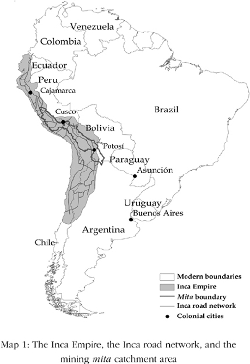

Map 1

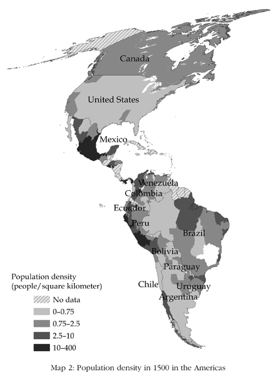

Map 2

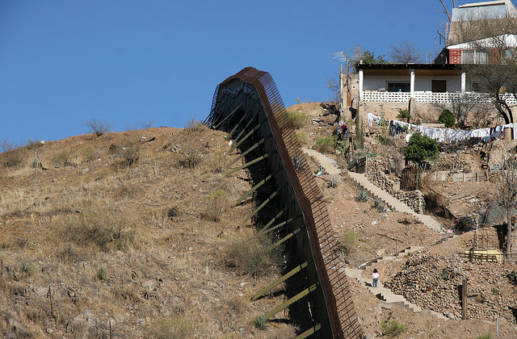

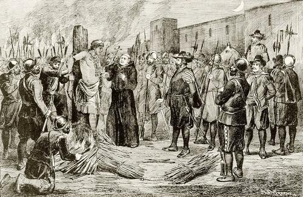

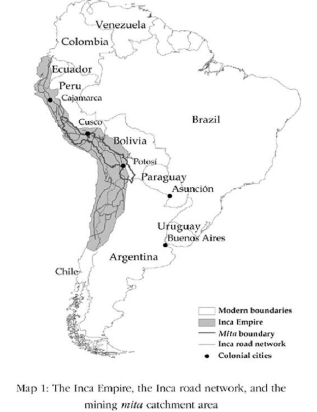

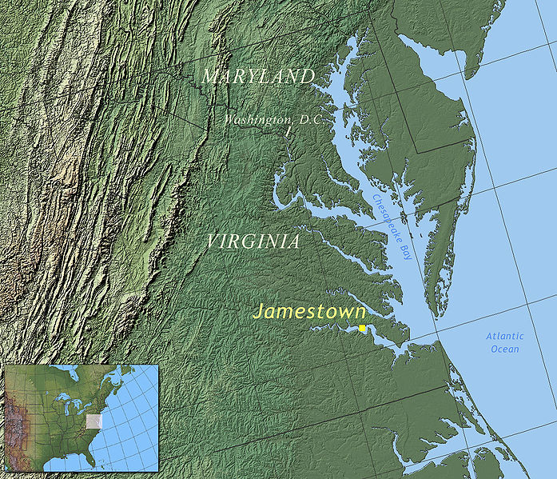

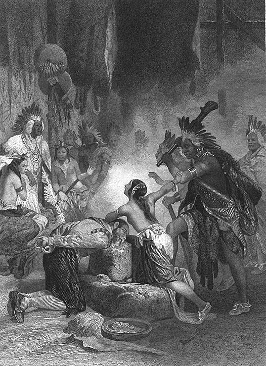

宝嘉康蒂

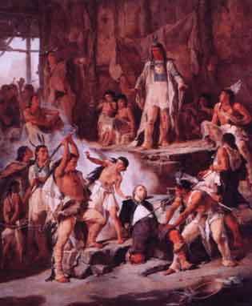

宝嘉康蒂

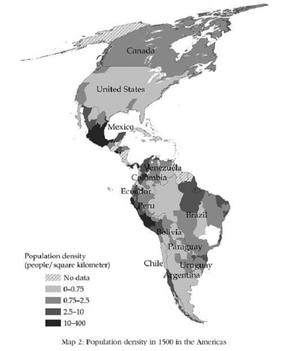

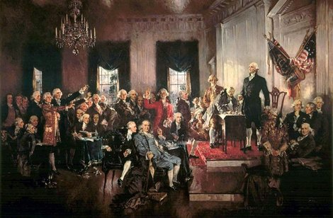

第一次大陆会议，通过并颁布《独立宣言》，自由美利坚诞生

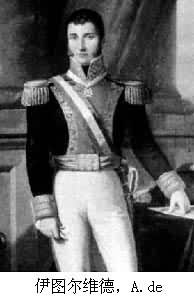

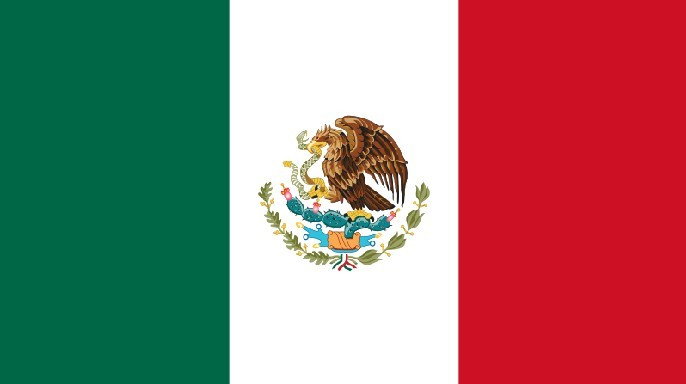

爱迪生

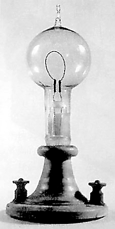

第一盏电灯

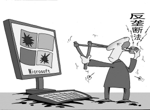

美国反垄断法——谢尔曼法不是吃素的

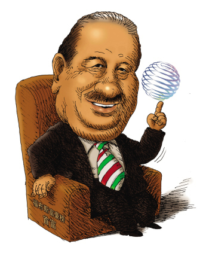

同墨西哥政治菁英结盟的施林，将墨西哥电信玩弄于股掌之上
