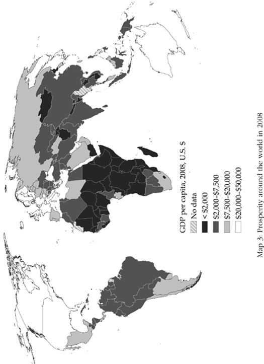
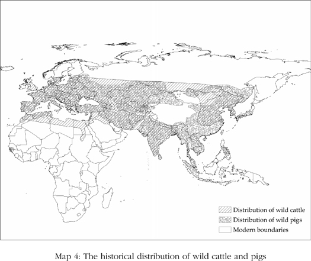
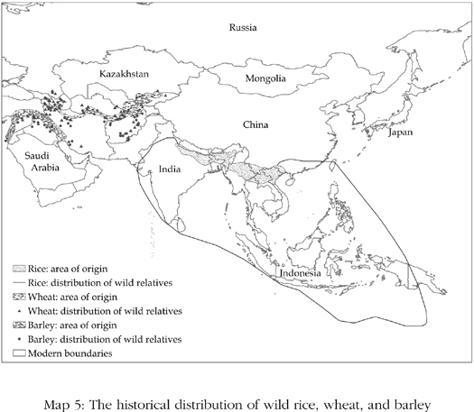
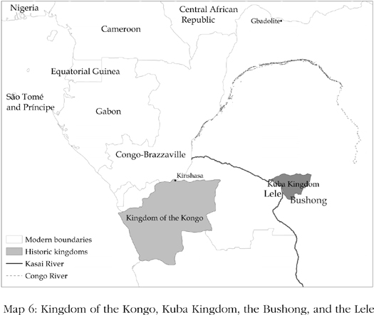
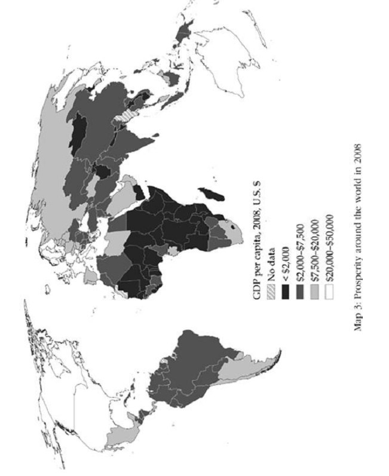
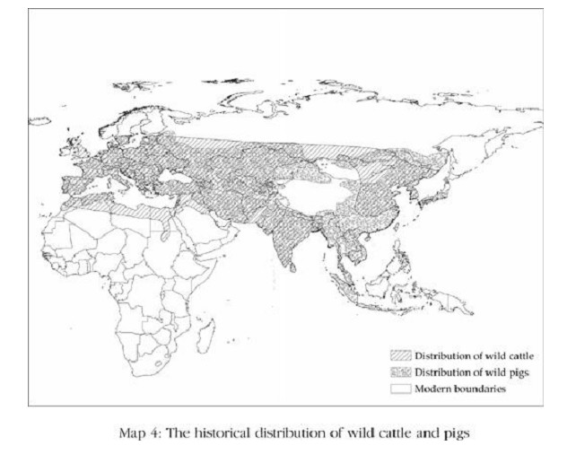
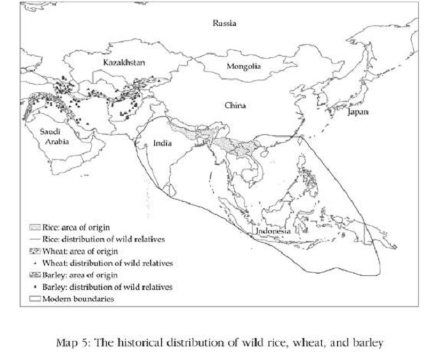
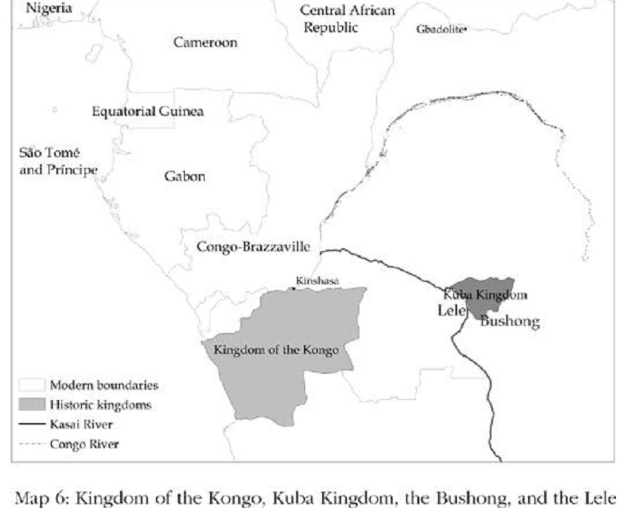

# Theories That Don’t Work · 第2章　无效的理论

## The Lay Of The Land · 世界情形

The focus of our book is on explaining world inequality and also some of the easily visible broad patterns that nest within it. The first country to experience sustained economic growth was England—or Great Britain, usually just Britain, as the union of England, Wales, and Scotland after 1707 is known. Growth emerged slowly in the second half of the eighteenth century as the Industrial Revolution, based on major technological breakthroughs and their application in industry, took root.

> 本书的焦点是解释世界的不平等，以及其中一些明显可见的普遍模式。第一个经历持续经济成长的国家是英国——或称大不列颠，指的是1707年以后英格兰、威尔士和苏格兰的联盟。18世纪下半叶，出自重大科技突破并将之应用到工业上的工业革命逐渐发挥影响，经济成长也随之缓慢浮现。

Industrialization in England was soon followed by industrialization in most of Western Europe and the United States. English prosperity also spread rapidly to Britain’s “settler colonies” of Canada, Australia, and New Zealand. A list of the thirty richest countries today would include them, plus Japan, Singapore, and South Korea. The prosperity of these latter three is in turn part of a broader pattern in which many East Asian nations, including Taiwan and subsequently China, have experienced recent rapid growth.

> 英国的工业化很快散播到大多数西欧国家和美国。英国的富裕也快速扩散到英国的移民殖民地（settler colonies）如加拿大、澳大利亚和新西兰。我们可以列出今日三十个富裕国家的清单，除了上述国家外，也包括日本、新加坡和韩国。后面三国的富裕属于一种更广泛的模式，许多东亚国家经历快速成长都是这种模式，包括中国台湾和后来的中国大陆。

The bottom of the world income distribution paints as sharp and as distinctive a picture as the top. If you instead make a list of the poorest thirty countries in the world today, you will find almost all of them in sub-Saharan Africa. They are joined by countries such as Afghanistan, Haiti, and Nepal, which, though not in Africa, all share something critical with African nations, as we’ll explain. If you went back fifty years, the countries in the top and bottom thirty wouldn’t be greatly different.

> 世界上收入排名殿后的国家呈现的图景，也和排名顶端的国家一样鲜明。如果你列出今日全世界最贫穷的三十个国家，你会发现它们几乎全都在下撒哈拉非洲，加上不在非洲的阿富汗、海地和尼泊尔，后面这几个国家都有某些与非洲国家相同的关键性质，我们稍后将解说。如果你回到五十年前，顶端的三十国和底部的三十国跟现在没有太大差异。

Singapore and South Korea would not be among the richest countries, and there would be several different countries in the bottom thirty, but the overall picture that emerged would be remarkably consistent with what we see today. Go back one hundred years, or a hundred and fifty, and you’d find nearly the same countries in the same groups. Map 3 shows the lay of the land in 2008. The countries shaded in the darkest color are the poorest in the world, those where average per-capita incomes (called by economists GDP, gross domestic product) are less than $2,000 annually.

> 当时的新加坡和韩国不在富国之列，底部三十国会有一些和今日不同的国家，但整体图景会与今日所见的相当一致。如果回溯到一百年前或一百五十年前，你会发现两个类别几乎都是相同的国家。地图3显示2008年的情况。颜色最深的国家代表世界上最贫穷的国家，年人均国内生产总值不到2000美元。

Most of Africa is in this color, as are Afghanistan, Haiti, and parts of Southeast Asia (for example, Cambodia and Laos). North Korea is also among this group of countries. The countries in white are the richest, those with annual income per-capita of $20,000 or more. Here we find the usual suspects: North America, western Europe, Australasia, and Japan.

> 大多数非洲国家属这种颜色，阿富汗、海地和部分东南亚国家（如柬埔寨和老挝）也是。朝鲜也在这一组国家里。白色代表最富裕的国家，年人均国内生产总值20000美元以上。我们在这一组看到常见的国家：北美、西欧国家、澳大利亚和日本。

Another interesting pattern can be discerned in the Americas. Make a list of the nations in the Americas from richest to poorest. You will find that at the top are the United States and Canada, followed by Chile, Argentina, Brazil, Mexico, and Uruguay, and maybe also Venezuela, depending on the price of oil. After that you have Colombia, the Dominican Republic, Ecuador, and Peru. At the bottom there is another distinct, much poorer group, comprising Bolivia, Guatemala, and Paraguay.

> 我们可以在美洲发现另一个有趣的模式。列一张从最富有到最贫穷的美洲国家清单，你将发现最上面是美国和加拿大，其次是智利、阿根廷、巴西、墨西哥和乌拉圭，或许还有委内瑞拉，视原油价格而定。再下来有哥伦比亚、多米尼加共和国、厄瓜多尔和秘鲁。垫底的是另一些明显贫穷很多的国家，包括玻利维亚、危地马拉和巴拉圭。

Go back fifty years, and you’ll find an identical ranking. One hundred years: same thing. One hundred and fifty years: again the same. So it is not just that the United States and Canada are richer than Latin America; there is also a definite and persistent divide between the rich and poor nations within Latin America.

> 回到五十年前，你会发现完全一致的排名。一百年前：一样。一百五十年前：还是一样。因此不只是美国和加拿大比拉丁美洲富裕；拉丁美洲之内的富国和穷国也有一个明确和持续的差距。

A final interesting pattern is in the Middle East. There we find oil-rich nations such as Saudi Arabia and Kuwait, which have income levels close to those of our top thirty. Yet if the oil price fell, they would quickly fall back down the table. Middle Eastern countries with little or no oil, such as Egypt, Jordan, and Syria, all cluster around a level of income similar to that of Guatemala or Peru. Without oil, Middle Eastern countries are also all poor, though, like those in Central America and the Andes, not so poor as those in sub-Saharan Africa.

> 最后一个有趣的模式是在中东。我们在中东发现蕴藏丰富石油的国家如沙特阿拉伯和科威特，它们的人均国内生产总值接近三十个富国。但如果油价下跌，它们会很快从排名滑落。只有很少石油或没有石油的中东国家如埃及、约旦和叙利亚，人均国内生产总值水平全都类似危地马拉和秘鲁。没有石油的中东国家也都很穷，尽管它们跟中美洲与安第斯山国家一样，还不像下撒哈拉非洲国家那么穷。

While there is a lot of persistence in the patterns of prosperity we see around us today, these patterns are not unchanging or immutable. First, as we have already emphasized, most of current world inequality emerged since the late eighteenth century, following on the tails of the Industrial Revolution. Not only were gaps in prosperity much smaller as late as the middle of the eighteenth century, but the rankings which have been so stable since then are not the same when we go further back in history.

> 虽然今日我们看到这些富裕模式有相当高的延续性，但这些模式并非没有改变或不会改变。第一，正如我们已经强调过，大多数目前世界的不平等始于18世纪末，是工业革命以后发生的。截至18世纪中叶，贫富国的差距不只小得多，而且当时贫富的排名也与后来一直保持稳定的排名不一样。

In the Americas, for example, the ranking we see for the last hundred and fifty years was completely different five hundred years ago. Second, many nations have experienced several decades of rapid growth, such as much of East Asia since the Second World War and, more recently, China. Many of these subsequently saw that growth go into reverse. Argentina, for example, grew rapidly for five decades up until 1920, becoming one of the richest countries in the world, but then started a long slide. The Soviet Union is an even more noteworthy example, growing rapidly between 1930 and 1970, but subsequently experiencing a rapid collapse.

> 例如在美洲，过去一百五十年我们看到的排名与五百年前完全不同。第二，许多国家经历了数十年的快速成长，像二战后的多个东亚国家，和晚近的中国大陆。也有许多国家在成长之后转而变成衰退，例如阿根廷快速成长直到1920年，变成世界最富裕的国家之一，但之后便开始长期滑落。苏联是更值得注意的例子，它在1930年到1970年间成长迅速，但随后急速崩跌。

What explains these major differences in poverty and prosperity and the patterns of growth? Why did Western European nations and their colonial offshoots filled with European settlers start growing in the nineteenth century, scarcely looking back? What explains the persistent ranking of inequality within the Americas?

> 什么原因造成贫穷与富裕以及成长模式的重大差异？为什么西欧国家和西欧移民进驻的殖民地在19世纪开始成长，此后一直维持好景？什么原因让美洲国家的不平等排名持久不变？

Why have sub-Saharan African and Middle Eastern nations failed to achieve the type of economic growth seen in Western Europe, while much of East Asia has experienced breakneck rates of economic growth? One might think that the fact that world inequality is so huge and consequential and has such sharply drawn patterns would mean that it would have a well-accepted explanation. Not so. Most hypotheses that social scientists have proposed for the origins of poverty and prosperity just don’t work and fail to convincingly explain the lay of the land.

> 为什么下撒哈拉非洲和中东国家未能创造出西欧那样的经济成长，而许多东亚国家则出现飞跃的经济成长？有人可能认为，世界的不平等差距如此大、模式如此截然不同，表示一定有一个众人都能接受的解释，但实际上并非如此。大多数社会科学家对贫穷与富裕根源的假设完全说不通，无法让人信服地解释这样的情形。

## The Geography Hypothesis · 地理假说

One widely accepted theory of the causes of world inequality is the geography hypothesis, which claims that the great divide between rich and poor countries is created by geographical differences. Many poor countries, such as those of Africa, Central America, and South Asia, are between the tropics of Cancer and Capricorn. Rich nations, in contrast, tend to be in temperate latitudes. This geographic concentration of poverty and prosperity gives a superficial appeal to the geography hypothesis, which is the starting point of the theories and views of many social scientists and pundits alike. But this doesn’t make it any less wrong.

> 世界不平等的原因有一个广被接受的理论，即地理假说，该假说宣称富国与穷国的巨大分野是由地理差异造成的。许多穷国如非洲、中美洲和南亚国家，都位于南北回归线间的热带。对照之下，富国往往位于温带地区。穷国与富国的地理集中性赋予地理假说一种肤浅的吸引力，许多社会科学家和学者就以这种假设来做为理论和观点的基础。可惜这无法使错误变正确。

As early as the late eighteenth century, the great French political philosopher Montesquieu noted the geographic concentration of prosperity and poverty, and proposed an explanation for it. He argued that people in tropical climates tended to be lazy and to lack inquisitiveness. As a consequence, they didn’t work hard and were not innovative, and this was the reason why they were poor. Montesquieu also speculated that lazy people tended to be ruled by despots, suggesting that a tropical location could explain not just poverty but also some of the political phenomena associated with economic failure, such as dictatorship.

> 早在18世纪伟大的法国政治哲学家孟德斯鸠就已发现，富裕与贫穷呈现出地理的集中，并为这种现象提出一种解释。他宣称热带气候下的人民倾向较懒惰，缺乏探究的精神，因此不努力工作，不知创新，这是他们贫穷的原因。孟德斯鸠也推论，懒惰的人倾向被专制君主统治，暗示热带地理位置不仅可解释贫穷，也能说明一些与经济失败有关的政治现象，例如独裁政治。

The theory that hot countries are intrinsically poor, though contradicted by the recent rapid economic advance of countries such as Singapore, Malaysia, and Botswana, is still forcefully advocated by some, such as the economist Jeffrey Sachs. The modern version of this view emphasizes not the direct effects of climate on work effort or thought processes, but two additional arguments: first, that tropical diseases, particularly malaria, have very adverse consequences for health and therefore labor productivity; and second, that tropical soils do not allow for productive agriculture. The conclusion, though, is the same: temperate climates have a relative advantage over tropical and semitropical areas.

> 热带国家原本就容易贫穷的理论，虽然与近来经济快速成长的国家如新加坡、马来西亚和博茨瓦纳相矛盾，仍旧被一些人大力提倡，例如经济学家萨克斯。这个观点的现代版不强调气候对工作努力或思考过程的直接影响，而是强调两项额外的论点：第一，特别是疟疾等热带疾病对健康有极不利的影响，因此也影响劳动生产力；第二，热带土壤不容许高生产力的农耕。不过，结论是相同的：温带气候比热带和亚热带地区有相对优势。

World inequality, however, cannot be explained by climate or diseases, or any version of the geography hypothesis. Just think of Nogales. What separates the two parts is not climate, geography, or disease environment, but the U.S.-Mexico border. If the geography hypothesis cannot explain differences between the north and south of Nogales, or North and South Korea, or those between East and West Germany before the fall of the Berlin Wall, could it still be a useful theory for explaining differences between North and South America? Between Europe and Africa? Simply, no.

> 然而，世界的不平等无法以气候或疾病、或任何版本的地理假说来解释。只要想想诺加雷斯就知道，造成这个城市两边差异的不是气候、地理或疾病的环境，而是美国与墨西哥的边界。如果地理假说无法解释诺加雷斯北边和南边，或朝鲜（北韩）与韩国（南韩），或柏林围墙倒塌前的东德与西德的差异，这套理论还能用来解释北美洲和南美洲的不同吗？或欧洲与非洲的差异？当然不能。

History illustrates that there is no simple or enduring connection between climate or geography and economic success. For instance, it is not true that the tropics have always been poorer than temperate latitudes. As we saw in the last chapter, at the time of the conquest of the Americas by Columbus, the areas south of the Tropic of Cancer and north of the Tropic of Capricorn, which today include Mexico, Central America, Peru, and Bolivia, held the great Aztec and Inca civilizations. These empires were politically centralized and complex, built roads, and provided famine relief.

> 历史显示，气候或地理与经济成功没有单纯或持久的关联。例如，热带并非总是比温带贫穷。我们在上一章提到，在哥伦布征服美洲时，北回归线以南和南回归线以北的地区，也就是今日涵盖墨西哥、中美洲、秘鲁和玻利维亚的地区，是伟大的阿兹特克和印加文明的所在地。这些帝国在政治上集权而复杂，他们兴建道路，提供饥馑的赈济。

The Aztecs had both money and writing, and the Incas, even though they lacked both these two key technologies, recorded vast amounts of information on knotted ropes called quipus. In sharp contrast, at the time of the Aztecs and Incas, the north and south of the area inhabited by the Aztecs and Incas, which today includes the United States, Canada, Argentina, and Chile, were mostly inhabited by Stone Age civilizations lacking these technologies. The tropics in the Americas were thus much richer than the temperate zones, suggesting that the “obvious fact” of tropical poverty is neither obvious nor a fact. Instead, the greater riches in the United States and Canada represent a stark reversal of fortune relative to what was there when the Europeans arrived.

> 阿兹特克人使用钱币和文字，印加人虽然缺少这两种技术，却以称作奇普的结绳记载大量信息。呈现鲜明对比的是，在阿兹特克和印加帝国的时代，阿兹特克人和印加人居住的地区以北和以南，即今日包括美国、加拿大、阿根廷和智利的地方，大多居住着缺乏这些技术的石器时代文明。美洲热带地区当时比温带富裕得多，这意味热带贫穷这个“明显的事实”既不明显、也非事实。而今日美国和加拿大远为富裕，与欧洲人初到美洲时的情况完全逆转。

This reversal clearly had nothing to do with geography and, as we have already seen, something to do with the way these areas were colonized. This reversal was not confined to the Americas. People in South Asia, especially the Indian subcontinent, and in China were more prosperous than those in many other parts of Asia and certainly more than the peoples inhabiting Australia and New Zealand.

> 这种逆转显然与地理毫无关系，而且正如我们已经谈到，是与这些地区遭到殖民的方式有关。这种逆转也不局限于美洲。南亚尤其是印度次大陆，以及中国大陆的人民，曾经比亚洲其他地方的人更富裕，比澳大利亚和新西兰的原住民更是如此。

This, too, was reversed, with South Korea, Singapore, and Japan emerging as the richest nations in Asia, and Australia and New Zealand surpassing almost all of Asia in terms of prosperity. Even within sub-Saharan Africa there was a similar reversal. More recently, before the start of intense European contact with Africa, the southern Africa region was the most sparsely settled and the farthest from having developed states with any kind of control over their territories.

> 但那种情况也已大幅逆转，韩国、新加坡和日本兴起成为亚洲的富国，澳大利亚和新西兰的富裕更超越几乎所有亚洲国家。即使在下撒哈拉非洲也有类似的逆转发生。在欧洲开始与非洲频繁接触之前，非洲南部地区都是一些人口最稀疏、开发程度最低的国家，对它们的领土只有最松散的控制。

Yet South Africa is now one of the most prosperous nations in sub-Saharan Africa. Further back in history we again see much prosperity in the tropics; some of the great premodern civilizations, such as Angkor in modern Cambodia, Vijayanagara in southern India, and Aksum in Ethiopia, flourished in the tropics, as did the great Indus Valley civilizations of Mohenjo Daro and Harappa in modern Pakistan. History thus leaves little doubt that there is no simple connection between a tropical location and economic success.

> 但南非现在是下撒哈拉非洲最富裕的国家之一。再回溯更早些的历史，我们又看到热带曾经繁华一时，部分前现代文明如今日柬埔寨的吴哥窟、印度南部的毘迦叶那迦罗王朝，和埃塞俄比亚阿克苏姆，都在热带繁荣兴盛；伟大的印度河谷文明摩亨佐达罗和今日巴基斯坦的哈拉帕也是。历史因此证明，毫无疑问的，热带地理位置与经济成功之间没有单纯的关系。

Tropical diseases obviously cause much suffering and high rates of infant mortality in Africa, but they are not the reason Africa is poor. Disease is largely a consequence of poverty and of governments being unable or unwilling to undertake the public health measures necessary to eradicate them. England in the nineteenth century was also a very unhealthy place, but the government gradually invested in clean water, in the proper treatment of sewage and effluent, and, eventually, in an effective health service.

> 热带疾病显然造成许多非洲人饱受病痛之苦，婴儿死亡率也较高，但它们不是非洲贫穷的原因。疾病大体上是贫穷的结果，也因为政府没有能力或不愿采取必要的公共卫生措施来消灭疾病。19世纪的英国也是很不健康的地方，但政府逐步投资在干净的水源、妥善处理污水和废水，最后还提供有效的公共卫生服务。

Improved health and life expectancy were not the cause of England’s economic success but one of the fruits of its previous political and economic changes. The same is true for Nogales, Arizona. The other part of the geography hypothesis is that the tropics are poor because tropical agriculture is intrinsically unproductive. Tropical soils are thin and unable to maintain nutrients, the argument goes, and emphasizes how quickly these soils are eroded by torrential rains.

> 健康和预期寿命提升不是英国经济成功的原因，而是英国先前的政治与经济变革的成果之一。亚利桑那州诺加雷斯的情况也是如此。地理假说的其他部分是，热带较贫穷是因为热带农业原本就不具生产力。热带土壤较薄，无法保持养分；这个假说还强调，这种土壤有多容易被暴雨侵蚀。

There certainly is some merit in this argument, but as we’ll show, the prime determinant of why agricultural productivity—agricultural output per acre—is so low in many poor countries, particularly in sub-Saharan Africa, has little to do with soil quality. Rather, it is a consequence of the ownership structure of the land and the incentives that are created for farmers by the governments and institutions under which they live. We will also show that world inequality cannot be explained by differences in agricultural productivity. The great inequality of the modern world that emerged in the nineteenth century was caused by the uneven dissemination of industrial technologies and manufacturing production. It was not caused by divergence in agricultural performance.

> 这种说法当然有一定道理，但我们将阐明，许多贫穷国家（尤其是在下撒哈拉非洲）的农业生产力——每英亩土地的农业产出——如此低的主要原因，与土壤品质无关，而是土地所有权结构的结果，以及政府和制度为农民创造的诱因所造成。我们也将阐明，世界的不平等无法以农业生产力的差异来解释。现代世界从19世纪发生的不平等扩大，是由工业科技与制造业生产的散播不平均所造成，而非源自农业生产表现的分歧。

Another influential version of the geography hypothesis is advanced by the ecologist and evolutionary biologist Jared Diamond. He argues that the origins of intercontinental inequality at the start of the modern period, five hundred years ago, rested in different historical endowments of plant and animal species, which subsequently influenced agricultural productivity. In some places, such as the Fertile Crescent in the modern Middle East, there were a large number of species that could be domesticated by humans. Elsewhere, such as the Americas, there were not.

> 另一个有影响力的地理假说版本，是由生态学家兼演化生物学家戴蒙所提倡。他宣称在五百年前的现代初期跨越各大陆的不平等，根源于动植物物种具备的不同历史特性，并因而影响了农业生产力。在某些地方如今日中东的肥沃新月地区，有许多物种可被人类驯化。而在其他地方如美洲，却缺少这类物种。

Having many species capable of being domesticated made it very attractive for societies to make the transition from a hunter-gatherer to a farming lifestyle. As a consequence, farming developed earlier in the Fertile Crescent than in the Americas. Population density grew, allowing specialization of labor, trade, urbanization, and political development. Crucially, in places where farming dominated, technological innovation took place much more rapidly than in other parts of the world. Thus, according to Diamond, the differential availability of animal and plant species created differential intensities of farming, which led to different paths of technological change and prosperity across different continents.

> 有许多物种可供驯化对社会从狩猎采集生活转型为农业生活帮助很大。其结果是，肥沃新月地区发展发展农耕比美洲早。人口密度增加，有助于促进劳动的专业化、贸易、都市化和政治发展。很重要的是，在农业为主的地方，科技创新发展比世界其他地方更快。因此，根据戴蒙的说法，动物和植物物种可得性的差异制造了农业发展程度的差异，导致不同大陆间的技术发展与富裕程度的不同。

Though Diamond’s thesis is a powerful approach to the puzzle on which he focuses, it cannot be extended to explain modern world inequality. For example, Diamond argues that the Spanish were able to dominate the civilizations of the Americas because of their longer history of farming and consequent superior technology. But we now need to explain why the Mexicans and Peruvians inhabiting the former lands of the Aztecs and Incas are poor.

> 虽然戴蒙的理论可以解开他所专注的谜题，但它无法用来解释现代世界的不平等。例如，戴蒙宣称西班牙之所以能支配美洲的文明，是因为他们有更悠久的农耕历史和由此而来的较优越技术。但我们现在必须解释，为什么住在以前阿兹特克和印加土地的墨西哥人和秘鲁人现在很贫穷。

While having access to wheat, barley, and horses might have made the Spanish richer than the Incas, the gap in incomes between the two was not very large. The average income of a Spaniard was probably less than double that of a citizen of the Inca Empire. Diamond’s thesis implies that once the Incas had been exposed to all the species and resulting technologies that they had not been able to develop themselves, they ought quickly to have attained the living standards of the Spanish.

> 虽然拥有小麦、大麦和马匹可能让西班牙人比印加人更富有，但两者的收入差距并不是很大。西班牙人的平均收入可能是印加帝国人民的不到两倍。戴蒙的理论暗示，一旦印加人有机会接近所有物种，以及他们过去无法自己发展的技术后，应该就能很快达到和西班牙人一样的生活水平。

Yet nothing of the sort happened. On the contrary, in the nineteenth and twentieth centuries, a much larger gap in incomes between Spain and Peru emerged. Today the average Spaniard is more than six times richer than the average Peruvian. This gap in incomes is closely connected to the uneven dissemination of modern industrial technologies, but this has little to do either with the potential for animal and plant domestication or with intrinsic agricultural productivity differences between Spain and Peru.

> 然而这种情况并未发生。相反的，在19世纪和20世纪，西班牙和秘鲁的收入差距变得更大。今日的西班牙人比秘鲁人富有六倍以上。这种收入差距与现代工业技术散播的不平均息息相关，但是与动植物驯化的潜力、或与西班牙和秘鲁土地本身的农业生产力差异无关。

While Spain, albeit with a lag, adopted the technologies of steam power, railroads, electricity, mechanization, and factory production, Peru did not, or at best did so very slowly and imperfectly. This technological gap persists today and reproduces itself on a bigger scale as new technologies, in particular those related to information technology, fuel further growth in many developed and some rapidly developing nations. Diamond’s thesis does not tell us why these crucial technologies are not diffusing and equalizing incomes across the world and does not explain why the northern half of Nogales is so much richer than its twin just to the south of the fence, even though both were part of the same civilization five hundred years ago.

> 当西班牙（有点落后地）采用蒸汽动力、铁路、电力、机械化和工厂生产的技术时，秘鲁并未跟着采用，或至少采用的速度很迟缓和不完全。这种技术差距持续到今日，并随着新科技出现而自动造成更大幅度的差距，特别是与信息有关的科技诞生后，更进一步助长许多已开发国家和部分快速发展国家的领先形势。戴蒙的理论并未告诉我们为什么这些重要的科技并没有四处散播以及缩小世界各地的收入差距，也未解释北半边的诺加雷斯为什么远比围墙的南半边富裕，即使两边在五百年前都属于同一个文明。

The story of Nogales highlights another major problem in adapting Diamond’s thesis: as we have already seen, whatever the drawbacks of the Inca and Aztec empires were in 1532, Peru and Mexico were undoubtedly more prosperous than those parts of the Americas that went on to become the United States and Canada. North America became more prosperous precisely because it enthusiastically adopted the technologies and advances of the Industrial Revolution. The population became educated and railways spread out across the Great Plains in stark contrast to what happened in South America. This cannot be explained by pointing to differential geographic endowments of North and South America, which, if anything, favored South America.

> 诺加雷斯的故事凸显戴蒙理论的另一个重大问题：正如我们已经讨论到，不管印加和阿兹特克帝国在1532年时有什么弱点，当时秘鲁和墨西哥无疑比后来变成美国和加拿大的那部分美洲繁荣得多。北美洲变富裕的原因就是它积极采用了工业革命的技术与进展。那里的人口教育程度提升，铁路扩散到大平原各地，与南美洲的情况成鲜明的对比。这无法从北美洲和南美洲的地理条件差异来解释，因为南美洲的地理条件显然比北美洲具有优势。

Inequality in the modern world largely results from the uneven dissemination and adoption of technologies, and Diamond’s thesis does include important arguments about this. For instance, he argues, following the historian William McNeill, that the east–west orientation of Eurasia enabled crops, animals, and innovations to spread from the Fertile Crescent into Western Europe, while the north–south orientation of the Americas accounts for why writing systems, which were created in Mexico, did not spread to the Andes or North America. Yet the orientation of continents cannot provide an explanation for today’s world inequality.

> 现代世界的不平等大体上源自科技应用与散布的不平均，而戴蒙的理论的确包含有关这一点的重要论述。例如他跟随在历史学家迈克尼尔之后主张，东西向的欧亚大陆让许多作物、动物和创新，从肥沃新月地区传播到西欧，而南北向的美洲则使在墨西哥发明的文字系统，无法散播到安第斯山或北美洲。然而大陆的方向无法提供今日世界不平等的解释。

Consider Africa. Though the Sahara Desert did present a significant barrier to the movement of goods and ideas from the north to sub-Saharan Africa, this was not insurmountable. The Portuguese, and then other Europeans, sailed around the coast and eliminated differences in knowledge at a time when gaps in incomes were very small compared with what they are today. Since then, Africa has not caught up with Europe; on the contrary, there is now a much larger income gap between most African and European countries.

> 想想非洲，尽管撒哈拉沙漠确实构成货物和思想从北传到下撒哈拉非洲的重大阻碍，这却并非完全无法克服。葡萄牙人和当时其他的欧洲人沿着海岸航行，并在一个收入差距比今日小很多的时代消弭了知识上的鸿沟。但后来非洲并未赶上欧洲，反而现在大多数非洲国家和欧洲国家之间的收入差距变得更大。

It should also be clear that Diamond’s argument, which is about continental inequality, is not well equipped to explain variation within continents—an essential part of modern world inequality. For example, while the orientation of the Eurasian landmass might explain how England managed to benefit from the innovations of the Middle East without having to reinvent them, it doesn’t explain why the Industrial Revolution happened in England rather than, say, Moldova. In addition, as Diamond himself points out, China and India benefited greatly from very rich suites of animals and plants, and from the orientation of Eurasia. But most of the poor people of the world today are in those two countries.

> 我们也必须说明，戴蒙有关各大陆不平等的理论无法解释大陆内部的差异，而这是现代世界不平等的基本部分。例如，虽然欧亚大陆的方向可能解释英国如何从中东的创新获益，而无需自己从头创新，但它未解释为什么工业革命发生在英国而非像摩尔多瓦这类地方。此外，正如戴蒙自己指出，中国和印度从极丰富的动物和植物物种、以及欧亚大陆的方向获益良多，但今日世界大部分的贫穷人口却在这两个国家。

In fact, the best way to see the scope of Diamond’s thesis is in terms of his own explanatory variables. Map 4 shows data on the distribution of Sus scrofa, the ancestor of the modern pig, and the aurochs, ancestor of the modern cow. Both species were widely distributed throughout Eurasia and even North Africa.

> 事实上，了解戴蒙理论的界限最好的方法，是从他自己的解释变数着手。地图4显示现代猪的祖先野猪和现代牛的祖先原牛的分布。两种物种都遍布欧亚大陆甚至非洲北部。

Map 5 (this page) shows the distribution of some of the wild ancestors of modern domesticated crops, such as Oryza sativa, the ancestor of Asian cultivated rice, and the ancestors of modern wheat and barley. It demonstrates that the wild ancestor of rice was distributed widely across south and southeast Asia, while the ancestors of barley and wheat were distributed along a long arc from the Levant, reaching through Iran and into Afghanistan and the cluster of “stans” (Turkmenistan, Tajikistan, and Krgyzistan). These ancestral species are present in much of Eurasia. But their wide distribution suggests that inequality within Eurasia cannot be explained by a theory based on the incidence of the species.

> 地图5显示某些现代驯化作物如亚洲种植稻米的原种水稻，以及现代小麦和大麦的原种分布。它显示稻米的野生原种广泛分布在南亚和东南亚，而大麦和小麦原种的分布则呈一个长拱形，从地中海东部穿过伊朗，到阿富汗和数个“斯坦”国家（土库曼斯坦、塔吉克斯坦、吉尔吉斯斯坦）。这些原种遍布欧亚大陆的许多地方，但它们的广泛分布意味欧亚大陆内部的不平等无法以物种发生率为基础的理论来解释。

The geography hypothesis is not only unhelpful for explaining the origins of prosperity throughout history, and mostly incorrect in its emphasis, but also unable to account for the lay of the land we started this chapter with. One might argue that any persistent pattern, such as the hierarchy of incomes within the Americas or the sharp and long-ranging differences between Europe and the Middle East, can be explained by unchanging geography. But this is not so. We have already seen that the patterns within the Americas are highly unlikely to have been driven by geographical factors.

> 地理假说不但无助于解释有历史以来的富裕根源，它的主要论点大体上也不正确，而且无法解释我们在本章开头提出的世界贫富情形问题。有人可能会说，任何持续的模式（例如美洲各国的收入等级，和欧洲与中东呈现鲜明而悬殊的差距）都可以用不变的地理因素来解释，但实际情况并非如此。我们已谈过美洲内的模式不太可能由地理因素所造成。

Before 1492 it was the civilizations in the central valley of Mexico, Central America, and the Andes that had superior technology and living standards to North America or places such as Argentina and Chile. While the geography stayed the same, the institutions imposed by European colonists created a “reversal of fortune.” Geography is also unlikely to explain the poverty of the Middle East for similar reasons.

> 在1492年之前，墨西哥中部谷地、中美洲和安第斯山的文明，都拥有比北美或阿根廷与智利等地更高的技术和生活水平。虽然地理条件没有改变，欧洲殖民者实施的制度却制造出“命运逆转”的发展。出于同样的理由，地理也不太可能解释中东的贫穷。

After all, the Middle East led the world in the Neolithic Revolution, and the first towns developed in modern Iraq. Iron was first smelted in Turkey, and as late as the Middle Ages the Middle East was technologically dynamic. It was not the geography of the Middle East that made the Neolithic Revolution flourish in that part of the world, as we will see in chapter 5, and it was, again, not geography that made the Middle East poor.

> 毕竟中东曾在新石器革命带领世界，并在今日伊拉克的地区发展出第一批城镇。铁最早在土耳其被人冶炼，而直到中古世纪，中东的技术都十分发达。我们将在第五章看到，不是中东的地理条件造成新时期革命在世界的那个部分蓬勃展开，也不是地理因素导致中东贫穷。

Instead, it was the expansion and consolidation of the Ottoman Empire, and it is the institutional legacy of this empire that keeps the Middle East poor today. Finally, geographic factors are unhelpful for explaining not only the differences we see across various parts of the world today but also why many nations such as Japan or China stagnate for long periods and then start a rapid growth process. We need another, better theory.

> 事实上，鄂图曼帝国的扩张和统一，以及帝国留下的制度才是让中东贫穷至今的原因。最后，地理因素不但无助于解释今日世界各部分的差异，也无法说明为什么像日本和中国等许多国家先经历长期停滞、然后展开快速成长的过程。我们需要另一个更好的理论。

## The Culture Hypothesis · 文化假说

The second widely accepted theory, the culture hypothesis, relates prosperity to culture. The culture hypothesis, just like the geography hypothesis, has a distinguished lineage, going back at least to the great German sociologist Max Weber, who argued that the Protestant Reformation and the Protestant ethic it spurred played a key role in facilitating the rise of modern industrial society in Western Europe. The culture hypothesis no longer relies solely on religion, but stresses other types of beliefs, values, and ethics as well.

> 第二个广为接受的理论是文化假说，认为富裕与文化有关。文化假说就像地理假说一样有着显赫的渊源，至少可以追溯到伟大的德国社会学家韦伯，他宣称宗教改革和它激发的新教伦理，在西欧现代工业社会的崛起中扮演关键角色。文化假说不再只以宗教为基础，而是也强调其他种类的信仰、价值和伦理。

Though it is not politically correct to articulate in public, many people still maintain that Africans are poor because they lack a good work ethic, still believe in witchcraft and magic, or resist new Western technologies. Many also believe that Latin America will never be rich because its people are intrinsically profligate and impecunious, and because they suffer from some “Iberian” or “mañana” culture. Of course, many once believed that the Chinese culture and Confucian values were inimical to economic growth, though now the importance of the Chinese work ethic as the engine of growth in China, Hong Kong, and Singapore is trumpeted.

> 虽然公开说出口是政治不正确的，但许多人心里仍认为非洲人贫穷是因为他们缺乏良好的工作伦理，和迷信巫术和魔法，或抗拒新西方技术。许多人也相信拉丁美洲永远不会富裕，因为那里的人民天生就是又穷又爱挥霍，同时因为他们受到“伊比利亚”文化或“明天再说”文化的毒害。当然，许多人曾认为，中国文化和儒家价值不利于经济成长，然而现在中国人的工作伦理却被认为是中国、香港和新加坡的成长引擎，其重要性受到大声宣扬。

Is the culture hypothesis useful for understanding world inequality? Yes and no. Yes, in the sense that social norms, which are related to culture, matter and can be hard to change, and they also sometimes support institutional differences, this book’s explanation for world inequality. But mostly no, because those aspects of culture often emphasized—religion, national ethics, African or Latin values—are just not important for understanding how we got here and why the inequalities in the world persist. Other aspects, such as the extent to which people trust each other or are able to cooperate, are important but they are mostly an outcome of institutions, not an independent cause.

> 文化假说对了解世界不平等有帮助吗？有，但也没有。说有是从社会规范来说，而社会规范与文化有关，很重要而且难以改变，同时它们有时候也支持制度性差异，即本书对世界不平等的解释。但大部分时候没有帮助，因为那些经常被强调的文化面向——宗教、民族的伦理、非洲的或拉丁的价值——对了解我们如何演变至今，和为什么世界的不平等长期延续，并不重要。其他面向如人们彼此信任的程度、或能不能互相合作虽然重要，但它们大多是制度的结果，而非独立的原因。

Let us go back to Nogales. As we noted earlier, many aspects of culture are the same north and south of the fence. Nevertheless, there may be some marked differences in practices, norms, and values, though these are not causes but outcomes of the two places’ divergent development paths. For example, in surveys Mexicans typically say they trust other people less than the citizens of the United States say they trust others.

> 让我们回到诺加雷斯。正如前面提过，围墙的北边和南边在文化的许多面向上相同。然而在实际运作、规范和价值上可能有一些显著的差异，虽然这些差异并非原因，而是两个地方走上分歧发展道路的结果。例如，墨西哥人在调查中说他们信任别人，程度上低于美国人说他们信任别人。

But it is not a surprise that Mexicans lack trust when their government cannot eliminate drug cartels or provide a functioning unbiased legal system. The same is true with North and South Korea, as we discuss in the next chapter. The South is one of the richest countries in the world, while the North grapples with periodic famine and abject poverty. While “culture” is very different between the South and the North today, it played no role in causing the diverging economic fortunes of these two half nations.

> 但墨西哥人缺乏信任并不令人意外，因为他们的政府无法消灭贩毒集团，也无法提供运作良好且不偏颇的司法制度。我们下一章将讨论的北韩和南韩情况也一样，南韩是世界的富国之一，而北韩则经常发生饥馑且深陷贫穷中。虽然今日的南北韩“文化”大不相同，但它并非两韩经济强弱的原因。

The Korean peninsula has a long period of common history. Before the Korean War and the division at the 38th parallel, it had an unprecedented homogeneity in terms of language, ethnicity, and culture. Just as in Nogales, what matters is the border. To the north is a different regime, imposing different institutions, creating different incentives. Any difference in culture between south and north of the border cutting through the two parts of Nogales or the two parts of Korea is thus not a cause of the differences in prosperity but, rather, a consequence.

> 朝鲜半岛有悠久的共同历史，在朝鲜战争和双方以北纬38度线划分边界前，两韩在语言、人种和文化上没有任何差别。就像在诺加雷斯一样，差别在于那道边界。在边界北方是一个不同的政权，实施不同的制度，制造不同的诱因。因此，穿越诺加雷斯两边或南北韩间的边界造成的任何文化差异，并不是贫富差距的原因，而是结果。

What about Africa and African culture? Historically, sub-Saharan Africa was poorer than most other parts of the world, and its ancient civilizations did not develop the wheel, writing (with the exception of Ethiopia and Somalia), or the plow. Though these technologies were not widely used until the advent of formal European colonization in the late nineteenth and early twentieth century, African societies knew about them much earlier. Europeans began sailing around the west coast in the late fifteenth century, and Asians were continually sailing to East Africa from much earlier times.

> 那么，非洲和非洲文化呢？从历史看，下撒哈拉非洲比世界大部分地区贫穷，而且那里的古文明没有发展出轮子、文字（埃塞俄比亚和索马里是例外）或耕犁。虽然这些技术直到19世纪末和20世纪初的欧洲殖民正式开始才被普遍采用，但非洲社会很早就知道这些技术了。欧洲人在15世纪末开始环非洲西岸航行，而亚洲则从更早的时代就已持续航行到非洲东部。

We can understand why these technologies were not adopted from the history of the Kingdom of Kongo at the mouth of the Congo River, which has given its name to the modern Democratic Republic of Congo. Map 6 shows where the Kongo was along with another important central African state, the Kuba Kingdom, which we discuss later in the book. Kongo came into intense contact with the Portuguese after it was first visited by the mariner Diogo Cão in 1483.

> 我们从刚果王国的历史，就可以了解为什么这些科技并未被采用。刚果王国位于刚果河口，今日的刚果民主共和国就是根据它而命名。地图6显示当时刚果所在的位置，以及另一个重要的中非洲国家库巴王国的位置，我们将在本书稍后讨论到这个国家。葡萄牙航海家卡欧1483年首度来到刚果后，刚果开始与葡萄牙人密切接触。

At the time, Kongo was a highly centralized polity by African standards, whose capital, Mbanza, had a population of sixty thousand, which made it about the same size as the Portuguese capital of Lisbon and larger than London, which had a population of about fifty thousand in 1500. The king of Kongo, Nzinga a Nkuwu, converted to Catholicism and changed his name to João I. Later Mbanza’s name was changed to São Salvador. Thanks to the Portuguese, the Kongolese learned about the wheel and the plow, and the Portuguese even encouraged their adoption with agricultural missions in 1491 and 1512. But all these initiatives failed.

> 当时刚果以非洲的标准来看是一个高度集权的国家组织，首度姆班扎有六万人口，规模与葡萄牙首度里斯本差不多，比伦敦更大，伦敦在1500年的人口大约五万。刚果国王恩库武改信天主教，并改名为约翰一世。后来姆班扎的名称改为圣萨尔瓦多。拜葡萄牙人所赐，刚果人学会使用轮子和犁，葡萄牙人甚至在1491年和1512年派出农耕队来鼓励他们采用。但这些措施后来全归于失败。

Still, the Kongolese were far from averse to modern technologies in general. They were very quick to adopt one venerable Western innovation: the gun. They used this new and powerful tool to respond to market incentives: to capture and export slaves. There is no sign here that African values or culture prevented the adoption of new technologies and practices. As their contacts with Europeans deepened, the Kongolese adopted other Western practices: literacy, dress styles, and house designs.

> 不过，刚果人整体而言一点都不厌恶现代科技，他们很快就采用一项令人敬畏的西方发明：枪。他们利用这项新颖而强大的工具来回应市场诱因：捕捉和出口奴隶。没有迹象显示非洲的价值或文化阻碍了新科技和做法的采用。随着刚果人与欧洲人的接触加深，他们也采用其他西方做法：文字书写、衣着和住房设计。

In the nineteenth century, many African societies also took advantage of the rising economic opportunities created by the Industrial Revolution by changing their production patterns. In West Africa there was rapid economic development based on the export of palm oil and ground nuts; throughout southern Africa, Africans developed exports to the rapidly expanding industrial and mining areas of the Rand in South Africa. Yet these promising economic experiments were obliterated not by African culture or the inability of ordinary Africans to act in their own self-interest, but first by European colonialism and then by postindependence African governments.

> 在19世纪，许多非洲社会也借由改变生产模式来利用工业革命带来的经济机会。在非洲西部出现以出口棕榈油和花生为主的快速经济发展；在非洲南部各地，非洲人发展出口产品，卖到南非兰德快速扩张的工业区和矿业区。但这些富于潜力的经济实验的灭绝并不是因为非洲文化，也不是因为非洲人没有能力为自利采取行动，而是先遭到欧洲殖民主义的破坏，继之则被独立后的非洲政府压制。

The real reason that the Kongolese did not adopt superior technology was because they lacked any incentives to do so. They faced a high risk of all their output being expropriated and taxed by the all-powerful king, whether or not he had converted to Catholicism. In fact, it wasn’t only their property that was insecure. Their continued existence was held by a thread. Many of them were captured and sold as slaves—hardly the environment to encourage investment to increase long-term productivity.

> 刚果人未采用较优越的技术真正的原因是，他们缺少这么做的诱因。他们面对所有生产成果被权力极大的国王没收和课税的高度风险，而这与国王是否皈依天主教会无关。事实上，不只是他们的财产不安全，他们的生存也岌岌可危。许多刚果人被俘虏并卖为奴隶——完全不是能鼓励投资来增进长期生产力的环境。

Neither did the king have incentives to adopt the plow on a large scale or to make increasing agricultural productivity his main priority; exporting slaves was so much more profitable. It might be true today that Africans trust each other less than people in other parts of the world. But this is an outcome of a long history of institutions which have undermined human and property rights in Africa. The potential to be captured and sold as a slave no doubt influenced the extent to which Africans trusted others historically.

> 国王也没有诱因大规模采用犁、或把增进农业生产力列为他的优先要务，因为出口奴隶获利远高于此。今日来看非洲人信任彼此的程度低于世界其他地方可能是真的，但这是过去长期的制度破坏了非洲人权与财产权的结果。被捕获并卖为奴隶的可能性，无疑影响了过去非洲人对彼此的信任程度。

What about Max Weber’s Protestant ethic? Though it may be true that predominantly Protestant countries, such as the Netherlands and England, were the first economic successes of the modern era, there is little relationship between religion and economic success. France, a predominantly Catholic country, quickly mimicked the economic performance of the Dutch and English in the nineteenth century, and Italy is as prosperous as any of these nations today. Looking farther east, you’ll see that none of the economic successes of East Asia have anything to do with any form of Christian religion, so there is not much support for a special relationship between Protestantism and economic success there, either.

> 韦伯的新教伦理又有什么影响？虽然新教徒占优势的国家如荷兰和英国确实是最早获得经济成功的国家，但宗教与经济成功却没有多大关系。法国是天主教占优势的国家，但也很快在19世纪模仿荷兰和英国的经济表现，而意大利今日也和其他国家一样繁荣富裕。再往更远的东方看，你会发现东亚的经济成功都与任何形式的基督教无关，因此也没有证据支持新教伦理与经济成功有特别的关系。

Let’s turn to a favorite area for the enthusiasts of the culture hypothesis: the Middle East. Middle Eastern countries are primarily Islamic, and the non–oil producers among them are very poor, as we have already noted. Oil producers are richer, but this windfall of wealth has done little to create diversified modern economies in Saudi Arabia or Kuwait. Don’t these facts show convincingly that religion matters?

> 再来看热衷于文化假说的人士偏爱的一个地区：中东。中东国家主要信仰伊斯兰教，而正如我们已经提到，其中的非产油国都相当贫穷。产油国很富裕，但这种天赐的财富对沙特阿拉伯或科威特建立多元化的现代经济却没有多大帮助。这些事实不是可以充分证明宗教有关系吗？

Though plausible, this argument is not right, either. Yes, countries such as Syria and Egypt are poor, and their populations are primarily Muslim. But these countries also systemically differ in other ways that are far more important for prosperity. For one, they were all provinces of the Ottoman Empire, which heavily, and adversely, shaped the way they developed. After Ottoman rule collapsed, the Middle East was absorbed into the English and French colonial empires, which, again, stunted their possibilities.

> 听起来似乎有道理，但这种说法也不正确。没错，像叙利亚和埃及这些国家很穷，他们的人口主要是穆斯林，但这些国家也在许多方面不同于其他国家，而这些方面对于繁荣富裕更是重要得多。例如，它们都曾是鄂图曼帝国的省份，而这对他们的发展方向造成极大的不利影响。在鄂图曼统治崩溃后，中东被吸收到英国和法国殖民帝国，两者又再阻碍了中东国家发展的可能性。

After independence, they followed much of the former colonial world by developing hierarchical, authoritarian political regimes with few of the political and economic institutions that, we will argue, are crucial for generating economic success. This development path was forged largely by the history of Ottoman and European rule. The relationship between the Islamic religion and poverty in the Middle East is largely spurious.

> 独立以后，它们跟随许多前殖民国家的脚步，发展出阶层式的独裁政权，采用的政治和经济制度在我们看来大多无助于创造经济成功。这种发展道路大体上受到鄂图曼和欧洲统治的历史所塑造。伊斯兰宗教与中东贫穷的关系大体上是捏造出来的。

The role of these historical events, rather than cultural factors, in shaping the Middle East’s economic trajectory is also seen in the fact that the parts of the Middle East that temporarily broke away from the hold of the Ottoman Empire and the European powers, such as Egypt between 1805 and 1848 under Muhammad Ali, could embark on a path of rapid economic change. Muhammad Ali usurped power following the withdrawal of the French forces that had occupied Egypt under Napoleon Bonaparte. Exploiting the weakness of the Ottoman hold over the Egyptian territory at the time, he was able to found his own dynasty, which would, in one form or another, rule until the Egyptian Revolution under Nasser in 1952.

> 这些历史事件（而非文化因素）在塑造中东经济轨道上扮演的角色，也可以从暂时脱离鄂图曼帝国和欧洲强权的部分中东地区看出，例如1805年到1848年间的埃及在穆哈穆德•阿里在拿破仑时代占领埃及的法国军队撤退后夺得权力，他利用鄂图曼统治埃及领土的弱点，建立了自己的王朝，此后这个王朝以不同的形式统治直到1952年纳赛尔发动埃及革命。

Muhammad Ali’s reforms, though coercive, did bring growth to Egypt as the state bureaucracy, the army, and the tax system were modernized and there was growth in agriculture and industry. Nevertheless, this process of modernization and growth came to an end after Ali’s death, as Egypt fell under European influence. But perhaps this is the wrong way to think about culture. Maybe the cultural factors that matter are not tied to religion but rather to particular “national cultures.”

> 阿里的改革虽然是胁迫性的，却为埃及带来成长；国家官僚制度、军队、税制都被现代化，且农业和工业都出现成长。尽管如此，这个现代化和成长的过程在阿里死后便陷于停顿，使埃及落入欧洲的掌控。但这或许是思考文化的错误方法，也许有关系的文化因素不是宗教，而是特定的“民族文化”。

Perhaps it is the influence of English culture that is important and explains why countries such as the United States, Canada, and Australia are so prosperous? Though this idea sounds initially appealing, it doesn’t work, either. Yes, Canada and the United States were English colonies, but so were Sierra Leone and Nigeria. The variation in prosperity within former English colonies is as great as that in the entire world. The English legacy is not the reason for the success of North America.

> 也许英国文化的影响很重要，可以解释为什么美国、加拿大和澳大利亚能如此繁荣富裕。虽然这种想法一开始很吸引人，但它也说不通。是的，加拿大和美国曾是英国殖民地，但塞拉利昂和阿尔及利亚也曾经是。前英国殖民地的富裕程度差异极大，就像世界各地的富裕程度差异一样大。英国的影响不是北美洲成功的原因。

There is yet one more version of the culture hypothesis: perhaps it is not English versus non-English that matters but, rather, European versus non-European. Could it be that Europeans are superior somehow because of their work ethic, outlook on life, Judeo-Christian values, or Roman heritage? It is true that Western Europe and North America, filled primarily by people of European descent, are the most prosperous parts of the world. Perhaps it is the superior European cultural legacy that is at the root of prosperity—and the last refuge of the culture hypothesis.

> 文化假说还有一个版本：也许关系重大的不是英国与非英国的差别，而是欧洲与非欧洲的不同。欧洲人较优越可不可能是因为他们的工作伦理、人生观、犹太—基督教价值或罗马传承？西欧和北美的人口确实以欧洲后代为主，而两地是世界最富裕的部分。优越的欧洲文化传承也许就是富裕的根源——也是文化假说最后的庇护所。

Alas, this version of the culture hypothesis has as little explanatory potential as the others. A greater proportion of the population of Argentina and Uruguay, compared with the population of Canada and the United States, is of European descent, but Argentina’s and Uruguay’s economic performance leaves much to be desired. Japan and Singapore never had more than a sprinkling of inhabitants of European descent, yet they are as prosperous as many parts of Western Europe.

> 可惜这个版本的文化假说和其他假说一样缺乏说服力。阿根廷和乌拉圭属于欧洲裔的人口比例，比加拿大和美国还高，但阿根廷和乌拉圭的经济表现只能以不理想来形容。日本和新加坡的居民绝少欧洲后裔，但两国的富裕程度不亚于西欧许多部分。

China, despite many imperfections in its economic and political system, has been the most rapidly growing nation of the past three decades. Chinese poverty until Mao Zedong’s death had nothing to do with Chinese culture; it was due to the disastrous way Mao organized the economy and conducted politics. In the 1950s, he promoted the Great Leap Forward, a drastic industrialization policy that led to mass starvation and famine.

> 中国的经济和政治体系尽管有许多缺点，却是过去三十年成长最迅速的国家。中国在毛泽东去世前的贫穷与中国文化没有关系，而是毛泽东以惨烈的方式管理经济和控制政治的结果。在1950年代，毛泽东推行大跃进，这项激烈的工业化政策导致大规模饥荒。

In the 1960s, he propagated the Cultural Revolution, which led to the mass persecution of intellectuals and educated people—anyone whose party loyalty might be doubted. This again led to terror and a huge waste of the society’s talent and resources. In the same way, current Chinese growth has nothing to do with Chinese values or changes in Chinese culture; it results from a process of economic transformation unleashed by the reforms implemented by Deng Xiaoping and his allies, who, after Mao Zedong’s death, gradually abandoned socialist economic policies and institutions, first in agriculture and then in industry.

> 1960年代，他展开文化大革命，对知识分子和受过教育的人——任何对党的忠诚遭到怀疑者——进行大规模迫害。这再度带来恐怖和社会才能与资源的巨大浪费。同样的，现在中国的成长与中国人的价值或中国文化的改变无关，而是源自邓小平和他的盟友推动改革所引发的经济转型过程；他们在毛泽东死后逐步放弃社会主义经济政策和制度，先是从农业着手，然后扩大到工业。

Just like the geography hypothesis, the culture hypothesis is also unhelpful for explaining other aspects of the lay of the land around us today. There are of course differences in beliefs, cultural attitudes, and values between the United States and Latin America, but just like those that exist between Nogales, Arizona, and Nogales, Sonora, or those between South and North Korea, these differences are a consequence of the two places’ different institutions and institutional histories. Cultural factors that emphasize how “Hispanic” or “Latin” culture molded the Spanish Empire can’t explain the differences within Latin America—for example, why Argentina and Chile are more prosperous than Peru and Bolivia.

> 和地理假说一样，文化假说也对解释今日世界情形的许多面向没有帮助。美国和拉丁美洲在信仰、文化态度和价值上当然有差异，但正如亚利桑那州诺加雷斯和索诺拉省诺加雷斯之间、或南韩和北韩之间，这些差异是两边不同的制度和制度的历史发展的结果。强调源自西班牙帝国的“西班牙”或“拉丁”文化因素，无法解释拉丁美洲内的差异——例如，为什么阿根廷和智利比秘鲁和玻利维亚富裕。

Other types of cultural arguments—for instance, those that stress contemporary indigenous culture—fare equally badly. Argentina and Chile have few indigenous people compared with Peru and Bolivia. Though this is true, indigenous culture as an explanation does not work, either. Colombia, Ecuador, and Peru have similar income levels, but Colombia has very few indigenous people today, while Ecuador and Peru have many. Finally, cultural attitudes, which are in general slow to change, are unlikely to account by themselves for the growth miracles in East Asia and China. Though institutions are persistent, too, in certain circumstances they do change rapidly, as we’ll see.

> 其他类型的文化理论——例如强调当代原住民文化的说法——也同样难以成立。阿根廷和智利的原住民人口比秘鲁和玻利维亚少，虽然这是事实，但以原住民文化当做解释也不成立。哥伦比亚、厄瓜多尔和秘鲁的收入水平相当，但今日哥伦比亚的原住民人口很少，而厄瓜多尔和秘鲁则很多。最后，大体说来改变很缓慢的文化态度也很难单独解释东亚和中国的成长奇迹。虽然制度也会长期延续，在特定情况下它们确实会快速改变，这一点我们也会谈到。

## The Ignorance Hypothesis · 无知假说

The final popular theory for why some nations are poor and some are rich is the ignorance hypothesis, which asserts that world inequality exists because we or our rulers do not know how to make poor countries rich. This idea is the one held by most economists, who take their cue from the famous definition proposed by the English economist Lionel Robbins in 1935 that “economics is a science which studies human behavior as a relationship between ends and scarce means which have alternative uses.” It is then a small step to conclude that the science of economics should focus on the best use of scarce means to satisfy social ends.

> 最后一个解释为何某些国家贫穷、某些国家却富裕的流行理论是无知假说，认为世界不平等的存在是因为我们或我们的统治者不知道如何让穷国变富裕。这是大多数经济学家抱持的看法，而他们的概念则源自英国经济学家罗宾斯1935年提出的著名定义：“经济学是把人类行为当作目的与具有各种不同用途的稀缺手段之间的一种关系来研究的科学”。从这个定义只要踏一小步，就可以认定经济学应该专注于以最佳方式利用稀缺手段、以满足社会的目的。

Indeed, the most famous theoretical result in economics, the so-called First Welfare Theorem, identifies the circumstances under which the allocation of resources in a “market economy” is socially desirable from an economic point of view. A market economy is an abstraction that is meant to capture a situation in which all individuals and firms can freely produce, buy, and sell any products or services that they wish. When these circumstances are not present there is a “market failure.”

> 的确，经济学中最著名的推论就是所谓的第一福利定理，定义了在哪些情况下“市场经济”的资源配置从经济观点来看是合乎社会要求的。市场经济是一个抽象概念，是用来描述一种所有个人与企业可以自由生产、购买和出售任何产品与服务的情景。当第一福利定理定义的这些情况不存在时就出现“市场失灵”。

Such failures provide the basis for a theory of world inequality, since the more that market failures go unaddressed, the poorer a country is likely to be. The ignorance hypothesis maintains that poor countries are poor because they have a lot of market failures and because economists and policymakers do not know how to get rid of them and have heeded the wrong advice in the past. Rich countries are rich because they have figured out better policies and have successfully eliminated these failures.

> 这种失灵提供了世界不平等的理论基础，因为愈多这种市场失灵未加解决，一个国家就可能愈贫穷。无知假说认为，穷国之所以贫穷，是因为它们有许多市场失灵，而经济学家和政策制定者不知道如何解决它们，而且在过去曾听从错误的建议。富国之所以富裕，是因为它们拟出更好的政策，并成功地消除这种失灵。

Could the ignorance hypothesis explain world inequality? Could it be that African countries are poorer than the rest of the world because their leaders tend to have the same mistaken views of how to run their countries, leading to the poverty there, while Western European leaders are better informed or better advised, which explains their relative success? While there are famous examples of leaders adopting disastrous policies because they were mistaken about those policies’ consequences, ignorance can explain at best a small part of world inequality.

> 无知假说能解释世界不平等吗？非洲国家比世界其他地方贫穷，有没有可能是因为他们的领导人在治理国家时抱持相同的错误观念，导致国家陷于贫困，而西欧领导人则知识较充足且获得较佳的建议，而这说明了他们相对的成功？虽然有一些著名例子是由领导人误判政策的结果，因而采取造成灾难的政策，但无知最多只能解释一小部分的世界不平等。

On the face of it, the sustained economic decline that soon set in in Ghana after independence from Britain was caused by ignorance. The British economist Tony Killick, then working as an adviser for the government of Kwame Nkrumah, recorded many of the problems in great detail. Nkrumah’s policies focused on developing state industry, which turned out to be very inefficient.

> 表面上看来，加纳从英国独立后很快陷于经济长期衰退是无知造成的。当时英国经济学家基立克担任恩克鲁玛政府的顾问，他详细记录了许多问题。恩克鲁玛的政策专注在发展国营企业，结果证明效率很低。

Killick recalled: The footwear factory … that would have linked the meat factory in the North through transportation of the hides to the South (for a distance of over 500 miles) to a tannery (now abandoned); the leather was to have been backhauled to the footwear factory in Kumasi, in the center of the country and about 200 miles north of the tannery. Since the major footwear market is in the Accra metropolitan area, the shoes would then have to be transported an additional 200 miles back to the South.

> 基立克回忆说：“这家鞋子工厂……准备与北部一家肉品工厂结盟，由后者把兽皮运送到南方（距离超过五百英里）的皮革厂（现在已停工）；皮革再运回位于该国中部的库马西，距离皮革厂约两百英里。由于主要的鞋子市场是在阿克拉都市区，鞋子必须再运送两百英里回到南方。”

Killick somewhat understatedly remarks that this was an enterprise “whose viability was undermined by poor siting.” The footwear factory was one of many such projects, joined by the mango canning plant situated in a part of Ghana which did not grow mangos and whose output was to be more than the entire world demand for the product. This endless stream of economically irrational developments was not caused by the fact that Nkrumah or his advisers were badly informed or ignorant of the right economic policies.

> 基立克委婉地说明，这是一家“因为设厂位置不良而危及其生存”的企业。这家鞋厂只是许多类似的计划之一，另外有一家芒果罐头工厂设在加纳不生产芒果的地区，它的产能却超过全世界对这种产品的需求。一连串非理性的经济发展，并非恩克鲁玛或他的顾问信息不足、或不了解正确的经济政策所造成。

They had people like Killick and had even been advised by Nobel laureate Sir Arthur Lewis, who knew the policies were not good. What drove the form the economic policies took was the fact that Nkrumah needed to use them to buy political support and sustain his undemocratic regime. Neither Ghana’s disappointing performance after independence nor the countless other cases of apparent economic mismanagement can simply be blamed on ignorance. After all, if ignorance were the problem, well-meaning leaders would quickly learn what types of policies increased their citizens’ incomes and welfare, and would gravitate toward those policies.

> 他们有像基立克这样的人才，诺贝尔奖得主刘易斯甚至曾担任顾问，他很清楚那些政策的缺失。那些经济政策之所以形成的原因是，恩克鲁玛必须用它们来收买政治支持，以维系他非民主的政权。加纳独立后令人失望的表现，以及无数明显错误的经济举措，都无法单纯地解释为无知。毕竟如果问题是无知，善意的领导人很快会学到哪些政策可以增进人民的收入和福祉，并改采那些政策。

Consider the divergent paths of the United States and Mexico. Blaming this disparity on the ignorance of the leaders of the two nations is, at best, highly implausible. It wasn’t differences in knowledge or intentions between John Smith and Cortés that laid the seeds of divergence during the colonial period, and it wasn’t differences in knowledge between later U.S. presidents, such as Teddy Roosevelt or Woodrow Wilson, and Porfirio Díaz that made Mexico choose economic institutions that enriched elites at the expense of the rest of society at the end of the nineteenth and beginning of the twentieth centuries while Roosevelt and Wilson did the opposite.

> 想想美国和墨西哥发展路径的分歧。将这种差异怪罪到领导人的无知，完全无法取信于人。不是因为史密斯上尉和柯尔特斯两人知识和意图的差异在殖民时代埋下了分歧的种子；也不是因为后来的美国总统如老罗斯福或威尔逊以及迪亚斯的知识差距，导致墨西哥在19世纪末和20世纪初选择让菁英获利并牺牲其他人福祉的制度，而罗斯福和威尔逊则选择相反的制度。

Rather, it was the differences in the institutional constraints the countries’ presidents and elites were facing. Similarly, leaders of African nations that have languished over the last half century under insecure property rights and economic institutions, impoverishing much of their populations, did not allow this to happen because they thought it was good economics; they did so because they could get away with it and enrich themselves at the expense of the rest, or because they thought it was good politics, a way of keeping themselves in power by buying the support of crucial groups or elites.

> 真正的原因是两国的总统与菁英面对的不同制度限制。同样的，过去半个世纪饱受不安全的财产权与经济制度危害而让大部分人民变穷的非洲国家，它们的领导人并非因为认为那些是好的经济政策所以采用，而是因为他们可以牺牲他人为自己图利并逃过制裁，或者因为他们认为那些经济政策是好的政治策略，可以借由收买重要菁英阶层的支持而维系自己的权力。

The experience of Ghana’s prime minister in 1971, Kofi Busia, illustrates how misleading the ignorance hypothesis can be. Busia faced a dangerous economic crisis. After coming to power in 1969, he, like Nkrumah before him, pursued unsustainable expansionary economic policies and maintained various price controls through marketing boards and an overvalued exchange rate. Though Busia had been an opponent of Nkrumah, and led a democratic government, he faced many of the same political constraints.

> 加纳总理布西亚1971年的经验，说明了无知假说会有多误导人。布西亚面对一场凶险的经济危机，在1969年取得权力后，他像之前恩克鲁玛一样，追求无法长久持续的扩张经济政策，并通过产销协会维系多种产品的价格控制，以及维持过度高估的汇率。虽然布西亚过去是恩克鲁玛的反对者，并且领导一个民主政府，但他面对许多相同的政治束缚。

As with Nkrumah, his economic policies were adopted not because he was “ignorant” and believed that these policies were good economics or an ideal way to develop the country. The policies were chosen because they were good politics, enabling Busia to transfer resources to politically powerful groups, for example in urban areas, who needed to be kept contented. Price controls squeezed agriculture, delivering cheap food to the urban constituencies and generating revenues to finance government spending. But these controls were unsustainable. Ghana was soon suffering from a series of balance-of-payment crises and foreign exchange shortages. Faced with these dilemmas, on December 27, 1971, Busia signed an agreement with the International Monetary Fund that included a massive devaluation of the currency.

> 和恩克鲁玛一样，他采用那些经济政策是因为它们对政治有好处，让布西亚能够转移资源给政治权力强大的群体，例如在都市地区需要被满足的人。价格控制榨取农业，把便宜的食物卖给都市选民，并创造收入供政府支出。但这些控制无法长期持续，加纳很快陷入一连串的收支危机和外汇短缺。面对这些困境，布西亚在1971年12月27日与国际货币基金组织（IMF）签订协议，协议中也包括使加纳货币大幅度贬值。

The IMF, the World Bank, and the entire international community put pressure on Busia to implement the reforms contained in the agreement. Though the international institutions were blissfully unaware, Busia knew he was taking a huge political gamble. The immediate consequence of the currency’s devaluation was rioting and discontent in Accra, Ghana’s capital, that mounted uncontrollably until Busia was overthrown by the military, led by Lieutenant Colonel Acheampong, who immediately reversed the devaluation. The ignorance hypothesis differs from the geography and culture hypotheses in that it comes readily with a suggestion about how to “solve” the problem of poverty: if ignorance got us here, enlightened and informed rulers and policymakers can get us out and we should be able to “engineer” prosperity around the world by providing the right advice and by convincing politicians of what is good economics.

> 国际货币基金组织和世界银行（World Bank）和整个国际社会，施压要求布西亚执行贷款协议包含的改革。虽然国际机构不知道严重性，但布西亚知道他下了一个重大的政治赌注。货币贬值的即刻结果是暴动和加纳首都阿克拉人民的不满，导致形势失控，直到布西亚被军方推翻，领导政变的艾钦朋上校立即回复货币的汇率。无知假说与地理和文化假说不同，它附带如何“解决”贫穷问题的现成建议：如果无知让我们陷于今日的情况，那么开明而信息充足的统治者和政策制定者就能带我们摆脱问题，我们应该能借由提供正确的建议并说服政治人物怎样是好的经济政策，通过“设计”来使世界达到富裕。

Yet Busia’s experience underscores the fact that the main obstacle to the adoption of policies that would reduce market failures and encourage economic growth is not the ignorance of politicians but the incentives and constraints they face from the political and economic institutions in their societies. Although the ignorance hypothesis still rules supreme among most economists and in Western policymaking circles—which, almost to the exclusion of anything else, focus on how to engineer prosperity—it is just another hypothesis that doesn’t work. It explains neither the origins of prosperity around the world nor the lay of the land around us—for example, why some nations, such as Mexico and Peru, but not the United States or England, adopted institutions and policies that would impoverish the majority of their citizens, or why almost all sub-Saharan Africa and most of Central America are so much poorer than Western Europe or East Asia.

> 然而布西亚的经验凸显一个事实，采用能减少市场失灵和鼓励经济成长的政策，最主要的障碍不是政治人物的无知，而是他们所处社会的政治与经济制度制造的诱因与限制。虽然无知假说仍然支配大多数经济学家的观念，并盛行于西方决策圈——这些决策者几乎只关注设计富裕——但这只是另一个不管用的假说。它无法解释世界各地富裕的根源，也说明不了我们周遭的情况——例如，为什么像墨西哥和秘鲁这些国家采用了会造成大部分人民贫穷的制度和政策，而美国或英国则没有；以及为什么几乎整个下撒哈拉非洲和大部分中美洲远比西欧和东亚贫穷。

When nations break out of institutional patterns condemning them to poverty and manage to embark on a path to economic growth, this is not because their ignorant leaders suddenly have become better informed or less self-interested or because they’ve received advice from better economists. China, for example, is one of the countries that made the switch from economic policies that caused poverty and the starvation of millions to those encouraging economic growth. But, as we will discuss in greater detail later, this did not happen because the Chinese Communist Party finally understood that the collective ownership of agricultural land and industry created terrible economic incentives.

> 当国家打破带给它们贫穷的制度模式，努力踏上经济成长的道路时，那不是因为它们无知的领导人突然变得更有知识或比较不顾私利，也不是因为他们获得更高明的经济学家的建议。以中国为例，中国是从造成数亿人贫穷与饥饿的经济政策转向鼓励经济成长的政策，但正如我们稍后会更详细讨论到的，这个转变不是因为中共终于了解农地和工业的公有制会带来糟糕的经济诱因，

Instead, Deng Xiaoping and his allies, who were no less self-interested than their rivals but who had different interests and political objectives, defeated their powerful opponents in the Communist Party and masterminded a political revolution of sorts, radically changing the leadership and direction of the party. Their economic reforms, which created market incentives in agriculture and then subsequently in industry, followed from this political revolution. It was politics that determined the switch from communism and toward market incentives in China, not better advice or a better understanding of how the economy worked.

> 而是因为邓小平和他的盟友——他们和别人一样自利，只是有不同的利益和政治目标——打败了他们在党内的强劲对手，策划一场政治革命，整个改变党的领导班子和方向。他们的经济改革跟着政治革命登场，先是在农业继而在工业创造出市场诱因。是政治决定了中国从共产主义转向市场诱因，而非更好的建议或更了解经济如何运作。

WE WILL ARGUE that to understand world inequality we have to understand why some societies are organized in very inefficient and socially undesirable ways. Nations sometimes do manage to adopt efficient institutions and achieve prosperity, but alas, these are the rare cases. Most economists and policymakers have focused on “getting it right,” while what is really needed is an explanation for why poor nations “get it wrong.” Getting it wrong is mostly not about ignorance or culture. As we will show, poor countries are poor because those who have power make choices that create poverty.

> 我们将讨论到，要了解世界的不平等，就必须了解为什么有些社会以极低效率和不利于社会的方式组成。国家有时候确实会采用有效率的制度并达成繁荣富裕，可惜这是罕见的例子。大多数经济学家和政策制定者专注在“做对”事情，而真正需要的其实是解释为什么穷国会“做错”。做错大部分不是因为无知或文化因素。我们将说明，贫穷国家之所以贫穷，是因为有权力的人做出制造贫穷的选择。

They get it wrong not by mistake or ignorance but on purpose. To understand this, you have to go beyond economics and expert advice on the best thing to do and, instead, study how decisions actually get made, who gets to make them, and why those people decide to do what they do. This is the study of politics and political processes. Traditionally economics has ignored politics, but understanding politics is crucial for explaining world inequality. As the economist Abba Lerner noted in the 1970s, “Economics has gained the title Queen of the Social Sciences by choosing solved political problems as its domain.”

> 他们做错不是出于犯错和无知，而是有意做错。要了解这一点，你必须超越经济学和专家对于怎么做最好的建议，去研究“那些决定是如何做成的、谁有权力做决定、以及为什么那些人决定要做他们所做的事”。这是在研究政治和政治过程。传统上经济学向来忽略政治学，但了解政治对解释世界的不平等极为重要。正如经济学家勒纳在1970年代指出：“经济学借选择已解决的政治问题做为其领土，而获得社会科学皇后的头衔。”

We will argue that achieving prosperity depends on solving some basic political problems. It is precisely because economics has assumed that political problems are solved that it has not been able to come up with a convincing explanation for world inequality. Explaining world inequality still needs economics to understand how different types of policies and social arrangements affect economic incentives and behavior. But it also needs politics.

> 我们将主张，达成富裕取决于解决一些基本的政治问题。就是因为经济学假设政治问题已经解决，所以它无法对世界不平等得出有说服力的解释。解释世界不平等，仍然需要经济学，来了解不同类型的政策和社会制度如何影响经济诱因与行为，但它也需要政治学。

## 本章插图

Map 3

Map 4

Map 5

Map 6

孟德斯鸠

马克斯•韦伯

