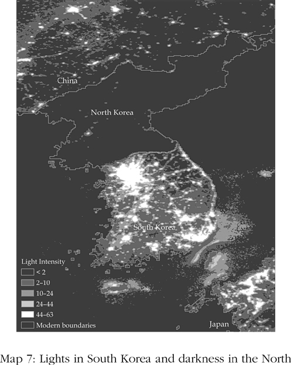
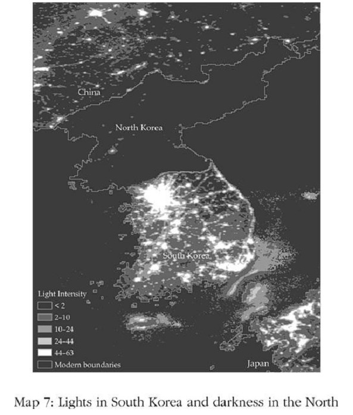
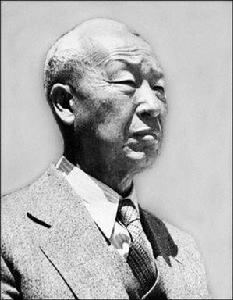
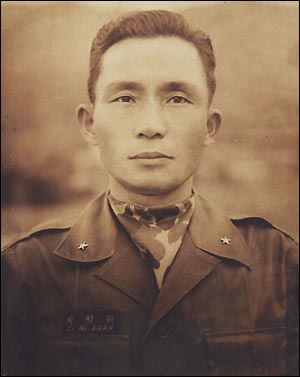
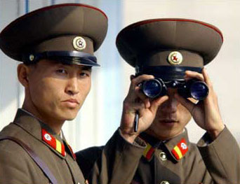
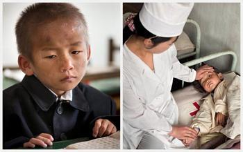
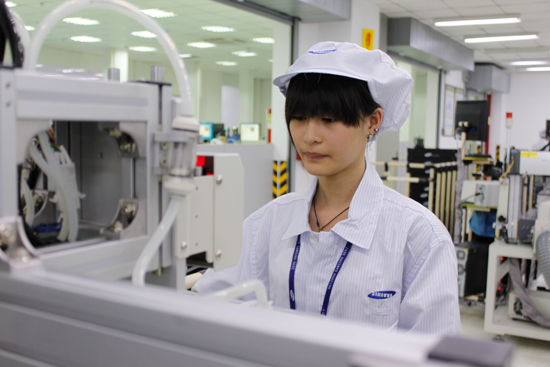
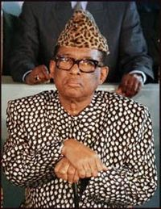
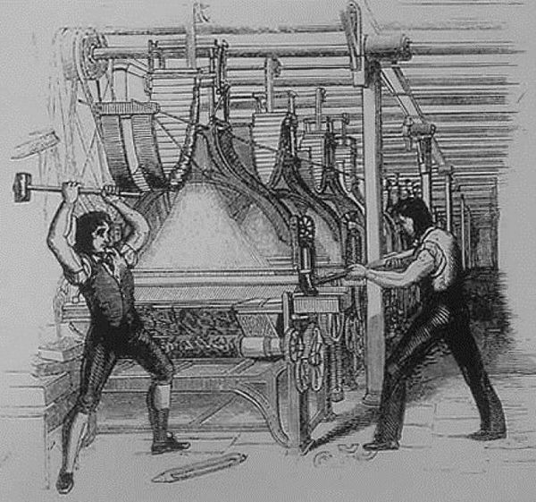

# The Making Of Prosperity And Poverty · 第3章　富裕与贫穷的形成

## The Economics Of The 38Th Parallel · 北纬三十八度线经济学

In the summer of 1945, as the Second World War was drawing to a close, the Japanese colony in Korea began to collapse. Within a month of Japan’s August 15 unconditional surrender, Korea was divided at the 38th parallel into two spheres of influence. The South was administered by the United States. The North, by Russia. The uneasy peace of the cold war was shattered in June 1950 when the North Korean army invaded the South. Though initially the North Koreans made large inroads, capturing the capital city, Seoul, by the autumn, they were in full retreat. It was then that Hwang Pyŏng-Wŏn and his brother were separated.

> 1945年夏季，二战接近尾声，日本在朝鲜半岛的殖民地开始崩溃。日本8月15日无条件投降不到一个月，半岛以北纬三十八度线被划分成两个势力区，南部由美国管理，北部由苏联管理。1950年6月北韩军队入侵南韩，粉碎了冷战不安定的和平。虽然初期北韩军队快速挺近，攻陷南韩首都汉城（今日的首尔），但到了秋季就全线撤退。就在这时候黄平元和他的哥哥失散了。

Hwang Pyŏng-Wŏn managed to hide and avoid being drafted into the North Korean army. He stayed in the South and worked as a pharmacist. His brother, a doctor working in Seoul treating wounded soldiers from the South Korean army, was taken north as the North Korean army retreated. Dragged apart in 1950, they met again in 2000 in Seoul for the first time in fifty years, after the two governments finally agreed to initiate a limited program of family reunification.

> 黄平元设法躲了起来，没有被北韩军队强征带走。他留在南方，从事药剂师的工作。他哥哥原本在汉城为南韩军队治疗受伤的士兵，但被撤退的北韩军队掳走。这对1950年失散的兄弟，五十年后的2000年在首尔重逢，因为南北韩政府终于同意有限度开放家人重聚。

As a doctor, Hwang Pyŏng-Wŏn’s brother had ended up working for the air force, a good job in a military dictatorship. But even those with privileges in North Korea don’t do that well. When the brothers met, Hwang Pyŏng-Wŏn asked about how life was north of the 38th parallel. He had a car, but his brother didn’t. “Do you have a telephone?” he asked his brother.

> 黄平元的哥哥身为医生，后来为北韩的空军工作，在军事独裁政府下算是个不错的职位。但即使在北韩享有特权的人生活也不富裕。两兄弟重逢时，黄平元问哥哥在三十八度线以北的生活情形。他自己有一辆汽车，但他哥哥没有。他问哥哥：“你有电话吗？”

“No,” said his brother. “My daughter, who works at the Foreign Ministry, has a phone, but if you don’t know the code you can’t call.” Hwang Pyŏng-Wŏn recalled how all the people from the North at the reunion were asking for money, so he offered some to his brother. But his brother said, “If I go back with money the government will say, ‘Give that money to us,’ so keep it.”

> 他哥哥说：“没有。我女儿在外交部工作，有一部电话，但如果你不知道密码就没办法打电话。”黄平元回忆说，在重逢时所有北方来的人都要钱，所以他提议给哥哥一些钱。但他哥哥说：“如果我带着钱回去，政府会说‘把钱交给我们’。你还是自己留着吧。”

Hwang Pyŏng-Wŏn noticed his brother’s coat was threadbare: “Take off that coat and leave it, and when you go back wear this one,” he suggested. “I can’t do that,” his brother replied. “This is just borrowed from the government to come here.” Hwang Pyŏng-Wŏn recalled how when they parted, his brother was ill at ease and always nervous as though someone were listening. He was poorer than Hwang Pyŏng-Wŏn imagined. His brother said he lived well, but Hwang Pyŏng-Wŏn thought he looked awful and was thin as a rake.

> 黄平元注意到他哥哥的大衣已经很破旧，他建议说：“把大衣脱下来丢了吧，回去的时候就穿我这件。”他哥哥回答：“我不能这么做，这是向政府借来穿到这里的。”黄平元回忆他们道别时，他哥哥始终紧张不安，好像有人在偷听。他比黄平元想象的还要穷。他哥哥说自己生活很好，但黄平元心想，他看起来很憔悴，而且骨瘦如柴。

The people of South Korea have living standards similar to those of Portugal and Spain. To the north, in the so-called Democratic People’s Republic of Korea, or North Korea, living standards are akin to those of a sub-Saharan African country, about one-tenth of average living standards in South Korea. The health of North Koreans is in an even worse state; the average North Korean can expect to live ten years less than his cousins south of the 38th parallel. Map 7 illustrates in a dramatic way the economic gap between the Koreas. It plots data on the intensity of light at night from satellite images. North Korea is almost completely dark due to lack of electricity; South Korea is blazing with light.

> 南韩人民的生活水平类似葡萄牙和西班牙。而国名为朝鲜民主主义人民共和国的北韩生活水平和下撒哈拉非洲国家相似，只有南韩平均生活水平约十分之一而已。北韩人的健康情况甚至更恶劣，北韩人的平均预期寿命比三十八度线以南的亲人少十年。地图7以戏剧化的方式显示南北韩的经济鸿沟，根据卫星摄影的夜晚灯光密度资料画出，北韩因为缺电几乎一片黑暗，南韩则处处亮光。

These striking differences are not ancient. In fact, they did not exist prior to the end of the Second World War. But after 1945, the different governments in the North and the South adopted very different ways of organizing their economies. South Korea was led, and its early economic and political institutions were shaped, by the Harvard- and Princeton-educated, staunchly anticommunist Syngman Rhee, with significant support from the United States. Rhee was elected president in 1948.

> 这些鲜明的差异并非自古以来就是如此，事实上，它们在二战前并不存在。但1945年以后，北方和南方不同的政府采用大不相同的方式管理经济。哈佛和普林斯顿大学大学出身、坚决反共的李承晚，在美国的大力支持下领导战后的南韩，建立了初期的政治和经济制度，并在1948年被选为总统。

Forged in the midst of the Korean War and against the threat of communism spreading to the south of the 38th parallel, South Korea was no democracy. Both Rhee and his equally famous successor, General Park Chung-Hee, secured their places in history as authoritarian presidents. But both governed a market economy where private property was recognized, and after 1961, Park effectively threw the weight of the state behind rapid economic growth, channeling credit and subsidies to firms that were successful. The situation north of the 38th parallel was different. Kim Il-Sung, a leader of anti-Japanese communist partisans during the Second World War, established himself as dictator by 1947 and, with the help of the Soviet Union, introduced a rigid form of centrally planned economy as part of the so-called Juche system.

> 历经朝鲜战争洗礼、并饱受共产主义扩散到三十八度线以南威胁的南韩并不民主，李承晚和同样与他著名的继任者朴正熙将军，在历史上的定位都是威权总统，但两人都实行市场经济和私有财产制度，朴正熙甚至在1961年后以国家力量当作快速经济成长的后盾，大力提供信贷和补贴给成功的企业。三十八度线以北的情况不同。金日成是二战时期反日的共产党领导人，到1947年确立了独裁者的地位，并在苏联的扶持下开始采用一套僵化的中央计划经济，是所谓“主体”系统的一部分。

Private property was outlawed, and markets were banned. Freedoms were curtailed not only in the marketplace, but in every sphere of North Koreans’ lives—except for those who happened to be part of the very small ruling elite around Kim Il-Sung and, later, his son and successor Kim Jong-Il. It should not surprise us that the economic fortunes of South and North Korea diverged sharply. Kim Il-Sung’s command economy and the Juche system soon proved to be a disaster.

> 私有财产被宣告违法，市场遭禁止。自由不仅在市场受到剥夺，北韩人生活的每一个层面都遭到限制——除了金日成和他儿子兼继承人金正日身边极少数的统治精英以外。南韩和北韩的经济命运出现尖锐的对比不应让我们感到惊讶，金日成的中央计划经济和主体系统很快证明是一场灾难。

Detailed statistics are not available from North Korea, which is a secretive state, to say the least. Nonetheless, available evidence confirms what we know from the all-too-often recurring famines: not only did industrial production fail to take off, but North Korea in fact experienced a collapse in agricultural productivity. Lack of private property meant that few people had incentives to invest or to exert effort to increase or even maintain productivity. The stifling, repressive regime was inimical to innovation and the adoption of new technologies. But Kim Il-Sung, Kim Jong-Il, and their cronies had no intention of reforming the system, or introducing private property, markets, private contracts, or changing economic and political institutions. North Korea continues to stagnate economically.

> 行事诡秘的北韩不提供详细的统计数据，然而可得的证据证实我们从频繁发生的饥馑看到的情况：北韩不但工业生产未能起飞，实际上连农业生产力都大幅滑落。缺少私有财产意味很少人有诱因投资或努力增进、甚至维持生产力。窒息式的压迫政权对创新和采用新科技极为不利，然而金日成、金正日和他们的亲信无意改革制度，也不想引进私有财产、市场、私人契约，或改变经济与政治制度。北韩的经济发展长期处于迟滞状态。

Meanwhile, in the South, economic institutions encouraged investment and trade. South Korean politicians invested in education, achieving high rates of literacy and schooling. South Korean companies were quick to take advantage of the relatively educated population, the policies encouraging investment and industrialization, exports, and the transfer of technology. South Korea quickly became one of East Asia’s “Miracle Economies,” one of the most rapidly growing nations in the world.

> 在同一时期，南方的经济制度鼓励投资和贸易。南韩政治人物投资在教育上，提高识字率和就学率。南韩企业迅速利用教育程度相对较高的人口、鼓励投资与工业化、出口，以及技术转移的政策。南韩很快崛起成为东亚的“经济奇迹”，全球最快速成长的国家之一。

By the late 1990s, in just about half a century, South Korean growth and North Korean stagnation led to a tenfold gap between the two halves of this once-united country—imagine what a difference a couple of centuries could make. The economic disaster of North Korea, which led to the starvation of millions, when placed against the South Korean economic success, is striking: neither culture nor geography nor ignorance can explain the divergent paths of North and South Korea. We have to look at institutions for an answer.

> 到1990年代末，经过大约半个世纪，南韩的成长和北韩的迟滞导致这个曾经统一的国家两边出现十倍的差距——想象一、两个世纪可以造成多大的差距。北韩造成数百万人饥荒经济灾难，与南韩的经济成功对比之下十分惊人：文化、地理和无知都无法解释南北韩今日命运如此悬殊的原因。我们必须从制度找寻答案。

## Extractive And Inclusive Economic Institutions · 榨取式和广纳式的经济制度

Countries differ in their economic success because of their different institutions, the rules influencing how the economy works, and the incentives that motivate people. Imagine teenagers in North and South Korea and what they expect from life. Those in the North grow up in poverty, without entrepreneurial initiative, creativity, or adequate education to prepare them for skilled work. Much of the education they receive at school is pure propaganda, meant to shore up the legitimacy of the regime; there are few books, let alone computers.

> 国家在经济成功上的差异是因为制度不同，也就是影响经济运作的规则，以及激励人的诱因不同。想象一下北韩和南韩的青少年和他们对人生的期待。北韩的青少年在贫穷中长大，缺少创业的动力、创造力或足够的教育来为他们做好从事高技术工作的准备。他们在学校接受的教育大部分是纯粹的宣传，目的是强化政权的正当性；学校里的书籍很少、更不用说有电脑。

After finishing school, everyone has to go into the army for ten years. These teenagers know that they will not be able to own property, start a business, or become more prosperous even if many people engage illegally in private economic activities to make a living. They also know that they will not have legal access to markets where they can use their skills or their earnings to purchase the goods they need and desire. They are even unsure about what kind of human rights they will have.

> 学校毕业后，每个人必须入伍当兵十年。这些青少年知道他们将不能拥有财产、创立事业或变得更富有，即使有许多人从事非法的民间经济活动维生。他们也知道不会有合法的市场渠道，让他们可以利用自己的技术或收入来购买需要和想拥有的产品。他们甚至无法确定自己可以享有哪些人权。

Those in the South obtain a good education, and face incentives that encourage them to exert effort and excel in their chosen vocation. South Korea is a market economy, built on private property. South Korean teenagers know that, if successful as entrepreneurs or workers, they can one day enjoy the fruits of their investments and efforts; they can improve their standard of living and buy cars, houses, and health care.

> 在南韩的青少年可以接受良好教育，有许多诱因鼓励他们努力在选择的职业中表现杰出。南韩是市场经济，建立在私人财产的基础上。南韩的青少年知道，如果他们将来成为成功的创业家或员工，就可以享有投资和努力的成果；他们可以改善生活水平和购买汽车、房屋和医疗。

In the South the state supports economic activity. So it is possible for entrepreneurs to borrow money from banks and financial markets, for foreign companies to enter into partnerships with South Korean firms, for individuals to take up mortgages to buy houses. In the South, by and large, you are free to open any business you like. In the North, you are not. In the South, you can hire workers, sell your products or services, and spend your money in the marketplace in whichever way you want.

> 在南韩，国家支持经济活动，因此创业家可以向银行和金融市场借钱，外国企业可以与南韩公司成立合资事业，个人可以用贷款的方式购买房屋。在南韩，大体说来你可以自由开创任何你喜欢的事业。在北韩，你没有这种自由。在南韩，你可以雇佣员工，销售你的产品或服务，在市场上花钱买任何你要的东西。

In the North, there are only black markets. These different rules are the institutions under which North and South Koreans live. Inclusive economic institutions, such as those in South Korea or in the United States, are those that allow and encourage participation by the great mass of people in economic activities that make best use of their talents and skills and that enable individuals to make the choices they wish. To be inclusive, economic institutions must feature secure private property, an unbiased system of law, and a provision of public services that provides a level playing field in which people can exchange and contract; it also must permit the entry of new businesses and allow people to choose their careers.

> 在北韩只有黑市。这些不同的规则就是北韩人和南韩人生活在其中的制度。像南韩或美国这种广纳式的经济制度，容许并鼓励绝大多数人民参与经济活动，发展才能和技术，让他们个人做想要的选择。要成为广纳式经济制度，必须具备安全的私有财产、公正的法律制度，并且提供公共服务让所有人可以在公平的规则下交易和缔结契约；经济制度也必须允许新企业进入，并让人们自由选择职业。

THE CONTRAST OF South and North Korea, and of the United States and Latin America, illustrates a general principle. Inclusive economic institutions foster economic activity, productivity growth, and economic prosperity. Secure private property rights are central, since only those with such rights will be willing to invest and increase productivity. A businessman who expects his output to be stolen, expropriated, or entirely taxed away will have little incentive to work, let alone any incentive to undertake investments and innovations. But such rights must exist for the majority of people in society.

> 南北韩及美国和拉丁美洲的鲜明对比，展现了一个概括的原则。广纳式的经济制度助长经济活动、生产力成长和经济繁荣。安全的私有财产权是核心，因为只有拥有这种权利的人愿意投资和增进生产力。企业家若预期他的生产会被窃取、征收或因为课税而当然无存，将失去工作的诱因，当然更不会有投资和创新的动机。但这种权利必须赋予社会中绝大多数人。

In 1680 the English government conducted a census of the population of its West Indian colony of Barbados. The census revealed that of the total population on the island of around 60,000, almost 39,000 were African slaves who were the property of the remaining one-third of the population. Indeed, they were mostly the property of the largest 175 sugar planters, who also owned most of the land. These large planters had secure and well-enforced property rights over their land and even over their slaves. If one planter wanted to sell slaves to another, he could do so and expect a court to enforce such a sale or any other contract he wrote.

> 1680年，英格兰政府在西印度群岛殖民地巴巴多斯做人口普查，发现这个小岛的总人口约六万，其中将近三万九千人是非洲奴隶，由其余三分之一人口所拥有。他们大部分是一百七十五位最大蔗糖农场主的财产，而农场主也拥有大部分土地。这些大农场主对名下的土地、甚至拥有的奴隶都有安全且妥善执行的财产权。如果某位农场主想出售奴隶给其他农场主，他可以这样做，并且可以预期法院会执行这类出售合约或任何他签下的合约。

Why? Of the forty judges and justices of the peace on the island, twenty-nine of them were large planters. Also, the eight most senior military officials were all large planters. Despite well-defined, secure, and enforced property rights and contracts for the island’s elite, Barbados did not have inclusive economic institutions, since two-thirds of the population were slaves with no access to education or economic opportunities, and no ability or incentive to use their talents or skills. Inclusive economic institutions require secure property rights and economic opportunities not just for the elite but for a broad cross-section of society.

> 为什么？岛上的四十名和治安官中，有二十九名就是大农场主。但尽管岛上的菁英有明确、安全且妥善执行的财产权和合约，巴巴多斯并没有广纳式的经济制度，因为三分之二的人口是奴隶，没有享受教育或经济机会的渠道，也没有能力或诱因利用他们的才能或技术。广纳式的经济制度需要安全的财产权和经济机会，不只是给菁英，也要开放给社会的各领域。

Secure property rights, the law, public services, and the freedom to contract and exchange all rely on the state, the institution with the coercive capacity to impose order, prevent theft and fraud, and enforce contracts between private parties. To function well, society also needs other public services: roads and a transport network so that goods can be transported; a public infrastructure so that economic activity can flourish; and some type of basic regulation to prevent fraud and malfeasance. Though many of these public services can be provided by markets and private citizens, the degree of coordination necessary to do so on a large scale often eludes all but a central authority.

> 安全的财产权、法律、公共服务和自由签订合约与交易都仰赖政府，仰赖强制能力的机构来维持秩序，防止盗窃和诈欺，并使民间各方当事人遵守合约。社会要有效运作，也需要其他公共服务：道路和交通网络，以便货物能流畅运输；要有公共基础建设以便经济活动可以活分地进行；有某种基本规章一避免诈欺和不法行为。虽然许多这类公共服务可以由市场和民间个人来提供，但有效运作所需的协调规模往往大到必须由中央的权威机构来执行。

The state is thus inexorably intertwined with economic institutions, as the enforcer of law and order, private property, and contracts, and often as a key provider of public services. Inclusive economic institutions need and use the state. The economic institutions of North Korea or of colonial Latin America—the mita, encomienda, or repartimiento described earlier—do not have these properties. Private property is nonexistent in North Korea.

> 政府因此无可逃避地与经济制度紧密交织，且往往是公共服务的关键提供者。广纳型的经济制度需要、且实际上借助政府的力量。北韩或拉丁美洲殖民地的经济制度——之前提到的米塔、赐封或产品配销——并没有这些性质。私有财产在北韩不存在。

In colonial Latin America there was private property for Spaniards, but the property of the indigenous peoples was highly insecure. In neither type of society was the vast mass of people able to make the economic decisions they wanted to; they were subject to mass coercion. In neither type of society was the power of the state used to provide key public services that promoted prosperity. In North Korea, the state built an education system to inculcate propaganda, but was unable to prevent famine.

> 在拉丁美洲殖民地，西班牙人拥有私有财产，但原住民的财产相当不安全。这两种社会都有大量人口无法自由做经济决定；他们受制于高压胁迫。这两种社会的政府力量都没有用来提供可促进富裕的公共服务。在北韩，政府建立教育制度来灌输政治宣传，却没有能力阻止饥馑发生。

In colonial Latin America, the state focused on coercing indigenous peoples. In neither type of society was there a level playing field or an unbiased legal system. In North Korea, the legal system is an arm of the ruling Communist Party, and in Latin America it was a tool of discrimination against the mass of people. We call such institutions, which have opposite properties to those we call inclusive, extractive economic institutions—extractive because such institutions are designed to extract incomes and wealth from one subset of society to benefit a different subset.

> 在拉丁美洲殖民地，政府专注于胁迫原住民。两种社会都没有公平的竞争环境或公正的法律制度。北韩的法律制度是共产党执政者的工具，拉丁美洲的法律则用来歧视广大的人民。相对于我们称为广纳式的特质，这类制度我们称为榨取式的经济制度——因为这类制度的设计是为了向社会的一部分人榨取收入和财富，以使另一部分人获利，所以称为榨取。

## Engines Of Prosperity · 富裕的引擎

Inclusive economic institutions create inclusive markets, which not only give people freedom to pursue the vocations in life that best suit their talents but also provide a level playing field that gives them the opportunity to do so. Those who have good ideas will be able to start businesses, workers will tend to go to activities where their productivity is greater, and less efficient firms can be replaced by more efficient ones. Contrast how people choose their occupations under inclusive markets to colonial Peru and Bolivia, where under the mita, many were forced to work in silver and mercury mines, regardless of their skills or whether they wanted to.

> 广纳式的经济制度创造广纳式的市场，不但给人自由以从事最适于个人才能的职业，也提供平等的环境让人有机会这么做。有好点子的人可以开创事业，工作者则倾向从事自己较有生产力的活动，缺乏效率的公司可能被更有效率的公司取代。对照人们在广纳式市场中选择职业的方式，殖民时代米塔制度下的秘鲁和玻利维亚有许多人被迫在银矿和水银矿场工作，不管他们有什么才能或有没有意愿。

Inclusive markets are not just free markets. Barbados in the seventeenth century also had markets. But in the same way that it lacked property rights for all but the narrow planter elite, its markets were far from inclusive; markets in slaves were in fact one part of the economic institutions systematically coercing the majority of the population and robbing them of the ability to choose their occupations and how they should utilize their talents. Inclusive economic institutions also pave the way for two other engines of prosperity: technology and education. Sustained economic growth is almost always accompanied by technological improvements that enable people (labor), land, and existing capital (buildings, existing machines, and so on) to become more productive.

> 广纳式的市场不只是自由市场，十七世纪的巴巴多斯也有市场，但因为财产权并未遍及所有人，而只限于少数农场主，所以它的市场并不是广纳的；奴隶市场实际上是巴巴多斯经济制度的一部分这套制度有系统地胁迫大部分人口，剥夺他们选择职业和发挥才能的能力。广纳式的经济制度也为另外两种富裕的引擎铺路：科技和教育。持续的经济成长几乎总是伴随着科技进步，使得人（劳动力）、土地和既有的资本（建筑物、既有的机器等等）变得更有生产力。

Think of our great-great-grandparents, just over a century ago, who did not have access to planes or automobiles or most of the drugs and health care we now take for granted, not to mention indoor plumbing, air-conditioning, shopping malls, radio, or motion pictures; let alone information technology, robotics, or computer-controlled machinery. And going back a few more generations, the technological know-how and living standards were even more backward, so much so that we would find it hard to imagine how most people struggled through life. These improvements follow from science and from entrepreneurs such as Thomas Edison, who applied science to create profitable businesses.

> 想想约一百年前我们的曾曾祖父辈，他们没有今日我们视为理所当然的飞机、汽车或各种药物与医疗，当然也没有室内的水管、空调、购物中心、收音机或电影，更别提信息科技、机器人或电脑控制的机器。再继续回溯几代，科技知识和生活的水平还更落后，甚至让我们无法想象大部分人是如何捱过艰苦的生活。这些改善来自科学和像爱迪生这类创业家，他们应用科学创造赚钱的事业。

This process of innovation is made possible by economic institutions that encourage private property, uphold contracts, create a level playing field, and encourage and allow the entry of new businesses that can bring new technologies to life. It should therefore be no surprise that it was U.S. society, not Mexico or Peru, that produced Thomas Edison, and that it was South Korea, not North Korea, that today produces technologically innovative companies such as Samsung and Hyundai. Intimately linked to technology are the education, skills, competencies, and know-how of the workforce, acquired in schools, at home, and on the job. We are so much more productive than a century ago not just because of better technology embodied in machines but also because of the greater know-how that workers possess.

> 创新的过程因为有合宜的经济制度而变为可能，这种经济制度鼓励私有财产、确保合约履行、创造公平的环境，并鼓励把新科技带进生活的新事业跨入市场。因此我们不应惊讶能产生爱迪生的是美国社会，而非墨西哥或秘鲁的社会；能产生像三星和现代这种科技创新公司的是南韩，而非北韩。与科技息息相关的是劳动人口的教育、技术、能力和知识，包括从学校、家庭和职场中得来的。我们的生产力已比一个世纪前提高很多，不只是因为机器使用更好的科技，同时也因为员工具备更多知识。

All the technology in the world would be of little use without workers who knew how to operate it. But there is more to skills and competencies than just the ability to run machines. It is the education and skills of the workforce that generate the scientific knowledge upon which our progress is built and that enable the adaptation and adoption of these technologies in diverse lines of business. Though we saw in chapter 1 that many of the innovators of the Industrial Revolution and afterward, like Thomas Edison, were not highly educated, these innovations were much simpler than modern technology.

> 如果没有懂得如何操作的员工，全世界的科技就无法发挥多少功效。但技术和能力并不局限于操作机器的能力，劳动人口的教育和技术创造出科学知识，奠定了我们进步的基础，并带来科技在商业各领域的改进和应用。虽然我们在第一章读到，工业革命和其后的许多发明家如爱迪生并未接受很高的教育，但那些发明比现代科技简单得多。

Today technological change requires education both for the innovator and the worker. And here we see the importance of economic institutions that create a level playing field. The United States could produce, or attract from foreign lands, the likes of Bill Gates, Steve Jobs, Sergey Brin, Larry Page, and Jeff Bezos, and the hundreds of scientists who made fundamental discoveries in information technology, nuclear power, biotech, and other fields upon which these entrepreneurs built their businesses. The supply of talent was there to be harnessed because most teenagers in the United States have access to as much schooling as they wish or are capable of attaining.

> 今日的科技变革需要发明家和工人两方都受到良好的教育。我们从这里也看到创造公平环境的经济制度的重要。美国可以产生或从外国吸引像盖茨、乔布斯、布林、佩吉和贝佐斯这样的人才，以及成千上万在信息科技、核动力、生物科技和其他领域做出重大贡献的科学家，他们的发现更为创业家建立事业提供了基础。社会有充分的人才可供运用，因为美国大多数的青少年只要愿意，就能获得他们想要的就学机会。

Now imagine a different society, for example the Congo or Haiti, where a large fraction of the population has no means of attending school, or where, if they manage to go to school, the quality of teaching is lamentable, where teachers do not show up for work, and even if they do, there may not be any books. The low education level of poor countries is caused by economic institutions that fail to create incentives for parents to educate their children and by political institutions that fail to induce the government to build, finance, and support schools and the wishes of parents and children. The price these nations pay for low education of their population and lack of inclusive markets is high.

> 现在再想象一个不同的社会，例如刚果或海地，那里有大部分人口没有就学渠道，或者即使能够就学，教学的品质也十分低下，老师经常旷职，或者即使老师来到课堂，也可能没有用来教学的书籍。贫穷国家的教育水平低下，是因为经济制度未能为父母创造教育子女的诱因，也因为政治制度未能促使政府兴建、资助和支援学校，满足父母和儿童的渴望。这些国家为人口教育水平低下和缺少广纳式市场，付出的代价十分高昂。

They fail to mobilize their nascent talent. They have many potential Bill Gateses and perhaps one or two Albert Einsteins who are now working as poor, uneducated farmers, being coerced to do what they don’t want to do or being drafted into the army, because they never had the opportunity to realize their vocation in life. The ability of economic institutions to harness the potential of inclusive markets, encourage technological innovation, invest in people, and mobilize the talents and skills of a large number of individuals is critical for economic growth. Explaining why so many economic institutions fail to meet these simple objectives is the central theme of this book.

> 他们无法促发人才幼苗结为果实。他们有许多潜在的盖茨，或者一、两位未受教育的贫穷农民有着爱因斯坦的天才，但被胁迫做他们不想做的工作，或被强征在军队服役，因为他们永远没有机会实现一生的志向。经济制度运用广纳式市场的潜力、鼓励科技创新、投资人才，以及促发大量个人的才能与技术的能力，对经济成长极为重要。本书的核心主题就是要解释，何以许多经济制度无法达成这个简单的目标。

## Extractive And Inclusive Political Institutions · 榨取式与广纳式政治制度

All economic institutions are created by society. Those of North Korea, for example, were forced on its citizens by the communists who took over the country in the 1940s, while those of colonial Latin America were imposed by Spanish conquistadors. South Korea ended up with very different economic institutions than the North because different people with different interests and objectives made the decisions about how to structure society. In other words, South Korea had different politics.

> 所有经济制度都由社会创造，例如，北韩的经济制度是由1940年代接管国家的共产党强加于人民，而拉丁美洲殖民地的经济制度则由西班牙征服者强加于原住民。南韩创造出与北韩大不相同的经济制度，原因是不同的人基于不同的利益和目标，做出如何构建社会的决定。换句话说，南韩有不同的政治。

Politics is the process by which a society chooses the rules that will govern it. Politics surrounds institutions for the simple reason that while inclusive institutions may be good for the economic prosperity of a nation, some people or groups, such as the elite of the Communist Party of North Korea or the sugar planters of colonial Barbados, will be much better off by setting up institutions that are extractive. When there is conflict over institutions, what happens depends on which people or group wins out in the game of politics—who can get more support, obtain additional resources, and form more effective alliances. In short, who wins depends on the distribution of political power in society.

> 政治就是社会选择管理社会之规则的过程。政治与经济制度密切相关的原因很简单，虽然广纳式的制度可能对国家的经济繁荣有益，但某些人或群体，例如北韩的共产党菁英或巴巴多斯殖民地的蔗糖农场主，可能从榨取式的制度获得更大利益。当为了制度而发生冲突时，事情会如何发展取决于哪些人或群体在政治比赛中获胜——谁能获得更多的支持、取得额外的资源，以及形成更有效的联盟。简单地说，谁获胜取决于政治权力在社会中的分配。

The political institutions of a society are a key determinant of the outcome of this game. They are the rules that govern incentives in politics. They determine how the government is chosen and which part of the government has the right to do what. Political institutions determine who has power in society and to what ends that power can be used. If the distribution of power is narrow and unconstrained, then the political institutions are absolutist, as exemplified by the absolutist monarchies reigning throughout the world during much of history.

> 社会的政治制度是这个比赛的关键决定因素，政治制度是支配政治诱因的规则。政治制度决定政府如何选出，以及政府的哪一部分有权力做什么事。政治制度决定谁在社会中有权力，以及权力可以用来做什么。如果权力的分配很狭窄和局限，那么这种政治制度就属于专制（absolutist）制度，例如历史上世界各地出现的专制君主政权。

Under absolutist political institutions such as those in North Korea and colonial Latin America, those who can wield this power will be able to set up economic institutions to enrich themselves and augment their power at the expense of society. In contrast, political institutions that distribute power broadly in society and subject it to constraints are pluralistic. Instead of being vested in a single individual or a narrow group, political power rests with a broad coalition or a plurality of groups.

> 在专制的政治制度下，例如北韩和拉丁美洲殖民地，能使用权力的人就能设立经济制度来为自己谋利和扩大自己的权力，而由社会付出代价。对照之下，在社会中广泛分配权力、并使权力受到节制的政治制度，就属于多元（pluralistic）制度。在这种制度下，政治权力并非只授予单一个人或狭窄的群体，而是取决于一个涵盖广泛的联盟或多个群体。

There is obviously a close connection between pluralism and inclusive economic institutions. But the key to understanding why South Korea and the United States have inclusive economic institutions is not just their pluralistic political institutions but also their sufficiently centralized and powerful states. A telling contrast is with the East African nation of Somalia. As we will see later in the book, political power in Somalia has long been widely distributed—almost pluralistic.

> 政治多元化和广纳式经济制度显然有紧密的关系，但要了解南韩和美国为什么有广纳式经济制度，关键不只在于它们的多元政治制度，而也要了解它们有足够集权和强大的政府。东非国家索马里是一个很好的对照说明。我们将在本书后面看到，索马里的政治权力长期以来就分配很广泛——几近多元政治。

Indeed there is no real authority that can control or sanction what anyone does. Society is divided into deeply antagonistic clans that cannot dominate one another. The power of one clan is constrained only by the guns of another. This distribution of power leads not to inclusive institutions but to chaos, and at the root of it is the Somali state’s lack of any kind of political centralization, or state centralization, and its inability to enforce even the minimal amount of law and order to support economic activity, trade, or even the basic security of its citizens.

> 但没有实质的权威可以控制或制裁任何人的行为，社会分裂为强烈敌对的宗族，彼此无法互相支配。一个宗族的权力，只能受其他宗族的武力所限制。这种权力分配并未带来广纳式的制度，反而使混乱，而其根源就是索马里的政府缺少任何形式的政治集权或政府集权，因此无法执行最起码的治安以支援经济活动、贸易，甚至保障人民的基本安全。

Max Weber, who we met in the previous chapter, provided the most famous and widely accepted definition of the state, identifying it with the “monopoly of legitimate violence” in society. Without such a monopoly and the degree of centralization that it entails, the state cannot play its role as enforcer of law and order, let alone provide public services and encourage and regulate economic activity. When the state fails to achieve almost any political centralization, society sooner or later descends into chaos, as did Somalia.

> 我们在前面章节介绍过的韦伯提供了最著名、且广被接受的国家定义，指出它是社会中“正当使用暴力的独占权”。没有这种独占权和它需要的集权，政府无法扮演维持治安的角色，更不可能提供公共服务并鼓励和规范经济活动。当政府无法达成任何政治集权时，社会迟早会陷于混乱中，就像索马里。

We will refer to political institutions that are sufficiently centralized and pluralistic as inclusive political institutions. When either of these conditions fails, we will refer to the institutions as extractive political institutions. There is strong synergy between economic and political institutions. Extractive political institutions concentrate power in the hands of a narrow elite and place few constraints on the exercise of this power.

> 我们将把足够集中化和多元化的政治制度称为广纳式政治制度。如果这两种条件有任何一种付之阙如，我们会把这套制度称为榨取式政治制度。经济与政治制度间有强大的相互促进效应。榨取式政治制度集中权力在少数菁英手中，权力的行使很少受到节制。

Economic institutions are then often structured by this elite to extract resources from the rest of the society. Extractive economic institutions thus naturally accompany extractive political institutions. In fact, they must inherently depend on extractive political institutions for their survival. Inclusive political institutions, vesting power broadly, would tend to uproot economic institutions that expropriate the resources of the many, erect entry barriers, and suppress the functioning of markets so that only a few benefit.

> 经济制度通常也由这些菁英建立，用以从社会其他人那里榨取资源。榨取式经济制度因此自然伴随着榨取式政治制度。事实上，它们生来就必须依赖榨取式政治制度才能存活。广纳式政治制度广泛地授予权力，通常能消除剥夺多数人资源、建立进入障碍、和压制市场机能以为少数人谋利的经济制度。

In Barbados, for example, the plantation system based on the exploitation of slaves could not have survived without political institutions that suppressed and completely excluded the slaves from the political process. The economic system impoverishing millions for the benefit of a narrow communist elite in North Korea would also be unthinkable without the total political domination of the Communist Party. This synergistic relationship between extractive economic and political institutions introduces a strong feedback loop: political institutions enable the elites controlling political power to choose economic institutions with few constraints or opposing forces.

> 例如，在巴巴多斯，建立在剥削奴隶基础上的农场制度，如果没有压制并将奴隶完全排除在政治过程之外的政治制度，就不可能存在。造成数千万人陷于贫穷、只造福少数共产党菁英的北韩经济制度，若非在共产党的绝对政治支配下，势必令人感到匪夷所思。榨取式经济制度与榨取式政治制度的互相促进关系，把人们带进一个强有力的反馈环：政治制度让控制权力的菁英，得以选择没什么限制或对手的经济制度。

They also enable the elites to structure future political institutions and their evolution. Extractive economic institutions, in turn, enrich the same elites, and their economic wealth and power help consolidate their political dominance. In Barbados or in Latin America, for example, the colonists were able to use their political power to impose a set of economic institutions that made them huge fortunes at the expense of the rest of the population. The resources these economic institutions generated enabled these elites to build armies and security forces to defend their absolutist monopoly of political power.

> 它们也让菁英得以建构未来的政治制度，及其演进。榨取式经济制度反过来为同一批菁英谋利，而他们的经济财富和权力将协助巩固他们的政治支配力。例如在巴巴多斯或拉丁美洲，殖民者能利用政治权力实施一套为他们赚进庞大财富而牺牲其余人口利益的经济制度。这些经济制度创造的资源让菁英得以组织军队和防卫武力，以保护他们对政治权力的专制独占。

The implication of course is that extractive political and economic institutions support each other and tend to persist. There is in fact more to the synergy between extractive economic and political institutions. When existing elites are challenged under extractive political institutions and the newcomers break through, the newcomers are likewise subject to only a few constraints. They thus have incentives to maintain these political institutions and create a similar set of economic institutions, as Porfirio Díaz and the elite surrounding him did at the end of the nineteenth century in Mexico.

> 其中的含义当然是榨取式政治与经济制度彼此支持，且往往长期得以延续。榨取式经济与政治制度间其实不只是彼此效力，当既有的菁英在榨取式政治制度下遭到挑战，且新来者突破压制时，新来者也同样只受到极少束缚。他们因此有诱因维持这种政治制度，并创造类似的经济制度，就像迪亚斯和围绕他的菁英在十九世纪末在墨西哥的做法。

Inclusive economic institutions, in turn, are forged on foundations laid by inclusive political institutions, which make power broadly distributed in society and constrain its arbitrary exercise. Such political institutions also make it harder for others to usurp power and undermine the foundations of inclusive institutions. Those controlling political power cannot easily use it to set up extractive economic institutions for their own benefit. Inclusive economic institutions, in turn, create a more equitable distribution of resources, facilitating the persistence of inclusive political institutions.

> 另一方面，广纳式经济制度是在广纳式政治制度奠立的基础上形成的，权力在社会中广泛分配，且权力的独断行使受到节制。这种政治制度也让其他人较难篡夺权力而导致广纳式制度的根基受损害。控制政治权力的人无法轻易利用它来建立榨取式经济制度供其图利。广纳式经济制度反过来创造较平等的资源分配，促进广纳式政治制度长期续存。

It was not a coincidence that when, in 1618, the Virginia Company gave land, and freedom from their draconian contracts, to the colonists it had previously tried to coerce, the General Assembly in the following year allowed the colonists to begin governing themselves. Economic rights without political rights would not have been trusted by the colonists, who had seen the persistent efforts of the Virginia Company to coerce them. Neither would these economies have been stable and durable. In fact, combinations of extractive and inclusive institutions are generally unstable. Extractive economic institutions under inclusive political institutions are unlikely to survive for long, as our discussion of Barbados suggests.

> 弗吉尼亚公司1618年授予土地和自由，给原本他们用严苛合约束缚、想要胁迫剥削的殖民者；第二年的大议会再允许殖民者开始自治，这一切的发生都不是偶然。如果没有政治权力，殖民者就不会信任他们获得的经济权利，因为殖民者长期以来看到弗吉尼亚公司不断尝试胁迫他们。这些经济体也无法保持稳定和长久存活。事实上，榨取式和广纳式制度的混合通常并不稳定。在广纳式政治制度下的榨取式经济制度不太可能长期存在，正如我们讨论的巴巴多斯所呈现的。

Similarly, inclusive economic institutions will neither support nor be supported by extractive political ones. Either they will be transformed into extractive economic institutions to the benefit of the narrow interests that hold power, or the economic dynamism they create will destabilize the extractive political institutions, opening the way for the emergence of inclusive political institutions. Inclusive economic institutions also tend to reduce the benefits the elites can enjoy by ruling over extractive political institutions, since those institutions face competition in the marketplace and are constrained by the contracts and property rights of the rest of society.

> 类似的，广纳式经济制度将不会支持榨取式政治制度，也不会得到榨取式政治制度的支援。要不是转变成榨取式经济制度，为握有权力的少数人牟利，不然就是它们创造的经济动能将动摇榨取式政治制度，打开广纳式政治制度兴起的大门。广纳式经济制度也倾向会削弱榨取式政治制度下的少数统治菁英所能享受的经济利益，因为这些制度将面对市场的竞争，且将受到社会其他人的合约与财产权的限制。

## Why Not Always Choose Prosperity? · 为什么不总是选择富裕

Political and economic institutions, which are ultimately the choice of society, can be inclusive and encourage economic growth. Or they can be extractive and become impediments to economic growth. Nations fail when they have extractive economic institutions, supported by extractive political institutions that impede and even block economic growth. But this means that the choice of institutions—that is, the politics of institutions—is central to our quest for understanding the reasons for the success and failure of nations.

> 政治与经济制度终究是社会的选择，它们可能是广纳式的，会鼓励经济成长，或者可能是榨取式的，将变成经济成长的阻碍。获得榨取式政治制度支援的榨取式经济制度会阻碍甚至禁止经济成长，这种国家将衰亡。但这意味制度的选择——亦即制度的政治学——是我们探索国家成功和失败原因的核心。

We have to understand why the politics of some societies lead to inclusive institutions that foster economic growth, while the politics of the vast majority of societies throughout history has led, and still leads today, to extractive institutions that hamper economic growth. It might seem obvious that everyone should have an interest in creating the type of economic institutions that will bring prosperity. Wouldn’t every citizen, every politician, and even a predatory dictator want to make his country as wealthy as possible?

> 我们必须了解，为什么有些社会的政治带来促进经济成长的广纳式制度，而从古至今绝大多数社会的政治却带来阻碍经济成长的榨取式制度。创造能促进富裕的经济制度应该是每个人都感兴趣的，这似乎是显而易见的道理。难道不是每个公民、每个政治人物、甚至每个剥削人民的独裁者，都希望让自己的国家尽可能富裕吗？

Let’s return to the Kingdom of Kongo we discussed earlier. Though this kingdom collapsed in the seventeenth century, it provided the name for the modern country that became independent from Belgian colonial rule in 1960. As an independent polity, Congo experienced almost unbroken economic decline and mounting poverty under the rule of Joseph Mobutu between 1965 and 1997. This decline continued after Mobutu was overthrown by Laurent Kabila.

> 让我们回到先前讨论过刚果王国。虽然这个王国17世纪灭亡了，1960年从比利时殖民统治独立的现代国家仍以它命名。独立后的刚果在1965年到1997年由蒙博托统治期间，经历几乎未间断的经济衰退和贫穷加深。蒙博托被卡比拉推翻后，衰退仍然持续。

Mobutu created a highly extractive set of economic institutions. The citizens were impoverished, but Mobutu and the elite surrounding him, known as Les Grosses Legumes (the Big Vegetables), became fabulously wealthy. Mobutu built himself a palace at his birthplace, Gbadolite, in the north of the country, with an airport large enough to land a supersonic Concord jet, a plane he frequently rented from Air France for travel to Europe. In Europe he bought castles and owned large tracts of the Belgian capital of Brussels.

> 蒙博托创造一套高度榨取式的经济制度，人民变得日渐贫穷，但蒙博托和身边的菁英（人称“大蔬菜”的一群人）却变得极其富有。蒙博托在自己的出生地刚果北部的毕多来建立一座宫殿，有一个机场大到足以降落超音速协和号喷气式客机，是他经常向法国航空公司租来到欧洲旅游用的。在欧洲，他购买城堡，并拥有比利时首都布鲁塞尔的大片地产。

Wouldn’t it have been better for Mobutu to set up economic institutions that increased the wealth of the Congolese rather than deepening their poverty? If Mobutu had managed to increase the prosperity of his nation, would he not have been able to appropriate even more money, buy a Concord instead of renting one, have more castles and mansions, possibly a bigger and more powerful army? Unfortunately for the citizens of many countries in the world, the answer is no. Economic institutions that create incentives for economic progress may simultaneously redistribute income and power in such a way that a predatory dictator and others with political power may become worse off.

> 如果蒙博托建立能增加刚果人财富、而非让他们更贫穷的经济制度，那不是更好吗？如果蒙博托增进全国人的财富，他不是可以有更充裕的经费可以买一架协和号、而非只是租用，还可以买更多城堡和豪宅，甚至拥有更大、更强的军队吗？对世界上许多国家的人民来说很不幸运的是，答案是否定的。创造经济进步诱因的经济制度可能同时造成收入与权力的再分配，导致喜好掠夺的独裁者和其他拥有政治权力的人受到威胁。

The fundamental problem is that there will necessarily be disputes and conflict over economic institutions. Different institutions have different consequences for the prosperity of a nation, how that prosperity is distributed, and who has power. The economic growth which can be induced by institutions creates both winners and losers. This was clear during the Industrial Revolution in England, which laid the foundations of the prosperity we see in the rich countries of the world today. It centered on a series of pathbreaking technological changes in steam power, transportation, and textile production. Even though mechanization led to enormous increases in total incomes and ultimately became the foundation of modern industrial society, it was bitterly opposed by many.

> 根本的问题是，经济制度必然引发争议和冲突，不同的制度会在国家的富裕程度、财富的分配，以及谁拥有权力上造成不同的结果。制度促进的经济成长会同时制造出赢家和输家，这在奠定今日世界富裕国家繁荣基础的英国工业革命期间已明显呈现。工业革命的核心是蒸汽动力、运输和纺织生产上一连串突破性的科技变革。虽然机械化带来总收入的突飞猛进，最后变成现代工业社会的基石，但当时曾遭到许多人激烈反对。

Not because of ignorance or shortsightedness; quite the opposite. Rather, such opposition to economic growth has its own, unfortunately coherent, logic. Economic growth and technological change are accompanied by what the great economist Joseph Schumpeter called creative destruction. They replace the old with the new. New sectors attract resources away from old ones. New firms take business away from established ones. New technologies make existing skills and machines obsolete. The process of economic growth and the inclusive institutions upon which it is based create losers as well as winners in the political arena and in the economic marketplace. Fear of creative destruction is often at the root of the opposition to inclusive economic and political institutions.

> 那不是因为无知和短视，刚好相反，反对经济成长本身有一套很不辛地前后一致的逻辑。经济成长和科技改变伴随着伟大的经济学家熊彼得所称的创造性破坏，它们以新事物取代旧事物，新产业从旧产业吸走资源，新公司抢走旧公司的生意，新科技让老旧的技术和机器变得过时。经济成长的过程和它立基其上的广纳式制度，在政治竞技场和在经济市场都创造出输家和赢家。对创造性破坏的恐惧往往是反对广纳式经济与政治制度的根源。

European history provides a vivid example of the consequences of creative destruction. On the eve of the Industrial Revolution in the eighteenth century, the governments of most European countries were controlled by aristocracies and traditional elites, whose major source of income was from landholdings or from trading privileges they enjoyed thanks to monopolies granted and entry barriers imposed by monarchs. Consistent with the idea of creative destruction, the spread of industries, factories, and towns took resources away from the land, reduced land rents, and increased the wages that landowners had to pay their workers. These elites also saw the emergence of new businessmen and merchants eroding their trading privileges.

> 欧洲历史为创造性破坏的影响提供了一个鲜活的例证。在18世纪工业革命之前，大多数欧洲国家的由贵族和传统菁英控制，他们的主要收入来源是拥有土地，或因为君主赐与的独占权与设置的进入障碍而享有的交易特权。如同创造性破坏的概念所描述的，工业、工厂与城镇的扩散把资源从土地吸走，降低了地租，并提高地主必须支付给佃农的工资。这些菁英也眼看新企业家和商人崛起，侵蚀他们的交易特权。

All in all, they were the clear economic losers from industrialization. Urbanization and the emergence of a socially conscious middle and working class also challenged the political monopoly of landed aristocracies. So with the spread of the Industrial Revolution the aristocracies weren’t just the economic losers; they also risked becoming political losers, losing their hold on political power. With their economic and political power under threat, these elites often formed a formidable opposition against industrialization.

> 整体来说，他们是工业化中很明显的经济输家。都市化和具有社会意识的中产与劳工阶级兴起，也挑战地主贵族的政治独占权。因此随着工业革命扩散，贵族不只是经济输家，他们也有变成政治输家的风险，拥有的政治权力可能随之丧失。在经济和政治权力受到威胁的情况下，这些菁英往往形成一股反对工业化的强大力量。

The aristocracy was not the only loser from industrialization. Artisans whose manual skills were being replaced by mechanization likewise opposed the spread of industry. Many organized against it, rioting and destroying the machines they saw as responsible for the decline of their livelihood. They were the Luddites, a word that has today become synonymous with resistance to technological change. John Kay, English inventor of the “flying shuttle” in 1733, one of the first significant improvements in the mechanization of weaving, had his house burned down by Luddites in 1753. James Hargreaves, inventor of the “spinning jenny,” a complementary revolutionary improvement in spinning, got similar treatment.

> 贵族不是工业化唯一的输家，手工技术被机器取代的工匠也反对工业普及。许多工匠组织起来反对工业化，暴动并破坏他们认为应该为抢走他们生计负责的机器。他们是卢德派人士，这个词今日已变成抗拒科技变革的同义词。1733年英国发明家凯伊发明飞梭，是纺织机械化第一次重大进步之一，他的房子在1753年被卢德派人士纵火烧毁。珍妮纺纱机是另一项改善纺织的革命性发明，它的发明者哈格里夫斯也遭到类似的待遇。

In reality, the artisans were much less effective than the landowners and elites in opposing industrialization. The Luddites did not possess the political power—the ability to affect political outcomes against the wishes of other groups—of the landed aristocracy. In England, industrialization marched on, despite the Luddites’ opposition, because aristocratic opposition, though real, was muted. In the Austro-Hungarian and the Russian empires, where the absolutist monarchs and aristocrats had far more to lose, industrialization was blocked. In consequence, the economies of Austria-Hungary and Russia stalled. They fell behind other European nations, where economic growth took off during the nineteenth century.

> 在现实中，工匠反对工业化的成效远低于地主和菁英。卢德派人士没有地主贵族拥有的政治权力——能影响政治结果、对抗其他群体愿望的能力。在英国，工业化大步迈进，无视于卢德派人士的反对，因为贵族虽然反对，声浪却很小。在奥匈帝国和俄罗斯帝国，专制君主与贵族的损失远为惨重，工业化因而遭到阻挡。其结果是，奥匈和俄罗斯的经济陷于停滞，落后于其他从19世纪开始经济成长起飞的欧洲国家。

The success and failure of specific groups notwithstanding, one lesson is clear: powerful groups often stand against economic progress and against the engines of prosperity. Economic growth is not just a process of more and better machines, and more and better educated people, but also a transformative and destabilizing process associated with widespread creative destruction. Growth thus moves forward only if not blocked by the economic losers who anticipate that their economic privileges will be lost and by the political losers who fear that their political power will be eroded.

> 从特定群体的成功或失败可以得到一个清楚的教训：有权力的群体通常反对经济进步和开往富裕的火车头。经济成长不只是更多更好的机器、以及更多受更好教育的人的过程，也是与创造性破坏普及有关的转型和动荡的过程。因此只有在预期会丧失经济特权的经济输家、和担心政治权力遭到侵蚀的政治输家没有阻挡成功的情况下，经济才会向前迈进。

Conflict over scarce resources, income and power, translates into conflict over the rules of the game, the economic institutions, which will determine the economic activities and who will benefit from them. When there is a conflict, the wishes of all parties cannot be simultaneously met. Some will be defeated and frustrated, while others will succeed in securing outcomes they like. Who the winners of this conflict are has fundamental implications for a nation’s economic trajectory. If the groups standing against growth are the winners, they can successfully block economic growth, and the economy will stagnate.

> 争夺稀有资源、收益和权力的冲突，转变成对游戏规则、经济制度（这会决定经济活动，以及谁可以从中获利）的冲突。当冲突产生时，各方的愿望无法同时满足，有些人将被打败和受挫，另一些人将成功获得他们想要的收益。这种冲突的赢家是谁，对国家的经济发展轨道有根本的影响；如果反对成长的群体是赢家，他们就能成功阻挡经济成长，经济将陷于停滞。

The logic of why the powerful would not necessarily want to set up the economic institutions that promote economic success extends easily to the choice of political institutions. In an absolutist regime, some elites can wield power to set up economic institutions they prefer. Would they be interested in changing political institutions to make them more pluralistic? In general not, since this would only dilute their political power, making it more difficult, maybe impossible, for them to structure economic institutions to further their own interests. Here again we see a ready source of conflict.

> 为什么有权力的人不见得愿意建立促进经济成长的经济制度，其中的逻辑很容易适用于政治制度的选择。在专制政权中，有些菁英可以利用权力建立他们偏好的经济制度。他们会有兴趣改变政治制度，让它们变得更多元化吗？通常不愿意，因为这只会稀释他们的政治权力，让他们更难以、甚至不可能建造能增进自己利益的经济制度。我们在这里又看到明显的冲突来源。

The people who suffer from the extractive economic institutions cannot hope for absolutist rulers to voluntarily change political institutions and redistribute power in society. The only way to change these political institutions is to force the elite to create more pluralistic institutions. In the same way that there is no reason why political institutions should automatically become pluralistic, there is no natural tendency toward political centralization. There would certainly be incentives to create more centralized state institutions in any society, particularly in those with no such centralization whatsoever.

> 榨取式经济制度的受害者无法期待专制统治者自愿改变政治制度，并重新分配社会中的政治权力。改变这类政治制度的唯一方法是，迫使菁英建立更多元化的制度。与政治制度没有理由自动变为多元化的道理一样，也没有往政治集权发展的自然倾向。任何社会确实都有创造更集权化政府体制的诱因，尤其是从未有过这种集权化的国家。

For example, in Somalia, if one clan created a centralized state capable of imposing order on the country, this could lead to economic benefits and make this clan richer. What stops this? The main barrier to political centralization is again a form of fear from change: any clan, group, or politician attempting to centralize power in the state will also be centralizing power in their own hands, and this is likely to meet the ire of other clans, groups, and individuals, who would be the political losers of this process.

> 例如，在索马里如果一个宗族建立起能在全国执行法令的中央集权政府，就可能带来经济利益，并使这个宗族更富裕。什么东西阻止了这种情况发生？政治集权化的主要阻碍是某种形式的害怕改变：任何宗族、群体或政治人物若尝试集中国家的权力，也会把权力集中在他们手中，而这可能触怒其他宗族、群体和个人，因为他们不想在这个过程中变成政治输家。

Lack of political centralization means not only lack of law and order in much of a territory but also there being many actors with sufficient powers to block or disrupt things, and the fear of their opposition and violent reaction will often deter many would-be centralizers. Political centralization is likely only when one group of people is sufficiently more powerful than others to build a state. In Somalia, power is evenly balanced, and no one clan can impose its will on any other. Therefore, the lack of political centralization persists.

> 缺乏政治集权不只意味在大部分领土缺乏治安，也代表有许多参与者有足够的权力阻止或破坏事情，而担心这些人的反对和暴力行动往往会让潜在的集权者裹足不前。政治集权只有在一个群体的权力比其他群体大到能建立政府时才会发生。在索马里，权力保持相对平衡，没有一个宗族能强加意志在其他宗族头上，因此缺乏政治集权的状况持续着。

## The Long Agony Of The Congo · 刚果长期的痛

There are few better, or more depressing, examples of the forces that explain the logic of why economic prosperity is so persistently rare under extractive institutions or that illustrate the synergy between extractive economic and political institutions than the Congo. Portuguese and Dutch visitors to Kongo in the fifteenth and sixteenth centuries remarked on the “miserable poverty” there. Technology was rudimentary by European standards, with the Kongolese having neither writing, the wheel, nor the plow. The reason for this poverty, and the reluctance of Kongolese farmers to adopt better technologies when they learned of them, is clear from existing historical accounts. It was due to the extractive nature of the country’s economic institutions.

> 没有比刚果更好、更令人沮丧的例子可以用来说明，为什么在榨取式制度下经济富裕如此罕见，也没有比刚果更适宜的例子可以解释榨取式经济与政治制度如何携手运作。15和16世纪来到刚果的葡萄牙人和荷兰人，描述那里“悲惨的贫穷”：技术水平以欧洲的标准来看还在初级阶段，刚果人没有文字、轮子和耕犁。刚果的贫穷以及当地农民不愿采用学到的更好技术，可以从现存的历史记录找到解释：是由于该国经济制度的榨取性质。

As we have seen, the Kingdom of Kongo was governed by the king in Mbanza, subsequently São Salvador. Areas away from the capital were ruled by an elite who played the roles of governors of different parts of the kingdom. The wealth of this elite was based on slave plantations around São Salvador and the extraction of taxes from the rest of the country. Slavery was central to the economy, used by the elite to supply their own plantations and by Europeans on the coast. Taxes were arbitrary; one tax was even collected every time the king’s beret fell off.

> 我们已讨论过，刚果王国是由位于姆班扎（后改名圣萨尔瓦多）的国王所统治，而远离首都的地区则由菁英所统治，他们扮演王国不同地区的总督角色。这些菁英的财富来自环绕姆班扎（圣萨尔瓦多）的奴隶市场，以及向王国其他地区课税。奴隶是经济的核心，菁英利用奴隶来耕种农场土地，海岸地区的欧洲人也使用奴隶。课税由统治者任意决定，甚至有一项税是每次国王的贝雷帽掉下来就向人民课征。

To become more prosperous, the Kongolese people would have had to save and invest—for example, by buying plows. But it would not have been worthwhile, since any extra output that they produced using better technology would have been subject to expropriation by the king and his elite. Instead of investing to increase their productivity and selling their products in markets, the Kongolese moved their villages away from the market; they were trying to be as far away from the roads as possible, in order to reduce the incidence of plunder and to escape the reach of slave traders.

> 如果想变富裕，刚果人必须储蓄和投资，例如购买犁。但这么做很划不来，因为他们采用更好的技术增加的生产都会被国王和他的菁英征收。因此刚果人不投资增加生产，也不在市场出售他们的产品，而是把村庄搬到远离市场的地方；他们尝试尽可能远离道路，以减少遭受劫掠的次数，和逃离奴隶贩子可及的范围。

The poverty of the Kongo was therefore the result of extractive economic institutions that blocked all the engines of prosperity or even made them work in reverse. The Kongo’s government provided very few public services to its citizens, not even basic ones, such as secure property rights or law and order. On the contrary, the government was itself the biggest threat to its subjects’ property and human rights. The institution of slavery meant that the most fundamental market of all, an inclusive labor market where people can choose their occupation or jobs in ways that are so crucial for a prosperous economy, did not exist.

> 刚果的贫穷因此是榨取式经济制度阻挡了所有富裕火车头、甚至让它们反方向开的结果。刚果政府提供给人民的公共服务很少，连基本服务如安全的财产权或治安也付诸厥如，反而政府本身人民财产与人权的最大威胁。奴隶制度意味所有市场中最基本的劳动市场不存在，而可以让人们选择职业或工作的广纳式劳动市场，对富裕社会却极其重要。

Moreover, long-distance trade and mercantile activities were controlled by the king and were open only to those associated with him. Though the elite quickly became literate after the Portuguese introduced writing, the king made no attempt to spread literacy to the great mass of the population. Nevertheless, though “miserable poverty” was widespread, the Kongolese extractive institutions had their own impeccable logic: they made a few people, those with political power, very rich. In the sixteenth century, the king of Kongo and the aristocracy were able to import European luxury goods and were surrounded by servants and slaves.

> 此外，国王控制长途的贸易和商业活动，只对与他有关系的人开放。虽然葡萄牙人引进文字后菁英阶级很快便能识字书写，但国王并未尝试让识字普及到广大的人口。尽管如此，虽然“悲惨的贫穷”十分普遍，刚果的榨取式制度却有自己的完美逻辑：这套制度让少数握有政治权力的人极度富有。在16世纪，刚果国王和贵族有能力进口欧洲奢侈品，过着仆役和奴隶围绕四周的生活。

The roots of the economic institutions of Kongolese society flowed from the distribution of political power in society and thus from the nature of political institutions. There was nothing to stop the king from taking people’s possessions or bodies, other than the threat of revolt. Though this threat was real, it was not enough to make people or their wealth secure. The political institutions of Kongo were truly absolutist, making the king and the elite subject to essentially no constraints, and it gave no say to the citizens in the way their society was organized.

> 刚果社会的经济制度源自社会里政治权力的分配，因此追根究底是源自政治制度的特性。除了叛乱以外，没有人可以阻止国王拿走人民的财物和身体。虽然叛乱的威胁真的存在，但那不足以保障人们的财产安全。刚果的政治制度极为专制，国王和菁英几乎不受任何节制，而人民对社会的组织方式完全没有置喙的余地。

Of course, it is not difficult to see that the political institutions of Kongo contrast sharply with inclusive political institutions where power is constrained and broadly distributed. The absolutist institutions of Kongo were kept in place by the army. The king had a standing army of five thousand troops in the mid-seventeenth century, with a core of five hundred musketeers—a formidable force for its time. Why the king and the aristocracy so eagerly adopted European firearms is thus easy to understand.

> 当然，我们不难看出刚果的政治制度，与权力受节制且广泛分配的广纳式政治制度呈现鲜明对比。刚果的专制制度靠军队来维系，在17世纪中叶，国王有一支五千人的常备军，其核心是五百名配备毛瑟枪的士兵，这在当时是一支可畏的武力。为什么国王和贵族急于采用欧洲的火器也很容易理解了。

There was no chance of sustained economic growth under this set of economic institutions and even incentives for generating temporary growth were highly limited. Reforming economic institutions to improve individual property rights would have made the Kongolese society at large more prosperous. But it is unlikely that the elite would have benefited from this wider prosperity. First, such reforms would have made the elite economic losers, by undermining the wealth that the slave trade and slave plantations brought them.

> 这套经济制度下不可能有持续的经济成长，即使是创造短期成长的诱因也很有限。改革经济制度以提升个人财产权可以让整体刚果社会变得富裕，但菁英不太可能从普遍的富裕获益。第一，这种改革将因为减少奴隶贸易和奴隶农场带给菁英的获利，而让他们变成经济输家。

Second, such reforms would have been possible only if the political power of the king and the elite were curtailed. For instance, if the king continued to command his five hundred musketeers, who would have believed an announcement that slavery had been abolished? What would have stopped the king from changing his mind later on?

> 第二，这种改革只有在国王和菁英的政治权力受到节制下才可能发生。举例来说，如果国王继续指挥他的五百名毛瑟枪兵，谁会相信废除奴隶制度的宣告？如何才能确保国王以后不会改变主意？

The only real guarantee would have been a change in political institutions so that citizens gained some countervailing political power, giving them some say over taxation or what the musketeers did. But in this case it is dubious that sustaining the consumption and lifestyle of the king and the elite would have been high on their list of priorities. In this scenario, changes that would have created better economic institutions in society would have made the king and aristocracy political as well as economic losers.

> 唯一真正的保证是改变政治制度，人民取得一些制衡的政治权力，使他们对课税或毛瑟枪兵该做什么拥有发言权。但在这种情况下，维系国王和菁英的消费与生活方式会不会被人民列为优先要务就大有疑问了。因此能为社会创造更佳经济制度的改变，势必让国王和贵族同时变成政治输家和经济输家。

The interaction of economic and political institutions five hundred years ago is still relevant for understanding why the modern state of Congo is still miserably poor today. The advent of European rule in this area, and deeper into the basin of the River Congo at the time of the “scramble for Africa” in the late nineteenth century, led to an insecurity of human and property rights even more egregious than that which characterized the precolonial Kongo. In addition, it reproduced the pattern of extractive institutions and political absolutism that empowered and enriched a few at the expense of the masses, though the few now were Belgian colonialists, most notably King Leopold II.

> 五百年前经济与政治制度的交互影响，对了解今日现代刚果依旧陷于悲惨的贫穷仍然很有帮助。欧洲统治开始在这个地区出现，以及19世纪末在“瓜分非洲”时期欧洲势力更深入刚果河盆地，导致人身与财产权的安全更加饱受威胁，超过刚果被殖民前的时期。此外，新统治者复制了榨取式制度与专制政治模式，由少数人掌握权力与财富，牺牲广大人民，只不过现在的统治者变成了比利时殖民者，其中最著名的是利奥波德国王。

When Congo became independent in 1960, the same pattern of economic institutions, incentives, and performance reproduced itself. These Congolese extractive economic institutions were again supported by highly extractive political institutions. The situation was worsened because European colonialism created a polity, Congo, made up of many different precolonial states and societies that the national state, run from Kinshasa, had little control over.

> 刚果在1960年独立时，同意模式的经济制度、诱因和表现又一次自我复制。刚果的这些榨取式经济制度再度获得榨取式政治制度的支持。情况还更加恶化，因为欧洲殖民主义制造出的这个国家组织（刚果）是由前殖民时期的许多不同国家和社会所组成，而新成立的国家政府（从金沙萨统治）却难以掌管这些地区。

Though President Mobutu used the state to enrich himself and his cronies—for example, through the Zairianization program of 1973, which involved the mass expropriation of foreign economic interests—he presided over a noncentralized state with little authority over much of the country, and had to appeal to foreign assistance to stop the provinces of Katanga and Kasai from seceding in the 1960s. This lack of political centralization, almost to the point of total collapse of the state, is a feature that Congo shares with much of sub-Saharan Africa. The modern Democratic Republic of Congo remains poor because its citizens still lack the economic institutions that create the basic incentives that make a society prosperous.

> 虽然蒙博托总统利用政府来为自己和亲信牟利——例如在1973年通过国有化计划大规模征收外国人的经济资产——但他掌管的是一个没有政治集权的政府，对刚果大部分地区没有实质管辖权，且在1960年代必须请求外国协助来阻止卡谭加省和卡赛省的分离。缺少政治集权几乎达到政府全面崩溃的程度，这是刚果与许多下撒哈拉非洲国家共同的特性。现在的刚果民主共和国依然贫穷，因为其经济制度仍然缺少能使社会富裕的基本诱因。

It is not geography, culture, or the ignorance of its citizens or politicians that keep the Congo poor, but its extractive economic institutions. These are still in place after all these centuries because political power continues to be narrowly concentrated in the hands of an elite who have little incentive to enforce secure property rights for the people, to provide the basic public services that would improve the quality of life, or to encourage economic progress. Rather, their interests are to extract income and sustain their power. They have not used this power to build a centralized state, for to do so would create the same problems of opposition and political challenges that promoting economic growth would.

> 不是地理、文化、人民和政治人物的无知导致刚果贫穷，而是榨取式经济制度。榨取式经济制度经过这么多世纪仍然存在，因为政治权力依旧集中在少数菁英手里，而没有诱因促使他们努力确保人民拥有安全的财产权、提供可以改善生活品质的基本公共服务，或鼓励经济进步。菁英也未利用手上的权力来建立政治集权的政府，因为这么做将和促进经济成长一样，招致反对和政治挑战的问题。

Moreover, as in much of the rest of sub-Saharan Africa, infighting triggered by rival groups attempting to take control of extractive institutions destroyed any tendency for state centralization that might have existed. The history of the Kingdom of Kongo, and the more recent history of the Congo, vividly illustrates how political institutions determine economic institutions and, through these, the economic incentives and the scope for economic growth. It also illustrates the symbiotic relationship between political absolutism and economic institutions that empower and enrich a few at the expense of many.

> 此外，和大部分下撒哈拉非洲国家相同，敌对群体为了掌控榨取式制度而产生的内斗，摧毁了原本可能存在的任何政治集权倾向。刚果王国和较近期的刚果历史，生动地展现政治制度如何决定政治制度，而且通过经济制度，也决定了经济诱因和经济成长的可能性。它也显示专制政治与牺牲多数人利益、赋予少数人权力及财富的经济制度之间的共生关系。

## Growth Under Extractive Political Institutions · 榨取式政治制度下的成长

Congo today is an extreme example, with lawlessness and highly insecure property rights. However, in most cases such extremism would not serve the interest of the elite, since it would destroy all economic incentives and generate few resources to be extracted. The central thesis of this book is that economic growth and prosperity are associated with inclusive economic and political institutions, while extractive institutions typically lead to stagnation and poverty. But this implies neither that extractive institutions can never generate growth nor that all extractive institutions are created equal.

> 今日刚果缺乏法治和财产权高度不安全是一个极端的例子，不过，这种极端状况大部分时候不符合菁英的利益，因为那会摧毁所有经济诱因，只产出很少的资源可供榨取。本书的核心论题是，经济成长和富裕与广纳式经济和政治制度有关联，而榨取式制度通常导致迟滞和贫穷。但这并不意味榨取式制度完全无法制造成长，也不代表所有榨取式制度都是相同的。

There are two distinct but complementary ways in which growth under extractive political institutions can emerge. First, even if economic institutions are extractive, growth is possible when elites can directly allocate resources to high-productivity activities that they themselves control. A prominent example of this type of growth under extractive institutions was the Caribbean Islands between the sixteenth and eighteenth centuries. Most people were slaves, working under gruesome conditions in plantations, living barely above subsistence level. Many died from malnutrition and exhaustion.

> 榨取式政治制度中的成长可能以两种不同但互补的方式发生。第一，即使经济制度是榨取式的，菁英能直接分配资源给他们控制的高生产力活动时，成长仍可能发生。这类榨取式制度下成长的著名例子之一，是16世纪到18世纪间的加勒比群岛。大多数人是奴隶，在条件很可怕的农场工作，过着仅能维持生存的生活。许多人因为营养不良和过劳而死亡。

In Barbados, Cuba, Haiti, and Jamaica in the seventeenth and eighteenth centuries, a small minority, the planter elite, controlled all political power and owned all the assets, including all the slaves. While the majority had no rights, the planter elite’s property and assets were well protected. Despite the extractive economic institutions that savagely exploited the majority of the population, these islands were among the richest places in the world, because they could produce sugar and sell it in world markets. The economy of the islands stagnated only when there was a need to shift to new economic activities, which threatened both the incomes and the political power of the planter elite.

> 在17世纪和18世纪的巴巴多斯、古巴、海底和牙买加，少数的农场主菁英控制所有政治权力，拥有所有资产，包括所有奴隶。大多数人都没有权利，而农场主菁英的财产和资产则受到严密的保护。尽管榨取式经济制度残暴地剥削绝大部分人口，但这些群岛却是世界最富裕的地方之一，因为它们生产糖并销售到世界市场。一直到必须转型为新的经济活动，并因而威胁到农场主菁英的收益和政治权力时，这些群岛才出现迟滞的情况。

Another example is the economic growth and industrialization of the Soviet Union from the first Five-Year Plan in 1928 until the 1970s. Political and economic institutions were highly extractive, and markets were heavily constrained. Nevertheless, the Soviet Union was able to achieve rapid economic growth because it could use the power of the state to move resources from agriculture, where they were very inefficiently used, into industry. The second type of growth under extractive political institutions arises when the institutions permit the development of somewhat, even if not completely, inclusive economic institutions.

> 另一个例子是，苏联从1928年第一个五年计划到1970年代的经济成长和工业化。当时苏联的政治与经济制度具有高度榨取性，市场受到层层限制。尽管如此，苏联仍能达成快速经济成长，因为它利用政府的力量把资源从（资源利用效率极低的）农业转移到工业。第二种榨取式政治制度下的成长，出现在政治制度允许某种程度的广纳式经济制度发展的情况。

Many societies with extractive political institutions will shy away from inclusive economic institutions because of fear of creative destruction. But the degree to which the elite manage to monopolize power varies across societies. In some, the position of the elite could be sufficiently secure that they may permit some moves toward inclusive economic institutions when they are fairly certain that this will not threaten their political power. Alternatively, the historical situation could be such as to endow an extractive political regime with rather inclusive economic institutions, which they decide not to block. These provide the second way in which growth can take place under extractive political institutions.

> 许多具有榨取式政治制度的社会会避开广纳式经济制度，因为担心创造性破坏的影响，但各个社会的菁英独占权力的程度都不相同，某些社会的菁英可能有相当安全的地位，使他们得以允许一些朝向广纳式经济制度靠近的做法，因为他们相当确信如此不会危及其政治权力。或者，历史的形势正好为一个榨取式政治政权带来一个相当广纳式的经济制度，而他们决定不加以阻挡。这提供了第二种在榨取式政治制度下可以发生成长的方式。

The rapid industrialization of South Korea under General Park is an example. Park came to power via a military coup in 1961, but he did so in a society heavily supported by the United States and with an economy where economic institutions were essentially inclusive. Though Park’s regime was authoritarian, it felt secure enough to promote economic growth, and in fact did so very actively—perhaps partly because the regime was not directly supported by extractive economic institutions. Differently from the Soviet Union and most other cases of growth under extractive institutions, South Korea transitioned from extractive political institutions toward inclusive political institutions in the 1980s. This successful transition was due to a confluence of factors.

> 南韩在朴正熙将军统治下的快速工业化就是一个例子。朴正熙在1961年的军事政变中取得政权，但当时的社会获得美国充分支援，且经济制度基本上是广纳式的。虽然朴正熙的政权是威权制度，但它感到安全到可以促进经济成长，而且实际上十分积极推动成长——也许部分原因是该政权并非直接受到榨取式经济制度的支援。与苏联和大多数榨取制度下的成长例子不同，南韩在1980年代从榨取式政治制度转型为广纳式政治制度。这个成功的转型是许多因素汇聚的结果。

By the 1970s, economic institutions in South Korea had become sufficiently inclusive that they reduced one of the strong rationales for extractive political institutions—the economic elite had little to gain from their own or the military’s dominance of politics. The relative equality of income in South Korea also meant that the elite had less to fear from pluralism and democracy. The key influence of the United States, particularly given the threat from North Korea, also meant that the strong democracy movement that challenged the military dictatorship could not be repressed for long.

> 到1970年代，南韩的经济制度已变得相当有广纳性，足以削弱维持榨取式政治制度的一项理由——经济菁英从自己或军方对政治的掌控当中得不到多少利益。南韩的收入相对平等也意味，菁英较不必担心政治多元化和民主。美国的关键性影响，尤其是在北韩的威胁下，也代表挑战军方独裁的强大民主运动无法被长期压制。

Though General Park’s assassination in 1979 was followed by another military coup, led by Chun Doo-hwan, Chun’s chosen successor, Roh Tae-woo, initiated a process of political reforms that led to the consolidation of a pluralistic democracy after 1992. Of course, no transition of this sort took place in the Soviet Union. In consequence, Soviet growth ran out of steam, and the economy began to collapse in the 1980s and then totally fell apart in the 1990s. Chinese economic growth today also has several commonalities with both the Soviet and South Korean experiences. While the early stages of Chinese growth were spearheaded by radical market reforms in the agricultural sector, reforms in the industrial sector have been more muted.

> 虽然朴正熙在1979年遭暗杀后，另一个由全斗焕领导的军事政变紧接着发生，但全斗焕挑选的接班人卢泰愚进行一连串政治改革，带来1992年后全面的多元化民主政治。当然，苏联并未发生这类转型，因此苏联的成长渐渐失去动力，经济在1980年代开始崩溃，到了1990年代更进一步完全瓦解。中国今日的经济成长与苏联和南韩的经验都有一些共同点。中国成长的早期阶段是由农业部门的激进生产改革带头，工业部门的改革则较为缓和。

Even today, the state and the Communist Party play a central role in deciding which sectors and which companies will receive additional capital and will expand—in the process, making and breaking fortunes. As in the Soviet Union in its heyday, China is growing rapidly, but this is still growth under extractive institutions, under the control of the state, with little sign of a transition to inclusive political institutions. The fact that Chinese economic institutions are still far from fully inclusive also suggests that a South Korean–style transition is less likely, though of course not impossible.

> 即使到今日，政府和共产党在决定哪些部门和哪些公司可获得额外资本与可以扩张，仍然扮演核心角色，并在这个过程中，决定产业和公司的成功与失败。和全盛时期的苏联一样，中国正快速成长，但这仍然是榨取式制度和政府控制下的成长，尚未出现朝向广纳式政治制度转轨的迹象。中国的经济制度距离充分广纳仍然相当遥远，这也意味南韩式的转型比较不会在中国发生，但也非完全不可能。

It is worth noting that political centralization is key to both ways in which growth under extractive political institutions can occur. Without some degree of political centralization, the planter elite in Barbados, Cuba, Haiti, and Jamaica would not have been able to keep law and order and defend their own assets and property. Without significant political centralization and a firm grip on political power, neither the South Korean military elites nor the Chinese Communist Party would have felt secure enough to manufacture significant economic reforms and still manage to cling to power.

> 值得注意的是，政治集权是在榨取式政治制度下能否发生成长的关键。如果没有某种程度的政治集权，巴巴多斯、古巴、海地和牙买加的农场主菁英将无法维持治安，保护他们自己的资产和财产。如果没有相当的政治集权和紧紧掌控政治权力，南韩的军事菁英和中国共产党不会感觉足够安全到愿意推动经济改革、同时仍能够紧握住权力。

And without such centralization, the state in the Soviet Union or China could not have been able to coordinate economic activity to channel resources toward high productivity areas. A major dividing line between extractive political institutions is therefore their degree of political centralization. Those without it, such as many in sub-Saharan Africa, will find it difficult to achieve even limited growth.

> 如果没有政治集权，苏联或中国将无法调节经济活动，把资源转移到高生产力的领域。因此不同的榨取式政治制度间有一条重大的分界线，即政治集权的程度。如果没有政治集权，例如像下撒哈拉非洲国家那样，连有限的成长都很难达成。

Even though extractive institutions can generate some growth, they will usually not generate sustained economic growth, and certainly not the type of growth that is accompanied by creative destruction. When both political and economic institutions are extractive, the incentives will not be there for creative destruction and technological change. For a while the state may be able to create rapid economic growth by allocating resources and people by fiat, but this process is intrinsically limited.

> 即使榨取式制度可以创造一些成长，它们往往无法创造持续稳定的经济成长，而且一定不是伴随创造性破坏而来的那种成长。当政治与经济制度都属榨取式，不会产生可以带来创造性破坏和科技变革的诱因。政府可能短期间借命令分配资源和人员而创造快速的经济成长，但这个过程本质上就是有限的。

When the limits are hit, growth stops, as it did in the Soviet Union in the 1970s. Even when the Soviets achieved rapid economic growth, there was little technological change in most of the economy, though by pouring massive resources into the military they were able to develop military technologies and even pull ahead of the United States in the space and nuclear race for a short while. But this growth without creative destruction and without broad-based technological innovation was not sustainable and came to an abrupt end.

> 当达到极限时，成长将停止，就像1970年代苏联的情况。即使在苏联达成快速经济成长时，经济的各层面也很少发生科技变革，虽然借着投资大量资源在军方，他们得以发展出军事科技，甚至有一段时间在太空和核武竞赛中领先美国。然而这种缺乏创造性破坏、没有广泛科技创新的成长无法长期持续，终究会走到尽头。

In addition, the arrangements that support economic growth under extractive political institutions are, by their nature, fragile—they can collapse or can be easily destroyed by the infighting that the extractive institutions themselves generate. In fact, extractive political and economic institutions create a general tendency for infighting, because they lead to the concentration of wealth and power in the hands of a narrow elite. If another group can overwhelm and outmaneuver this elite and take control of the state, they will be the ones enjoying this wealth and power.

> 此外，在榨取式政治制度下支持经济成长的措施本质上就是脆弱的——它们可能崩溃，或者很容易被榨取式制度本身产生的内斗所摧毁。事实上，榨取式政治与经济制度一般会产生内斗的倾向，因为它们导致财富和权力集中在少数菁英手中。如果另一个群体可以压倒或胜过这群菁英而接管政府，他们讲成为享受这些财富和权力的人。

Consequently, as our discussion of the collapse of the later Roman Empire and the Maya cities will illustrate (this page and this page), fighting to control the all-powerful state is always latent, and it will periodically intensify and bring the undoing of these regimes, as it turns into civil war and sometimes into total breakdown and collapse of the state. One implication of this is that even if a society under extractive institutions initially achieves some degree of state centralization, it will not last. In fact, the infighting to take control of extractive institutions often leads to civil wars and widespread lawlessness, enshrining a persistent absence of state centralization as in many nations in sub-Saharan Africa and some in Latin America and South Asia.

> 因此，正如我们后面会讨论到的罗马帝国和玛雅城市的崩溃所显示，政府掌控权的争夺无时无刻不在台面下进行，而且会定期加剧并导致政权的毁灭，它可能转变成内战，有时候甚至造成政府完全崩溃。这种情况的影响之一是，即使一个榨取式制度下的社会初期达成若干程度的政府集权，也无法持久。事实上，为了掌控榨取式制度的内斗往往导致内战和大范围的法治荡然无存的状态，使得初期缺乏政府集权变成常态，就像许多下撒哈拉非洲国家和拉丁美洲与南亚的部分国家一样。

Finally, when growth comes under extractive political institutions but where economic institutions have inclusive aspects, as they did in South Korea, there is always the danger that economic institutions become more extractive and growth stops. Those controlling political power will eventually find it more beneficial to use their power to limit competition, to increase their share of the pie, or even to steal and loot from others rather than support economic progress. The distribution and ability to exercise power will ultimately undermine the very foundations of economic prosperity, unless political institutions are transformed from extractive to inclusive.

> 最后，当榨取式政治制度下的经济制度具备广纳的特性、而且发生成长时（就像南韩的情况），永远会有经济制度转变得更具榨取性，并使成长停止的危险。政治权力的控制者最后将发现，利用他们的权力限制竞争、扩大他们享有的大饼，甚至窃取和掠夺他人利益，对他们自身的获利会比支持经济进步更有利。分配和行使权力的能力最后会摧毁经济富裕的基础，除非政治制度也从榨取式的变成广纳式的。

## 本章插图

Map 7

李承晚

朴正熙

北韩军人

北韩饥饿儿童

南韩少年

蒙博托

