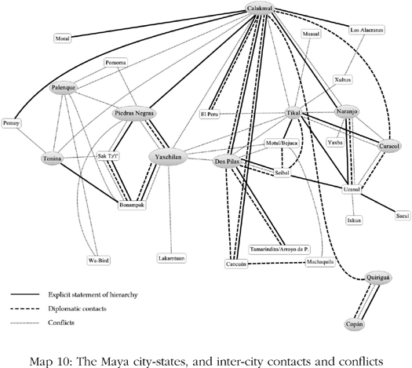
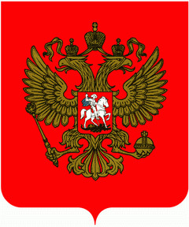
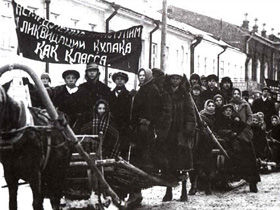
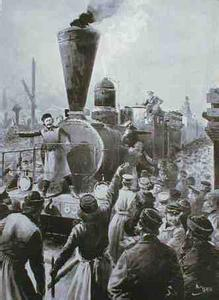
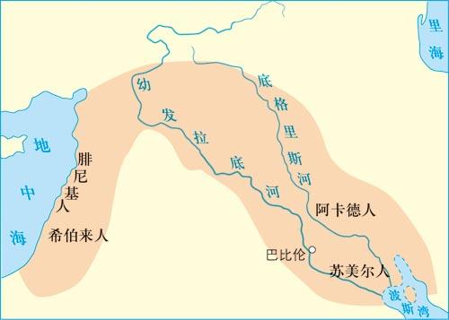
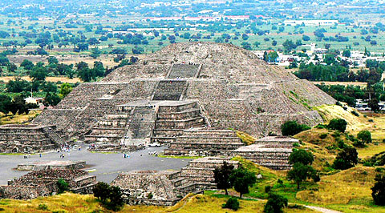
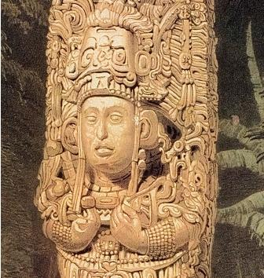
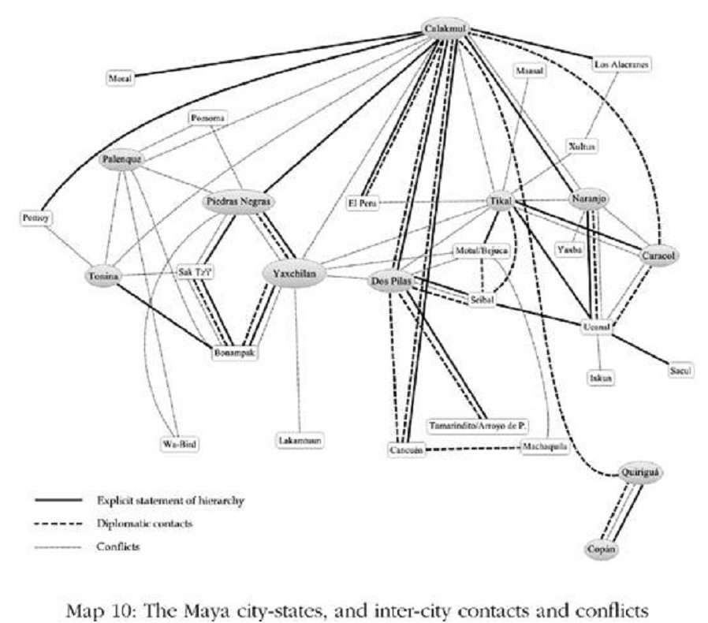

# “I’ve Seen The Future, And It Works”: Growth Under Extractive Institutions · 第5章　“我已见过未来，它行得通”：榨取式制度下的成长

## I’ve Seen The Future · 我已见过未来

Institutional differences play the critical role in explaining economic growth throughout the ages. But if most societies in history are based on extractive political and economic institutions, does this imply that growth never takes place? Obviously not. Extractive institutions, by their very logic, must create wealth so that it can be extracted. A ruler monopolizing political power and in control of a centralized state can introduce some degree of law and order and a system of rules, and stimulate economic activity.

> 制度差异在解释历史上各个时代的经济成长问题上扮演重要角色，但如果历史上大多数的社会都建基于榨取式的政治与经济制度，这是否表示成长从未发生？显然不是。榨取式制度从其根本逻辑来看，必须能创造财富以供榨取。独占政治权力并控制一个集权政府的统治者，可能实施某种程度的治安和规范制度，并刺激经济活动。

But growth under extractive institutions differs in nature from growth brought forth by inclusive institutions. Most important, it will be not sustained growth that requires technological change, but rather growth based on existing technologies. The economic trajectory of the Soviet Union provides a vivid illustration of how the authority and incentives provided by the state can spearhead rapid economic growth under extractive institutions and how this type of growth ultimately comes to an end and collapses.

> 但榨取式制度下的成长在性质上不同于广纳式制度带来的成长。最重要的，这种成长不会是需要科技进步的持续成长，而是建基于既有科技的成长。苏联的经济轨迹提供了鲜明例子，说明权威和政府提供的诱因可以在榨取式制度下带领经济成长，以及这种成长最终会停顿和崩溃。

THE FIRST WORLD WAR had ended and the victorious and the vanquished powers met in the great palace of Versailles, outside Paris, to decide on the parameters of the peace. Prominent among the attendees was Woodrow Wilson, president of the United States. Noticeable by its absence was any representation from Russia. The old tsarist regime had been overthrown by the Bolsheviks in October 1917. A civil war then raged between the Reds (the Bolsheviks) and the Whites. The English, French, and Americans sent an expeditionary force to fight against the Bolsheviks.

> 第一次世界大战结束后，战胜国和战败国在巴黎郊外雄伟的凡尔赛宫集会，以决定和平的秩序。出席的知名人物包括美国总统威尔逊，而值得注意的是俄国没有派出任何代表参加。旧沙皇政权已在1917年10月被布尔什维克推翻（似乎有误，布尔什维克推翻的是二月革命建立的克伦斯基临时政府，而沙皇政府则在二月革命时已经被推翻），红军（布尔什维克）和白军正进行激烈的内战。英国人、法国人和美国人派遣远征军与布尔什维克打仗。

A mission led by a young diplomat, William Bullitt, and the veteran intellectual and journalist Lincoln Steffens was sent to Moscow to meet with Lenin to try to understand the intentions of the Bolsheviks and how to come to terms with them. Steffens had made his name as an iconoclast, a muckraker journalist who had persistently denounced the evils of capitalism in the United States. He had been in Russia at the time of the revolution. His presence was intended to make the mission look credible and not too hostile. The mission returned with the outlines of an offer from Lenin about what it would take for peace with the newly created Soviet Union. Steffens was bowled over by what he saw as the great potential of the Soviet regime.

> 由年轻外交官蒲丽德带领的特使团和资历丰富的知识分子兼新闻记者斯蒂芬斯，被派往莫斯科回见列宁，尝试了解布尔什维克党的意图，以及如何与他们达成协议。斯蒂芬斯以破除偶像和揭发丑闻的新闻记者著称，长期以来在美国不断谴责资本主义的邪恶，他加入的用意在于让特使团显得更可信、较不具敌意。特使团回国时带着列宁的提议大纲，内容是新建立的苏联开出的和平条件。斯蒂芬斯对他认为苏联政权具有的无穷潜力大为倾倒。

“Soviet Russia,” he recalled in his 1931 autobiography, “was a revolutionary government with an evolutionary plan. Their plan was not to end evils such as poverty and riches, graft, privilege, tyranny, and war by direct action, but to seek out and remove their causes. They had set up a dictatorship, supported by a small, trained minority, to make and maintain for a few generations a scientific rearrangement of economic forces which would result in economic democracy first and political democracy last.”

> 他在1931年的自传中回忆：“俄罗斯苏维埃是一个有着渐进演变计划的革命政府。他们的计划不是借由直接行动来终结贫穷与富裕、贪腐、特权、暴政和战争等邪恶事物，而是找出并去除它们的原因。他们建立一个独裁政权，在几个世代中以科学方式重新安排经济力，这将先带来经济的民主，最后则达成政治的民主。”

When Steffens returned from his diplomatic mission he went to see his old friend the sculptor Jo Davidson and found him making a portrait bust of the wealthy financier Bernard Baruch. “So you’ve been over in Russia,” Baruch remarked. Steffens answered, “I have been over into the future, and it works.” He would perfect this adage into a form that went down in history: “I’ve seen the future, and it works.”

> 斯蒂芬斯从外交特使团回来后，去见老友雕刻家戴维森，发现他正在为金融巨子巴鲁克制作半神像。巴鲁克说：“你刚从俄国回来。”斯蒂芬斯回答：“我已到过未来，而且它行得通。”后来他稍微修改了这句话，就此流传后世：“我已见过未来，它行得通。”（I’ve seen the future，and it works.）

Right up until the early 1980s, many Westerners were still seeing the future in the Soviet Union, and they kept on believing that it was working. In a sense it was, or at least it did for a time. Lenin had died in 1924, and by 1927 Joseph Stalin had consolidated his grip on the country. He purged his opponents and launched a drive to rapidly industrialize the country. He did it via energizing the State Planning Committee, Gosplan, which had been founded in 1921.

> 一直到1980年代初期，许多西方人仍然在苏联身上看到未来，他们继续相信那套制度行得通。就某个意义来看它是行得通，至少在一段时间内行得通。列宁在1924年去世，到1927年斯大林已巩固他对苏联的掌控。他肃清反对者，并推行快速将苏联现代化的运动。他通过1921年成立的国家计划委员会来进行这项运动。

Gosplan wrote the first Five-Year Plan, which ran between 1928 and 1933. Economic growth Stalin style was simple: develop industry by government command and obtain the necessary resources for this by taxing agriculture at very high rates. The communist state did not have an effective tax system, so instead Stalin “collectivized” agriculture. This process entailed the abolition of private property rights to land and the herding of all people in the countryside into giant collective farms run by the Communist Party.

> 国家计划委员会拟定第一套五年计划，从1928年执行到1933年。斯大林式的经济成长很单纯：借政府命令发展工业，并通过向农业课征高税率来为发展工业取得必要的资源。苏联共产党政府缺乏有效的税务系统，因此斯大林便将农业”集体化“。这个过程必须废除土地私有权，并将农村所有人聚集在由共产党管理的巨大集体农场。

This made it much easier for Stalin to grab agricultural output and use it to feed all the people who were building and manning the new factories. The consequences of this for the rural folk were calamitous. The collective farms completely lacked incentives for people to work hard, so production fell sharply. So much of what was produced was extracted that there was not enough to eat. People began to starve to death. In the end, probably six million people died of famine, while hundreds of thousands of others were murdered or banished to Siberia during the forcible collectivization.

> 这让斯大林更容易攫取农业产品，用来喂养所有兴建新工厂以及在工厂工作的人。这为农民带来悲惨的后果。集体农场完全缺乏让人努力工作的诱因，导致生产大幅减少。大部分产品被榨取后，留下的粮食已不够吃，人民开始饥饿至死。到最后可能有六百万人死于饥馑，数十万人在强迫集体化中遭谋杀或放逐到西伯利亚。

Neither the newly created industry nor the collectivized farms were economically efficient in the sense that they made the best use of what resources the Soviet Union possessed. It sounds like a recipe for economic disaster and stagnation, if not outright collapse. But the Soviet Union grew rapidly. The reason for this is not difficult to understand. Allowing people to make their own decisions via markets is the best way for a society to efficiently use its resources. When the state or a narrow elite controls all these resources instead, neither the right incentives will be created nor will there be an efficient allocation of the skills and talents of people.

> 新建立的工业和集体化的农场都不具经济效率，无法善加利用苏联拥有的资源。这听起来是炮制经济灾难或停滞的配方，甚至是完全崩溃；然而苏联却快速成长，其原因并不难了解。允许人们通过市场自己做决定，是让社会有效利用资源最好的方法，当政府或一小群菁英控制所有资源时，将无法创造出正确的诱因，人们的技术和才能也无法获得有效的配置。

But in some instances the productivity of labor and capital may be so much higher in one sector or activity, such as heavy industry in the Soviet Union, that even a top-down process under extractive institutions that allocates resources toward that sector can generate growth. As we saw in chapter 3, extractive institutions in Caribbean islands such as Barbados, Cuba, Haiti, and Jamaica could generate relatively high levels of incomes because they allocated resources to the production of sugar, a commodity coveted worldwide. The production of sugar based on gangs of slaves was certainly not “efficient,” and there was no technological change or creative destruction in these societies, but this did not prevent them from achieving some amount of growth under extractive institutions.

> 但在某些例子中，一个部门或活动的劳动与资本生产力可能远高于其他部门和活动，例如苏联的重工业，因此即使是在榨取式制度下，通过自上而下的过程把资源分配给那个部门，也可以创造成长。正如我们在第三章讨论过，加勒比海群岛的榨取式制度如巴巴多斯、古巴、海地和牙买加也能创造相对较高的收益，因为它们把资源分配给全球迫切需要的商品蔗糖的生产。以众多奴隶为基础的蔗糖生产当然称不上”效率“，而且在这几个社会当中没有科技变革或创造性破坏，但这不会阻止它们在榨取式制度下达成一定程度的增长。

The situation was similar in the Soviet Union, with industry playing the role of sugar in the Caribbean. Industrial growth in the Soviet Union was further facilitated because its technology was so backward relative to what was available in Europe and the United States, so large gains could be reaped by reallocating resources to the industrial sector, even if all this was done inefficiently and by force. Before 1928 most Russians lived in the countryside. The technology used by peasants was primitive, and there were few incentives to be productive. Indeed, the last vestiges of Russian feudalism were eradicated only shortly before the First World War. There was thus huge unrealized economic potential from reallocating this labor from agriculture to industry.

> 这种情况类似苏联，只是工业取代了加勒比海蔗糖的角色。还受到另一个因素助长了苏联的工业成长，由于其科技极度落后于当年欧洲和美国的水平，因此只要重新分配资源到工业部门就能刺激大幅成长，即使分配是以强迫的低效率方式运行。1928年以前，大部分俄国人住在乡下，农民使用的技术十分原始，而且没有提高生产的诱因。俄国封建制度最后的残留在一战前不久就已经根除，因此把劳动力从农业重新配置到工业有着庞大的未实现的经济潜力。

Stalinist industrialization was one brutal way of unlocking this potential. By fiat, Stalin moved these very poorly used resources into industry, where they could be employed more productively, even if industry itself was very inefficiently organized relative to what could have been achieved. In fact, between 1928 and 1960 national income grew at 6 percent a year, probably the most rapid spurt of economic growth in history up until then. This quick economic growth was not created by technological change, but by reallocating labor and by capital accumulation through the creation of new tools and factories.

> 斯大林的工业化以残暴的方式释放了这股潜力，他通过命令将这些低度利用的资源转移到工业，以便他们在那里发挥更大的生产力，即使工业本身的效率仍远低于可达成的水平。事实上，从1928年到1960年间，苏联的国民收入每年增长6%，可能是截至当时历史上的最快速的经济成长。这段快速的经济成长并非借由科技进步而达成，而是借由重新配置劳动力，以及通过创造新工具与工厂而积累资本的结果。

Growth was so rapid that it took in generations of Westerners, not just Lincoln Steffens. It took in the Central Intelligence Agency of the United States. It even took in the Soviet Union’s own leaders, such as Nikita Khrushchev, who famously boasted in a speech to Western diplomats in 1956 that “we will bury you [the West].” As late as 1977, a leading academic textbook by an English economist argued that Soviet-style economies were superior to capitalist ones in terms of economic growth, providing full employment and price stability and even in producing people with altruistic motivation.

> 成长如此快速，以至于数代的西方人受到欺骗。不只是史蒂芬斯，连美国中央情报局也不明就里，甚至苏联自己的领导人也被快速的成长蒙骗，例如赫鲁晓夫曾在1956年对西方外交官的演说中，吹嘘地说出那句名言：”我们将埋葬你们。”直到1977年，英国经济学家写的主流教科书还宣称，从经济成长、提供充分就业与价格稳定，甚至在创造人的利他动机各方面来看，苏联式的经济都比资本主义优越。

Poor old Western capitalism did better only at providing political freedom. Indeed, the most widely used university textbook in economics, written by Nobel Prize–winner Paul Samuelson, repeatedly predicted the coming economic dominance of the Soviet Union. In the 1961 edition, Samuelson predicted that Soviet national income would overtake that of the United States possibly by 1984, but probably by 1997. In the 1980 edition there was little change in the analysis, though the two dates were delayed to 2002 and 2012.

> 可怜的西方资本主义只在提供政治自由方面表现较佳。由诺贝尔奖获得者萨缪尔森写作、最被广泛使用的经济学大学教科书，也再三预测苏联经济霸权的到来。在1961年版的书中，萨缪尔森预测苏联的国民收入有可能在1984年超越美国，或很可能在1997年。1980年版中，他的分析仍旧没有改变，只是把两个时间延后到2002年和2012年。

Though the policies of Stalin and subsequent Soviet leaders could produce rapid economic growth, they could not do so in a sustained way. By the 1970s, economic growth had all but stopped. The most important lesson is that extractive institutions cannot generate sustained technological change for two reasons: the lack of economic incentives and resistance by the elites. In addition, once all the very inefficiently used resources had been reallocated to industry, there were few economic gains to be had by fiat.

> 虽然斯大林和后来其他苏联领导人的政策制造出快速的经济成长，但这种成长却无法长久持续。到1970年代，经济成长几乎完全停顿。最重要的教训是，榨取式制度基于两个原因而无法制造持续的科技进步：缺乏经济诱因，和菁英的抗拒。此外，一旦所有低效率使用的资源都被重新配置到工业后，靠命令所能创造的经济成果便很有限。

Then the Soviet system hit a roadblock, with lack of innovation and poor economic incentives preventing any further progress. The only area in which the Soviets did manage to sustain some innovation was through enormous efforts in military and aerospace technology. As a result they managed to put the first dog, Leika, and the first man, Yuri Gagarin, in space. They also left the world the AK-47 as one of their legacies.

> 这时候苏联的系统便撞上障碍，因为缺乏创新和经济诱因导致无法继续进步。苏联能够持续创新的唯一领域是，投入庞大努力的军事和航天科技。其结果是他们把第一只狗莱卡，和第一个人类加加林送上太空。他们也把AK-47步枪留给世人。

Gosplan was the supposedly all-powerful planning agency in charge of the central planning of the Soviet economy. One of the benefits of the sequence of five-year plans written and administered by Gosplan was supposed to have been the long time horizon necessary for rational investment and innovation. In reality, what got implemented in Soviet industry had little to do with the five-year plans, which were frequently revised and rewritten or simply ignored.

> 国家计划委员会原本应该是掌握一切权力的规划机构，负责苏联经济的中央计划。由国家计划委员会连续拟定并执行五年计划的优点是，可以采取理性投资和创新所不可或缺的长期观点。然而在现实中，苏联工业的实际作为却与五年计划没有多大关系，因为五年计划经常修改和重写，或者完全被忽略。

The development of industry took place on the basis of commands by Stalin and the Politburo, who changed their minds frequently and often completely revised their previous decisions. All plans were labeled “draft” or “preliminary.” Only one copy of a plan labeled “final”—that for light industry in 1939—has ever come to light. Stalin himself said in 1937 that “only bureaucrats can think that planning work ends with the creation of the plan. The creation of the plan is just the beginning. The real direction of the plan develops only after the putting together of the plan.”

> 工业的发展基本上斯大林和政治局的命令进行，而他们经常改变想法，且往往全面修改先前的决定。所有计划都标示为“草稿”或“初步”。只有一份标示为“定案”的计划曾公诸于世——1939年有关轻工业的计划。斯大林本人在1937年曾说：“只有官僚会认为，规划的工作在计划拟出后就已结束。计划真正的方向只有在计划拟出后才开始发展。”

Stalin wanted to maximize his discretion to reward people or groups who were politically loyal, and punish those who were not. As for Gosplan, its main role was to provide Stalin with information so he could better monitor his friends and enemies. It actually tried to avoid making decisions. If you made a decision that turned out badly, you might get shot. Better to avoid all responsibility.

> 斯大林希望把自己的裁量权最大化，以便奖赏政治上忠诚的个人或团体，或惩罚不忠诚者。至于国家计划委员会的主要角色是提供信息给斯大林，以便他更能监视他的朋友和敌人。委员会甚至尝试避免做决定，因为如果做出结果不好的决定，你可能遭枪毙；能不必负任何责任最好。

An example of what could happen if you took your job too seriously, rather than successfully second-guessing what the Communist Party wanted, is provided by the Soviet census of 1937. As the returns came in, it became clear that they would show a population of about 162 million, far less than the 180 million Stalin had anticipated and indeed below the figure of 168 million that Stalin himself announced in 1934. The 1937 census was the first conducted since 1926, and therefore the first one that followed the mass famines and purges of the early 1930s.

> 苏联人口普查局在1937年提供了一个好例子，说明太认真工作、而不懂得揣摩共产党领导人心思的后果。当调查的资料陆续汇集后，很明显它们呈现的人口大约是一亿六千二百万人，远低于斯大林预期的一亿八千万人，而且低于斯大林本人在1934年宣布的一亿六千八百万人。1937年的人口普查是1926年以来首次进行的普查，因此也是1930年代大规模饥荒和肃清后的第一次。

The accurate population numbers reflected this. Stalin’s response was to have those who organized the census arrested and sent to Siberia or shot. He ordered another census, which took place in 1939. This time the organizers got it right; they found that the population was actually 171 million.

> 正确的人口数字反映出这些事件。斯大林的反应是逮捕进行人口普查的官员，将他们放逐到西伯利亚或枪毙。他下令重做一次人口普查，并在1939年进行。这一次主持普查的人搞清楚了，他们发现人口实际上有一亿七千一百万人。

Stalin understood that in the Soviet economy, people had few incentives to work hard. A natural response would have been to introduce such incentives, and sometimes he did—for example, by directing food supplies to areas where productivity had fallen—to reward improvements. Moreover, as early as 1931 he gave up on the idea of creating “socialist men and women” who would work without monetary incentives. In a famous speech he criticized “equality mongering,” and thereafter not only did different jobs get paid different wages but also a bonus system was introduced.

> 斯大林了解，在苏联经济中人们缺乏努力工作的诱因。最自然的反应是引进这种诱因，而且斯大林有时候也确实这么做——例如借引导粮食供应到生产力下降的地区——以奖赏改善的绩效。此外，早在1931年他就已放弃创造不需要金钱诱因就愿意工作的“社会主义男女”的想法。他在著名的演说中批评“平等贩子”，此后不但不同的工作领到不同的薪资，而且开始采用红利制度。

It is instructive to understand how this worked. Typically a firm under central planning had to meet an output target set under the plan, though such plans were often renegotiated and changed. From the 1930s, workers were paid bonuses if the output levels were attained. These could be quite high—for instance, as much as 37 percent of the wage for management or senior engineers. But paying such bonuses created all sorts of disincentives to technological change.

> 了解这个制度运作的方式将很有帮助。在中央计划下的公司通常必须达成计划设定的生产目标，虽然这类计划常常重新协商并修改目标。从1930年代起，如果达成生产目标，工人就能获得红利，而且红利可能不少——例如，经理人或资深工程师领到的红利高达本薪的37%。但支付这类红利却制造出各种不利于科技进步的反诱因。

For one thing, innovation, which took resources away from current production, risked the output targets not being met and the bonuses not being paid. For another, output targets were usually based on previous production levels. This created a huge incentive never to expand output, since this only meant having to produce more in the future, since future targets would be “ratcheted up.” Underachievement was always the best way to meet targets and get the bonus. The fact that bonuses were paid monthly also kept everyone focused on the present, while innovation is about making sacrifices today in order to have more tomorrow.

> 例如，创新会耗用当期生产的资源，带来生产目标无法达成和领不到红利的风险。此外，生产目标常根据前期的生产水平来制订，这导致不扩大生产的强烈诱因，因为扩大生产只表示未来必须生产更多，未来的目标会“逐步提高”。表现低于潜力永远是达成目标和拿到红利最好的方法。每月支付红利使每个人只顾及现在，而创新却是牺牲今日以便明日获得更多。

Even when bonuses and incentives were effective in changing behavior, they often created other problems. Central planning was just not good at replacing what the great eighteenth-century economist Adam Smith called the “invisible hand” of the market. When the plan was formulated in tons of steel sheet, the sheet was made too heavy. When it was formulated in terms of area of steel sheet, the sheet was made too thin. When the plan for chandeliers was made in tons, they were so heavy, they could hardly hang from ceilings.

> 即使红利和诱因有效改变了行为，它们往往也制造出其他问题。中央计划就是难以取代18世纪伟大经济学家亚当•斯密所称的市场那只“看不见的手”。当计划是规定生产以吨计算的钢板时，制造出来的钢板便太重；当规定是以面积计算时，制造出的钢板便太薄。当计划规定吊灯以吨计算时，生产出来的吊灯便太重，重到无法吊在天花板上。

By the 1940s, the leaders of the Soviet Union, even if not their admirers in the West, were well aware of these perverse incentives. The Soviet leaders acted as if they were due to technical problems, which could be fixed. For example, they moved away from paying bonuses based on output targets to allowing firms to set aside portions of profits to pay bonuses. But a “profit motive” was no more encouraging to innovation than one based on output targets.

> 到1940年代，苏联领导人已经很了解这些错误的诱因（即使那些西方的仰慕者还被蒙在鼓里）。苏联领导人的做法是把它们当成技术问题，是可以修正的，例如，他们改变了根据生产目标支付红利的做法，转而允许公司挪出一部分获利来支付红利。但“获利动机”不见得比生产目标更能鼓舞创新。

The system of prices used to calculate profits was almost completely unconnected to the value of new innovations or technology. Unlike in a market economy, prices in the Soviet Union were set by the government, and thus bore little relation to value. To more specifically create incentives for innovation, the Soviet Union introduced explicit innovation bonuses in 1946. As early as 1918, the principle had been recognized that an innovator should receive monetary rewards for his innovation, but the rewards set were small and unrelated to the value of the new technology.

> 用来计算获利的价格制度几乎完全与创新或新科技的价值无关。不像在市场经济，苏联的价格是由政府设定，因此与价值没有太大关系。为了具体地为创新制造诱因，苏联在1946年引进明订的创新红利。最早在1918年，创新者应为他的创新接受财物奖赏的原则就已受到认可，但设定的奖赏太小，且与新科技的价值无关。

This changed only in 1956, when it was stipulated that the bonus should be proportional to the productivity of the innovation. However, since productivity was calculated in terms of economic benefits measured using the existing system of prices, this was again not much of an incentive to innovate. One could fill many pages with examples of the perverse incentives these schemes generated. For example, because the size of the innovation bonus fund was limited by the wage bill of a firm, this immediately reduced the incentive to produce or adopt any innovation that might have economized on labor.

> 一直到1956年，这种情况才改变，变成以明文规定红利与创新的生产力成比例。不过，由于生产力是用既有的价格制度来计算其经济利益，这又变成不良的创新诱因。我们可以找到无数这套制度制造出错误诱因的例子，举例来说，由于创新红利受限于一家公司的薪资预算，这立即降低了产生或采用任何可能会减少劳动力的创新。

Focusing on the different rules and bonus schemes tends to mask the inherent problems of the system. As long as political authority and power rested with the Communist Party, it was impossible to fundamentally change the basic incentives that people faced, bonuses or no bonuses. Since its inception, the Communist Party had used not just carrots but also sticks, big sticks, to get its way. Productivity in the economy was no different. A whole set of laws created criminal offenses for workers who were perceived to be shirking.

> 只专注在不同的规范和红利制度，很容易掩盖制度的根本问题。只要政治权威和权力全掌握在共产党手里，就不可能从根本上改变人们面对的基本诱因，无论支不支付红利都一样。共产党从创立以来就不只使用胡萝卜、也使用棒子来达成目的，而且是大棒子。经济中的生产力也相同。对被认为偷懒的工人有一整套诉诸刑法追究的法律。

In June 1940, for example, a law made absenteeism, defined as any twenty minutes unauthorized absence or even idling on the job, a criminal offense that could be punished by six months’ hard labor and a 25 percent cut in pay. All sorts of similar punishments were introduced, and were implemented with astonishing frequency. Between 1940 and 1955, 36 million people, about one-third of the adult population, were found guilty of such offenses. Of these, 15 million were sent to prison and 250,000 were shot.

> 例如，在1940年6月，一项法律把旷职（定义是只要有二十分钟未授权的缺席，或甚至只是在职位上的怠工）订为刑事犯罪，可能被判处六个月苦役或减薪25%的处罚。各种类似的惩罚纷纷祭出，且执法的次数出奇频繁。从1940年到1955年，有三千六百万人触犯这类法律被判有罪，约占成年人口数的三分之一。其中有一千五百万人被送进监牢，有二十五万人被枪决。

In any year, there would be 1 million adults in prison for labor violations; this is not to mention the 2.5 million people Stalin exiled to the gulags of Siberia. Still, it didn’t work. Though you can move someone to a factory, you cannot force people to think and have good ideas by threatening to shoot them. Coercion like this might have generated a high output of sugar in Barbados or Jamaica, but it could not compensate for the lack of incentives in a modern industrial economy.

> 在任何一年都有一百万名成年人因触犯劳动法规而被监禁；这还不包括被斯大林放逐到西伯利亚劳改营的二百五十万人。尽管如此，这样还是不管用。你可以把人送进工厂里，但你无法强迫人思考，也无法借威胁要枪毙他们来让他们想出好点子。这类胁迫可能在巴巴多斯牙买加制造很高的蔗糖生产，但它无法解决在现代工业经济中缺少诱因的问题。

The fact that truly effective incentives could not be introduced in the centrally planned economy was not due to technical mistakes in the design of the bonus schemes. It was intrinsic to the whole method by which extractive growth had been achieved. It had been done by government command, which could solve some basic economic problems. But stimulating sustained economic growth required that individuals use their talent and ideas, and this could never be done with a Soviet-style economic system. The rulers of the Soviet Union would have had to abandon extractive economic institutions, but such a move would have jeopardized their political power.

> 真正有效的诱因无法出现在中央计划经济中，这不是因为红利制度设计上的技术错误，而是达成榨取式成长的整个方法本来就存在问题。这种成长靠政府命令达成，虽然可以解决一些基本经济问题，但刺激长久持续的经济成长需要个人利用他们的才能和创意，而这在苏联式的经济制度中不可能办到。苏联的统治者必须放弃榨取式经济制度才能办到，但这么做将危及他们的政治权力。

Indeed, when Mikhail Gorbachev started to move away from extractive economic institutions after 1987, the power of the Communist Party crumbled, and with it, the Soviet Union. THE SOVIET UNION was able to generate rapid growth even under extractive institutions because the Bolsheviks built a powerful centralized state and used it to allocate resources toward industry. But as in all instances of growth under extractive institutions, this experience did not feature technological change and was not sustained. Growth first slowed down and then totally collapsed.

> 的确，当戈尔巴乔夫在1987年后开始放弃榨取式经济制度时，共产党的权力随即瓦解，苏联也跟着崩溃。苏联在榨取式制度下还能够创造快速的成长，是因为布尔什维克建立了一个强而有力的政治集权政府，并通过政府的力量把资源分配给工业。但和所有榨取式制度下的成长例子一样，这种经济缺乏科技变革，而且无法长久持续。成长先是缓慢下来，然后完全崩溃。

Though ephemeral, this type of growth still illustrates how extractive institutions can stimulate economic activity. Throughout history most societies have been ruled by extractive institutions, and those that have managed to impose some extent of order over the countries have been able to generate some limited growth—even if none of these extractive societies have managed to achieve sustained growth. In fact, some of the major turning points in history are characterized by institutional innovations that cemented extractive institutions and increased the authority of one group to impose law and order and benefit from extraction.

> 这种类型的成长虽然为时短暂，依旧证明了榨取式制度可以刺激经济活动。自有历史以来，大多数社会都曾被榨取式制度统治，而能在全国执行某种程度的秩序的社会，就能创造有限的成长——即使这些榨取式社会都未能达成成就持续的成长。事实上，历史上一些重大的转折点都曾出现巩固榨取式制度的制度创新，并增进一个群体维持治安的权威，进而从榨取中获益。

In the rest of this chapter, we will first discuss the nature of institutional innovations that establish some degree of state centralization and enable growth under extractive institutions. We shall then show how these ideas help us understand the Neolithic Revolution, the momentous transition to agriculture, which underpins many aspects of our current civilization. We will conclude by illustrating, with the example of the Maya city-states, how growth under extractive institutions is limited not only because of lack of technological progress but also because it will encourage infighting from rival groups wishing to take control of the state and the extraction it generates.

> 在本章接下来的部分，我们会先讨论建立某种程度的政府集权、并促成在榨取式制度下成长的制度创新。然后我们将说明这些创新如何帮助我们了解新石器革命，亦即人类进入农业社会的重大转折，而农业则是我们当前文明许多方面的基础。我们将举玛雅的城邦为例，证明榨取式制度下的成长不只受限于缺少科技进步，也因为它会鼓励敌对的群体为了掌控政府和榨取来的利益而发生内斗。

## On The Banks Of The Kasai · 卡塞河河岸

One of the great tributaries of the River Congo is the Kasai. Rising in Angola, it heads north and merges with the Congo northeast of Kinshasa, the capital of the modern Democratic Republic of Congo. Though the Democratic Republic of Congo is poor compared with the rest of the world, there have always been significant differences in the prosperity of various groups within Congo. The Kasai is the boundary between two of these. Soon after passing into Congo along the western bank, you’ll find the Lele people; on the eastern bank are the Bushong (Map 6, this page).

> 卡塞河是刚果河的大支流之一，它源自安哥拉，流向北方，在刚果民主共和国首都金沙萨东北汇入刚果河。虽然刚果民主共和国比世界其他地方穷，但刚果内部不同群体的贫富程度一直差距很大。卡塞河是贫富的分界，渡过卡塞河进入西岸的刚果，你会发现利利人；在东岸则是布尚人（参考地图6）。

On the face of it there ought to be few differences between these two groups with regard to their prosperity. They are separated only by a river, which either can cross by boat. The two different tribes have a common origin and related languages. In addition, many of the things they build are similar in style, including their houses, clothes, and crafts.

> 表面上两个族群的贫富程度应该没有多大差距，他们中间只有一条河分隔，可以搭船渡过。两个不同部族有共同的起源和相关的语言。此外，他们制造的东西的风格也很类似，包括他们的房子、衣服和工艺品。

Yet when the anthropologist Mary Douglas and the historian Jan Vansina studied these groups in the 1950s, they discovered some startling differences between them. As Douglas put it: “The Lele are poor, while the Bushong are rich … Everything that the Lele have or can do, the Bushong have more and can do better.” Simple explanations for this inequality are easy to come by.

> 然而人类学家玛丽•道格拉斯和历史学家万塞纳在1950年代研究这些部族时，发现他们存在一些惊人的差异。道格拉斯指出：“利利人较贫穷，布尚人较富裕……利利人拥有或能做的事，布尚人拥有更多且做得更好。”这种不平等很容易得出简单的解释。

One difference, reminiscent of that between places in Peru that were or were not subject to the Potosí mita, is that the Lele produced for subsistence while the Bushong produced for exchange in the market. Douglas and Vansina also noted that the Lele used inferior technology. For instance, they did not use nets for hunting, even though these greatly improve productivity. Douglas argued, “[T]he absence of nets is consistent with a general Lele tendency not to invest time and labor in long-term equipment.”

> 其中一个差异令人想起秘鲁当年被划入和未划入波托西米塔区的不同，即利利人为了维持生存而生产，而布尚人为了在市场交易而生产。道格拉斯和万塞纳也指出，利利人使用较差的技术，例如，他们不用网子打猎，虽然那可以大幅提高生产力。道格拉斯认为：“不使用符合一般利利人不投资时间和劳力在长期设备的倾向。”

There were also important distinctions in agricultural technologies and organization. The Bushong practiced a sophisticated form of mixed farming where five crops were planted in succession in a two-year system of rotation. They grew yams, sweet potatoes, manioc (cassava), and beans and gathered two and sometimes three maize harvests a year. The Lele had no such system and managed to reap only one annual harvest of maize.

> 两个族群在农业技术和组织方面也有重大差异。布尚人采用复杂的混耕，在为期两年的轮种制度下连续种植五种作物。他们种植山药、地瓜、木薯（树薯）和豆子，并且一年采收两到三次玉米。利利人没有这种制度，而且一年只采收一次玉米。

There were also striking differences in law and order. The Lele were dispersed into fortified villages, which were constantly in conflict. Anyone traveling between two or even venturing into the forest to collect food was liable to be attacked or kidnapped. In the Bushong country, this rarely, if ever, happened.

> 在治安方面也有显著的差异，利利人散居在有防御工事的村落，冲突经常发生。任何人在两个村落间行走，或进入森林采集食物，都可能遭攻击或绑架。在布尚人的国度，这种事绝少发生。

What lay behind these differences in the patterns of production, agricultural technology, and prevalence of order? Obviously it was not geography that induced the Lele to use inferior hunting and agricultural technology. It was certainly not ignorance, because they knew about the tools used by the Bushong. An alternative explanation might be culture; could it be that the Lele had a culture that did not encourage them to invest in hunting nets and sturdier and better-built houses?

> 在生产模式、农业技术和法律规范的各种差异背后，是什么因素？显然不是地理环境导致利利人使用较低劣的狩猎和农业技术，更不可能是无知，因为他们知道布尚人使用的工具。另一种解释可能是文化：利利人可不可能有一种不鼓励他们投资在狩猎网、更坚固和更好的房子的文化？

But this does not seem to have been true, either. As with the people of Kongo, the Lele were very interested in purchasing guns, and Douglas even remarked that “their eager purchase of firearms … shows their culture does not restrict them to inferior techniques when these do not require long-term collaboration and effort.” So neither a cultural aversion to technology nor ignorance nor geography does a good job of explaining the greater prosperity of the Bushong relative to the Lele.

> 但事实似乎也不是如此。和刚果人一样，利利人对购买枪支很感兴趣，道格拉斯甚至评注说：“他们渴望购买武器……显示他们的文化并不限制他们只能用较差的、不要求长期协力与努力的科技。”因此，厌恶科技的文化、无知或地理因素，都无法解释为什么布尚人比利利人富裕。

The reason for differences between these two peoples lies in the different political institutions that emerged in the lands of the Bushong and the Lele. We noted earlier that the Lele lived in fortified villages that were not part of a unified political structure. It was different on the other side of the Kasai. Around 1620 a political revolution took place led by a man called Shyaam, who forged the Kuba Kingdom, which we saw on Map 6, with the Bushong at its heart and with himself as king.

> 这两个族群的差异，源自布尚人和利利人的土地上出现不同的政治制度。我们前面提到利利人住在有防御工事的村落，而且村落不属于一个统一的政治结构。在卡塞河的另一方情况却不同。大约在1620年，一个名叫夏姆的人领导了一场政治革命，并建立了我们在地图6看到的库巴王国。这个王国以布尚人的地区为中心，由夏姆担任国王。

Prior to this period, there were probably few differences between the Bushong and the Lele; the differences emerged as a consequence of the way Shyaam reorganized society to the east of the river. He built a state and a pyramid of political institutions. These were not just significantly more centralized than what came before but also involved highly elaborate structures. Shyaam and his successors created a bureaucracy to raise taxes and a legal system and police force to administer the law.

> 在这之前，布尚人和利利人之间可能没有多大差异；差异的发生是夏姆在河的东边组织社会的结果。他建立政府和金字塔式的政治制度，不仅集权程度远高于过去，而且政治结构也远为精细。夏姆和他的继任者建立一套课税的官僚系统和法律制度，以及用来执法的警力。

Leaders were checked by councils, which they had to consult with before making decisions. There was even trial by jury, an apparently unique event in sub-Saharan Africa prior to European colonialism. Nevertheless, the centralized state that Shyaam constructed was a tool of extraction and highly absolutist. Nobody voted for him, and state policy was dictated from the top, not by popular participation.

> 领导人受议会节制，他们必须咨询议会才能做出决定。甚至有陪审团来进行审判，这发生在欧洲殖民之前的下撒哈拉非洲，显然是很独特的事件。尽管如此，夏姆建立的集权政府是用来榨取的工具，而且极为专制。他担任国王不需要任何人投票，国家政策由最高领导人指挥，而非通过全民参与。

This political revolution introducing state centralization and law and order in the Kuba country in turn led to an economic revolution. Agriculture was reorganized and new technologies were adopted to increase productivity. The crops that had previously been the staples were replaced by new, higher-yield ones from the Americas (in particular, maize, cassava, and chili peppers). The intense mixed-farming cycle was introduced at this time, and the amount of food produced per capita doubled.

> 这场政治革命为库巴王国引进政府集权和治安，进而带来经济革命。他们重新组织农业，采用新科技以增进生产力。过去当成主食的作物被美洲来的高产量新作物取代（尤其是玉米、树薯和红辣椒）。密集混耕循环在这时候引进，人均粮食产量因而倍增。

To adopt these crops and reorganize the agricultural cycle, more hands were needed in the fields. So the age of marriage was lowered to twenty, which brought men into the agricultural labor force at a younger age. The contrast with the Lele is stark. Their men tended to marry at thirty-five and only then worked in the fields. Until then, they dedicated their lives to fighting and raiding.

> 要采用这些作物并重新安排农事周期，需要更多人在地里工作。因此结婚的年龄降低到二十岁，让男人在更年轻的时候就加入农业的劳动力。这与利利人的情况呈现鲜明的对比，利利人男性往往三十五岁才结婚，且只有在结婚后才在田里工作。在这之前，他们的生活主要是打斗和劫掠。

The connection between the political and economic revolution was simple. King Shyaam and those who supported him wanted to extract taxes and wealth from the Kuba, who had to produce a surplus above what they consumed themselves. While Shyaam and his men did not introduce inclusive institutions to the eastern bank of the Kasai, some amount of economic prosperity is intrinsic to extractive institutions that achieve some degree of state centralization and impose law and order. Encouraging economic activity was of course in the interest of Shyaam and his men, as otherwise there would have been nothing to extract. Just like Stalin, Shyaam created by command a set of institutions that would generate the wealth necessary to support this system.

> 政治与经济革命的关联很单纯，夏姆国王和支持他的人想向库巴人征税和榨取财富，库巴人的生产必须比他们自己消耗的更多。夏姆和他的手下虽然未把广纳式制度引进卡塞河东岸，但能达成某种程度的政府集权和维持治安的榨取式制度，本身就能创造若干数量的经济财富。鼓励经济活动当然符合夏姆和他手下的利益，因为若非如此就没有东西可供榨取。和斯大林一样，夏姆借命令建立一套制度，这套制度能创造必要的财富以支持这个制度。

Compared to the utter absence of law and order that reigned on the other bank of the Kasai, this generated significant economic prosperity—even if much of it was likely extracted by Shyaam and his elites. But it was necessarily limited. Just as in the Soviet Union, there was no creative destruction in the Kuba Kingdom and no technological innovation after this initial change. This situation was more or less unaltered by the time the kingdom was first encountered by Belgian colonial officials in the late nineteenth century.

> 与完全缺乏治安的卡塞河对岸相比，这套制度创造出显著的经济财富——即使大部可能遭夏姆和他的手下榨取。但这种富裕必定是有限度的。正如在苏联，库巴王国在初期的变革后就再也没有创造性破坏，也没有科技创新。当库巴王国在19世纪末首度遭遇比利时殖民官员时，这套制度大体上未曾经历大改变。

KING SHYAAM’S ACHIEVEMENT illustrates how some limited degree of economic success can be achieved through extractive institutions. Creating such growth requires a centralized state. To centralize the state, a political revolution is often necessary. Once Shyaam created this state, he could use its power to reorganize the economy and boost agricultural productivity, which he could then tax.

> 夏姆国王的成就说明，通过榨取式制度可以达成有限度的经济成功。创造这种成长需要政治集权政府，而建立集权政府往往需要政治革命。夏姆建立政府后，他可以利用权力重新组织经济和提振农业生产，然后才能征税。

Why was it that the Bushong, and not the Lele, had a political revolution? Couldn’t the Lele have had their own King Shyaam? What Shyaam accomplished was an institutional innovation not tied in any deterministic way to geography, culture, or ignorance. The Lele could have had such a revolution and similarly transformed their institutions, but they didn’t.

> 为什么是布尚人发生政治革命，而非利利人？利利人可能出现自己的夏姆国王吗？夏姆完成的是一个与地理、文化和无知等因素完全无关的制度创新。利利人也可能展开这种革命，并且同样导致他们制度的转变，但他们并没有。

Perhaps this is for reasons that we do not understand, because of our limited knowledge of their society today. Most likely it is because of the contingent nature of history. The same contingency was probably at work when some of the societies in the Middle East twelve thousand years ago embarked upon an even more radical set of institutional innovations leading to settled societies and then to the domestication of plants and animals, as we discuss next.

> 也许这是因为我们还不了解的原因，毕竟我们今日对他们的社会所知仍很有限。最可能的原因是历史的偶发性。当中东的一些社会在一万两千年前展开一场更激进的制度创新，导致定居的社会和对动植物的驯化，也可能同样是偶然性运作的结果，而这就是接下来我们要讨论的主题。

## The Long Summer · 漫漫长夏

About 15,000 BC, the Ice Age came to an end as the Earth’s climate warmed up. Evidence from the Greenland ice cores suggests that average temperatures rose by as much as fifteen degrees Celsius in a short span of time. This warming seems to have coincided with rapid increases in human populations as the global warming led to expanding animal populations and much greater availability of wild plants and foods.

> 约公元前一万五千年时，冰河时代结束，地球气候开始变暖。从格陵兰冰蕊得到的证据显示，平均气温在短短一段时间内就上升到摄氏15度。这种暖化似乎与人类人口快速增加同时发生，因为气温上升导致动物数量增加，以及野生植物和食物更容易取得。

This process was put into rapid reverse at about 14,000 BC, by a period of cooling known as the Younger Dryas, but after 9600 BC, global temperatures rose again, by seven degrees Celsius in less than a decade, and have since stayed high. Archaeologist Brian Fagan calls it the Long Summer. The warming-up of the climate was a huge critical juncture that formed the background to the Neolithic Revolution, where human societies made the transition to sedentary life, farming, and herding.

> 这个过程大约在公元前一万四千年急速反转，当时出现一段称为新仙女木（Younger Dryas）的冷却期，但在公元前九千六百年之后，全球气温再度上升，在不到十年间升高摄氏七度，此后便维持在相对的高温。考古学家费根称其为长夏（Long Summer）。气候变暖是构成新石器革命背景的一大关键时期，人类社会从此开始转型到定居生活、农耕和放牧。

This and the rest of subsequent human history have played out basking in this Long Summer. There is a fundamental difference between farming and herding and hunting-gathering. The former is based on the domestication of plant and animal species, with active intervention in their life cycles to change genetics to make those species more useful to humans. Domestication is a technological change that enables humans to produce a lot more food from the available plants and animals.

> 这个转变和后来的人类历史都在这个漫漫长夏中发展出来。农耕放牧和狩猎采集有着根本上的差异，前者建立在驯化动植物的基础上，以积极的手段干预这些物种的生命周期，根本基因以使它们对人类更有用。驯化是一种技术变革，使人类能够从可得的植物和动物生产出更多食物。

The domestication of maize, for example, began when humans gathered teosinte, the wild crop that was maize’s ancestor. Teosinte cobs are very small, barely a few centimeters long. They are dwarfed by a cob of modern maize. Yet gradually, by selecting the larger ears of teosinte, and plants whose ears did not break but stayed on the stalk to be harvested, humans created modern maize, a crop that provides far more nourishment from the same piece of land.

> 例如，玉米的驯化始于人类采集玉米的野生原型物种类蜀黍（teosinte）。类蜀黍的穗轴很小，只有几公分长，比现代玉米小得多。然而通过慢慢地拣选穗较大，且在成熟后穗不会爆开、而是留在穗梗上方便采集的类蜀黍，人类创造出现代玉米，这种作物可以从同一块土地供应更多营养。

The earliest evidence of farming, herding, and the domestication of plants and animals comes from the Middle East, in particular from the area known as the Hilly Flanks, which stretches from the south of modern-day Israel, up through Palestine and the west bank of the River Jordan, via Syria and into southeastern Turkey, northern Iraq, and western Iran. Around 9500 BC the first domestic plants, emmer and two-row barley, were found in Jericho on the west bank of the River Jordan in Palestine; and emmer, peas, and lentils, at Tell Aswad, farther north in Syria. Both were sites of the so-called Natufian culture and both supported large villages; the village of Jericho had a population of possibly five hundred people by this time.

> 最早的农耕、放牧和驯化动植物的证据来自中东，尤其是被称为侧翼丘陵区（Hilly Flanks）（似乎与肥沃新月地带重合，参见下图）的地区，即从今日以色列南部往北经过巴勒斯坦和约旦河西岸，经由叙利亚进入土耳其东南部、伊拉克北部和伊朗西部。大约在公元前九千五百年，第一批驯化植物二粒小麦（emmer）和二棱大麦（two-row barley）在耶利哥和巴勒斯坦的约旦河西岸被发现；二粒小麦、豌豆和扁豆也在更北边的叙利亚泰尔阿斯瓦德被发现。两个遗址都属于纳图夫文化（Natufian culture），都供应较大型的聚落；耶利哥聚落的人口在当时可能已达到五百人。

Why did the first farming villages happen here and not elsewhere? Why was it the Natufians, and not other peoples, who domesticated peas and lentils? Were they lucky and just happened to be living where there were many potential candidates for domestication? While this is true, many other people were living among these species, but they did not domesticate them. As we saw in chapter 2 in Maps 4 and 5, research by geneticists and archaeologists to pin down the distribution of the wild ancestors of modern domesticated animals and plants reveals that many of these ancestors were spread over very large areas, millions of square kilometers.

> 为什么第一批农耕聚落在这里出现，而不是在别的地方？为什么是纳图夫人驯化了豌豆和扁豆，而不是其他人？他们是不是很幸运碰巧住在有许多潜在可被驯化的植物物种的地方？虽然这是事实，但许多别的族群也住在有这些物种的地区，却并未驯化它们。正如我们在第二章的地图4与地图5所见，基因学家和考古学家针对现代已驯化动植物的野生原种分布的研究，发现许多这些原种散布在广大的地区，达几百万平方公里。

The wild ancestors of domesticated animal species were spread throughout Eurasia. Though the Hilly Flanks were particularly well endowed in terms of wild crop species, even they were very far from unique. It was not that the Natufians lived in an area uniquely endowed with wild species that made them special. It was that they were sedentary before they started domesticating plants or animals. One piece of evidence comes from gazelle teeth, which are composed of cementum, a bony connective tissue that grows in layers.

> 驯化动物的野生原种更遍布欧亚大陆。虽然丘侧翼地区在作物野生原种的种类上很丰富，但也完全称不上独特。纳图夫人并非住在一个野生原种丰富到独特程度的地区，而是他们在开始驯化植物或动物前就已经过着定居的生活。其中一项证据来自原羚（gazelle）的牙齿，由牙骨质构成，是一种分层生长的骨质结缔组织。

During the spring and summer, when cementum’s growth is most rapid, the layers are a different color from the layers that form in the winter. By taking a slice through a tooth you can see the color of the last layer created before the gazelle died. Using this technique, you can determine if the gazelle was killed in summer or winter. At Natufian sites, one finds gazelles killed in all seasons, suggesting year-round residence.

> 在春季和夏季牙骨质生长最快的时候，骨质层的颜色与冬季的颜色不同。从牙齿切片可以看到原羚死前最后牙质层的颜色。利用这种技术可以判断原羚是在夏季或冬季被宰杀。在纳图夫遗址，研究发现原羚每个季节都被宰杀，这意味着人群一年四季都住在那里。

The village of Abu Hureyra, on the river Euphrates, is one of the most intensively researched Natufian settlements. For almost forty years archaeologists have examined the layers of the village, which provides one of the best documented examples of sedentary life before and after the transition to farming. The settlement probably began around 9500 BC, and the inhabitants continued their hunter-gatherer lifestyle for another five hundred years before switching to agriculture. Archaeologists estimate that the population of the village prior to farming was between one hundred and three hundred.

> 幼发拉底河边的阿布胡瑞拉聚落是被研究最彻底的纳图夫人定居地之一，考古学家花了近四十年勘查聚落的各层，这里为人类转型到农耕之前和之后的定居生活提供了记载最详尽的例子。该聚落可能始于约公元前九千五百年，而居民持续他们的狩猎采集生活方式约五百年，然后才转向农耕。考古学家估计，农耕前的聚落人口约介于一百到三百人。

You can think of all sorts of reasons why a society might find it advantageous to become sedentary. Moving about is costly; children and old people have to be carried, and it is impossible to store food for lean times when you are on the move. Moreover, tools such as grinding stones and sickles were useful for processing wild foods, but are heavy to carry.

> 你可以想到各种理由解释为何一个社会可能发现定居具有优势。迁移的成本较高，必须载运儿童与老人，经常移动也不可能为歉收的时候储备粮食。此外，像石磨和镰刀等工具可用来处理野生食物，搬运起来却太沉重。

There is evidence that even mobile hunter-gatherers stored food in select locations such as caves. One attraction of maize is that it stores very well, and this is a key reason why it became so intensively cultivated throughout the Americas. The ability to deal more effectively with storage and accumulate food stocks must have been a key incentive for adopting a sedentary way of life.

> 有证据显示，即使移动的狩猎采集族群也会把粮食储存在洞穴等特殊地点。玉米的吸引力之一是很适合储存，这是它在美洲各地被广为种植的主要原因。能更有效储存和积累粮食，一定是采用定居生活方式的重要诱因。

While it might be collectively desirable to become sedentary, this doesn’t mean that it will necessarily happen. A mobile group of hunter-gatherers would have to agree to do this, or someone would have to force them. Some archaeologists have suggested that increasing population density and declining living standards were key factors in the emergence of sedentary life, forcing mobile people to stay in one place.

> 虽然集体定居可能对整个群体有利，这并不表示一定会发生。移动的狩猎采集族群必须共同同意这么做，否则必须有人强迫他们。一些考古学家认为，人口密度升高和生活水平降低，是定居生活出现、迫使人们留在一个地方的主要原因。

Yet the density of Natufian sites is no greater than that of previous groups, so there does not appear to be evidence of increasing population density. Skeletal and dental evidence does not suggest deteriorating health, either. For instance, food shortage tends to create thin lines in people’s tooth enamel, a condition called hypoplasia. These lines are in fact less prevalent in Natufian people than in later farming people.

> 然而纳图夫人遗址的人口密度并不比以前的族群高，并没有当时人口密度升高的证据。骨骼与牙齿证据也未显出健康恶化的迹象。例如，食物匮乏往往在人的牙齿珐琅质留下细线，这种现象叫珐琅质发育不全。这些细纹事实上在纳图夫人身上出现的情况比后来的农耕族群较不普遍。

More important is that while sedentary life had pluses, it also had minuses. Conflict resolution was probably much harder for sedentary groups, since disagreements could be resolved less easily by people or groups merely moving away. Once people had built permanent buildings and had more assets than they could carry, moving away was a much less attractive option. So villages needed more effective ways of resolving conflict and more elaborate notions of property. Decisions would have to be made about who had access to which piece of land close to the village, or who got to pick fruit from which stand of trees and fish in which part of the stream.

> 更重要的是，定居生活虽然有优点，但也有缺点。解决冲突对定居族群可能困难得多，因为无法轻易借由人或群体离开而解决歧见。一旦人们兴建永久的建筑、拥有超过所能搬移的资产，迁居就成了比较不吸引人的选项。因此聚落需要更有效的解决冲突的方法，和更细致的财产观念。必须决定谁能取得村落附近的哪一块土地，或谁能从哪些树丛摘取果实，或从溪流的哪一部分捕鱼。

Rules had to be developed, and the institutions that made and enforced rules had to be elaborated. In order for sedentary life to emerge, it therefore seems plausible that hunter-gatherers would have had to be forced to settle down, and this would have to have been preceded by an institutional innovation concentrating power in the hands of a group that would become the political elite, enforce property rights, maintain order, and also benefit from their status by extracting resources from the rest of society. In fact, a political revolution similar to that initiated by King Shyaam, even if on a smaller scale, is likely to have been the breakthrough that led to sedentary life.

> 规则必须拟订，而订定并执行规则的制度也必须建立。为了让定居生活出现，很可能狩猎采集者必须被迫定居下来，而这必须先有制度创新，把权力集中在一个变成政治菁英的群体手中，以便执行财产权、维持秩序，并借由他们的地位榨取社会其他成员的资源而获得利益。事实上，一场类似夏姆国王发动的政治革命，虽然规模也许小一些，很可能就是进入定居生活的突破性进展。

The archaeological evidence indeed suggests that the Natufians developed a complex society characterized by hierarchy, order, and inequality—beginnings of what we would recognize as extractive institutions—a long time before they became farmers. One compelling piece of evidence for such hierarchy and inequality comes from Natufian graves. Some people were buried with large amounts of obsidian and dentalium shells, which came from the Mediterranean coast near Mount Carmel. Other types of ornamentation include necklaces, garters, and bracelets, which were made out of canine teeth and deer phalanges as well as shells.

> 考古学证据确实指出纳图夫人在他们变成农耕者之前很久，就发展出一个复杂的社会，呈现阶级、秩序和不平等的特性——我们认知为榨取式制度的初期阶段。一项令人信服的阶级和不平等的证据来自纳图夫人的坟墓。有些人以大量黑曜石和角贝陪葬，它们来自迦密山附近的地中海海岸。其他装饰品包括项链、彩带和手镯，手镯是以犬科动物牙齿、鹿趾骨和贝壳制成。

Other people were buried without any of these things. Shells and also obsidian were traded, and control of this trade was quite likely a source of power accumulation and inequality. Further evidence of economic and political inequality comes from the Natufian site of Ain Mallaha, just north of the Sea of Galilee. Amid a group of about fifty round huts and many pits, clearly used for storage, there is a large, intensively plastered building close to a cleared central place.

> 其他人埋葬时完全没有这类东西。贝壳和黑曜石也是交易的物品，控制这项交易很可能是权力累积和不平等的来源。经济与政治不平等的进一步证据来自恩马拉哈的纳图夫遗址，就在加利利海北方。在大约五十个圆形茅屋和许多显然用来储藏的坑洞间，有一座涂着灰泥的大建筑盖在一处空地的中央。

This building was almost certainly the house of a chief. Among the burials at the site, some are much more elaborate, and there is also evidence of a skull cult, possibly indicating ancestor worship. Such cults are widespread in Natufian sites, particularly Jericho. The preponderance of evidence from Natufian sites suggests that these were probably already societies with elaborate institutions determining inheritance of elite status. They engaged in trade with distant places and had nascent forms of religion and political hierarchies.

> 这座建筑可确定是酋长的屋子。恩马拉哈遗址的坟墓有些特别精致，而且也有头颅骨崇拜的证据，显示可能有祖先祭祀。这类崇拜在纳图夫遗址十分普遍，尤其是在耶利哥。纳图夫遗址的众多证据显示，当时的社会可能已经有精心架构的制度来规范菁英地位的继承。纳图夫人与遥远的地方交易，且有粗具雏形的宗教和政治阶层组织。

The emergence of political elites most likely created the transition first to sedentary life and then to farming. As the Natufian sites show, sedentary life did not necessarily mean farming and herding. People could settle down but still make their living by hunting and gathering. After all, the Long Summer made wild crops more bountiful, and hunting and gathering was likely to have been more attractive.

> 政治菁英的兴起很可能先创造了向定居生活的转变，然后又向农耕转变。正如纳图夫遗址所显示，定居生活不必然意味农耕和放牧。人类可能定居下来，但仍然靠狩猎和采集维生。毕竟长夏让野生作物更丰沛，狩猎和采集可能更有吸引力。

Most people may have been quite satisfied with a subsistence life based on hunting and gathering that did not require a lot of effort. Even technological innovation doesn’t necessarily lead to increased agricultural production. In fact, it is known that a major technological innovation, the introduction of the steel axe among the group of Australian Aboriginal peoples known as Yir Yoront, led not to more intense production but to more sleeping, because it allowed subsistence requirements to be met more easily, with little incentive to work for more.

> 大多数人可能很满足于仅能维持生存的狩猎和采集生活，因为那不需要许多努力。即使是科技创新也不一定会带来农业增产。事实上，我们都知道称作伊尔约龙特人的澳大利亚原住民，采用钢斧这项重大科技创新后并未导致更努力工作，反而是睡觉的时间更长，因为维持生存所需变得更加容易，而没有更努力工作的诱因。

The traditional, geography-based explanation for the Neolithic Revolution—the centerpiece of Jared Diamond’s argument, which we discussed in chapter 2—is that it was driven by the fortuitous availability of many plant and animal species that could easily be domesticated. This made farming and herding attractive and induced sedentary life. After societies became sedentary and started farming, they began to develop political hierarchy, religion, and significantly more complex institutions. Though widely accepted, the evidence from the Natufians suggests that this traditional explanation puts the cart before the horse. Institutional changes occurred in societies quite a while before they made the transition to farming and were probably the cause both of the move to sedentarism, which reinforced the institutional changes, and subsequently of the Neolithic Revolution.

> 对新石器革命的传统地理解释——我们在第二章谈到的戴蒙理论的核心——说它是因为恰巧有许多植物和动物物种可供驯化所致。这使得农耕和放牧变得更有吸引力，并带来定居生活。在社会变成定居并开始农耕后，它们开始发展政治阶层组织、宗教和更加复杂的制度。虽然这种说法被广为接受，来自纳图夫的证据却显示，传统的解释颠倒了因果关系。制度的改变早在社会转型到农耕之前就已发生，且可能是导致定居生活的原因（定居反过来强化了制度改变），同时也是随后的新石器革命的原因。

This pattern is suggested not only by the evidence from the Hilly Flanks, which is the area most intensively studied, but also by the preponderance of evidence from the Americas, sub-Saharan Africa, and East Asia. Certainly the transition to farming led to greater agricultural productivity and enabled a significant expansion of population. For instance, in sites such as Jericho and Abu Hureyra, one sees that the early farming village was much larger than the prefarming one. In general, villages grew by between two and six times when the transition took place.

> 这个模式不仅获得侧翼丘陵区的证据支持，也符合来自美洲、下撒哈拉非洲和东亚的众多证据。转型到农耕无疑带来更多农业产品，并使人口得以大幅扩增。例如，在耶利哥和阿布胡瑞拉等遗址，可以看出初期农耕村落比未进入农耕的村落大得多。一般而言，当转型发生时，村落会成长二到六倍。

Moreover, many of the consequences that people have traditionally argued as having flowed from this transition undoubtedly happened. There was greater occupational specialization and more rapid technological progress, and probably the development of more complex and possibly less egalitarian political institutions. But whether this happened in a particular place was not determined by the availability of plant and animal species. Instead, it was a consequence of the society’s having experienced the types of institutional, social, and political innovations that would have allowed sedentary life and then farming to emerge.

> 此外，传统上人们认为这种转型会带来的许多结果确实会发生。例如，进一步的职业专门化，和更迅速的技术进步，可能发展出较复杂和较不平等的政治制度。但这些事物是否会发生在特定地方，并非取决于植物和动物物种的可及性。相反的，这是因为社会所经历的制度、社会和政治创新的类型，可以让定居生活及农耕兴起。

Though the Long Summer and the presence of crop and animal species allowed this to happen, it did not determine where or when exactly, after the climate had warmed up, it would happen. Rather, this was determined by the interaction of a critical juncture, the Long Summer, with small but important institutional differences that mattered. As the climate warmed up, some societies, such as the Natufians, developed elements of centralized institutions and hierarchy, though these were on a very small scale relative to those of modern nation-states.

> 虽然长夏和作物与动物物种的存在让这些得以发生，但并未决定它会在气候变暖后的何时或何地发生。反而这是决定于关键时期、长夏，以及小而重要的制度差异之间的交互作用。在气候变暖后，部分社会（例如纳图夫）发展出集权制度和阶级组织的成分，虽然当时的规模与现代民族国家比起来十分小。

Like the Bushong under Shyaam, societies reorganized to take advantage of the greater opportunities created by the glut of wild plants and animals, and it was no doubt the political elites who were the main beneficiaries of these new opportunities and of the political centralization process. Other places that had only slightly different institutions did not permit their political elites to take similar advantage of this juncture and lagged behind the process of political centralization and the creation of settled, agricultural, and more complex societies. This paved the way to a subsequent divergence of exactly the type we have seen before. Once these differences emerged, they spread to some places but not to others.

> 和夏姆统治下的布尚人类似，社会经过重新组织以利用大量野生植物和动物带来的更好机会，而毫无疑问的，政治菁英是这种新机会和政治集权过程的主要受益者。制度只有些微差异的其他地方，不容许政治菁英利用这个新机会，因而在政治集权以及创造定居的、农业的和更复杂的社会方面落后。这位后来发展的分歧埋下了伏笔，与我们前面讨论的分歧是同样的类型。一旦这些差异产生，它们便散播到某些地方，而不散播到另一些地方。

For example, farming spread into Europe from the Middle East starting around 6500 BC, mostly as a consequence of the migration of farmers. In Europe, institutions drifted away from parts of the world, such as Africa, where initial institutions had been different and where the innovations set in motion by the Long Summer in the Middle East happened only much later, and even then in a different form. THE INSTITUTIONAL INNOVATIONS of the Natufians, though they did most likely underpin the Neolithic Revolution, did not leave a simple legacy in world history and did not lead inexorably to the long-run prosperity of their homelands in modern Israel, Palestine, and Syria.

> 例如，农耕从公元前六千五百年左右开始散播到欧洲，主要是农民迁徙的结果。欧洲的制度与世界其他地方如非洲渐渐漂离；在非洲，初始的制度就已经不同，而长夏在中东启动的创新直到很久以后才散播到非洲，甚至散播到非洲时的形式已经大不相同。纳图夫人的制度创新虽然很可能撑起了新石器革命，但并未在世界历史上留下单纯的痕迹，也没有为他们的地盘（今日的以色列、巴勒斯坦和叙利亚）留下长久延续的富裕。

Syria and Palestine are relatively poor parts of the modern world, and the prosperity of Israel was largely imported by the settlement of Jewish people after the Second World War and their high levels of education and easy access to advanced technologies. The early growth of the Natufians did not become sustained for the same reason that Soviet growth fizzled out. Though highly significant, even revolutionary for its time, this was growth under extractive institutions.

> 叙利亚和巴勒斯坦是今日世界相对贫穷的国家，而以色列的富裕大体上是由于二战后犹太人在此定居，以及他们高程度的教育和容易取得先进科技。纳图夫人早期的成长未能长久持续的原因，与苏联成长终归停顿相同。虽然极为重要，在当时甚至是革命性的，但它仍是榨取式制度下的成长。

For the Natufian society it was also likely that this type of growth created deep conflicts over who would control institutions and the extraction they enabled. For every elite benefiting from extraction there is a non-elite who would love to replace him. Sometimes infighting simply replaces one elite with another. Sometimes it destroys the whole extractive society, unleashing a process of state and societal collapse, as the spectacular civilization that Maya city-states built more than one thousand years ago experienced.

> 对纳图夫社会来说，这种成长可能也会制造出谁能掌控制度及其榨取利益的深刻冲突。只要有一个从榨取获益的菁英，就有一个想取而代之的非菁英。有时候内斗只是以一个菁英取代另一个；有时候它摧毁整个榨取性社会，展开政府和社会崩溃的过程，就像一千多年前玛雅城邦令人惊叹的文明所经历的。

## The Unstable Extraction · 不稳定的榨取

Farming emerged independently in several places around the world. In what is now modern Mexico, societies formed that established states and settlements, and transitioned to agriculture. As with the Natufians in the Middle East, they also achieved some degree of economic growth. The Maya city-states in the area of southern Mexico, Belize, Guatemala, and Western Honduras in fact built a fairly sophisticated civilization under their own brand of extractive institutions. The Maya experience illustrates not only the possibility of growth under extractive institutions but also another fundamental limit to this type of growth: the political instability that emerges and ultimately leads to collapse of both society and state as different groups and people fight to become the extractors.

> 农耕在全世界许多地方分别兴起。在今日墨西哥的地方，一些建立政府和聚落的社会转型到农耕生活。和中东纳图夫一样，它们也达成某种程度的经济成长。在今日墨西哥南部、伯利兹、危地马拉和洪都拉斯西部等地区的玛雅城邦，事实上建立了一个复杂的文明，有自己独特的榨取式制度。玛雅经验不仅显示在榨取式制度下成长的可能性，也证明这类成长具有另一种根本的限制：政治不稳定的发生，最后导致不同群体和人民为了成为榨取者而争斗，进而造成社会和政府的崩溃。

Maya cities first began to develop around 500 BC. These early cities eventually failed, sometime in the first century AD. A new political model then emerged, creating the foundation for the Classic Era, between AD 250 and 900. This period marked the full flowering of Maya culture and civilization. But this more sophisticated civilization would also collapse in the course of the next six hundred years. By the time the Spanish conquistadors arrived in the early sixteenth century, the great temples and palaces of such Maya sites as Tikal, Palenque, and Calakmul had receded into the forest, not to be rediscovered until the nineteenth century.

> 玛雅城市最早在公元前五百年左右开始发展，这些早期的城市最后大约在公元一世纪瓦解。一种新的政治模式兴起，奠定了从公元250年到900年的古典期的基础。这是玛雅文化和文明全面盛开的时期，但这个较复杂的文明也在接下来六百年间崩溃。到了西班牙征服者在16世纪初抵达时，许多雄伟的玛雅庙宇和宫殿遗址如提卡尔、帕伦克和卡拉克穆尔已隐没在丛林中，直到19世纪才重新被发现。

The Maya cities never unified into an empire, though some cities were subservient to others, and they often appear to have cooperated, particularly in warfare. The main connection between the region’s city-states, fifty of which we can recognize by their own glyphs, is that their people spoke around thirty-one different but closely related Mayan languages. The Mayas developed a writing system, and there are at least fifteen thousand remaining inscriptions describing many aspects of elite life, culture, and religion.

> 玛雅城市从未结合成一个帝国，虽然部分城市臣服于其他城市，而且彼此间经常有结盟关系，尤其是在战争时。我们可以从各自的标志识别该地区的五十个城邦，它们之间主要的连结是人民说三十一种不同但关系密切的玛雅语。玛雅人发展出书写系统，而且至少有一万五千份铭文描述菁英生活、文化和宗教的各层面。

They also had a sophisticated calendar for recording dates known as the Long Count. It was very much like our own calendar in that it counted the unfolding of years from a fixed date and was used by all Maya cities. The Long Count began in 3114 BC, though we do not know what significance the Mayas attached to this date, which long precedes the emergence of anything resembling Maya society.

> 他们也有记录各项日期的精密历法，称为长纪历（Long Count）。这种历法与今日的历法类似，它从一个固定的日期开始计算年的推展，而且被所有玛雅城市采用。长纪历从公元前3114年开始，不过我们并不知道这个日期对玛雅人有什么重要性，而且与玛雅社会有关的事物都在这日期之后很久才出现。

The Mayas were skilled builders who independently invented cement. Their buildings and their inscriptions provide vital information on the trajectories of the Maya cities, as they often recorded events dated according to the Long Count. Looking across all the Maya cities, archaeologists can thus count how many buildings were finished in particular years. Around AD 500 there are few dated monuments. For example, the Long Count date corresponding to AD 514 recorded just ten.

> 玛雅人是技术高超的营建者，独立发明了水泥。他们的建筑和碑铭提供了玛雅城市兴衰的重要资料，因为他们记录事件时通常会根据长纪历标示日期。考古学家因此可以纵观所有玛雅城市，计算在特定年间有多少建筑兴建完成。在公元五百年左右，标示这个日期的纪念建筑很少。例如，相当于公元514年的长纪历记录只有十座。

There was then a steady increase, reaching twenty by AD 672 and forty by the middle of the eighth century. After this the number of dated monuments collapses. By the ninth century, it is down to ten per year, and by the tenth century, to zero. These dated inscriptions give us a clear picture of the expansion of Maya cities and their subsequent contraction from the late eighth century.

> 此后数量稳定增加，到公元672年达到二十座，八世纪中叶则达到四十座。达到这个数字后，纪念建筑的数量剧减。到九世纪降为每年十座，到十世纪变为零。这些有日期的碑铭给我们清楚的轮廓，了解玛雅城市的扩张和后来从八世纪末开始的萎缩。

This analysis of dates can be complemented by examining the lists of kings the Mayas recorded. At the Maya city of Copán, now in western Honduras, there is a famous monument known as Altar Q. Altar Q records the names of all the kings, starting from the founder of the dynasty K’inich Yax K’uk’ Mo’, or “King Green-Sun First Quetzal Macaw,” named after not just the sun but also two of the exotic birds of the Central American forest whose feathers were greatly valued by the Mayas. K’inich Yax K’uk’ Mo’ came to power in Copán in AD 426, which we know from the Long Count date on Altar Q. He founded a dynasty that would reign for four hundred years.

> 检视玛雅人记录中的国王名单，可以补充对日期的分析。在今日洪都拉斯西部的玛雅城市科潘有一座著名的纪念碑叫“Q祭坛”（Altar Q），上面记录了所有国王的名字，第一位是亚科库毛王，意思是“朝阳凤尾绿咬鹃金刚鹦鹉王”，名号里不只有太阳，还有玛雅人极珍视其羽毛的两种中美洲雨林鸟类。亚科库毛在公元426年在科潘取得大权，这个日期可以从Q祭坛记录的长纪历日期得知。他建立了一个统治延续四百年的王朝。

Some of K’inich Yax’s successors had equally graphic names. The thirteenth ruler’s glyph translates as “18 Rabbit,” who was followed by “Smoke Monkey” and then “Smoke Shell,” who died in AD 763. The last name on the altar is King Yax Pasaj Chan Yoaat, or “First Dawned Sky Lightening God,” who was the sixteenth ruler of this line and assumed the throne at the death of Smoke Shell. After him we know of only one more king, Ukit Took (“Patron of Flint”), from a fragment of an altar. After Yax Pasaj, the buildings and inscriptions stopped, and it seems that the dynasty was shortly overthrown. Ukit Took was probably not even the real claimant to the throne but a pretender.

> 部分亚科库毛的继任者有同样生动的名称，第十三任统治者的名号翻译为“十八兔”，他的下一任则是“烟猴”，接着是公元763年驾崩的“烟壳”。祭坛上最后一个名字是雅克斯潘，意思是“旭日天空闪电神”，他是第十六任统治者，在烟壳死后即位。从一座祭坛的残片，我们知道在他之后还有一位国王乌奇图克，意思是“火石守护者”。在雅克斯潘之后，建筑和碑铭便停止，似乎不久后王朝就被推翻。乌奇图克甚至可能不是真正的王位继承者，而是自称为王。

There is a final way of looking at this evidence at Copán, one developed by the archaeologists AnnCorinne Freter, Nancy Gonlin, and David Webster. These researchers mapped the rise and fall of Copán by examining the spread of the settlement in the Copán Valley over a period of 850 years, from AD 400 to AD 1250, using a technique called obsidian hydration, which calculates the water content of obsidian on the date it was mined. Once mined, the water content falls at a known rate, allowing archaeologists to calculate the date a piece of obsidian was mined.

> 最后还有一个方法可用来检视科潘的证据，是由考古学家福莱特、龚林和韦伯斯特所发展。这些研究者检视长达八百五十年期间（从公元400年到1250年）人类居住区在科潘山谷的扩散，据此研究科潘的兴起与衰落，他们利用一种技术叫黑曜石水化年代测定法，由水成分计算黑曜石的开采日期。黑曜石被开采之后，所含水分便以固定速率减少，考古学家因此得以计算一块黑曜石的开采时间。

Freter, Gonlin, and Webster were then able to map where pieces of dated obsidian were found in the Copán Valley and trace how the city expanded and then contracted. Since it is possible to make a reasonable guess about the number of houses and buildings in a particular area, the total population of the city can be estimated. In the period AD 400–449, the population was negligible, estimated at about six hundred people. It rose steadily to a peak of twenty-eight thousand in AD 750–799.

> 他们借此可以标示已测定日期的黑曜石在科潘山谷哪些地点被发现，进而追踪城市如何扩张和萎缩。由于可以合理推测特定地区的房屋与建筑数量，因此可以估计城市的总人口。在公元400年到449年间，人口数微不足道，估计约有六百人。在公元750到799年间，人口稳定增加到最高峰的两万八千人。

Though this does not appear large by contemporary urban standards, it was massive for that period; these numbers imply that in this period, Copán had a larger population than London or Paris. Other Maya cities, such as Tikal and Calakmul, were undoubtedly much larger. In line with the evidence from the Long Count dates, AD 800 was the population peak for Copán. After this it began to decline, and by AD 900 it had fallen to around fifteen thousand people. From there the fall continued, and by AD 1200 the population had returned to what it was eight hundred years previously.

> 虽然这与现代都市比起来似乎很小，但在当时算是庞大的了；这个数字表示，科潘的人口在那段时间超过伦敦或巴黎。其他玛雅城市如提卡尔和卡拉克穆尔，无疑还大很多。与来自长纪历的证据相吻合，公元800年是科潘人口达到高峰的时候。此后人口开始减少，到公元900年已降到约一万五千人。然后人口持续减少，到公元1200年人口已降回八百年前的水平。

The basis for the economic development of the Maya Classical Era was the same as that for the Bushong and the Natufians: the creation of extractive institutions with some degree of state centralization. These institutions had several key elements. Around AD 100, in the city of Tikal in Guatemala, there emerged a new type of dynastic kingdom. A ruling class based on the ajaw (lord or ruler) took root with a king called the k’uhul ajaw (divine lord) and, underneath him, a hierarchy of aristocrats.

> 玛雅古典经济发展的基础和布尚人及纳图夫人相同：建立榨取式制度，并达到某种程度的政府集权。这些制度有几个关键要素。约公元一百年在危地马拉的提卡尔出现一种新类型的王朝，一个统治阶级形成，包括称作库乎尔阿华即“神圣君主”的国王，以及他底下的贵族阶层。

The divine lord organized the society with the cooperation of these elites and also communicated with the gods. As far as we know, this new set of political institutions did not allow for any sort of popular participation, but it did bring stability. The k’uhul ajaw raised tribute from farmers and organized labor to build the great monuments, and the coalescence of these institutions created the basis for an impressive economic expansion. The Maya’s economy was based on extensive occupational specialization, with skilled potters, weavers, woodworkers, and tool and ornament makers.

> 这位神圣君主与菁英阶层合作组织社会，并与神祗沟通。据我们所知，这套新政治制度不允许任何形式的平民参与，但它确实带来稳定。库乎尔阿华向农民征收贡赋，并组织劳动力以兴建宏伟的纪念建筑，而这些制度结合起来奠定了经济大幅扩张的基础。玛雅的经济建基于广泛的职业专门化，有技术专精的陶匠、织工、木匠，以及工具和装饰品制造匠。

They also traded obsidian, jaguar pelts, marine shells, cacao, salt, and feathers among themselves and other polities over long distances in Mexico. They probably had money, too, and like the Aztecs, used cacao beans for currency. The way in which the Maya Classical Era was founded on the creation of extractive political institutions was very similar to the situation among the Bushong, with Yax Ehb’ Xook at Tikal playing a role similar to that of King Shyaam.

> 他们也交易黑曜石、美洲豹皮、海贝、可可豆、盐和羽毛，交易对象包括王国之内的人，和远至墨西哥的其他国家。他们很可能也有钱币，而且和阿兹特克人一样，使用可可豆当作货币。玛雅古典期建立在榨取式政治制度的基础上，很类似于布尚人的情况，亚克斯艾伯苏克在提卡尔扮演夏姆国王的角色。

The new political institutions led to a significant increase in economic prosperity, much of which was then extracted by the new elite based around the k’uhul ajaw. Once this system had consolidated, by around AD 300, there was little further technological change, however. Though there is some evidence of improved irrigation and water management techniques, agricultural technology was rudimentary and appears not to have changed. Building and artistic techniques became much more sophisticated over time, but in total there was little innovation.

> 新政治制度导致经济财富大幅增加，这些财富多半被围绕着神圣君主的新菁英阶级所榨取。不过，这个体系在公元300年左右巩固后，就很少出现进一步的技术变革。虽然有一些证据显示灌溉和水利管理技术的改进，但农业技术仍然相当原始，似乎未曾进步。建筑技术和工艺逐渐变得愈来愈复杂，但整体而言却少有创新。

There was no creative destruction. But there were other forms of destruction as the wealth that the extractive institutions created for the k’uhul ajaw and the Maya elite led to constant warfare, which worsened over time. The sequence of conflicts is recorded in the Maya inscriptions, with special glyphs indicating that a war took place at a particular date in the Long Count. The planet Venus was the celestial patron of war, and the Mayas regarded some phases of the planet’s orbit as particularly auspicious for waging war.

> 也没有创造性破坏。但其他形式的破坏却接踵而至，因为榨取式制度为神圣君王和玛雅菁英创造的财富带来持续不断的战争，而且形势越来越恶化。接连的冲突记录在玛雅的碑铭上，特殊的符号显示战争发生在长纪历的特定日期。金星是战争的守护星，玛雅人认为这个行星在轨道的某些相位特别适合发动战争。

The glyph that indicated warfare, known as “star wars” by archaeologists, shows a star showering the earth with a liquid that could be water or blood. The inscriptions also reveal patterns of alliance and competition. There were long contests for power between the larger states, such as Tikal, Calakmul, Copán, and Palenque, and these subjugated smaller states into a vassal status. Evidence for this comes from glyphs marking royal accessions. During this period, they start indicating that the smaller states were now being dominated by another, outside ruler.

> 代表战争（考古学家称为“星战”）的符号显示一颗星星向大地洒下液体，可能是水或血。碑铭也透露结盟和竞争的模式。大国如提卡尔、卡拉克穆尔、科潘和帕伦克之间长期竞逐霸权，而被征服的较小国家则沦为臣仆，这些情况的证据都来自记录王室登基的符号。在这段期间，它们开始显示较小的国家已被别的外来统治者支配。

Map 10 (this page) shows the main Maya cities and the various patterns of contact between them as reconstructed by the archaeologists Nikolai Grube and Simon Martin. These patterns indicate that though the large cities such as Calakmul, Dos Pilas, Piedras Negras, and Yaxchilan had extensive diplomatic contacts, some were often dominated by others and they also fought each other. The overwhelming fact about the Maya collapse is that it coincides with the overthrow of the political model based on the k’uhul ajaw.

> 地图10显示玛雅的主要城市，以及由考古学家格鲁比和马丁重建的各种接触模式。这些模式显示，虽然卡拉克穆尔、多斯比拉斯、比耶德拉斯内格拉斯和亚科斯奇兰有密切的外交接触，部分国家却被他国支配，且彼此间也常发生征战。玛雅令人惊异的崩溃，恰巧与神圣君主的政治模式被推翻同时发生。

We saw in Copán that after Yax Pasaj’s death in AD 810 there were no more kings. At around this time the royal palaces were abandoned. Twenty miles to the north of Copán, in the city of Quiriguá, the last king, Jade Sky, ascended to the throne between AD 795 and 800. The last dated monument is from AD 810 by the Long Count, the same year that Yax Pasaj died.

> 我们在科潘看到，雅克斯潘在公元810年死后就再也没有国王。王室宫殿大约在这时候被毁弃。在科潘以北二十英里的基里瓜城，最后一位国王玉天（jade sky）在公元795年到800年间登基。最后一座有长纪历日期的纪念碑建于公元810年，与雅克斯潘死亡同年。

The city was abandoned soon after. Throughout the Maya area the story is the same; the political institutions that had provided the context for the expansion of trade, agriculture, and population vanished. Royal courts did not function, monuments and temples were not carved, and palaces were emptied. As political and social institutions unraveled, reversing the process of state centralization, the economy contracted and the population fell.

> 这个城市很快被抛弃。所有玛雅地区的经历都一样，提供贸易、农业与人口扩张动力的政治制度已经消失。王室宫廷不再运作，纪念碑和庙宇不再雕琢，宫殿也空无一人。随着政治和社会制度瓦解，使得政府集权的过程反转，经济也开始萎缩，人口逐渐减少。

In some cases the major centers collapsed from widespread violence. The Petexbatun region of Guatemala—where the great temples were subsequently pulled down and the stone used to build extensive defensive walls—provides one vivid example. As we’ll see in the next chapter, it was very similar to what happened in the later Roman Empire. Later, even in places such as Copán, where there are fewer signs of violence at the time of the collapse, many monuments were defaced or destroyed. In some places the elite remained even after the initial overthrow of the k’uhul ajaw.

> 在某些例子中，大城市因为遍地发生的暴力而崩溃。危地马拉的匹特斯巴唐地区——许多大神殿后来被摧毁，石头被用来兴建浩大的防御墙——提供一个鲜活的例子。我们将在下一章看到，这很类似在罗马帝国晚期发生的情况。后来甚至在科潘这些在崩溃期间较少暴力迹象的地方，许多纪念碑都遭到毁损或摧毁。在部分地方，即使神圣君主被推翻初期，菁英仍然存在。

In Copán there is evidence of the elite continuing to erect new buildings for at least another two hundred years before they also disappeared. Elsewhere elites seem to have gone at the same time as the divine lord. Existing archaeological evidence does not allow us to reach a definitive conclusion about why the k’uhul ajaw and elites surrounding him were overthrown and the institutions that had created the Maya Classical Era collapsed. We know this took place in the context of intensified inter-city warfare, and it seems likely that opposition and rebellion within the cities, perhaps led by different factions of the elite, overthrew the institution.

> 在科潘，有证据显示菁英仍继续兴建新建筑至少两百年，然后他们才消失。但在别的地方，菁英似乎与神圣君主同时被推翻。对于神圣君主和他四周的菁英为什么被推翻，以及创造玛雅古典期的制度为何崩溃，既有的考古证据不允许我们达成确定的结论。我们知道这发生在城邦间战争加剧的背景下，而且很可能是城邦内的对立与叛乱，也许是由不同派系的菁英领导，推翻了整个制度。

Though the extractive institutions that the Mayas created produced sufficient wealth for the cities to flourish and the elite to become wealthy and generate great art and monumental buildings, the system was not stable. The extractive institutions upon which this narrow elite ruled created extensive inequality, and thus the potential for infighting between those who could benefit from the wealth extracted from the people. This conflict ultimately led to the undoing of the Maya civilization.

> 虽然玛雅人创造的榨取式制度为城市带来欣欣向荣的财富，让菁英变得富裕并产生出伟大的艺术和纪念建筑，但这个制度并不稳定。少数菁英赖以统治的榨取式制度造成极度的不平等，因此有潜力导致能从人民榨取利益的菁英彼此内斗。这种冲突最后造成玛雅文明的瓦解。

## What Goes Wrong? · 出了什么差错？

Extractive institutions are so common in history because they have a powerful logic: they can generate some limited prosperity while at the same time distributing it into the hands of a small elite. For this growth to happen, there must be political centralization. Once this is in place, the state—or the elite controlling the state—typically has incentives to invest and generate wealth, encourage others to invest so that the state can extract resources from them, and even mimic some of the processes that would normally be set in motion by inclusive economic institutions and markets.

> 榨取式制度在历史上如此常见，因为它们有一套强而有力的逻辑：它们可以创造有限度的财富，同时能将它分配给少数菁英。但要创造这种成长，必须具备政治集权的条件。一旦条件都满足，政府——或掌控政府的菁英——通常有诱因投资并创造财富、鼓励其他人投资，以便政府能向他们赚取资源，甚至模仿某些通常由广纳式经济制度和市场所推动的过程。

In the Caribbean plantation economies, extractive institutions took the form of the elite using coercion to force slaves to produce sugar. In the Soviet Union, they took the form of the Communist Party reallocating resources from agriculture to industry and structuring some sort of incentives for managers and workers. As we have seen, such incentives were undermined by the nature of the system.

> 在加勒比海农场经济体，榨取式制度的形式是菁英以胁迫方式强迫奴隶生产蔗糖。在苏联，其形式是共产党把资源从农业重新配置到工业，并为经理人和工人设计某些诱因。但我们已经看到，这类诱因会遭到制度本身的特性的破坏。

The potential for creating extractive growth gives an impetus to political centralization and is the reason why King Shyaam wished to create the Kuba Kingdom, and likely accounts for why the Natufians in the Middle East set up a primitive form of law and order, hierarchy, and extractive institutions that would ultimately lead to the Neolithic Revolution. Similar processes also likely underpinned the emergence of settled societies and the transition to agriculture in the Americas, and can be seen in the sophisticated civilization that the Mayas built on foundations laid by highly extractive institutions coercing many for the benefit of their narrow elites. The growth generated by extractive institutions is very different in nature from growth created under inclusive institutions, however.

> 创造榨取式成长的可能性带来政治集权的动力，这也是夏姆国王建立库巴王国的原因，很可能也能用来解释中东的纳图夫人建立原始形式的治安、阶级制度和榨取式制度，最后导致新石器革命。类似的过程可能也在美洲导致定居社会兴起，以及向农业转型；这种过程可以从玛雅人建立的复杂文明中看到，这个文明建基在胁迫多数人、为少数菁英牟利的高度榨取式制度。不过，榨取式制度创造的成长，在本质上迥异于广纳式制度创造的成长。

Most important, it is not sustainable. By their very nature, extractive institutions do not foster creative destruction and generate at best only a limited amount of technological progress. The growth they engender thus lasts for only so long. The Soviet experience gives a vivid illustration of this limit. Soviet Russia generated rapid growth as it caught up rapidly with some of the advanced technologies in the world, and resources were allocated out of the highly inefficient agricultural sector and into industry.

> 最重要的是，榨取式制度无法长久持续。榨取式制度受限于本身的特质，无法培育创造性破坏，最多只能刺激有限的科技进步。它们激发的成长因此无法持续长久，苏联经验为这种极限提供了鲜明的例证。苏联借由在部分先进科技迅速赶上世界水平，并把资源从低效率的农业重新配置到工业，而创造出快速的成长。

But ultimately the incentives faced in every sector, from agriculture to industry, could not stimulate technological progress. This took place in only a few pockets where resources were being poured and where innovation was strongly rewarded because of its role in the competition with the West. Soviet growth, however rapid it was, was bound to be relatively short lived, and it was already running out of steam by the 1970s.

> 但从农业到工业所有部门的诱因终究无法刺激科技进步。进步只在少数部门发生，都是大量注入资源、且创新受到丰厚奖励的部门，其目的是要与西方竞争。不管苏联的成长多快，都注定只能维持相对短暂的时间，到1970年代就已开始显得力不从心。

Lack of creative destruction and innovation is not the only reason why there are severe limits to growth under extractive institutions. The history of the Maya city-states illustrates a more ominous and, alas, more common end, again implied by the internal logic of extractive institutions. As these institutions create significant gains for the elite, there will be strong incentives for others to fight to replace the current elite. Infighting and instability are thus inherent features of extractive institutions, and they not only create further inefficiencies but also often reverse any political centralization, sometimes even leading to the total breakdown of law and order and descent into chaos, as the Maya city-states experienced following their relative success during their Classical Era.

> 缺乏创造性破坏和创新不是榨取式制度下的成长受限仅有的原因。玛雅城邦的历史显示一种更加不详，但更普遍的的结局，且同样是受制于榨取式制度的内在逻辑。当这些制度为菁英创造可观的收益时，其他人会有强烈的诱因想取代既有的菁英。内斗和不稳定因此成了榨取式制度天生的特性，而且它们不只制造出更低的效率，还往往反转既有的政治集权，有时候甚至导致治安完全崩溃而陷于混乱，如同玛雅城邦在相对成功的古典期之后所经历的情况。

Though inherently limited, growth under extractive institutions may nonetheless appear spectacular when it’s in motion. Many in the Soviet Union and many more in the Western world were awestruck by Soviet growth in the 1920s, ’30s, ’40s, ’50s, ’60s, and even as late as the ’70s, in the same way that they are mesmerized by the breakneck pace of economic growth in China today. But as we will discuss in greater detail in chapter 15, China under the rule of the Communist Party is another example of society experiencing growth under extractive institutions and is similarly unlikely to generate sustained growth unless it undergoes a fundamental political transformation toward inclusive political institutions.

> 虽然天生受限，榨取式制度下的成长在启动时看起来仍然可能非常可观。许多苏联人和更多西方人对苏联从1920年代到1960年代甚至70年代的成长都崇拜不已，就像今日他们对中国飞快的经济成长感到目眩神迷。但正如我们将在第十五章谈到的，共产党统治下的中国是另一个榨取式制度下成长的例子，且同样不太可能创造长久持续的成长，除非它展开根本的政治转型，迈向广纳式政治制度。

## 本章插图

Map 10

1917年“十月革命”推翻的俄罗斯临时政府国徽

今日俄罗斯国徽，宣示自己对临时政府的继承性

集体农庄

列车到达西伯利亚

