# Drifting Apart · 第6章　渐行渐远

## How Venice Became A Museum · 威尼斯如何变成博物馆

The group of islands that form Venice lie at the far north of the Adriatic Sea. In the Middle Ages, Venice was possibly the richest place in the world, with the most advanced set of inclusive economic institutions underpinned by nascent political inclusiveness. It gained its independence in AD 810, at what turned out to be a fortuitous time. The economy of Europe was recovering from the decline it had suffered as the Roman Empire collapsed, and kings such as Charlemagne were reconstituting strong central political power.

> 组成威尼斯的群岛位于亚得里亚海的最北边。在中世纪，威尼斯可能是世界上最富裕的地方，拥有最先进的广纳式经济制度，这些制度则由初始的广纳式政治支撑。威尼斯在公元810年获得独立，于今看来恰好在一个幸运时刻。欧洲的经济正从罗马帝国崩溃带来的衰退逐渐复苏，查理曼等君王重新建构强大的集权政治势力。

This led to stability, greater security, and an expansion of trade, which Venice was in a unique position to take advantage of. It was a nation of seafarers, placed right in the middle of the Mediterranean. From the East came spices, Byzantine-manufactured goods, and slaves. Venice became rich. By 1050, when Venice had already been expanding economically for at least a century, it had a population of 45,000 people. This increased by more than 50 percent, to 70,000, by 1200. By 1330 the population had again increased by another 50 percent, to 110,000; Venice was then as big as Paris, and probably three times the size of London.

> 这带来稳定和更多安全，以及贸易的扩增，而威尼斯则处于最具优势的独特地位。这是一个航海家的王国，位在地中海的中段，有来自东方的香料、拜占庭制造的产品以及奴隶，威尼斯因而变得富裕。到1050年，威尼斯的经济扩张至少已经一个世纪，人口达到四万五千人。到1200年，人口增加了50%，达到七万人；到1330年，又再增加50%到十一万人。当时的威尼斯已和巴黎一样大，同时可能是伦敦人口规模的三倍。

One of the key bases for the economic expansion of Venice was a series of contractual innovations making economic institutions much more inclusive. The most famous was the commenda, a rudimentary type of joint stock company, which formed only for the duration of a single trading mission. A commenda involved two partners, a “sedentary” one who stayed in Venice and one who traveled. The sedentary partner put capital into the venture, while the traveling partner accompanied the cargo.

> 威尼斯经济扩张的关键基础之一是，一连串的契约创新让经济制度变得更具广纳性。最著名的是康曼达（commenda），是一种初具雏形的合股公司，只在单一一次贸易任务期间组成。康曼达涉及两批合伙人，一批是留在威尼斯的“定居”方，另一批则是旅行者。定居的合伙人投入资金到合伙事业，旅行的合伙人则与货物随行。

Typically, the sedentary partner put in the lion’s share of the capital. Young entrepreneurs who did not have wealth themselves could then get into the trading business by traveling with the merchandise. It was a key channel of upward social mobility. Any losses in the voyage were shared according to the amount of capital the partners had put in. If the voyage made money, profits were based on two types of commenda contracts.

> 通常定居的合伙人提供绝大部分的资本；年轻的创业家本身没有足够财力，可以通过押运商品旅行跨入贸易事业。这是向上流社会流动的重要渠道。旅途中的任何损失按照合伙人出资比率分担。如果商旅赚钱，获利则按两类康曼达契约分配。

If the commenda was unilateral, then the sedentary merchant provided 100 percent of the capital and received 75 percent of the profits. If it was bilateral, the sedentary merchant provided 67 percent of the capital and received 50 percent of the profits. Studying official documents, one sees how powerful a force the commenda was in fostering upward social mobility: these documents are full of new names, people who had previously not been among the Venetian elite. In government documents of AD 960, 971, and 982, the number of new names comprise 69 percent, 81 percent, and 65 percent, respectively, of those recorded.

> 如果康曼达是单方出资的，那么定居的商人提供100%的资本，并得到75%的获利。如果是两方出资的，定居的商人提供67%的资本，并取得50%的获利。研究官方文件就可看出，康曼达是提高向上流社会流动的强大力量；这类文件上记载许多新名字，都是原本不属于威尼斯菁英阶层的人。在公元960年、971年和982年的政府文件中，出现的新名字分别占记载的69%、81%和65%。

This economic inclusiveness and the rise of new families through trade forced the political system to become even more open. The doge, who governed Venice, was selected for life by the General Assembly. Though a general gathering of all citizens, in practice the General Assembly was dominated by a core group of powerful families. Though the doge was very powerful, his power was gradually reduced over time by changes in political institutions. After 1032 the doge was elected along with a newly created Ducal Council, whose job was also to ensure that the doge did not acquire absolute power.

> 这种经济广纳性和新家族通过贸易崛起，迫使政治制度变得更开放。管理威尼斯的总督由公民大会选出，终身任职。公民大会虽然是所有公民出席的会议，实际上则由一群最有影响力的核心家族主导。虽然总督权力很大，但他的权力随着政治制度改变而减弱。1032年以后，总督改由新创立的总督委员会遴选，总督委员会的工作也包括确保总督不拥有绝对的权力。

The first doge hemmed in by this council, Domenico Flabianico, was a wealthy silk merchant from a family that had not previously held high office. This institutional change was followed by a huge expansion of Venetian mercantile and naval power. In 1082 Venice was granted extensive trade privileges in Constantinople, and a Venetian Quarter was created in that city. It soon housed ten thousand Venetians. Here we see inclusive economic and political institutions beginning to work in tandem.

> 第一个被总督委员会选出的总督是一位富有的丝绸商人，来自未曾居于高位的家族。这个制度变革发生后，威尼斯的商务和海军势力开始大幅扩张。1082年，威尼斯在君士坦丁堡取得广泛的贸易优惠，并在该地建立一个威尼斯区。那里很快就住了一万名威尼斯人。我们从这里可以看出广纳式经济和政治制度开始携手并进。

The economic expansion of Venice, which created more pressure for political change, exploded after the changes in political and economic institutions that followed the murder of the doge in 1171. The first important innovation was the creation of a Great Council, which was to be the ultimate source of political power in Venice from this point on. The council was made up of officeholders of the Venetian state, such as judges, and was dominated by aristocrats.

> 威尼斯的经济扩张为政治变革带来更大的压力，而1171年总督遭谋杀后的政治与经济制度改变，更使经济扩张突飞猛进。第一个重要的创新是设立大会议（Great Council），是此后威尼斯政治权力的最终来源。大会议是由威尼斯国的公职人员如法官等组成，并由贵族主导。

In addition to these officeholders, each year a hundred new members were nominated to the council by a nominating committee whose four members were chosen by lot from the existing council. The council also subsequently chose the members for two subcouncils, the Senate and the Council of Forty, which had various legislative and executive tasks. The Great Council also chose the Ducal Council, which was expanded from two to six members. The second innovation was the creation of yet another council, chosen by the Great Council by lot, to nominate the doge.

> 除了这些公职官员外，每年由一个提名委员会提名一百位新成员给大会议，提名委员会有四名成员，从既有的大会议抽签选出。大会议产生后，也遴选两个次级会议的成员，即参议会（Senate）和四十人会议（Council of Forty），两个会议各有不同的立法和行政职责。大会议也挑选总督委员会成员，其人数已从二人扩增至六人。第二个创新是另一个委员会的诞生，成员由大会议抽签选出，职责是提名总督。

Though the choice had to be ratified by the General Assembly, since they nominated only one person, this effectively gave the choice of doge to the council. The third innovation was that a new doge had to swear an oath of office that circumscribed ducal power. Over time these constraints were continually expanded so that subsequent doges had to obey magistrates, then have all their decisions approved by the Ducal Council. The Ducal Council also took on the role of ensuring that the doge obeyed all decisions of the Great Council.

> 虽然人选必须经由公民大会批准，但因为只提名一人，所以实际上是把推选总督的大权交给这个委员会。第三个创新是新总督必须选读限制其权力的就职誓词。这些限制后来持续扩增，以至于后来的总督必须服从地方法官，然后演变到所有决定必须由总督委员会批准。总督委员会也扮演确保总督遵守大会议所有决定的角色。

These political reforms led to a further series of institutional innovations: in law, the creation of independent magistrates, courts, a court of appeals, and new private contract and bankruptcy laws. These new Venetian economic institutions allowed the creation of new legal business forms and new types of contracts. There was rapid financial innovation, and we see the beginnings of modern banking around this time in Venice. The dynamic moving Venice toward fully inclusive institutions looked unstoppable.

> 这些政治改革导致一连串进一步的制度创新：在法律方面是创造独立的地方法官、法院、上诉法院，和新的民间契约与破产法。这些新的威尼斯经济制度允许创造新的合法企业形式和新类型的契约。金融的创新速度很快，我们看到的现代银行业务大约从此时的威尼斯萌芽。威尼斯朝向完全广纳式制度迈进的力量似乎难以抵挡。

But there was a tension in all this. Economic growth supported by the inclusive Venetian institutions was accompanied by creative destruction. Each new wave of enterprising young men who became rich via the commenda or other similar economic institutions tended to reduce the profits and economic success of established elites. And they did not just reduce their profits; they also challenged their political power. Thus there was always a temptation, if they could get away with it, for the existing elites sitting in the Great Council to close down the system to these new people.

> 但所有这一切都存在着某种紧张关系。威尼斯广纳式制度支持的经济成长伴随着创造性破坏，借由康曼达契约或类似的经济制度致富的每一波新兴年轻企业家，往往会减损既有菁英的获利或经济成功。而且这批新人不仅会减损既有菁英的获利，还会挑战他们的政治权力。因此对大会议里的既有菁英来说，永远有一种诱惑驱使他们关闭新人进入政治体系的通道。

At the Great Council’s inception, membership was determined each year. As we saw, at the end of the year, four electors were randomly chosen to nominate a hundred members for the next year, who were automatically selected. On October 3, 1286, a proposal was made to the Great Council that the rules be amended so that nominations had to be confirmed by a majority in the Council of Forty, which was tightly controlled by elite families. This would have given this elite veto power over new nominations to the council, something they previously had not had.

> 在大会议创始之初，成员资格是每年决定一次。就我们的了解，每到年底会随机选出四名提名委员，由他们负责提名一百名会议成员，被提名者将自动当选为新任大会议成员。1286年10月3日，大会议有一项提案建议修改规定，被提名的候选人必须获得四十人会议的多数确认，而四十人会议是由菁英家族牢牢控制的。这将赋予这群菁英否决大会议新成员的权力，是一项前所未有的扩权。

The proposal was defeated. On October 5, 1286, another proposal was put forth; this time it passed. From then on there was to be automatic confirmation of a person if his fathers and grandfathers had served on the council. Otherwise, confirmation was required by the Ducal Council. On October 17 another change in the rules was passed stipulating that an appointment to the Great Council must be approved by the Council of Forty, the doge, and the Ducal Council.

> 该提案未获通过。1286年10月5日，又有另一项提案提出，这次的提案通过了。此后如果被提名者的父亲或祖父曾担任大会议成员，他就可以自动确认当选，否则必须获得总督委员会确认。10月17日又通过一项修改，规定大会议成员的人选必须经由四十人会议、总督和总督委员会批准。

The debates and constitutional amendments of 1286 presaged La Serrata (“The Closure”) of Venice. In February 1297, it was decided that if you had been a member of the Great Council in the previous four years, you received automatic nomination and approval. New nominations now had to be approved by the Council of Forty, but with only twelve votes.

> 1286年的辩论和制度修改预告了威尼斯的“关闭”（La Serrata）。1297年2月，新的规定是，如果你曾在过去四年担任大会议成员，就能自动获得提名和批准。新提名人选现在必须获得四十人会议批准，但只有十二人有投票权。

After September 11, 1298, current members and their families no longer needed confirmation. The Great Council was now effectively sealed to outsiders, and the initial incumbents had become a hereditary aristocracy. The seal on this came in 1315, with the Libro d’Oro, or “Gold Book,” which was an official registry of the Venetian nobility.

> 1298年9月11日以后，现任成员和他们的家人再也不需要确认。大会议现在实际上已向外人关闭，既有的成员已变成世袭贵族。贵族的头衔在1315年确定，记载在威尼斯贵族的官方名册《金书》（Libro d’Oro）上。

Those outside this nascent nobility did not let their powers erode without a struggle. Political tensions mounted steadily in Venice between 1297 and 1315. The Great Council partially responded by making itself bigger. In an attempt to co-opt its most vocal opponents, it grew from 450 to 1,500. This expansion was complemented by repression. A police force was introduced for the first time in 1310, and there was a steady growth in domestic coercion, undoubtedly as a way of solidifying the new political order.

> 形成中的贵族圈外的人并未轻易放弃他们的权力。从1297年到1315年间，威尼斯的政治紧张持续升高，大会议的一部分反应是让自己变大。为了安抚最激烈的反对者，大会议把成员从四百五十人扩增到一千五百人。大会议的扩张伴随着压制。1310年首度建立常备警力，国内的高压统治也逐渐升高，无疑是为了巩固新的政治秩序。

Having implemented a political Serrata, the Great Council then moved to adopt an economic Serrata. The switch toward extractive political institutions was now being followed by a move toward extractive economic institutions. Most important, they banned the use of commenda contracts, one of the great institutional innovations that had made Venice rich. This shouldn’t be a surprise: the commenda benefited new merchants, and now the established elite was trying to exclude them.

> 完成政治关闭后，大会议接着采取经济关闭的行动。转向榨取式政治制度后，紧接着是转向榨取式经济制度。最重要的是，他们禁止使用康曼达契约这项让威尼斯变富裕的重大制度创新。这不应该让人意外：康曼达契约让新商人获益，而既有的菁英现在想排除他们。

This was just one step toward more extractive economic institutions. Another step came when, starting in 1314, the Venetian state began to take over and nationalize trade. It organized state galleys to engage in trade and, from 1324 on, began to charge individuals high levels of taxes if they wanted to engage in trade. Long-distance trade became the preserve of the nobility. This was the beginning of the end of Venetian prosperity.

> 这只是步向更具榨取性的制度的一步。另一步是，从1314年起，威尼斯政府开始接管贸易，实施贸易国有化。它建立国家船队从事贸易，从1324年开始对想从事贸易的个人征收重税。长程贸易变成贵族的专利。这是威尼斯繁荣结束的开始。

With the main lines of business monopolized by the increasingly narrow elite, the decline was under way. Venice appeared to have been on the brink of becoming the world’s first inclusive society, but it fell to a coup. Political and economic institutions became more extractive, and Venice began to experience economic decline. By 1500 the population had shrunk to one hundred thousand. Between 1650 and 1800, when the population of Europe rapidly expanded, that of Venice contracted.

> 几种主要事业被人数越来越少的菁英垄断后，衰退于是开始。威尼斯似乎已来到变成第一个广纳式社会的边缘，却在一场政变中倒下。政治和经济制度变得更具榨取性，威尼斯开始陷入经济衰退。到1500年，人口已萎缩到十万人。从1650年到1800年这段欧洲人口快速增长的时期，威尼斯人口不增反减。

Today the only economy Venice has, apart from a bit of fishing, is tourism. Instead of pioneering trade routes and economic institutions, Venetians make pizza and ice cream and blow colored glass for hordes of foreigners. The tourists come to see the pre-Serrata wonders of Venice, such as the Doge’s Palace and the lions of St. Mark’s Cathedral, which were looted from Byzantium when Venice ruled the Mediterranean. Venice went from economic powerhouse to museum.

> 今日威尼斯仅有的经济除了一点渔业外，就只有旅游业。威尼斯人不再开创贸易路线和经济制度，而是为成群结队的外国人制作披萨和冰淇淋，以及吹制彩色玻璃。游客前来欣赏“关闭”前的威尼斯奇景，例如总督宫和圣马可大教堂的铜马，这些铜马是威尼斯统治地中海时从拜占庭劫掠来的。威尼斯从经济强权变成了博物馆。

IN THIS CHAPTER we focus on the historical development of institutions in different parts of the world and explain why they evolved in different ways. We saw in chapter 4 how the institutions of Western Europe diverged from those in Eastern Europe and then how those of England diverged from those in the rest of Western Europe. This was a consequence of small institutional differences, mostly resulting from institutional drift interacting with critical junctures. It might then be tempting to think that these institutional differences are the tip of a deep historical iceberg where under the waterline we find English and European institutions inexorably drifting away from those elsewhere, based on historical events dating back millennia. The rest, as they say, is history.

> 本章我们将专注于讨论世界各地的制度的发展，并解释为什么它们以不同的方式演进。我们在第四章看到西欧的制度与东欧的分歧发展，以及英格兰的制度又如何与西欧其他国家愈见分歧。这种现象是制度微小差异的结果，主要源自制度漂移和关键时期的交互作用。因此我们可能忍不住认为，这些制度差异只是更深的历史冰山的一角，在水线之下我们会发现，英格兰和欧洲的制度基于几千年来的历史事件而难以抗拒地漂离其他地方的制度。如他们所说，其余的则是历史。

Except that it isn’t, for two reasons. First, moves toward inclusive institutions, as our account of Venice shows, can be reversed. Venice became prosperous. But its political and economic institutions were overthrown, and that prosperity went into reverse. Today Venice is rich only because people who make their income elsewhere choose to spend it there admiring the glory of its past. The fact that inclusive institutions can go into reverse shows that there is no simple cumulative process of institutional improvement.

> 然而实际并非如此，这有两个理由。第一，从我们谈到的威尼斯可见，迈向广纳式制度的措施可能被反转。威尼斯虽然一度繁荣富裕，但它们的政治和经济制度被推翻，富裕也随之反转。今日威尼斯的富裕是因为在别的地方赚钱的人，选择把钱花在瞻仰威尼斯过去的光荣上。广纳式制度可能反转的事实显示，制度进步没有单纯的累积过程。

Second, small institutional differences that play a crucial role during critical junctures are by their nature ephemeral. Because they are small, they can be reversed, then can reemerge and be reversed again. We will see in this chapter that, in contrast with what one would expect from the geography or culture theories, England, where the decisive step toward inclusive institutions would take place in the seventeenth century, was a backwater, not only in the millennia following the Neolithic Revolution in the Middle East but also at the beginning of the Middle Ages, following the fall of the Western Roman Empire.

> 第二，在关键时期扮演重要角色的制度微小差异，本质上就是短暂的。由于是小差异，它们可以被反转，然后可能再度出现，并且再度被反转。我们将在本章讨论到，与地理或文化理论的说法相反，在17世纪广纳式制度迈出决定性步伐的英格兰是一个落后地区，不仅在中东新石器革命后的几千年间落后，在西罗马帝国崩溃后中世纪开始时也是如此。

The British Isles were marginal to the Roman Empire, certainly of less importance than continental Western Europe, North Africa, the Balkans, Constantinople, or the Middle East. When the Western Roman Empire collapsed in the fifth century AD, Britain suffered the most complete decline. But the political revolutions that would ultimately bring the Industrial Revolution would take place not in Italy, Turkey, or even western continental Europe, but in the British Isles.

> 不列颠群岛对罗马帝国是边陲地区，毫无疑问比西欧大陆、北非和巴尔干半岛、君士坦丁堡和中东都不重要。西罗马帝国在公元五世纪崩溃后，英格兰出现最严重的衰退。但最终带来工业革命的政治革命不是发生在意大利、土耳其甚至西欧大陆，而是出现在不列颠群岛。

In understanding the path to England’s Industrial Revolution and the countries that followed it, Rome’s legacy is nonetheless important for several reasons. First, Rome, like Venice, underwent major early institutional innovations. As in Venice, Rome’s initial economic success was based on inclusive institutions—at least by the standards of their time. As in Venice, these institutions became decidedly more extractive over time. With Rome, this was a consequence of the change from the Republic (510 BC–49 BC) to the Empire (49 BC–AD 476). Even though during the Republican period Rome built an impressive empire, and long-distance trade and transport flourished, much of the Roman economy was based on extraction.

> 要了解同向英国工业革命的路途和其他追随工业革命的国家，罗马的遗绪仍有其重要性，这有几个原因：第一，罗马和威尼斯一样，初期曾经历重大的制度创新。就像威尼斯，罗马初期的经济成功建基在广纳式制度上——至少以当时的标准而言。就像威尼斯，这些制度后来变得愈来愈具有榨取性。在罗马的情况，这是从共和（公元前510年到公元前49年）转变成帝国（公元前49年到公元476年）。虽然在共和期间罗马建立了宏伟的帝国，长程贸易和运输欣欣向荣，但大部分罗马经济仍以榨取为基础。

The transition from republic to empire increased extraction and ultimately led to the kind of infighting, instability, and collapse that we saw with the Maya city-states. Second and more important, we will see that Western Europe’s subsequent institutional development, though it was not a direct inheritance of Rome, was a consequence of critical junctures that were common across the region in the wake of the collapse of the Western Roman Empire. These critical junctures had little parallel in other parts of the world, such as Africa, Asia, or the Americas, though we will also show via the history of Ethiopia that when other places did experience similar critical junctures, they sometimes reacted in ways that were remarkably similar.

> 从共和转变成帝国提高了榨取，最后导致类似我们从玛雅城邦看到的内斗、不稳定和崩溃。第二也是更重要的一点是，我们将讨论到西欧后来的制度发展，虽然它不是直接继承自罗马，却是西罗马帝国崩溃后这个地区普遍的关键时期的后果。世界其他部分如非洲、亚洲或美洲当时都未出现类似的关键时期，不过我们也会通过埃塞俄比亚的历史谈到，当世界的其他部分经历类似的关键时期，这些地方的反应方式有时候会十分类似。

Roman decline led to feudalism, which, as a by-product, caused slavery to wither away, brought into existence cities that were outside the sphere of influence of monarchs and aristocrats, and in the process created a set of institutions where the political powers of rulers were weakened. It was upon this feudal foundation that the Black Death would create havoc and further strengthen independent cities and peasants at the expense of monarchs, aristocrats, and large landowners. And it was on this canvas that the opportunities created by the Atlantic trade would play out. Many parts of the world did not undergo these changes, and in consequence drifted apart.

> 罗马崩溃导致封建制度形成，而封建制度的副产品之一是奴隶制度式微，促使不在君王和贵族影响力范围之内的城市开始出现，并在这个过程中创造了一套统治者政治权力被削弱的制度。黑死病就是在这种封建基础上带来一场浩劫，并进一步强化了独立城市和农民的地位，减损君王、贵族和大地主的权势。就是在这种背景下，大西洋贸易创造的机会开始发挥影响力。世界的许多部分并未经历这种转变，其结果是彼此逐渐漂离。

## Roman Virtues … · 罗马之善

Roman plebeian tribune Tiberius Gracchus was clubbed to death in 133 BC by Roman senators and his body was thrown unceremoniously into the Tiber. His murderers were aristocrats like Tiberius himself, and the assassination was masterminded by his cousin Publius Cornelius Scipio Nasica. Tiberius Gracchus had an impeccable aristocratic pedigree as a descendant of some of the more illustrious leaders of the Roman Republic, including Lucius Aemilius Paullus, hero of the Illyrian and Second Punic wars, and Scipio Africanus, the general who defeated Hannibal in the Second Punic War. Why had the powerful senators of his day, even his cousin, turned against him?

> 罗马护民官格拉古在公元前133年被罗马元老院成员乱棒打死，他的尸体没有举行任何仪式就被丢进台伯河。谋杀他的人都是和他一样的贵族，而暗杀是由他的表兄弟纳西卡一手策划。格拉古有完美的贵族血统，是罗马共和时期一些著名领袖的后代，包括伊利里亚战争与第二次布匿战争的英雄保卢斯，和在第二次布匿战争中打败汉尼拔的将领大希庇阿斯。为什么当时掌权的元老、甚至他的表兄弟会反对他？

The answer tells us much about the tensions in the Roman Republic and the causes of its subsequent decline. What pitted Tiberius against these powerful senators was his willingness to stand against them in a crucial question of the day: the allocation of land and the rights of plebeians, common Roman citizens. By the time of Tiberius Gracchus, Rome was a well-established republic. Its political institutions and the virtues of Roman citizen-soldiers—as captured by Jacques-Louis David’s famous painting Oath of the Horatii, which shows the sons swearing to their fathers that they will defend the Roman Republic to their death—are still seen by many historians as the foundation of the republic’s success.

> 答案透露出许多罗马共和国内部的紧张的格局和气氛，并预示了共和国后来的衰微。导致格拉古与掌权的元老反目成仇的原因是，他在当时的关键问题上与他们站在敌对立场：土地的分配和平民（一般罗马公民）的权利。在格拉古那个年代，罗马已是一个基础稳固的共和国，其政治制度和罗马公民士兵的优点（善）——正如雅克•路易•大卫著名的绘画《贺拉斯兄弟宣誓》所描绘的，儿子们向父亲宣誓他们会不惜生命捍卫罗马共和——被许多历史学家视为共和成功的基石。

Roman citizens created the republic by overthrowing their king, Lucius Tarquinius Superbus, known as Tarquin the Proud, around 510 BC. The republic cleverly designed political institutions with many inclusive elements. It was governed by magistrates elected for a year. That the office of magistrate was elected, annually, and held by multiple people at the same time reduced the ability of any one person to consolidate or exploit his power.

> 罗马公民在公元前510年左右推翻他们的国王、人称高傲者塔克文的苏佩布，并建立了共和国。罗马共和的政治制度设计明智地放入许多广纳性元素。共和国由选举产生的行政官管理一年，由于行政官每年选举一次，且行政官人数有许多，因此降低了任何人巩固并滥用权力的可能性。

The republic’s institutions contained a system of checks and balances that distributed power fairly widely. This was so even if not all citizens had equal representation, as voting was indirect. There was also a large number of slaves crucial for production in much of Italy, making up perhaps one-third of the population. Slaves of course had no rights, let alone political representation.

> 共和的制度包括一套制衡的制度，把权力分配得相当广泛。因此即使选举并非直接投票、并非所有公民都有同等代表权，权力在当时仍然堪称平均。当时也有众多奴隶，大约占人口数的三分之一，他们对意大利许多地方的生产不可或缺。奴隶当然没有权利，更不用说政治代表权。

All the same, as in Venice, Roman political institutions had pluralistic elements. The plebeians had their own assembly, which could elect the plebeian tribune, who had the power to veto actions by the magistrates, call the Plebeian Assembly, and propose legislation. It was the plebeians who put Tiberius Gracchus in power in 133 BC. Their power had been forged by “secession,” a form of strike by plebeians, particularly soldiers, who would withdraw to a hill outside the city and refuse to cooperate with the magistrates until their complaints were dealt with. This threat was of course particularly important during a time of war.

> 和威尼斯相同，罗马的政治制度有多元成分。平民有自己的议会，可以选举护民官；护民官有权否决行政官的决定、召集平民会议，以及提议立法。公元前133年让格拉古当上护民官的就是平民。平民的权力借由“脱离”行动而逐渐巩固，这是一种由平民、尤其是士兵发动的罢工形式，他们会撤离到城外的山上，拒绝与行政官合作，直到他们的不满获得解决。这种威胁当然在战争时特别重要。

It was supposedly during such a secession in the fifth century BC that citizens gained the right to elect their tribune and enact laws that would govern their community. Their political and legal protection, even if limited by our current standards, created economic opportunities for citizens and some degree of inclusivity in economic institutions. As a result, trade throughout the Mediterranean flourished under the Roman Republic. Archaeological evidence suggests that while the majority of both citizens and slaves lived not much above subsistence level, many Romans, including some common citizens, achieved high incomes, with access to public services such as a city sewage system and street lighting.

> 一般认为公元前5世纪的一次脱离行动让平民获得权力，得以选举自己的护民官，和制订管理他们社区的法律。即使他们的政治和法律保障以现在的标准来看很有限，却为公民创造出经济机会，和经济中某种程度的广纳性。其结果是，罗马共和统治下的地中海各地贸易蓬勃发展。考古学证据显示，虽然绝大多数公民和奴隶的生活只略高于基本水平，许多罗马人（包括某些一般公民）都有相当高的收入，且能使用城市下水道系统和街灯之类的公共服务。

Moreover, there is evidence that there was also some economic growth under the Roman Republic. We can track the economic fortunes of the Romans from shipwrecks. The empire the Romans built was in a sense a web of port cities—from Athens, Antioch, and Alexandria in the east; via Rome, Carthage, and Cadiz; all the way to London in the far west. As Roman territories expanded, so did trade and shipping, which can be traced from shipwrecks found by archaeologists on the floor of the Mediterranean. These wrecks can be dated in many ways.

> 此外，有证据显示罗马共和统治下也有若干经济成长。我们可以从沉船追踪罗马人的经济财力。从某方面看，罗马人建立的帝国就是一个港口城市结成的网——从东边的雅典、安提阿和亚历山大，经过罗马、迦太基和加的斯，一直到最西边的伦敦。罗马的领土扩大时，贸易和船运也跟着扩大，考古学家可以从地中海海底的沉船追踪得知。这些沉船可以用许多方法测定年代。

Often the ships carried amphorae full of wine or olive oil, being transported from Italy to Gaul, or Spanish olive oil to be sold or distributed for free in Rome. Amphorae, sealed vessels made of clay, often contained information on who had made them and when. Just near the river Tiber in Rome is a small hill, Monte Testaccio, also known as Monte dei Cocci (“Pottery Mountain”), made up of approximately fifty-three million amphorae. When the amphorae were unloaded from ships, they were discarded, over the centuries creating a huge hill.

> 通常船只载运着用双耳细颈瓶装满的葡萄酒和橄榄油，从意大利运往高卢，或是载运准备出售或在罗马免费配发的西班牙橄榄油。以粘土制造并密封的双耳细颈瓶瓶身往往有由谁制造、何时制造的信息。在罗马台伯河附近有一座泰斯塔修山也被称作陶器山，是由大约五千三百万个双耳细颈瓶堆成的。双耳细颈瓶从船上卸载后就被抛弃，经过数百年堆积成了一座大山丘。

Other goods on the ships and the ship itself can sometimes be dated using radiocarbon dating, a powerful technique used by archaeologists to date the age of organic remains. Plants create energy by photosynthesis, which uses the energy from the sun to convert carbon dioxide into sugars. As they do this, plants incorporate a quantity of a naturally occurring radioisotope, carbon-14. After plants die, the carbon-14 deteriorates due to radioactive decay.

> 船上的其他货物和船本身有时候可以用放射性碳测定法来测定年代，这是考古学家测定有机残留物年代的极其有用的技术。植物借由光合作用制造能量，以阳光的能量转化二氧化碳成为糖。当植物这么做时，会吸收微量自然生成的放射性同位素“碳十四”。在植物死后，碳十四因为放射性衰变而减少。

When archaeologists find a shipwreck, they can date the ship’s wood by comparing the remaining carbon-14 fraction in it to that expected from atmospheric carbon-14. This gives an estimate of when the tree was cut down. Only about 20 shipwrecks have been dated to as long ago as 500 BC. These were probably not Roman ships, and could well have been Carthaginian, for example. But then the number of Roman shipwrecks increases rapidly.

> 当考古学家找到一艘沉船，他们可以用遗留的碳十四成分，和当时大气中推测而得的碳十四成分对照，来估定船身木材的年代。这可以估计树木何时被砍伐。只有约二十艘沉船被测定年代久远到公元前500年。这些可能不是罗马人的船，而是迦太基或其他地方的船。然而后来罗马沉船数量快速增加。

Around the time of the birth of Christ, they reached a peak of 180. Shipwrecks are a powerful way of tracing the economic contours of the Roman Republic, and they do show evidence of some economic growth, but they have to be kept in perspective. Probably two-thirds of the contents of the ships were the property of the Roman state, taxes and tribute being brought back from the provinces to Rome, or grain and olive oil from North Africa to be handed out free to the citizens of the city. It is these fruits of extraction that mostly constructed Monte Testaccio.

> 大约在基督诞生的年代，沉船的数量达到180艘的高峰。沉船是追踪罗马共和经济概况的有效方法，而且它们确实呈现一些经济成长的证据，但我们必须用更审慎全面的角度看待这些证据。船上的货物可能有三分之二是罗马政府的财产、来自罗马各省份的税收和贡赋，或来自北非的谷物和橄榄油，要免费分发给罗马的公民。构成泰斯塔修山的主要就是这些榨取的成果。

Another fascinating way to find evidence of economic growth is from the Greenland Ice Core Project. As snowflakes fall, they pick up small quantities of pollution in the atmosphere, particularly the metals lead, silver, and copper. The snow freezes and piles up on top of the snow that fell in previous years. This process has been going on for millennia, and provides an unrivaled opportunity for scientists to understand the extent of atmospheric pollution thousands of years ago. In 1990–1992 the Greenland Ice Core Project drilled down through 3,030 meters of ice covering about 250,000 years of human history.

> 另一个寻找经济成长证据的绝佳方法来自格陵兰冰蕊计划。当雪片飘落，它们会夹带大气中的微量污染物，尤其是铅、银和铜等金属。雪结成冰，并堆积在过去年份的降雪上。这个过程已持续数千年，并提供给科学家无与伦比的机会以了解几千年前大气污染物的内容。格陵兰冰蕊计划在1990年至92年钻下3030公尺深的覆冰，涵盖了二十五万年的人类历史。

One of the major findings of this project, and others preceding it, was that there was a distinct increase in atmospheric pollutants starting around 500 BC. Atmospheric quantities of lead, silver, and copper then increased steadily, reaching a peak in the first century AD. Remarkably, this atmospheric quantity of lead is reached again only in the thirteenth century. These findings show how intense, compared with what came before and after, Roman mining was. This upsurge in mining clearly indicates economic expansion.

> 这个计划和之前其他计划的主要发现之一是，大气污染物从公元前500年左右开始明显增加。此后大气中含有的铅、银和铜量稳定增加，在公元一世纪达到高峰。值得注意的是，大气中的铅直到13世纪才再度达到这个含量。这些发现显示，比起之前和之后，罗马人开采的矿物相当多。采矿激增明白显示出经济扩张。

But Roman growth was unsustainable, occurring under institutions that were partially inclusive and partially extractive. Though Roman citizens had political and economic rights, slavery was widespread and very extractive, and the elite, the senatorial class, dominated both the economy and politics. Despite the presence of the Plebeian Assembly and plebeian tribute, for example, real power rested with the Senate, whose members came from the large landowners constituting the senatorial class.

> 但罗马的成长无法长久持续，这种成长发生在部分广纳、部分榨取的制度下。虽然罗马公民拥有政治和经济的权利，但奴隶制十分普遍，且极具榨取性，而元老阶级的菁英则主导经济与政治。尽管有平民会议和护民官等机制，真正的权力操在元老院，而其成员则来自构成元老阶级的大地主。

According to the Roman historian Livy, the Senate was created by Rome’s first king, Romulus, and consisted of one hundred men. Their descendants made up the senatorial class, though new blood was also added. The distribution of land was very unequal and most likely became more so by the second century BC. This was at the root of the problems that Tiberius Gracchus brought to the fore as tribune.

> 根据罗马历史学家李维，元老院是由罗马第一位国王罗慕洛斯所创立，由一百名成员组成。他们的后代构成了元老阶级，不过也会增加一些新血。土地的分配非常不平等，且到了公元前二世纪变得更严重。这是护民官格拉古所凸显的问题的根源。

As its expansion throughout the Mediterranean continued, Rome experienced an influx of great riches. But this bounty was captured mostly by a few wealthy families of senatorial rank, and inequality between rich and poor increased. Senators owed their wealth not only to their control of the lucrative provinces but also to their very large estates throughout Italy. These estates were manned by gangs of slaves, often captured in the wars that Rome fought.

> 随着罗马在地中海地区各地的扩张，大量财富也涌进罗马。但这些财富主要由元老阶级的少数家族攫取，贫富之间的不平等日益加剧。元老们的财富不只因为他们掌控富饶的省份，也因为他们在意大利各地拥有大量产业。这些产业靠大批奴隶提供劳务，而奴隶通常是在罗马的征战中俘虏而来。

But where the land for these estates came from was equally significant. Rome’s armies during the Republic consisted of citizen-soldiers who were small landowners, first in Rome and later in other parts of Italy. Traditionally they fought in the army when necessary and then returned to their plots. As Rome expanded and the campaigns got longer, this model ceased to work. Soldiers were away from their plots for years at a time, and many landholdings fell into disuse.

> 不过这些产业的土地从何而来也很重要。共和时期的罗马军队是由本身是小地主的公民士兵组成，传统上他们在必要时组成军队出征，回来后继续耕种他们的田地。随着罗马扩张，出征的时间也愈来愈长，这种模式再也行不通了。士兵离开他们的田地一次就要数年之久，许多田地因此荒废。

The soldiers’ families sometimes found themselves under mountains of debt and on the brink of starvation. Many of the plots were therefore gradually abandoned, and absorbed by the estates of the senators. As the senatorial class got richer and richer, the large mass of landless citizens gathered in Rome, often after being decommissioned from the army. With no land to return to, they sought work in Rome.

> 士兵的家庭有时候因此身陷债务、濒临挨饿。许多田地逐渐遭人放弃，被元老的产业吞没。随着元老阶级变得愈来愈富裕，大批没有土地的公民聚集在罗马，往往是刚从军队退役的士兵。由于没有土地可以回去，他们在罗马寻找工作。

By the late second century BC, the situation had reached a dangerous boiling point, both because the gap between rich and poor had widened to unprecedented levels and because there were hordes of discontented citizens in Rome ready to rebel in response to these injustices and turn against the Roman aristocracy. But political power rested with the rich landowners of the senatorial class, who were the beneficiaries of the changes that had gone on over the last two centuries. Most had no intention of changing the system that had served them so well.

> 到了公元前二世纪末，形势已达到危险的沸点，一方面是因为贫富差距已扩大到前所未见的地步，另一方面是因为成群结队不满的公民在罗马准备针对种种不公平而造反，并反对罗马贵族。但政治权力握在富有的元老阶级地主手中，他们是过去两百年来持续发生的改变的受益者。大多数贵族无意改变对他们如此有利的制度。

According to the Roman historian Plutarch, Tiberius Gracchus, when traveling through Etruria, a region in what is now central Italy, became aware of the hardship that families of citizen-soldiers were suffering. Whether because of this experience or because of other frictions with the powerful senators of his time, he would soon embark upon a daring plan to change land allocation in Italy. He stood for plebeian tribune in 133 BC, then used his office to propose land reform: a commission would investigate whether public lands were being illegally occupied and would redistribute land in excess of the legal limit of three hundred acres to landless Roman citizens.

> 根据罗马历史学家普鲁塔克，格拉古在旅行经过今日意大利中部地区的易特鲁里亚时，开始了解公民士兵家庭过着贫苦的生活。不管是因为这个经历，或因为与当时有权势的元老发生嫌隙，他很快便着手实施一项大胆的计划，准备改变意大利的土地分配。他在公元前133年出任护民官，然后利用他的职权提议土地改革：组织一个委员会以调查公地是否遭非法侵占，并将超过法定三百英亩上限的土地分给没有土地的罗马公民。

The three-hundred-acre limit was in fact part of an old law, though ignored and not implemented for centuries. Tiberius Gracchus’s proposal sent shockwaves through the senatorial class, who were able to block implementation of his reforms for a while. When Tiberius managed to use the power of the mob supporting him to remove another tribune who threatened to veto his land reform, his proposed commission was finally founded. The Senate, though, prevented implementation by starving the commission of funds.

> 三百英亩限制事实上是一部旧法律的规定，但已经数百年被忽视而未执行。格拉古的提议冲击了元老阶级，他们只能抵挡他实施改革一阵子。格拉古利用支持他的群众的力量，除去另一位扬言否决他的土地改革的护民官，他提议的委员会最后终于成立。不过，元老院借由断决委员会的资金来阻止其运作。

Things came to a head when Tiberius Gracchus claimed for his land reform commission the funds left by the king of the Greek city Pergamum to the Roman people. He also attempted to stand for tribune a second time, partly because he was afraid of persecution by the Senate after he stepped down. This gave the senators the pretext to charge that Tiberius was trying to declare himself king.

> 当格拉古为他的土地改革委员会取得希腊城邦佩加蒙的国王留给罗马人民的资金时，形势进入重要关头。他尝试第二度担任护民官，部分原因是他怕卸任后遭到元老院迫害。这给了元老院控告格拉古意图自立为王的借口。

He and his supporters were attacked, and many were killed. Tiberius Gracchus himself was one of the first to fall, though his death would not solve the problem, and others would attempt to reform the distribution of land and other aspects of Roman economy and society. Many would meet a similar fate. Tiberius Gracchus’s brother Gaius, for example, was also murdered by landowners, after he took the mantle from his brother.

> 他和他的支持者遭到攻击，许多人被杀害。格拉古自己就是最先遇害的人之一，然而他的死无法解决问题，其他人仍会尝试改革土地分配和罗马经济与社会的其他方面。许多人仍将遭遇类似的命运。例如，格拉古的兄弟盖乌斯接任格拉古留下的职位后，也被地主谋害。

These tensions would surface again periodically during the next century—for example, leading to the “Social War” between 91 BC and 87 BC. The aggressive defender of the senatorial interests, Lucius Cornelius Sulla, not only viciously suppressed the demands for change but also severely curtailed the powers of the plebeian tribune. The same issues would also be a central factor in the support that Julius Caesar received from the people of Rome in his fight against the Senate.

> 这种紧张局面将在下一个世纪定期浮上台面，导致如公元前91年到公元前87年间的同盟者战争。积极护卫元老利益的苏拉不仅严厉镇压改变的需求，也极力限制护民官的权力。同样的问题也将成为凯撒对抗元老院时，获得人民支持的核心因素。

The political institutions forming the core of the Roman Republic were overthrown by Julius Caesar in 49 BC when he moved his legion across the Rubicon, the river separating the Roman provinces of Cisalpine Gaul from Italy. Rome fell to Caesar, and another civil war broke out. Though Caesar was victorious, he was murdered by disgruntled senators, led by Brutus and Cassius, in 44 BC.

> 形成罗马共和核心的政治制度，在公元前49年辈挥军渡过卢比孔河的凯撒所推翻。罗马落入凯撒手中，另一场内战随之爆发。虽然凯撒战功彪炳，他仍在公元前44年遭到以布鲁图斯和卡西乌斯为首的心怀不满的元老谋杀。

The Roman Republic would never be re-created. A new civil war broke out between Caesar’s supporters, particularly Mark Anthony and Octavian, and his foes. After Anthony and Octavian won, they fought each other, until Octavian emerged triumphant in the battle of Actium in 31 BC. By the following year, and for the next forty-five years, Octavian, known after 28 BC as Augustus Caesar, ruled Rome alone.

> 罗马共和再也无法重新建立，新内战在凯撒的支持者和敌人间爆发，前者主要是安东尼和屋大维。安东尼和屋大维获胜后，他们两人又彼此征战，直到屋大维在公元前31年阿克图姆战役胜出为止。次年和接下来的四十五年间，屋大维（公元前28年之后称为奥古斯都凯撒）一个人统治罗马。

Augustus created the Roman Empire, though he preferred the title princep, a sort of “first among equals,” and called the regime the Principate. Map 11 shows the Roman Empire at its greatest extent in 117 AD. It also includes the river Rubicon, which Caesar so fatefully crossed. It was this transition from republic to principate, and later naked empire, that laid the seeds of the decline of Rome. The partially inclusive political institutions, which had formed the basis for the economic success, were gradually undermined.

> 奥古斯都建立了罗马帝国，虽然他偏好“第一公民”的头衔，并称呼政权为元首制。地图11显示罗马帝国在公元117年扩展到最大时的版图，包括凯撒渡过而改变了罗马历史的卢比孔河。就是从共和到元首制，及至后来到帝国的转变，播下了罗马衰亡的种子。原本具有部分广纳性的政治制度曾是经济成功的基石，如今逐渐遭到侵蚀。

Even if the Roman Republic created a tilted playing field in favor of the senatorial class and other wealthy Romans, it was not an absolutist regime and had never before concentrated so much power in one position. The changes unleashed by Augustus, as with the Venetian Serrata, were at first political but then would have significant economic consequences. As a result of these changes, by the fifth century AD the Western Roman Empire, as the West was called after it split from the East, had declined economically and militarily, and was on the brink of collapse.

> 虽然罗马共和创造出一个倾斜的环境、偏袒元老阶级和其他富有的罗马人，但它并非专制制度，而且从未集中如此大的权力在一个职位。奥古斯都做出的改变正如威尼斯的“关闭”，起初是政治的，但后来却造成重大的经济影响。因为这些改变，西罗马帝国到公元5世纪在经济上和军事上已经衰退，濒临崩溃边缘。

## … Roman Vices · 罗马之恶

Flavius Aetius was one of the larger-than-life characters of the late Roman Empire, hailed as “the last of the Romans” by Edward Gibbon, author of The Decline and Fall of the Roman Empire. Between AD 433 and 454, until he was murdered by the emperor Valentinian III, Aetius, a general, was probably the most powerful person in the Roman Empire. He shaped both domestic and foreign policy, and fought a series of crucial battles against the barbarians, and also other Romans in civil wars.

> 艾提乌斯是罗马帝国末期的传奇人物，被《罗马帝国衰亡史》作者吉本称赞为“最后的罗马人”。公元433年到454年间，在艾提乌斯被罗马皇帝瓦伦汀尼安三世谋杀前，这位将领可能是罗马帝国最有权势的人。他一手包办国内和国外的政策，率领军队打了一连串对抗野蛮人的重要战争，也在内战中与其他罗马人作战。

He was unique among powerful generals fighting in civil wars in not seeking the emperorship himself. Since the end of the second century, civil war had become a fact of life in the Roman Empire. Between the death of Marcus Aurelius in AD 180 until the collapse of the Western Roman Empire in AD 476, there was hardly a decade that did not see a civil war or a palace coup against an emperor. Few emperors died of natural causes or in battle. Most were murdered by usurpers or their own troops.

> 相较于内战中其他位高权重的将军，他独树一帜，并不寻求自立为皇帝。从第二世纪末起，内战变成罗马帝国的家常便饭，公元180年奥利略驾崩到476年西罗马帝国灭亡之间，几乎没有一个十年未发生内战或反叛皇帝的宫廷政变。很少皇帝得享天年，或战死沙场，大多数是遭篡位者或自己的军队谋杀。

Aetius’s career illustrates the changes from Roman Republic and early Empire to the late Roman Empire. Not only did his involvement in incessant civil wars and his power in every aspect of the empire’s business contrast with the much more limited power of generals and senators during earlier periods, but it also highlights how the fortunes of Romans changed radically in the intervening centuries in other ways. By the late Roman Empire, the so-called barbarians who were initially dominated and incorporated into Roman armies or used as slaves now dominated many parts of the empire.

> 艾提乌斯的生涯，正反映出从罗马共和国与早期帝国到罗马帝国末期的各种变化。不只是因为他参与从未间断的内战以及他决定帝国各方面事务的权力，与过去权力受到更多限制的将领和元老成鲜明对比，也因为它凸显几个世纪来罗马人的财富在其他方面的剧烈改变。到了罗马帝国末期，早期构成罗马军队主力、或被当作奴隶的所谓野蛮人，现在已掌控帝国的许多地方。

As a young man, Aetius had been held hostage by barbarians, first by the Goths under Alaric and then by the Huns. Roman relations with these barbarians are indicative of how things had changed since the Republic. Alaric was both a ferocious enemy and an ally, so much so that in 405 he was appointed one of the senior-most generals of the Roman army. The arrangement was temporary, however. By 408, Alaric was fighting against the Romans, invading Italy and sacking Rome.

> 年轻的艾提乌斯曾被野蛮人扣作人质，先是被阿拉里克统治下的哥特人，然后是匈奴人。罗马与这些野蛮人的关系充分说明从共和以后形势发生的变化。阿拉里克既是凶残的敌人也是盟友，他在公元450年被任命为罗马军队最高阶的将领之一。不过，这种安排没有维持很久。到公元408年，阿拉里克同罗马人征战，入侵意大利，并洗劫了罗马。

The Huns were also both powerful foes and frequent allies of the Romans. Though they, too, held Aetius hostage, they later fought alongside him in a civil war. But the Huns did not stay long on one side, and under Attila they fought a major battle against the Romans in 451, just across the Rhine. This time defending the Romans were the Goths, under Theodoric.

> 匈奴人也是罗马人的强大敌人兼经常的盟友。虽然他们也曾把艾提乌斯当作人质，不过后来他们在一场内战中与他并肩作战。但匈奴人并未长期支持一边，公元451年在阿提拉的带领下，他们与罗马人隔着莱茵河展开一场重大战役。这一次协助保卫罗马人的是狄奥多里克率领的哥特人。

All of this did not stop Roman elites from trying to appease barbarian commanders, often not to protect Roman territories but to gain the upper hand in internal power struggles. For example, the Vandals, under their king, Geiseric, ravaged large parts of the Iberian Peninsula and then conquered the Roman bread baskets in North Africa from 429 onward. The Roman response to this was to offer Geiseric the emperor Valentinian III’s child daughter as a bride.

> 这些都未阻止罗马菁英尝试安抚野蛮人的将领，通常不是为了保卫罗马领土，而是为了在内斗中取得优势。例如，汪达尔人在国王盖萨里克率领下蹂躏伊比利亚半岛大半地区，并在公元429年以后征服罗马在北非的谷仓。罗马人对此的反应是，提供皇帝瓦伦汀尼安三世的幼女给盖萨里克当新娘。

Geiseric was at the time married to the daughter of one of the leaders of the Goths, but this does not seem to have stopped him. He annulled his marriage under the pretext that his wife was trying to murder him and sent her back to her family after mutilating her by cutting off both her ears and her nose. Fortunately for the bride-to-be, because of her young age she was kept in Italy and never consummated her marriage to Geiseric.

> 盖萨里克当时已经娶了某位哥特人领袖的女儿，但这似乎阻止不了他。他以妻子企图谋害他为借口宣告婚姻无效，并在割掉她双耳和鼻子，将她毁容后，送她回家族。幸运的是那位准新娘因为年幼而留在意大利，从未履行嫁给盖萨里克的婚约。

Later she would marry another powerful general, Petronius Maximus, the mastermind of the murder of Aetius by the emperor Valentinian III, who would himself shortly be murdered in a plot hatched by Maximus. Maximus later declared himself emperor, but his reign would be very short, ended by his death during the major offensive by the Vandals under Geiseric against Italy, which saw Rome fall and savagely plundered. BY THE EARLY fifth century, the barbarians were literally at the gate. Some historians argue that it was a consequence of the more formidable opponents the Romans faced during the late Empire.

> 日后她嫁给另一位有权势的将领马克西姆斯，他是瓦伦汀尼安三世谋害艾提乌斯的背后策划者；瓦伦汀尼安三世不久后也遭马克西姆斯策划的阴谋杀害。马克西姆斯后来自立为皇帝，但他的统治十分短暂，他在盖萨里克率领汪达尔人大举入侵意大利时身亡，罗马沦陷并惨遭劫掠。到5世纪初期，野蛮人实际上已兵临城下。部分历史学家认为这是罗马人在帝国末期面对更强大对手的结果。

But the success of the Goths, Huns, and Vandals against Rome was a symptom, not the cause, of Rome’s decline. During the Republic, Rome had dealt with much more organized and threatening opponents, such as the Carthaginians. The decline of Rome had causes very similar to those of the Maya city-states. Rome’s increasingly extractive political and economic institutions generated its demise because they caused infighting and civil war.

> 但哥特人、匈奴人和汪达尔人对抗罗马的成功，只是罗马衰亡的征兆，而非原因。在共和期间，罗马曾面对更有组织、威胁更大的敌人，例如迦太基人。罗马衰亡的原因与玛雅城邦灭亡很类似。罗马愈来愈榨取性的政治与经济制度带来它的灭亡，因为它们导致内斗和内战。

The origins of the decline go back at least to Augustus’s seizure of power, which set in motion changes that made political institutions much more extractive. These included changes in the structure of the army, which made secession impossible, thus removing a crucial element that ensured political representation for common Romans. The emperor Tiberius, who followed Augustus in AD 14, abolished the Plebeian Assembly and transferred its powers to the Senate. Instead of a political voice, Roman citizens now had free handouts of wheat and, subsequently, olive oil, wine, and pork, and were kept entertained by circuses and gladiatorial contests.

> 衰亡的源头至少可以追溯到奥古斯都取得大权，启动了让政治制度变得更具榨取性的改变。这些改变包括军队的结构，使“脱离”行动变得毫无可能，因而除去了让一般罗马人拥有政治表达权的关键因素。在公元14年继承奥古斯都的皇帝特比利乌斯废除了平民会议，并将其权力转移给元老院。罗马公民现在失去了政治上的发言权，换得的是免费发放的小麦，以及后来增加的橄榄油、葡萄酒和猪肉，并可享受竞技场和角斗士比武等娱乐。

With Augustus’s reforms, emperors began to rely not so much on the army made up of citizen-soldiers, but on the Praetorian Guard, the elite group of professional soldiers created by Augustus. The Guard itself would soon become an important independent broker of who would become emperor, often through not peaceful means but civil wars and intrigue. Augustus also strengthened the aristocracy against common Roman citizens, and the growing inequality that had underpinned the conflict between Tiberius Gracchus and the aristocrats continued, perhaps even strengthened.

> 在奥古斯都的改革下，皇帝开始不再依赖公民士兵组成的军队，而是拥有禁卫军，即由奥古斯都创立的职业士兵菁英部队。不久后，禁卫军本身也变成决定谁可以当皇帝的重要掮客，通常通过非和平的手段如内战和阴谋。奥古斯都也强化了贵族与罗马平民的对立，而曾经导致格拉古与贵族冲突的不平等继续加深，可以说变本加厉。

The accumulation of power at the center made the property rights of common Romans less secure. State lands also expanded with the empire as a consequence of confiscation, and grew to as much as half of the land in many parts of the empire. Property rights became particularly unstable because of the concentration of power in the hands of the emperor and his entourage. In a pattern not too different from what happened in the Maya city-states, infighting to take control of this powerful position increased.

> 中央权力的累积让一般罗马人的财产权更加没有保障。国有土地也因为帝国没收私有土地而扩增，达到在帝国许多地方有半数土地属于国有的程度。财产权变得特别不稳定，因为权力集中在皇帝和他的亲信手中。与玛雅城邦的模式类似，内战逐渐增加，为的是争夺这个掌控大权的地位。

Civil wars became a regular occurrence, even before the chaotic fifth century, when the barbarians ruled supreme. For example, Septimius Severus seized power from Didius Julianus, who had made himself emperor after the murder of Pertinax in AD 193. Severus, the third emperor in the so-called Year of the Five Emperors, then waged war against his rival claimants, the generals Pescennius Niger and Clodius Albinus, who were finally defeated in AD 194 and 197, respectively. Severus confiscated all the property of his losing opponents in the ensuing civil war.

> 内战频繁发生，甚至在第五世纪野蛮人势力达到巅峰的乱世之前就如此。例如，赛维鲁斯从尤里安努斯夺得大权，而尤里安努斯则是在公元193年谋杀佩提纳克斯坐上大位。赛维鲁斯是所谓五帝之年(year of the Five Emperors)的第三位皇帝，他掌权后便对挑战者发动战争，包括尼格尔和阿比努斯等将领，并在公元194年和197年分别打败他们。赛维鲁斯在紧接着发生的内战中打败对手，并没收他们的所有财产。

Though able rulers, such as Trajan (AD 98 to 117), Hadrian, and Marcus Aurelius in the next century, could stanch decline, they could not, or did not want to, address the fundamental institutional problems. None of these men proposed abandoning the empire or re-creating effective political institutions along the lines of the Roman Republic. Marcus Aurelius, for all his successes, was followed by his son Commodus, who was more like Caligula or Nero than his father.

> 虽然一些贤明的皇帝如图拉真、哈德良和下一个世纪的奥利略能止住罗马帝国的衰颓，但他们无法或不愿意解决根本的制度问题。这些皇帝都未曾提议放弃帝制，或重新创造像罗马共和那样有效的政治制度。尽管奥利略如此成功，继承他的儿子康莫德斯却更像卡里古拉或尼禄多过于像父亲。

The rising instability was evident from the layout and location of towns and cities in the empire. By the third century AD every sizeable city in the empire had a defensive wall. In many cases monuments were plundered for stone, which was used in fortifications. In Gaul before the Romans had arrived in 125 BC, it was usual to build settlements on hilltops, since these were more easily defended. With the initial arrival of Rome, settlements moved down to the plains. In the third century, this trend was reversed.

> 升高的不安定从帝国城镇的规划和地点就能明显看出。到第三世纪，帝国里每一个规模够大的城市都有防护墙。许多纪念建筑的石材被盗走，用来修筑防御工事。罗马人在公元前125年抵达高卢之前，那里的村落通常建在山顶上，因为那样最容易防卫。罗马人到来初期，村落迁移到平原，但到了第三世纪，这个趋势又反转。

Along with mounting political instability came changes in society that moved economic institutions toward greater extraction. Though citizenship was expanded to the extent that by AD 212 nearly all the inhabitants of the empire were citizens, this change went along with changes in status between citizens. Any sense that there might have been of equality before the law deteriorated. For example, by the reign of Hadrian (AD 117 to 138), there were clear differences in the types of laws applied to different categories of Roman citizen. Just as important, the role of citizens was completely different from how it had been in the days of the Roman Republic, when they were able to exercise some power over political and economic decisions through the assemblies in Rome.

> 伴随着政治日趋不稳定的是，各项社会变动使经济制度益加朝榨取性的方向发展。虽然公民权不断扩大，到公元212年几乎所有帝国居民都已是公民，但这项改变与公民地位的变化同时发生。可能“存在的法律是公正的”感觉逐渐崩坏，例如，在哈德良统治期间（公元117年到138年）不同类别的罗马公民适用的法律也有很清楚的差别。同样重要的是，公民的角色已经与罗马共和时代完全不同，当时他们可以通过在罗马举行的会议，对政治与经济决策行使某种权力。

Slavery remained a constant throughout Rome, though there is some controversy over whether the fraction of slaves in the population actually declined over the centuries. Equally important, as the empire developed, more and more agricultural workers were reduced to semi-servile status and tied to the land. The status of these servile “coloni” is extensively discussed in legal documents such as the Codex Theodosianus and Codex Justinianus, and probably originated during the reign of Diocletian (AD 284 to 305).

> 奴隶在罗马各地仍然很普遍，虽然学者对奴隶占人口的比率在几百年间是否下降有若干争议。同样重要的，随着帝国发展，愈来愈多农业工作者沦落到与土地绑在一起的类奴隶身份。这种“佃农”（coloni）的地位在讨论狄奥多西法典和查士丁尼法典的法律文件时经常被提到，而且可能最早出现于戴克里先统治时期（公元284年到305年）。

The rights of landlords over the coloni were progressively increased. The emperor Constantine in 332 allowed landlords to chain a colonus whom they suspected was trying to escape, and from AD 365, coloni were not allowed to sell their own property without their landlord’s permission. Just as we can use shipwrecks and the Greenland ice cores to track the economic expansion of Rome during earlier periods, we can use them also to trace its decline. By AD 500 the peak of 180 ships was reduced to 20.

> 地主对佃农的权利不断扩增，君士坦丁大帝在公元332年允许地主以铁链加诸有逃脱之虞的佃农，而且从公元365年起，佃农未经地主同意不得出售自己的财产。就像我们可以用沉船和格陵兰的冰蕊来追踪罗马早期的经济扩张，我们也可以利用这些方法来追踪它的衰亡。到公元500年，沉船数量已从180艘的高峰减少到20艘。

As Rome declined, Mediterranean trade collapsed, and some scholars have even argued that it did not return to its Roman height until the nineteenth century. The Greenland ice tells a similar story. The Romans used silver for coins, and lead had many uses, including for pipes and tableware. After peaking in the first century AD, the deposits of lead, silver, and copper in the ice cores declined.

> 随着罗马衰亡，地中海的贸易跟着剧减，部分学者认为一直到19世纪才重新恢复到罗马时代的高峰。格陵兰的冰蕊诉说了类似的故事。罗马人使用白银当钱币，而铅则有许多用途，包括制作水管和餐具。在公元一世纪的高峰过后，铅、银和铜在冰蕊中的沉积逐渐减少。

The experience of economic growth during the Roman Republic was impressive, as were other examples of growth under extractive institutions, such as the Soviet Union. But that growth was limited and was not sustained, even when it is taken into account that it occurred under partially inclusive institutions. Growth was based on relatively high agricultural productivity, significant tribute from the provinces, and long-distance trade, but it was not underpinned by technological progress or creative destruction.

> 罗马共和时期经历的经济成长令人刮目相看，就像其他在榨取式制度下的成长例子如苏联。但这种成长有其限制且无法长久持续，即使把发生在局部广纳式制度的成长考虑在内也一样。当时的成长主要建立在相对较高的农业生产力、来自各省份的大量贡赋，以及长程贸易，但它未获得科技进步或创造性破坏的支撑。

The Romans inherited some basic technologies, iron tools and weapons, literacy, plow agriculture, and building techniques. Early on in the Republic, they created others: cement masonry, pumps, and the water wheel. But thereafter, technology was stagnant throughout the period of the Roman Empire. In shipping, for instance, there was little change in ship design or rigging, and the Romans never developed the stern rudder, instead steering ships with oars.

> 罗马人承袭了一些基本科技、铁制工具和武器、文字、犁耕农业和建筑技术。在共和早期，罗马人创造出别的技术：水泥砌筑、泵和水车。但此后科技在整个罗马帝国时期停滞不前。例如在船运方面，船的设计或帆具少有改变，且罗马人从未发明出船尾舵，而是以桨控制行船方向。

Water wheels spread very slowly, so that water power never revolutionized the Roman economy. Even such great achievements as aqueducts and city sewers used existing technology, though the Romans perfected it. There could be some economic growth without innovation, relying on existing technology, but it was growth without creative destruction. And it did not last. As property rights became more insecure and the economic rights of citizens followed the decline of their political rights, economic growth likewise declined.

> 水车的散播十分缓慢，因此水车从未带来罗马经济的大幅变革。即使像水渠和城市下水道这类伟大的成就也是使用既有的科技，罗马人只是将它发扬光大。没有创新而只是仰赖既有科技也能带来经济成长，但这种成长缺少创造性破坏，而且未能长久持续。随着财产权变得愈来愈不安全，公民的经济权利也跟随政治权利日渐式微，经济成长同样也江河日下。

A remarkable thing about new technologies in the Roman period is that their creation and spread seem to have been driven by the state. This is good news, until the government decides that it is not interested in technological development—an all-too-common occurrence due to the fear of creative destruction. The great Roman writer Pliny the Elder relates the following story. During the reign of the emperor Tiberius, a man invented unbreakable glass and went to the emperor anticipating that he would get a great reward. He demonstrated his invention, and Tiberius asked him if he had told anyone else about it.

> 罗马时期的新科技值得一提的是，它们的创造和散播似乎都由政府所推动。这是好事，直到后来政府决定不再把科技发展列为重要政策——原因正是最常发生的害怕创造性破坏。伟大的罗马作家老普林尼提到下述的故事：在提庇留皇帝统治的时代，有一个人发明了打不破的玻璃，将它献给皇帝，并期待获得一笔大赏赐。他展示自己的发明，提庇留问他是否告诉过任何人。

When the man replied no, Tiberius had the man dragged away and killed, “lest gold be reduced to the value of mud.” There are two interesting things about this story. First, the man went to Tiberius in the first place for a reward, rather than setting himself up in business and making a profit by selling the glass. This shows the role of the Roman government in controlling technology. Second, Tiberius was happy to destroy the innovation because of the adverse economic effects it would have had. This is the fear of the economic effects of creative destruction.

> 当那个人回答没有后，提庇留下令将他拖出去处死，说“免得黄金变得像泥土那样没有价值”。这则故事有两个有趣的点，第一是那个人一开始就去见提庇留希望获得赏赐，而非自己成立事业，借出售玻璃赚钱。这显示罗马政府在控制科技上扮演的角色。第二，提庇留很愿意摧毁那项创新，因为它会带给经济不利的影响，换句话说就是害怕创造性破坏的经济效应。

There is also direct evidence from the period of the Empire of the fear of the political consequences of creative destruction. Suetonius tells how the emperor Vespasian, who ruled between AD 69 and 79, was approached by a man who had invented a device for transporting columns to the Capitol, the citadel of Rome, at a relatively small cost. Columns were large, heavy, and very difficult to transport. Moving them to Rome from the mines where they were made involved the labor of thousands of people, at great expense to the government.

> 还有直接证据可以显示帝国恐惧创造性破坏的政治后果。苏埃托尼乌斯写到有一个人觐见皇帝维斯帕先，他发明了一项将圆柱运送到罗马要塞丘比特神殿的方法，成本比较低廉。圆柱既大又重，很难运输。把它们从制造的矿场搬动到罗马需要成千上万的工人，花费政府庞大的经费。

Vespasian did not kill the man, but he also refused to use the innovation, declaring, “How will it be possible for me to feed the populace?” Again an inventor came to the government. Perhaps this was more natural than with the unbreakable glass, as the Roman government was most heavily involved with column mining and transportation. Again the innovation was turned down because of the threat of creative destruction, not so much because of its economic impact, but because of fear of political creative destruction.

> 维斯帕先没有杀那个人，但他也拒绝使用这项创新，宣称：“那我要用什么方法养活这么多人？”同样的，发明家找上政府。也许在这个例子找政府比打不破的玻璃自然些，因为罗马政府最常制造和运送石柱。同样的，发明被拒绝，原因是创造性破坏的威胁，主要不是因为对经济的冲击，而是担心政治上的创造性破坏。

Vespasian was concerned that unless he kept the people happy and under control it would be politically destabilizing. The Roman plebeians had to be kept busy and pliant, so it was good to have jobs to give them, such as moving columns about. This complemented the bread and circuses, which were also dispensed for free to keep the population content. It is perhaps telling that both of these examples came soon after the collapse of the Republic. The Roman emperors had far more power to block change than the Roman rulers during the Republic.

> 维斯帕先担心，除非他让人民快乐并受到控制，否则可能引发政治动乱。必须让罗马平民保持忙碌和温顺，所以有工作给他们是好事，例如搬运石柱。这弥补了面包和竞技场的不足，这两者也是免费提供以满足人民的工具。上述两个例子都发生在罗马共和崩溃后不久，或许这也透露出一些信息，罗马皇帝拥有比共和时期统治者更大的权力，足以阻碍改变。

Another important reason for the lack of technological innovation was the prevalence of slavery. As the territories Romans controlled expanded, vast numbers were enslaved, often being brought back to Italy to work on large estates. Many citizens in Rome did not need to work: they lived off the handouts from the government. Where was innovation to come from? We have argued that innovation comes from new people with new ideas, developing new solutions to old problems.

> 另一个缺乏科技创新的重要原因是奴隶的普遍存在。随着罗马人的领土扩大，奴隶数量也大幅增加，他们往往被带回意大利在大庄园里工作。许多罗马公民不需要工作：他们仰赖政府免费发放的物资过生活。那么创新要从何而来？我们已阐述过创新来自新的人才想出新点子、针对旧问题发展新解决方法。

In Rome the people doing the producing were slaves and, later, semi-servile coloni with few incentives to innovate, since it was their masters, not they, who stood to benefit from any innovation. As we will see many times in this book, economies based on the repression of labor and systems such as slavery and serfdom are notoriously noninnovative. This is true from the ancient world to the modern era. In the United States, for example, the northern states took part in the Industrial Revolution, not the South. Of course slavery and serfdom created huge wealth for those who owned the slaves and controlled the serfs, but it did not create technological innovation or prosperity for society.

> 在罗马从事生产的人是奴隶，和后期的类奴隶佃农，他们没有创新的动机，因为任何创新的受益者是他们的主人，不是他们自己。正如我们会在本书多次看到，建基在压迫劳工的经济体，以及奴隶和农奴这类制度都是出了名的缺少创新，从古至今都是如此。例如，在美国，北方各州参与了工业革命，而南方没有。当然奴隶制和农奴制为拥有奴隶和控制农奴的人创造了庞大财富，但它并未替社会带来科技创新或富裕繁荣。

## No One Writes From Vindolanda · 没有人从文都兰达写信

By AD 43 the Roman emperor Claudius had conquered England, but not Scotland. A last, futile attempt was made by the Roman governor Agricola, who gave up and, in AD 85, built a series of forts to protect England’s northern border. One of the biggest of these was at Vindolanda, thirty-five miles west of Newcastle and depicted on Map 11 at the far northwest of the Roman Empire.

> 到公元43年，罗马皇帝克劳迪乌斯已经征服英格兰，但还未拿下苏格兰。罗马总督阿古利可拉作了最后一次徒劳无功的尝试后，在公元85年放弃征服苏格兰，并建立一系列城堡以保卫英格兰北部的边界。其中一个最大的城堡是文都兰达，位于新堡以西三十五英里，即地图11罗马帝国最西北的地方。

Later, Vindolanda was incorporated into the eighty-five-mile defensive wall that the emperor Hadrian constructed, but in AD 103, when a Roman centurion, Candidus, was stationed there, it was an isolated fort. Candidus was engaged with his friend Octavius in supplying the Roman garrison and received a reply from Octavius to a letter he had sent: Octavius to his brother Candidus, greetings.

> 后来文都兰达被并入哈德良皇帝兴建的八十五英里防卫长城中，但是公元103年罗马百夫长坎迪达斯驻扎在这里时，它是个孤立的城堡。坎迪达斯为了这个罗马要塞的补给事务而与他的朋友欧克塔威尔斯接洽，并受到欧克塔威尔斯给他的一封回信：“欧克塔威尔斯向他的兄弟坎迪达斯问好。

I have several times written to you that I have bought about five thousand modii of ears of grain, on account of which I need cash. Unless you send me some cash, at least five hundred denarii, the result will be that I shall lose what I have laid out as a deposit, about three hundred denarii, and I shall be embarrassed. So, I ask you, send me some cash as soon as possible. The hides which you write are at Cataractonium—write that they be given to me and the wagon about which you write.

> 我已经数次写信给你，说我已买了约五千莫迪的谷物，而我因此需要现金。除非你寄给我一些现金，至少五百迪纳利厄斯，否则我会损失我先付的定金大约三百迪纳利厄斯，那会让我很困窘。所以我要求你，尽快寄一些现金给我。你提到的兽皮在卡塔拉可托尼厄姆——你写到这些是要给我的，还有你写到的马车。

I would have already been to collect them except that I did not care to injure the animals while the roads are bad. See with Tertius about the 8½ denarii which he received from Fatalis. He has not credited them to my account. Make sure that you send me cash so that I may have ears of grain on the threshing-floor. Greet Spectatus and Firmus. Farewell.

> 我原本应该已经出发去接收这些东西，但我不想因为道路情况恶劣而伤了牲畜。去问特提尔斯有关他从法塔利斯收到的八点五迪纳利厄斯，他还没有记入我的账户中。确定你会寄给我现金，我的打谷场才会有谷物。问候史贝克塔特斯和弗穆斯。再会。”

The correspondence between Candidus and Octavius illustrates some significant facets of the economic prosperity of Roman England: It reveals an advanced monetary economy with financial services. It reveals the presence of constructed roads, even if sometimes in bad condition. It reveals the presence of a fiscal system that raised taxes to pay Candidus’s wages. Most obviously it reveals that both men were literate and were able to take advantage of a postal service of sorts. Roman England also benefited from the mass manufacture of high-quality pottery, particularly in Oxfordshire; urban centers with baths and public buildings; and house construction techniques using mortar and tiles for roofs.

> 坎迪达斯和欧克塔威尔斯之间的通信，显示罗马统治下的英格兰经济繁荣的一些重要表现：它透露出一个有金融服务的先进货币经济。它透露当地有修筑好的道路，尽管有时候道路情况不佳。它透露出有一套财政制度，借课税来支付坎迪达斯的薪水。最明显的是，它透露出两个人都识字，而且能利用某种邮政服务的便利。罗马统治下的英格兰也从大规模制造高品质的陶器获利，尤其是在牛津郡；城镇中心有澡堂和公共建筑；使用灰泥和瓦制屋顶的房屋建造技术。

By the fourth century, all were in decline, and after AD 411 the Roman Empire gave up on England. Troops were withdrawn; those left were not paid, and as the Roman state crumbled, administrators were expelled by the local population. By AD 450 all these trappings of economic prosperity were gone. Money vanished from circulation. Urban areas were abandoned, and buildings stripped of stone.

> 到了第四世纪，一切都在衰退，公元411年后，罗马帝国终于放弃英格兰。军队撤退；留下来的人没有薪水可领，而随着罗马政府崩溃，行政官员也被当地人驱逐。到公元450年，经济繁荣的所有迹象都不见了。钱币不再流通，城镇地区人去楼空，建筑变成石块堆。

The roads were overgrown with weeds. The only type of pottery fabricated was crude and handmade, not manufactured. People forgot how to use mortar, and literacy declined substantially. Roofs were made of branches, not tiles. Nobody wrote from Vindolanda anymore.

> 道路被杂草堙没，唯一还继续制造的陶器是粗糙的手工陶器，而不是由工厂生产。人们忘记如何使用灰泥，识字率大幅滑落。屋顶改由树枝做成，不是砖瓦。再也没有人从文都兰达写信。

After AD 411, England experienced an economic collapse and became a poor backwater—and not for the first time. In the previous chapter we saw how the Neolithic Revolution started in the Middle East around 9500 BC. While the inhabitants of Jericho and Abu Hureyra were living in small towns and farming, the inhabitants of England were still hunting and gathering, and would do so for at least another 5,500 years. Even then the English didn’t invent farming or herding; these were brought from the outside by migrants who had been spreading across Europe from the Middle East for thousands of years.

> 公元411年后，英格兰遭遇一次经济崩溃，变成一个贫穷的边陲地区——而且不是首次如此。在前面的章节我们已谈过新石器革命在公元前9500年左右始于中东，当耶利哥和阿布胡瑞拉的居民住在小城镇从事农耕时，英格兰的居民仍以狩猎和采集维生，而且继续过这种生活至少五千五百年。即使在五千五百年后，英格兰人也未发明农耕或畜牧，它们是由数千年来从中东扩散到欧洲的移民带来的。

As the inhabitants of England caught up with these major innovations, those in the Middle East were inventing cities, writing, and pottery. By 3500 BC, large cities such as Uruk and Ur emerged in Mesopotamia, modern Iraq. Uruk may have had a population of fourteen thousand in 3500 BC, and forty thousand soon afterward. The potter’s wheel was invented in Mesopotamia at about the same time as was wheeled transportation. The Egyptian capital of Memphis emerged as a large city soon thereafter.

> 英格兰人赶上这些重大创新时，中东人已经发明了城市、文字和陶器。到公元前3500年，大城市如乌鲁克和乌尔已在美索不达米亚崛起。乌鲁克在公元前3500年的人口可能达到一万四千人，不久后又增加至四万人。陶匠的转轮在美索不达米亚发明的时期大约与使用轮子运输同时。埃及首都孟斐斯在后来不久兴起成为大城市。

Writing appeared independently in both regions. While the Egyptians were building the great pyramids of Giza around 2500 BC, the English constructed their most famous ancient monument, the stone circle at Stonehenge. Not bad by English standards, but not even large enough to have housed one of the ceremonial boats buried at the foot of King Khufu’s pyramid. England continued to lag behind and to borrow from the Middle East and the rest of Europe up to and including the Roman period.

> 文字在这两个地区各自出现。埃及人在公元前2500年左右兴建吉萨（Giza）的大金字塔时，英格兰人正建构他们最有名的古纪念碑巨石阵（Stonehenge）。以英格兰的标准来看这已经算不错了，但巨石阵的规模还不够容纳埋在胡夫金字塔底下的一艘仪式用船。英格兰持续落后，也持续向中东和欧洲其他地方借用发明，一直到罗马时期结束。

Despite such an inauspicious history, it was in England that the first truly inclusive society emerged and where the Industrial Revolution got under way. We argued earlier (this page–this page) that this was the result of a series of interactions between small institutional differences and critical junctures—for example, the Black Death and the discovery of the Americas. English divergence had historical roots, but the view from Vindolanda suggests that these roots were not that deep and certainly not historically predetermined.

> 尽管有这么不堪的历史，第一个真正广纳式的社会却从英格兰崛起，工业革命也在此开展。我们在前面谈到，这是微小的制度差异与关键时期之间一连串交互作用的结果（关键时期的例子有黑死病和美洲的发现）。英格兰的歧异发展有其历史根源，但从文都兰达的例子看来，这些根源并不深远，更不是历史命定的。

They were not planted in the Neolithic Revolution, or even during the centuries of Roman hegemony. By AD 450, at the start of what historians used to call the Dark Ages, England had slipped back into poverty and political chaos. There would be no effective centralized state in England for hundreds of years.

> 这些历史根源并非始自新石器革命，或甚至罗马称霸的时代。到公元450年，也就是历史学家惯称的黑暗时代开始之时，英格兰已退回贫穷和政治混乱中。英格兰将经历数百年缺乏有效的集权政府的岁月。

## Diverging Paths · 分歧的道路

The rise of inclusive institutions and the subsequent industrial growth in England did not follow as a direct legacy of Roman (or earlier) institutions. This does not mean that nothing significant happened with the fall of the Western Roman Empire, a major event affecting most of Europe. Since different parts of Europe shared the same critical junctures, their institutions would drift in a similar fashion, perhaps in a distinctively European way. The fall of the Roman Empire was a crucial part of these common critical junctures. This European path contrasts with paths in other parts of the world, including sub-Saharan Africa, Asia, and the Americas, which developed differently partly because they did not face the same critical junctures.

> 广纳式制度在英格兰的兴起和随后的工业成长，并非因为效法罗马（或更早以前）的制度。这并不表示西罗马帝国衰亡并未带来重大影响，因为那是影响绝大部分欧洲的重大事件。由于欧洲不同的地区出现共同的关键时期，它们的制度也以类似的方式漂移，甚至称得上是以独树一帜的欧洲方式漂移。罗马帝国衰亡是这个共同关键时期的重要部分。欧洲走的这条道路与世界其他地区的道路成鲜明对比，包括下撒哈拉非洲、亚洲和美洲都以不同于欧洲的方式发展，部分原因是它们并未面对相同的关键时期。

Roman England collapsed with a bang. This was less true in Italy, or Roman Gaul (modern France), or even North Africa, where many of the old institutions lived on in some form. Yet there is no doubt that the change from the dominance of a single Roman state to a plethora of states run by Franks, Visigoths, Ostrogoths, Vandals, and Burgundians was significant. The power of these states was far weaker, and they were buffeted by a long series of incursions from their peripheries.

> 罗马统治下的英格兰彻底崩溃。在意大利或高卢（今日的法国），甚至在北非，情况则没有那么严重，有许多旧制度以某种形式延续下来。但从罗马单一国家的统治转变成被法拉克人、西哥特人、东哥特人、汪达尔人和勃艮第人等众多国家统治，无疑是很重大的改变。这些国家的力量远为薄弱，而且他们饱受周边国家的长期侵犯。

From the north came the Vikings and Danes in their longboats. From the east came the Hunnic horsemen. Finally, the emergence of Islam as a religion and political force in the century after the death of Mohammed in AD 632 led to the creation of new Islamic states in most of the Byzantine Empire, North Africa, and Spain. These common processes rocked Europe, and in their wake a particular type of society, commonly referred to as feudal, emerged.

> 来自北方的入侵者有搭乘大船的维京人和丹麦人，来自东方的有骑马的匈奴人。最后，伊斯兰在公元632年穆罕默德死后崛起成为一股宗教和政治势力，导致拜占庭帝国、北非与西班牙的大部分地区建立了许多新的伊斯兰国家。这些共同的过程对欧洲带来冲击，并造成一种特定类型的社会兴起，即通常所称的封建社会。

Feudal society was decentralized because strong central states had atrophied, even if some rulers such as Charlemagne attempted to reconstruct them. Feudal institutions, which relied on unfree, coerced labor (the serfs), were obviously extractive, and they formed the basis for a long period of extractive and slow growth in Europe during the Middle Ages. But they also were consequential for later developments. For instance, during the reduction of the rural population to the status of serfs, slavery disappeared from Europe.

> 封建社会缺乏政治集权，因为强大的集权政府已经萎缩，即使一些统治者如查理曼尝试重建集权也徒劳无功。仰赖不自由、受胁迫的劳动力（农奴）的封建制度，显然是榨取性的，而且造成欧洲在中古时代长期的缓慢榨取式成长。它们对后来的发展影响也很大，例如在农村人口逐渐沦落为农奴的过程中，奴隶也从欧洲消失了。

At a time when it was possible for elites to reduce the entire rural population to serfdom, it did not seem necessary to have a separate class of slaves as every previous society had had. Feudalism also created a power vacuum in which independent cities specializing in production and trade could flourish. But when the balance of power changed after the Black Death, and serfdom began to crumble in Western Europe, the stage was set for a much more pluralistic society without the presence of any slaves.

> 由于菁英有能力将整个农村人口贬抑成农奴，似乎不再像以前的社会那样需要另一个奴隶阶级。封建制度也造成一个权力真空，让专于生产和贸易的独立城市得以繁荣发展。但是当权力平衡在黑死病之后产生了变化，以及西欧的农奴制开始崩溃，便为更加多元且没有任何奴隶的社会架好了舞台。

The critical junctures that gave rise to feudal society were distinct, but they were not completely restricted to Europe. A relevant comparison is with the modern African country of Ethiopia, which developed from the Kingdom of Aksum, founded in the north of the country around 400 BC. Aksum was a relatively developed kingdom for its time and engaged in international trade with India, Arabia, Greece, and the Roman Empire. It was in many ways comparable to the Eastern Roman Empire in this period.

> 促成封建社会兴起的关键时期很独特，但它们并非完全局限于欧洲。一个相关的比较例子是现代非洲国家埃塞俄比亚，起源于公元400年左右在埃塞俄比亚北部建立的阿克苏姆王国。阿克苏姆以当时的标准来看是一个相对已开放的王国，与印度、阿拉伯、希腊和罗马帝国有国际贸易关系。从很多方面看，它的发展程度比得上当时的东罗马帝国。

It used money, built monumental public buildings and roads, and had very similar technology, for example, in agriculture and shipping. There are also interesting ideological parallels between Aksum and Rome. In AD 312, the Roman emperor Constantine converted to Christianity, as did King Ezana of Aksum about the same time. Map 12 shows the location of the historical state of Aksum in modern-day Ethiopia and Eritrea, with outposts across the Red Sea in Saudi Arabia and Yemen.

> 阿克苏姆使用钱币、建造纪念性的公共建筑和道路，拥有很类似的科技，如农业和船运。阿克苏姆在意识形态上也与罗马有类似的发展。罗马皇帝君士坦丁在公元312年皈依基督教，阿克苏姆国王埃扎纳大约在相同时间也改信基督教。地图12显示历史上的阿克苏姆王国在现代埃塞俄比亚和厄立特里亚的位置，并显示它在沙特阿拉伯和也门的红海岸边建立的许多前哨村落。

Just as Rome declined, so did Aksum, and its historical decline followed a pattern close to that of the Western Roman Empire. The role played by the Huns and Vandals in the decline of Rome was taken by the Arabs, who, in the seventh century, expanded into the Red Sea and down the Arabian Peninsula. Aksum lost its colonies in Arabia and its trade routes. This precipitated economic decline: money stopped being coined, the urban population fell, and there was a refocusing of the state into the interior of the country and up into the highlands of modern Ethiopia.

> 和罗马一样，阿克苏姆也步上衰亡的命运，而且其衰亡模式与西罗马帝国类似。匈奴人和汪达尔人在罗马衰亡扮演的角色在此被阿拉伯人取代；阿拉伯人在7世纪扩展至红海，并顺着阿拉伯半岛而下。阿克苏姆丧失了它在阿拉伯的殖民地和贸易路线。这带来经济衰退：钱币停止铸造，城市人口锐减，国家将重点转向疆界内部，退至今日埃塞俄比亚的高地。

In Europe, feudal institutions emerged following the collapse of central state authority. The same thing happened in Ethiopia, based on a system called gult, which involved a grant of land by the emperor. The institution is mentioned in thirteenth-century manuscripts, though it may have originated much earlier. The term gult is derived from an Amharic word meaning “he assigned a fief.” It signified that in exchange for the land, the gult holder had to provide services to the emperor, particularly military ones.

> 在欧洲，封建制度随着中央集权国家崩溃而兴起。同样的事发生在埃塞俄比亚，其基础是一套称作古尔特的制度，由皇帝授予土地。这套体系在13世纪的手稿中提到，但它的起源可能早得多。古尔特的名称来自阿姆哈拉语，意思是“他分派封地”。为了获得土地，古尔特的持有者必须提供服务给皇帝，尤其是军事服务。

In turn, the gult holder had the right to extract tribute from those who farmed the land. A variety of historical sources suggest that gult holders extracted between one-half and three-quarters of the agricultural output of peasants. This system was an independent development with notable similarities to European feudalism, but probably even more extractive. At the height of feudalism in England, serfs faced less onerous extraction and lost about half of their output to their lords in one form or another.

> 古尔特的持有者则有权从该土地的耕作者征收贡赋。许多历史来源显示，古尔特持有者向农民征收一半到四分之三的农业产出。这套制度虽然独立发展出来，却与欧洲的封建制度有引人注意的类似处，甚至比欧洲更具榨取性。在欧洲封建制度最盛时，农奴面对的征收还比较轻，他们的产出大约一半必须以不同形式交给领主。

But Ethiopia was not representative of Africa. Elsewhere, slavery was not replaced by serfdom; African slavery and the institutions that supported it were to continue for many more centuries. Even Ethiopia’s ultimate path would be very different. After the seventh century, Ethiopia remained isolated in the mountains of East Africa from the processes that subsequently influenced the institutional path of Europe, such as the emergence of independent cities, the nascent constraints on monarchs and the expansion of Atlantic trade after the discovery of the Americas. In consequence, its version of absolutist institutions remained largely unchallenged.

> 但埃塞俄比亚在非洲不具代表性。在别的地方，奴隶制并未被农奴制取代；非洲奴隶制及支持它的制度还持续了许多世纪。甚至埃塞俄比亚最后走的道路也大不相同。在公元7世纪之后，埃塞俄比亚仍然孤立于非洲东部的山区，阻隔在后来影响了欧洲制度方向的过程之外，例如独立城市的兴起、对君主的节制，以及发现美洲后大西洋贸易的扩张。其结果是，埃塞俄比亚版的专制制度大体上未曾受到挑战。

The African continent would later interact in a very different capacity with Europe and Asia. East Africa became a major supplier of slaves to the Arab world, and West and Central Africa would be drawn into the world economy during the European expansion associated with the Atlantic trade as suppliers of slaves. How the Atlantic trade led to sharply divergent paths between Western Europe and Africa is yet another example of institutional divergence resulting from the interaction between critical junctures and existing institutional differences. While in England the profits of the slave trade helped to enrich those who opposed absolutism, in Africa they helped to create and strengthen absolutism.

> 非洲大陆后来将以差距极大的能力与欧洲和亚洲互动。非洲东部变成供应阿拉伯世界奴隶的主要来源，而非洲西部和中部将在欧洲扩张中卷入世界经济，在大西洋贸易中变成奴隶的供应区。大西洋贸易如何导致西欧和非洲走上分歧的路途，是关键时期与既有制度差异之间交互作用而导致制度分歧的另一个例子。在英国，奴隶贸易让反对专制统治的人致富；而在非洲，它们却有助于制造和强化专制统治。

Farther away from Europe, the processes of institutional drift were obviously even freer to go their own way. In the Americas, for example, which had been cut off from Europe around 15,000 BC by the melting of the ice that linked Alaska to Russia, there were similar institutional innovations as those of the Natufians, leading to sedentary life, hierarchy, and inequality—in short, extractive institutions. These took place first in Mexico and in Andean Peru and Bolivia, and led to the American Neolithic Revolution, with the domestication of maize. It was in these places that early forms of extractive growth took place, as we have seen in the Maya city-states.

> 在离欧洲更远的地方，制度漂移的过程明显有更大的自由度可以走自己的路。例如，在公元前一万五千年左右，因为冰层融化而阻断阿拉斯加到俄罗斯的通道，从而与欧洲切断的美洲，那里也有类似纳图夫人的制度创新，带来了定居生活、阶级制度和不平等——简单的说，就是榨取式制度。这最早发生在墨西哥和安第斯山脉的秘鲁和玻利维亚，并带来美洲的新石器革命，包括玉米的驯化。就是在这些地方发生了早期形式的榨取式成长，正如我们在玛雅城邦所见。

But in the same way that big breakthroughs toward inclusive institutions and industrial growth in Europe did not come in places where the Roman world had the strongest hold, inclusive institutions in the Americas did not develop in the lands of these early civilizations. In fact, as we saw in chapter 1, these densely settled civilizations interacted in a perverse way with European colonialism to create a “reversal of fortune,” making the places that were previously relatively wealthy in the Americas relatively poor. Today it is the United States and Canada, which were then far behind the complex civilizations in Mexico, Peru, and Bolivia, that are much richer than the rest of the Americas.

> 但就像欧洲迈向广纳式制度和工业成长的大突破不是发生在罗马掌控最紧密的地区，美洲的广纳式制度也没有发生在这些早期文明的土地上。事实上，就像我们在第一章讨论到，这些文明以一种反常的方式与欧洲殖民统治交互作用，制造出“命运逆转”，使过去在美洲相对富裕的一些地方变成相对贫穷。过去远远落后于墨西哥、秘鲁和玻利维亚等复杂文明的美国和加拿大，如今变得比美洲其他国家富裕得多。

## Consequences Of Early Growth · 早期成长的结果

The long period between the Neolithic Revolution, which started in 9500 BC, and the British Industrial Revolution of the late eighteenth century is littered with spurts of economic growth. These spurts were triggered by institutional innovations that ultimately faltered. In Ancient Rome the institutions of the Republic, which created some degree of economic vitality and allowed for the construction of a massive empire, unraveled after the coup of Julius Caesar and the construction of the empire under Augustus. It took centuries for the Roman Empire finally to vanish, and the decline was drawn out; but once the relatively inclusive republican institutions gave way to the more extractive institutions of the empire, economic regress became all but inevitable.

> 从公元前9500年开始的新石器革命，到18世纪末英国工业革命之间的漫长期间，出现过许多次突发的经济成长，这些突发的成长源自制度创新的刺激，终至后继乏力而结束。在古罗马，共和制度创造出某种程度的经济活力，使罗马足以建立庞大的帝国，这些制度在凯撒政变和奥古斯都建立帝国之后瓦解。罗马帝国历经几个世纪才终于消失，衰亡的过程相当长；然而一旦相对广纳的共和制度被帝国更具榨取性的制度取代，经济倒退就无可避免。

The Venetian dynamics were similar. The economic prosperity of Venice was forged by institutions that had important inclusive elements, but these were undermined when the existing elite closed the system to new entrants and even banned the economic institutions that had created the prosperity of the republic. However notable the experience of Rome, it was not Rome’s inheritance that led directly to the rise of inclusive institutions in England and to the British Industrial Revolution.

> 威尼斯的过程也类似。威尼斯的经济繁荣是由具备重要广纳式成分的制度所创造，但当既存的菁英关闭渠道不让新加入者进入体制，甚至废除曾为共和国创造繁荣的经济制度时，繁荣的基础便遭到破坏。不管罗马经验多么显赫，罗马的遗绪并未直接导致英格兰的广纳式制度和英国工业革命兴起。

Historical factors shape how institutions develop, but this is not a simple, predetermined, cumulative process. Rome and Venice illustrate how early steps toward inclusivity were reversed. The economic and institutional landscape that Rome created throughout Europe and the Middle East did not inexorably lead to the more firmly rooted inclusive institutions of later centuries.

> 历史因素塑造制度的发展方式，但这并不是一种单纯、注定、累积的过程。罗马和威尼斯的例子说明，早期迈向广纳性的脚步最后如何被逆转。罗马在欧洲和中东各地创造的经济和制度环境，并未导致更为根深蒂固的广纳式制度在其后数个世纪无可避免地出现。

In fact, these would emerge first and most strongly in England, where the Roman hold was weakest and where it disappeared most decisively, almost without a trace, during the fifth century AD. Instead, as we discussed in chapter 4, history plays a major role through institutional drift that creates institutional differences, albeit sometimes small, which then get amplified when they interact with critical junctures. It is because these differences are often small that they can be reversed easily and are not necessarily the consequence of a simple cumulative process.

> 事实上，这类制度最早、也以最强有力的方式出现在英格兰，而英格兰时罗马掌控最弱、在公元5世纪势力消失最彻底、几乎不留痕迹的地方。正如我们在第四章讨论过，历史反而使通过制度漂移而在创造制度差异上扮演主要角色，虽然这种差异有时候很小，但当它们与关键时期交互作用时可能被扩大。正因为这些差异经常很小，它们可能被轻易反转，而且不必然是单纯累积过程的结果。

Of course, Rome had long-lasting effects on Europe. Roman law and institutions influenced the laws and institutions that the kingdoms of the barbarians set up after the collapse of the Western Roman Empire. It was also Rome’s fall that created the decentralized political landscape that developed into the feudal order. The disappearance of slavery and the emergence of independent cities were long, drawn out (and, of course, historically contingent) by-products of this process.

> 当然，罗马对欧洲有深远的影响。罗马的法律和制度影响了西罗马帝国崩溃后野蛮人所建王国的法律和制度。罗马的崩溃也造成了集权瓦解的政治形势，进而发展出封建秩序。奴隶的消失和独立城市的崛起是这个过程的漫长副产品（当然就历史来说是偶发的结果）。

These would become particularly consequential when the Black Death shook feudal society deeply. Out of the ashes of the Black Death emerged stronger towns and cities, and a peasantry no longer tied to the land and newly free of feudal obligations. It was precisely these critical junctures unleashed by the fall of the Roman Empire that led to a strong institutional drift affecting all of Europe in a way that has no parallel in sub-Saharan Africa, Asia, or the Americas.

> 当黑死病摇撼封建社会时，这些发展就更显得影响重大。从黑死病的灰烬中兴起的是更强大的城镇，以及不再被土地束缚和从封建义务解脱出来的农民。就是这些因为罗马帝国衰亡而释放的关键时期，导致一股强大的制度漂移，以一种下撒哈拉非洲、亚洲或美洲无法比拟的方式影响了欧洲。

By the sixteenth century, Europe was institutionally very distinct from sub-Saharan Africa and the Americas. Though not much richer than the most spectacular Asian civilizations in India or China, Europe differed from these polities in some key ways. For example, it had developed representative institutions of a sort unseen there.

> 到16世纪，欧洲的制度已经与下撒哈拉非洲和美洲迥然有别。虽然比起大多数伟大的亚洲文明如印度和中国，欧洲并不特别富裕，但在一些关键方面却与这些国家组织大不相同。例如，欧洲已发展出在其他地方未曾见过的代议制度。

These were to play a critical role in the development of inclusive institutions. As we will see in the next two chapters, small institutional differences would be the ones that would really matter within Europe; and these favored England, because it was there that the feudal order had made way most comprehensively for commercially minded farmers and independent urban centers where merchants and industrialists could flourish. These groups were already demanding more secure property rights, different economic institutions, and political voice from their monarchs. This whole process would come to a head in the seventeenth century.

> 这些差异将在广纳式制度的发展中扮演关键角色。正如我们将在下两章中讨论的，制度上的小差异将是真正影响欧洲的因素；而且这些差异对英格兰有利，因为封建秩序就是在英格兰最彻底让位给有商业头脑的农民，以及商人与工业家得以昌盛发展的独立城市中心。这些群体已开始向他们的君主要求更安全的财产权、不同的经济制度、以及政治发言权。这整个过程将在17世纪达到转折点。

## 本章插图

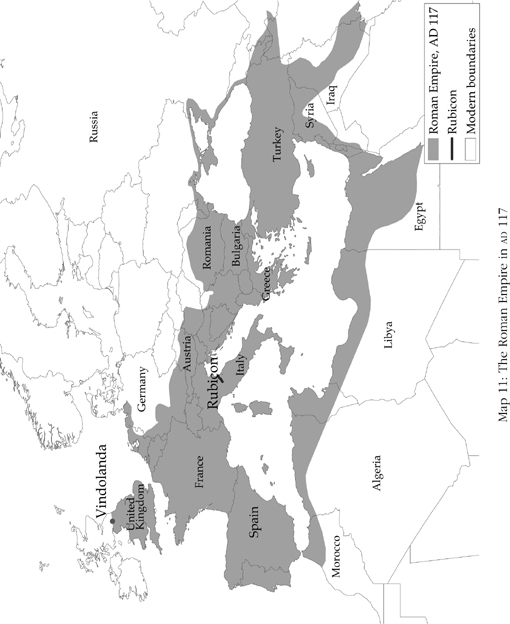

Map 11

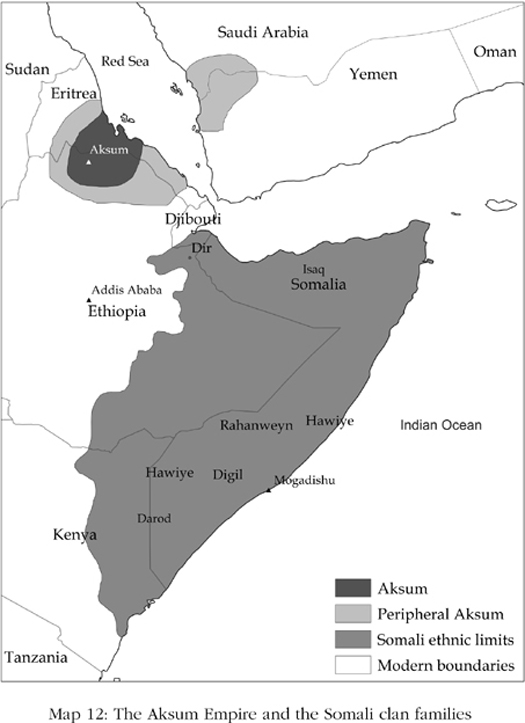

Map 12

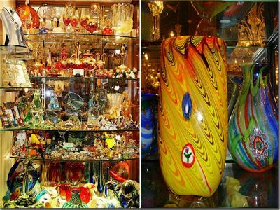

威尼斯彩色玻璃

海鲜披萨

从拜占庭掳来的铜马

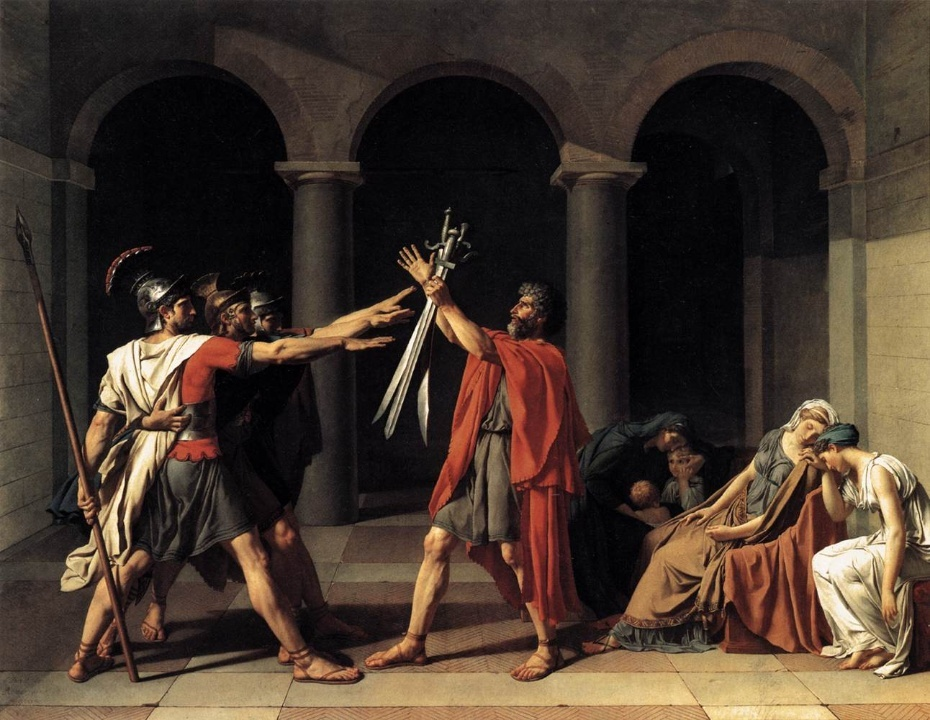

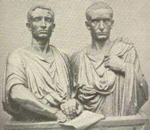

护民官格拉古两兄弟：提比略和盖乌斯

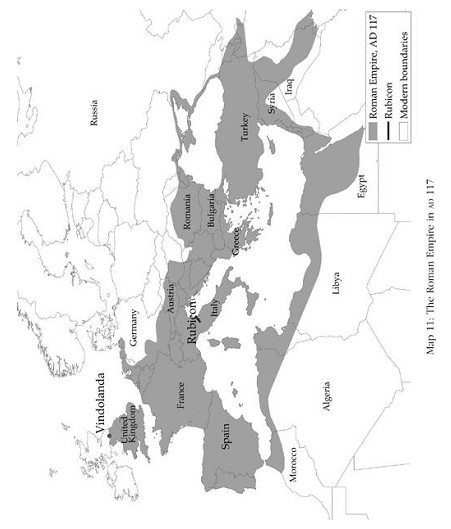

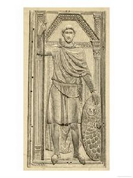

艾提乌斯

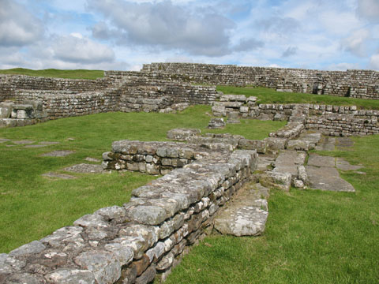

哈德良长城遗址

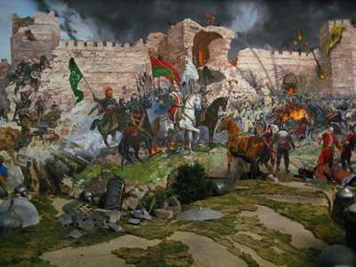

五世纪西罗马灭亡

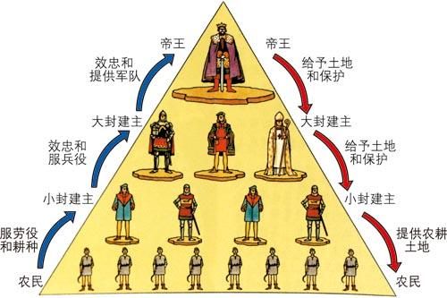

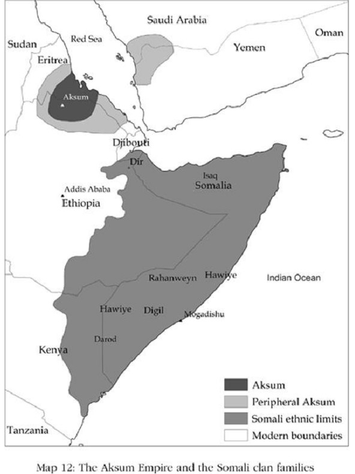
