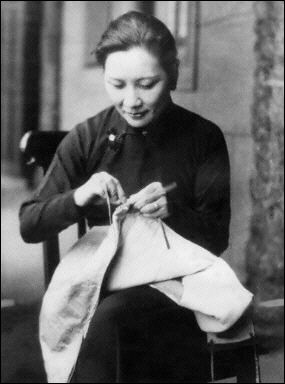
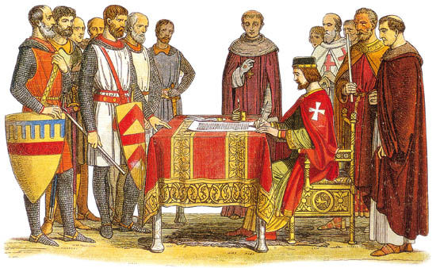
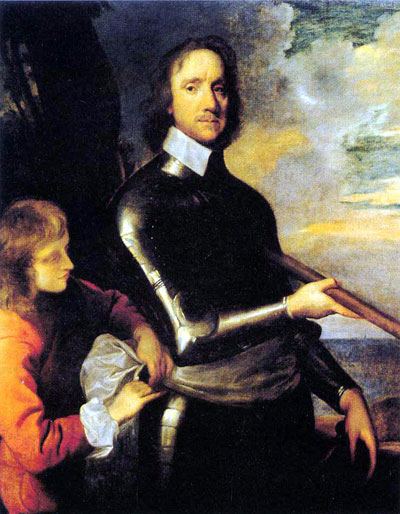
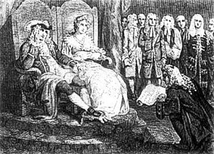
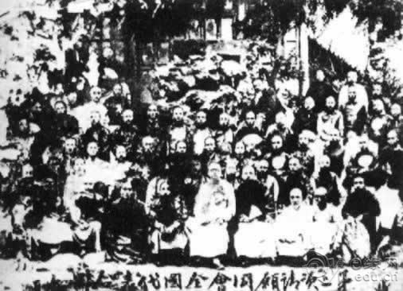

# The Turning Point · 第7章　转折点

## Trouble With Stockings · 袜子问题

In 1583 William Lee returned from his studies at the University of Cambridge to become the local priest in Calverton, England. Elizabeth I (1558–1603) had recently issued a ruling that her people should always wear a knitted cap. Lee recorded that “knitters were the only means of producing such garments but it took so long to finish the article. I began to think. I watched my mother and my sisters sitting in the evening twilight plying their needles. If garments were made by two needles and one line of thread, why not several needles to take up the thread.”

> 1583年，威廉•李（William Lee）从剑桥大学毕业回来，成为英格兰卡夫顿的地方教士。伊丽莎白一世（1558年至1603年）前不久颁布了一项旨意，规定她的人民必须带着织帽。威廉记述说：“织工是制造此等衣物的唯一手段，但完成织品要花这么长的时间。我开始思考。我看着母亲和姐妹坐在晚上昏暗的灯光下操作她们的织针。如果衣物是由两个针和一条线制作，为什么不用好几根针来操作那条线？”

This momentous thought was the beginning of the mechanization of textile production. Lee became obsessed with making a machine that would free people from endless hand-knitting. He recalled, “My duties to Church and family I began to neglect. The idea of my machine and the creating of it ate into my heart and brain.”

> 这个重大的想法就是纺织生产机械化的肇始。威廉•李开始着迷于制造一部可以让人从无尽的手工针织解放出来的机器。他回忆说：“我开始忽略对教会和家庭的职责。我对这部机器和制造它的想法啃噬我的心和脑。”

Finally, in 1589, his “stocking frame” knitting machine was ready. He traveled to London with excitement to seek an interview with Elizabeth I to show her how useful the machine would be and to ask her for a patent that would stop other people from copying the design. He rented a building to set the machine up and, with the help of his local member of Parliament Richard Parkyns, met Henry Carey, Lord Hundson, a member of the Queen’s Privy Council.

> 最后在1589年，他的“织袜机”已经完成。他怀着兴奋的心情旅行到伦敦，觐见伊莉莎白一世，向她显示这部机器多有用处，并要求授予专利，以便阻止别人模仿。他租下一栋建筑来架设机器，并在他的地方国会议员帕金斯的协助下会晤女王的枢密院成员亨斯顿勋爵卡瑞。

Carey arranged for Queen Elizabeth to come see the machine, but her reaction was devastating. She refused to grant Lee a patent, instead observing, “Thou aimest high, Master Lee. Consider thou what the invention could do to my poor subjects. It would assuredly bring to them ruin by depriving them of employment, thus making them beggars.” Crushed, Lee moved to France to try his luck there; when he failed there, too, he returned to England, where he asked James I (1603–1625), Elizabeth’s successor, for a patent.

> 卡瑞安排伊莉莎白女王参观机器，但她的反应却很糟糕。她拒绝授予威廉•李专利，并表示：“你的理想远大，李大人。你想这项发明对我穷困的人民会有什么影响。它将因为抢走工作而毁了他们，令他们沦为乞丐。“受挫的威廉•李转往法国试运气，但在那里也未能成功。他回到英国，要求继承伊丽莎白的詹姆斯一世（1603年至1625年）授予他专利。

James I also refused, on the same grounds as Elizabeth. Both feared that the mechanization of stocking production would be politically destabilizing. It would throw people out of work, create unemployment and political instability, and threaten royal power. The stocking frame was an innovation that promised huge productivity increases, but it also promised creative destruction.

> 詹姆斯一世也拒绝了他，理由和伊丽莎白相同。两位君主都担心长袜生产机械化会造成政治动乱，因为它会让许多人失去工作，制造失业和政治不安，危及王室权力。织袜机是保证能大幅提高生产力的一项创新，但也势必带来创造性破坏。

THE REACTION TO LEE’S brilliant invention illustrates a key idea of this book. The fear of creative destruction is the main reason why there was no sustained increase in living standards between the Neolithic and Industrial revolutions. Technological innovation makes human societies prosperous, but also involves the replacement of the old with the new, and the destruction of the economic privileges and political power of certain people. For sustained economic growth we need new technologies, new ways of doing things, and more often than not they will come from newcomers such as Lee.

> 对威廉•这项杰出发明的反应凸显出本书的一个重要概念。害怕创造性破坏是新石器革命到工业革命间生活水平未能持续提升的主要原因。科技创新使人类社会变富裕，但也牵涉到汰旧换新，以及破坏某些人的经济特权和政治权力。为了长久持续的经济成长，我们需要新科技、做事情的新方法，而这些新创意往往来自像威廉•李这种新加入者。

It may make society prosperous, but the process of creative destruction that it initiates threatens the livelihood of those who work with old technologies, such as the hand-knitters who would have found themselves unemployed by Lee’s technology. More important, major innovations such as Lee’s stocking frame machine also threaten to reshape political power. Ultimately it was not concern about the fate of those who might become unemployed as a result of Lee’s machine that led Elizabeth I and James I to oppose his patent; it was their fear that they would become political losers—their concern that those displaced by the invention would create political instability and threaten their own power.

> 社会也许因而变富裕，但它启动的创造性破坏过程会危及那些采用旧科技者的生计，例如因威廉•李的科技而失业的手工编织工人。更重要的是，像威廉•李的织袜机这类重大创新也威胁到既有的政治权力。最后导致伊莉莎白一世和詹姆斯一世反对授予专利给威廉•李的真正原因，不是担心那些可能因为机械化而失业的人，而是担心他们自己变成政治上的输家——他们担心因为新发明而失业的人制造政治动乱，危及他们自身的权力。

As we saw with the Luddites (this page–this page), it is often possible to bypass the resistance of workers such as hand-knitters. But the elite, especially when their political power is threatened, form a more formidable barrier to innovation. The fact that they have much to lose from creative destruction means not only that they will not be the ones introducing new innovations but also that they will often resist and try to stop such innovations. Thus society needs newcomers to introduce the most radical innovations, and these newcomers and the creative destruction they wreak must often overcome several sources of resistance, including that from powerful rulers and elites.

> 正如我们在前面章节讨论到的卢德派人士，要避开工人（例如编织工）的抗拒比较容易，但那些菁英（尤其是政治权力遭到威胁的菁英）对创新的阻碍力量更加强大。创造性破坏会带给他们很大损失这个事实，意味着他们不仅不会是引进创新的人，而且往往会抗拒并阻碍这类创新。因此社会需要新来者带进最激进的创新，但这些新来者和他们引入的创造性破坏往往必须克服数个抗拒来源，包括来自握有权力的统治者和菁英的抗拒。

Prior to seventeenth-century England, extractive institutions were the norm throughout history. They have at times been able to generate economic growth, as shown in the last two chapters, especially when they’ve contained inclusive elements, as in Venice and Rome. But they did not permit creative destruction. The growth they generated was not sustained, and came to an end because of the absence of new innovations, because of political infighting generated by the desire to benefit from extraction, or because the nascent inclusive elements were conclusively reversed, as in Venice.

> 在17世纪的英格兰之前，榨取式制度是历史的常态。有时候榨取式制度能够创造经济成长，例如前面两章讨论到的，尤其是当它们含有一些广纳性元素时，如威尼斯和罗马的例子。但它们不容许创造性破坏。它们创造的成长无法长久持续，并因为缺乏创新而走到尽头，也因为想从榨取得利而引发政治内斗，或因为初萌芽的广纳性元素被彻底反转，例如威尼斯的情况。

The life expectancy of a resident of the Natufian village of Abu Hureyra was probably not that much different from that of a citizen of Ancient Rome. The life expectancy of a typical Roman was fairly similar to that of an average inhabitant of England in the seventeenth century. In terms of incomes, in 301 AD the Roman emperor Diocletian issued the Edict on Maximum Prices, which set out a schedule of wages that various types of workers would be paid.

> 阿布胡瑞拉的纳图夫村落居民的预期寿命，可能与古罗马公民的预期寿命差不多。一般罗马人的预期寿命也类似17世纪英格兰居民的平均水平。从收入来看，罗马皇帝戴克里先在公元301年下达最高价格令，设定对各类劳工支付不同薪资的标准。

We don’t know exactly how well Diocletian’s wages and prices were enforced, but when the economic historian Robert Allen used his edict to calculate the living standards of a typical unskilled worker, he found them to be almost exactly the same as those of an unskilled worker in seventeenth-century Italy. Farther north, in England, wages were higher and increasing, and things were changing. How this came to be is the topic of this chapter.

> 我们不知道戴克里先的薪资和价格令的执行状况如何，但经济史学家艾伦利用这道命令，计算典型的非技术工人的生活水平，发现几乎与17世纪意大利的非技术工人一样。往更北的英格兰，那里的薪资较高且持续增加，而且许多事物正在改变。这种改变如何发生就是本章的主题。

## Ever-Present Political Conflict · 随时存在的政治冲突

Conflict over institutions and the distribution of resources has been pervasive throughout history. We saw, for example, how political conflict shaped the evolution of Ancient Rome and Venice, where it was ultimately resolved in favor of the elites, who were able to increase their hold on power. English history is also full of conflict between the monarchy and its subjects, between different factions fighting for power, and between elites and citizens.

> 制度和资源分配引发的冲突在人类历史上不断发生。例如，我们看到政治冲突如何塑造古罗马和威尼斯的演进，最后变成对菁英有利，使菁英得以扩增他们掌控的权力。英格兰历史也充满王权和臣民间的冲突、不同派系为权力而斗争，以及菁英与公民的对立。

The outcome, though, has not always been to strengthen the power of those who held it. In 1215 the barons, the layer of the elite beneath the king, stood up to King John and made him sign the Magna Carta (“the Great Charter”) at Runnymede (see Map 9, this page). This document enacted some basic principles that were significant challenges to the authority of the king. Most important, it established that the king had to consult with the barons in order to raise taxes.

> 不过，其结果并非永远强化既有掌权者的权力。在1215年，国王手下的贵族菁英，联合起来对抗约翰王，迫使他在伦尼米德签署大宪章（Magna Carta）。这份文件制订了一些挑战国王权威的基本原则。最重要的是，它确立国王必须咨询贵族才能征税。

The most contentious clause was number 61, which stated that “the barons shall choose any twenty-five barons of the realm they wish, who with all their might are to observe, maintain and cause to be observed the peace and liberties which we have granted and confirmed to them by this our present charter.” In essence, the barons created a council to make sure that the king implemented the charter, and if he didn’t, these twenty-five barons had the right to seize castles, lands, and possessions “… until, in their judgement, amends have been made.” King John didn’t like the Magna Carta, and as soon as the barons dispersed, he got the pope to annul it.

> 争论最大的是第六十一条，规定”贵族应依其意志遴选出国内二十五名贵族，他们将尽力遵守、维护并促成我们已经允许的和平与自由，并借本宪章确认此等权利。“这些贵族基本上创造了一个议会以确保国王实施该宪章，而如果他不实施，这二十五名贵族有权占领城堡、土地和财产，”……直到他们判断情况已经矫正“。约翰王不喜欢大宪章，等贵族一散会，他立即让教皇宣告它无效。

But both the political power of the barons and the influence of the Magna Carta remained. England had taken its first hesitant step toward pluralism. Conflict over political institutions continued, and the power of the monarchy was further constrained by the first elected Parliament in 1265. Unlike the Plebeian Assembly in Rome or the elected legislatures of today, its members had originally been feudal nobles, and subsequently were knights and the wealthiest aristocrats of the nation.

> 但贵族的政治权力和大宪章的影响力持续不坠。英格兰已跨出迟疑的第一步，迈向政治多元化。政治制度的冲突持续不断，君王的权力遭到1265年首度选出的国会（Parliament）进一步的限制。和罗马平民会议或今日选出的立法机构不同，国会的成员刚开始都是封建贵族，后来则是骑士和最富裕的上层阶级。

Despite consisting of elites, the English Parliament developed two distinguishing characteristics. First, it represented not only elites closely allied to the king but also a broad set of interests, including minor aristocrats involved in different walks of life, such as commerce and industry, and later the “gentry,” a new class of commercial and upwardly mobile farmers. Thus the Parliament empowered a quite broad section of society—especially by the standards of the time. Second, and largely as a result of the first characteristic, many members of Parliament were consistently opposed to the monarchy’s attempts to increase its power and would become the mainstay of those fighting against the monarchy in the English Civil War and then in the Glorious Revolution.

> 尽管是由菁英组成，英格兰国会发展出两个独特的性质，第一，它不只代表与国王紧密结盟的菁英，也代表各种不同的利益如商业和工业，以及后来的”绅士阶级“（gentry）这个代表商人与向上流动的农民的新阶级。因此国会把权力赋予相当广泛的社会阶层——尤其是以当时的标准来看。第二，也是第一项特质的结果之一，许多国会成员持续反对君王扩权的尝试，他们变成英格兰内战和后来的光荣革命中对抗君权的中流砥柱。

The Magna Carta and the first elected Parliament notwithstanding, political conflict continued over the powers of the monarchy and who was to be king. This intra-elite conflict ended with the War of the Roses, a long duel between the Houses of Lancaster and York, two families with contenders to be king. The winners were the Lancastrians, whose candidate for king, Henry Tudor, became Henry VII in 1485.

> 尽管有大宪章和第一个由选举产生的国会，君王权力和谁担任国王引发的政治冲突还是继续发生。这种菁英间的冲突结局是玫瑰战争（War of the Roses），一场兰开斯特家族与约克家族争夺王位的长期对决。结果是兰开斯特家族获胜，其国王候选人都铎（Henry Tudor）在1485年加冕成为亨利七世。

Two other interrelated processes took place. The first was increasing political centralization, put into motion by the Tudors. After 1485 Henry VII disarmed the aristocracy, in effect demilitarizing them and thereby massively expanding the power of the central state. His son, Henry VIII, then implemented through his chief minister, Thomas Cromwell, a revolution in government. In the 1530s, Cromwell introduced a nascent bureaucratic state. Instead of the government being just the private household of the king, it could become a separate set of enduring institutions.

> 还有另外两项相互关联的过程发生，第一是由于都铎王朝的推动而日益提高的政治集权。1485年以后，亨利七世解除贵族的武装，实际上废除了他们的军事力量，因而大幅扩张中央政府的权力。他的儿子亨利八世接着通过首席大臣克伦威尔（Thomas Cromwell）在政府中展开一场革命。在1530年代，克伦威尔采用了一套官僚政府体制，政府不再只是国王的御用机构，而是变成分隔开来的长期机构。

This was complemented by Henry VIII’s break with the Roman Catholic Church and the “Dissolution of the Monasteries,” in which Henry expropriated all the Church lands. The removal of the power of the Church was part of making the state more centralized. This centralization of state institutions meant that for the first time, inclusive political institutions became possible. This process initiated by Henry VII and Henry VIII not only centralized state institutions but also increased the demand for broader-based political representation.

> 这套制度搭配亨利八世与罗马天主教会的决裂，以及亨利八世没收所有教会土地、解散修道院的政策。解除教会权力是让政府更集权的做法之一。政府体制的集权化意味政治制度首度有可能变得更具广纳性。亨利七世和亨利八世推动的过程不仅让政治体制集权化，也使政治代表性更加扩大的要求为之升高。

The process of political centralization can actually lead to a form of absolutism, as the king and his associates can crush other powerful groups in society. This is indeed one of the reasons why there will be opposition against state centralization, as we saw in chapter 3. However, in opposition to this force, the centralization of state institutions can also mobilize demand for a nascent form of pluralism, as it did in Tudor England.

> 政治集权的过程实际上可能导致某种形式的专制，因为国王和他的亲信可以镇压社会中其他有权力的团体。这确实是有人反对政府集权的原因之一，正如我们在第三章曾讨论的。不过，与这种反对力量相反，政府体制的集权化也可能激发出对某种政治多元化的要求，就像英格兰都铎王朝发生的情况。

When the barons and local elites recognize that political power will be increasingly more centralized and that this process is hard to stop, they will make demands to have a say in how this centralized power is used. In England during the late fifteenth and sixteenth centuries, this meant greater efforts by these groups to have Parliament as a counterweight against the Crown and to partially control the way the state functioned. Thus the Tudor project not only initiated political centralization, one pillar of inclusive institutions, but also indirectly contributed to pluralism, the other pillar of inclusive institutions.

> 当贵族与地方菁英意识到政治权力将愈来愈集权化，且这个过程已经很难阻挡时，他们势必要求对这种集中的权力如何行使拥有发言权。在15世纪末和16世纪的英格兰，这意味这些群体更努力让国会变成制衡王室的力量，并取得一部分控制国家运作方式的权力。因此都铎家族的作为不仅建立了政治集权这根广纳式制度的支柱，也间接促成另一根广纳式制度的支柱——政治多元化。

These developments in political institutions took place in the context of other major changes in the nature of society. Particularly significant was the widening of political conflict which was broadening the set of groups with the ability to make demands on the monarchy and the political elites. The Peasants’ Revolt of 1381 (this page) was pivotal, after which the English elite were rocked by a long sequence of popular insurrections. Political power was being redistributed not simply from the king to the lords, but also from the elite to the people.

> 这些政治制度的发展都发生在社会产生其他重大改变的背景下，尤其重要的是政治冲突扩大，导致有能力对王室和政治菁英提出要求的各类群体变得更广泛。1381年的农民起义是一大关键，此后英格兰菁英遭到一连串平民起义的打击。政治权力的重新分配，不仅发生在国王与诸侯间，也从菁英阶层流向平民。

These changes, together with the increasing constraints on the king’s power, made the emergence of a broad coalition opposed to absolutism possible and thus laid the foundations for pluralistic political institutions. Though contested, the political and economic institutions the Tudors inherited and sustained were clearly extractive. In 1603 Elizabeth I, Henry VIII’s daughter who had acceded to the throne of England in 1553, died without children, and the Tudors were replaced by the Stuart dynasty. The first Stuart king, James I, inherited not only the institutions but the conflicts over them.

> 这些改变加上国王权力愈来愈受到限制，使得反对专制的广泛联盟能够兴起，进而为多元的政治制度奠定了基础。虽然受到挑战，但都铎王朝所继承和维系的政治与经济制度显然是榨取性的。亨利八世的女儿伊莉莎白一世在1558年基础英国王位，1603年死时没有子嗣，都铎王朝因而被斯图亚特（Stuart）王朝取代。第一位斯图亚特国王是詹姆斯一世，他继承的不只是制度，还包括制度引发的冲突。

He desired to be an absolutist ruler. Though the state had become more centralized and social change was redistributing power in society, political institutions were not yet pluralistic. In the economy, extractive institutions manifested themselves not just in the opposition to Lee’s invention, but in the form of monopolies, monopolies, and more monopolies. In 1601 a list of these was read out in Parliament, with one member ironically asking, “Is not bread there?” By 1621 there were seven hundred of them.

> 他渴望成为专制君主，虽然国家已变得更集权，社会变迁也使权力在社会中重新分配，但政治制度尚未多元化。在经济上，榨取式制度不只表现在反对威廉•李的发明，还呈现为独占、独占和更多独占。1601年国会朗读一份独占清单，一位议员讽刺地问：“面包有没有列在清单中？”到1621年，独占的项目多达七百项。

As the English historian Christopher Hill put it, a man lived in a house built with monopoly bricks, with windows … of monopoly glass; heated by monopoly coal (in Ireland monopoly timber), burning in a grate made of monopoly iron … He washed himself in monopoly soap, his clothes in monopoly starch. He dressed in monopoly lace, monopoly linen, monopoly leather, monopoly gold thread … His clothes were held up by monopoly belts, monopoly buttons, monopoly pins. They were dyed with monopoly dyes.

> 正如英国历史学家希尔的描述：“一个人住在用独占的砖头盖的屋子里，窗户……使用独占的玻璃；以独占的煤取暖（在爱尔兰则用独占的木柴），放在独占的铁制造的壁炉里燃烧……他用独占的肥皂洗澡，衣服用独占的淀粉上浆。他穿着独占的饰带、独占的亚麻布、独占的皮革、独占的金线……他的衣服搭配独占的腰带、独占的纽扣、独占的别针。它们以独占的染料染成。

He ate monopoly butter, monopoly currants, monopoly red herrings, monopoly salmon, and monopoly lobsters. His food was seasoned with monopoly salt, monopoly pepper, monopoly vinegar … He wrote with monopoly pens, on monopoly writing paper; read (through monopoly spectacles, by the light of monopoly candles) monopoly printed books. These monopolies, and many more, gave individuals or groups the sole right to control the production of many goods. They impeded the type of allocation of talent, which is so crucial to economic prosperity.

> 他吃独占的奶油、独占的葡萄干、独占的薰青鱼、独占的鲑鱼、和独占的龙虾。他的食物以独占的盐、独占的胡椒粉、独占的醋调味……他用独占的笔，在独占的书写纸上写字；（通过独占的眼镜，在独占的蜡烛光照下）阅读独占的印刷书籍。“这些独占项目以及其它更多项目，授予个人或团体控制许多货品生产的独家权力。它们阻碍了攸关经济繁荣的人才配置。

Both James I and his son and successor Charles I aspired to strengthen the monarchy, reduce the influence of Parliament, and establish absolutist institutions similar to those being constructed in Spain and France to further their and the elite’s control of the economy, making institutions more extractive. The conflict between James I and Parliament came to a head in the 1620s. Central in this conflict was the control of trade both overseas and within the British Isles. The Crown’s ability to grant monopolies was a key source of revenue for the state, and was used frequently as a way of granting exclusive rights to supporters of the king.

> 詹姆斯一世和他儿子兼继任者查理一世都极力想要强化君权，削弱国会的影响力，并建立类似西班牙和法国的专制制度，以扩大他们自身和菁英对经济的掌控，使制度变得更具榨取性。詹姆斯一世和国会的冲突在1620年代达到高点。这场冲突的核心在于海外和不列颠群岛间的贸易掌控权。王室有能力授予独占权是政府收入的主要来源，并且常被用来授予独家权利给国王的支持者。

Not surprisingly, this extractive institution blocking entry and inhibiting the functioning of the market was also highly damaging to economic activity and to the interests of many members of Parliament. In 1623 Parliament scored a notable victory by managing to pass the Statute of Monopolies, which prohibited James I from creating new domestic monopolies. He would still be able to grant monopolies on international trade, however, since the authority of Parliament did not extend to international affairs. Existing monopolies, international or otherwise, stood untouched.

> 不难想见，这种榨取式制度阻绝了新进入者，妨碍市场的功能，同时对经济活动和许多国会成员的利益极具破坏性。1623年，国会赢得一场明显的胜利，通过独占法案，禁止詹姆斯一世授予新的国内独占。不过，他还有权授予国际贸易的独占权，因为国会的职权尚未延伸到国际事务。旧有的独占权不受影响，不管是国际还是国内的独占。

Parliament did not sit regularly and had to be called into session by the king. The convention that emerged after the Magna Carta was that the king was required to convene Parliament to get assent for new taxes. Charles I came to the throne in 1625, declined to call Parliament after 1629, and intensified James I’s efforts to build a more solidly absolutist regime. He induced forced loans, meaning that people had to “lend” him money, and he unilaterally changed the terms of loans and refused to repay his debts.

> 国会并非定期召开会议，而必须由国王召集。大宪章以后召开的会议是因为国王必须召开国会以取得征收新税的许可。查理一世在1625年加冕，1629年后拒绝召开国会，并加强前任国王詹姆斯一世对于建立更专制政权的努力。他采用强制借贷政策，意即人民必须“借钱”给他，而且他单方面改变借贷条件，拒绝偿还他的债务。

He created and sold monopolies in the one dimension that the Statute of Monopolies had left to him: overseas trading ventures. He also undermined the independence of the judiciary and attempted to intervene to influence the outcome of legal cases. He levied many fines and charges, the most contentious of which was “ship money”—in 1634 taxing the coastal counties to pay for the support of the Royal Navy and, in 1635, extending the levy to the inland counties. Ship money was levied each year until 1640.

> 他在独占法留给他权力的领域创造并出售独占权：海外贸易事业。他也削弱司法的独立性，并尝试干预法律案件的结果。他征收许多罚款和规费，最引起争议的是征收船税（ship money）——在1634年向沿海的郡征税以支援皇家海军，并在1635年扩大实施到内陆各郡。船税按年课征，直到1640年。

Charles’s increasingly absolutist behavior and extractive policies created resentment and resistance throughout the country. In 1640 he faced conflict with Scotland and, without enough money to put a proper army into the field, was forced to call Parliament to ask for more taxes. The so-called Short Parliament sat for only three weeks. The parliamentarians who came to London refused to talk about taxes, but aired many grievances, until Charles dismissed them.

> 查理一世日益专制的行为和榨取性的政策，引起全国普遍的憎恨和抗拒。他在1640年与苏格兰发生冲突，且因为没有足够的资金置办军队，被迫召开国会以要求征收更多的税。那场所谓的短期国会会议只有三周，来伦敦开会的国会成员不但拒绝讨论征税，而且散布许多不满，直到查理将他们解散。

The Scots realized that Charles did not have the support of the nation and invaded England, occupying the city of Newcastle. Charles opened negotiations, and the Scots demanded that Parliament be involved. This induced Charles to call what then became known as the Long Parliament, because it continued to sit until 1648, refusing to dissolve even when Charles demanded it do so.

> 苏格兰人发现查理没有获得国人支持，决定入侵英格兰，并占领新堡。查理展开谈判，苏格兰要求英格兰国会也参与。这促成召开后来称为长期国会的会议，因为它拒绝查理解散的命令，持续开会到1648年。

In 1642 the Civil War broke out between Charles and Parliament, even though there were many in Parliament who sided with the Crown. The pattern of conflicts reflected the struggle over economic and political institutions. Parliament wanted an end to absolutist political institutions; the king wanted them strengthened. These conflicts were rooted in economics. Many supported the Crown because they had been granted lucrative monopolies. For example, the local monopolies controlled by the rich and powerful merchants of Shrewsbury and Oswestry were protected by the Crown from competition by London merchants.

> 1642年，内战在查理和国会间爆发 ，虽然国会里有许多人站在王室这一边。冲突的模式反映出经济与政治制度上的斗争。国会想要终结专制的政治制度；国王希望加强它。这些冲突的根源是经济。许多人支持王室是因为他们被授予有利可图的独占权，例如舒兹伯利欧斯维斯崔势力庞大的富商所控制的地方独占权，受到王室的保护，可免于伦敦商人的竞争。

These merchants sided with Charles I. On the other side, the metallurgical industry had flourished around Birmingham because monopolies were weak there and newcomers to the industry did not have to serve a seven-year apprenticeship, as they did in other parts of the country. During the Civil War, they made swords and produced volunteers for the parliamentary side. Similarly, the lack of guild regulation in the county of Lancashire allowed for the development before 1640 of the “New Draperies,” a new style of lighter cloth. The area where the production of these cloths was concentrated was the only part of Lancashire to support Parliament.

> 这些富商与查理一世同一阵线。另一方面，冶金业在伯明翰一带十分兴盛，因为独占在那里较弱，而且新入行的人不必像国内其他地方那样先当七年学徒。在内战期间，他们为国会这一边制作刀剑并提供志愿兵。同样的，没有同业行会的管制使兰开夏郡得以在1640年以前开发出“新布料”，是一种新型的轻质布匹。这类布匹的生产集中区，是兰开夏唯一支持国会的部分。

Under the leadership of Oliver Cromwell, the Parliamentarians—known as the Roundheads after the style in which their hair was cropped—defeated the royalists, known as Cavaliers. Charles was tried and executed in 1649. His defeat and the abolition of the monarchy did not, however, result in inclusive institutions. Instead, monarchy was replaced by the dictatorship of Oliver Cromwell.

> 在克伦威尔（Oliver Cromwell）领导下，国会派（以他们的发型而被称为圆颅党[Roundheads]）打败了称为骑士党（Cavaliers）的保皇派。查理在1649年接受审判并被处死。不过他的失败和君主政体遭废除并未带来广纳式制度，反而君权被克伦威尔的独裁所取代。

Following Cromwell’s death, the monarchy was restored in 1660 and clawed back many of the privileges that had been stripped from it in 1649. Charles’s son, Charles II, then set about the same program of creating absolutism in England. These attempts were only intensified by his brother James II, who ascended to the throne after Charles’s death in 1685. In 1688 James’s attempt to reestablish absolutism created another crisis and another civil war.

> 克伦威尔死后，君主政权在1660年恢复，许多1649年取消的特权又被恢复。查理的儿子查理二世又企图在英格兰建立专制政权；1685年他死后，他的弟弟詹姆斯二世继承王位，更加强化这样的企图。詹姆斯企图重建专制导致1688年再度引发危机和另一场内战。

Parliament this time was more united and organized. They invited the Dutch Statholder, William of Orange, and his wife, Mary, James’s Protestant daughter, to replace James. William would bring an army and claim the throne, to rule not as an absolutist monarch but under a constitutional monarchy forged by Parliament. Two months after William’s landing in the British Isles at Brixham in Devon (see Map 9, this page), James’s army disintegrated and he fled to France.

> 国会这一次更加团结也更有组织。他们邀请荷兰执政奥兰治亲王威廉（William of Orange）和他妻子玛丽（即詹姆斯的清教徒女儿）来取代詹姆斯。威廉将率领一支军队前来接受王位，并且不以专制君主的身份统治，而是根据国会创制的君主立宪制。威廉从德文郡布瑞克斯汉姆登陆不列颠群岛（参考地图9），两个月后，詹姆斯的军队便告瓦解，他也逃到了法国。

## The Glorious Revolution · 光荣革命

After victory in the Glorious Revolution, Parliament and William negotiated a new constitution. The changes were foreshadowed by William’s “Declaration,” made shortly prior to his invasion. They were further enshrined in the Declaration of Rights, produced by Parliament in February 1689. The Declaration was read out to William at the same session where he was offered the crown.

> 光荣革命得到胜利后，国会和威廉协商新宪法。威廉在入侵英格兰之前不久发布的“宣言”，预告了变革的来临。这些变革后来进一步在1689年2月国会制订的权利宣言（Declaration of Rights）获得确立。宣言在威廉加冕时对着他宣读出来。

In many ways the Declaration, which would be called the Bill of Rights after its signing into law, was vague. Crucially, however, it did establish some central constitutional principles. It determined the succession to the throne, and did so in a way that departed significantly from the then-received hereditary principles. If Parliament could remove a monarch and replace him with one more to their liking once, then why not again?

> 从很多方面看，后来签署成法律、称作权利法案（Bill of Rights）的宣言还是暧昧不清。不过，关键的是它确实建立一些核心的宪政原则。它决定王位的继承方法，且与当时普遍接受的世袭原则大不相同。如果国会可以罢黜一位国王、另立一位他们较喜欢的国王，那为什么不能再来一次？

The Declaration of Rights also asserted that the monarch could not suspend or dispense with laws, and it reiterated the illegality of taxation without parliamentary consent. In addition, it stated that there could be no standing army in England without parliamentary consent. Vagueness entered into such clauses as number 8, which stated, “The election of members of Parliament ought to be free,” but did not specify how “free” was to be determined. Even vaguer was clause 13, whose main point was that Parliaments ought to be held frequently.

> 权利宣言也主张君主不能暂停或废除法律，并重申未经国会同意而征税为违法。此外，它规定未经国会同意，英格兰不能有常备军。暧昧不清的条款如第八条说“国会成员的选举应该自由”，但未注明如何界定“自由”。更暧昧的是第十三条，其重点是国会应经常召开。

Since when and whether Parliament would be held had been such a contentious issue for the entire century, one might have expected much more specificity in this clause. Nevertheless, the reason for this vague wording is clear. Clauses have to be enforced. During the reign of Charles II, a Triennial Act had been in place that asserted that Parliaments had to be called at least once every three years. But Charles ignored it, and nothing happened, because there was no method of enforcing it.

> 由于国会应不应该召开，或多久召开一次一直是整个世纪以来备受争议的问题，社会原本预期此一条款应该会更加明确。尽管如此，这种措辞的暧昧原因不难理解。发条必须执行，在查理二世统治期间已有三年法案，规定至少每三年要召开国会一次。但查理置之不理，却也没有怎样，因为没有执行这项法律的方法。

After 1688, Parliament could have tried to introduce a method for enforcing this clause, as the barons had done with their council after King John signed the Magna Carta. They did not do so because they did not need to. This was because authority and decision-making power switched to Parliament after 1688. Even without specific constitutional rules or laws, William simply gave up on many of the practices of previous kings. He stopped interfering in legal decisions and gave up previous “rights,” such as getting the customs revenues for life.

> 1688年以后，国会原本可以制订一套执行该法条的方法，如同贵族们在约翰王签署大宪章之后所做的那样。国会没有制订执行方法是因为他们不需要，因为1688年后权威和决策权力已经转移到国会。即使未制订具体的宪法条文或法律，威廉也放弃许多以前国王的做法。他停止干预法律的决定，并放弃以前的“权利”，例如终身归他所有的关税。

Taken together, these changes in political institutions represented the triumph of Parliament over the king, and thus the end of absolutism in England and subsequently Great Britain—as England and Scotland were united by the Act of Union in 1707. From then on Parliament was firmly in control of state policy. This made a huge difference, because the interests of Parliament were very different from those of the Stuart kings. Since many of those in Parliament had important investments in trade and industry, they had a strong stake in enforcing property rights.

> 整体来看，这些政治制度上的改变代表国会凌驾国王的胜利，并因此终结英格兰以及后来大不列颠的专制体制——英格兰和苏格兰通过1707年的联合法案（Act of Union）合而为一。从那时候起，国会紧紧控制国家政策。这是一个重大改变，因为国会的利益与斯图亚特王室的利益大不相同。由于许多国会成员大举投资在贸易和工业上，保障财产权攸关他们的利益。

The Stuarts had frequently infringed on property rights; now they would be upheld. Moreover, when the Stuarts controlled how the government spent money, Parliament opposed greater taxes and balked at strengthening the power of the state. Now that Parliament itself controlled spending, it was happy to raise taxes and spend the money on activities that it deemed valuable. Chief among them was the strengthening of the navy, which would protect the overseas mercantile interests of many of the members of Parliament.

> 斯图亚特王室经常侵害财产权，现在这些权利将受到保护。此外，过去斯图亚特王室控制政府的支出时，国会反对课征更多的税，并阻碍政府扩大权力。现在国会自己控制支出，它很乐意增税和花钱在认为有价值的事情上。国会主要花钱的项目之一是强化海军，以便保护许多国会成员的海外商务利益。

Even more important than the interest of parliamentarians was the emerging pluralistic nature of political institutions. The English people now had access to Parliament, and the policy and economic institutions made in Parliament, in a way they never had when policy was driven by the king. This was partially, of course, because members of Parliament were elected. But since England was far from being a democracy in this period, this access provided only a modest amount of responsiveness.

> 比国会议员利益更重要的是政治制度初期萌芽的多元特性。英格兰人现在有渠道可以贴近和利用国会和国会制订的政策与经济制度，这是以前由国王主导政策时无法企及的。当然，部分原因是国会成员由选举产生，但由于英格兰在这段时间还远远称不上民主，这种对国会的贴近和利用只能提供有限的政治回应。

Among its many inequities was that less than 2 percent of the population could vote in the eighteenth century, and these had to be men. The cities where the Industrial Revolution took place, Birmingham, Leeds, Manchester, and Sheffield, had no independent representation in Parliament. Instead, rural areas were overrepresented. Just as bad, the right to vote in the rural areas, the “counties,” was based on ownership of land, and many urban areas, the “boroughs,” were controlled by a small elite who did not allow the new industrialists to vote or run for office.

> 众多不平等中的一项是，在18世纪只有不到2%的人可以投票，而且只限于男性。工业革命发生的城市，如伯明翰、利兹、曼彻斯特和谢菲尔德在国会没有独立的代表人；相反的，农村地区的代表却过多。同样糟糕的是，农村地区（各郡[counties]）的投票权是以土地所有权为基础，而许多城市地区（自治市镇[boroughs]）则由一小群菁英把持，他们不允许新工业家投票或竞选公职。

In the borough of Buckingham, for instance, thirteen burgesses had the exclusive right to vote. On top of this there were the “rotten boroughs,” which had historically had the right to vote but had “rotted away,” either because their population had moved over time or, in the case on Dunwich on the east coast of England, had actually fallen into the ocean as a result of coastal erosion. In each of these rotten boroughs, a small number of voters elected two members of Parliament. Old Sarum had seven voters, Dunwich thirty-two, and each elected two members of Parliament.

> 以白金汉镇为例，只有十三位自由民拥有投票权。除此之外还有“衰废市镇”，即过去有权投票但已逐渐“衰废”的城镇，原因是人口迁出，或像英格兰东岸的敦威治那样，因为海岸侵蚀而陷入海中。在这些衰废市镇，一小群选民可以选出两名国会议员。老赛勒姆镇有七位选民，敦威治有三十二位，各可选出两名国会议员。

But there were other ways to influence Parliament and thus economic institutions. The most important was via petitioning, and this was much more significant than the limited extent of democracy for the emergence of pluralism after the Glorious Revolution. Anybody could petition Parliament, and petition they did. Significantly, when people petitioned, Parliament listened. It is this more than anything that reflects the defeat of absolutism, the empowerment of a fairly broad segment of society, and the rise of pluralism in England after 1688.

> 还有其他方式可以影响国会、进而牵动经济制度，最重要的是通过请愿，而且这种方法对光荣革命后政治多元化兴起的助力远大于有限的民主。任何人都可向国会请愿，而且很多人这么做。重要的是，当有人请愿时，国会会倾听。这比任何情况都更能反映英格兰在1688年后专制统治的挫败，权力赋予相当广泛的社会阶层，以及政治多元化的兴起。

The frantic petitioning activity shows that it was indeed such a broad group in society, far beyond those sitting or even being represented in Parliament, that had the power to influence the way the state worked. And they used it. The case of monopolies best illustrates this. We saw above how monopolies were at the heart of extractive economic institutions in the seventeenth century. They came under attack in 1623 with the Statute of Monopolies, and were a serious bone of contention during the English Civil War.

> 频繁的请愿活动显示，社会中有权力影响国家运作方式的人十分广泛，远超过国会里的议员或他们代表的选民。他们也确实使用了这样的权力。独占权的例子最能说明这种情况。我们从前面的讨论知道独占是17世纪榨取式经济制度的核心，它们在1623年遭到独占法的攻击，而且在英格兰内战期间是激烈争辩的议题。

The Long Parliament abolished all the domestic monopolies that so impinged on people’s lives. Though Charles II and James II could not bring these back, they managed to maintain the ability to grant overseas monopolies. One was the Royal African Company, whose monopoly charter was issued by Charles II in 1660. This company held a monopoly on the lucrative African slave trade, and its governor and major shareholder was Charles’s brother James, soon to become James II.

> 长期国会废除了所有深刻影响人民生活的国内独占。虽然查理二世和詹姆斯二世无法挽回这些，但他们仍紧紧掌控授予海外独占的权力。其中之一是皇家非洲公司，其独占权是1660年查理二世所授予。这家公司掌控获利丰厚的非洲奴隶贸易独占权，公司的管理者和主要股东是查理的兄弟詹姆斯，即不久后登基的詹姆斯二世。

After 1688 the Company lost not just its governor, but its main supporter. James had assiduously protected the monopoly of the company against “interlopers,” the independent traders who tried to buy slaves in West Africa and sell them in the Americas. This was a very profitable trade, and the Royal African Company faced a lot of challenges, since all other English trade in the Atlantic was free.

> 1688年后，该公司失去的不只是管理者，也是在它背后撑腰的人。詹姆斯向来不遗余力地保护该公司的独占权免于“无照营业者”的侵犯，就是那些尝试在西非收购奴隶然后卖到美洲的独立贸易商。这是一门暴利生意，皇家非洲公司面临许多挑战，因为英格兰在大西洋上的其他贸易全都不受限制。

In 1689 the Company seized the cargo of an interloper, one Nightingale. Nightingale sued the Company for illegal seizure of goods, and Chief Justice Holt ruled that the Company’s seizure was unlawful because it was exercising a monopoly right created by royal prerogative. Holt reasoned that monopoly privileges could be created only by statute, and this had to be done by Parliament. So Holt pushed all future monopolies, not just of the Royal Africa Company, into the hands of Parliament. Before 1688 James II would quickly have removed any judge who made such a ruling. After 1688 things were different.

> 该公司在1689年查扣一艘无照经营船夜莺号的货物，夜莺号控告皇家非洲公司违法查扣货物，主审法官霍尔特判决皇家非洲公司的查扣行为违法，因为它执行的是由皇家创造的独占权。霍尔特宣称独占权只能由法律创造，而只有国会能通过法律。霍尔特因而把所有未来的独占权，不只是皇家非洲公司的独占权，交到国会手中。若是在1688年以前，詹姆斯二世会很快开除任何作这种判决的法官，但1688年以后形势已经改观。

Parliament now had to decide what to do with the monopoly, and the petitions began to fly. One hundred and thirty-five came from interlopers demanding free access to trade in the Atlantic. Though the Royal African Company responded in kind, it could not hope to match the number or scope of the petitions demanding its demise. The interlopers succeeded in framing their opposition in terms not just of narrow self-interest, but of national interest, which indeed it was.

> 国会现在必须决定该如何处理独占权，而请愿已纷至沓来。有135份请愿来自无照经营商，要求开放大西洋贸易。虽然皇家非洲公司也提出诉愿，但在数量和规模上当然比不上要求关闭它的请愿。无照经营商不仅从狭隘的自身利益出发，同时也从国家的利益出发，成功架构出他们的反对理由。

As a result, only 5 of the 135 petitions were signed by the interlopers themselves, and 73 of the interlopers’ petitions came from the provinces outside London, as against 8 for the Company. From the colonies, where petitioning was also allowed, the interlopers gathered 27 petitions, the Company 11. The interlopers also gathered far more signatures for their petitions, in total 8,000, as opposed to 2,500 for the Company. The struggle continued until 1698, when the Royal African Company monopoly was abolished.

> 其结果是，135份请愿书只有5份是由无照经营商自己签署；支持无照经营商的请愿有73份来自伦敦以外的郡，相对于8份支持皇家非洲公司的请愿。无照经营商从殖民地（也允许请愿）搜集到27份请愿书，皇家非洲公司只有11份。无照经营商为他们的请愿书搜集的签名也多得多，总共八千个，而支持皇家非洲公司的只有两千五百个。这场争斗持续到1698年，皇家非洲公司的独占权终于遭废止。

Along with this new locus for the determination of economic institutions and the new responsiveness after 1688, parliamentarians started making a series of key changes in economic institutions and government policy that would ultimately pave the way for the Industrial Revolution. Property rights eroded under the Stuarts were strengthened. Parliament began a process of reform in economic institutions to promote manufacturing, rather than taxing and impeding it. The “hearth tax”—an annual tax for each fireplace or stove, which fell most heavily on manufacturers, who were bitterly opposed to it—was abolished in 1689, soon after William and Mary ascended the throne. Instead of taxing hearths, Parliament moved to start taxing land.

> 1688年以后，国会除了获得决定经济制度的新权力，和积极回应社会的新做法之外，国会议员也开始在经济制度和政府政策上推行一连串重大改变，进而为日后的工业革命奠定基础。在斯图亚特王朝统治下遭削弱的财产权再度被强化。国会开始改革经济制度以促进制造业，而不再以征税和其他方式阻碍它。“炉灶税”（hearth tax）——所有壁炉或火炉每年必须缴纳的税，制造商受到的影响最大，也最激烈反对——在1689年威廉和玛丽登基后不久就被废除。停止课征炉灶税后，国会转而开始课征土地税。

Redistributing the tax burden was not the only pro-manufacturing policy that Parliament supported. A whole series of acts and legislations that would expand the market and the profitability of woolen textiles was passed. This all made political sense, since many of the parliamentarians who opposed James were heavily invested in these nascent manufacturing enterprises. Parliament also passed legislation that allowed for a complete reorganization of property rights in land, permitting the consolidation and elimination of many archaic forms of property and user rights.

> 重新分配税赋负担不是国会支持制造商的惟一一个政策，一系列能扩大羊毛纺织业的市场和获利的法案和立法也陆续通过。从政治上这完全可以理解，因为许多反对詹姆斯的国会议员，大举投资在这些新兴的制造事业上。国会也通过立法，使得土地财产权能够彻底重整，允许整合和取消许多古老形式的财产权和使用权。

Another priority of Parliament was reforming finance. Though there had been an expansion of banking and finance in the period leading up to the Glorious Revolution, this process was further cemented by the creation of the Bank of England in 1694, as a source of funds for industry. It was another direct consequence of the Glorious Revolution. The foundation of the Bank of England paved the way for a much more extensive “financial revolution,” which led to a great expansion of financial markets and banking.

> 国会的另一个优先要务是改革金融。虽然在光荣革命之前银行与金融业已经逐步扩张，这个过程在1694年英格兰银行创立后获得进一步强化。英格兰银行扮演产业的融资来源之一，其建立是光荣革命另一个直接的结果，并为日后更广泛的“金融革命”、导致金融市场与银行业的大扩张奠定基础。

By the early eighteenth century, loans would be available to everyone who could put up the necessary collateral. The records of a relatively small bank, C. Hoare’s & Co. in London, which have survived intact from the period 1702–1724, illustrate this point. Though the bank did lend money to aristocrats and lords, fully two-thirds of the biggest borrowers from Hoare’s over this period were not from the privileged social classes. Instead they were merchants and businessmen, including one John Smith, a man with the name of the eponymous average Englishman, who was loaned £2,600 by the bank during the period 1715–1719.

> 到18世纪初，任何能提供必要担保品的人都能取得贷款。伦敦一家规模较小的银行霍尔家族银行的记录，完整保留了1702年至1724年的情况，足以说明这一点。虽然这家银行也借钱给贵族和地主，但它在这段期间的大贷款户有三分之二并非来自享受特权的社会阶层，而是商贾和生意人，包括一位取了英国最常见姓名的约翰•史密斯，他在1715年到1719年间向这家银行借贷了两千六百英镑。

So far we have emphasized how the Glorious Revolution transformed English political institutions, making them more pluralistic, and also started laying the foundations for inclusive economic institutions. There is one more significant change in institutions that emerged from the Glorious Revolution: Parliament continued the process of political centralization that was initiated by the Tudors. It was not just that constraints increased, or that the state regulated the economy in a different way, or that the English state spent money on different things; but also the capability and capacity of the state increased in all directions.

> 截至目前我们已强调，光荣革命如何改变英格兰的政治制度，让它们变得更多元化，并开始为广纳式经济制度铺路。光荣革命还带来另一个更重大的制度改变：国会继续进行由都铎王朝开始推动的政治集权化过程。集权化并不只是增加限制，或政府以不同方式管制经济，或政府花钱在不同的事物上，它也包括政府在各方面的能力都增加。

This again illustrates the linkages between political centralization and pluralism: Parliament had opposed making the state more effective and better resourced prior to 1688 because it could not control it. After 1688 it was a different story. The state started expanding, with expenditures soon reaching around 10 percent of national income. This was underpinned by an expansion of the tax base, particularly with respect to the excise tax, which was levied on the production of a long list of domestically produced commodities.

> 这再度显示政治集权和政治多元化之间的关联：在1688年之前，国会反对政府变得更有效率和拥有更多资源，原因是国会无法控制它。但1688年后，情况已经大不相同。政府开始扩张，支出很快达到国民收入的10%左右。这种情况得到税基扩大的支撑，尤其是针对一长串国内生产的商品课征的特种销售税。

This was a very large state budget for the period, and is in fact larger than what we see today in many parts of the world. The state budgets in Colombia, for example, reached this relative size only in the 1980s. In many parts of sub-Saharan Africa—for example, in Sierra Leone—the state budget even today would be far smaller relative to the size of the economy without the large inflows of foreign aid.

> 这在当时是极庞大的政府预算，而且事实上比今日许多国家的预算都多。例如，哥伦比亚的政府预算直到1980年代才达到类似的规模。在下撒哈拉非洲许多地方如塞拉利昂，甚至到今日若没有巨额国外援助流入，政府预算占经济规模的比率仍然远小于此。

But the expansion of the size of the state is only part of the process of political centralization. More important than this was the qualitative way the state functioned and the way those who controlled it and those who worked in it behaved. The construction of state institutions in England reached back into the Middle Ages, but as we’ve seen (this page), steps toward political centralization and the development of modern administration were decisively taken by Henry VII and Henry VIII. Yet the state was still far from the modern form that would emerge after 1688. For example, many appointees were made on political grounds, not because of merit or talent, and the state still had a very limited capacity to raise taxes.

> 然而政府规模的扩大只是政治集权过程的一部分，比这更重要的是政府运作方式的特性，以及控制政府的人、和为政府工作的人行为的方式。英格兰政府体制的建构可以溯源到中世纪，但正如前面讨论过，亨利七世和亨利八世采取了明确的步骤，朝政治集权和现代管理的发展迈进。然而当时的政府仍然距离1688年后浮现的现代形式十分遥远。例如，许多职务任命是根据政治因素决定，而非根据其才干，而且政府的课税能力仍非常有限。

After 1688 Parliament began to improve the ability to raise revenue through taxation, a development well illustrated by the excise tax bureaucracy, which expanded rapidly from 1,211 people in 1690 to 4,800 by 1780. Excise tax inspectors were stationed throughout the country, supervised by collectors who engaged in tours of inspection to measure and check the amount of bread, beer, and other goods subject to the excise tax. The extent of this operation is illustrated by the reconstruction of the excise rounds of Supervisor George Cowperthwaite by the historian John Brewer.

> 1688年后，国会开始通过提升课税能力来增加财政收入，这种发展可从特种销售税的官僚体系明显看出——这个政府部门从1690年的1211人迅速扩张，到1780年达到4800人。特种货物税的检查员驻扎在全国各地，在税吏的监督下四处巡视，检查和测量面包、啤酒和其他必须缴纳特种货物税的产品数量。从历史学家布鲁尔重新整理特种货物税稽核员考博斯威特的例行工作记录，可以看出这项作业规模的梗概。

Between June 12 and July 5, 1710, Supervisor Cowperthwaite traveled 290 miles in the Richmond district of Yorkshire. During this period he visited 263 victualers, 71 maltsters, 20 chandlers, and one common brewer. In all, he took 81 different measurements of production and checked the work of 9 different excisemen who worked for him. Eight years later we find him working just as hard, but now in the Wakefield district, in a different part of Yorkshire. In Wakefield, he traveled more than nineteen miles a day on average and worked six days a week, normally inspecting four or five premises.

> 从1710年6月12日到7月5日，稽核员考博斯威特在约克夏的里奇蒙区旅行了二百九十英里，在这段期间他走访了263家粮食供应商、71家麦芽厂、20家杂货零售商、和一家酿酒厂。整体来说，他对生产做了八十一种测量，并检查九名为他工作的税务员的工作。八年后他工作一样辛苦，但巡视地区换成同样是约克夏的维克菲尔德区，在这里他平均每天要跑超过十九英里的路，每周工作六天，通常检查四或五个场所。

On his day off, Sunday, he made up his books, so we have a complete record of his activities. Indeed, the excise tax system had very elaborate record keeping. Officers kept three different types of records, all of which were supposed to match one another, and any tampering with these records was a serious offense. This remarkable level of state supervision of society exceeds what the governments of most poor countries can achieve today, and this in 1710. Also significantly, after 1688 the state began to rely more on talent and less on political appointees, and developed a powerful infrastructure to run the country.

> 在他休息的周日，他就记录自己的工作，我们因此可以看到他活动的完整记录。特种货物税系统确实有很精细的记录，税务官员做三种不同的记录，每一种都应该彼此吻合，篡改这些记录是很严重的犯罪行为。政府监管社会到如此精细的程度，远超过今日大多数贫穷国家的政府所能做到，而当时是1710年。同样重要的是，1688年后，政府开始更仰赖人才而减少政治性任命，并且发展出一套强大的管理国家的架构。

## The Industrial Revolution · 工业革命

The Industrial Revolution was manifested in every aspect of the English economy. There were major improvements in transportation, metallurgy, and steam power. But the most significant area of innovation was the mechanization of textile production and the development of factories to produce these manufactured textiles. This dynamic process was unleashed by the institutional changes that flowed from the Glorious Revolution. This was not just about the abolition of domestic monopolies, which had been achieved by 1640, or about different taxes or access to finance. It was about a fundamental reorganization of economic institutions in favor of innovators and entrepreneurs, based on the emergence of more secure and efficient property rights.

> 工业革命展现在英国经济的每一个层面。在运输、冶金和蒸汽动力方面出现重大的改进，但最重要的创新领域是纺织生产的机械化，以及生产这些纺织品的工厂的发展。光荣革命带来的制度改变启动了这个活力十足的过程，这不只是因为1640年达成的废除国内独占权，或是课征不同的税或融资来源的普及；更重要的是因为经济制度从根本上重新建构，变得对创新者和创业家更有利，而其基础则是确立了更安全和更有效率的财产权。

Improvements in the security and efficiency of property rights, for example, played a central role in the “transportation revolution,” paving the way for the Industrial Revolution. Investment in canals and roads, the so-called turnpikes, massively increased after 1688. These investments, by reducing the costs of transportation, helped to create an important prerequisite for the Industrial Revolution. Prior to 1688, investment in such infrastructure had been impeded by arbitrary acts by the Stuart kings. The change in the situation after 1688 is vividly illustrated by the case of the river Salwerpe, in Worcestershire, England.

> 举例来说，安全而有效的财产权在“运输革命”中扮演核心角色，也为工业革命的出现铺路。运河和道路（所谓的收费公路[turnpikes]）的投资在1688年后大量增加，这些投资借由降低运输的成本，协助创造了工业革命的一个重大先决条件。在1688年以前，这类基础建设的投资受到斯图亚特王朝的独断措施的阻碍。1688年后形势的改观鲜明地呈现在英格兰伍斯特郡萨尔韦伯河的例子。

In 1662 Parliament passed an act to encourage investment to make the Salwerpe navigable, and the Baldwyn family invested £6,000 to this end. In return they got the right to charge people for navigation on the river. In 1693 a bill was introduced to Parliament to transfer the rights to charge for navigation to the Earl of Shrewsbury and Lord Coventry. This act was challenged by Sir Timothy Baldwyn, who immediately submitted a petition to Parliament claiming that the proposed bill was essentially expropriating his father, who had already heavily invested in the river in anticipation of the charges he could then levy.

> 国会在1662年通过法案以鼓励投资，要让萨尔韦伯河变成可航行的河道；柏德文家族为此投资了六千英镑，换得向航行于该河道的人收费的权利。1693年国会审议一项法案，准备把收取航行费的权利转移给希鲁斯贝里伯爵和柯温特里伯爵。这项法案遭到柏德文爵士的挑战，他立刻向国会请愿，宣称这项议案等于没收他父亲的财产，因为他父亲投入许多资金在开发这条河上，为的就是可以收取费用。

Baldwyn argued that “the new act tends to make void the said act, and to take away all the works and materials done in pursuance thereof.” Reallocation of rights such as this was exactly the sort of thing done by Stuart monarchs. Baldwyn noted, “[I]t is of dangerous consequence to take away any person’s right, purchased under an act of Parliament, without their consent.” In the event, the new act failed, and Baldwyn’s rights were upheld. Property rights were much more secure after 1688, partly because securing them was consistent with the interests of Parliament and partly because pluralistic institutions could be influenced by petitioning. We see here that after 1688 the political system became significantly more pluralistic and created a relatively level playing field within England.

> 柏德文指出“这项新法案企图取消旧法案，并夺走在过程中所有完成的工作和物资”。像这类重新分配权利的例子就是斯图亚特王室常做的事。柏德文指出：“未经同意而夺走任何人根据国会的法案所购得的权利，将带来危险的后果。”在这个事件中，新法案未能通过，柏德文的权利得以确保。财产权在1688年后的政治制度变得远为多元化，并在英格兰创造出一个相对公平的竞争环境。

Underlying the transportation revolution and, more generally, the reorganization of land that took place in the eighteenth century were parliamentary acts that changed the nature of property ownership. Until 1688 there was even the legal fiction that all the land in England was ultimately owned by the Crown, a direct legacy from the feudal organization of society. Many pieces of land were encumbered by numerous archaic forms of property rights and many cross-cutting claims.

> 在运输革命底下，还有更普遍发生在18世纪的土地重新分派的背后，是国会的法案改变了财产权的性质。在1688年以前，对土地的法律假设甚至还是“所有英格兰的土地最终归皇室拥有”，是一个直接承袭自封建社会组织的观念。许多土地被无数古老的财产权形式和许多交叉的所有权主张所捆绑。

Much land was held in so-called equitable estates, which meant that the landowner could not mortgage, lease, or sell the land. Common land could often be used only for traditional uses. There were enormous impediments to using land in ways that would be economically desirable. Parliament began to change this, allowing groups of people to petition Parliament to simplify and reorganize property rights, alterations that were subsequently embodied into hundreds of acts of Parliament.

> 还有许多土地以所谓的衡平法产权（equitable estates）的形式持有，意即地主不能抵押、租赁或销售该土地。一般土地往往只能用于传统用途，有无数障碍阻止人以合乎经济理想的方式利用土地。国会开始改变这种情况，允许团体向国会请愿，以便简化和重新界定财产权，这些修改后来在国会整合进数百项法案。

This reorganization of economic institutions also manifested itself in the emergence of an agenda to protect domestic textile production against foreign imports. Not surprisingly, parliamentarians and their constituents were not opposed to all entry barriers and monopolies. Those that would increase their own market and profits would be welcome. However, crucially, the pluralistic political institutions—the fact that Parliament represented, empowered, and listened to a broad segment of society—meant that these entry barriers would not choke other industrialists or completely shut out newcomers, as the Serrata did in Venice (this page–this page). The powerful woolen manufacturers soon made this discovery.

> 经济制度的重新建构，也表现在保护国内的纺织品生产、对抗外国进口产品的努力。不足为奇的是，国会议员和他们的选民并未反对所有的进入障碍和独占，政策只要能扩增他们的市场和获利，他们就欢迎。但关键的是，多元化的政治制度——国会代表社会上颇大一部分人、赋予这些人权力并倾听他们的意见——意味这些进入障碍不会扼杀其他工业家，或像威尼斯的关闭措施那样完全阻绝新进入者。势力庞大的羊毛制造商就发现这一点。

In 1688 some of the most significant imports into England were textiles from India, calicoes and muslins, which comprised about one-quarter of all textile imports. Also important were silks from China. Calicoes and silks were imported by the East India Company, which prior to 1688 enjoyed a government-sanctioned monopoly over the trade with Asia. But the monopoly and the political power of the East India Company was sustained through heavy bribes to James II.

> 在1688年，英格兰最大的进口产品之一是来自印度的纺织品，其中包括印花棉布和细棉布，约占所有进口纺织品的四分之一。同样重要的是来自中国的丝织品。印花棉布和丝网都由东印度公司进口，这家公司在1688年以前享有政府授予的亚洲贸易独占权，但东印度公司的独占和政治权力是靠重金贿赂詹姆斯二世来维持。

After 1688 the company was in a vulnerable position and soon under attack. This took the form of an intense war of petitions with traders hoping to trade in the Far East and India demanding that Parliament sanction competition for the East India Company, while the company responded with counterpetitions and offers to lend Parliament money. The company lost, and a new East India Company to compete with it was founded. But textile producers did not just want more competition in the trade to India. They wanted imports of cheap Indian textiles (calicoes) taxed or even banned.

> 1688年后，该公司处于不利的地位，且很快遭到攻击，其形式是密集的请愿战，由想与远东和印度做生意的贸易商向国会请愿，要求允许与东印度公司竞争，而东印度公司则提出反请愿，并提议借钱给国会。东印度公司输了这场请愿战，一家新的东印度公司因而成立，开始与它竞争。但纺织制造商想要的不只是印度贸易有更多竞争，他们希望从印度进口的廉价纺织品（印花棉布）被课税，甚至被禁止。

These producers faced strong competition from these cheap Indian imports. At this point the most important domestic manufacturers produced woolen textiles, but the producers of cotton cloths were becoming both more important economically and more powerful politically. The wool industry mounted attempts to protect itself as early as the 1660s. It promoted the “Sumptuary Laws,” which, among other things, prohibited the wearing of lighter cloth. It also lobbied Parliament to pass legislation in 1666 and 1678 that would make it illegal for someone to be buried in anything other than a woolen shroud.

> 这些制造商遭到廉价印度进口货的激烈竞争。当时最主要的一些国内制造商生产的是羊毛纺织品，但棉质衣服制造商在经济上已变得日益重要，在政治上也愈来愈有势力。羊毛产业从1660年代就开始采取自保的行动，促成“禁奢法”，制订不准穿轻质衣服等规定。该产业也游说国会在1666年和1678年通过立法，禁止亡者下葬时穿着羊毛以外的衣物。

Both measures protected the market for woolen goods and reduced the competition that English manufacturers faced from Asia. Nevertheless, in this period the East India Company was too strong to restrict imports of Asian textiles. The tide changed after 1688. Between 1696 and 1698, woolen manufacturers from East Anglia and the West Country allied with silk weavers from London, Canterbury, and the Levant Company to restrict imports. The silk importers from the Levant, even if they had recently lost their monopoly, wished to exclude Asian silks to create a niche for silks from the Ottoman Empire.

> 两项立法都保护羊毛产品市场，减少英格兰制造商面对来自亚洲的竞争。尽管如此，东印度公司在这段期间势力太过强大，以致难以限制进口亚洲纺织品。1688年后形势开始改变，从1696年到1698年间，来自东安格利亚地区和西南地区的羊毛制造商，联合来自伦敦、坎特伯雷的丝绸织工以及利凡特公司，要求限制进口。利凡特（地中海东岸地区）的丝绸进口商虽然不久前才丧失独占权，却希望排除亚洲丝绸，为来自鄂图曼帝国的丝绸创造利润基础。

This coalition started to present bills to Parliament to place restrictions on the wearing of Asian cottons and silks, and also restrictions on the dyeing and printing of Asian textiles in England. In response, in 1701, Parliament finally passed “an Act for the more effectual imploying the poor, by incouraging the manufactures of this kingdom.” From September 1701, it decreed: “All wrought silks, bengals and stuffs, mixed with silk of herba, of the manufacture of Persia, China, or East-India, all Calicoes painted, dyed, printed, or stained there, which are or shall be imported into this kingdom, shall not be worn.”

> 这个联盟开始向国会提出议案，要求限制穿着亚洲的棉质与丝质产品，同时限制在英格兰为亚洲纺织品从事印染加工。国会的回应是终于在1701年通过“一项鼓励本国制造商，以促进雇佣更多贫民的法案”。根据法案规定，从1701年9月起，“所有由波斯、中国或东印度生产的丝织品、孟加拉生丝、混纺丝或植物纤维的织品，所有进口至本国之绘、印、染或着色之棉布，都禁止穿着。”

It was now illegal to wear Asian silks and calicoes in England. But it was still possible to import them for reexport to Europe or elsewhere, in particular to the American colonies. Moreover, plain calicoes could be imported and finished in England, and muslins were exempt from the ban. After a long struggle, these loopholes, as the domestic woolen textile manufacturers viewed them, were closed by the Calicoe Act of 1721: “After December 25, 1722, it shall not be lawful for any person or persons whatsoever to use or wear in Great Britain, in any garment or apparel whatsoever, any printed, painted, stained or dyed Calicoe.”

> 在英国穿着亚洲丝绸与印花棉布现在已经违法，但仍然可以进口这些布料在转出口到欧洲或其他地方，尤其是美洲殖民地。此外，素棉布可以进口到英国并加工为产品，细棉布则不在禁止之列。经过长期的抗争后，国内羊毛纺织制造商眼中的这些漏洞已被1721年的棉布法案堵住：“从1722年12月25日起，任何人若在大不列颠使用或穿着任何绘、印、着色或染制的棉布衣服或服装，将属违法。”

Though this act removed competition from Asia for English woolens, it still left an active domestic cotton and linen industry competing against the woolens: cotton and linen were mixed to produce a popular cloth called fustian. Having excluded Asian competition, the wool industry now turned to clamp down on linen. Linen was primarily made in Scotland and Ireland, which gave some scope to an English coalition to demand those countries’ exclusion from English markets. However, there were limits to the power of the woolen manufacturers. Their new attempts encountered strong opposition from fustian producers in the burgeoning industrial centers of Manchester, Lancaster, and Liverpool.

> 虽然这项法案为英国羊毛去除来自亚洲的竞争，却仍然保留一个活跃的国内棉质和亚麻纺织品产业，足以与羊毛竞争：他们将棉花与亚麻混纺，制成一种受欢迎的棉麻粗布。排除了亚洲的竞争后，羊毛业现在转向取缔亚麻。亚麻主要在苏格兰和爱尔兰制造，使英格兰的联盟有机会要求将它们逐出英格兰市场。不过，羊毛制造商的力量是有限的，他们的新尝试遭遇曼彻斯特、兰开斯特和利物浦等新兴工业中心的棉麻粗布制造商的激烈反对。

The pluralistic political institutions implied that all these different groups now had access to the policy process in Parliament via voting and, more important, petitioning. Though the petitions flew from the pens of both sides, amassing signatures for and against, the outcome of this conflict was a victory for the new interests against those of the wool industry. The Manchester Act of 1736 agreed that “great quantities of stuffs made from linen yarn and cotton wool have for several years past been manufactured, and have been printed and painted within this kingdom of Great Britain.”

> 多元的政治制度意味所有这些不同的团体现在都可以通过选票、以及更重要的请愿等渠道，来参与国会的政策过程。虽然双方阵营的请愿书涌入，收集了许多赞成和反对的签名，但这场冲突的结果是新利益打败羊毛业的旧利益。1736年的曼彻斯特法案同意“过去几年已有大量以亚麻纱和棉线制造的纺织品，在大不列颠王国内制造、印染和着色。”

It then went on to assert that “nothing in the said recited Act [of 1721] shall extend or be construed to prohibit the wearing or using in apparel, household stuff, furniture or otherwise, any sort of stuff made out of linen yarn and cotton wool, manufactured and printed or painted with any colour or colours within the kingdom of Great Britain.” The Manchester Act was a significant victory for the nascent cotton manufacturers. But its historical and economic significance was in fact much greater. First, it demonstrated the limits of entry barriers that the pluralistic political institutions of parliamentary England would permit.

> 该法案进而声称“前述的（1721年）法案不应扩大或解释为，在衣服、家用品、家具或其他物品上，禁止穿着或使用在大不列颠王国内以亚麻纱和棉线制造、印染或着色的纺织品。”曼彻斯特法案是新兴起的棉布制造商的重大胜利，但它的历史与经济意义实际上更为深远。第一，它展现出英国国会的多元政治制度所能容许的进入障碍极限。

Second, over the next half century, technological innovations in the manufacture of cotton cloth would play a central role in the Industrial Revolution and fundamentally transform society by introducing the factory system. After 1688, though domestically a level playing field emerged, internationally Parliament strove to tilt it. This was evident not only from the Calicoe Acts but also from the Navigation Acts, the first of which was passed in 1651, and they remained in force with alternations for the next two hundred years.

> 第二，在接下来的半个世纪，棉布制造的科技创新将在工业革命中扮演核心角色，并且因为采用工厂制度而从根本上改变社会。1688年后，虽然国内出现了公平的竞争环境，但在国际层面国会仍然积极保护本国利益。这不仅从印花棉布法案可以明显看出，从1651年首度通过的航海法（Navigation Act）也可发现，而且这套法案的修订版在后来的两百年都还继续施行。

The aim of these acts was to facilitate England’s monopolization of international trade—though crucially this was monopolization not by the state but by the private sector. The basic principle was that English trade should be carried in English ships. The acts made it illegal for foreign ships to transport goods from outside Europe to England or its colonies, and it was similarly illegal for third-party countries’ ships to ship goods from a country elsewhere in Europe to England. This advantage for English traders and manufacturers naturally increased their profits and may have further encouraged innovation in these new and highly profitable activities.

> 这套法案的目的是促进英格兰在国际贸易上的独占——虽然很重要的是，这不是由政府独占而是民间业者独占。其基本原则是，英格兰贸易应由英格兰船只载运。根据法案规定，外国船只若从欧洲以外的地方载运货物到英格兰或其殖民地就属违法；同样违法的是，第三方国家的船只从欧洲其他地方运送货物到英格兰。占有优势的英格兰贸易商和制造商自然能够增加获利，并可能进一步鼓励这类高获利的新活动的创新。

By 1760 the combination of all these factors—improved and new property rights, improved infrastructure, a changed fiscal regime, greater access to finance, and aggressive protection of traders and manufacturers—was beginning to have an effect. After this date, there was a jump in the number of patented inventions, and the great flowering of technological change that was to be at the heart of the Industrial Revolution began to be evident. Innovations took place on many fronts, reflecting the improved institutional environment. One crucial area was power, most famously the transformations in the use of the steam engine that were a result of James Watt’s ideas in the 1760s.

> 到1760年，所有这些因素加起来——改善过的和新规定的财产权、改善的基础建设、经过变更的财政制度、更容易取得的融资，以及对贸易商和制造商的积极保护——开始发挥功效。从这一年以后，专利发明的数量开始大幅跃增，工业革命的核心科技突飞猛进开始显现。创新在很多方面发生，反映改善的制度环境。其中一个关键领域是动力，最有名的是使用蒸汽机的转变，而这要归功于瓦特在1760年代的点子。

Watt’s initial breakthrough was to introduce a separate condensing chamber for the steam so that the cylinder that housed the piston could be kept continually hot, instead of having to be warmed up and cooled down. He subsequently developed many other ideas, including much more efficient methods of converting the motion of the steam engine into useful power, notably his “sun and planets” gear system. In all these areas technological innovations built on earlier work by others. In the context of the steam engine, this included early work by English inventor Thomas Newcomen and also by Dionysius Papin, a French physicist and inventor.

> 瓦特初期的突破是采用一个分开的蒸汽冷凝室，以便包着活塞的气缸可以持续保持热度，而不必不断加热和冷却。他接着想出许多新点子，包括以更有效率的方法把蒸汽机的动作变成有用的动力，包括他著名的“太阳与行星”齿轮系统。所有这些领域的科技创新都建立在前人努力的基础上，以蒸汽机为例，就包括英国发明家纽康门以及法国物理学家兼发明家帕宾的研究成果。

The story of Papin’s invention is another example of how, under extractive institutions, the threat of creative destruction impeded technological change. Papin developed a design for a “steam digester” in 1679, and in 1690 he extended this into a piston engine. In 1705 he used this rudimentary engine to build the world’s first steamboat. Papin was by this time a professor of mathematics at the University of Marburg, in the German state of Kassel.

> 帕宾的发明故事是害怕创造性破坏的榨取式制度如何阻碍科技变革的另一个例子。帕宾在1679年开发出一个“蒸汽锅炉”，并在1690年改进成一具活塞引擎。1705年，他用这具雏形的引擎打造出全世界第一艘蒸汽船。帕宾当时是德意志卡塞尔邦国马堡大学的数学教授。

He decided to steam the boat down the river Fulda to the river Weser. Any boat making this trip was forced to stop at the city of Münden. At that time, river traffic on the Fulda and Weser was the monopoly of a guild of boatmen. Papin must have sensed that there might be trouble. His friend and mentor, the famous German physicist Gottfried Leibniz, wrote to the Elector of Kassel, the head of state, petitioning that Papin should be allowed to “… pass unmolested …” through Kassel.

> 他决定驾驶这艘蒸汽船顺着富尔达（Fulda）河而下，进入威悉（Weser）河。如何走这趟航程的船只都会被迫在明登（Munden）市停留。在当时，航行富尔达河和威悉河是船夫公会的独占权。帕宾必定了解到可能会有麻烦。他的友人兼导师、也是著名的德意志物理学家莱布尼茨写信给卡塞尔选侯，请求他允许帕宾“顺利通过”卡塞尔。

Yet Leibniz’s petition was rebuffed and he received the curt answer that “the Electoral Councillors have found serious obstacles in the way of granting the above petition, and, without giving their reasons, have directed me to inform you of their decision, and that in consequence the request is not granted by his Electoral Highness.” Undeterred, Papin decided to make the journey anyway. When his steamer arrived at Münden, the boatmen’s guild first tried to get a local judge to impound the ship, but was unsuccessful. The boatmen then set upon Papin’s boat and smashed it and the steam engine to pieces.

> 但莱布尼茨的请愿遭到拒绝，他接到简略的回答说：“选侯国委员会发现批准上述请愿的障碍重重，且未说明理由即指示我通知你他们的决定，其结论是该要求未获选侯殿下准许。”帕宾好不气馁，仍然决定展开航行。当他的蒸汽船抵达明登时，船夫先是尝试要地方法官扣留该船，但未获成功。于是船夫们攻击帕宾的船，将它砸毁，蒸汽引擎化为碎片。

Papin died a pauper and was buried in an unmarked grave. In Tudor or Stuart England, Papin might have received similar hostile treatment, but this all changed after 1688. Indeed, Papin was intending to sail his boat to London before it was destroyed. In metallurgy, key contributions were made in the 1780s by Henry Cort, who introduced new techniques for dealing with impurities in iron, allowing for a much better quality wrought iron to be produced.

> 帕宾死时身无分文，被葬在无名墓地。在都铎或斯图亚特王朝的英格兰，帕宾可能会受到类似的敌视待遇，但这种情况在1688年后完全改观。帕宾在船还没被摧毁前，确实有意把船开到伦敦。在冶金方面，柯特在1780年代做出重大贡献，他采用新技术处理铸铁中的杂质，制造出品质更好的锻铁。

This was critical for the manufacture of machine parts, nails, and tools. The production of vast quantities of wrought iron using Cort’s techniques was facilitated by the innovations of Abraham Darby and his sons, who pioneered the use of coal to smelt iron beginning in 1709. This process was enhanced in 1762 by the adaptation, by John Smeaton, of water power to operate blowing cylinders in making coke. After this, charcoal vanished from the production of iron, to be replaced by coal, which was much cheaper and more readily available.

> 这对制造机器零件、钉子和工具极其重要。利用柯特的技术生产的大量锻铁，促成了达比和他的儿子的创新，他们率先在1709年使用煤炭来精炼铁。（注：以上两个年代靠谱，但作者叙述颠倒了前后，不是柯特促成了达比，而是相反）这个工艺流程（指达比）在1762年又由于史密顿采用水力来操作气缸鼓风炉制煤而进一步改善。从此以后，木炭从铁的生产中消失，由煤炭取代，不但成本更低，而且更容易取得。

Even though innovation is obviously cumulative, there was a distinct acceleration in the middle of the eighteenth century. In no place was this more visible than in textile production. The most basic operation in the production of textiles is spinning, which involves taking plant or animal fibers, such as cotton or wool, and twisting them together to form yarn. This yarn is then woven to make up textiles. One of the great technological innovations of the medieval period was the spinning wheel, which replaced hand spinning.

> 虽然创新显然是慢慢累积的，但在18世纪中叶却呈现明显的加速，尤其是在纺织品生产中最为显著。纺织品生产最基本的步骤是纺纱，也就是使用植物或动物纤维如棉花或羊毛，将它们制成纱线。纱线再被制成纺织品。中世纪最大的科技创新之一是纺车，取代了手工纺纱。

This invention appeared around 1280 in Europe, probably disseminating from the Middle East. The methods of spinning did not change until the eighteenth century. Significant innovations began in 1738, when Lewis Paul patented a new method of spinning using rollers to replace human hands to draw out the fibers being spun. The machine did not work well, however, and it was the innovations of Richard Arkwright and James Hargreaves that truly revolutionized spinning.

> 这种发明约在1280年出现于欧洲，可能是从中东传入。此后纺纱的方法一直未变，直到18世纪。一连串重大创新于1738年保罗取得一项新纺纱方法的专利，使用萝拉（Roller）取代手工抽出要纺制的纤维。不过，这套机器运作得不好，直到后来阿克莱特和哈格里夫斯的创新才真正带来纺纱的革命。

In 1769 Arkwright, one of the dominant figures of the Industrial Revolution, patented his “water frame,” which was a huge improvement over Lewis’s machine. He formed a partnership with Jedediah Strutt and Samuel Need, who were hosiery manufacturers. In 1771 they built one of the world’s first factories, at Cromford. The new machines were powered by water, but Arkwright later made the crucial transition to steam power.

> 1769年，工业革命的代表人物之一阿克莱特为他的“水力纺纱机”取得专利，那是比保罗的机器改善许多的新发明。阿克莱特与针织品制造商斯图特和尼德成立合伙事业。1771年，他们在克罗姆福德兴建全世界最早的一座工厂。新机器以水为动力，但阿克莱特后来做了关键的改变，改以蒸汽为动力。

By 1774 his firm employed six hundred workers, and he expanded aggressively, eventually setting up factories in Manchester, Matlock, Bath, and New Lanark in Scotland. Arkwright’s innovations were complemented by Hargreaves’s invention in 1764 of the spinning jenny, which was further developed by Samuel Crompton in 1779 into the “mule,” and later by Richard Roberts into the “self-acting mule.” The effects of these innovations were truly revolutionary: earlier in the century, it took 50,000 hours for hand spinners to spin one hundred pounds of cotton. Arkwright’s water frame could do it in 300 hours, and the self-acting mule in 135.

> 到1774年，他的公司雇佣六百名工人，而且他积极扩张，最后在曼彻斯特、马特洛克、巴斯，还有苏格兰的新兰纳克建立工厂。阿克莱特的创新在1764年因哈格里夫斯发明的珍妮纺纱机而更加完善，而这部纺纱机又由克隆普顿在1779年发展成“骡子”，以及后来罗伯兹的自动纺纱机。这些创新的效益确实是革命性：在18世纪稍早，手工纺织要花五万小时纺完一百磅棉花，阿克莱特的水力纺纱机只花三百小时，而自动纺纱机只需要一百三十五小时。

Along with the mechanization of spinning came the mechanization of weaving. An important first step was the invention of the flying shuttle by John Kay in 1733. Though it initially simply increased the productivity of hand weavers, its most enduring impact would be in opening the way to mechanized weaving. Building on the flying shuttle, Edmund Cartwright introduced the power loom in 1785, a first step in a series of innovations that would lead to machines replacing manual skills in weaving as they were also doing in spinning.

> 随着纺纱机械化出现的是编织的机械化。重要的第一步是凯伊在1733年发明的飞梭。虽然刚开始那只是增加手工编织的生产力，但它最长远的影响是奠定了机械化编织的基础。1785年，卡特莱特又在飞梭的基础上发明了动力织布机，跨出一连串创新的第一步，终于制造出取代手工编织的机器，如同那些取代手工纺纱的机器。

The English textile industry not only was the driving force behind the Industrial Revolution but also revolutionized the world economy. English exports, led by cotton textiles, doubled between 1780 and 1800. It was the growth in this sector that pulled ahead the whole economy. The combination of technological and organizational innovation provides the model for economic progress that transformed the economies of the world that became rich.

> 英国纺织业不只是工业革命背后的推手，也促成了世界经济的革命。以棉纺织品为首的英国出口从1780年到1800年增加一倍，这个产业的成长变成整个经济体的火车头。技术创新和组织创新的结合，提供了经济进步的范本，改变了世界上那些变得富裕的经济体。

New people with new ideas were crucial to this transformation. Consider innovation in transportation. In England there were several waves of such innovations: first canals, then roads, and finally railways. In each of these waves the innovators were new men. Canals started to develop in England after 1770, and by 1810 they had linked up many of the most important manufacturing areas. As the Industrial Revolution unfolded, canals played an important role in reducing transportation costs for moving around the bulky new finished industrial goods, such as cotton textiles, and the inputs that went into them, particularly raw cotton and coal for the steam engines.

> 新的人和新创意对这个转变极其重要。以运输创新为例，在英国出现了数波这类创新：先是运河，然后是公路，最后使铁路。每一波创新都是新人贡献的。运河1770年后开始在英国发展，到1810年他们已连接许多最重要的制造区。随着工业革命展开，运河在降低运输成本上扮演重要角色，可以把庞大数量的工业产品运到各地，例如棉纺织品；同时也可把原料运到工厂，尤其是棉花和蒸汽机使用的煤。

Early innovators in building canals were men such as James Brindley, who was employed by the Duke of Bridgewater to build the Bridgewater Canal, which ended up linking the key industrial city of Manchester to the port of Liverpool. Born in rural Derbyshire, Brindley was a millwright by profession. His reputation for finding creative solutions to engineering problems came to the attention of the duke. He had no previous experience with transportation problems, which also was true of other great canal engineers such as Thomas Telford, who started life as a stonemason, or John Smeaton, an instrument maker and engineer.

> 早期开凿运河的创新者包括布林德利，他受雇于布里奇沃特公爵以兴建布里奇沃特运河，最后把工业大城曼彻斯特连接到利物浦港。布林德利生于达比郡农村，以水车工匠为业。他发明创新方法解决工程问题的名声引起公爵注意。在这之前他没有解决运输问题的经验，而另外两位杰出的运河工程师也是如此，一位原本当砌石匠的泰尔福德，另一位是工具制作师兼工程师史密顿。

Just as the great canal engineers had no previous connection to transportation, neither did the great road and railway engineers. John McAdam, who invented tarmac around 1816, was the second son of a minor aristocrat. The first steam train was built by Richard Trevithick in 1804. Trevithick’s father was involved in mining in Cornwall, and Richard entered the same business at an early age, becoming fascinated by steam engines used for pumping out the mines. More significant were the innovations of George Stephenson, the son of illiterate parents and the inventor of the famous train “The Rocket,” who began work as an engineman at a coal mine.

> 正如那些杰出的运河工程师之前没有运输的背景，卓越的公路和铁路工程师也一样。麦克亚当在1816年左右发明碎石铺路法，他是一位小贵族的次子。第一辆蒸汽火车由特里维西克在1804年打造，他父亲在康沃尔郡采矿，早年他跟着父亲从事这个行业，因而着迷于用来抽出矿产的蒸汽机。更重要的是史蒂芬森的发明，他的父母都不识字，但他发明了著名的“火箭号”火车；史蒂芬森刚开始只是煤矿矿场的一名蒸汽机操作员。

New men also drove the critical cotton textile industry. Some of the pioneers of this new industry were people who had previously been heavily involved in the production and trade of woolen cloths. John Foster, for example, employed seven hundred handloom weavers in the woolen industry at the time he switched to cotton and opened Black Dyke Mills in 1835. But men such as Foster were a minority. Only about one-fifth of the leading industrialists at this time had previously been involved in anything like manufacturing activities.

> 新人也推动了重要的棉纺织业。这个新产业的一些开路先锋是过去从事羊毛衣物生产与贸易的业者，例如福斯特在1835年转向棉花并开设布拉克染厂之前，曾在羊毛业雇佣七百名手工织布机工人。但像福斯特这类人是少数，当时只有五分之一的主要工业家过去从事与制造业有关的行业。

This is not surprising. For one, the cotton industry developed in new towns in the north of England. Factories were a completely new way of organizing production. The woolen industry had been organized in a very different way, by “putting out” materials to individuals in their homes, who spun and wove on their own. Most of those in the woolen industry were therefore ill equipped to switch to cotton, as Foster did. Newcomers were needed to develop and use the new technologies. The rapid expansion of cotton decimated the wool industry—creative destruction in action.

> 这并不奇怪，因为第一，棉纺织业先从英格兰北部的新城镇发展，工厂是组织生产的全新方法，羊毛业的生产组织则大不相同，是把原料送到生产工人的家里，让他们自己纺纱和织布。因此大部分这类羊毛业者不具备转换成棉纺织的条件，福斯特是例外。要发展和使用新技术需要有新人加入。棉纺织的快速发展宣告了羊毛业的没落——这又是创造性破坏的作用。

Creative destruction redistributes not simply income and wealth, but also political power, as William Lee learned when he found the authorities so unreceptive to his invention because they feared its political consequences. As the industrial economy expanded in Manchester and Birmingham, the new factory owners and middle-class groups that emerged around them began to protest their disenfranchisement and the government policies opposed to their interests. Their prime candidate was the Corn Laws, which banned the import of “corn”—all grains and cereals, but principally wheat—if the price got too low, thus ensuring that the profits of large landowners were kept high.

> 创造性破坏不只重新分配收入和财富，也重新分配政治权力，正如威廉•李发现当权者因为害怕政治后果而排斥拒绝他的发明时所了解到的。随着工业经济在曼彻斯特和伯明翰的扩张，新工厂业主和新崛起的中产阶级也开始抗议他们被剥夺的公民权利，以及违背他们利益的政府政策。他们的主要对象是谷物法（Corn Laws），这项法律规定所有谷物，尤其是小麦，价格过低时不准从谷物进口，目的是保护大地主的高额获利。

This policy was very good for big landowners who produced wheat, but bad for manufacturers, because they had to pay higher wages to compensate for the high price of bread. With workers concentrated into new factories and industrial centers, it became easier to organize and riot. By the 1820s, the political exclusion of the new manufacturers and manufacturing centers was becoming untenable. On August 16, 1819, a meeting to protest the political system and the policies of the government was planned to be held in St. Peter’s Fields, Manchester.

> 这个政策对生产小麦的大地主有利，但对制造商不利，因为他们必须支付较高的薪资，以弥补较高的面包价格。由于工人集中在新工厂和工业中心，组织动员和暴动也变得更容易。到1820年，对新制造商和制造中心的政治排斥和拒绝已变得站不住脚。1819年8月16日，曼彻斯特的圣彼得广场准备举行抗议政治制度和政府政策的集会。

The organizer was Joseph Johnson, a local brush manufacturer and one of the founders of the radical newspaper the Manchester Observer. Other organizers included John Knight, a cotton manufacturer and reformer, and John Thacker Saxton, editor of the Manchester Observer. Sixty thousand protestors gathered, many holding banners such as “No Corn Laws,” “Universal Suffrage,” and “Vote by Ballot” (meaning voting should take place secretly, not openly, as it did in 1819). The authorities were very nervous about the meeting, and a force of six hundred cavalry of the Fifteenth Hussars had been assembled.

> 策划者是当地的刷子制造商强森，也是激进的《曼彻斯特观察报》的创办人。其他策划者包括棉纺织制造商兼改革家奈特，和《曼彻斯特观察报》编辑萨克斯顿。六万名抗议者聚集在广场，许多人举的标语牌上写着“取消谷物法”、“普选权”和“投票选举”（亦即秘密投票，而非像1819年时的公开投票）。当局对这次集会十分紧张，由六百名骑兵组成的第十五轻骑兵部队严阵以待。

As the speeches began, a local magistrate decided to issue a warrant for the arrest of the speakers. As police tried to enforce the warrant, they met with the opposition of the crowd, and fighting broke out. At this point the Hussars charged the crowd. Within a few chaotic minutes, eleven people were dead and probably six hundred wounded. The Manchester Observer called it the Peterloo Massacre.

> 当演说开始时，一名地方法官决定对演说者发出逮捕令。警察尝试执行逮捕令时遭到群众的抗拒，并爆发战斗。这时候轻骑兵冲进群众中，在混乱的几分钟里，十一位民众被杀死，受伤者可能多达六百人。《曼彻斯特观察报》称之为彼得卢屠杀。

But given the changes that had already taken place in economic and political institutions, long-run repression was not a solution in England. The Peterloo Massacre would remain an isolated incident. Following the riot, the political institutions in England gave way to the pressure, and the destabilizing threat of much wider social unrest, particularly after the 1830 revolution in France against Charles X, who had tried to restore the absolutism destroyed by the French Revolution of 1789. In 1832 the government passed the First Reform Act. It enfranchised Birmingham, Leeds, Manchester, and Sheffield, and broadened the base of voting so that manufacturers could be represented in Parliament.

> 然而在经济与政治制度已经改变的情况下，长期压制在英国不是解决问题的方法。彼得卢屠杀只是孤立事件，在这次暴动后，英国的政治制度不得不屈服于压力和广泛的社会动乱威胁，尤其是在1830年法国民众反对查理十世的革命之后（查理十世尝试恢复被1789年法国大革命摧毁的专制政体）。1832年，英国政府通过第一改革法案，赋予伯明翰、里兹、曼彻斯特和谢菲尔德参政权，并扩大投票的基础，让制造商在国会可以有代表。

The consequent shift in political power moved policy in the direction favored by these newly represented interests; in 1846 they managed to get the hated Corn Laws repealed, demonstrating again that creative destruction meant a redistribution not just of income, but also of political power. And naturally, changes in the distribution of political power in time would lead to a further redistribution of income. It was the inclusive nature of English institutions that allowed this process to take place. Those who suffered from and feared creative destruction were no longer able to stop it.

> 随之发生的政治权力转移把政策推至有利于这些新代表的方向：他们在1846年终于成功废止了广泛憎恶的谷物法，再次显示创造性破坏不只带来收入的重新分配，也带来政治权力的重新分配。当然，政治权力的重新分配假以时日将导致进一步的收入重新分配。英国制度的广纳性使这个过程得以发生，身受创造性破坏之害或害怕它的人，再也无法抵挡大势。

## Why In England? · 为什么发生在英国？

The Industrial Revolution started and made its biggest strides in England because of her uniquely inclusive economic institutions. These in turn were built on foundations laid by the inclusive political institutions brought about by the Glorious Revolution. It was the Glorious Revolution that strengthened and rationalized property rights, improved financial markets, undermined state-sanctioned monopolies in foreign trade, and removed the barriers to the expansion of industry. It was the Glorious Revolution that made the political system open and responsive to the economic needs and aspirations of society.

> 工业革命在英国开始并大步迈进，原因是英国独特的广纳式经济制度。而这套制度建立的基础则是光荣革命带来的广纳式政治制度。光荣革命强化并使财产权合理化，改善金融市场，削弱政府掌控的国外贸易独占权，同时去除了工业扩张的障碍。是光荣革命促成政治制度的开放，并积极回应经济的需求和社会的渴望。

These inclusive economic institutions gave men of talent and vision such as James Watt the opportunity and incentive to develop their skills and ideas and influence the system in ways that benefited them and the nation. Naturally these men, once they had become successful, had the same urges as any other person. They wanted to block others from entering their businesses and competing against them and feared the process of creative destruction that might put them out of business, as they had previously bankrupted others. But after 1688 this became harder to accomplish.

> 这种广纳式经济制度让有才干和眼光的人如瓦特，有机会和诱因发展他们的技术和创意，进而以对他们和国家都有利的方式影响制度。一旦这些人成功后，他们自然和其他人有同样的冲动，想阻碍别人进入他们的行业并与他们竞争，唯恐创造性破坏的过程可能使他们无法在行业中生存，就像他们曾经让别人破产一样。但是在1688年之后，要做到这一点已愈来愈困难。

In 1775 Richard Arkwright took out an encompassing patent that he hoped would give him a monopoly on the rapidly expanding cotton spinning industry in the future. He could not get the courts to enforce it. Why did this unique process start in England and why in the seventeenth century? Why did England develop pluralistic political institutions and break away from extractive institutions?

> 1775年阿克莱特曾拿出一项内容广泛的专利权，希望让他在快速扩张的棉纺织业取得独占势力，但他无法让法院执行它。为什么这个独特的过程在英国展开，还有为什么在17世纪发生？为什么英格兰发展出多元的政治制度，从此脱离榨取式制度？

As we have seen, the political developments leading up to the Glorious Revolution were shaped by several interlinked processes. Central was the political conflict between absolutism and its opponents. The outcome of this conflict not only put a stop to the attempts to create a renewed and stronger absolutism in England, but also empowered those wishing to fundamentally change the institutions of society. The opponents of absolutism did not simply attempt to build a different type of absolutism. This was not simply the House of Lancaster defeating the House of York in the War of the Roses. Instead, the Glorious Revolution involved the emergence of a new regime based on constitutional rule and pluralism.

> 正如我们已经讨论过，光荣革命前的政治发展由几个彼此关联的过程所塑造，其核心是专制政权与反对者的政治冲突，这种冲突的结果不只阻止了专制政权在英格兰复辟和强化的企图，同时赋予那些渴望彻底改变社会制度的人以权力。专制政权的反对者并不是想建立一种不同类型的专制政权。这不只是像兰开斯特家族在玫瑰战争中打败的约克家族。相反的，光荣革命产生了一种建基于宪政和政治多元化的新政权。

This outcome was a consequence of the drift in English institutions and the way they interacted with critical junctures. We saw in the previous chapter how feudal institutions were created in Western Europe after the collapse of the Western Roman Empire. Feudalism spread throughout most of Europe, West and East. But as chapter 4 showed, Western and Eastern Europe began to diverge radically after the Black Death. Small differences in political and economic institutions meant that in the West the balance of power led to institutional improvement; in the East, to institutional deterioration.

> 这个结果是英格兰的制度漂移、以及它们与关键时期交互作用的结果。我们在前一章看到西罗马帝国崩溃后封建制度如何在西欧建立，并传播到西欧和东欧的大部分地区，但就像在第四章谈到的，西欧和东欧在黑死病后开始分道扬镳。政治和经济制度的小差异意味西欧的权力平衡导致制度的改善；反之在东欧，制度却逐渐在恶化。

But this was not a path that would necessarily and inexorably lead to inclusive institutions. Many more crucial turns would have to be taken on the way. Though the Magna Carta had attempted to establish some basic institutional foundations for constitutional rule, many other parts of Europe, even Eastern Europe, saw similar struggles with similar documents. Yet, after the Black Death, Western Europe significantly drifted away from the East.

> 但这并不是一条必然且坚决迈向广纳式制度的道路。还有许多关键的转折必须在这条路上出现。虽然大宪章尝试为宪政建立根本的制度基础，但欧洲许多国家、甚至东欧也出现类似的抗争和类似的文献。然而在黑死病之后，西欧大幅漂离东欧。

Documents such as the Magna Carta started to have more bite in the West. In the East, they came to mean little. In England, even before the conflicts of the seventeenth century, the norm was established that the king could not raise new taxes without the consent of Parliament. No less important was the slow, incremental drift of power away from elites to citizens more generally, as exemplified by the political mobilization of rural communities, seen in England with such moments as the Peasants’ Revolt of 1381.

> 像大宪章这类文献开始对西欧产生更大影响。但在东欧，它们显得无足轻重。在英格兰，即使是在17世纪的冲突之前，国王未经国会同意不得课征新税惯例已经建立。同样重要的是，权力缓慢而渐进地漂离菁英，转向更普遍的公民，这从农村社区政治动员的例子可见一斑。例如1381年英格兰的农民暴动。

This drift of institutions now interacted with another critical juncture caused by the massive expansion of trade into the Atlantic. As we saw in chapter 4, one crucial way in which this influenced future institutional dynamics depended on whether or not the Crown was able to monopolize this trade. In England the somewhat greater power of Parliament meant that the Tudor and Stuart monarchs could not do so.

> 这种制度漂移此时与另一个由大西洋贸易大幅扩张促成的关键时期交互影响。正如我们在第四章中谈到，影响未来制度发展的重要因素之一是王室有没有能力独占这项贸易。权力较大的英格兰国会意味都铎和斯图亚特王朝没有能力这么做。

This created a new class of merchants and businessmen, who aggressively opposed the plan to create absolutism in England. By 1686 in London, for example, there were 702 merchants exporting to the Caribbean and 1,283 importing. North America had 691 exporting and 626 importing merchants. They employed warehousemen, sailors, captains, dockworkers, clerks—all of whom broadly shared their interests.

> 这个情况创造出一个商人和企业人士的新阶层，他们积极反对在英格兰建立专制统治的计划。例如，在1686年的伦敦，有702名商人出口到加勒比海，进口的商人有1283名。北美有691名出口商，626名进口商。他们雇佣仓库看守员、水手、船长、码头工人、行员——这些人也与他们有广泛的共同利益。

Other vibrant ports, such as Bristol, Liverpool, and Portsmouth, were similarly full of such merchants. These new men wanted and demanded different economic institutions, and as they got wealthier through trade, they became more powerful. The same forces were at work in France, Spain, and Portugal. But there the kings were much more able to control trade and its profits. The type of new group that was to transform England did emerge in those countries, but was considerably smaller and weaker.

> 其他生意盎然的港口如布里斯托、利物浦和朴茨茅斯也充满这类商人。这些新人想要并且要求建立不同的经济制度，而且随着他们通过贸易变得富裕，影响力也变得更大。同样的力量也在法国、西班牙和葡萄牙运作，但这些国家的国王都更有能力控制贸易及其获利。改变英格兰的那种新阶级也在这些国家兴起，但他们的势力远为弱小。

When the Long Parliament sat and the Civil War broke out in 1642, these merchants primarily sided with the parliamentary cause. In the 1670s they were heavily involved in the formation of the Whig Party, to oppose Stuart absolutism, and in 1688 they would be pivotal in deposing James II. So the expanding trade opportunities presented by the Americas, the mass entry of English merchants into this trade and the economic development of the colonies, and the fortunes they made in the process, tipped the balance of power in the struggle between the monarchy and those opposed to absolutism.

> 当长期国会开会而内战在1642年爆发时，这些商人主要站在国会这一边。他们在1670年代与辉格党的形成关系密切，是反对斯图亚特专制统治的中坚，并在1688年罢黜詹姆斯二世中扮演关键角色。因此，美洲提供的扩大贸易机会、英格兰商人大举跨入这些贸易、殖民地的经济发展，以及他们在这个过程创造的财富，使得王室与反专制者之间的斗争的势力失去平衡。

Perhaps most critically, the emergence and empowerment of diverse interests—ranging from the gentry, a class of commercial farmers that had emerged in the Tudor period, to different types of manufacturers to Atlantic traders—meant that the coalition against Stuart absolutism was not only strong but also broad. This coalition was strengthened even more by the formation of the Whig Party in the 1670s, which provided an organization to further its interests. Its empowerment was what underpinned pluralism following the Glorious Revolution.

> 也许最重要的是，多样的利益群体崛起和获得权力——从绅士阶级（在都铎时期崛起的商业农民阶级）、各类制造商，到大西洋贸易商——意味反对斯图亚特专制统治的联盟势力既强且广。这个联盟在1670年辉格党形成后势力更加强大，因为辉格党提供一个争取其利益的组织。这个联盟取得权力就是光荣革命之后支撑政治多元化的支柱。

If all those fighting against the Stuarts had the same interests and the same background, the overthrow of the Stuart monarchy would have been much more likely to be a replay of the House of Lancaster versus the House of York, pitting one group against another narrow set of interests, and ultimately replacing and re-creating the same or a different form of extractive institutions. A broad coalition meant that there would be greater demands for the creation of pluralist political institutions. Without some sort of pluralism, there would be a danger that one of the diverse interests would usurp power at the expense of the rest.

> 如果对抗斯图亚特王朝的所有人都有相同的利益和相同的背景，推翻斯图亚特国王可能会比较像兰开斯特家族对抗约克家族的重演，变成一个群体对抗另一个狭隘的利益集团，最后取而代之，并重新创造相同或不同形式的榨取式制度。但一个广泛的联盟意味他们对创造多元政治制度有更大的需求。如果没有某种政治多元化，将出现不同利益集团中的一个群体压倒其他人而夺取权力的危险。

The fact that Parliament after 1688 represented such a broad coalition was a crucial factor in making members of Parliament listen to petitions, even when they came from people outside of Parliament and even from those without a vote. This was a crucial factor in preventing attempts by one group to create a monopoly at the expense of the rest, as wool interests tried to do before the Manchester Act. The Glorious Revolution was a momentous event precisely because it was led by an emboldened broad coalition and further empowered this coalition, which managed to forge a constitutional regime with constraints on the power of both the executive and, equally crucially, any one of its members.

> 1688年后的国会代表了广泛的联盟，是促使国会议员倾听请愿的关键因素，即使请愿是来自国会之外、甚至是没有投票权的人。这是避免某个群体企图牺牲他人而垄断利益的关键因素，例如羊毛业在曼彻斯特法案之前的尝试。光荣革命是划时代的事件，正是因为它由一个声势浩大的广泛联盟所领导，而革命又使得这个联盟获得更大的权力；这个联盟成功建立了限制执政者与联盟中任何一个成员的权力的宪政制度。

It was, for example, these constraints that prevented the wool manufacturers from being able to crush the potential competition from the cotton and fustian manufacturers. Thus this broad coalition was essential in the lead-up to a strong Parliament after 1688, but it also meant that there were checks within Parliament against any single group becoming too powerful and abusing its power. It was the critical factor in the emergence of pluralistic political institutions. The empowerment of such a broad coalition also played an important role in the persistence and strengthening of these inclusive economic and political institutions, as we will see in chapter 11.

> 例如，正因为这种限制，使得羊毛制造商无法压抑棉花与棉麻粗布制造商的潜在竞争。因此这种广泛联盟对1688年后建立一个强大的国会是不可或缺的，但它同时也意味国会内部有制约的力量，以免任何单一群体变得太过强大而滥用其权力。这是多元政治制度兴起的关键要素。这类广泛联盟获得权力，对于广纳式经济和政治制度的延续与强化也扮演了重要角色，我们将在第十一章谈到这个主题。

Still none of this made a truly pluralistic regime inevitable, and its emergence was in part a consequence of the contingent path of history. A coalition that was not too different was able to emerge victorious from the English Civil War against the Stuarts, but this only led to Oliver Cromwell’s dictatorship. The strength of this coalition was also no guarantee that absolutism would be defeated. James II could have defeated William of Orange.

> 这些条件仍不必然带来真正的多元政治制度，而多元政治制度的出现部分来说只是历史偶然发展的结果。一个很相似的联盟曾经从对抗斯图亚特王朝的英格兰内战中胜出，结果只是带来克伦威尔的独裁统治。这个联盟的力量也不保证能打败专制统治，詹姆斯二世原本可能打败奥兰治亲王威廉。

The path of major institutional change was, as usual, no less contingent than the outcome of other political conflicts. This was so even if the specific path of institutional drift that created the broad coalition opposed to absolutism and the critical juncture of Atlantic trading opportunities stacked the cards against the Stuarts. In this instance, therefore, contingency and a broad coalition were deciding factors underpinning the emergence of pluralism and inclusive institutions.

> 重大制度改变往往出于偶发，跟其他政治冲突的结果没有什么两样。即使有创造出反专制广泛联盟的制度漂移，以及为反对斯图亚特王朝积蓄力量的大西洋贸易机会带来的关键时期，偶发性在其中扮演的角色仍然一样重要。因此，在这个例子里，偶发性和一个广泛联盟就是支撑政治多元化和广纳式制度崛起的决定性因素。

## 本章插图

奥利佛•克伦威尔

曼彻斯特工业博物馆

曼彻斯特街景

## 附录：清末请愿“提前召开国会”的和平立宪运动及其失败

1910年6月，孙洪伊等人在北京创办《国民公报》后，开始发动第二次请愿。

6月16日，各省150余名请愿代表开始陆续赴京，共递10份请愿书，并向摄政王载沣上请愿书。孙洪伊在请愿书上指责政府对于预备立宪“真诚意少，敷衍之意多”。

6月27日，清廷发布上谕，说无法提前召开国会，并严令以后“毋得再行渎情”。

8月31日，梁启超预言：“全国之兵变与全国之民变必起于此一二年之间，此非革命党煽动之力所致也，政府迫之使然也。”由此引发第三次国会请愿运动。

11月清宣布将开设国会时间定在宣统五年，并声称“万不能再议更张”，否则“依法惩处”。国会请愿团并不甘心就此罢手。

12月4日，奉天各界士绅民众1万余人手持清开国会的旗帜，在省公署前伏地而泣，要求1911年召开国会。

12月6日，再次请愿。11日，东三省总督锡良奏请1911年即开国会。21日，直隶总督代顺直咨议局奏清1911年召开国会。但均无效。

1910年12月24日，清廷下令遣返国会请愿代表团代表，并严令各省督抚弹压请愿者，国会请愿运动彻底失败。

资料来源：http://zjgd.eyw.edu.cn/www/a/eywnews/lishijintian/2010/0826/16197.html
