# Not On Our Turf: Barriers To Development · 第8章　别在我们的领土：发展的障碍

## No Printing Allowed · 禁止印刷

In 1445 in the German city of Mainz, Johannes Gutenberg unveiled an innovation with profound consequences for subsequent economic history: a printing press based on movable type. Until then, books either had to be hand-copied by scribes, a very slow and laborious process, or they were block-printed with specific pieces of wood cut for printing each page. Books were few and far between, and very expensive. After Gutenberg’s invention, things began to change. Books were printed and became more readily available. Without this innovation, mass literacy and education would have been impossible.

> 1445年在德意志城市美因茨，古腾堡公开了一项对后来的经济史带来深远影响的创新：活字印刷机。在那之前的书籍都是由抄写员以手工抄写，速度缓慢且极耗人工，或是以整片木刻版逐页印刷。书籍很少见，价格十分昂贵。在古腾堡的发明之后，情况开始改变。书籍都以印刷出版，且更容易取得。如果没有这项发明，广大民众的识字和教育将不可能办到。

In Western Europe, the importance of the printing press was quickly recognized. In 1460 there was already a printing press across the border, in Strasbourg, France. By the late 1460s the technology had spread throughout Italy, with presses in Rome and Venice, soon followed by Florence, Milan, and Turin. By 1476 William Caxton had set up a printing press in London, and two years later there was one in Oxford. During the same period, printing spread throughout the Low Countries, into Spain, and even into Eastern Europe, with a press opening in Budapest in 1473 and in Cracow a year later.

> 在西欧，印刷机的重要性很快被认识。1460年，已有一部印刷机越过边界，在法国斯特拉斯堡出现。到了1460年代，这种科技已传遍意大利，罗马和威尼斯都有印刷厂，佛罗伦萨、米兰和杜林紧随其后。1476年，卡克斯顿在伦敦设立印刷厂，两年后牛津也有一家。在同一时期，印刷传遍低地国（Low Countries），进入西班牙，甚至传进东欧，1473年一家印刷厂在布达佩斯开张，一年后波兰克拉科夫也开了一家。

Not everyone saw printing as a desirable innovation. As early as 1485 the Ottoman sultan Bayezid II issued an edict that Muslims were expressly forbidden from printing in Arabic. This rule was further reinforced by Sultan Selim I in 1515. It was not until 1727 that the first printing press was allowed in the Ottoman lands. Then Sultan Ahmed III issued a decree granting İbrahim Müteferrika permission to set up a press.

> 然而不是每个人都把印刷当成可喜的创新。早在1485年鄂图曼苏丹巴耶塞特二世就明令禁止穆斯林印刷阿拉伯文。这个规定在1515年由赛里木一世苏丹进一步强化。一直到1727年第一部印刷机才得到允许出现在鄂图曼的领土上。当时阿赫梅特三世苏丹颁布命令，允许穆特费力卡设立印刷厂。

Even this belated step was hedged with restraints. Though the decree noted “the fortunate day this Western technique will be unveiled like a bride and will not again be hidden,” Müteferrika’s printing was going to be closely monitored. The decree stated: so that the printed books will be free from printing mistakes, the wise, respected and meritorious religious scholars specializing in Islamic Law, the excellent Kadi of Istanbul, Mevlana İshak, and Selaniki’s Kadi, Mevlana Sahib, and Galata’s Kadi, Mevlana Asad, may their merits be increased, and from the illustrious religious orders, the pillar of the righteous religious scholars, the Sheykh of the Kasim Paşa Mevlevihane, Mevlana Musa, may his wisdom and knowledge increase, will oversee the proofreading.

> 即便是这个迟来的措施也由于保险起见而受到限制。虽然命令指出“此等西方技术在这个幸运的日子，将像新娘那样被掀开面纱，从此不再隐藏”，但穆特费力卡的印刷将受到严密监视。命令上说：“为了印刷的书籍免于印刷错误，睿智、受人尊敬、备受赞誉且专精于伊斯兰律法的宗教学者，优秀的伊斯坦布尔法官伊萨克、赛兰尼克的法官沙希伯、贾腊达的法官阿萨德，愿他们的美德增长，以及来自杰出的教团，正义的宗教学者支柱、卡新帕萨苏菲僧院的长老穆萨，愿他的智慧和知识增长，将肩负校对职责。”

Müteferrika was allowed to set up a printing press, but whatever he printed had to be vetted by a panel of three religious and legal scholars, the Kadis. Maybe the wisdom and knowledge of the Kadis, like everybody else’s, would have increased much faster had the printing press been more readily available. But that was not to be, even after Müteferrika was given permission to set up his press.

> 穆特费力卡获准成立印刷厂，但他印的任何东西必须由三名宗教兼法律学者（法官）组成的小组审查。如果印刷机更加普及，也许法官的智慧和知识就能更加快速增长，正如所有人一样。但情况并未如此发展，即使在穆特费力卡获准设立印刷厂后。

Not surprisingly Müteferrika printed few books in the end, only seventeen between 1729, when the press began to operate, and 1743, when he stopped working. His family tried to continue the tradition, but they managed to print only another seven books by the time they finally gave up in 1797. Outside of the core of the Ottoman Empire in Turkey, printing lagged even further behind.

> 不足为奇的是，穆特费力卡最后只印了少数几种书，从他的印刷厂开始营运的1729年，到他停止工作的1743年，只印了17种。他的家族尝试持续这个传统，但直到1797年终于放弃时只多印了七种。在鄂图曼帝国核心的土耳其以外，印刷落后甚至更久。

In Egypt, for instance, the first printing press was set up only in 1798, by Frenchmen who were part of the abortive attempt by Napoleon Bonaparte to capture the country. Until well into the second half of the nineteenth century, book production in the Ottoman Empire was still primarily undertaken by scribes hand-copying existing books. In the early eighteenth century, there were reputed to be eighty thousand such scribes active in Istanbul.

> 以埃及为例，第一家印刷厂直到1798年才由法国人成立，这些人是拿破仑企图占领该国的随行人员。直到19世纪下半叶，鄂图曼帝国的书籍生产主要由抄写员抄写既有的书籍。在18世纪初，据称伊斯坦布尔有八万名忙碌的抄写员。

This opposition to the printing press had the obvious consequences for literacy, education, and economic success. In 1800 probably only 2 to 3 percent of the citizens of the Ottoman Empire were literate, compared with 60 percent of adult males and 40 percent of adult females in England. In the Netherlands and Germany, literacy rates were even higher. The Ottoman lands lagged far behind the European countries with the lowest educational attainment in this period, such as Portugal, where probably only around 20 percent of adults could read and write.

> 反对印刷机对于识字率、教育和经济成功有明显的影响。在1800年，鄂图曼帝国识字的公民可能只有2%到3%，相较于英国有60%成年男性和40%成年女性识字。在荷兰和德意志，识字率甚至更高。鄂图曼各地甚至远远落后于这段期间教育普及率最低的欧洲国家，例如葡萄牙，那里可能只有20%的成年人能阅读和书写。

Given the highly absolutist and extractive Ottoman institutions, the sultan’s hostility to the printing press is easy to understand. Books spread ideas and make the population much harder to control. Some of these ideas may be valuable new ways to increase economic growth, but others may be subversive and challenge the existing political and social status quo.

> 在高度专制和榨取性的鄂图曼制度下，苏丹对印刷机的敌视不难理解。书籍会散播观念，让人民更难控制。有些观念可能是促进经济成长的好方法，但其他观念可能会颠覆和挑战既有的政治和社会现状。

Books also undermine the power of those who control oral knowledge, since they make that knowledge readily available to anyone who can master literacy. This threatened to undermine the existing status quo, where knowledge was controlled by elites. The Ottoman sultans and religious establishment feared the creative destruction that would result. Their solution was to forbid printing.

> 书籍也会削弱控制口传知识者的力量，因为书籍让任何识字的人随时可以取得知识。这队既有的状况带来威胁，因为知识是由菁英控制。鄂图曼的苏丹和宗教当局担心可能带来的创造性破坏，他们的解决办法是禁止印刷。

THE INDUSTRIAL REVOLUTION created a critical juncture that affected almost every country. Some nations, such as England, not only allowed, but actively encouraged, commerce, industrialization, and entrepreneurship, and grew rapidly. Many, such as the Ottoman Empire, China, and other absolutist regimes, lagged behind as they blocked or at the very least did nothing to encourage the spread of industry. Political and economic institutions shaped the response to technological innovation, creating once again the familiar pattern of interaction between existing institutions and critical junctures leading to divergence in institutions and economic outcomes.

> 工业革命创造的关键时期影响了几乎所有国家，部分国家如英国，不只允许而且还积极鼓励商务、工业化和创新精神，并因而快速成长。许多国家如鄂图曼帝国、中国和其他专制政权，因为阻碍或至少未鼓励工业的扩展而落后。政治与经济制度塑造了对科技创新的回应方式，再度制造出既有制度与关键时期之间交互作用的熟悉模式，带来了制度与经济结果的分歧。

The Ottoman Empire remained absolutist until it collapsed at the end of the First World War, and was thus able to successfully oppose or impede innovations such as the printing press and the creative destruction that would have resulted. The reason that the economic changes that took place in England did not happen in the Ottoman Empire is the natural connection between extractive, absolutist political institutions and extractive economic institutions. Absolutism is rule unconstrained by law or the wishes of others, though in reality absolutists rule with the support of some small group or elite. In nineteenth-century Russia, for example, the tsars were absolutist rulers supported by a nobility that represented about 1 percent of the total population.

> 鄂图曼帝国直到第一次世界大战末期崩溃时仍是专制政权，因此一直能成功反对或阻碍像印刷机这类创新及其带来的创造性破坏。在英国发生的经济改变未在鄂图曼帝国发生的原因，是榨取式专制政治制度与榨取式经济制度间自然而然的连结。专制统治不受法律或他人愿望的节制，虽然在现实中专制统治者仍得靠一些小群体或菁英的支持。

This narrow group organized political institutions to perpetuate their power. There was no Parliament or political representation of other groups in Russian society until 1905, when the tsar created the Duma, though he quickly undermined what few powers he had given to it. Unsurprisingly, economic institutions were extractive, organized to make the tsar and nobility as wealthy as possible. The basis of this, as of many extractive economic systems, was a mass system of labor coercion and control, in the particularly pernicious form of Russian serfdom.

> 这个狭窄群体建立的政治制度是为了永久延续他们的权力。俄罗斯社会在1905年之前没有国会或其他群体的政治代表，沙皇在那一年成立了议会杜马，但很快又削弱他赋予杜马的权力。不足为奇的是，当时的经济制度是榨取性的，建构的目的是让沙皇和贵族尽可能富裕，其基础与许多榨取式经济制度如出一辙，是一套大规模的胁迫劳动和控制的制度，而且是特别恶性的俄罗斯农奴制形式。

Absolutism was not the only type of political institution preventing industrialization. Though absolutist regimes were not pluralistic and feared creative destruction, many had centralized states, or at least states that were centralized enough to impose bans on innovations such as the printing press. Even today, countries such as Afghanistan, Haiti, and Nepal have national states that lack political centralization. In sub-Saharan Africa the situation is even worse. As we argued earlier, without a centralized state to provide order and enforce rules and property rights, inclusive institutions could not emerge.

> 专制并非唯一会阻碍工业化的政治制度。虽然专制政权不具备多元性，而且害怕创造性破坏，不过许多专制政权拥有集权的政府体制，或至少集权到足以禁止像印刷机这类创新。即使到今日，像阿富汗、海地和尼泊尔这类民族国家还缺乏政治集权，在下撒哈拉非洲情况还更糟。正如我们先前讨论过，没有集权政府提供秩序和执行规范与财产权，广纳式制度将无法出现。

We will see in this chapter that in many parts of sub-Saharan Africa (for example, Somalia and southern Sudan) a major barrier to industrialization was the lack of any form of political centralization. Without these natural prerequisites, industrialization had no chance of getting off the ground. Absolutism and a lack of, or weak, political centralization are two different barriers to the spread of industry. But they are also connected; both are kept in place by fear of creative destruction and because the process of political centralization often creates a tendency toward absolutism.

> 我们将在本章看到，下撒哈拉非洲的许多部分（例如索马里和苏丹南部），工业化的重大阻碍之一是缺少任何形式的政治集权。若不具备这些先决条件，工业化没有机会起飞。专制和缺乏政治集权（或只有微弱的政治集权），是阻止工业扩散的两种不同障碍。但它们之间也有连结，两者都因为害怕创造性破坏而僵化不变，同时因为政治集权的过程往往会制造往专制发展的倾向。

Resistance to political centralization is motivated by reasons similar to resistance to inclusive political institutions: fear of losing political power, this time to the newly centralizing state and those who control it. We saw in the previous chapter how the process of political centralization under the Tudor monarchy in England increased demands for voice and representation by different local elites in national political institutions as a way of staving off this loss of political power. A stronger Parliament was created, ultimately enabling the emergence of inclusive political institutions.

> 抗拒政治集权的原因很类似抗拒广纳式政治制度：害怕失去政治权力，但这次是害怕被新的集权化政府和掌控政府的人抢走。我们在前一章讨论到英格兰都铎王朝统治下政治集权的过程，以及这个过程如何提高不同地方菁英对于他们在全国性政治机构能有人代表与发声的要求，以弥补丧失的政治权力。这创造出更强大的国会，最后使广纳式政治制度得以出现。

But in many other cases, just the opposite takes place, and the process of political centralization also ushers in an era of greater absolutism. This is illustrated by the origins of Russian absolutism, which was forged by Peter the Great between 1682 and his death in 1725. Peter built a new capital at Saint Petersburg, stripping away power from the old aristocracy, the Boyars, in order to create a modern bureaucratic state and modern army. He even abolished the Boyar Duma that had made him tsar.

> 但在许多别的例子里，发生的情况刚好相反，政治集权的过程引导到更专制的制度。俄罗斯专制政权的发源就是一个例子，这是彼得大帝从1682年到他1725年死亡期间建立的。彼得在圣彼得堡建立新都，夺走旧贵族（Boyars）的权力，以便建立一个现代官僚政府和现代军队。他甚至废除立他为沙皇的贵族杜马。

Peter introduced the Table of Ranks, a completely new social hierarchy whose essence was service to the tsar. He also took control over the Church, just as Henry VIII did when centralizing the state in England. With this process of political centralization, Peter was taking power away from others and redirecting it toward himself. His military reforms led the traditional royal guards, the Streltsy, to rebel. Their revolt was followed by others, such as the Bashkirs in Central Asia and the Bulavin Rebellion. None succeeded.

> 彼得采行职级表（Table of Ranks），建立一套全新的社会阶层，其核心精神是报效沙皇。他也控制教会，就像英格兰的亨利八世将政府集权化时的做法。彼得通过这个政治集权的过程夺走其他人的权力，并将权力导向自己。他的军事改革引发传统皇家卫队斯特列尔奇的反叛。其他人也加入叛乱，例如中亚的巴什基尔人和布拉温之乱，但这些反叛都未成功。

Though Peter the Great’s project of political centralization was a success and the opposition was overcome, the type of forces that opposed state centralization, such as the Streltsy, who saw their power being challenged, won out in many parts of the world, and the resulting lack of state centralization meant the persistence of a different type of extractive political institutions. In this chapter, we will see how during the critical juncture created by the Industrial Revolution, many nations missed the boat and failed to take advantage of the spread of industry. Either they had absolutist political and extractive economic institutions, as in the Ottoman Empire, or they lacked political centralization, as in Somalia.

> 虽然彼得大帝的政治集权计划很成功，也克服了反对势力，但因权力受到威胁而反对政府集权的这类势力（例如斯特列尔奇），在世界上许多地方获得胜利，其结果是缺乏政府集权导致另一种榨取式政治制度持续不坠。在本章，我们将看到在工业革命创造的关键时期，许多国家如何错过机会并失去工业扩散带来的益处。这些国家往往有专制的政治制度和榨取式经济制度，就像鄂图曼帝国；或者它们缺乏政治集权，像索马里。

## A Small Difference That Mattered · 小差异却有大影响

Absolutism crumbled in England during the seventeenth century but got stronger in Spain. The Spanish equivalent of the English Parliament, the Cortes, existed in name only. Spain was forged in 1492 with the merger of the kingdoms of Castile and Aragon via the marriage of Queen Isabella and King Ferdinand. That date coincided with the end of the Reconquest, the long process of ousting the Arabs who had occupied the south of Spain, and built the great cities of Granada, Cordova, and Seville, since the eighth century.

> 专制统治在17世纪的英格兰瓦解，但在西班牙变得更强大。等同于英格兰国会的西班牙科尔蒂斯徒具虚名。西班牙在1492年通过伊莎贝拉女王和费迪南德国王联姻，合并卡斯提亚和阿拉贡王国而形成。那一年正好是收复失地运动结束，驱逐了从8世纪以来就长期占领西班牙南部，建立格拉纳达、科尔多瓦和塞维亚等大城市的阿拉伯人。

The last Arab state on the Iberian Peninsula, Granada, fell to Spain at the same time Christopher Columbus arrived in the Americas and started claiming lands for Queen Isabella and King Ferdinand, who had funded his voyage. The merger of the crowns of Castile and Aragon and subsequent dynastic marriages and inheritances created a European superstate. Isabella died in 1504, and her daughter Joanna was crowned queen of Castile. Joanna was married to Philip of the House of Habsburg, the son of the emperor of the Holy Roman Empire, Maximilian I.

> 伊比利亚半岛上最后一个阿拉伯国家格拉纳达被西班牙征服的时候，正好是哥伦布抵达美洲、开始为资助他航行的伊莎贝拉女王和费迪南德国王占据领土的时候。卡斯提亚王室和阿拉贡王室的合并，以及随后一连串的王朝联姻与继承，在欧洲创造出一个超级大国。伊莎贝拉在1504年去世，她女儿胡安娜加冕成为卡斯提亚女王。胡安娜嫁给哈布斯堡家族的菲力，他是神圣罗马帝国皇帝玛克西米利安一世的儿子。

In 1516 Charles, Joanna and Philip’s son, was crowned Charles I of Castile and Aragon. When his father died, Charles inherited the Netherlands and Franche-Comté, which he added to his territories in Iberia and the Americas. In 1519, when Maximilian I died, Charles also inherited the Habsburg territories in Germany and became Emperor Charles V of the Holy Roman Empire. What had been a merger of two Spanish kingdoms in 1492 became a multicontinental empire, and Charles continued the project of strengthening the absolutist state that Isabella and Ferdinand had begun.

> 1516年，胡安娜与菲力的儿子查理加冕成为哈布斯堡与阿拉贡王国的查理一世。当他父亲去世，查理继承荷兰与法兰什孔泰，并入他在伊比利亚和美洲拥有的领土。1519年，玛克西米利安一世去世，查理也继承了哈布斯堡在德意志地区的领土，并成为神圣罗马帝国皇帝查理五世。原本只是两个西班牙王国在1492年的合并，如今变成一个跨洲的帝国，而查理则继续壮大由伊莎贝拉和费迪南德开创的专制国家。

The effort to build and consolidate absolutism in Spain was massively aided by the discovery of precious metals in the Americas. Silver had already been discovered in large quantities in Guanajuato, in Mexico, by the 1520s, and soon thereafter in Zacatecas, Mexico. The conquest of Peru after 1532 created even more wealth for the monarchy. This came in the form of a share, the “royal fifth,” in any loot from conquest and also from mines. As we saw in chapter 1, a mountain of silver was discovered in Potosí by the 1540s, pouring more wealth into the coffers of the Spanish king.

> 建立并巩固西班牙专制政权的努力，因为在美洲发现的贵金属而大获助益。到1520年代，墨西哥瓜纳华托已发现大量白银，不久后在墨西哥萨卡特卡斯又再度发现。1532年征服秘鲁后，为王室带进了更多财富。这些财富以抽成的方式取得：任何征服得来的掠夺品和矿产收入都得贡献“五分之一给皇室”。正如我们在第一章谈到，1540年代在波托西发现一座银山，使西班牙国王的金库涌进更多财富。

At the time of the merger of Castile and Aragon, Spain was among the most economically successful parts of Europe. After its absolutist political system solidified, it went into relative and then, after 1600, absolute economic decline. Almost the first acts of Isabella and Ferdinand after the Reconquest was the expropriation of the Jews. The approximately two hundred thousand Jews in Spain were given four months to leave. They had to sell off all their land and assets at very low prices and were not allowed to take any gold or silver out of the country.

> 在卡斯提亚和阿拉贡合并时，西班牙是欧洲经济最成功的地区之一。在它的专制政治体系获得巩固后，经济开始相对变弱，接着在1600年之后，经济更是陷于绝对的衰退。伊莎贝拉和费迪南德在收复失地运动后，紧接着采取的措施就是征收犹太人财产。约二十万名西班牙的犹太人得在四个月内离开，他们必须以极低的价格变卖土地和资产，且不准携带任何黄金或白银离开西班牙。

A similar human tragedy was played out just over one hundred years later. Between 1609 and 1614, Philip III expelled the Moriscos, the descendants of the citizens of the former Arab states in the south of Spain. Just as with the Jews, the Moriscos had to leave with only what they could carry and were not allowed to take with them any gold, silver, or other precious metals. Property rights were insecure in other dimensions under Habsburg rule in Spain.

> 类似的人间悲剧约在一百多年后再度重演，从1609年到1614年，菲力三世驱逐西班牙南部前阿拉伯国家人民的后裔摩尔人。和犹太人一样，摩尔人只能携带随身的东西离开，且不准带走黄金、白银和其他贵金属。在哈布斯堡王朝统治下的西班牙，其他方面的财产权也不安全。

Philip II, who succeeded his father, Charles V, in 1556, defaulted on his debts in 1557 and again in 1560, ruining the Fugger and Welser banking families. The role of the German banking families was then assumed by Genoese banking families, who were in turn ruined by subsequent Spanish defaults during the reign of the Habsburgs in 1575, 1596, 1607, 1627, 1647, 1652, 1660, and 1662. Just as crucial as the instability of property rights in absolutist Spain was the impact of absolutism on the economic institutions of trade and the development of the Spanish colonial empire.

> 1556年继承父亲查理五世王位的菲力二世，在1557年就发生债务违约的情况，1560年又再度倒债，前后毁了福格尔和维瑟尔银行家族。这两个德意志银行家族的角色改由热那亚的银行家族承接，但后者也被哈布斯堡统治的西班牙一连串的倒债摧毁；倒债发生的时间分别在1575、1596、1607、1627、1647、1652、1660和1662年。与西班牙专制统治下财产权的不稳定同样重要的是，专制统治对贸易的经济制度和西班牙殖民帝国发展的影响。

As we saw in the previous chapter, the economic success of England was based on rapid mercantile expansion. Though, compared with Spain and Portugal, England was a latecomer to Atlantic trade, she allowed for relatively broad-based participation in trading and colonial opportunities. What filled the Crown’s coffers in Spain enriched the newly emerging merchant class in England. It was this merchant class that would form the basis of early England economic dynamism and become the bulwark of the anti-absolutist political coalition.

> 我们在前一章已经讨论到，英格兰的经济成功建基在快速的商务扩张。与西班牙和葡萄牙比较起来，虽然英格兰是大西洋贸易的后来者，但它允许相对较广泛的阶层参与贸易和殖民机会。在西班牙，财富流入王室的金库；在英格兰，财富则散布到新兴的商人阶级。就是这个商人阶级形成了早期英格兰经济活力的基础，并建立了反专制政治联盟的堡垒。

In Spain these processes that led to economic progress and institutional change did not take place. After the Americas had been discovered, Isabella and Ferdinand organized trade between their new colonies and Spain via a guild of merchants in Seville. These merchants controlled all trade and made sure that the monarchy got its share of the wealth of the Americas. There was no free trade with any of the colonies, and each year a large flotilla of ships would return from the Americas bringing precious metals and valuable goods to Seville.

> 在西班牙，这些引导到经济进步和制度改变的过程并未发生。在发现美洲后，伊莎贝拉和费迪南德通过塞维亚的商人行会，组织新殖民地与西班牙间的贸易。这些商人控制所有贸易，并确保王室分到美洲财富的一杯羹。所有殖民地都未开放自由贸易，而每年都有一支大船队会从美洲回到西班牙，载运贵金属和宝贵的货物到塞维亚。

The narrow, monopolized base of this trade meant that no broad class of merchants could emerge via trading opportunities with the colonies. Even trade within the Americas was heavily regulated. For example, a merchant in a colony such as New Spain, roughly modern Mexico, could not trade directly with anyone in New Granada, modern Colombia. These restrictions on trade within the Spanish Empire reduced its economic prosperity and also, indirectly, the potential benefits that Spain could have gained by trading with another, more prosperous empire. Nevertheless, they were attractive because they guaranteed that the silver and gold would keep flowing to Spain.

> 这种贸易狭隘而独占的基础，意味不会有广泛的商人阶级从殖民地的贸易机会兴起。即使是美洲内的贸易也受到层层管制，例如在新西班牙（大约是现在的墨西哥）这类殖民地的商人，不能直接与新格拉纳达（现在的哥伦比亚）直接贸易。西班牙帝国内部的贸易限制减损了帝国的经济富裕，并间接降低西班牙可以通过与其他更富裕的帝国贸易而获得的潜在利益。尽管如此，这些限制很有吸引力，因为它们可以保证白银和黄金不断流进西班牙。

The extractive economic institutions of Spain were a direct result of the construction of absolutism and the different path, compared with England, taken by political institutions. Both the Kingdom of Castile and the Kingdom of Aragon had their Cortes, a parliament representing the different groups, or “estates,” of the kingdom. As with the English Parliament, the Castilian Cortes needed to be summoned to assent to new taxes. Nevertheless, the Cortes in Castile and Aragon primarily represented the major cities, rather than both the urban and rural areas, as the English Parliament did.

> 西班牙的榨取式经济制度，是专制政权的建立以及政治制度步上与英格兰不同道路的直接结果。卡斯提亚王国和阿拉贡王国都有自己的科尔蒂斯，亦即王国中不同群体的代表组成的国会。和英格兰的国会一样，卡斯提亚的科尔蒂斯必须由国王召开，以同意开征新税。不过，卡斯提亚和阿拉贡的科尔蒂斯主要由大城市推派代表，不像英格兰国会兼顾城市和农村地区。

By the fifteenth century, it represented only eighteen cities, each of whom sent two deputies. In consequence, the Cortes did not represent as broad a set of groups as the English Parliament did, and it never developed as a nexus of diverse interests vying to place constraints on absolutism. It could not legislate, and even the scope of its powers with respect to taxation was limited. This all made it easier for the Spanish monarchy to sideline the Cortes in the process of consolidating its own absolutism.

> 到15世纪，科尔蒂斯只有十八个城市参与，每个城市各派两名代表。其结果是，科尔蒂斯不像英格兰国会那样代表更广泛的群体，而且从未发展成一个汇聚了想限制专制政权的多样利益的枢纽。它不能立法，甚至在同意开征新税方面的权力也很有限。这些都让西班牙国王更容易在巩固其专制统治时，让科尔蒂斯边缘化。

Even with silver coming from the Americas, Charles V and Philip II required ever-increasing tax revenues to finance a series of expensive wars. In 1520 Charles V decided to present the Cortes with demands for increased taxation. Urban elites used the moment to call for much wider change in the Cortes and its powers. This opposition turned violent and quickly became known as the Comunero Rebellion. Charles was able to crush the rebellion with loyal troops.

> 即使有来自美洲的白银，查理五世和菲力二世仍要求愈来愈重的税收，以支应一连串昂贵的战争。1520年，查理五世决定向科尔蒂斯提出加税的要求。城市菁英利用这个机会要求让科尔蒂斯及其权力有更大幅度的改变，这场抗争变成暴动，很快成为所谓的平民叛乱。最后查理靠忠心的军队镇压反叛。

Throughout the rest of the sixteenth century, though, there was a continuous battle as the Crown tried to wrest away from the Cortes what rights to levy new taxes and increase old ones that it had. Though this battle ebbed and flowed, it was ultimately won by the monarchy. After 1664 the Cortes did not meet again until it would be reconstructed during the Napoleonic invasions almost 150 years later.

> 不过，在16世纪其余的时间里，抗争仍然持续不断，因为国王仍尝试夺走科尔蒂斯的权力，以便课征新税和提高旧税。虽然抗争时热时冷，国王还是赢得最后的胜利。1664年后，科尔蒂斯就不再开会，一直到将近一百五十年后拿破仑入侵期间它才重新创建。

In England the defeat of absolutism in 1688 led not only to pluralistic political institutions but also to the further development of a much more effective centralized state. In Spain the opposite happened as absolutism triumphed. Though the monarchy emasculated the Cortes and removed any potential constraints on its behavior, it became increasingly difficult to raise taxes, even when attempted by direct negotiations with individual cities. While the English state was creating a modern, efficient tax bureaucracy, the Spanish state was again moving in the opposite direction.

> 1688年专制统治在英格兰失败不仅带来多元政治制度，也进一步发展出更有效率的集权政府。在西班牙，专制政权的胜利造成相反的结果。虽然国王削弱科尔蒂斯并去除对自身行为的所有潜在限制，王室却变得愈来愈难征税，甚至尝试直接与个别的城市协商也徒劳无功。当英格兰致力于建立一个有效的现代税务官僚体系时，西班牙再度往相反的方向发展。

The monarchy was not only failing to create secure property rights for entrepreneurs and monopolizing trade, but it was also selling offices, often making them hereditary, indulging in tax farming, and even selling immunity from justice. The consequences of these extractive political and economic institutions in Spain were predictable. During the seventeenth century, while England was moving toward commercial growth and then rapid industrialization, Spain was tailspinning toward widespread economic decline.

> 王室不仅未能为创业家确保财产权同时更独占了贸易权，反而还卖官（往往容许世袭）、包收租税，甚至出售司法豁免权。西班牙出现这些榨取式政治与经济制度是可以预料的。17世纪英格兰迈向经济成长和快速工业化之际，西班牙却快速坠落到广泛的经济衰退。

At the start of the century, one in five people in Spain was living in urban areas. By the end, this figure had halved to one in ten, in a process that corresponded to increasing impoverishment of the Spanish population. Spanish incomes fell, while England grew rich. The persistence and the strengthening of absolutism in Spain, while it was being uprooted in England, is another example of small differences mattering during critical junctures. The small differences were in the strengths and nature of representative institutions; the critical juncture was the discovery of the Americas.

> 在17世纪初，西班牙每五个人中有一个住在城市地区，到世纪结束时，这个数字已减半到每十个有一个，与西班牙人口变贫穷的速度一致。在英格兰人变富裕时，西班牙人普遍变穷。西班牙专制统治的持续与强化，而英格兰的专制政权却被推翻，这又是一个说明小差异在关键时期关系重大的例子。小差异是代议制度的强度和性质，关键时期则是发现美洲。

The interaction of these sent Spain off on a very different institutional path from England. The relatively inclusive economic institutions that resulted in England created unprecedented economic dynamism, culminating in the Industrial Revolution, while industrialization did not stand a chance in Spain. By the time industrial technology was spreading in many parts of the world, the Spanish economy had declined so much that there was not even a need for the Crown or the land-owning elites in Spain to block industrialization.

> 两者的交互作用把西班牙带往一个与英格兰截然不同的制度道路。英格兰出现的相对广纳的经济制度，创造了史无前例的经济动力，并以工业革命达到其高峰，而工业化在西班牙却无法生根发展。等到工业科技扩散到世界许多地方时，西班牙经济已衰退到甚至不需要西班牙王室或地主菁英来阻挡工业化。

## Fear Of Industry · 对工业的恐惧

Without the changes in political institutions and political power similar to those that emerged in England after 1688, there was little chance for absolutist countries to benefit from the innovations and new technologies of the Industrial Revolution. In Spain, for example, the lack of secure property rights and the widespread economic decline meant that people simply did not have the incentive to make the necessary investments and sacrifices. In Russia and Austria-Hungary, it wasn’t simply the neglect and mismanagement of the elites and the insidious economic slide under extractive institutions that prevented industrialization; instead, the rulers actively blocked any attempt to introduce these technologies and basic investments in infrastructure such as railroads that could have acted as their conduits.

> 如果没有经历类似1688年之后英格兰出现的政治制度与政治权力的改变，专制国家几乎没有机会从工业革命的创新和新科技中获益。例如，在西班牙，财产权没有保障和普遍的经济衰退，意味人们完全没有诱因去从事必要的投资和牺牲。在俄罗斯和奥匈帝国，阻止工业化的不只是菁英的忽视和错误管理，以及榨取式制度下经济的节节衰退，而是统治者积极阻碍任何引进这类科技的企图，并禁止对铁路等基础建设的投资，这类基础建设正好可以是工业化的触媒。

At the time of the Industrial Revolution, in the eighteenth and early nineteenth centuries, the political map of Europe was quite different from how it is today. The Holy Roman Empire, a patchwork quilt of more than four hundred polities, most of which would eventually coalesce into Germany, occupied most of Central Europe. The House of Habsburg was still a major political force, and its empire, known as the Habsburg or Austro-Hungarian Empire, spread over a vast area of around 250,000 square miles, even if it no longer included Spain, after the Bourbons had taken over the Spanish throne in 1700. In terms of population, it was the third-largest state in Europe and comprised one-seventh of the population of Europe.

> 在18世纪和19世纪初的工业革命初期，欧洲的政治版图与今日大不相同。由超过四百个政治体拼凑成的神圣罗马帝国（大部分最后并入德国）占据大部分中欧，哈布斯堡王室仍是一股庞大的政治势力，它掌控的哈布斯堡帝国或奥匈帝国即使不再包括西班牙（从波旁家族1700年接管西班牙王位后），仍然跨越二十五万平方英里的广大地区。以人口看，它是欧洲第三大国家，占欧洲人口的七分之一。

In the late eighteenth century the Habsburg lands included, in the west, what is today Belgium, then known as the Austrian Netherlands. The largest part, however, was the contiguous block of lands based around Austria and Hungary, including the Czech Republic and Slovakia to the north, and Slovenia, Croatia, and large parts of Italy and Serbia to the south. To the east it also incorporated much of what is today Romania and Poland. Merchants in the Habsburg domains were much less important than in England, and serfdom prevailed in the lands in Eastern Europe.

> 在18世纪末，哈布斯堡的土地从西起包括今日的比利时，在当时称为奥属尼德兰，不过最大的部分是奥地利和匈牙利及其周围的土地，包括北边的捷克共和国和斯洛伐克，南边的斯洛文尼亚、克罗地亚，和意大利与塞尔维亚的一部分。往东边看，它也包括今日罗马尼亚和波兰的许多地方。哈布斯堡领土上的商人影响力远比英国商人小，而东欧的土地则盛行农奴制。

As we saw in chapter 4, Hungary and Poland were at the heart of the Second Serfdom of Eastern Europe. The Habsburgs, unlike the Stuarts, were successful in sustaining strongly absolutist rule. Francis I, who ruled as the last emperor of the Holy Roman Empire, between 1792 and 1806, and then emperor of Austria-Hungary until his death in 1835, was a consummate absolutist. He did not recognize any limitations on his power and, above all, he wished to preserve the political status quo.

> 正如我们在第四章讨论到，匈牙利和波兰位于东欧二次农奴制的心脏地带。不同于斯图亚特王朝，哈布斯堡王朝在维系严厉的专制统治上很成功。1792年到1806年统治神圣罗马帝国的最后一位皇帝、接着又成为奥匈帝国皇帝直到1835年去世的法兰西斯一世，是一位绝对的专制皇帝。他不承认对他权力的任何限制，特别是他希望保持政治现状。

His basic strategy was opposing change, any sort of change. In 1821 he made this clear in a speech, characteristic of Habsburg rulers, he gave to the teachers at a school in Laibach, asserting, “I do not need savants, but good, honest citizens. Your task is to bring young men up to be this. He who serves me must teach what I order him. If anyone can’t do this, or comes with new ideas, he can go, or I will remove him.” The empress Maria Theresa, who reigned between 1740 and 1780, frequently responded to suggestions about how to improve or change institutions by remarking. “Leave everything as it is.”

> 他的基本策略就是反对改变——任何形式的改变。他在1821年的演说中清楚地表达了这一点，并以哈布斯堡统治者典型的方式对莱巴赫一所学校的教师说：”我不需要博学的人民，只要善良、诚实的人民。你们的工作是教育年轻人成为这种人。为我工作的人必须照我的命令教导。如果任何人做不到这一点，或有新想法，他可以离开，或者我会让他走。“1740年到1780年在位的特蕾莎女皇经常回答有关改善或改变制度的建议说：”一切保持原状就好。

Nevertheless, she and her son Joseph II, who was emperor between 1780 and 1790, were responsible for an attempt to construct a more powerful central state and more effective administrative system. Yet they did this in the context of a political system with no real constraints on their actions and with few elements of pluralism. There was no national parliament that would exert even a modicum of control on the monarch, only a system of regional estates and diets, which historically had some powers with respect to taxation and military recruitment. There were even fewer controls on what the Austro-Hungarian Habsburgs could do than there were on Spanish monarchs, and political power was narrowly concentrated.

> “尽管如此，她和她儿子约瑟夫二世（1780年至1790年在位）曾尝试建立更强大的集权政府和更有效的行政体系。但他们在一个完全无法节制其行为并且政治多元化也很少的政治体系下进行这个工作，没有国会能稍微控制君主，只有一套过去曾有一些课税权和募兵权的地方阶级（estate）与议会的制度。奥匈哈布斯堡君主受到的节制比西班牙君主还少，而且政治权力集中在少数人手中。

As Habsburg absolutism strengthened in the eighteenth century, the power of all non-monarchical institutions weakened further. When a deputation of citizens from the Austrian province of the Tyrol petitioned Francis for a constitution, he responded, “So, you want a constitution! … Now look, I don’t care for it, I will give you a constitution but you must know that the soldiers obey me, and I will not ask you twice if I need money … In any case I advise you to be careful what you are going to say.” Given this response, the Tyrolese leaders replied, “If thou thinkest thus, it is better to have no constitution,” to which Francis answered, “That is also my opinion.”

> 随着哈布斯堡专制统治在18世纪进一步强化，所有非皇室机构的权力也进一步被削弱。当奥地利提洛省的市民代表向法兰西斯一世请愿创制宪法时，他的回应是：”原来你们想要一部宪法！……听着，我不喜欢宪法，我会给你们一部宪法，但你们必须知道士兵服从我的命令，如果我需要钱我不会征询你们的意见……无论如何我劝你们小心自己想说的话。”听到他的回应后，提洛省的领导人回答：“如果你这么想，那最好是没有宪法。”法兰西斯对此的反应是：“这也是我的意见。”

Francis dissolved the State Council that Maria Theresa had used as a forum for consultation with her ministers. From then on there would be no consultation or public discussion of the Crown’s decisions. Francis created a police state and ruthlessly censored anything that could be regarded as mildly radical. His philosophy of rule was characterized by Count Hartig, a long-standing aide, as the “unabated maintenance of the sovereign’s authority, and a denial of all claims on the part of the people to a participation in that authority.” He was helped in all this by Prince von Metternich, appointed as his foreign minister in 1809. Metternich’s power and influence actually outlasted that of Francis, and he remained foreign minister for almost forty years.

> 特蕾莎用来跟官员咨询的国务委员会遭法兰西斯解散，从那时候起国王的决定就再也没有咨询官员意见或公开讨论。法兰西斯建立了一个警察国家，严密监视任何可能被视为略微激进的人。他的长期帮手哈提希伯爵形容他的统治哲学是“永不停止地维护统治权威，并排拒任何人民参与此等权威的主张”。他的一切作为得到1809年被他任命为外交大臣的梅特涅亲王的协助。梅特涅亲王的权力和影响力实际上比法兰西斯持续更久，他担任外交大臣长达近四十年。

At the center of Habsburg economic institutions stood the feudal order and serfdom. As one moved east within the empire, feudalism became more intense, a reflection of the more general gradient in economic institutions we saw in chapter 4, as one moved from Western to Eastern Europe. Labor mobility was highly circumscribed, and emigration was illegal. When the English philanthropist Robert Owen tried to convince the Austrian government to adopt some social reforms in order to ameliorate the conditions of poor people, one of Metternich’s assistants, Friedrich von Gentz, replied, “We do not desire at all that the great masses shall become well off and independent … How could we otherwise rule over them?”

> 哈布斯堡经济制度的核心是封建秩序和农奴制度，在帝国境内愈往东边走就愈发现，封建秩序变得更加严密，这反映出我们在第四章讨论的更加倾斜的经济制度。劳动流动受到极大限制，法律不允许迁移。当英国慈善家欧文尝试说服奥地利政府推动社会改革以改善贫苦人民的生活时，梅特涅的助理冯•艮茨回答：“我们不希望所有人民都过好日子和独立……否则我们怎么统治他们？”

In addition to serfdom, which completely blocked the emergence of a labor market and removed the economic incentives or initiative from the mass of the rural population, Habsburg absolutism thrived on monopolies and other restrictions on trade. The urban economy was dominated by guilds, which restricted entry into professions. Until 1775 there were internal tariffs within Austria itself and in Hungary until 1784. There were very high tariffs on imported goods, with many explicit prohibitions on the import and export of goods.

> 除了完全阻碍劳动力市场兴起、并消灭农村广大人民的经济诱因或努力的农奴制外，哈布斯堡的专制统治也靠独占和对其他贸易的限制而兴盛。都市经济由行会支配，而行会则限制新人进入。在1775年以前，奥地利境内要收内部关税，这种情况在匈牙利延续到1784年。进口产品的关税很高，许多货物完全禁止进口和出口。

The suppression of markets and the creation of extractive economic institutions are of course quite characteristic of absolutism, but Francis went further. It was not simply that extractive economic institutions removed the incentive for individuals to innovate or adopt new technology. We saw in chapter 2 how in the Kingdom of Kongo attempts to promote the use of plows were unsuccessful because people lacked any incentive, given the extractive nature of the economic institutions. The king of Kongo realized that if he could induce people to use plows, agricultural productivity would be higher, generating more wealth, which he could benefit from.

> 压制市场和建立榨取式经济制度当然是专制制度的特质，但法兰西斯做得更彻底。这里的情况不只是榨取式经济制度消灭了个人创新或采用新科技的诱因。我们在第二章曾讨论到刚果王国尝试提倡使用耕犁却不成功，原因是经济制度的榨取性质。刚果国王知道如果他可以劝诱人民使用犁，农耕生产力将提高，创造出更多财富而使他受益。

This is a potential incentive for all governments, even absolutist ones. The problem in Kongo was that people understood that whatever they produced could be confiscated by an absolutist monarch, and therefore they had no incentive to invest or use better technology. In the Habsburg lands, Francis did not encourage his citizens to adopt better technology; on the contrary, he actually opposed it, and blocked the dissemination of technologies that people would have been otherwise willing to adopt with the existing economic institutions.

> 这是所有政府的潜在诱因，甚至专制政府也相同。刚果的问题出在人民了解不管他们生产什么，都可能被专制的国王没收，因此他们没有投资或利用更好科技的诱因。在哈布斯堡，法兰西斯不鼓励人民采用更好的科技；相反的，他反对这么做，并阻碍新科技传播，而这些新科技是人民仍可能愿意采用的，即使是在既有的这种经济制度下。

Opposition to innovation was manifested in two ways. First, Francis I was opposed to the development of industry. Industry led to factories, and factories would concentrate poor workers in cities, particularly in the capital city of Vienna. Those workers might then become supporters for opponents of absolutism. His policies were aimed at locking into place the traditional elites and the political and economic status quo. He wanted to keep society primarily agrarian. The best way to do this, Francis believed, was to stop the factories being built in the first place.

> 反对创新以两种方式呈现，第一，法兰西斯一世反对工业发展。工业带来工厂，而工厂会在城市聚集贫穷的劳工，尤其是在首都维也纳。这些工人可能变成反对专制政权的支持者。他的政策目标是巩固传统的菁英还有政治现状与经济现状，他希望保持一个以农业为主的社会。法兰西斯相信，达到这个目的最好的方法是一开始就阻止兴建工厂。

This he did directly—for instance, in 1802, banning the creation of new factories in Vienna. Instead of encouraging the importation and adoption of new machinery, the basis of industrialization, he banned it until 1811. Second, he opposed the construction of railways, one of the key new technologies that came with the Industrial Revolution. When a plan to build a northern railway was put before Francis I, he replied, “No, no, I will have nothing to do with it, lest the revolution might come into the country.”

> 例如，他在1802年直接下令禁止在维也纳盖工厂。他禁止进口和采用能为工业化打基础的新机器，直到1811年为止。第二，他反对兴建铁路，而这又是工业革命带来的关键新科技之一。当有人向法兰西斯一世提出兴建北部铁路的计划时，他回答：“不，不，我不想跟它有任何关系，免得国内发生革命。”

Since the government would not grant a concession to build a steam railway, the first railway built in the empire had to use horse-drawn carriages. The line, which ran between the city of Linz, on the Danube, to the Bohemian city of Budweis, on the Moldau River, was built with gradients and corners, which meant that it was impossible subsequently to convert it to steam engines. So it continued with horse power until the 1860s. The economic potential for railway development in the empire had been sensed early by the banker Salomon Rothschild, the representative in Vienna of the great banking family.

> 由于政府不允许兴建蒸汽铁路，帝国境内兴建的第一条铁路不得不采用马匹拉的车厢。这条铁路从多瑙河畔的林兹连接莫尔道河畔的波西米亚城市布德韦斯，沿途有许多坡道和转弯，这意味以后不可能改成使用蒸汽机，因此它持续使用马力直到1860年代。所罗门•罗斯柴尔德是大银行家族在维也纳的代表，他很早就发现在帝国里发展铁路有很大的经济潜力。

Salomon’s brother Nathan, who was based in England, was very impressed by George Stephenson’s engine “The Rocket” and the potential for steam locomotion. He contacted his brother to encourage him to look for opportunities to develop railways in Austria, since he believed that the family could make large profits by financing railway development. Nathan agreed, but the scheme went nowhere because Emperor Francis again simply said no.

> 所罗门的兄弟纳森住在英国，对史蒂芬森的蒸汽机“火箭号”和蒸汽动力的潜能很感兴趣。他联络并鼓励他的兄弟探寻在奥地利发展铁路的机会，因为他相信家族可以从资助铁路发展获得庞大利益。但这个计划无疾而终，因为法兰西斯皇帝再度说不。

The opposition to industry and steam railways stemmed from Francis’s concern about the creative destruction that accompanied the development of a modern economy. His main priorities were ensuring the stability of the extractive institutions over which he ruled and protecting the advantages of the traditional elites who supported him. Not only was there little to gain from industrialization, which would undermine the feudal order by attracting labor from the countryside to the cities, but Francis also recognized the threat that major economic changes would pose to his political power.

> 反对工业和铁路是因为，法兰西斯担心伴随现代经济发展而来的创造性破坏。他的优先目标是确保自己统治下的榨取式制度的稳定，以及保护支持他的传统菁英的优势。工业化对他来说不仅获益有限，还会因为吸引农村的劳工聚集到城市而削弱封建秩序，而且法兰西斯看出重大的经济改变会对他的政治权力带来威胁。

As a consequence, he blocked industry and economic progress, locking in economic backwardness, which manifested itself in many ways. For instance, as late as 1883, when 90 percent of world iron output was produced using coal, more than half of the output in the Habsburg territories still used much less efficient charcoal. Similarly, right up to the First World War, when the empire collapsed, textile weaving was never fully mechanized but still undertaken by hand.

> 因此他阻挡工业和经济进步，使经济持续落后。这呈现在许多方面，例如，直到1883年，全世界90%的铁都以煤炼制时，哈布斯堡领土上有一半的铁仍使用效率较低的木炭炼制。同样的，直到第一次世界大战结束帝国崩溃时，纺织尚未完全机械化，而仍然采用手工生产。

Austria-Hungary was not alone in fearing industry. Farther east, Russia had an equally absolutist set of political institutions, forged by Peter the Great, as we saw earlier in this chapter. Like Austria-Hungary, Russia’s economic institutions were highly extractive, based on serfdom, keeping at least half of the population tied to the land. Serfs had to work for nothing three days a week on the lands of their lords. They could not move, they lacked freedom of occupation, and they could be sold at will by their lord to another lord.

> 奥匈帝国不是唯一恐惧工业的政权。再往东走，俄罗斯有一套同样专制的政治制度，由彼得大帝所建立。和奥匈帝国一样，俄罗斯的经济制度具有高度榨取性，农奴制把至少一半人口绑在土地上。农奴必须每周为地主的土地免费工作三天，他们不能迁徙，没有职业自由，而且地主可以任意贩卖农奴给其他地主。

The radical philosopher Peter Kropotkin, one of the founders of modern anarchism, left a vivid depiction of the way serfdom worked during the reign of Tsar Nicholas I, who ruled Russia from 1825 until 1855. He recalled from his childhood stories of men and women torn from their families and their villages and sold, lost in gambling, or exchanged for a couple of hunting dogs, and transported to some remote part of Russia … of children taken from their parents and sold to cruel or dissolute masters; of flogging “in the stables,” which occurred every day with unheard of cruelty;

> 近代无政府主义的创立者之一、激进哲学家克鲁泡特金，生动地描述了农奴制在1825年到1855年统治俄罗斯的沙皇尼古拉一世下运作的情形。他回忆自己的童年故事：“男人和女人从家庭和村庄被拆散并贩售，在赌博中输掉，或被用来交换两条猎犬，然后运送到俄罗斯某个偏远的地方……小孩被从父母身边带走，卖给残酷或浪荡的主人；每天在马厩中发生残暴至极的鞭打；

of a girl who found her only salvation in drowning herself; of an old man who had grown grey-haired in his master’s service and at last hanged himself under his master’s window; and of revolts of serfs, which were suppressed by Nicholas I’s generals by flogging to death each tenth or fifth man taken out of the ranks, and by laying waste the village … As to the poverty which I saw during our journeys in certain villages, especially in those which belonged to the imperial family, no words would be adequate to describe the misery to readers who have not seen it.

> 一个女孩发现她唯一的救赎是溺死自己；一个老人为他主人服务到头发斑白，最后上吊死在主人的窗口；农奴的叛乱，最后被尼古拉一世的将领镇压，方法是每十个或五个男人就拉出一个鞭打至死，并且摧毁整个村庄……至于我在游历某些村庄所看到的贫穷，尤其是在属于皇室的村庄里，没有言语足以向未亲眼见过的读者描述。”

Exactly as in Austria-Hungary, absolutism didn’t just create a set of economic institutions that impeded the prosperity of the society. There was a similar fear of creative destruction and a fear of industry and the railways. At the heart of this during the reign of Nicholas I was Count Egor Kankrin, who served as finance minister between 1823 and 1844 and played a key role in opposing the changes in society necessary for promoting economic prosperity. Kankrin’s policies were aimed at strengthening the traditional political pillars of the regime, particularly the landed aristocracy, and keeping the society rural and agrarian.

> 就像在奥匈帝国的情况，俄罗斯的专制政权不只是制造出一套阻碍社会富裕的经济制度，对创造性破坏以及工业和铁路也怀着类似的恐惧。尼古拉一世统治期间的核心人物之一，是1823年到1844年担任财政大臣的坎克林伯爵，他在反对促进经济繁荣所需的社会改变中扮演关键角色。坎克林的政策目标是强化政权的传统政治支柱，特别是地主贵族，同时保持农业社会的形态。

Upon becoming minister of finance, Kankrin quickly opposed and reversed a proposal by the previous finance minister, Gurev, to develop a government-owned Commercial Bank to lend to industry. Instead, Kankrin reopened the State Loan Bank, which had been closed during the Napoleonic Wars. This bank was originally created to lend to large landowners at subsidized rates, a policy Kankrin approved of. The loans required the applicants to put up serfs as “security,” or collateral, so that only feudal landowners could get such loans. To finance the State Loan Bank, Kankrin transferred assets from the Commercial Bank, killing two birds with one stone: there would now be little money left for industry.

> 坎克林在当上财政大臣后，很快就反对并逆转前任财政大臣古瑞夫的提议，也就是成立政府拥有的商业银行以借款给工业。相反的，坎克林重新启用拿破仑战争期间关闭的国家贷款银行。这家银行最初设立是为了以补贴的利率借款给大地主，坎克林赞同这种政策。申请贷款者必须以农奴做为“保险”或担保，因此只有封建地主能利用这种贷款。为了提供资金给国家贷款银行，坎克林从商业银行转移资产，一石二鸟地达成他的目的：减少贷款给工业的资金。

Kankrin’s attitudes were presciently shaped by the fear that economic change would bring political change, and so were those of Tsar Nicholas. Nicholas’s assumption of power in December 1825 had been almost aborted by an attempted coup by military officers, the so-called Decembrists, who had a radical program of social change. Nicholas wrote to Grand Duke Mikhail: “Revolution is on Russia’s doorstep, but I swear that it will not penetrate the country while there is breath in my body.”

> 坎克林的态度是基于对经济改变势必带来政治改变的恐惧，而沙皇尼古拉的态度也一样。尼古拉在1825年12月取得的权力，差点在一场军方将领的政变中被推翻，这些被称为十二月党人的军官对社会有一套激进的改革计划。尼古拉写信给米哈伊大公说：“革命已经打到俄罗斯的门口，但我发誓只要一息尚存绝不让它穿透我的国家。”

Nicholas feared the social changes that creating a modern economy would bring. As he put it in a speech he made to a meeting of manufacturers at an industrial exhibit in Moscow: both the state and manufacturers must turn their attention to a subject, without which the very factories would become an evil rather than a blessing; this is the care of the workers who increase in number annually. They need energetic and paternal supervision of their morals; without it this mass of people will gradually be corrupted and eventually turn into a class as miserable as they are dangerous for their masters.

> 尼古拉畏惧建立现代经济会带来的社会改变。他在莫斯科一场工业展览上回见制造业者所发表的演讲中说：“政府和制造业者必须把注意力转向一件事，否则每一座工厂将变成邪恶而非祝福，这件事就是关注数量逐年增加的工人。他们的道德需要积极且父亲式的监督；若不如此，如此众多的人民将逐渐腐化，最后变成一个悲惨且对他们的主人很危险的阶级。”

Just as with Francis I, Nicholas feared that the creative destruction unleashed by a modern industrial economy would undermine the political status quo in Russia. Urged on by Nicholas, Kankrin took specific steps to slow the potential for industry. He banned several industrial exhibitions, which had previously been held periodically to showcase new technology and facilitate technology adoption.

> 和法兰西斯一样，尼古拉害怕现代工业经济释放的创造性破坏将动摇俄罗斯的政治现状。在尼古拉的要求下，坎克林采取具体的措施以减弱工业的潜力。他禁止数项过去定期举行、用于展示新科技并推广采用的工业展览会。

In 1848 Europe was rocked by a series of revolutionary outbursts. In response, A. A. Zakrevskii, the military governor of Moscow, who was in charge of maintaining public order, wrote to Nicholas: “For the preservation of calm and prosperity, which at present time only Russia enjoys, the government must not permit the gathering of homeless and dissolute people, who will easily join every movement, destroying social or private peace.” His advice was brought before Nicholas’s ministers, and in 1849 a new law was enacted that put severe limits on the number of factories that could be opened in any part of Moscow.

> 1848年，欧洲受到一连串革命爆发的冲击。负责维持公共秩序的莫斯科军政首长萨克瑞夫斯基写信给尼古拉：“为了维护目前仅有俄罗斯保有的安定与繁荣，政府不应允许无家可归者和行为不检者集会，因为他们可能共同行动，摧毁社会或私人的和平。”他的建议被呈报到尼古拉的大臣，于是一项新法律在1849年开始施行，严格限制在莫斯科各地可以设立的工厂数量。

It specifically forbade the opening of any new cotton or woolen spinning mills and iron foundries. Other industries, such as weaving and dyeing, had to petition the military governor if they wanted to open new factories. Eventually cotton spinning was explicitly banned. The law was intended to stop any further concentration of potentially rebellious workers in the city.

> 该法律特别禁止新设立羊毛或棉纺纱厂与铸铁工厂。其他产业如织布或染布业如果想开新工厂，必须向军政首长申请。最后棉纺业完全被禁止。这项法律意在阻止城市里可能造反的工人进一步集中。

Opposition to railways accompanied opposition to industry, exactly as in Austria-Hungary. Before 1842 there was only one railway in Russia. This was the Tsarskoe Selo Railway, which ran seventeen miles from Saint Petersburg to the imperial residencies of Tsarskoe Selo and Pavlovsk. Just as Kankrin opposed industry, he saw no reason to promote railways, which he argued would bring a socially dangerous mobility, noting that “railways do not always result from natural necessity, but are more an object of artificial need or luxury. They encourage unnecessary travel from place to place, which is entirely typical of our time.”

> 反对铁路紧跟着反对工业而来，和奥匈帝国的情况如出一辙。在1842年以前，俄罗斯只有一条铁路，即沙皇村铁路，长17英里，从圣彼得堡连接到沙皇村和帕夫洛夫斯克的皇宫。和反对工业的理由一样，坎克林认为没有发展铁路的必要，铁路会带来危及社会的流动性：“铁路不一定是自然需求的结果，而是出于人为的需要或奢侈。它们鼓励人从事不必要的旅行，这正是我们时代的写照。”

Kankrin turned down numerous bids to build railways, and it was only in 1851 that a line was built linking Moscow and Saint Petersburg. Kankrin’s policy was continued by Count Kleinmichel, who was made head of the main administration of Transport and Public Buildings. This institution became the main arbiter of railway construction, and Kleinmichel used it as a platform to discourage their construction. After 1849 he even used his power to censor discussion in the newspapers of railway development.

> 坎克林拒绝无数兴建铁路的申请，直到1851年只有一条连接莫斯科和圣彼得堡的铁路兴建。出任运输与公共建筑管理局的克林米奇伯爵延续了坎克林的政策。这个机构变成铁路建设的主管单位，而克林米奇利用它做为阻止铁路发展的平台。1849年之后，他甚至利用自己的职权来检查有关铁路发展的报纸讨论。

Map 13 (opposite) shows the consequences of this logic. While Britain and most of northwest Europe was crisscrossed with railways in 1870, very few penetrated the vast territory of Russia. The policy against railways was only reversed after Russia’s conclusive defeat by British, French, and Ottoman forces in the Crimean War, 1853–1856, when the backwardness of its transportation network was understood to be a serious liability for Russian security. There was also little railway development in Austria-Hungary outside of Austria and the western parts of the empire, though the 1848 Revolutions had brought change to these territories, particularly the abolition of serfdom.

> 地图13显示出这种逻辑的结果。虽然英国和大部分西北欧在1870年时已经铁路交织，穿越俄罗斯广大领土的铁路却很少。直到俄罗斯在1853年至1856年的克里米亚战争中被英国、法国和鄂图曼的军队击溃后，反对铁路的政策才反转，俄罗斯人才了解运输网络的落后是俄国安全的重大弱点。奥匈帝国境内除了奥地利和帝国西部外，铁路发展也相当落后，虽然1848年的革命为这些地方带来了改变，尤其是废除农奴制。

## No Shipping Allowed · 禁止船运

Absolutism reigned not just in much of Europe but also in Asia, and similarly prevented industrialization during the critical juncture created by the Industrial Revolution. The Ming and Qing dynasties of China and the absolutism of the Ottoman Empire illustrate this pattern. Under the Song dynasty, between 960 and 1279, China led the world in many technological innovations.

> 专制统治不只出现在欧洲许多国家，许多亚洲国家也是，而且同样在工业革命创造的关键时期阻碍了工业化。中国的明朝和清朝以及鄂图曼帝国的专制统治，充分展现了这种模式。从公元960年1279年的宋朝，中国在许多科技创新上领先世界。

The Chinese invented clocks, the compass, gunpowder, paper and paper money, porcelain, and blast furnaces to make cast iron before Europe did. They independently developed spinning wheels and waterpower at more or less the same time that these emerged at the other end of Eurasia. In consequence, in 1500 standards of living were probably at least as high in China as they were in Europe. For centuries China also had a centralized state with a meritocratically recruited civil service.

> 中国人发明时钟、罗盘、火药、纸和纸币、瓷器，并且比欧洲更早利用鼓风炉来制造铸铁。中国人也独立发展出转轮和水力，与这些发明出现于欧亚大陆另一端大约同时。中国在公元1500年时的生活水平至少和欧洲一样高。许多世纪以来中国就已是集权国家，采用以才干为任用标准的文官制度。

Yet China was absolutist, and the growth under the Song dynasty was under extractive institutions. There was no political representation for groups other than the monarchy in society, nothing resembling a Parliament or a Cortes. Merchants always had a precarious status in China, and the great inventions of the Song were not spurred by market incentives but were brought into existence under the auspices, or even the orders, of the government.

> 然而中国也是专制统治，而宋朝期间的成长也是在榨取式制度下的产物。社会上除了君主外，各种群体没有政治代表，也没有类似英格兰国会或西班牙科尔蒂斯的机构。商人在中国的地位向来不确定，且宋朝伟大的发明并非市场诱因的结果，而是通过政府赞助、甚至命令而产生。

Little of this was commercialized. The grip of the state tightened during the Ming and Qing dynasties that followed the Song. At the root of all this was the usual logic of extractive institutions. As most rulers presiding over extractive institutions, the absolutist emperors of China opposed change, sought stability, and in essence feared creative destruction.

> 这些发明很少被商业化。宋朝之后的明朝和清朝，政府的掌控更进一步加强。所有这一切的基础仍然是不变的榨取式制度逻辑。和大多数控制榨取式制度的统治者一样，中国的专制君主反对改变、要求稳定，且基本上畏惧创造性破坏。

This is best illustrated by the history of international trade. As we have seen, the discovery of the Americas and the way international trade was organized played a key role in the political conflicts and institutional changes of early modern Europe. In China, while private merchants were commonly involved in trade within the country, the state monopolized overseas trade.

> 这从国际贸易的历史可窥见一斑。正如我们已讨论过，发现美洲和国际贸易进行的方式，在现代欧洲早期的政治冲突和制度改变中扮演关键角色。在中国，民间商人通常从事国内的贸易，海外贸易则由政府独占。

When the Ming dynasty came to power in 1368, it was Emperor Hongwu who first ruled, for thirty years. Hongwu was concerned that overseas trade would be politically and socially destabilizing and he allowed international trade to take place only if it were organized by the government and only if it involved tribute giving, and not commercial activity. Hongwu even executed hundreds of people accused of trying to turn tribute missions into commercial ventures. Between 1377 and 1397, no oceangoing tribute missions were allowed. He banned private individuals from trading with foreigners and would not allow Chinese to sail overseas.

> 明朝在1368年创立后，第一位皇帝洪武帝统治三十年，他担心海外贸易会带来政治和社会的动乱，因此只允许政府主持的国际贸易，而且仅限于招徕纳贡而非商业活动。洪武帝甚至处死数百名被指控企图把纳贡任务改变成商务冒险的人。在1377年到1397年间，政府未批准任何海上纳贡任务。他禁止民间个人与外国人贸易，且不许中国人航行到海外。

In 1402 Emperor Yongle came to the throne and initiated one of the most famous periods of Chinese history by restarting government-sponsored foreign trade on a big scale. Yongle sponsored Admiral Zheng He to undertake six huge missions to Southeast and South Asia, Arabia, and Africa. The Chinese knew about these places from a long history of trading relations, but nothing had ever happened on this scale before. The first fleet included 27,800 men and 62 large treasure ships, accompanied by 190 smaller ships, including ones specifically for carrying freshwater, others for supplies, and others for troops.

> 1402年，明朝永乐帝即位，并展开中国历史上最辉煌的时期之一，重新启动政府赞助的大规模海外贸易活动。永乐帝派郑和从事六次航行到东南亚、南亚、阿拉伯和非洲的重大任务。中国人从悠久的贸易关系知道这些地方，但以前从未有过如此规模的行动。第一支舰队有两万七千八百人参与，有六十二艘大宝船，伴随一百九十艘较小的船，其中包括有些专门载运淡水、有些载运补给品，以及载运军队的船。

Yet Emperor Yongle put a temporary stop on the missions after the sixth one in 1422. This was made permanent by his successor, Hongxi, who ruled from 1424 to 1425. Hongxi’s premature death brought to the throne Emperor Xuande, who at first allowed Zheng He a final mission, in 1433. But after this, all overseas trade was banned. By 1436 the construction of seagoing ships was even made illegal. The ban on overseas trade was not lifted until 1567.

> 但六次任务后，永乐帝在1422年暂停派遣任务，继位的洪熙帝（1424年到1425年在位）则永久停止派遣任务。洪熙帝猝死之后，宣德帝登基，起初他允许郑和在1433年进行最后一次出使，但此后所有海外贸易都遭禁止。到1436年，建造远洋海船甚至被视为违法。海外贸易的禁令直到1567年才解除。

These events, though only the tip of the extractive iceberg that prevented many economic activities deemed to be potentially destabilizing, were to have a fundamental impact on Chinese economic development. Just at the time when international trade and the discovery of the Americas were fundamentally transforming the institutions of England, China was cutting itself off from this critical juncture and turning inward. This inward turn did not end in 1567. The Ming dynasty was overrun in 1644 by the Jurchen people, the Manchus of inner Asia, who created the Qing dynasty. A period of intense political instability then ensued.

> 这些事件都为了禁止被视为可能造成不稳定的经济活动，虽然只是榨取式制度的冰山一角，却对中国的经济发展产生根本的影响。正当国际贸易和发现美洲从根本上改变英格兰的制度时，中国在这个关键时期却断绝对外关系，转而向内，一直持续到1567年。明朝在1644年被女真人推翻，清朝取而代之，接着是一段政治极度动荡的时期。

The Qings engaged in mass expropriation of property and assets. In the 1690s, T’ang Chen, a retired Chinese scholar and failed merchant, wrote: More than fifty years have passed since the founding of the Ch’ing [Qing] dynasty, and the empire grows poorer each day. Farmers are destitute, artisans are destitute, merchants are destitute, and officials too are destitute.

> 清朝大规模没收财产与资产。在1690年代，罢官文人兼不得意的商人唐甄写道：“从清朝建立五十多年来，整个国家变得日益贫穷。农人穷困，工匠穷困，商人穷困，官员也穷困。

Grain is cheap, yet it is hard to eat one’s fill. Cloth is cheap, yet it is hard to cover one’s skin. Boatloads of goods travel from one marketplace to another, but the cargoes must be sold at a loss. Officials upon leaving their posts discover they have no wherewithal to support their households. Indeed the four occupations are all impoverished.

> 谷物价格低廉，却没钱吃饱。布匹价格低廉，却没钱买布穿衣。满船的货物从一个市场运到另一个市场，但必须赔本才能将货物出清。即将退休的官员发现，他们没有足够的钱养家糊口。士农工商全都一贫如洗。”（出自唐甄《潜书•存言》原文是：“清兴五十余年矣。四海之内，日益贫困：农空、工空、市空、仕空。谷贱而艰于食，布帛贱而艰于衣，舟转市集而货折赀，居官者去官而无以为家，是四空也。”）

In 1661 the emperor Kangxi ordered that all people living along the coast from Vietnam to Chekiang—essentially the entire southern coast, once the most commercially active part of China—should move seventeen miles inland. The coast was patrolled by troops to enforce the measure, and until 1693 there was a ban on shipping everywhere on the coast. This ban was periodically reimposed in the eighteenth century, effectively stunting the emergence of Chinese overseas trade. Though some did develop, few were willing to invest when the emperor could suddenly change his mind and ban trade, making investments in ships, equipment, and trading relations worthless or even worse.

> 1661年，康熙帝下令，从越南到浙江所有居住在沿海地区的人——基本上是整个南部海岸，也就是过去中国商业最活络的地区——必须往内陆迁移十七英里远。海岸有军队巡逻来执行这项命令，直到1693年各地沿岸都禁止航行。这个禁令在18世纪不时再度颁布实施，很彻底地压制中国海外贸易的兴起。即使部分贸易有发展，但很少人愿意大举投资，因为皇帝可能突然改变心意而禁止贸易，使船只、设备和贸易关系的投资变得毫无价值，甚至付出更惨重的代价。

The reasoning of the Ming and Qing states for opposing international trade is by now familiar: the fear of creative destruction. The leaders’ primary aim was political stability. International trade was potentially destabilizing as merchants were enriched and emboldened, as they were in England during the era of Atlantic expansion. This was not just what the rulers believed during the Ming and Qing dynasties, but also the attitude of the rulers of the Song dynasty, even if they were willing to sponsor technological innovations and permit greater commercial freedom, provided that this was under their control.

> 明朝和清朝反对国际贸易的原因现在大家已经很熟悉：恐惧创造性破坏。皇帝的首要目标是政治安定，国际贸易可能带来不稳定，因为商人将变得富有和大胆，正如大西洋扩张时期的英格兰商人。不只是明朝和清朝的统治者这么认为，宋朝的皇帝虽然愿意赞助科技创新和允许更大的商业自由，却也局限于他们能控制的范围内。

Things got worse under the Ming and Qing dynasties as the control of the state on economic activity tightened and overseas trade was banned. There were certainly markets and trade in Ming and Qing China, and the government taxed the domestic economy quite lightly. However, it did little to support innovation, and it exchanged the development of mercantile or industrial prosperity for political stability. The consequence of all this absolutist control of the economy was predictable: the Chinese economy was stagnant throughout the nineteenth and early twentieth centuries while other economies were industrializing. By the time Mao set up his communist regime in 1949, China had become one of the poorest countries in the world.

> 情况在明朝和清朝变得更恶化，政府对经济活动的控制日益严密，海外贸易则遭到禁止。明朝和清朝国内有一些市场和贸易，且政府对国内经济课税很轻，不过对创新却很少支持，并且发展商业和工业的目的是为了政治安定。所有这些对经济的专制控制结果都不难预测：整个19世纪和20世纪初，当其他经济体展开工业化时，中国经济却陷于停滞。到毛泽东1949年建立共产党政权时，中国已变成全世界最贫穷的国家之一。

## The Absolutism Of Prester John · 祭司王约翰的专制统治

Absolutism as a set of political institutions and the economic consequences that flowed from it were not restricted to Europe and Asia. It was present in Africa, for example, with the Kingdom of Kongo, as we saw in chapter 2. An even more durable example of African absolutism is Ethiopia, or Abyssinia, whose roots we came across in chapter 6, when we discussed the emergence of feudalism after the decline of Aksum. Abyssinian absolutism was even more long-lived than its European counterparts, because it was faced with very different challenges and critical junctures.

> 专制的政治制度及其带来的经济后果并不局限于欧洲和亚洲，也出现在非洲，例如我们在第二章讨论到的刚果王国。另一个持续更久的非洲专制政权的例子是埃塞俄比亚（或称阿比西尼亚），其根源我们在第六章讨论阿克苏姆王国衰亡、封建制度崛起时曾经提及。阿比西尼亚专制政权甚至比欧洲的同类延续更久，因为它在关键时期面对大不相同的挑战。

After the conversion of the Aksumite king Ezana to Christianity, the Ethiopians remained Christian, and by the fourteenth century they had become the focus of the myth of King Prester John. Prester John was a Christian king who had been cut off from Europe by the rise of Islam in the Middle East. Initially his kingdom was thought to be located in India. However, as European knowledge of India increased, people realized that this was not true. The king of Ethiopia, since he was a Christian, then became a natural target for the myth.

> 在阿克苏姆国王埃扎纳皈依基督教后，埃塞俄比亚人一直信仰基督教，到14世纪时，他们成了祭司王约翰传说的焦点。约翰是一位信仰基督教的国王，在中东伊斯兰教崛起后与欧洲的往来便断绝。起初这个王国被认为位于印度，但随着欧洲人对印度的知识增长，人们发现那不是事实。埃塞俄比亚国王因为是基督徒，于是成了传说的目标。

Ethiopian kings in fact tried hard to forge alliances with European monarchs against Arab invasions, sending diplomatic missions to Europe from at least 1300 onward, even persuading the Portuguese king to send soldiers. These soldiers, along with diplomats, Jesuits, and travelers wishing to meet Prester John, left many accounts of Ethiopia. Some of the most interesting from an economic point of view are by Francisco Álvares, a chaplain accompanying a Portuguese diplomatic mission, who was in Ethiopia from 1520 to 1527.

> 事实上，历来的埃塞俄比亚国王都极力尝试与欧洲的君主国结盟以对抗阿拉伯人的侵略，至少从1300年开始就派遣外交使节到欧洲，甚至说服葡萄牙国王派遣士兵。这些士兵以及外交使节、耶稣会教士和商旅曾经觐见约翰，留下许多对埃塞俄比亚的记述。其中最有趣的记述之一是阿尔瓦雷斯从经济角度写的札记，他是跟随葡萄牙外交使节的牧师，从1520年到1527年在埃塞俄比亚游历。

In addition, there are accounts by Jesuit Manoel de Almeida, who lived in Ethiopia from 1624, and by John Bruce, a traveler who was in the country between 1768 and 1773. The writings of these people give a rich account of political and economic institutions at the time in Ethiopia and leave no doubt that Ethiopia was a perfect specimen of absolutism. There were no pluralistic institutions of any kind, nor any checks and constraints on the power of the emperor, who claimed the right to rule on the basis of supposed descent from the legendary King Solomon and the Queen of Sheba.

> 此外还有耶稣会教士阿尔梅伊达的笔记，他从1624年起住在埃塞俄比亚；旅行者布鲁斯从1768年1773年也住在这个国家。这些人的写作提供了详细的记录，呈现埃塞俄比亚当时的政治和经济制度，证明埃塞俄比亚毫无疑问是一个完美的专制政权。那里没有任何形式的多元制度，国王的权力也未受任何节制和束缚，他们统治权的基础来自于宣称自己是传奇的所罗门王（King Solomon）和希巴女王（Queen of Sheba）的后代。

The consequence of absolutism was great insecurity of property rights driven by the political strategy of the emperor. Bruce, for example, noted that all the land is the king’s; he gives it to whom he pleases during pleasure, and resumes it when it is his will. As soon as he dies the whole land in the kingdom is at the disposal of the Crown; and not only so, but, by death of the present owner, his possessions however long enjoyed, revert to the king, and do not fall to the eldest son.

> 埃塞俄比亚专制统治的结果是，国王的政策造成财产权的极度不安全。例如，布鲁斯说：“所有土地都归属于国王；他可以在高兴时送给他喜欢的人，并随时任意收回土地。他死后王国的所有土地立即任由新王处置；不仅如此，任何现在的土地拥有者死后，他拥有的土地不管持续多久都恢复为归属于国王，而不由长子继承。”

Álvares claimed there would be much more “fruit and tillage if the great men did not ill-treat the people.” Alameida’s account of how the society worked is very consistent. He observed: It is so usual for the emperor to exchange, alter and take away the lands each man holds every two or three years, sometimes every year and even many times in the course of a year, that it causes no surprise.

> 阿尔瓦雷斯描述，“如果不是大人虐待子民”，人民会生产更多“果实和耕种更多土地”。阿尔梅伊达对社会运作情况的记述也很一致，他写道：“国王交换、改变和取走土地的例子如此常见，使得每个人拥有土地只持续两、三年，有时候只有一年，甚至不到一年，而人们一点也不觉得奇怪。

Often one man plows the soil, another sows it and another reaps. Hence it arises that there is no one who takes care of the land he enjoys; there is not even anyone to plant a tree because he knows that he who plants it very rarely gathers the fruit. For the king, however, it is useful that they should be so dependent upon him.

> 经常一个人犁了田，另一个人播种，再另一个人收成。因此这导致没有人照顾他拥有的土地；甚至没有人种树，因为他知道种树者很少能收成果实。不过，对国王来说，人们如此依赖他却极为有用。”

These descriptions suggest major similarities between the political and economic structures of Ethiopia and those of European absolutism, though they also make it clear that absolutism was more intense in Ethiopia, and economic institutions even more extractive. Moreover, as we emphasized in chapter 6, Ethiopia was not subject to the same critical junctures that helped undermine the absolutist regime in England. It was cut off from many of the processes that shaped the modern world. Even if this had not been the case, the intensity of its absolutism would probably have led the absolutism to strengthen even more.

> 这些描述暗示了埃塞俄比亚的政治与经济结构与欧洲专制政权极其类似，虽然可以明显看出埃塞俄比亚的专制更加严厉，且经济制度更具榨取性。此外，正如我们在第六章强调的，埃塞俄比亚并未经历削弱英格兰专制统治的同一关键时期。埃塞俄比亚被隔绝于塑造现代世界的许多过程之外；即使它未被隔绝，以其专制的严厉程度可能也会导致专制统治更加强化。

For example, as in Spain, international trade in Ethiopia, including the lucrative slave trade, was controlled by the monarch. Ethiopia was not completely isolated: Europeans did search for Prester John, and it did have to fight wars against surrounding Islamic polities. Nevertheless, the historian Edward Gibbon noted with some accuracy that “encompassed on all sides by the enemies of their religion, the Aethiopians slept near a thousand years, forgetful of the world by whom they were forgotten.”

> 例如，和西班牙一样，埃塞俄比亚的国际贸易由国王控制，包括获利丰厚的奴隶贸易。埃塞俄比亚并非完全隔绝：欧洲曾经寻找祭司王约翰，埃塞俄比亚也必须与环伺的伊斯兰国家作战。然而历史学家吉本相当正确地指出：”在四周被宗教上的敌人围绕下，埃塞俄比亚沉睡了近千年，忘记了忘记他们的世界。“

As the European colonization of Africa began in the nineteenth century, Ethiopia was an independent kingdom under Ras (Duke) Kassa, who was crowned Emperor Tewodros II in 1855. Tewodros embarked on a modernization of the state, creating a more centralized bureaucracy and judiciary, and a military capable of controlling the country and possibly fighting the Europeans. He placed military governors, responsible for collecting taxes and remitting them to him, in charge of all the provinces. His negotiations with European powers were difficult, and in exasperation he imprisoned the English consul. In 1868 the English sent an expeditionary force, which sacked his capital. Tewodros committed suicide.

> 当欧洲人19世纪开始殖民非洲时，埃塞俄比亚是一个由卡萨公爵统治的独立王国。卡萨在1855年加冕成皇帝特沃德罗斯二世，他开始推动政府现代化，建立一个中央集权的官僚及司法体系，和一支能控制国家、甚至与欧洲人打仗的军队。他设置管理各省的军事首长，负责课税，并把税金缴交给他。他与欧洲强权的谈判屡遭挫折，恼怒之下囚禁谈判的英国官员。英国在1868年派遣远征军，攻陷埃塞俄比亚首都，特沃德罗斯自杀身亡。

All the same, Tewodros’s reconstructed government did manage to pull off one of the great anticolonial triumphs of the nineteenth century, against the Italians. In 1889 the throne went to Menelik II, who was immediately faced with the interest of Italy in establishing a colony there. In 1885 the German chancellor Bismarck had convened a conference in Berlin where the European powers hatched the “Scramble for Africa”—that is, they decided how to divide up Africa into different spheres of interest.

> 尽管如此，特沃德罗斯重新构建的政府仍然在19世纪对抗意大利人的战争中，获得历史上最大的反殖民胜利之一。1889年，王位传承给孟尼利克二世，他立即面对意大利在埃塞俄比亚建立殖民地的意图。1885年，德国首相俾斯麦在柏林举行会议，欧洲列强酝酿”瓜分非洲“的构想，亦即决定如何把非洲划分成不同的势力范围。

At the conference, Italy secured its rights to colonies in Eritrea, along the coast of Ethiopia, and Somalia. Ethiopia, though not represented at the conference, somehow managed to survive intact. But the Italians still kept designs, and in 1896 they marched an army south from Eritrea. Menelik’s response was similar to that of a European medieval king; he formed an army by getting the nobility to call up their armed men.

> 在会议中，意大利取得在埃塞俄比亚沿海的厄立特里亚和索马里殖民的权利。埃塞俄比亚虽然未派代表出席会议，却逃过了这场灾难。不过，意大利人继续筹划，并在1896年派遣一支军队从厄立特里亚南下。孟尼利克的反应和欧洲中世纪的国王一样，他号召贵族聚集各自的武装战士，组成一支军队。

This approach could not put an army in the field for long, but it could put a huge one together for a short time. This short time was just enough to defeat the Italians, whose fifteen thousand men were overwhelmed by Menelik’s one hundred thousand in the Battle of Adowa in 1896. It was the most serious military defeat a precolonial African country was able to inflict on a European power, and secured Ethiopia’s independence for another forty years.

> 这个办法无法让军队长期留在战场，但可以在短时间内集结一支庞大的军队。这段很短的时间刚好够打败意大利人，人数一万五千人的意大利军队在1896年的阿杜瓦战役，完全被孟尼利克的十万大军的声势所淹没。那是未殖民的非洲国家对抗欧洲强权最大的一场军事胜利，埃塞俄比亚因而确保了后四十年的独立。

The last emperor of Ethiopia, Ras Tafari, was crowned Haile Selassie in 1930. Haile Selassie ruled until he was overthrown by a second Italian invasion, which began in 1935, but he returned from exile with the help of the English in 1941. He then ruled until he was overthrown in a 1974 coup by the Derg, “the Committee,” a group of Marxist army officers, who then proceeded to further impoverish and ravage the country. The basic extractive economic institutions of the absolutist Ethiopian empire, such as gult (this page), and the feudalism created after the decline of Aksum, lasted until they were abolished after the 1974 revolution.

> 埃塞俄比亚最后一位皇帝塔法里公爵在1930年加冕成为皇帝塞拉西，他的统治延续到1935年意大利第二度入侵后被推翻，但1941年在英国协助下结束流亡回到国内。后来他继续统治，直到1974年被一群马克思主义军官组成的“委员会“所推翻，并由委员会继续榨取和蹂躏这个国家。埃塞俄比亚专制帝国采用的基本榨取式经济制度，例如第六章讨论到的古尔特制度，以及阿克苏姆衰亡后建立的封建制度，一直持续到1974年革命后才废除。

Today Ethiopia is one of the poorest countries in the world. The income of an average Ethiopian is about one-fortieth that of an average citizen of England. Most people live in rural areas and practice subsistence agriculture. They lack clean water, electricity, and access to proper schools or health care. Life expectancy is about fifty-five years and only one-third of adults are literate.

> 今日的埃塞俄比亚是世界上最贫穷的国家之一，埃塞俄比亚人平均收入只有英国人的约四十分之一。大多数埃塞俄比亚人住在农村地区，以仅能糊口的农业维生。他们缺少清洁的水源、电力，学校和医疗设施极其匮乏。预期寿命只有约五十五岁，且只有三分之一的成人识字。

A comparison between England and Ethiopia spans world inequality. The reason Ethiopia is where it is today is that, unlike in England, in Ethiopia absolutism persisted until the recent past. With absolutism came extractive economic institutions and poverty for the mass of Ethiopians, though of course the emperors and nobility benefited hugely. But the most enduring implication of the absolutism was that Ethiopian society failed to take advantage of industrialization opportunities during the nineteenth and early twentieth centuries, underpinning the abject poverty of its citizens today.

> 比较英国和埃塞俄比亚就能了解世界不平等的差距有多大。埃塞俄比亚变成今日的样子是因为，和英国不同，埃塞俄比亚的专制统治持续到晚近的年代。专制统治伴随着榨取式经济制度，以及埃塞俄比亚人普遍的贫穷，虽然皇帝和贵族能从中获得庞大利益。然而专制统治最大的影响是，埃塞俄比亚社会未能掌握住19世纪和20世纪初工业化的机会，造成今日该国人民过着悲惨的贫穷生活。

## The Children Of Samaale · 萨马利人的后代

Absolutist political institutions around the world impeded industrialization either indirectly, in the way they organized the economy, or directly, as we have seen in Austria-Hungary and Russia. But absolutism was not the only barrier to the emergence of inclusive economic institutions. At the dawn of the nineteenth century, many parts of the world, especially in Africa, lacked a state that could provide even a minimal degree of law and order, which is a prerequisite for having a modern economy.

> 世界各地的专制政治制度如果不是通过其建构经济的方式间接阻碍工业化，就是像我们讨论过的奥匈帝国和俄罗斯那样直接抑制工业化。但专制不是广纳式经济制度崛起唯一的障碍。在19世纪初，世界上许多地方，尤其是在非洲，都缺少可以提供最起码程度的治安的政府，而治安是现代经济的先决条件。

There was not the equivalent of Peter the Great in Russia starting the process of political centralization and then forging Russian absolutism, let alone that of the Tudors in England centralizing the state without fully destroying—or, more appropriately, without fully being able to destroy—the Parliament and other constraints on their power. Without some degree of political centralization, even if the elites of these African polities had wished to greet industrialization with open arms, there wouldn’t have been much they could have done. Somalia, situated in the Horn of Africa, illustrates the devastating effects of lack of political centralization.

> 很少国家像俄罗斯的彼得大帝先是推动政治集权，继而建立俄罗斯的专制统治；更不用说像英格兰的都铎王朝打造出集权政府，却未能完全摧毁——或更贴切地说，却没有能力摧毁——国会和其他节制他们权力的机制。如果没有某种程度的政治集权，即使那些非洲政权的菁英张开双臂拥抱工业化，也起不了多大作用。位于非洲之角的索马里凸显出缺少政治集权的严重后果。

Somalia has been dominated historically by people organized into six clan families. The four largest of these, the Dir, Darod, Isaq, and Hawiye, all trace their ancestry back to a mythical ancestor, Samaale. These clan families originated in the north of Somalia and gradually spread south and east, and are even today primarily pastoral people who migrate with their flocks of goats, sheep, and camels. In the south, the Digil and the Rahanweyn, sedentary agriculturalists, make up the last two of the clan families. The territories of these clans are depicted on Map 12.

> 索马里向来由六个宗族掌控，其中四个最大的宗族迪尔、达罗德、以萨克和哈维耶的渊源都追溯到同一个神秘的祖先萨马利。这些宗族来自索马里北方，并逐渐散布到南方和东方，即使到今日主要仍以放牧为生，带着他们的山羊、绵羊和骆驼逐水草而居。在南方，另两个宗族狄吉尔和拉罕韦恩则是定居的农耕者。这些宗族的领土可以在地图12上看到。

Somalis identify first with their clan family, but these are very large and contain many subgroups. First among these are clans that trace their descent back to one of the larger clan families. More significant are the groupings within clans called diya-paying groups, which consist of closely related kinspeople who pay and collect diya, or “blood wealth,” compensation against the murder of one of their members. Somali clans and diya-paying groups were historically locked in to almost continual conflict over the scarce resources at their disposal, particularly water sources and good grazing land for their animals. They also constantly raided the herds of neighboring clans and diya-paying groups.

> 索马里人首先认同的是他们的宗族，但这些宗族范围很广，包括许多次级族群，其中首要的是一些祖先上溯到那些大宗族的家族。更重要的是一些称作支付“迪亚”（意即“血钱”，家族成员遭杀害的补偿金）的族群，由关系紧密且支付和收受血钱的亲族组成。索马里宗族和支付迪亚族群为了争取稀缺资源的掌控权，长期以来就争斗不休，特别是竞逐水源和丰饶的牲口放牧地。他们也不断突袭毗邻宗族与支付迪亚族群的畜群。

Though clans had leaders called sultans, and also elders, these people had no real power. Political power was very widely dispersed, with every Somali adult man being able to have his say on decisions that might affect the clan or group. This was achieved through an informal council made up of all adult males. There was no written law, no police, and no legal system to speak of, except that Sharia law was used as a framework within which informal laws were embedded. These informal laws for a diya-paying group would be encoded in what was called a heer, a body of explicitly formulated obligations, rights, and duties the group demanded others obey in their interactions with the group.

> 虽然宗族有称作苏丹的领袖，也有长老，但这些人没有实质权力。政治权力极其分散，每一个索马里成人都有权对可能影响宗族或族群的决定发言，而决定是通过一个由所有成年男性组成的非正式会议做成。没有以文字记载的法律、没有警察，也没有具体的司法体系，除了伊斯兰律法被用作非正式法律的架构。这些血钱支付族群的非正式法律将化为一套称作希尔的规范，明确地表述互动的族群应遵守的义务、权利和责任。

With the advent of colonial rule, these heers began to be written down. For example, the Hassan Ugaas lineage formed a diya-paying group of about fifteen hundred men and was a subclan of the Dir clan family in British Somaliland. On March 8, 1950, their heer was recorded by the British district commissioner, the first three clauses of which read 1. When a man of the Hassan Ugaas is murdered by an external group twenty camels of his blood wealth (100) will be taken by his next of kin and the remaining eighty camels shared amongst all the Hassan Ugaas.

> 从殖民统治开始后，这些希尔开始被写下，例如乌加斯的后裔形成一个约一千五百名男性的血钱支付族群，是英属索马里迪尔宗族的次级家族。1950年3月8日，英国地区行政长官将他们的希尔记录下来，前三个条款如下：“一、若乌加斯的男人被外部族群杀害，他最近的血亲将接受二十头骆驼的血钱（总数是一百），其余八十头骆驼将由所有乌加斯人均分。

2\. If a man of the Hassan Ugaas is wounded by an outsider and his injuries are valued at thirty-three-and-a-third camels, ten camels must be given to him and the remained to his jiffo-group (a sub-group of the diya group). 3. Homicide amongst members of the Hassan Ugaas is subject to compensation at the rate of thirty-three-and-a-third camels, payable only to the deceased’s next of kin. If the culprit is unable to pay all or part, he will be assisted by his lineage.

> ”二、若乌加斯的男人遭外人伤害，他的受伤价值三十三又三分之一头骆驼，其中十头骆驼必须给他，其余的骆驼则给他的基弗族群（血钱族群的次级族群）。“三、乌加斯成员间的凶杀必须补偿三十三又三分之一头骆驼，只支付给死亡者最近的血亲。如果被告无法支付全部或部分，他的后裔必须协助他。”

The heavy focus of the heer on killing and wounding reflects the almost constant state of warfare between diya-paying groups and clans. Central to this was blood wealth and blood feuding. A crime against a particular person was a crime against the whole diya-paying group, and necessitated collective compensation, blood wealth.

> 希尔十分强调杀害和伤害，反映出血钱支付族群和宗族之间几乎随时处于战争状态。这种形态的核心是血钱与长期的流血仇怨。对特定人的犯罪等同于对整个血钱支付族群的犯罪，因此必须支付集体赔偿。

If such blood wealth was not paid, the diya-paying group of the person who had committed the crime faced the collective retribution of the victim. When modern transportation reached Somalia, blood wealth was extended to people who were killed or injured in motor accidents. The Hassan Ugaas’s heer didn’t refer only to murder; clause 6 was “If one man of the Hassan Ugaas insults another at a Hassan Ugaas council he shall pay 150 shillings to the offended party.”

> 如果不支付血钱，犯罪者所属的血钱支付族群必须面对受害者的集体惩罚。当现代运输传到索马里时，血钱扩大到在车祸中死亡或受伤的人。乌加斯的希尔牵涉的不只是谋杀，条款六规定：“如果一个乌加斯人在乌加斯会议上侮辱另一个乌加斯人，他必须支付受辱方一百五十先令。”

In early 1955, the flocks of two clans, the Habar Tol Ja’lo and the Habar Yuunis, were grazing close to each other in the region of Domberelly. A man from the Yuunis was wounded after a dispute with a member of the Tol Ja’lo over camel herding. The Yuunis clan immediately retaliated, attacking the Tol Ja’lo clan and killing a man. This death led, following the code of blood wealth, to the Yuunis clan offering compensation to the Tol Ja’lo clan, which was accepted. The blood wealth was to be handed over in person, as usual in the form of camels.

> 在1955年初，哈巴涂佳罗和哈巴尤尼斯两个族群的羊群，在杜牧博瑞里地区毗邻的草地放牧，一名尤尼斯族男人在与涂佳罗族人的争端中受伤，尤尼斯族立即展开报复，攻击涂佳罗族并杀害一名男人。死亡事件导致尤尼斯族根据血钱法向涂佳罗族提议赔偿，且提议被接受。血钱必须亲自送交对方，且遵照习俗采取骆驼的形式。

At the handing-over ceremony, one of the Tol Ja’lo killed a member of the Yuunis, mistaking him for a member of the diya-paying group of the murderer. This led to all-out warfare, and within the next forty-eight hours thirteen Yuunis and twenty-six Tol Ja’lo had been killed. Warfare continued for another year before elders from both clans, brought together by the English colonial administration, managed to broker a deal (the exchange of blood wealth) that satisfied both sides and was paid over the next three years.

> 在送交血钱的仪式中，一名涂佳罗人误把一名尤尼斯人当成血钱支付族群的凶手而杀害。这引发一场全面战争，在接下来的四十八个小时内，十三名尤尼斯人和二十六名涂佳罗人惨遭杀害。战争持续一年，直到英国殖民行政官署召集两个宗族的长老，协调出一个让双方都满意的交易（交换血钱），并在之后三年内支付。

The paying of blood wealth took place in the shadow of the threat of force and feuding, and even when it was paid, it did not necessarily stop conflict. Usually conflict died down and then flared up again. Political power was thus widely dispersed in Somali society, almost pluralistically. But without the authority of a centralized state to enforce order, let alone property rights, this led not to inclusive institutions.

> 血钱的支付在暴力威胁和世仇的阴影下进行，即使支付了血钱也未必能停止冲突。通常冲突会暂时平息，隔一段时间又复燃。因此政治权力在索马里社会极为分散，几乎是多元性的，但缺乏集权化的政府来确保秩序，也没有财产权，无法产生广纳式制度。

Nobody respected the authority of another, and nobody, including the British colonial state when it eventually arrived, was able to impose order. The lack of political centralization made it impossible for Somalia to benefit from the Industrial Revolution. In such a climate it would have been unimaginable to invest in or adopt the new technologies emanating from Britain, or indeed to create the types of organizations necessary to do so.

> 没有人尊重其他人的权威，也没有人有能力带来秩序，包括最后进入的英国殖民当局。缺乏政治集权使索马里不可能从工业革命获益。在这种局势下，几乎无法想像投资或采用从英国传播来的新科技，或建立任何能投资和采用新科技的组织。

The complex politics of Somalia had even more subtle implications for economic progress. We mentioned earlier some of the great technological puzzles of African history. Prior to the expansion of colonial rule in the late nineteenth century, African societies did not use wheeled transportation or plow agriculture and few had writing. Ethiopia did, as we have seen. The Somalis also had a written script, but unlike the Ethiopians, they did not use it.

> 索马里复杂的政治对经济进步还有更微妙的影响。我们前面提到非洲历史上一些科技的大谜团，在19世纪末殖民统治扩张之前，非洲社会不使用轮子运输或用犁耕种，而且只有少数地方使用文字。我们已讨论过埃塞俄比亚使用文字，索马里也有书写手稿，但和埃塞俄比亚不同，一般索马里人不使用文字。

We have already seen instances of this in African history. African societies may not have used wheels or plows, but they certainly knew about them. In the case of the Kingdom of Kongo, as we have seen, this was fundamentally due to the fact that the economic institutions created no incentives for people to adopt these technologies. Could the same issues arise with the adoption of writing? We can get some sense of this from the Kingdom of Taqali, situated to the northwest of Somalia, in the Nuba Hills of southern Sudan.

> 我们在非洲历史上见过这种例子，非洲社会可能不使用轮子或耕犁，但他们知道这些东西。在我们讨论过的刚果例子里，基本上是因为经济制度未提供人民采用这些科技的诱因。但同样的问题也影响文字的采用吗？我们可以从位于索马里西北方、南苏丹努巴山的塔加里王国窥知一二。

The Kingdom of Taqali was formed in the late eighteenth century by a band of warriors led by a man called Isma’il, and it stayed independent until amalgamated into the British Empire in 1884. The Taqali kings and people had access to writing in Arabic, but it was not used—except by the kings, for external communication with other polities and diplomatic correspondence. At first this situation seems very puzzling. The traditional account of the origin of writing in Mesopotamia is that it was developed by states in order to record information, control people, and levy taxes. Wasn’t the Taqali state interested in this?

> 塔加里王国在18世纪末由一群战士建立，领导者叫伊斯玛伊尔；该王国保持独立直到1884年被并入大英帝国。塔加里的国王和人民可以使用阿拉伯文，但并未使用——除了国王以外，且仅用来与外面其他政治实体和外交使节通信息。起初这种情况似乎令人很困惑，美索不达米亚文字起源的传统解释是，政府发明了文字以便记录信息、控制人民和课税，但塔加里王国对这些事不感兴趣吗？

These questions were investigated by the historian Janet Ewald in the late 1970s as she tried to reconstruct the history of the Taqali state. Part of the story is that the citizens resisted the use of writing because they feared that it would be used to control resources, such as valuable land, by allowing the state to claim ownership. They also feared that it would lead to more systematic taxation. The dynasty that Isma’il started did not gel into a powerful state.

> 这些问题在1970年代由历史学家爱瓦尔德着手调查，当时她正尝试重建塔加里王国的历史。部分原因是人民抗拒使用文字，因为担心文字被用来控制资源，例如政府宣告拥有宝贵的土地。他们也害怕文字导致更有系统的征税。伊斯玛伊尔建立的王朝未凝聚成强大的政府。

Even if it had wanted to, the state was not strong enough to impose its will over the objections of the citizens. But there were other, more subtle factors at work. Various elites also opposed political centralization, for example, preferring oral to written interaction with citizens, because this allowed them maximum discretion. Written laws or orders could not be taken back or denied and were harder to change; they set benchmarks that governing elites might want to reverse.

> 即使王朝当初希望如此，政府也不够强大到足以压倒人民的反对。但还有更隐晦的其他因素产生影响。例如，各类菁英也反对政治集权，宁可以口语而不用文字与人民互动，因为如此可以拥有最大的权宜便利。明文规定的法律或命令无法撤销或否认，也较难改变；它们立下的基准将使统治菁英难以变更。

So neither the ruled nor the rulers of Taqali saw the introduction of writing to be to their advantage. The ruled feared how the rulers would use it, and the rulers themselves saw the absence of writing as aiding their quite precarious grip on power. It was the politics of Taqali that kept writing from being introduced. Though the Somalis had even less of a well-defined elite compared with the Taqali kingdom, it is quite plausible that the same forces inhibited their use of writing and their adoption of other basic technologies.

> 因此，塔加里的被统治者或统治者都认为采用文字对他们不利。被统治者害怕统治者会如何用它，而统治者本身也认为没有文字有利于他们巩固对权力的掌控。塔加里的政治阻碍了文字被采用。虽然索马里人的菁英阶层比塔加里王国更难定义，但很可能是相同的原因阻止他们使用文字和采用其他基本技术。

The Somali case shows the consequences of the lack of political centralization for economic growth. The historical literature does not record instances of attempts to create such centralization in Somalia. However, it is clear why this would have been very difficult. To politically centralize would have meant that some clans would have been subject to the control of others. But they rejected any such dominance, and the surrender of their power that this would have entailed; the balance of military power in the society would also have made it difficult to create such centralized institutions.

> 索马里的例子显示缺少政治集权对经济成长的影响。历史文献并未记录索马里曾经尝试建立政治集权的例子。政治集权意味部分宗族将必须受其他宗族控制，但他们拒绝集权势必会带来的控制或被迫交出权力；社会中的军事力量的均衡态势也使集权体制难以实现。

In fact, it is likely that any group or clan attempting to centralize power would not only have faced stiff resistance but would have lost its existing power and privileges. As a consequence of this lack of political centralization and the implied absence of even the most basic security of property rights, Somali society never generated incentives to invest in productivity-enhancing technologies. As the process of industrialization was under way in other parts of the world in the nineteenth and early twentieth centuries, Somalis were feuding and fending for their lives, and their economic backwardness became more ingrained.

> 事实上，很可能任何族群或宗族尝试集权不仅会招致激烈抗拒，还可能丧失既有的权力和特权。因此，缺少政治集权以及其隐含的连最基本的财产权安全也没有，使索马里人社会从未创造出诱因让他们投资在提升生产力的技术。在19世纪和20世纪初世界其他部分进行工业化时，索马里人则忙着争斗和护卫他们的生活，经济落后也变得更加根深蒂固。

## Enduring Backwardness · 持久的落后

The Industrial Revolution created a transformative critical juncture for the whole world during the nineteenth century and beyond: those societies that allowed and incentivized their citizens to invest in new technologies could grow rapidly. But many around the world failed to do so—or explicitly chose not to do so. Nations under the grip of extractive political and economic institutions did not generate such incentives.

> 工业革命在19世纪以后为全世界创造一个转变的关键时期：允许并提供诱因给人民投资新技术的社会，就能快速成长。但世界各地的许多国家没有这么做——或明确地选择不这么做。受榨取式政治与经济制度掌控的国家未能创造这种诱因。

Spain and Ethiopia provide examples where the absolutist control of political institutions and the implied extractive economic institutions choked economic incentives long before the dawn of the nineteenth century. The outcome was similar in other absolutist regimes—for example, in Austria-Hungary, Russia, the Ottoman Empire, and China, though in these cases the rulers, because of fear of creative destruction, not only neglected to encourage economic progress but also took explicit steps to block the spread of industry and the introduction of new technologies that would bring industrialization. Absolutism is not the only form of extractive political institutions and was not the only factor preventing industrialization.

> 西班牙和埃塞俄比亚提供的例子是政治制度受到专制掌控，以及隐含的榨取式经济制度早在19世纪前很久就已扼杀了经济诱因。其结果与其他专制政权的情况类似——例如奥匈帝国、俄罗斯、鄂图曼帝国和中国，虽然在这些例子中统治者是因为畏惧创造性破坏而不仅未鼓励经济进步、还公开采取阻碍工业普及和能促进工业化的新科技的措施。专制统治不是榨取式政治制度的唯一形式，也不是阻碍工业化的唯一因素。

Inclusive political and economic institutions necessitate some degree of political centralization so that the state can enforce law and order, uphold property rights, and encourage economic activity when necessary by investing in public services. Yet even today, many nations, such as Afghanistan, Haiti, Nepal, and Somalia, have states that are unable to maintain the most rudimentary order, and economic incentives are all but destroyed. The case of Somalia illustrates how the process of industrialization also passed by such societies.

> 广纳式政治与经济制度需要某种程度的政治集权，以便政府能维持治安，维系财产权，并鼓励经济活动和投资在公共服务。然而即使到今日，许多国家如阿富汗、海地、尼泊尔和索马里，政府仍然无法维持最基本的秩序，而且经济诱因已完全遭摧毁。索马里的例子显示为什么工业化的过程也略过这些社会。

Political centralization is resisted for the same reason that absolutist regimes resist change: the often well-placed fear that change will reallocate political power from those that dominate today to new individuals and groups. Thus, as absolutism blocks moves toward pluralism and economic change, so do the traditional elites and clans dominating the scene in societies without state centralization. As a consequence, societies that still lacked such centralization in the eighteenth and nineteenth centuries were particularly disadvantaged in the age of industry.

> 政治集权遭到抗拒，其理由和专制政权抗拒改变一样：害怕改变会带来会带来政治权力的重新分配，从今日掌权的阶层转移到新崛起的个人和集团。因此，正如专制政权阻碍了朝向政治多元化和经济变革的措施，在缺乏政治集权的社会掌控大局的传统菁英和宗族同样也阻碍了这种发展。其结果是，在18和19世纪仍然缺乏政治集权的社会在工业时代特别居于劣势。

While the variety of extractive institutions ranging from absolutism to states with little centralization failed to take advantage of the spread of industry, the critical juncture of the Industrial Revolution had very different effects in other parts of the world. As we will see in chapter 10, societies that had already taken steps toward inclusive political and economic institutions, such as the United States and Australia, and those where absolutism was more seriously challenged, such as France and Japan, took advantage of these new economic opportunities and started a process of rapid economic growth. As such, the usual pattern of interaction between a critical juncture and existing institutional differences leading to further institutional and economic divergence played out again in the nineteenth century, and this time with an even bigger bang and more fundamental effects on the prosperity and poverty of nations.

> 虽然从专制统治到低度集权政府的各种榨取式制度都未能利用工业普及的机会，工业革命带来的关键时期在世界其他地方却造成大不相同的影响。我们将在第十章讨论到，已经跨出广纳式政治与经济制度脚步的社会，如美国和澳大利亚，以及其他专制统治遭遇较大挑战的社会，如法国和日本，都把握住新的经济机会，展开快速经济成长的过程。因此，关键时期和既有的制度差异交互作用、导致进一步制度分歧与经济分歧的常见模式，在19世纪再度展现，而且这一次对国家的富裕和贫穷造成更大的冲击和更根本的影响。

## 本章插图

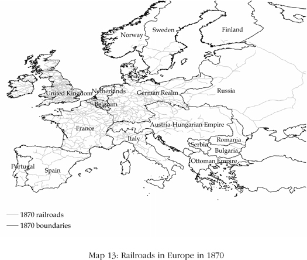

Map 13

古腾堡

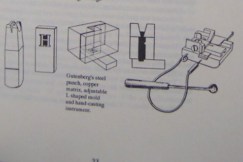

古腾堡发明制作铅活字的设备

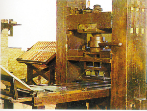

古腾堡发明使用铅活字的印刷机

古腾堡发明与铅活字相适应的用亚麻仁油制作的油墨

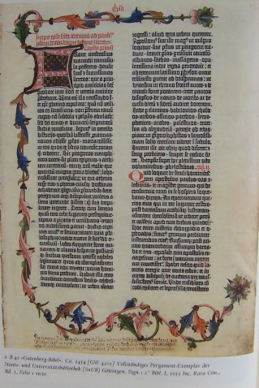

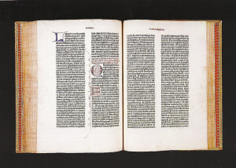

使用古腾堡的发明印刷的《圣经》

双国王偶人

百合花王冠：西班牙女王或王后之冠

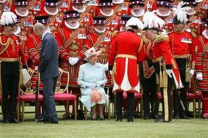

英国伊丽莎白女王2010年宣布将“缩减王室成员为四人”。英国媒体援引王室消息称：“女王殿下希望王室越发强大，为达此目的，就必须得民心。她已经决定要实行‘瘦身’计划。那也就意味着，其他年轻的‘多余’王室成员将面临危机。”安德鲁王子的两个女儿首当其冲，将丧失成为“职业王室”的机会，随之而来的是，她们大学毕业后，可能要出去找工作。

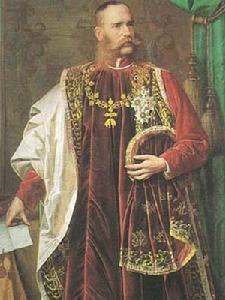

法兰西斯一世

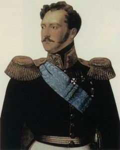

尼古拉一世

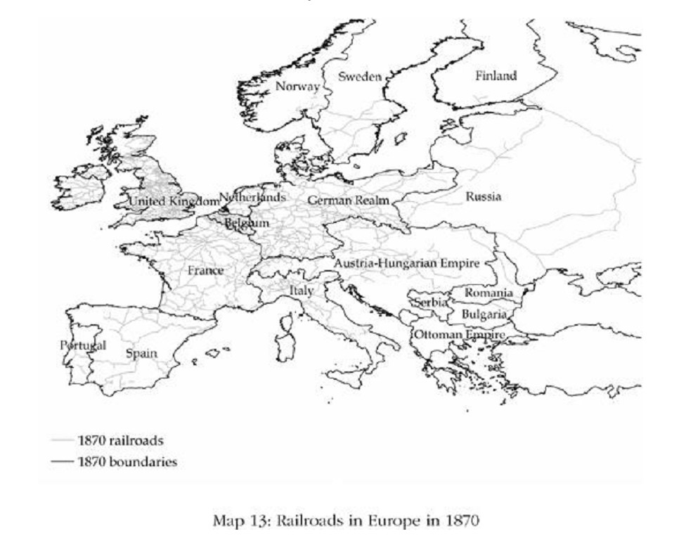

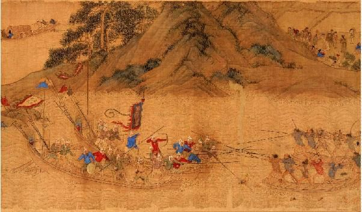

1555年（明嘉靖34年），五十三名日本浪人洗劫浙、皖、苏三省，攻掠杭、严、徽、宁、太平等州县二十余处，直逼明朝留都南京城下。这股倭寇暴走数千里，杀死杀伤四五千明朝官兵，历时八十余日，才被占绝对优势数量的明军围歼。（上图为明朝仇英画作《倭寇图卷》局部）

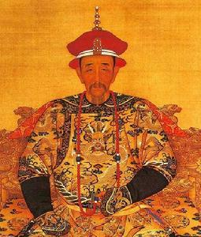

清朝康熙帝

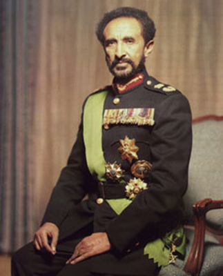

海尔•塞拉西一世

索马里海盗
