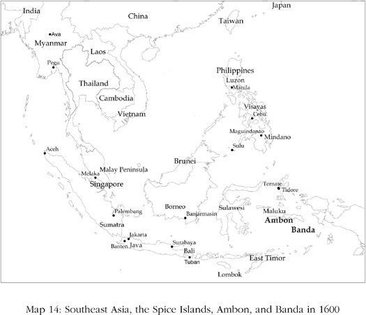
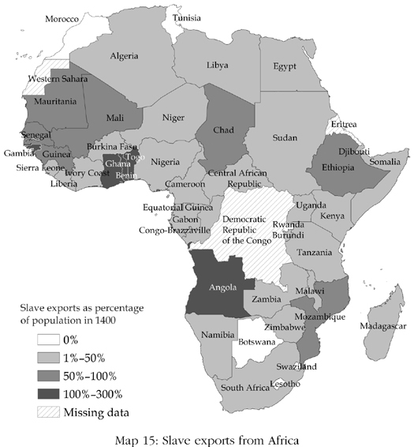
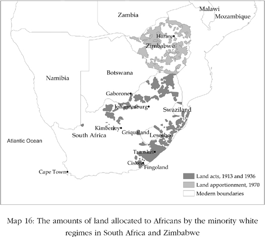
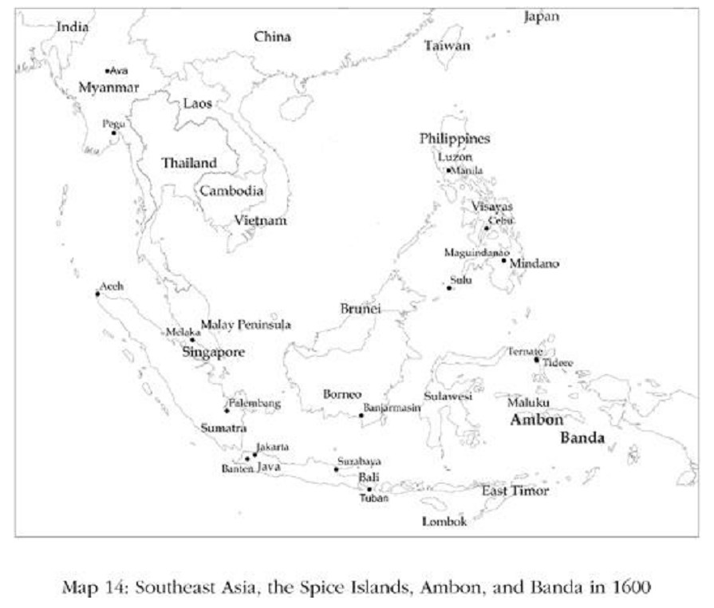
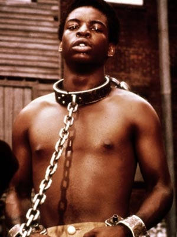
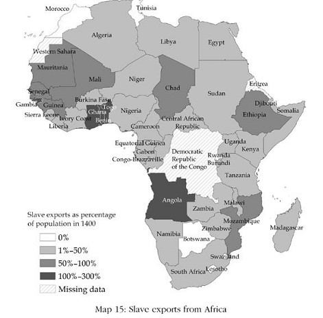
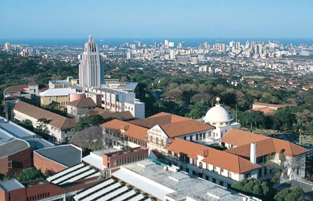

# Reversing Development · 第9章　倒退发展

## Spice And Genocide · 香料与灭族

The Moluccan Archipelago in modern Indonesia is made up of three groups of islands. In the early seventeenth century, the northern Moluccas housed the independent kingdoms of Tidore, Ternate, and Bacan. The middle Moluccas were home to the island kingdom of Ambon. In the south were the Banda Islands, a small archipelago that was not yet politically unified.

> 今日印尼境内的摩鲁佳群岛由三大岛群组成。17世纪初叶，北摩鲁佳分属三个独立王国：蒂多雷、特纳提及巴坎。中摩鲁佳则由安汶王国独据。南边的班达群岛幅员虽小，政治上却未统一。

Though they seem remote to us today, the Moluccas were then central to world trade as the only producers of the valuable spices cloves, mace, and nutmeg. Of these, nutmeg and mace grew only in the Banda Islands. Inhabitants of these islands produced and exported these rare spices in exchange for food and manufactured goods coming from the island of Java, from the entrepôt of Melaka on the Malaysian Peninsula, and from India, China, and Arabia. The first contact the inhabitants had with Europeans was in the sixteenth century, with Portuguese mariners who came to buy spices.

> 所有这些地方，今天看来虽然远在天边，但当时却是世界贸易的焦点，因为当地乃是珍贵的香料如丁香、豆蔻及肉豆蔻的唯一产地，其中，肉豆蔻及豆蔻甚至只有班达群岛才出产。岛民生产并输出这些珍稀的香料，用以交换粮食及手工制品，贸易对象则包括爪哇岛、马来半岛的港口城市马六甲、印度、中国及阿拉伯。岛民与欧洲人的第一次接触是在16世纪，对象是前来购买香料的葡萄牙水手。

Before then spices had to be shipped through the Middle East, via trade routes controlled by the Ottoman Empire. Europeans searched for a passage around Africa or across the Atlantic to gain direct access to the Spice Islands and the spice trade. The Cape of Good Hope was rounded by the Portuguese mariner Bartolomeu Dias in 1488, and India was reached via the same route by Vasco da Gama in 1498. For the first time the Europeans now had their own independent route to the Spice Islands.

> 在此之前，香料输往欧洲，都必须经过鄂图曼帝国控制的中东贸易路线。为了直接与香料群岛从事香料贸易，欧洲人绕过非洲或横渡大西洋寻找出路，1488年，葡萄牙人迪亚斯绕过好望角；1498年，达伽马经由同一路线抵达印度。从此，前往香料群岛，欧洲人不再仰人鼻息，终于有了自己的路径。

The Portuguese immediately set about the task of trying to control the trade in spices. They captured Melaka in 1511. Strategically situated on the western side of the Malaysian Peninsula, merchants from all over Southeast Asia came there to sell their spices to other merchants, Indian, Chinese, and Arabs, who then shipped them to the West. As the Portuguese traveler Tomé Pires put it in 1515: “The trade and commerce between the different nations for a thousand leagues on every hand must come to Melaka … Whoever is lord of Melaka has his hands at the throat of Venice.”

> 葡萄牙人立刻着手部署，企图一手控制香料贸易，并于1511年占领了马六甲。马六甲位于马来半岛西部，地处要津，整个东南亚地区的商人云集于此，将香料卖给印度、中国及阿拉伯商人，再由他们转运至西方。诚如葡萄牙旅行家派尔斯1515年所言：“马六甲为各国商旅必至之地……谁要是主宰了马六甲，谁就掐住了威尼斯的喉咙。”

With Melaka in their hands, the Portuguese systematically tried to gain a monopoly of the valuable spice trade. They failed. The opponents they faced were not negligible. Between the fourteenth and sixteenth centuries, there was a great deal of economic development in Southeast Asia based on trade in spices. City-states such as Aceh, Banten, Melaka, Makassar, Pegu, and Brunei expanded rapidly, producing and exporting spices along with other products such as hardwoods.

> 马六甲到手，葡萄牙人便有系统地展开行动，企图垄断价值不菲的香料贸易。但失败了。他们所面对的对手并不好惹。14至16世纪间，东南亚地区的许多经济发展全都有赖于香料贸易，城邦如亚齐、万丹、马六甲、望加西、勃固及婆罗乃（今日文莱）均发展迅速，香料之外，也生产及输出硬木之类的产品。

These states had absolutist forms of government similar to those in Europe in the same period. The development of political institutions was spurred by similar processes, including technological change in methods of warfare and international trade. State institutions became more centralized, with a king at the center claiming absolute power. Like absolutist rulers in Europe, Southeast Asian kings relied heavily on revenues from trade, both engaging in it themselves and granting monopolies to local and foreign elites. As in absolutist Europe, this generated some economic growth but was a far-from-ideal set of economic institutions for economic prosperity, with significant entry barriers and insecure property rights for most.

> 一如同一时期的欧洲，这些国家都实行专制统治，甚至连发展过程中所受到的刺激都相同，这里面包括作战方法的科技变革和国际贸易，政府体制则愈来愈趋向集中化，以君主为中心，集绝对权力于一身。如同欧洲专制政权的统治者，东南亚的君主也高度依赖营利所得，不仅自己大做买卖，也把独占权特许给本国及外国的菁英阶级。一如专制统治的欧洲，这种情形虽然造就了某些阶级成长，但相较于那些可以促进经济繁荣的理想经济制度，相去却不可以道里计，大体上来说，不仅进场的通路障碍重重，财产权的保障也付之阙如。

But the process of commercialization was under way even as the Portuguese were trying to establish their dominance in the Indian Ocean. The presence of Europeans swelled and had a much greater impact with the arrival of the Dutch. The Dutch quickly realized that monopolizing the supply of the valuable spices of the Moluccas would be much more profitable than competing against local or other European traders.

> 尽管如此，随着葡萄牙人对印度洋的掌控，商业化的进程还是展开了。紧接着，欧洲人开始大量出现，荷兰人的影响尤其重大。荷兰人很快就明白，与其跟当地及其他欧洲商人竞争，彻底垄断摩鲁佳香料的供应才是更大的利润所在。

In 1600 they persuaded the ruler of Ambon to sign an exclusive agreement that gave them the monopoly on the clove trade in Ambon. With the founding of the Dutch East India Company in 1602, the Dutch attempts to capture the entire spice trade and eliminate their competitors, by hook or by crook, took a turn for the better for the Dutch and for the worse for Southeast Asia. The Dutch East India Company was the second European joint stock company, following the English East India Company, major landmarks in the development of the modern corporation, which would subsequently play a major role in European industrial growth. It was also the second company that had its own army and the power to wage war and colonize foreign lands.

> 1600年，荷兰人说服安汶统治者，签订一纸独家协议，取得安汶的丁香贸易独占权。1602年，荷兰东印度公司成立，连蒙带骗，排除了所有的竞争者，拿下整个香料贸易，此举固然为荷兰带来了更大的利益，东南亚却从此日趋沦落。继英格兰东印度公司之后，荷兰东印度公司是欧洲第二个联合股份公司，两者在现代公司的发展中堪称重要的里程碑，随后并在欧洲的工业发展中扮演重要角色。该公司也是第二个自身拥有军队，有力量发动战争并殖民外国领土的公司。

With the military power of the company now brought to bear, the Dutch proceeded to eliminate all potential interlopers to enforce their treaty with the ruler of Ambon. They captured a key fort held by the Portuguese in 1605 and forcibly removed all other traders. They then expanded to the northern Moluccas, forcing the rulers of Tidore, Ternate, and Bacan to agree that no cloves could be grown or traded in their territories. The treaty they imposed on Ternate even allowed the Dutch to come and destroy any clove trees they found there.

> 随着公司武力的得逞，荷兰着手排除任何可能的外来势力，强化他们与安汶统治者之间的条约。1605年，占领葡萄牙人的一处要塞之后，开始向北摩鲁佳扩张势力，强制蒂多雷、特纳提及巴坎同意不在本国领土内种植或买卖丁香。条约甚至强迫蒂多雷同意，国境之内只要发现任何丁香树，荷兰人都可以将之摧毁。

Ambon was ruled in a manner similar to much of Europe and the Americas during that time. The citizens of Ambon owed tribute to the ruler and were subject to forced labor. The Dutch took over and intensified these systems to extract more labor and more cloves from the island. Prior to the arrival of the Dutch, extended families paid tribute in cloves to the Ambonese elite. The Dutch now stipulated that each household was tied to the soil and should cultivate a certain number of clove trees. Households were also obligated to deliver forced labor to the Dutch.

> 安汶的统治方式，和当时多数欧洲及美洲政权相似，人民不仅要向统治者纳贡还要服役。荷兰占领该岛之后，强化此一制度，榨取更多的劳力和丁香。荷兰人没来之前，岛上的大家族以丁香向安汶的统治阶层纳贡。荷兰人来了之后，便明文规定每一家都配给一定的土地，种植定量的丁香树，还要为荷兰人服强制性劳役。

The Dutch also took control of the Banda Islands, intending this time to monopolize mace and nutmeg. But the Banda Islands were organized very differently from Ambon. They were made up of many small autonomous city-states, and there was no hierarchical social or political structure. These small states, in reality no more than small towns, were run by village meetings of citizens. There was no central authority whom the Dutch could coerce into signing a monopoly treaty and no system of tribute that they could take over to capture the entire supply of nutmeg and mace.

> 同时，荷兰人又控制班达群岛，企图垄断肉豆蔻及豆蔻。但班达群岛的组成大异于安汶，是由许多小型的自治城邦构成，无论社会或政治结构都没有阶层之分。这些小国实际上无异于小城镇，由老百姓组成的村里大会治理。由于没有中央集权的政权，荷兰人没有对象强制签订专卖条约，又因为没有纳贡的制度，想要全面掌控肉豆蔻及豆蔻的供应也变得无从下手。

At first this meant that the Dutch had to compete with English, Portuguese, Indian, and Chinese merchants, losing the spices to their competitors when they did not pay high prices. Their initial plans of setting up a monopoly of mace and nutmeg dashed, the Dutch governor of Batavia, Jan Pieterszoon Coen, came up with an alternative plan. Coen founded Batavia, on the island of Java, as the Dutch East India Company’s new capital in 1618. In 1621 he sailed to Banda with a fleet and proceeded to massacre almost the entire population of the islands, probably about fifteen thousand people.

> 这样一来，摆明了必须跟英格兰、葡萄牙、印度及中国商人竞争，如果又不肯出高价，就只有败下阵来一途。独占肉豆蔻及豆蔻的如意算盘落空了，荷兰巴达维亚总督科昂开始想别的办法。1618年，他在爪哇岛上建立巴达维亚，将之定为荷兰东印度公司的新首府，并于1621年率领一支舰队航向班达，展开屠杀，几乎灭绝全部岛民，为数约一万五千人。

All their leaders were executed along with the rest, and only a few were left alive, enough to preserve the know-how necessary for mace and nutmeg production. After this genocide was complete, Coen then proceeded to create the political and economic structure necessary for his plan: a plantation society. The islands were divided into sixty-eight parcels, which were given to sixty-eight Dutchmen, mostly former and current employees of the Dutch East India Company.

> 除了少数懂得肉豆蔻及豆蔻生产的人，所有的领袖人物及其他人等无一幸免。完成灭族之举后，科昂着手建立计划中的政治及经济架构：农庄社会。全岛分成六十八块区域，分给六十八个荷兰人，大部分都是荷兰东印度公司前任及现任员工。

These new plantation owners were taught how to produce the spices by the few surviving Bandanese and could buy slaves from the East India Company to populate the now-empty islands and to produce spices, which would have to be sold at fixed prices back to the company. The extractive institutions created by the Dutch in the Spice Islands had the desired effects, though, in Banda this was at the cost of fifteen thousand innocent lives and the establishment of a set of economic and political institutions that would condemn the islands to underdevelopment. By the end of the seventeenth century, the Dutch had reduced the world supply of these spices by about 60 percent and the price of nutmeg had doubled.

> 新的农庄主向少数幸存下来的班达人学习生产技术，同时向东印度公司购买奴隶，运至空无一人的岛上生产香料，再以固定价格回销公司。荷兰人在香料群岛建立的榨取式制度取得了既定的效果，其代价却是班达岛上一万五千条无辜的生命，以及一套从此使这个群岛沦于低度发展的经济及政治制度。至17世纪末叶，荷兰人把香料的世界供应量减少60%，豆蔻的价格随之倍增。

The Dutch spread the strategy they perfected in the Moluccas to the entire region, with profound implications for the economic and political institutions of the rest of Southeast Asia. The long commercial expansion of several states in the area that had started in the fourteenth century went into reverse. Even the polities which were not directly colonized and crushed by the Dutch East India Company turned inward and abandoned trade. The nascent economic and political change in Southeast Asia was halted in its tracks.

> 荷兰人在摩鲁佳得逞，于是将相同的策略推广到整个区域，在东南亚其余地区雷厉风行。此一区域有好几个国家，14世纪以来开展的商业规模就此大幅衰退，即使没有直接受到荷兰东印度公司殖民与压榨的政体也转而内缩，放弃对外贸易。东南亚的经济及政治刚刚要开始改变，因此也就戛然而止。

To avoid the threat of the Dutch East India Company, several states abandoned producing crops for export and ceased commercial activity. Autarky was safer than facing the Dutch. In 1620 the state of Banten, on the island of Java, cut down its pepper trees in the hope that this would induce the Dutch to leave it in peace. When a Dutch merchant visited Maguindanao, in the southern Philippines, in 1686, he was told, “Nutmeg and cloves can be grown here, just as in Malaku. They are not there now because the old Raja had all of them ruined before his death. He was afraid the Dutch Company would come to fight with them about it.”

> 为避开荷兰东印度公司的威胁，好几个国家放弃外销作物的生产并停止商业活动。自给自足总比面对荷兰人的威胁来得安全。1620年，爪哇岛上的万丹国就将境内的胡椒树全数铲除，指望荷兰人就此放他们过平安日子。1686年，一名荷兰商人走访菲律宾南部的马昆塔纳欧，当地人跟他说：“豆蔻和丁香在这里长得和摩鲁佳一样好，但现在却全没了，因为已故国王担心荷兰公司的侵略，生前已经将之全数铲除。”

What a trader heard about the ruler of Maguindanao in 1699 was similar: “He had forbidden the continued planting of pepper so that he could not thereby get involved in war whether with the [Dutch] company or with other potentates.” There was de-urbanization and even population decline. In 1635 the Burmese moved their capital from Pegu, on the coast, to Ava, far inland up the Irrawaddy River.

> 1699年，又有一名商人到了马昆塔纳欧，谈起统治者，所听到的依然如出一辙：“他禁止继续种植胡椒，以免自己卷入到（荷兰）公司或其他统治者的战争中去。”整个结果是，都市化倒退，甚至连人口也跟着减少。1635年，缅甸人就将国都从沿海的勃固迁往亚伐，远远躲到伊洛瓦底江上游去了。

We do not know what the path of economic and political development of Southeast Asian states would have been without Dutch aggression. They may have developed their own brand of absolutism, they may have remained in the same state they were in at the end of the sixteenth century, or they may have continued their commercialization by gradually adopting more and more inclusive institutions. But as in the Moluccas, Dutch colonialism fundamentally changed their economic and political development. The people in Southeast Asia stopped trading, turned inward, and became more absolutist. In the next two centuries, they would be in no position to take advantage of the innovations that would spring up in the Industrial Revolution. And ultimately their retreat from trade would not save them from Europeans; by the end of the eighteenth century, nearly all were part of European colonial empires.

> 如果没有荷兰人的侵略，东南亚国家的经济及政治发展会走上什么道路，我们无从知悉，它们有可能发展出自有特色的专制政体，也有可能维持它们在16世纪末叶时的状态，也或许会渐进地采纳更为广纳式制度继续进行商业化。但如同摩鲁佳的例子，荷兰的殖民政策却是从根本上改变了经济与政治的发展，使东南亚国家停止了对外贸易，转而内缩，专制统治也为之变本加厉，以致在接下来的两个世纪中，尽管工业革命的创新如火如荼，此一地区却只能置身事外，完全无缘参与。弄到最后，退出对外贸易不但没有保住它们免于欧洲的侵略，到了18世纪末叶，反而全都成了欧洲殖民帝国的囊中之物。

WE SAW IN CHAPTER 7 how European expansion into the Atlantic fueled the rise of inclusive institutions in Britain. But as illustrated by the experience of the Moluccas under the Dutch, this expansion sowed the seeds of underdevelopment in many diverse corners of the world by imposing, or further strengthening existing, extractive institutions. These either directly or indirectly destroyed nascent commercial and industrial activity throughout the globe or they perpetuated institutions that stopped industrialization. As a result, as industrialization was spreading in some parts of the world, places that were part of European colonial empires stood no chance of benefiting from these new technologies.

> 在第七章，我们看到，欧洲向大西洋的扩张刺激了广纳式制度在英格兰兴起。但荷兰人统治摩鲁佳的经济显示，强行实施或进一步强化现行的榨取式制度，却在世界各个角落撒下了低度发展的种子。这种扩张行为，无论其为间接或直接，所到之处，不仅商业及工业活动的幼苗毁于一旦，而且使得阻挡工业化的制度更加长命百岁。其结果是，工业化虽然在世界的某些部分扩散，多数欧洲殖民帝国却没有用新的科技带来新的福祉。

## The All-Too-Usual Institution · 司空见惯的制度

In Southeast Asia the spread of European naval and commercial power in the early modern period curtailed a promising period of economic expansion and institutional change. In the same period as the Dutch East India Company was expanding, a very different sort of trade was intensifying in Africa: the slave trade. In the United States, southern slavery was often referred to as the “peculiar institution.”

> 现代的早期，东南亚本来大有机会迎接一个经济扩张及制度改变的新时代，但欧洲海军及商业力量的扩散却活生生将之截断。就在荷兰东印度公司进行扩张的同时，另一种迥然不同的贸易则在非洲如火如荼地进行，那就是奴隶贸易。在美国，一说到南方的奴隶制度，往往都说是“特殊制度”。

But historically, as the great classical scholar Moses Finlay pointed out, slavery was anything but peculiar, it was present in almost every society. It was, as we saw earlier, endemic in Ancient Rome and in Africa, long a source of slaves for Europe, though not the only one. In the Roman period slaves came from Slavic peoples around the Black Sea, from the Middle East, and also from Northern Europe. But by 1400, Europeans had stopped enslaving each other.

> 但从历史的角度观察，诚如大古典学家芬雷所言，奴隶制度绝非特例，几乎在每个社会都曾出现过。本书早先也曾指出，这在古罗马及非洲都是地方性的传统，或者长期以来更是欧洲的奴隶来源，只不过并非唯一来源。古罗马时期，奴隶都是斯拉夫人（Slavic people），来自黑海四周、中东，也有来自北欧。但到1400年代，欧洲人不再奴役自己人。

Africa, however, as we saw in chapter 6, did not undergo the transition from slavery to serfdom as did medieval Europe. Before the early modern period, there was a vibrant slave trade in East Africa, and large numbers of slaves were transported across the Sahara to the Arabian Peninsula. Moreover, the large medieval West African states of Mali, Ghana, and Songhai made heavy use of slaves in the government, the army, and agriculture, adopting organizational models from the Muslim North African states with whom they traded.

> 至于非洲，如本书第六章所言，并未像中世纪欧洲那样从奴隶制度转变成农奴制度。现代时期来临之前，东非奴隶贸易活络，有大量奴隶越过撒哈拉运往阿拉伯半岛。此外，西非大国马里、加纳及桑海，中世纪时就已经在政府、军队及农业上大量使用奴隶，它们和北非穆斯林国家从事奴隶贸易，同时也采用它们的组织形态。

It was the development of the sugar plantation colonies of the Caribbean beginning in the early seventeenth century that led to a dramatic escalation of the international slave trade and to an unprecedented increase in the importance of slavery within Africa itself. In the sixteenth century, probably about 300,000 slaves were traded in the Atlantic. They came mostly from Central Africa, with heavy involvement of Kongo and the Portuguese based farther south in Luanda, now the capital of Angola. During this time, the trans-Saharan slave trade was still larger, with probably about 550,000 Africans moving north as slaves. In the seventeenth century, the situation reversed.

> 17世纪初期，加勒比海地区殖民地的糖业种植不仅导致国际间的奴隶贸易量剧增，同时也使奴隶在非洲内部受到前所未有的重视。16世纪时，大西洋的奴隶贸易为数约三十万名，多数来自中非洲，与刚果及葡萄牙人有着密切的关系，后者的根据地在偏南方的卢安达，先今安哥拉的首都。此一时期，横越撒哈拉的奴隶贸易量仍然庞大，北上为奴的非洲人为数约五十五万。到了17世纪，整个情况反转过来。

About 1,350,000 Africans were sold as slaves in the Atlantic trade, the majority now being shipped to the Americas. The numbers involved in the Saharan trade were relatively unchanged. The eighteenth century saw another dramatic increase, with about 6,000,000 slaves being shipped across the Atlantic and maybe 700,000 across the Sahara. Adding the figures up over periods and parts of Africa, well over 10,000,000 Africans were shipped out of the continent as slaves.

> 在大西洋贸易中，出售为奴的非洲人多达一百三十五万，绝大多数都是用船送往美洲。至于撒哈拉的交易数量，大体上没有什么改变。18世纪又有另一波的暴增，乘船横渡大西洋的奴隶多达六百万，横越撒哈拉的奴隶则在七十万之上。如果把各个时期及非洲各地加总起来，从非洲大陆运送出去的奴隶，数量起码超过一千万。

Map 15 (this page) gives some sense of the scale of the slave trade. Using modern country boundaries, it depicts estimates of the cumulative extent of slavery between 1400 and 1900 as a percent of population in 1400. Darker colors show more intense slavery. For example, in Angola, Benin, Ghana, and Togo, total cumulative slave exports amounted to more than the entire population of the country in 1400.

> 地图15约略可以说明奴隶贸易的规模。用今天的国界标示，粗略估计1400年至1900年间的累积人数，及其在1400年人口数中所占百分比。深暗色部分表示奴隶的密度较高，例如安哥拉、贝宁、加纳及多哥，累积输出的奴隶数量超过该国1400年总人口数。

The sudden appearance of Europeans all around the coast of Western and Central Africa eager to buy slaves could not but have a transformative impact on African societies. Most slaves who were shipped to the Americas were war captives subsequently transported to the coast. The increase in warfare was fueled by huge imports of guns and ammunition, which the Europeans exchanged for slaves.

> 欧洲人突然出现在西非海岸及中非，迫不及待地收购奴隶，对非洲的改变自有其重大影响。大部分要用船运到美国的奴隶都是战俘，且立刻就送往海岸。枪支弹药的大量进口刺激了战争的增加，欧洲人便是拿这些东西来交换奴隶。

By 1730 about 180,000 guns were being imported every year just along the West African coast, and between 1750 and the early nineteenth century, the British alone sold between 283,000 and 394,000 guns a year. Between 1750 and 1807, the British sold an extraordinary 22,000 tons of gunpowder, making an average of about 384,000 kilograms annually, along with 91,000 kilograms of lead per year. Farther to the south, the trade was just as vigorous. On the Loango coast, north of the Kingdom of Kongo, Europeans sold about 50,000 guns a year.

> 1730年代，沿着西非海岸，每年进口枪支约十八万，到了1750年及19世纪初年间，单单英国，一年所卖的枪支就在二十八万三千至三十九万四千之间。1750年至1807年间，英国另外还卖了二万二千吨的火药，平均每年约三十八万四千公斤，外加每年九万一千公斤的铅。更往南边去，交易也同样火热。在刚果北部的卢安果沿海，欧洲人一年卖出五万枝枪。

All this warfare and conflict not only caused major loss of life and human suffering but also put in motion a particular path of institutional development in Africa. Before the early modern era, African societies were less centralized politically than those of Eurasia. Most polities were small scale, with tribal chiefs and perhaps kings controlling land and resources. Many, as we showed with Somalia, had no structure of hierarchical political authority at all.

> 所有这些战争不仅造成生命的丧失及人生的苦难，同时也推动非洲在制度发展上走出一条另类的道路。现代时期萌发之前，相较于欧洲及亚洲，非洲社会在政治上极少中央集权，大部分政体都是小格局，由部落酋长或所谓的国王控制土地及资源。许多地方，如本书提到过的索马里，政治上根本没有层级分明的权力结构。

The slave trade initiated two adverse political processes. First, many polities initially became more absolutist, organized around a single objective: to enslave and sell others to European slavers. Second, as a consequence but, paradoxically, in opposition to the first process, warring and slaving ultimately destroyed whatever order and legitimate state authority existed in sub-Saharan Africa. Apart from warfare, slaves were also kidnapped and captured by small-scale raiding. The law also became a tool of enslavement.

> 在政治上，奴隶买卖启动了两种有害的进程。其一，许多原本就比较专制的政权，奴役别人并将之卖给欧洲的奴隶主变成了国家的唯一目标。其二是因此产生的结果，但却很矛盾：为对抗第一种进程，到头来，战争与奴役却彻底摧毁了下撒哈拉非洲国家的秩序与法治权威。战争之外，奴隶也有绑架得来的，甚至连法律都变成了取得奴隶的工具。

No matter what crime you committed, the penalty was slavery. The English merchant Francis Moore observed the consequences of this along the Senegambia coast of West Africa in the 1730s: Since this slave trade has been us’d, all punishments are changed into slavery; there being an advantage on such condemnations, they strain for crimes very hard, in order to get the benefit of selling the criminal. Not only murder, theft and adultery, are punished by selling the criminal for slave, but every trifling case is punished in the same manner.

> 无论是犯的是什么罪，刑罚都可以将之打为奴隶。1730年代，在非洲西岸的塞内甘比亚，英国商人摩尔就注意到了这种情形：“自从奴隶买卖派上用场，所有的处罚就都变成了奴隶制度的一环；这种刑罚有个好处，他们打击犯罪从此不遗余力，因为罪犯可以卖为奴隶，有利可图，而且不只是杀人、盗窃、通奸会被处以卖为奴隶之罪，连小案子也照样处以同罪。”

Institutions, even religious ones, became perverted by the desire to capture and sell slaves. One example is the famous oracle at Arochukwa, in eastern Nigeria. The oracle was widely believed to speak for a prominent deity in the region respected by the major local ethnic groups, the Ijaw, the Ibibio, and the Igbo. The oracle was approached to settle disputes and adjudicate on disagreements. Plaintiffs who traveled to Arochukwa to face the oracle had to descend from the town into a gorge of the Cross River, where the oracle was housed in a tall cave, the front of which was lined with human skulls.

> 为了抓捕并贩卖奴隶，甚至连宗教制度都遭到扭曲。尼日利亚东部的埃罗恰夸神谕就是一例。当地三个主要族群，伊乔族、伊毕比欧族和伊格波族都相信，神谕是一位普受敬仰的地方神祗的发言，请神谕的目的则是要排难解纷。前往埃罗恰夸请神谕的人，必须从镇里下到克罗斯河的一个峡谷，进入一个高大的洞穴，神谕就放在里面，洞穴前则排列着人的骷髅。

The priests of the oracle, in league with the Aro slavers and merchants, would dispense the decision of the oracle. Often this involved people being “swallowed” by the oracle, which actually meant that once they had passed through the cave, they were led away down the Cross River and to the waiting ships of the Europeans. This process in which all laws and customs were distorted and broken to capture slaves and more slaves had devastating effects on political centralization, though in some places it did lead to the rise of powerful states whose main raison d’être was raiding and slaving. The Kingdom of Kongo itself was probably the first African state to experience a metamorphosis into a slaving state, until it was destroyed by civil war.

> 分配神谕的祭师和埃罗恰夸的奴隶主及商人勾结，这中间大有文章，经常发生有人被神谕给“吞掉”的事，说穿了，其实是请神谕的人穿过洞穴之后，就被带到克罗斯河，而欧洲人的船早已等在那儿。整件事情里面，法律和风俗都遭到滥用及破坏，成了抓捕奴隶的帮凶，这样的事情对于政治集权化具有致命的效应，虽然在某些地方确实促成了强势政府的兴起，但其存在的目的竟然就只是掠夺与奴役。刚果王国是第一个质变为奴隶国家的非洲国家，后来终因内战而覆亡。

Other slaving states arose most prominently in West Africa and included Oyo in Nigeria, Dahomey in Benin, and subsequently Asante in Ghana. The expansion of the state of Oyo in the middle of the seventeenth century, for example, is directly related to the increase of slave exports on the coast. The state’s power was the result of a military revolution that involved the import of horses from the north and the formation of a powerful cavalry that could decimate opposing armies. As Oyo expanded south toward the coast, it crushed the intervening polities and sold many of their inhabitants for slaves.

> 其他奴隶国家主要集中在西非，包括今天尼日利亚境内的奥约、贝宁境内的达荷美，以及后来加纳境内的艾森地。举例来说，17世纪中叶奥约国的扩张，就和沿海奴隶输出的增加有着直接关系。至于国力的强盛则是军事改革的结果，其中包括从北方输入马匹，组成强大骑兵，能够彻底歼灭反对势力。奥约向南方海岸扩张之际，遭到其他政治体的干预，奥约一一予以击败，并将其人民出售为奴。

In the period between 1690 and 1740, Oyo established its monopoly in the interior of what came to be known as the Slave Coast. It is estimated that 80 to 90 percent of the slaves sold on the coast were the result of these conquests. A similar dramatic connection between warfare and slave supply came farther west in the eighteenth century, on the Gold Coast, the area that is now Ghana. After 1700 the state of Asante expanded from the interior, in much the same way as Oyo had previously.

> 1690年至1740年这段期间，奥约一手垄断了号称奴隶海岸的贸易。据估计，在此一海岸卖出去的奴隶，征战所俘者占约八至九成。战争与奴隶供应之间存在着显著的关系，另外一个例子则发生在东非（似应为西北非），亦即现今加纳境内的黄金海岸。1700年之后，艾森地从内陆向外扩张，其模式与之前的奥约如出一辙。

During the first half of the eighteenth century, this expansion triggered the so-called Akan Wars, as Asante defeated one independent state after another. The last, Gyaman, was conquered in 1747. The preponderance of the 375,000 slaves exported from the Gold Coast between 1700 and 1750 were captives taken in these wars. Probably the most obvious impact of this massive extraction of human beings was demographic. It is difficult to know with any certitude what the population of Africa was before the modern period, but scholars have made various plausible estimates of the impact of the slave trade on the population.

> 18世纪前半叶，扩张引发了史称的艾肯战争，艾森地各个击破，并于1747年征服最后一个国家伽门。1700年至1750年间从黄金海岸出售的奴隶约三十五万七千人，其中多数是战俘。这种大规模的人口抽离，影响最大的可能就属人口统计。现代时期之前，非洲人口到底有多少，根本无从知道，倒是奴隶贸易对人口的冲击，不少学者所做的估计却相当值得参考。

The historian Patrick Manning estimates that the population of those areas of West and West-Central Africa that provided slaves for export was around twenty-two to twenty-five million in the early eighteenth century. On the conservative assumption that during the eighteenth and early nineteenth centuries these areas would have experienced a rate of population growth of about half a percent a year without the slave trade, Manning estimated that the population of this region in 1850 ought to have been at least forty-six to fifty-three million. In fact, it was about one-half of this.

> 历史学家曼宁估计，18世纪初，供应奴隶输出的非洲西部及中西部，人口数约在二千二百万至二千五百万之间。但按照保守的假设，18世纪与19世纪初期这段期间，如果没有奴隶贸易的话，以这些地区人口成长一年约为0.5%计，曼宁估计，到1850年，这一区域的人口数至少应为四千六百万至五千三百万。但事实上，却只有一半的数目。

This massive difference was not only due to about eight million people being exported as slaves from this region between 1700 and 1850, but the millions likely killed by continual internal warfare aimed at capturing slaves. Slavery and the slave trade in Africa further disrupted family and marriage structures and may also have reduced fertility. Beginning in the late eighteenth century, a strong movement to abolish the slave trade began to gain momentum in Britain, led by the charismatic figure of William Wilberforce. After repeated failures, in 1807 the abolitionists persuaded the British Parliament to pass a bill making the slave trade illegal.

> 为何会出现这样巨大的差异，1700年至1850年之间，从此一区域输出的奴隶多达八百万人固然是原因之一，但为了抓捕奴隶，征战连年，死亡数以百万计也难辞其咎。此外，奴隶制度与奴隶贸易进一步破坏了家庭与婚姻，或许也降低了生育率。18世纪末叶，废止奴隶贸易的运动兴起，并在领袖魅力十足的威伯佛斯领导下，开始在英国获得动力。经过多次失败，1807年，废止派终于说服国会，通过法案，将奴隶贸易列为非法。

The United States followed with a similar measure the next year. The British government went further, though: it actively sought to implement this measure by stationing naval squadrons in the Atlantic to try to stamp out the slave trade. Though it took some time for these measures to be truly effective, and it was not until 1834 that slavery itself was abolished in the British Empire, the days of the Atlantic slave trade, by far the largest part of the trade, were numbered.

> 次年，美国继踵其后。但英国政府推行得更彻底，为积极推动此一禁令，在大西洋上部署海军舰队，企图彻底扫除奴隶贸易。所有这些措施真正见到效果却花了相当长的时间，直到1834年，奴隶身份才在大英帝国境内绝迹，当时奴隶贸易的最大一部分——大西洋奴隶贸易——总算走到了日暮穷途。

Though the end of the slave trade after 1807 did reduce the external demand for slaves from Africa, this did not mean that slavery’s impact on African societies and institutions would magically melt away. Many African states had become organized around slaving, and the British putting an end to the trade did not change this reality. Moreover, slavery had become much more prevalent within Africa itself. These factors would ultimately shape the path of development in Africa not only before but also after 1807.

> 1807年后，奴隶贸易告终虽然减少了外界对非洲奴隶的需求，但这并不表示奴隶制度对非洲社会及制度的影响也就此跟着消失。许多国家的组成都是以奴隶为中心，就算英国终结了这方面的交易，但却没改变此一现实。尤其重要的是，奴隶制度在非洲已经根深蒂固。所有这些因素加起来，也就形成了非洲发展的道路，1807年之前如此，其后亦然。

In the place of slavery came “legitimate commerce,” a phrase coined for the export from Africa of new commodities not tied to the slave trade. These goods included palm oil and kernels, peanuts, ivory, rubber, and gum arabic. As European and North American incomes expanded with the spread of the Industrial Revolution, demand for many of these tropical products rose sharply. Just as African societies took aggressive advantage of the economic opportunities presented by the slave trade, they did the same with legitimate commerce.

> 奴隶制度之后，取而代之的是一个新词：“合法生意”，指的是一切从非洲出口但无关于奴隶贸易的新商品。所有这些新货品包括棕榈油、果仁、花生、象牙、橡胶及阿拉伯树胶。欧洲人及北美洲人的收入因工业革命的推动而成长，对于这类热带产品的需求也随之急剧升高。非洲人一如当年卯足了劲利用奴隶贸易带来的商机，对于这些合法生意，他们也一头栽入。

But they did so in a peculiar context, one in which slavery was a way of life but the external demand for slaves had suddenly dried up. What were all these slaves to do now that they could not be sold to Europeans? The answer was simple: they could be profitably put to work, under coercion, in Africa, producing the new items of legitimate commerce.

> 但他们利用这波新商机的方式有一个特殊的背景：奴隶的存在早已司空见惯，但外界对奴隶的需求却突然消失。奴隶既然不能再卖给欧洲人，他们又能做什么呢？答案很简单：可以强制他们在非洲工作，生产合法生意的新产品，利润好得很。

One of the best documented examples was in Asante, in modern Ghana. Prior to 1807, the Asante Empire had been heavily involved in the capturing and export of slaves, bringing them down to the coast to be sold at the great slaving castles of Cape Coast and Elmina. After 1807, with this option closed off, the Asante political elite reorganized their economy. However, slaving and slavery did not end.

> 有记录可稽的最佳例子之一在艾森地，亦即今天的加纳。1807年之前，艾森地帝国大搞抓奴卖奴的勾当，将人带到海岸，卖给设在凯普海岸及艾尔米纳的奴隶堡。1807年之后，这行业眼看没了搞头，艾森地的政治菁英阶层在经济上便另起炉灶。但不管怎么说，奴役与奴隶制度根本没有结束。

Rather, slaves were settled on large plantations, initially around the capital city of Kumase, but later spread throughout the empire (corresponding to most of the interior of Ghana). They were employed in the production of gold and kola nuts for export, but also grew large quantities of food and were intensively used as porters, since Asante did not use wheeled transportation. Farther east, similar adaptations took place. In Dahomey, for example, the king had large palm oil plantations near the coastal ports of Whydah and Porto Novo, all based on slave labor.

> 相反的，奴隶全都给圈进了大型农庄，刚开始只在首都库玛西周围，后来又扩张到整个帝国，受雇生产出口用的黄金及可乐果，但也种植大量的粮食，并从事密集的搬运工作，因为艾森地根本不使用轮子运输。同样的变通也发生在更往东的地方。举例来说，达荷美国王在怀达及波多诺伏的港岸地区拥有大片棕榈园，用的就全是奴工。

So the abolition of the slave trade, rather than making slavery in Africa wither away, simply led to a redeployment of the slaves, who were now used within Africa rather than in the Americas. Moreover, many of the political institutions the slave trade had wrought in the previous two centuries were unaltered and patterns of behavior persisted. For example, in Nigeria in the 1820s and ’30s the once-great Oyo Kingdom collapsed. It was undermined by civil wars and the rise of the Yoruba city-states, such as Illorin and Ibadan, that were directly involved in the slave trade, to its south.

> 因此，奴隶贸易的废止并没有使奴隶制度在非洲销声匿迹，充其量只是把奴隶换了个地方使用，以前是用在美洲，如今则是用在非洲境内。尤其重要的是，过去两个世纪为因应奴隶贸易所形成的政治制度并没有改变，因此其行为模式依然。举例来说，在尼日利亚，1820至30年代一度强大的奥约王国之所以崩溃，除了内战的关系，还因为南边的约鲁巴人的城邦兴起，诸如伊洛林及伊巴丹，这些都是直接涉入奴隶贸易的国家。

In the 1830s, the capital of Oyo was sacked, and after that the Yoruba cities contested power with Dahomey for regional dominance. They fought an almost continuous series of wars in the first half of the century, which generated a massive supply of slaves. Along with this went the normal rounds of kidnapping and condemnation by oracles and smaller-scale raiding. Kidnapping was such a problem in some parts of Nigeria that parents would not let their children play outside for fear they would be taken and sold into slavery.

> 1830年代，奥约饱受劫掠，之后，约鲁巴诸城又与达荷美角逐该地区的支配权，整个19世纪的前半叶，战火连绵，制造了无数奴隶。除此之外，日常生活中，绑架有之，神谕的诅咒有之，小规模的打家劫舍也照样发生。在尼日利亚某些地方，绑架严重到父母不准孩子到外面游戏，唯恐子女就此沦落成为奴隶。

As a result slavery, rather than contracting, appears to have expanded in Africa throughout the nineteenth century. Though accurate figures are hard to come by, a number of existing accounts written by travelers and merchants during this time suggest that in the West African kingdoms of Asante and Dahomey and in the Yoruba city-states well over half of the population were slaves. More accurate data exist from early French colonial records for the western Sudan, a large swath of western Africa, stretching from Senegal, via Mali and Burkina Faso, to Niger and Chad. In this region 30 percent of the population was enslaved in 1900.

> 其结果是，整个19世纪，在非洲大肆扩张的并不是商业合同而是奴隶制度。精确的数字尽管不易取得，根据当时许多旅行者及商人现存的记述，西非的艾森地王国及达荷美王国，以及约巴鲁诸城邦，奴隶人数都超过人口的半数。比较精确的资料则存在于早期法国殖民地的记录中，其中包括西苏丹，以及西非一大片带状地带，从塞内加尔经马里、吉布纳法索到尼日尔及乍得。到1900年，在这一区域，奴隶仍占全部人口的30%。

Just as with the emergence of legitimate commerce, the advent of formal colonization after the Scramble for Africa failed to destroy slavery in Africa. Though much of European penetration into Africa was justified on the grounds that slavery had to be combated and abolished, the reality was different. In most parts of colonial Africa, slavery continued well into the twentieth century. In Sierra Leone, for example, it was only in 1928 that slavery was finally abolished, even though the capital city of Freetown was originally established in the late eighteenth century as a haven for slaves repatriated from the Americas. It then became an important base for the British antislavery squadron and a new home for freed slaves rescued from slave ships captured by the British navy.

> 对于消灭非洲的奴隶制度，合法生意的出现固然无能为力，同样的，列强瓜分非洲之后的殖民统治照样无济于事。欧洲人入主非洲，尽管正气凛然，摆出一副对抗并废止奴隶制度的架势，但现实情况却非如此。殖民统治下的非洲，绝大部分地方，直至20世纪奴隶制度依然延续不绝。举例来说，塞拉利昂的奴隶就是直到1928年才完全根绝，尽管首都自由城在18世纪末叶建立之初，还被视为是美洲遣返奴隶的天堂，并成为英国反奴舰队的重要基地，也是奴隶被英国海军从奴隶船上解救下来，重获自由后的新家。

Even with this symbolism slavery lingered in Sierra Leone for 130 years. Liberia, just south of Sierra Leone, was likewise founded for freed American slaves in the 1840s. Yet there, too, slavery lingered into the twentieth century; as late as the 1960s, it was estimated that one-quarter of the labor force were coerced, living and working in conditions close to slavery. Given the extractive economic and political institutions based on the slave trade, industrialization did not spread to sub-Saharan Africa, which stagnated or even experienced economic retardation as other parts of the world were transforming their economies.

> 尽管具有这样的象征意义，奴隶制度在塞拉利昂还是延续长达一百三十年之久。1840年代，就在塞拉利昂的南边，同样也是为美洲重获自由的奴隶而成立的赖比瑞亚，情况亦复如此。甚至到了20世纪，奴隶制度仍然阴魂不散，迟至1960年代，据估计，劳动人口中仍有四分之一是强制性的，生活上与工作上的条件都无异于奴隶。由于经济与政治制度的建立都是以奴隶贸易为基础，是榨取式的，因此工业化也没有扩及到下撒哈拉非洲；相较于世界其他部分的经济正在转型，这一地区的经济不仅停滞不前甚至是倒退的。

## Making A Dual Economy · 打造二元经济

The “dual economy” paradigm, originally proposed in 1955 by Sir Arthur Lewis, still shapes the way that most social scientists think about the economic problems of less-developed countries. According to Lewis, many less-developed or underdeveloped economies have a dual structure and are divided into a modern sector and a traditional sector. The modern sector, which corresponds to the more developed part of the economy, is associated with urban life, modern industry, and the use of advanced technologies. The traditional sector is associated with rural life, agriculture, and “backward” institutions and technologies.

> “二元经济”的典型最初由刘易斯爵士于1955年提出，至今许多社会科学家思考低度开发国家的经济问题时，仍然是从这个角度切入。按照刘易斯的说法，许多低度开发国家的经济都是二元结构，其一为现代部门，另一为传统部门。现代部门相当于经济中发展得较高的部分，与之相关的如都市生活、现代产业及先进技术的应用。与传统部门相关的则是农村生活、农业，以及“落后的”制度及技术。

Backward agricultural institutions include the communal ownership of land, which implies the absence of private property rights on land. Labor was used so inefficiently in the traditional sector, according to Lewis, that it could be reallocated to the modern sector without reducing the amount the rural sector could produce. For generations of development economists building on Lewis’s insights, the “problem of development” has come to mean moving people and resources out of the traditional sector, agriculture and the countryside, and into the modern sector, industry and cities. In 1979 Lewis received the Nobel Prize for his work on economic development.

> 落后的农业制度包括土地所有权公有，这表示私人没有土地财产权。按照刘易斯的观点，在传统部门，劳动力的使用非常没有效率，大可将之重新配置，转用到现代部门，这样做也不至于降低农业部门的生产量。好几个世代下来，发展经济学者无不以刘易斯的观点为依归，所谓“发展问题”，无法就是把人和资源从传统部门、农业及农村转移给现代部门、工业及都市。1979年，刘易斯因经济发展理论获诺贝尔奖。

Lewis and development economists building on his work were certainly right in identifying dual economies. South Africa was one of the clearest examples, split into a traditional sector that was backward and poor and a modern one that was vibrant and prosperous. Even today the dual economy Lewis identified is everywhere in South Africa. One of the most dramatic ways to see this is by driving across the border between the state of KwaZulu-Natal, formerly Natal, and the state of the Transkei. The border follows the Great Kei River.

> 以他的理论为基础，刘易斯和发展经济学者所指出的二元经济，确实有其道理。南非就是最明显的例子，一是传统部门，落后而贫穷，一是现代部门，活跃而繁荣。时至今日，二元经济在这里仍然到处可见。若要见识这种状况，最好的办法莫过于开车到夸祖鲁—纳塔尔省与特兰斯凯省的边界去走一趟。边界沿着大凯河而行。

To the east of the river in Natal, along the coast, are wealthy beachfront properties on wide expanses of glorious sandy beaches. The interior is covered with lush green sugarcane plantations. The roads are beautiful; the whole area reeks of prosperity. Across the river, it is as if it were a different time and a different country. The area is largely devastated.

> 纳塔尔境内的河东，沿海所见，尽是滨海高档房屋，沙滩绵延，景致优雅。内陆则是甘蔗园，绿意遍野。道路美不胜收，整个地区散发着富裕的气息。但一过了河，仿佛就进入了另外一个时代和国家，触目荒凉。

The land is not green, but brown and heavily deforested. Instead of affluent modern houses with running water, toilets, and all the modern conveniences, people live in makeshift huts and cook on open fires. Life is certainly traditional, far from the modern existence to the east of the river. By now you will not be surprised that these differences are linked with major differences in economic institutions between the two sides of the river.

> 放眼大地，四野褐黄，不见绿意。自来水、卫生间，以及现代豪宅的一切现代设施，全都消失，人们所住，无非简陋的草寮，炊煮都在露天。生活当然是传统的，跟河东比起来，相差可谓十万八千里。目睹此一情景，一河之隔的差异，系于两岸经济制度的大不同，这也就不足为奇了。

To the east, in Natal, we have private property rights, functioning legal systems, markets, commercial agriculture, and industry. To the west, the Transkei had communal property in land and all-powerful traditional chiefs until recently. Looked at through the lens of Lewis’s theory of dual economy, the contrast between the Transkei and Natal illustrates the problems of African development. In fact, we can go further, and note that, historically, all of Africa was like the Transkei, poor with premodern economic institutions, backward technology, and rule by chiefs. According to this perspective, then, economic development should simply be about ensuring that the Transkei eventually turns into Natal.

> 河东的纳塔尔，人民拥有私有财产权、运作良好的法律体系、市场、商业化农业，以及工业。但在河西的特兰斯凯，直到最近仍然是土地公有，部族首领大权在握，唯我独尊。通过刘易斯二元经济的理论之镜，特兰斯凯与纳塔尔之间的对比充分说明了非洲的发展问题。事实上，更进一步观察发现，就历史来说，整个非洲其实和特兰斯凯如出一辙，无非是贫穷加上前现代的经济制度、落后的技术及部族首领统治。按照这个看法，只要经济发展了，特兰斯凯应该也能够变成纳塔尔。

This perspective has much truth to it but misses the entire logic of how the dual economy came into existence and its relationship to the modern economy. The backwardness of the Transkei is not just a historic remnant of the natural backwardness of Africa. The dual economy between the Transkei and Natal is in fact quite recent, and is anything but natural. It was created by the South African white elites in order to produce a reservoir of cheap labor for their businesses and reduce competition from black Africans. The dual economy is another example of underdevelopment created, not of underdevelopment as it naturally emerged and persisted over centuries.

> 但此一看似成理的观点却忽略了一点，亦即二元经济之存在及其与现代经济的关系之间自有其逻辑。特兰斯凯的落后并非完全是非洲本土落后的历史残余。特兰斯凯与纳塔尔之间的二元经济其实是相当晚近的事，绝非原来就存在的，而是南非白人菁英阶层刻意打造出来，其目的无非是要为他们自己的事业制造一个廉价劳动的储备库，并以此降低非洲黑人的竞争力。因此，二元经济的低度发展乃是人为造就的有一个例子，而不是低度发展乃自然发生并持续多个世纪的例子。

South Africa and Botswana, as we will see later, did avoid most of the adverse effects of the slave trade and the wars it wrought. South Africans’ first major interaction with Europeans came when the Dutch East India Company founded a base in Table Bay, now the harbor of Cape Town, in 1652. At this time the western part of South Africa was sparsely settled, mostly by hunter-gatherers called the Khoikhoi people.

> 南非与博茨瓦纳就避免了奴隶贸易以及为此引发战争的不利效应，这一点本书稍后将会谈到。荷兰东印度公司1625年在泰泊湾（现在的开普敦）建立基地，是南非人与欧洲人的第一次重要互动。当时，南非西部人口稀少，多数人以狩猎采集为生，人称科伊科伊人。

Farther east, in what is now the Ciskei and Transkei, there were densely populated African societies specializing in agriculture. They did not initially interact heavily with the new colony of the Dutch, nor did they become involved in slaving. The South African coast was far removed from slave markets, and the inhabitants of the Ciskei and Transkei, known as the Xhosa, were just far enough inland not to attract anyone’s attention. As a consequence, these societies did not feel the brunt of many of the adverse currents that hit West and Central Africa.

> 偏东的部分则是今天的西斯凯及特兰斯凯，为人口密集的农业社会。刚开始时，这些非洲人与新来的荷兰殖民者互动并不频繁，也与奴隶的贸易无关。南非沿海地区距离奴隶市场遥远，西斯凯及特兰斯凯的居民，亦即廓萨人，则地处内陆深处，都未引起太多的注意。因此，横扫西非及中非的倒退发展并未波及此一地区。

The isolation of these places changed in the nineteenth century. For the Europeans there was something very attractive about the climate and the disease environment of South Africa. Unlike West Africa, for example, South Africa had a temperate climate that was free of the tropical diseases such as malaria and yellow fever that had turned much of Africa into the “white man’s graveyard” and prevented Europeans from settling or even setting up permanent outposts. South Africa was a much better prospect for European settlement. European expansion into the interior began soon after the British took over Cape Town from the Dutch during the Napoleonic Wars. This precipitated a long series of Xhosa wars as the settlement frontier expanded further inland.

> 到19世纪，这些地方的封闭开始有了改变。对于南非的气候及环境，欧洲人开始发生兴趣。西非地处热带，热带疾病如霍乱及黄热病，使大部分的非洲变成了“白人的坟场”，欧洲人不仅不愿意定居，甚至不愿意设置永久的驻地。南非却不同，不仅气候温和，而且完全没有霍乱及黄热病这类热带疾病，比较适合欧洲人定居。拿破仑战争期间，英国从荷兰人手上夺下开普敦之后，欧洲向南非内陆的扩张于是展开，随着开拓不断朝内地深入，引发了一连串的长期战争，是为廓萨之战。

The penetration into the South African interior was intensified in 1835, when the remaining Europeans of Dutch descent, who would become known as Afrikaners or Boers, started their famous mass migration known as the Great Trek away from the British control of the coast and the Cape Town area. The Afrikaners subsequently founded two independent states in the interior of Africa, the Orange Free State and the Transvaal. The next stage in the development of South Africa came with the discovery of vast diamond reserves in Kimberly in 1867 and of rich gold mines in Johannesburg in 1886. This huge mineral wealth in the interior immediately convinced the British to extend their control over all of South Africa.

> 1835年，欧洲人之深入南非内地达到高潮。当时，荷兰裔欧洲人，亦即后来的欧洲裔南非人或布尔人，展开集体迁移，史称“大迁徙”，迁离英国控制下的沿海及开普敦地区，后来在非洲内陆建立了两个独立国家，一为奥兰治自由国，一为特兰斯瓦。1867年，金伯利发现巨大钻石矿藏，1886年，约翰内斯堡发现丰富金矿，南非开发的第二阶段随之展开。巨大的矿产财富使英国大为心动，决心全面占领整个南非。

The resistance of the Orange Free State and the Transvaal led to the famous Boer Wars in 1880–1881 and 1899–1902. After initial unexpected defeat, the British managed to merge the Afrikaner states with the Cape Province and Natal, to found the Union of South Africa in 1910. Beyond the fighting between Afrikaners and the British, the development of the mining economy and the expansion of European settlement had other implications for the development of the area. Most notably, they generated demand for food and other agricultural products and created new economic opportunities for native Africans both in agriculture and trade.

> 奥兰治自由国和特兰斯瓦起而抵抗，导致1880至1881年及1899至1902年著名的布尔战争。最初虽然失利，英国终究将欧洲裔南非人国家的版图并入了开普省与纳塔尔，1910年成立南非联邦。矿产经济的发展与欧洲人的大举扩张，除了引发布尔人与英国人之间的战争外，对此一地区的发展另有其他的意义，其中最值得注意的是，他们因此制造了粮食及其他农业产品的需求，进而在农业及贸易上为非洲原住民制造了新的机会。

The Xhosa, in the Ciskei and Transkei, reacted quickly to these economic opportunities, as the historian Colin Bundy documented. As early as 1832, even before the mining boom, a Moravian missionary in the Transkei observed the new economic dynamism in these areas and noted the demand from the Africans for the new consumer goods that the spread of Europeans had begun to reveal to them. He wrote, “To obtain these objects, they look … to get money by the labour of their hands, and purchase clothes, spades, ploughs, wagons and other useful articles.”

> 根据历史学家邦迪所收录的文献，对于此一经济机会，西斯凯及特兰斯凯的廓萨人很快就做出回应。早在1832年，甚至矿业尚未起飞前，这些地区新生的经济活力，特兰斯凯一位摩拉维亚教会传教士就已经看在眼里，同时也注意到，对于欧洲人带来的新消费商品，非洲人也产生了需求。他写道：“为了要得到这些东西，他们用自己的双手付出劳力，赚取金钱，购买衣服、铲子、犁头、车辆及其他有用的商品。”

The civil commissioner John Hemming’s description of his visit to Fingoland in the Ciskei in 1876 is equally revealing. He wrote that he was struck with the very great advancement made by the Fingoes in a few years … Wherever I went I found substantial huts and brick or stone tenements. In many cases, substantial brick houses had been erected … and fruit trees had been planted; wherever a stream of water could be made available it had been led out and the soil cultivated as far as it could be irrigated; the slopes of the hills and even the summits of the mountains were cultivated wherever a plough could be introduced.

> 民政专员海明1876年走访西斯凯的芬格埔，所做的描述同样传神：“芬格人短短几年间的进步非常之大，令我十分惊讶……茅草屋子、砖造或石造的居所全都有模有样，无论走到哪里都看得到。许多地方盖起了颇具规模的砖房……种植了水果树；不管哪里，只要有溪水可用，引水耕地便到哪里；丘陵山坡甚至高山顶上，只要犁头可到之处，无不耕遍。

The extent of the land turned over surprised me; I have not seen such a large area of cultivated land for years. As in other parts of sub-Saharan Africa, the use of the plow was new in agriculture, but when given the opportunity, African farmers seemed to have been quite ready to adopt the technology. They were also prepared to invest in wagons and irrigation works. As the agricultural economy developed, the rigid tribal institutions started to give way. There is a great deal of evidence that changes in property rights to land took place.

> 翻耕土地之广，令人惊讶；耕地如此广大，多年未见。”如同下撒哈拉非洲的其他部分，在农业上，犁的使用虽属新事，但只要给他们机会，非洲农民很快就能接受新的技术，并在车辆及灌溉方面做好投资准备。随着农业经济的发展，僵化死板的部落制度也开始让路。许多证据显示，土地财产权出现了改变。

In 1879 the magistrate in Umzimkulu of Griqualand East, in the Transkei, noted “the growing desire of the part of natives to become proprietors of land—they have purchased 38,000 acres.” Three years later he recorded that around eight thousand African farmers in the district had bought and started to work on ninety thousand acres of land. Africa was certainly not on the verge of an Industrial Revolution, but real change was under way. Private property in land had weakened the chiefs and enabled new men to buy land and make their wealth, something that was unthinkable just decades earlier.

> 1879年，东格里克兰的昂金谷鲁的地方行政官这样写道：“原住民想要拥有土地的欲望愈来愈强烈，他们已经买了三万八千亩地。”三年之后，他又写道，区内约有八千个非洲农民买了九万亩地，并开始在其上耕作。说到工业革命，非洲或许言之过早，但真正的改变却已经上路。土地私有弱化了部族首领的地位，使一般人也能够购买土地生财，这在数十年前根本是无法想象的事。

This also illustrates how quickly the weakening of extractive institutions and absolutist control systems can lead to newfound economic dynamism. One of the success stories was Stephen Sonjica in the Ciskei, a self-made farmer from a poor background. In an address in 1911, Sonjica noted how when he first expressed to his father his desire to buy land, his father had responded: “Buy land? How can you want to buy land? Don’t you know that all land is God’s, and he gave it to the chiefs only?”

> 这也充分显示，榨取式制度及专制体系的衰落很快就能带来新的经济活力。这中间成功的故事非常多，西斯凯的桑杰卡只是其中之一而已。1911年，这位白手起家的农民在一次演说中指出，他第一次向父亲开口说要买土地时，父亲回答说：“买土地？你怎么会想到要买土地呢？所有的土地都属于神，祂也只赐给酋长，这你难道不知道？”

Sonjica’s father’s reaction was understandable. But Sonjica was not deterred. He got a job in King William’s Town and noted: I cunningly opened a private bank account into which I diverted a portion of my savings … This went only until I had saved eighty pounds … [I bought] a span of oxen with yokes, gear, plough and the rest of agricultural paraphernalia … I now purchased a small farm … I cannot too strongly recommend [farming] as a profession to my fellow man … They should however adopt modern methods of profit making.

> 桑杰卡父亲的反应是可以理解的。但桑杰卡不气馁，他到威廉国王镇去找了一份工作，说道：“用了一点手腕，到银行开了一个私人账户，把一笔储蓄存了进去……一直存到八十镑……（买了）一只牛，连带轭、犁、工具及其他农具……又买了一小块田……至于我的乡亲，我并不十分建议他们也从事农耕……但不管怎么说，总要用现代的法子去赚点钱才是正途。”

An extraordinary piece of evidence supporting the economic dynamism and prosperity of African farmers in this period is revealed in a letter sent in 1869 by a Methodist missionary, W. J. Davis. Writing to England, he recorded with pleasure that he had collected forty-six pounds in cash “for the Lancashire Cotton Relief Fund.” In this period the prosperous African farmers were donating money for relief of the poor English textile workers!

> 卫理公会传教士戴维斯1869年写的一封信，最可以见出这个时代非洲农民的活力与富裕。在这封寄到英格兰的信中，他喜不自胜地说，他为“兰开夏郡棉花救济基金”募集到了四十六英镑现金。这个时代，富裕的非洲农民可以捐钱救济贫穷的英国纺织工人。

This new economic dynamism, not surprisingly, did not please the traditional chiefs, who, in a pattern that is by now familiar to us, saw this as eroding their wealth and power. In 1879 Matthew Blyth, the chief magistrate of the Transkei, observed that there was opposition to surveying the land so that it could be divided into private property. He recorded that “some of the chiefs … objected, but most of the people were pleased … the chiefs see that the granting of individual titles will destroy their influence among the headmen.”

> 一点也不令人惊讶的是，这种经济活力惹恼了传统的酋长，在他们眼里，这是我们已经熟悉的模式，这简直就是在侵犯他们的财富与权力。1879年，特兰斯凯地方行政长官布莱斯注意到，有人反对测量土地，因为唯有这样才能将土地分割成为私有财产。他的记述写道：“有些部族首领……反对，但多数人都乐观其成……部族首领都明白，承认个人的名分地位，有损他们部族首领的威望。”

Chiefs also resisted improvements made on the lands, such as the digging of irrigation ditches or the building of fences. They recognized that these improvements were just a prelude to individual property rights to the land, the beginning of the end for them. European observers even noted that chiefs and other traditional authorities, such as witch doctors, attempted to prohibit all “European ways,” which included new crops, tools such as plows, and items of trade.

> 部族首领也抗拒土地改良，诸如挖掘灌溉沟渠或建筑围篱。他们明白，这些改良措施只不过是个人拥有土地财产权的前奏，那也就是他们自己末日的开始。欧洲观察家甚至注意到，部族首领以及其他传统权威人士，譬如巫医，就企图禁止所有的“欧洲花样”，包括新的种子、犁之类的工具，以及各种商品。

But the integration of the Ciskei and the Transkei into the British colonial state weakened the power of the traditional chiefs and authorities, and their resistance would not be enough to stop the new economic dynamism in South Africa. In Fingoland in 1884, a European observer noted that the people had transferred their allegiance to us.

> 但随着西斯凯与特兰斯凯并入英国殖民政府，传统的部族首领与权威人士一蹶不振，再也无法阻挡新的经济活力在南非兴起。1884年在芬格埔，一名欧洲观察家指出：“老百姓转而向我们效忠。

Their chiefs have been changed to a sort of titled landowner … without political power. No longer afraid of the jealousy of the chief or of the deadly weapon … the witchdoctor, which strikes down the wealthy cattle owner, the able counsellor, the introduction of novel customs, the skilful agriculturalist, reducing them all to the uniform level of mediocrity—no longer apprehensive of this, the Fingo clansman … is a progressive man. Still remaining a peasant farmer … he owns wagons and ploughs; he opens water furroughs for irrigation; he is the owner of a flock of sheep.

> 酋长变成一种地主头衔……不再有政治权力。酋长……巫医的嫉妒发作起来，足以致命，容不下富有的牛只主人、能干的谋士、新商品的引进、技术高超的农业专家，因为这一切都会使他们沦落为凡夫；然而，芬格人不再顾忌这些……他们是进步人士。尽管仍然是一介农夫……他却有车有犁，开渠灌溉，并拥有一大群绵羊。”

Even a modicum of inclusive institutions and the erosion of the powers of the chiefs and their restrictions were sufficient to start a vigorous African economic boom. Alas, it would be short lived. Between 1890 and 1913 it would come to an abrupt end and go into reverse. During this period two forces worked to destroy the rural prosperity and dynamism that Africans had created in the previous fifty years. The first was antagonism by European farmers who were competing with Africans.

> 广纳式制度，加上部族首领权力的衰退，纵使只是星星之火，却足以在非洲引发沛然的经济繁荣。但好景不长。1890年至1913年间，一切戛然而止，进入了倒退。这段期间，两股力量合流，过去五十年非洲人创造的农村财富与活力随之尽付东流。其一是欧洲农民与非洲人竞争所引发的对抗。

Successful African farmers drove down the price of crops that Europeans also produced. The response of Europeans was to drive the Africans out of business. The second force was even more sinister. The Europeans wanted a cheap labor force to employ in the burgeoning mining economy, and they could ensure this cheap supply only by impoverishing the Africans. This they went about methodically over the next several decades.

> 由于非洲农民的成功，欧洲人所生产的同类谷物价格跟着下降。对此，欧洲人做出的回应是将非洲人逐出市场。第二股力量更为邪恶。欧洲人需要廉价劳工以供刚兴起的矿业所用，为了确保此一目标的实现，就只有把非洲人贫穷化。于是，接下去的数十年，此一策略便按部就班地执行。

The 1897 testimony of George Albu, the chairman of the Association of Mines, given to a Commission of Inquiry pithily describes the logic of impoverishing Africans so as to obtain cheap labor. He explained how he proposed to cheapen labor by “simply telling the boys that their wages are reduced.” His testimony goes as follows: Commission: Suppose the kaffirs [black Africans] retire back to their kraal [cattle pen]? Would you be in favor of asking the Government to enforce labour?

> 1897年，矿业协会理事长奥布在调查委员会作证，对贫穷化非洲人以得到廉价劳工的做法提出了有力的描述。他说，他“对那些下人什么都不必说，只要告诉他们减薪就成了”。他的证词如下：委员会：假定有卡菲尔（指非洲黑人）辞职不干回牛棚去了呢？你赞成要求政府强迫他们出来做工吗？

Albu: Certainly … I would make it compulsory … Why should a nigger be allowed to do nothing? I think a kaffir should be compelled to work in order to earn his living. Commission: If a man can live without work, how can you force him to work? Albu: Tax him, then …

> 奥布：当然……我会断然采取强迫……为什么要让一个黑鬼游手好闲呢？依我的看法，应该强迫他们工作以养活自己。委员会：如果工人不工作也能生活，你又怎么强迫他工作呢？奥布：征他的税，然后……

Commission: Then you would not allow the kaffir to hold land in the country, but he must work for the white man to enrich him? Albu: He must do his part of the work of helping his neighbours. Both of the goals of removing competition with white farmers and developing a large low-wage labor force were simultaneously accomplished by the Natives Land Act of 1913.

> 委员会：所以你不会让卡菲尔在乡下拥有土地，却必须为白人工作让他发财？奥布：帮助邻人，那是他应该做的。扫除白人农民的竞争对手，开发大规模的廉价劳动力，双管齐下，1913年随着原住民土地法的立法，两大目标同时完成。

The act, anticipating Lewis’s notion of dual economy, divided South Africa into two parts, a modern prosperous part and a traditional poor part. Except that the prosperity and poverty were actually being created by the act itself. It stated that 87 percent of the land was to be given to the Europeans, who represented about 20 percent of the population. The remaining 13 percent was to go to the Africans. The Land Act had many predecessors, of course, because gradually Europeans had been confining Africans onto smaller and smaller reserves. But it was the act of 1913 that definitively institutionalized the situation and set the stage for the formation of the South African Apartheid regime, with the white minority having both the political and economic rights and the black majority being excluded from both.

> 此一法案预言了刘易斯二元经济的概念，把南非一分为二，一是现代的富裕部门，一是传统的贫穷部门这项法案除了落实贫富的二分外，同时规定，87%的土地都交给只占人口20%的欧洲人，剩下的13%才归于南非黑人。当然，在这项法案之前，早已经有了许多前例，欧洲人一直都在限制非洲人，将他们保有的土地愈圈愈小。但直到1913年法案定案，整个形势才制度化，也为南非的种族隔离制度设下了舞台，从此政治与经济的权利全归少数白人，黑人虽为多数，却是两者皆空。

The act specified that several land reserves, including the Transkei and the Ciskei, were to become the African “Homelands.” Later these would become known as the Bantustans, another part of the rhetoric of the Apartheid regime in South Africa, since it claimed that the African peoples of Southern Africa were not natives of the area but were descended from the Bantu people who had migrated out of Eastern Nigeria about a thousand years before. They thus had no more—and of course, in practice, less—entitlement to the land than the European settlers.

> 法案特别规定，保留某些土地，包括特兰斯凯与西斯凯，做为非洲人的“原乡”。后来这些地方成为所谓的班图斯坦，也成了南非种族隔离制度的另一个借口，说什么南非黑人并不是这一地区的原住民，而是班图人后裔，是一千多年前从东尼日利亚迁移过来的。如此一来，讲到对这片土地的权利，他们不见得比欧洲人多，实际上当然还更少。

Map 16 (this page) shows the derisory amount of land allocated to Africans by the 1913 Land Act and its successor in 1936. It also records information from 1970 on the extent of a similar land allocation that took place during the construction of another dual economy in Zimbabwe, which we discuss in chapter 13. The 1913 legislation also included provisions intended to stop black sharecroppers and squatters from farming on white-owned land in any capacity other than as labor tenants.

> 地图16显示，1913年的土地法及其1936年的修正案分配给南非黑人的土地实在少得可怜。此外，此图也可以看出1970年类似的土地分配也发生在津巴布韦，是另一个二元经济体的建立。这一部分我们将在第十三章再做讨论。1913年的立法还包括了一些条款，旨在阻止小佃农及流动农民在白人拥有的土地上耕作，顶多只能短期打工。

As the secretary for native affairs explained, “The effect of the act was to put a stop, for the future, to all transactions involving anything in the nature of partnership between Europeans and natives in respect of land or the fruits of land. All new contracts with natives must be contracts of service. Provided there is a bona fide contract of this nature there is nothing to prevent an employer from paying a native in kind, or by the privilege of cultivating a defined piece of ground … But the native cannot pay the master anything for his right to occupy the land.”

> 负责原住民事务的书记说明：“法案的目的在于终止未来任何涉及欧洲人与原住民之间有关土地及土地收成的交易行为，所有与原住民签订的新合约都必须是工作合约。所有这类秉持诚心签订的合约，雇主当初于善意不计一切给付原住民，或特准其耕种指定的一块土地……但原住民不得给付主人任何东西以换取占有土地的权利。”

To the development economists who visited South Africa in the 1950s and ’60s, when the academic discipline was taking shape and the ideas of Arthur Lewis were spreading, the contrast between these Homelands and the prosperous modern white European economy seemed to be exactly what the dual economy theory was about. The European part of the economy was urban and educated, and used modern technology. The Homelands were poor, rural, and backward; labor there was very unproductive; people, uneducated. It seemed to be the essence of timeless, backward Africa.

> 1950年代与60年代，发展经济学正在成形，刘易斯的理论也正走红，对当时走访南非的发展经济学家来说，原乡经济与白人富裕的现代经济之间形成强烈对比，正是二元经济理论所讨论的核心。经济中属于欧洲人的部分是都市的、受过教育的，使用的是现代技术。原乡则是贫穷的、乡村的及落后的，劳动生产力极低，人民未受过教育，落后如故，仿佛完全没有受到时间的影响。

Except that the dual economy was not natural or inevitable. It had been created by European colonialism. Yes, the Homelands were poor and technologically backward, and the people were uneducated. But all this was an outcome of government policy, which had forcibly stamped out African economic growth and created the reservoir of cheap, uneducated African labor to be employed in European-controlled mines and lands. After 1913 vast numbers of Africans were evicted from their lands, which were taken over by whites, and crowded into the Homelands, which were too small for them to earn an independent living from.

> 但撇开这些不谈，二元经济并非自然发生，也不是不可避免，而是欧洲殖民主义的产物。没错，原乡是贫穷的，技术上是落后的，人民没有受过教育。但始作俑者却是政府的政策。政府强势打压非洲的经济成长，以便欧洲人所控制的矿场及土地制造没有受过教育的廉价劳工。1913年之后，白人侵占非洲人的土地，大量非洲人被迫离乡背井，涌入原乡，却又因空间太小，不足以让他们养活自己。

As intended, therefore, they would be forced to look for a living in the white economy, supplying their labor cheaply. As their economic incentives collapsed, the advances that had taken place in the preceding fifty years were all reversed. People gave up their plows and reverted to farming with hoes—that is, if they farmed at all. More often they were just available as cheap labor, which the Homelands had been structured to ensure.

> 一如所料，在这种情况下，他们只能廉价出卖自己的劳动力，到白人的公司去找一口饭吃。随着经济动机的瓦解，之前五十年所成就的进步全都退回原点。耕田时放弃了犁，重新拾起锄头，当然，那还得他们有地可耕。更常见的情形是，只能委身做个廉价劳工，而那正是当初划定原乡所要达到的目的。

It was not only the economic incentives that were destroyed. The political changes that had started to take place also went into reverse. The power of chiefs and traditional rulers, which had previously been in decline, was strengthened, because part of the project of creating a cheap labor force was to remove private property in land. So the chiefs’ control over land was reaffirmed.

> 事实上，毁掉的不只是经济动机而已，已经开始的政治变化也转而倒退。之前，部族首领及传统统治者的力量已经式微，如今却死灰复燃，因为制造廉价劳工的阳谋得逞，土地私有财产制胎死腹中。于是部落首领的土地控制权重新获得认可。

These measures reached their apogee in 1951, when the government passed the Bantu Authorities Act. As early as 1940, G. Findlay put his finger right on the issue: Tribal tenure is a guarantee that the land will never properly be worked and will never really belong to the natives. Cheap labour must have a cheap breeding place, and so it is furnished to the Africans at their own expense.

> 1951年，政府通过班图人管理机构法，所有这些措施乃达到最高点。早在1940年，范德利就已经明白点出了此一问题：“部落的保有权，无异于保证土地永远无法得到适当的使用，也永远无法属于原住民。要有廉价的劳工，就要有一个廉价的繁殖场，所以这是以非洲人自己做为代价。”

The dispossession of the African farmers led to their mass impoverishment. It created not only the institutional foundations of a backward economy, but the poor people to stock it. The available evidence demonstrates the reversal in living standards in the Homelands after the Natives Land Act of 1913. The Transkei and the Ciskei went into a prolonged economic decline.

> 土地遭到剥夺，导致非洲农民陷入赤贫，不仅为落后的经济打造了制度基础，而且还制造了穷人塞满这个经济。1913年原住民土地法实施之后，原乡生活水平倒退，证据信手可得。特兰斯凯与西斯凯陷入经济衰退，持续不断。

The employment records from the gold mining companies collected by the historian Francis Wilson show that this decline was widespread in the South African economy as a whole. Following the Natives Land Act and other legislation, miners’ wages fell by 30 percent between 1911 and 1921. In 1961, despite relatively steady growth in the South African economy, these wages were still 12 percent lower than they had been in 1911. No wonder that over this period South Africa became the most unequal country in the world.

> 历史学家威尔森从金矿公司那里搜集到的雇佣资料显示，整个南非经济的衰退非常广泛。继土地法及其他立法之后，1911至1921年之间，矿工的薪资下降达30%。到1961年，尽管南非的经济维持相当稳定的成长，但相较于1911年，薪资反而下降了12%。这段期间，南非无疑是全世界最不公平的国家。

But even in these circumstances, couldn’t black Africans have made their way in the European, modern economy, started a business, or have become educated and begun a career? The government made sure these things could not happen. No African was allowed to own property or start a business in the European part of the economy—the 87 percent of the land. The Apartheid regime also realized that educated Africans competed with whites rather than supplying cheap labor to the mines and to white-owned agriculture.

> 但话又说回来，尽管环境如此，在欧洲人的现代经济中，非洲黑人难道就不能走自己的道路，开始自己的事业，或者接受教育力争上游吗？答案是，政府的作为让所有这些事情都不会发生。在欧洲人的经济势力范围内——87%的土地——所有的黑人都不准拥有财产或经营事业。种族隔离政权清楚得很，让黑人受教育只会使他们成为白人的竞争者，而不会为矿业或白人拥有的农业提供廉价劳工。

As early as 1904 a system of job reservation for Europeans was introduced in the mining economy. No African was allowed to be an amalgamator, an assayer, a banksman, a blacksmith, a boiler maker, a brass finisher, a brassmolder, a bricklayer … and the list went on and on, all the way to woodworking machinist. At a stroke, Africans were banned from occupying any skilled job in the mining sector. This was the first incarnation of the famous “colour bar,” one of the several racist inventions of South Africa’s regime.

> 早在1904年，矿业界就实施了一套制度，为欧洲人保留工作权，举凡搅拌水泥的工人、试金人、矿坑监工、锻工、锅炉工、铜匠、铜铸工、泥水匠……长长一份清单，没完没了，一直到木匠，全都不准黑人担任。总而言之，在矿业界，黑人禁止从事任何技术性工作。这就是恶名昭彰的“有色人种障碍”（color bar），为南非政权所发明的各项种族隔离措施开了先例。

The colour bar was extended to the entire economy in 1926, and lasted until the 1980s. It is not surprising that black Africans were uneducated; the South African state not only removed the possibility of Africans benefiting economically from an education but also refused to invest in black schools and discouraged black education. This policy reached its peak in the 1950s, when, under the leadership of Hendrik Verwoerd, one of the architects of the Apartheid regime that would last until 1994, the government passed the Bantu Education Act.

> 1926年，有色人种障碍扩及全部经济活动，直到1980年代。黑人没受教育一点也不令人惊讶。南非政府不仅排除任何在经济上有利于黑人的教育，同时还拒绝投资黑人学校，压抑黑人教育。此一政策于1950年代达到高峰，当时，在种族隔离政策主要策划者维沃尔德带领下，政府通过了班图人教育法。

The philosophy behind this act was bluntly spelled out by Verwoerd himself in a speech in 1954: The Bantu must be guided to serve his own community in all respects. There is no place for him in the European community above the level of certain forms of labour … For that reason it is to no avail to him to receive a training which has as its aim absorption in the European community while he cannot and will not be absorbed there.

> 此一法案背后的哲学，维沃尔德在1954年的一次演讲中，毫不避讳地公诸于世：“班图人必须弄清楚，无论在哪一方面，他都只能在自己的社会里做事。在欧洲人的社会里，高于某些层面的工作，他是没份的……因此，接受一种训练以便投入欧洲人社会这种事情，于他是没有需要的，更何况，他既不能也不会被欧洲人社会吸收。”

Naturally, the type of dual economy articulated in Verwoerd’s speech is rather different from Lewis’s dual economy theory. In South Africa the dual economy was not an inevitable outcome of the process of development. It was created by the state. In South Africa there was to be no seamless movement of poor people from the backward to the modern sector as the economy developed. On the contrary, the success of the modern sector relied on the existence of the backward sector, which enabled white employers to make huge profits by paying very low wages to black unskilled workers.

> 当然，维沃尔德口中的二元经济显然大不同于刘易斯的二元经济理论。在南非，二元经济并不是发展过程不可避免的结果，而是政府制造出来的产物。在南非，穷人不可能随着经济发展从落后部门晋身到现代部门。相反的，反而是落后部门的存在促成了现代部门的成功，利用非技术性黑人劳工的廉价工资，白人获得了巨大的利益。

In South Africa there would not be a process of the unskilled workers from the traditional sector gradually becoming educated and skilled, as Lewis’s approach envisaged. In fact, the black workers were purposefully kept unskilled and were barred from high-skill occupations so that skilled white workers would not face competition and could enjoy high wages. In South Africa black Africans were indeed “trapped” in the traditional economy, in the Homelands. But this was not the problem of development that growth would make good. The Homelands were what enabled the development of the white economy.

> 按照刘易斯的看法，出身传统部门的非技术工人将会逐渐变成受过教育的技术性劳工。但在南非，此一过程完全不存在。事实上，黑人劳工停留在非技术层面，并被禁止担任高阶技术的职位，完全是出于故意，其目的无非是要让有技术的白人劳工不致遭到竞争并继续享受高薪。在南非，黑人完全“困处”于原乡，困处于传统经济。但这并不是有利于发展的经济成长所造成的问题。白人的发展靠的是原乡。

It should also be no surprise that the type of economic development that white South Africa was achieving was ultimately limited, being based on extractive institutions the whites had built to exploit the blacks. South African whites had property rights, they invested in education, and they were able to extract gold and diamonds and sell them profitably in the world market. But over 80 percent of the South African population was marginalized and excluded from the great majority of desirable economic activities. Blacks could not use their talents; they could not become skilled workers, businessmen, entrepreneurs, engineers, or scientists.

> 在白人以剥削黑人为基础所建立的榨取式制度下，南非的经济发展模式到头来成就有限，其实一点也不令人意外。南非白人拥有财产权，他们投资教育，又能够开采黄金及钻石，以高利润出售到世界市场。但高达80%的人民却遭到边缘化，令人称羡的经济活动绝大部分都把他们排除在外。生为黑人，有天资也没用，完全不可能成为技术性工人、商人、企业家、工程师或科学家。

Economic institutions were extractive; whites became rich by extracting from blacks. Indeed, white South Africans shared the living standards of people of Western European countries, while black South Africans were scarcely richer than those in the rest of sub-Saharan Africa. This economic growth without creative destruction, from which only the whites benefited, continued as long as revenues from gold and diamonds increased. By the 1970s, however, the economy had stopped growing.

> 经济制度是榨取式的，白人靠榨取黑人致富。的确，南非白人拥有西方欧洲国家相同的生活水平，但南非黑人呢？比起下撒哈拉非洲的那些人民，他们一点也不富有，同样一贫如洗。没有创造性的破坏，这种光是肥了白人的经济成长，只要黄金和钻石的收入增加便可以继续不断。然而，到了1970年代，经济停止成长了。

And it will again be no surprise that this set of extractive economic institutions was built on foundations laid by a set of highly extractive political institutions. Before its overthrow in 1994, the South African political system vested all power in whites, who were the only ones allowed to vote and run for office. Whites dominated the police force, the military, and all political institutions. These institutions were structured under the military domination of white settlers. At the time of the foundation of the Union of South Africa in 1910, the Afrikaner polities of the Orange Free State and the Transvaal had explicit racial franchises, barring blacks completely from political participation.

> 同样不令人意外的是，这套榨取式经济制度是建立在一套高度榨取式的政治制度上。1994年垮台之前，南非政治制度把一切的权力都交到白人手上，只有白人才能投票及竞选公职。白人支配警察、军队及所有的政府机构，而这些机构又置于白人的军事统治之下。1910年南非联邦成立时，奥兰治自由国与德兰斯瓦等政治实体就已经是彻头彻尾的种族特权，完全禁止黑人参与政治。

Natal and the Cape Colony allowed blacks to vote if they had sufficient property, which typically they did not. The status quo of Natal and the Cape Colony was kept in 1910, but by the 1930s, blacks had been explicitly disenfranchised everywhere in South Africa. The dual economy of South Africa did come to an end in 1994. But not because of the reasons that Sir Arthur Lewis theorized about. It was not the natural course of economic development that ended the color bar and the Homelands.

> 殖民地纳塔尔与开普虽然准许黑人投票，但前提是他们必须拥有足够的财产，而这明显是他们无法做到的。1910年时，殖民地纳塔尔与开普任然维持原有制度，但到了1930年代，南非境内所有的地方，黑人的投票权完全遭到剥夺。1994年，南非的二元经济告终，但不是基于刘易斯爵士的理论所提出的原因。结束有色人种障碍与原乡的并非经济发展的自然过程。

Black South Africans protested and rose up against the regime that did not recognize their basic rights and did not share the gains of economic growth with them. After the Soweto uprising of 1976, the protests became more organized and stronger, ultimately bringing down the Apartheid state. It was the empowerment of blacks who managed to organize and rise up that ultimately ended South Africa’s dual economy in the same way that South African whites’ political force had created it in the first place.

> 一个政权既不承认人民的基本权利又不同他们分享经济成长的利得，南非的黑人终于起而抗争。1976年索威托起义之后，抗争行动愈来愈有组织，也愈来愈强大，最后终于打倒了这个种族隔离国家。南非黑人集结奋起所凝聚的力量，终于终结了南非的二元经济，同样也终结了南非白人从一开始就制造了这种经济模式的政治力量。

## Development Reversed · 发展的倒退

World inequality today exists because during the nineteenth and twentieth centuries some nations were able to take advantage of the Industrial Revolution and the technologies and methods of organization that it brought while others were unable to do so. Technological change is only one of the engines of prosperity, but it is perhaps the most critical one. The countries that did not take advantage of new technologies did not benefit from the other engines of prosperity, either.

> 今日世界之所以存在着不平等，关键在于19与20世纪有些国家能够利用工业革命、科技及组织方法取得优势，而其他国家却没有。科技变革虽然只是繁荣的引擎之一，但或许也是最为关键的。没有利用新技术的国家，即使拥有其他促进繁荣的引擎也属枉然。

As we have shown in this and the previous chapter, this failure was due to their extractive institutions, either a consequence of the persistence of their absolutist regimes or because they lacked centralized states. But this chapter has also shown that in several instances the extractive institutions that underpinned the poverty of these nations were imposed, or at the very least further strengthened, by the very same process that fueled European growth: European commercial and colonial expansion. In fact, the profitability of European colonial empires was often built on the destruction of independent polities and indigenous economies around the world, or on the creation of extractive institutions essentially from the ground up, as in the Caribbean islands, where, following the almost total collapse of the native populations, Europeans imported African slaves and set up plantation systems.

> 在这一章和前一章我们都已经看到，国家之所以失败，问题出在其制度是榨取式的，而这有可能是长期专制的结果，也有可能是因为缺乏集权的政府。但在这一章里面我们也看到好几个例子，同样的一种过程：欧洲人的商业与殖民扩张，对欧洲固然是成长的染料，对别的地方却造成或至少是强化了榨取式制度，成了国家贫穷落后的症结。事实上，欧洲殖民帝国的财富积累，往往都是建立在侵略上，摧毁世界各地独立的政治实体及本土经济，要不然就是一手扶植榨取式制度，譬如加勒比海群岛，在原住民几乎荡然无存之后，进口非洲奴隶，建立大规模的庄园区。

We will never know what the trajectories of independent city-states such as those in the Banda Islands, in Aceh, or in Burma (Myanmar) would have been without the European intervention. They may have had their own indigenous Glorious Revolution or slowly moved toward more inclusive political and economic institutions based on growing trade in spices and other valuable commodities. But this possibility was removed by the expansion of the Dutch East India Company. The company stamped out any hope of indigenous development in the Banda Islands by carrying out its genocide. Its threat also made the city-states in many other parts of Southeast Asia pull back from commerce.

> 如果没有欧洲人的介入，班达群岛、亚齐，或缅甸的那些城邦会变成什么样子，我们无从知道。他们或许会有自己的光荣革命，也有可能以香料或其他有价值的商品进行贸易，以积极成长做为基础，逐渐走向比较广纳式的政治经济制度。但荷兰东印度公司的扩张却勾销了此一可能性，其灭族行动彻底扼杀了班达群岛本土发展的希望，其威胁也使东南亚其他许多地方的城邦在商业上全面撤退。

The story of one of the oldest civilizations in Asia, India, is similar, though the reversing of development was done not by the Dutch but by the British. India was the largest producer and exporter of textiles in the world in the eighteenth century. Indian calicoes and muslins flooded the European markets and were traded throughout Asia and even eastern Africa. The main agent that carried them to the British Isles was the English East India Company.

> 印度是亚洲最古老的文明之一，一路走来，情形如出一辙，不同的是，导致其发展倒退的不是荷兰而是英国。18世纪时，印度是世界上最大的纺织品制造国及出口国。印度的印花布与细棉布充斥欧洲市场，而且销遍亚洲甚至东非，将其带进不列颠群岛的代理商则是英格兰东印度公司。

Founded in 1600, two years before its Dutch version, the English East India Company spent the seventeenth century trying to establish a monopoly on the valuable exports from India. It had to compete with the Portuguese, who had bases in Goa, Chittagong, and Bombay, and the French with bases at Pondicherry, Chandernagore, Yanam, and Karaikal. Worse still for the East India Company was the Glorious Revolution, as we saw in chapter 7. The monopoly of the East India Company had been granted by the Stuart kings and was immediately challenged after 1688, and even abolished for over a decade.

> 英格兰东印度公司成立于1600年，早荷兰东印度公司两年，整个17世纪都在经营印度，企图独揽当地重要的出口品，但必须面对葡萄牙及法国的竞争。前者在果阿、吉大港及孟买都已建立了根据地，后者在彭地治力、昌德纳加、亚南及凯利凯尔也早有所部署。但如我们在第七章所说，地东印度公司来说，更大的麻烦是光荣革命。该公司的独占权为斯图亚特王室所特许，但1688年之后立刻遭到了挑战，甚至被取消超过十年。

The loss of power was significant, as we saw earlier (this page–this page), because British textile producers were able to induce Parliament to ban the import of calicoes, the East India Company’s most profitable item of trade. In the eighteenth century, under the leadership of Robert Clive, the East India Company switched strategies and began to develop a continental empire. At the time, India was split into many competing polities, though many were still nominally under the control of the Mughal emperor in Delhi.

> 特权一失，影响重大，如我们之所见，英国的纺织业者说服了国会，禁止印花棉布进口，而这正是东印度公司最赚钱的商品。到了18世纪，在克里夫的领导下，东印度公司改变策略，开始发展一个大陆帝国。当时，印度四分五裂，互相竞争的政治实体林立，尽管其中仍有不少在名义上还隶属于德里的蒙兀儿王朝。

The East India Company first expanded in Bengal in the east, vanquishing the local powers at the battles of Plassey in 1757 and Buxar in 1764. The East India Company looted local wealth and took over, and perhaps even intensified, the extractive taxation institutions of the Mughal rulers of India. This expansion coincided with the massive contraction of the Indian textile industry, since, after all, there was no longer a market for these goods in Britain. The contraction went along with de-urbanization and increased poverty. It initiated a long period of reversed development in India. Soon, instead of producing textiles, Indians were buying them from Britain and growing opium for the East India Company to sell in China.

> 东印度公司首先在东边的孟加拉扩张，分别在1757年普拉西及1764年布克萨尔的战斗中将地方势力铲除殆尽，劫掠地方财富，接管甚至强化德里的蒙兀儿王朝榨取式的捐税机构。此一扩张进行之际，则是对印度纺织业的大规模压缩，不管怎么说，反正这类商品早已经失去英国的市场，但如此一来，导致城市凋敝，贫穷增加，为印度开启了长时期的倒退发展。不久之后，印度人自己不再生产纺织品，而是向英国人购买，并开始为东印度公司种植鸦片，销往中国。

The Atlantic slave trade repeated the same pattern in Africa, even if starting from less developed conditions than in Southeast Asia and India. Many African states were turned into war machines intent on capturing and selling slaves to Europeans. As conflict between different polities and states grew into continuous warfare, state institutions, which in many cases had not yet achieved much political centralization in any case, crumbled in large parts of Africa, paving the way for persistent extractive institutions and the failed states of today that we will study later.

> 大西洋奴隶贸易也在非洲重复同样的模式，即使是从比东南亚及印度更落后的状态展开。许多非洲国家为了要捕捉奴隶并贩卖给欧洲人，变成了战争机器。不同政治实体与国家之间的冲突演变成连年的战火，又由于政治权力始终未能集中，非洲大部分的政府体制乃土崩瓦解，使历久不衰的榨取式制度以及今天失序状态趁虚而入——这一方面，我们还会再谈到。

In a few parts of Africa that escaped the slave trade, such as South Africa, Europeans imposed a different set of institutions, this time designed to create a reservoir of cheap labor for their mines and farms. The South African state created a dual economy, preventing 80 percent of the population from taking part in skilled occupations, commercial farming, and entrepreneurship. All this not only explains why industrialization passed by large parts of the world but also encapsulates how economic development may sometimes feed on, and even create, the underdevelopment in some other part of the domestic or the world economy.

> 至于非洲少数得以免于奴隶贸易的地方，譬如南非，欧洲人则强加了另一套制度，为自己矿场及农场设计并制造了一个廉价劳工的储备库。为此，南非政府制造了一个二元经济体系，举凡技术性的职业、商业性的农业，以及创业，80%的人民全都没份。所有这一切，不仅可以解释世界大部分地区之所以错过了工业化的原因，同时也概括说明了一种现象：有的时候，经济发展是以国内其他地区或世界其他地区的经济低度发展为养分，或甚至创造了这种低度发展。

## 本章插图

Map 14

Map 15

Map 16

丁香

豆蔻

肉豆蔻

南非，大凯河以东的纳塔尔，纳塔尔大学

南非，大凯河以西的特兰斯凯，农民小屋

