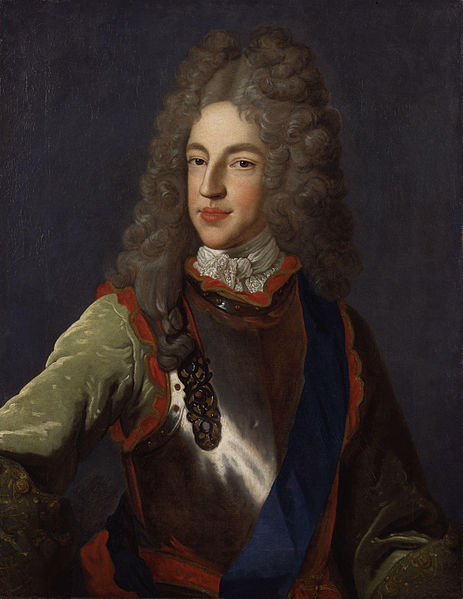
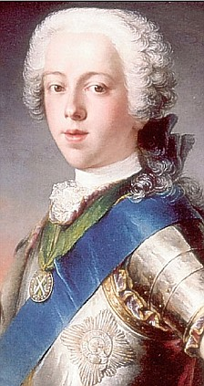
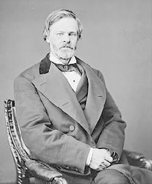
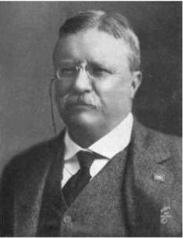
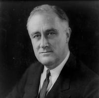
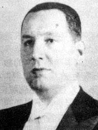

# The Virtuous Circle · 第11章　良性循环

## The Black Act · 黑面法案

Windsor Castle, located just west of London, is one of the great royal residencies of England. In the early eighteenth century, the castle was surrounded by a great forest, full of deer, though little of this remains today. One of the keepers of the forest in 1722, Baptist Nunn, was locked in to a violent conflict. On June 27 he recorded, Blacks came in the night shot at me 3 times 2 bullets into my chamber window and [I] agreed to pay them 5 guineas at Crowthorne on the 30th.

> 温莎堡位于伦敦之西，是英国最堂皇的王家宅邸。18世纪初期，城堡周围曾是一大片森林，林中多鹿，但今已存留无几。1722年，一名名叫南恩的森林守卫，陷入了一场暴力冲突。他在6月27日写下记录：“晚上有黑面进来，开了我三枪，两颗子弹射中房间窗户，我答应三十日到克劳索恩给他们五基尼金币。“

Another entry in Nunn’s diary read, “A fresh surprise. One appeared disguised with a message of destruction.” Who were these mysterious “Blacks” making threats, shooting at Nunn, and demanding money? The Blacks were groups of local men who had their faces “blacked” to conceal their appearance at night. They appeared widely across southern England in this period, killing and maiming deer and other animals, burning down haystacks and barns, and destroying fences and fish ponds. On the surface it was sheer lawlessness, but it wasn’t.

> 南恩日记记述的另一次入侵是这样的：”又一次恐吓，一个伪装的人送来一张扬言破坏的字条。“枪击南恩、索取金钱、要挟恐吓，这些神秘的”黑面“都是些什么人呢？他们其实都是当地人，把脸涂黑，趁着夜色掩盖容貌，这一段时期经常在英格兰南部一带出没，宰杀肢解鹿只及其他动物，焚烧草堆谷仓，破坏围墙鱼池。表面看来，这些都只是违法行为，但其实不然。

Illegal hunting (poaching) deer in lands owned by the king or other members of the aristocracy had been going on for a long time. In the 1640s, during the Civil War, the entire population of deer at Windsor Castle was killed. After the Restoration in 1660, when Charles II came to the throne, the deer park was restocked. But the Blacks were not just poaching deer to eat; they also engaged in wanton destruction. To what end?

> 狩猎（盗猎）国王或贵族土地上的鹿只的情形早已有之。1640年代内战时期，温莎堡的鹿群就几乎被斩尽杀绝。1660年复辟之后，查理二世登基，鹿苑才又恢复。但黑面盗猎鹿只并不光只是为了食其肉，更是要进行破坏，但目的何在呢？

A crucial building block of the Glorious Revolution of 1688 was the pluralistic nature of interests represented in Parliament. None of the merchants, industrialists, gentry, or aristocracy allied with William of Orange and then with the Hanoverian monarchs, who succeeded Queen Anne in 1714, were strong enough to impose their will unilaterally. Attempts at restoring the Stuart monarchy continued throughout much of the eighteenth century. After James II’s death in 1701, his son, James Francis Edward Stuart, the “Old Pretender,” was recognized as the lawful heir to the English Crown by France, Spain, the pope, and supporters of the Stuart monarchy in England and Scotland, the so-called Jacobites.

> 国会代表的各种利益具有多元性，乃是1688年光荣革命的关键基石之一。因此，无论是商人、实业家、社会名流，或与奥兰治的威廉及1714年继承安妮女王的汉诺威王室站在一条阵线上的贵族，都不可能具有足够的力量片面贯彻自己的意志。整个18世纪，斯图亚特王朝复辟的努力未曾停止过。1701年詹姆斯二世去世后，法国、西班牙、教宗，加上英格兰和苏格兰斯图亚特王室的支持者（所谓的”詹姆斯党人“）都承认其子詹姆斯•法兰西斯•爱德华•斯图亚特（亦即“老僭王”）为英国王位的合法继承人。

In 1708 the Old Pretender attempted to take back the throne with support of French troops, but was unsuccessful. In the ensuing decades there would be several Jacobite revolts, including major ones in 1715 and 1719. In 1745–46, the Old Pretender’s son, Charles Edward Stuart, the “Young Pretender,” made an attempt to take back the throne, but his forces were defeated by the British army. The Whig political party, which as we saw (this page–this page) was founded in the 1670s to represent the new mercantile and economic interests, was the main organization behind the Glorious Revolution, and the Whigs dominated Parliament from 1714 to 1760.

> 1708年，老僭王在法国军队的支持下企图夺回王位，但没有成功。接下来的十年间，詹姆斯党发动过好几次革命，其中以1715年及1719年两次规模最大。1745年到1746年间，老僭王之子查理•爱德华•斯图亚特（称为“小僭王”）又企图夺回王位，但遭英军击败。前面提到过的辉格党成立于1670年代，代表的是新兴的商人及其经济利益，也是光荣革命背后的主要团体，并在1714年至1760年间主导国会。

Once in power, they were tempted to use their newly found position to prey on the rights of others, to have their cake and eat it, too. They were no different from the Stuart kings, but their power was far from absolute. It was constrained both by competing groups in Parliament, particularly the Tory Party which had formed to oppose the Whigs, and by the very institutions that they had fought to introduce to strengthen Parliament and to prevent the emergence of a new absolutism and the return of the Stuarts. The pluralistic nature of society that emerged from the Glorious Revolution also meant that the population at large, even those without formal representation in Parliament, had been empowered, and “blacking” was precisely a response by the common people to perceptions that the Whigs were exploiting their position.

> 一旦得势之后，该党便利用新建立起来的地位掠取别人的权益，抢夺别人手上的大饼，其行径与斯图亚特诸王无异，但其权力远非绝对。他们的权力一方面受到国会内部竞争团体的制衡，尤其是为了对抗辉格党而成立的托利党，另一方面也受到他们过去奋斗得来的制度所限制，这些制度是为了强化国会、避免新的专制出现，以及防止斯图亚特王室复辟而设立。光荣革命成就了社会的多元性质，同时也表示大部分老百姓获得了权力，纵使在国会中没有正式代表亦然。因此，一般民众眼看自己的权益遭到辉格党人侵害，“黑面”群起其实是对此情况的反应。

The case of William Cadogan, a successful general in the War of the Spanish Succession between 1701 and 1714 and in the suppression of the Jacobite revolts, illustrates the sort of encroachment of common people’s rights by the Whigs that led to blacking. George I made Cadogan a baron in 1716 and then an earl in 1718. He was also an influential member of the Regency Council of Lords Justices, which presided over major affairs of state, and he served as the acting commander in chief.

> 辉格党人因侵犯老百姓的权益而导致黑面四起，最好的例子就是卡多根将军。卡多根在1701年至1714年的西班牙王位继承战争及剿平詹姆斯党人叛乱中立有战功，两度受英王乔治一世册封，1716年受封男爵，1718年再封伯爵，并在上议院辅政会议中位居要津，职司总理，过问重大国政。

He bought a large property of about a thousand acres at Caversham, about twenty miles west of Windsor. There he built a grand house and ornate gardens and laid out a 240-acre deer park. Yet this property was consolidated by encroaching on the rights of those around the estate. People were evicted, and their traditional rights to graze animals and collect peat and firewood were abrogated.

> 他在温莎堡西边约二十英里的凯佛夏姆买下大片地产，占地约一千亩。他建了一栋大宅与林荫庭园，又设置一个广达二百四十亩的鹿苑。但如此一来，却侵犯了庄园周围住户的权益。老百姓被迫迁离，放牧牲畜、收集泥炭及柴火的权益遭到剥夺。

Cadogan faced the wrath of the Blacks. On January 1, 1722, and again in July, the park was raided by mounted and armed Blacks. The first attack killed sixteen deer. Earl Cadogan was not alone. The estates of many notable landowners and politicians were also raided by the Blacks.

> 为此触怒了黑面。先是1722年元月1日，然后在7月，骑马武装的黑面劫掠了鹿苑。第一次攻击杀死了十六只鹿。但遭殃的并不只有卡多根伯爵，许多显赫的地主和政治人物，其庄园也受到黑面的劫掠。

The Whig government was not going to take this lying down. In May 1723, Parliament passed the Black Act, which created an extraordinary fifty new offenses that were punishable by hanging. The Black Act made it a crime not only to carry weapons but to have a blackened face. The law in fact was soon amended to make blacking punishable by hanging. The Whig elites went about implementing the law with gusto.

> 辉格党政府当然不会坐视。1723年5月，国会通过黑面法案，判处绞刑的罪新增加五十条，不仅携带武器有罪，就连把脸涂黑也犯法。事实上，这项法律很快就做了修正，连把脸涂黑也可以处以绞刑。辉格党的菁英阶层大张旗鼓准备实施这项法律。

Baptist Nunn set up a network of informers in Windsor Forest to discover the identity of the Blacks. Soon several were arrested. The transition from arrest to hanging ought to have been a straightforward affair. After all, the Black Act had already been enacted, the Whigs were in charge of Parliament, Parliament was in charge of the country, and the Blacks were acting directly contrary to the interests of some powerful Whigs. Even Sir Robert Walpole, secretary of state, then prime minister—and like Cadogan, another influential member of the Regency Council of the Lords Justices—was involved.

> 南恩在温莎森林建立了一个线民网，揭发黑面的身份，没多久就逮捕了好多人。从逮捕再到绞死，事情应该很简单。毕竟黑面法案已经上路，辉格党掌握了国会，而国会又掌握国家，至于一干黑面，不过是跟某些大权在握的辉格党人作对而已。更何况，连当时的首相华博尔——他跟卡多根一样，身居上议院辅政会议之要津——也都牵涉其中。

He had a vested interest in Richmond Park in southwest London, which had been created out of common land by Charles I. This park also encroached upon the traditional rights of local residents to graze their animals, hunt hares and rabbits, and collect firewood. But the ending of these rights appears to have been rather laxly enforced, and grazing and hunting continued, until Walpole arranged for his son to become the park ranger. At this time, the park was closed off, a new wall was constructed, and man traps were installed. Walpole liked hunting deer, and he had a lodge built for himself at Houghton, within the park. The animosity of local Blacks was soon ignited.

> 华博尔在伦敦西南方的里奇蒙庭园就拥有既得利益，而里奇蒙庭园则是查理一世利用公有地弄出来的，同样也侵犯了当地居民放牧牲畜、狩猎野兔，及采集柴火的固有权益。只不过这些规矩并未严格执行，放牧狩猎照常，直到华博尔安排自己的儿子出任庭园管理，情况才急转直下。庭园关闭，新的围墙建立起来，并布置了捕捉入侵者的陷阱。华博尔自己喜欢猎鹿，又在园内的霍顿为自己盖了一间猎屋。这一切立刻点燃了当地黑面的怒火。

On November 10, 1724, a local resident outside the park, John Huntridge, was accused of aiding deer stealers and abetting known Blacks, both crimes punishable by hanging. The prosecution of Huntridge came right from the top, initiated by the Regency Council of Lords Justices, which Walpole and Cadogan dominated. Walpole went so far as to extract evidence himself as to Huntridge’s guilt from an informant, Richard Blackburn. Conviction ought to have been a foregone conclusion, but it wasn’t.

> 1724年11月10日，庭园外面一个名叫亨特里奇的当地居民，被控协助盗鹿者并鼓动黑面生事，两项罪名都可处以绞刑。指控是直接从上面交下来，带头的是由华博尔及卡多根掌握的上议院辅政会议。华博尔一不做、二不休，亲自询问告密者布莱克本，套取亨特里奇的犯罪证据。罪名应该早已经预定，但结果却并非如此。

After a trial of eight or nine hours, the jury found Huntridge innocent, partly on procedural grounds, since there were irregularities with the way the evidence had been collected. Not all Blacks or those who sympathized with them were as lucky as Huntridge. Though some others were also acquitted or had their convictions commuted, many were hanged or transported to the penal colony of choice at the time, North America; the law in fact stayed on the statute books until it was repealed in 1824.

> 经过八或九个小时的审讯，法官裁决亨特里奇无罪，部分理由是程序上的，因为搜证的方式违法。但并非所有的黑面或同情他们的人都跟亨特里奇一样幸运。尽管也有人获得开释或减刑，许多人还是遭到绞死，或者被流放到北美洲殖民地；事实上，这项条例一直都保留在英国法律中，至1824年才废止。

Yet Huntridge’s victory is remarkable. The jury was made up not of Huntridge’s peers, but of major landowners and gentry, who ought to have sympathized with Walpole. But this was no longer the seventeenth century, where the Court of Star Chamber would simply follow the wishes of Stuart monarchs and act as an open tool of repression against their opponents, and where kings could remove judges whose decisions they did not like. Now the Whigs also had to abide by the rule of law, the principle that laws should not be applied selectively or arbitrarily and that nobody is above the law.

> 然而，亨特里奇的胜利还是非比寻常。陪审团并不是同亨特里奇一伙的，而是大地主及士绅名流，按理说是应该站在华博尔那一边，但时代毕竟不再是17世纪，当年的法院会直接依照斯图亚特诸王的想法处理，形同他们打击对手的压迫工具，国王若不满意判决，还可以免除法官的职务。如今，辉格党人也得遵守法治，亦即法律之使用不应有选择性、不得主观专断，以及任何人都不得凌驾法律之上的原则。

THE EVENTS SURROUNDING the Black Act would show that the Glorious Revolution had created the rule of law, and that this notion was stronger in England and Britain, and the elites were far more constrained by it than they themselves imagined. Notably, the rule of law is not the same as rule by law. Even if the Whigs could pass a harsh, repressive law to quash obstacles from common people, they had to contend with additional constraints because of the rule of law.

> 环绕着黑面法案所发生的种种事情，充分显示光荣革命已经建立了法治，同时也凸显此一观念在英格兰及不列颠更形强烈，菁英阶层受到此一观念制约远远超过了他们自己的想象。值得注意的是，法治（rule of law）有别于依法统治（rule by law）。辉格党纵使可以通过严刑峻法镇压老百姓的抗争，但因为法治，他们却必须应付重重的制约。

Their law violated the rights that the Glorious Revolution and the changes in political institutions that followed from it had already established for everybody by tearing down the “divine” rights of kings and the privileges of elites. The rule of law then implied that both elites and nonelites alike would resist its implementation. The rule of law is a very strange concept when you think about it in historical perspective. Why should laws be applied equally to all?

> 光荣革命以及随之而来的政治制度变迁拆毁了“神授”的君权及菁英阶层的特权，个人的权利已经确立，而辉格党的法律与这种权利乃是背道而驰的。在这种情形下，法治就意味着菁英及非菁英阶层都会抗拒这种法律的实施。从历史的角度思考，法治乃是一个极为陌生的概念。法律之前为什么应该人人平等？

If the king and the aristocracy have political power and the rest don’t, it’s only natural that whatever is fair game for the king and the aristocracy should be banned and punishable for the rest. Indeed, the rule of law is not imaginable under absolutist political institutions. It is a creation of pluralist political institutions and of the broad coalitions that support such pluralism. It’s only when many individuals and groups have a say in decisions, and the political power to have a seat at the table, that the idea that they should all be treated fairly starts making sense.

> 既然国王与贵族政治大权在握，其他人一无所有，国王与贵族当然可以予取予求，至于其他人必须受到禁止或处罚，这乃是极其自然的事。专制政治制度下，法治的确是无法想象的事。法治是多元政治制度以及支持此种政治多元化的广大结盟的产物，唯有许多个人及团体在决策上拥有发言权，也拥有政治权力可以在台面上有其位置，大家都应该受到公平对待的理想才有意义。

By the early eighteenth century, Britain was becoming sufficiently pluralistic, and the Whig elites would discover that, as enshrined in the notion of the rule of law, laws and institutions would constrain them, too. But why did the Whigs and parliamentarians abide by such restraints? Why didn’t they use their control over Parliament and the state to force an uncompromising implementation of the Black Act and overturn the courts when the decisions didn’t go their way?

> 到18世纪初叶，英国已经逐渐充分多元化，辉格党发现法律及制度也会制约他们，如同法治的观念所确立的。但辉格党人及国会议员为什么要接受这类约束？为什么不利用自己对国会及政府的控制，毫不妥协地强制执行黑面法案，并推翻不合己意的法院判决呢？

The answer reveals much about the nature of the Glorious Revolution—why it didn’t just replace an old absolutism with a new version—the link between pluralism and the rule of law, and the dynamics of virtuous circles. As we saw in chapter 7, the Glorious Revolution was not the overthrow of one elite by another, but a revolution against absolutism by a broad coalition made up of the gentry, merchants, and manufacturers as well as groupings of Whigs and Tories. The emergence of pluralist political institutions was a consequence of this revolution.

> 答案要归诸光荣革命的本质——为什么它不是以一个新的专制政权取代旧有的政权——亦即政治多元化与法治的结合，另外加上良性循环的动力。如同我们在第七章所见，光荣革命并不是由一个菁英阶层推翻另一个菁英阶层，而是士绅名流、商人及实业家，加上辉格党人和托利党人的团队，组成一个广大的联盟，对专制政权所发起的革命。多元政治制度的出现，就是此一革命的结果。

The rule of law also emerged as a by-product of this process. With many parties at the table sharing power, it was natural to have laws and constraints apply to all of them, lest one party start amassing too much power and ultimately undermine the very foundations of pluralism. Thus the notion that there were limits and restraints on rulers, the essence of the rule of law, was part of the logic of pluralism engendered by the broad coalition that made up the opposition to Stuart absolutism.

> 法治则是此一过程中出现的副产品。既然台面上有许多党派分食权力，为了避免一党一派集太多的权力于一身，到头来破坏了政治多元化的基础，大家就都必须受到法律的制约乃是极其自然的事情。因此，统治者必须受到限制与约束的理念——这是法治的精髓——乃是出于政治多元化的内在逻辑，而这政治多元化则是各方人马为反对斯图亚特专制统治而组成广大联盟的所造成的。

In this light, it should be no surprise that the principle of the rule of law, coupled with the notion that monarchs did not have divine rights, was in fact a key argument against Stuart absolutism. As the British historian E. P. Thompson put it, in the struggle against the Stuart monarchs: immense efforts were made … to project the image of a ruling class which was itself subject to the rule of law, and whose legitimacy rested upon the equity and universality of those legal forms.

> 从这个角度看，若说法治的原则，加上君权并非神授的理念，实际上乃是反抗斯图亚特专制统治的关键，这绝非意外。诚如英国历史学家汤普森所说，在反抗斯图亚特王朝的斗争中，“竭尽所能……打造一种形象，亦即统治阶级自愿接受法治，其合法性则是建立在平等以及一切依法行事的基础上。

And the rulers were, in serious senses, whether willingly or unwillingly, the prisoners of their own rhetoric; they played games of power according to rules which suited them, but they could not break those rules or the whole game would be thrown away. Throwing the game away would destabilize the system and open the way for absolutism by a subset of the broad coalition or even risk the return of the Stuarts. In Thompson’s words, what inhibited Parliament from creating a new absolutism was that take away law, and the royal prerogative … might flood back upon their properties and lives.

> 严格说，统治者无论愿意或不愿意，全都要对自己的承诺负责；行使权力必须严守法律界限，不可破坏规矩，否则就会打乱阵脚。”打乱阵脚的结果则是制度失衡，将会为广泛结盟中的小团体打开专制之路，甚至有导致斯图亚特复辟的危险。国会之所以无法防止新的专制，用汤普森的话来说，那是因为：“法律出现真空，王室特权……有可能卷土重来，淹没人民的财产和生命。”

Moreover, it was inherent in the very nature of the medium which they [those aristocrats, merchants etc. fighting the Crown] had selected for their own self-defense that it could not be reserved for the exclusive use only of their own class. The law, in its forms and traditions, entailed principles of equity and universality which … had to be extended to all sorts and degrees of men. Once in place, the notion of the rule of law not only kept absolutism at bay but also created a type of virtuous circle: if the laws applied equally to everybody, then no individual or group, not even Cadogan or Walpole, could rise above the law, and common people accused of encroaching on private property still had the right to a fair trial.

> 此外，“他们（那些跟王室作对的贵族、商人等）为保护自己所选择的手段，其本质是不会丧失的。法律就其形式和传统而言，需要的是平等及普适性……并必须扩及各式各样人等。”法治的观念一旦落实，不仅可以防止专制，同时可以造成一种良性循环，这也就是说，如果法律面前人人平等，那么，任何个人或团体，不论其为卡多根或华博尔，都不可能凌驾于法律之上，老百姓就算被控侵犯私人产业，也有接受公平审判的权利。

WE SAW HOW INCLUSIVE economic and political institutions emerge. But why do they persist over time? The history of the Black Act and the limits to its implementation illustrate the virtuous circle, a powerful process of positive feedback that preserves these institutions in the face of attempts at undermining them and, in fact, sets in motion forces that lead to greater inclusiveness. The logic of virtuous circles stems partly from the fact that inclusive institutions are based on constraints on the exercise of power and on a pluralistic distribution of political power in society, enshrined in the rule of law.

> 广纳式经济与政治制度是如何出现的，我们已经谈过了。但它们为何能够持续存在呢？黑面法案以及限制其执行的故事充分显示，在这些制度面临破坏的企图时，良性循环，亦即一股沛然的正向反馈机制便会出而维护，事实上，甚至会鼓动风潮，开创更大的广纳性。良性循环之所以可能，部分原因在于广纳式制度建立在两个事实上，其一是权力的行使受到制约，其二是社会上政治权力的分配是多元的，这一点内含在法治里。

The ability of a subset to impose its will on others without any constraints, even if those others are ordinary citizens, as Huntridge was, threatens this very balance. If it were temporarily suspended in the case of the peasants protesting against elites encroaching on their communal lands, what was there to guarantee that it would not be suspended again? And the next time it was suspended, what would prevent the Crown and aristocracy from taking back what the merchants, businessmen, and the gentry had gained in the intervening half century?

> 一个团体若能强加其意志于他人而不受到任何制约，即使这些他人是亨特里奇之类的小老百姓，制衡也就遭到了威胁。农民抗议菁英阶层侵犯了他们的公有地，如果不马上处理，又怎么保证下一次不会再被搁置？既然下一次又遭到了搁置，又怎么能够防止王权与贵族卷土重来，拿回实业家、商人及士绅名流介入半个世纪所得到的成果呢？

In fact, the next time it was suspended, perhaps the entire project of pluralism would come crumbling down, because a narrow set of interests would take control at the expense of the broad coalition. The political system would not risk this. But this made pluralism, and the rule of law that it implied, persistent features of British political institutions. And we will see that once pluralism and the rule of law were established, there would be demand for even greater pluralism and greater participation in the political process.

> 事实上，下一次的搁置，有可能就是政治多元化整个进程的土崩瓦解，因为一套狭隘的利益将会因此成为刀俎，而广大的联盟则将就此沦为鱼肉。但政治的机制并不会走上此一险境，反而会使政治多元化及其所蕴含的法治成为英国政治制度持久不衰的特色。我们也将看到，政治多元化及法治一旦建立，对于政治多元化及政治参与的要求只会变得更大。

The virtuous circle arises not only from the inherent logic of pluralism and the rule of law, but also because inclusive political institutions tend to support inclusive economic institutions. This then leads to a more equal distribution of income, empowering a broad segment of society and making the political playing field even more level. This limits what one can achieve by usurping political power and reduces the incentives to re-create extractive political institutions. These factors were important in the emergence of truly democratic political institutions in Britain.

> 良性循环不仅是政治多元化及法治的必然趋势，更是因为广纳式政治制度很自然地会支持广纳式经济制度，如此一来，将导致收入的分配更为平等，社会中更多的人将因此而获得权利，进而使政治领域也更趋于平等。这将限制想以篡夺政治权力而出头的人，也可以打消复辟榨取式政治制度的企图。英国之所以会出现真正民主的政治制度，这些都是重要因素。

Pluralism also creates a more open system and allows independent media to flourish, making it easier for groups that have an interest in the continuation of inclusive institutions to become aware and organize against threats to these institutions. It is highly significant that the English state stopped censoring the media after 1688. The media played a similarly important role in empowering the population at large and in the continuation of the virtuous circle of institutional development in the United States, as we will see in this chapter.

> 政治多元化也创造了一个更为开放的系统，使独立的媒体得以繁荣滋长，也比较容易使关心广纳式制度能否延续的团体提高警觉，组织起来对抗各种威胁。1688年之后，英格兰政府停止审查媒体，意义极为重大。在赋予人民权力上，以及良性循环在美国制度发展上的持续不断，媒体也都扮演了同样重要的角色，这一方面本章将会讨论。

While the virtuous circle creates a tendency for inclusive institutions to persist, it is neither inevitable nor irreversible. Both in Britain and the United States, inclusive economic and political institutions were subject to many challenges. In 1745 the Young Pretender got all the way to Derby, a mere hundred miles from London, with an army to unseat the political institutions forged during the Glorious Revolution. But he was defeated. More important than the challenges from without were potential challenges from within that might also have led to the unraveling of inclusive institutions.

> 良性循环虽然有利于广纳式制度的持续存在，但这却非必然也不是不可逆转的。无论在英国或美国，广纳式经济及政治制度都遭遇过许多挑战。1745年，小僭王就曾一路杀到达比，距伦敦仅一百英里之遥，意图颠覆光荣革命时期所建立的政治制度。比这种外来挑战更为严峻的则是来自内部的潜在挑战，同样也有可能导致广纳式制度的崩解。

As we saw in the context of the Peterloo Massacre in Manchester in 1819 (this page), and as we will see in more detail next, British political elites thought of using repression to avoid having to further open the political system, but they pulled back from the brink. Similarly, inclusive economic and political institutions in the United States faced serious challenges, which could have conceivably succeeded, but didn’t. And of course it was not preordained that these challenges should be defeated. It is due to not only the virtuous circle but also to the realization of the contingent path of history that British and U.S. inclusive institutions survived and became substantially stronger over time.

> 例如在前面提过的1819年曼彻斯特彼得鲁屠杀，以及接下来将更详细讨论的事件中，英国的政治菁英阶层就曾经想要以高压手段遏止政治系统的进一步开放，但到头来都悬崖勒马。同样的，广纳式经济及政治制度在美国也遭遇过严峻的挑战，而且大有成功的机会，但却没有。当然，所有这些挑战并非注定失败。英国及美国的广纳式制度能够存活并随着时间益趋壮大，不只是良性循环的结果，同时也有其历史的偶然。

## The Slow March Of Democracy · 民主的缓慢进程

The response to the Black Act showed ordinary British people that they had more rights than they previously realized. They could defend their traditional rights and economic interests in the courts and in Parliament through the use of petitions and lobbying. But this pluralism had not yet delivered effective democracy. Most adult men could not vote; neither could women; and there were many inequities in the existing democratic structures.

> 对黑面法案所做出的回应让英国老百姓明白，他们所拥有的权利其实比自己以前所了解的要多。通过请愿与游说，他们可以在法院及国会捍卫自己的权利与经济利益。但是，这样的多元政治还没有产生实际有效的民主。多数的成年男人还不能投票；妇女也不行；在当时的民主政治结构中仍然存在着许多的不平等。

All this was to change. The virtuous circle of inclusive institutions not only preserves what has already been achieved but also opens the door to greater inclusiveness. The odds were against the British elite of the eighteenth century maintaining their grip on political power without serious challenges. This elite had come to power by challenging the divine right of kings and opening the door to participation by the people in politics, but then they gave this right only to a small minority.

> 所有这一切都会改变。广纳式制度的良性循环不仅保留了已经成就的成果，而且对更大的广纳性敞开了门户。18世纪的英国菁英阶层未曾遭遇过严重的挑战，仍然紧紧抓着权力不放，但形势却对他们不利。这一批菁英阶层的崛起，靠的是挑战君权神授，并打开了人民参政的大门，但当时他们只把这种权利给了极少的少数人。

It was only a matter of time until more and more of the population demanded the right to participate in the political process. And in the years leading up to 1831, they did. The first three decades of the nineteenth century witnessed increasing social unrest in Britain, mostly in response to increasing economic inequities and demands from the disenfranchised masses for greater political representation. The Luddite Riots of 1811–1816, where workers fought against the introduction of new technologies they believed would reduce their wages, were followed by riots explicitly demanding political rights, the Spa Fields Riots of 1816 in London and the Peterloo Massacre of 1819 in Manchester.

> 当然，愈来愈多老百姓要求参与政治的权利只是个时间问题而已。等时间来到1831年，他们就起而要求了。19世纪的前三个十年，英国的社会动荡不断增加，其起因则是不断增加的经济不平等，以及公民权遭到剥夺的民众要求更大的政治参与权。1811年至1816年的卢德派暴乱，起因是工人相信新技术的引进将减少他们的收入，因此起而抗争；接下来的暴乱，包括1816年的伦敦斯帕广场暴乱及1819年的彼得鲁屠杀，则明显是政治权利的要求。

In the Swing Riots of 1830, agricultural workers protested against falling living standards as well as the introduction of new technology. Meanwhile, in Paris, the July Revolution of 1830 exploded. A consensus among elites was starting to form that the discontent was reaching the boiling point, and the only way to defuse social unrest, and turn back a revolution, was by meeting the demands of the masses and undertaking parliamentary reform.

> 1830年，农业劳工抗议生活水平下降及新技术的引进，发生了斯温暴乱。同一时间在巴黎，1830年的七月革命爆发。菁英阶层开始形成共识，认为不满已经达到了沸点，若要缓解社会的不安并防止革命发生，唯一的方法就是满足群众的要求，进行国会改革。

It was no surprise then that the 1831 election was mostly about a single issue: political reform. The Whigs, almost one hundred years after Sir Robert Walpole, were much more responsive to the wishes of the common man and campaigned to extend voting rights. But this meant only a small increase in the electorate. Universal suffrage, even only for men, was not on the table. The Whigs won the election, and their leader, Earl Grey, became the prime minister.

> 一点都不令人意外，1831年的选举几乎只有一个议题：政治改革。在华博尔爵士死后将近一百年，辉格党对老百姓的希望做出了较大的回应，以扩大投票权为竞选的主要诉求。但实际上只是要小幅增加选民而已。普选，甚至只是男性，根本还谈不上。结果辉格党赢得选举，党魁格雷伯爵成为首相。

Earl Grey was no radical—far from it. He and the Whigs pushed for reform not because they thought a broader voting franchise was more just or because they wanted to share power. British democracy was not given by the elite. It was largely taken by the masses, who were empowered by the political processes that had been ongoing in England and the rest of Britain for the last several centuries. They had become emboldened by the changes in the nature of political institutions unleashed by the Glorious Revolution.

> 说到激进，格雷还差得远。他和辉格党推动改革，并不是认为放宽公民资格是该做的事，也不是想要分权。英国的民主并不是靠菁英阶层的施舍得来，而是英格兰及英国其他地区的平民百姓，从过去几个世纪的政治洗礼中得到了力量，奋力争取得来的。光荣革命促成了政治制度的质变，他们因此而受到鼓舞。

Reforms were granted because the elite thought that reform was the only way to secure the continuation of their rule, albeit in a somewhat lessened form. Earl Grey, in his famous speech to Parliament in favor of political reform, said this very clearly: There is no-one more decided against annual Parliaments, universal suffrage and the ballot, than I am. My object is not to favour, but to put an end to such hopes and projects … The principle of my reform is, to prevent the necessity of revolution … reforming to preserve and not to overthrow.

> 同时，改革被认为是可行的，因为菁英阶层知道，要延续自己的统治，唯一的道路就是改革，即使只是稍微放宽一点也行。格雷伯爵在国会发表他支持政治改革的著名演讲，就把这一点说得很清楚：”说到反对国会每年一选、普选及投票，没有人比我更坚决的。我的目标不在于支持，而是要打消这样的希望和念头……我的改革原则，无非是避免走上革命……改革，为的是要保存而不是推翻。“

The masses did not just want the vote for its own sake but to have a seat at the table to be able to defend their interests. This was well understood by the Chartist movement, which led the campaign for universal suffrage after 1838, taking its name from its adoption of the People’s Charter, named to evoke a parallel with the Magna Carta. Chartist J. R. Stephens articulated why universal suffrage, and the vote for all citizens, was key for the masses:

> 人民当然不会以投票为满足，而是要取得席位以保护自己的利益。对此，宪章运动知之甚深。这一派人马在1838年之后推动普选，因采纳人民宪章而以宪章为名，并欲以此与大宪章媲美。普选及全民投票，对人民之所以意义重大，宪章派的史蒂芬斯做了生动说明：

The question of universal suffrage … is a knife and fork question, a bread and cheese question … by universal suffrage I mean to say that every working man in the land has a right to a good coat on his back, a good hat on his head, a good roof for the shelter of his household, a good dinner upon his table. Stephens had well understood that universal suffrage was the most durable way of empowering the British masses further and guaranteeing a coat, a hat, a roof, and a good dinner for the working man. Ultimately, Earl Grey was successful both in ensuring the passage of the First Reform Act and in defusing the revolutionary tides without taking any major strides toward universal mass suffrage.

> ”普选的问题……是一个刀子和叉子的问题，一个面包和奶酪的问题……说到普选，我要说的是，一如身上有一件好外套、头上有一顶好帽子、为家人遮风蔽雨有一个好屋顶、桌上有一顿好晚饭，乃是这块土地上每个劳动者的一项权利。“史蒂芬森再清楚不过，要使英国老百姓拥有更大的权利，保证每个劳动者都有一件外套、一顶帽子、一个屋顶及一顿晚饭，普选乃是最为可长久的办法。最后，格雷伯爵的两个如意算盘都得逞了，一方面通过了第一改革法案，另一方面，毋须大费周章弄什么普选就缓解了革命的浪潮。

The 1832 reforms were modest, only doubling the voting franchise from 8 percent to about 16 percent of the adult male population (from about 2 to 4 percent of all the population). They also got rid of rotten boroughs and gave independent representation to the new industrializing cities such as Manchester, Leeds, and Sheffield. But this still left many issues unresolved. Hence there were soon further demands for greater voting rights and further social unrest. In response, further reform would follow.

> 1832年的改革算是最温和的，公民投票人数虽然加倍，却只是从8%的男性成人增加到16%（从人口的2%增加到4%）。另外则是取消了有名无实的选区，把独立代表给了新兴工业城市如曼彻斯特、里兹和谢菲尔德。但没有解决的问题还是一箩筐。没过多久，要求更大投票权的呼声以及更进一步的社会动荡便随之而来。为了做出回应，进一步的改革也随之而来。

Why did the British elites give in to the demands? Why did Earl Grey feel that partial—indeed, very partial—reform was the only way to preserve the system? Why did they have to put up with the lesser of the two evils, reform or revolution, rather than maintaining their power without any reform? Couldn’t they just have done what the Spanish conquistadors did in South America, what Austria-Hungarian and Russian monarchs would do in the next several decades when the demands for reform reached those lands, and what the British themselves did in the Caribbean and in India: use force to put down the demands? The answer to this question comes from the virtuous circle.

> 英国的菁英阶层为什么会向这些要求让步？格雷伯爵为什么会觉得局部改革——真的很局部——是保存现行制度的唯一办法？他们为什么会两害相权——改革或革命——取其轻，而不是一意孤行，不做任何改革，继续维持自己的权力？西班牙征服者在南美洲的所作所为；数十年后，当改革的要求兴起时，奥匈帝国和俄罗斯君王的所作所为；以及英国自己在加勒比海和印度的所作所为，亦即用武力镇压这些要求，他们难道做不到吗？所有这些问题，答案只有一个：良性循环。

The economic and political changes that had already taken place in Britain made using force to repress these demands both unattractive for the elite and increasingly infeasible. As E. P. Thompson wrote: When the struggles of 1790–1832 signalled that this equilibrium had changed, the rulers of England were faced with alarming alternatives. They could either dispense with the rule of law, dismantle their elaborate constitutional structures, countermand their own rhetoric and rule by force; or they could submit to their own rules and surrender their hegemony … they took halting steps in the first direction.

> 经济及政治改变在英国已经发生，对菁英阶层来说，武力镇压已经毫无吸引力，可行性也愈来愈低。诚如汤普森所说：“1790年至1832年的抗争放出了信号，均势已然改变，英格兰的统治者面对着紧要的抉择，要么把法治摆到一边，拆掉他们精心设计的宪法架构，撤回他们的承诺，遂行武力统治，要么就是交出统治，放下霸权……举步之初，虽然不免踌躇……

But in the end, rather than shatter their own self-image and repudiate 150 years of constitutional legality, they surrendered to the law. Put differently, the same forces that made the British elite not wish to tear down the edifice of the rule of law during the Black Act also made them shun repression and rule by force, which would again risk the stability of the entire system. If undermining the law in trying to implement the Black Act would have weakened the system that merchants, businessmen, and the gentry had built in the Glorious Revolution, setting up a repressive dictatorship in 1832 would have entirely undermined it.

> 但到了最后，他们总算没有糟蹋自己的形象，不曾践踏一百五十年的宪法合法性，而是在法律面前俯首。“从另一方面看，在黑面法案时期，同一股使英国菁英阶层不致推倒法治大厦的力量，也曾经使他们回避了镇压及武力统治，才没有使整个体系陷入动荡的险境。当时，如果破坏法治，强制实施黑面法案，势必削弱由商人、实业家及士绅名流在光荣革命中建立起来的制度，同样的，1832年如果树立的是一个高压的独裁政权，其结果必然也是一样。

In fact, the organizers of the protests for parliamentary reform were well aware of the importance of the rule of law and its symbolism to the British political institutions during this period. They used its rhetoric to bring home this point. One of the first organizations seeking parliamentary reform was called the Hampden Club, after the member of Parliament who had first resisted Charles I over the ship money tax, a crucial event leading up to the first major uprising against Stuart absolutism, as we saw in chapter 7. There was also dynamic positive feedback between inclusive economic and political institutions making such a course of action attractive.

> 事实上，法治的重要性，以及法治在那段期间对英国政治制度的象征意义，当时支持国会改革、组织推动抗争的人心中非常清楚，并不遗余力地阐明这一点。在追求国会改革的第一波中，有一个组织名叫汉普顿俱乐部用的是一个国会议员的名字。如本书第七章所述，当年，汉普顿第一个跳出来反对查理一世的船税，结果导致反抗斯图亚特专制统治的第一次起义。此外，广纳式经济及政治制度之间具有正向反馈的功能，使这一类的行动具有吸引力。

Inclusive economic institutions led to the development of inclusive markets, inducing a more efficient allocation of resources, greater encouragement to acquire education and skills, and further innovations in technology. All of these forces were in play in Britain by 1831. Clamping down on popular demands and undertaking a coup against inclusive political institutions would also destroy these gains, and the elites opposing greater democratization and greater inclusiveness might find themselves among those losing their fortunes from this destruction.

> 广纳式经济制度使广纳式市场得以发展，进而促成更有效率资源分配，成为一种更大的动力，鼓励人们接受教育、学习技术，并进一步创新技术。到1831年时，在英国，所有这些力量都动了起来。打压公众的要求，对广纳式政治制度进行变革，都会毁掉这些成就，而菁英阶层反对更大的民主化及更大的广纳性，到头来则可能发现，自己的富贵也将一并埋葬于废墟之中。

Another aspect of this positive feedback is that under inclusive economic and political institutions, controlling power became less central. In Austria-Hungary and in Russia, as we saw in chapter 8, the monarchs and the aristocracy had much to lose from industrialization and reform. In contrast, in Britain at the beginning of the nineteenth century, thanks to the development of inclusive economic institutions, there was much less at stake: there were no serfs, relatively little coercion in the labor market, and few monopolies protected by entry barriers. Clinging to power was thus much less valuable for the British elite.

> 这种正向的反馈还有另一个面向，亦即在广纳式经济及政治制度之下，权力的控制比较不集中。在奥匈帝国及俄罗斯，如本书第八章所述，由于未能工业化及改革，到头来，君主及贵族所失去的更多。相反的，19世纪初的英国，广纳式经济制度得以发展，加上没有农奴，劳动力市场的强制性相对比较小，受到进入障碍保护的垄断也不多，情况就没有那么严重。就英国的菁英阶层而言，抓着权力不放其实没有什么价值。

The logic of the virtuous circle also meant that such repressive steps would be increasingly infeasible, again because of the positive feedback between inclusive economic and political institutions. Inclusive economic institutions lead to a more equitable distribution of resources than extractive institutions. As such, they empower the citizens at large and thus create a more level playing field, even when it comes to the fight for power.

> 良性循环还有另外一层道理，亦即高压手段的可行性愈来愈低，这也是因为广纳式经济及政治制度之间的正向反馈的结果。在资源的分配上，广纳式经济制度比榨取式制度来得公平。就此而言，便有利于公民的壮大，因而创造了一个比较公平的竞争局面，即使角逐的是权力亦然。

This makes it more difficult for a small elite to crush the masses rather than to give in to their demands, or at least to some of them. The British inclusive institutions had also already unleashed the Industrial Revolution, and Britain was highly urbanized. Using repression against an urban, concentrated, and partially organized and empowered group of people would have been much harder than repressing a peasantry or dependent serfs.

> 这样一来，少数的菁英就比较不容易欺压人民大众，反而会对他们的要求让步，或至少做某些退让。英国的广纳式制度也孕育了工业革命，这又使得英国高度都市化。都市人集中居住，多少有其组织及自主性，这样的一群人，相较于农民或没有自主性的农奴，想要施以压制自然困难得多。

The virtuous circle thus brought the First Reform Act to Britain in 1832. But this was just the beginning. There was still a long road to travel toward real democracy, because in 1832 the elite had only offered what they thought they had to and no more. The issue of parliamentary reform was taken up by the Chartist movement, whose People’s Charter of 1838 included the clauses A vote for every man twenty-one years of age, of sound mind, and not undergoing punishment for crime.

> 因此，良性循环在1832年为英国带来了第一改革法案。但这还只是开头而已，真正的民主还有很长的一段路要走，因为菁英阶层1832年所交出来的东西，都是他们心目中不得不放手的，至于其他的则免谈。国会改革的议题要到1838年才由宪章运动提出，他们的人民宪章包括以下条款：“凡年满二十一岁、心智正常、不在服刑中的男性，皆拥有投票权。

The ballot. —To protect the elector in the exercise of his vote. No property qualification for members of Parliament—thus enabling the constituencies to return the man of their choice, be he rich or poor. Payment of members, thus enabling an honest tradesman, working man, or other person, to serve a constituency, when taken from his business to attend to the interests of the Country.

> 投票——保障选举人选举权的行使。国会议员无任何资格限制——惟其如此，选民得以不论贫富选出自己中意的人选。国会议员为有给职，惟其如此，才得以使诚实的商人、劳动者或其他人等服务选区，放下自己的事业，专心于国家利益。

Equal Constituencies, securing the same amount of representation for the same number of electors, instead of allowing small constituencies to swamp the votes of large ones. Annual Parliaments, thus presenting the most effectual check to bribery and intimidation, since though a constituency might be bought once in seven years (even with the ballot), no purse could buy a constituency (under a system of universal suffrage) in each ensuing twelve-month; and since members, when elected for a year only, would not be able to defy and betray their constituents as now. By the “ballot,” they meant the secret ballot and the end of open voting, which had facilitated the buying of votes and the coercion of voters.

> 选区平等，确保同样数量的选举人拥有相同数量的代表，不致使小选区吞掉大选区。国会每年一选，惟其如此，才能最有效地检验贿赂及恫吓，以免收买选民一买就是七年（甚至连选票一起），十二个月的任期（在普选制度下），任谁的钱包都买不起一个选区；如此一来，任期只有一年，国会议员便不至于像现在这样蔑视并出卖选民。“这里的“投票”，指的是秘密投票，终结亮票行为，以免选民遭到收买或胁迫。

The Chartist movement organized a series of mass demonstrations, and throughout this period Parliament continually discussed the potential for further reforms. Though the Chartists disintegrated after 1848, they were followed by the National Reform Union, founded in 1864, and the Reform League, which was founded in 1865. In July 1866, major pro-reform riots in Hyde Park brought reform right to the top of the political agenda once more. This pressure bore dividends in the form of the Second Reform Act of 1867, in which the total electorate was doubled and working-class voters became the majority in all urban constituencies.

> 宪章运动发起了一系列群众示威，这段期间，国会则在不断讨论未来改革的可能。1848年之后，宪章运动虽然分裂，但1864年及1865年先后有国家改革同盟及改革联盟继起。1866年7月，海德公园举行支持改革的活动，演变成重大暴乱，再度将改革权利拉升到政治议程的首位，所造成的压力全都成了1867年第二改革法案的红利：选民总数加倍，劳工阶级选民成为所有都市选区的多数。

Shortly afterward the secret ballot was introduced and moves were made to eliminate corrupt electoral practices such as “treating” (essentially buying votes in exchange for which the voter received a treat, usually money, food, or alcohol). The electorate was doubled again by the Third Reform Act of 1884, when 60 percent of adult males were enfranchised. Following the First World War, the Representation of the People Act of 1918 gave the vote to all adult males over the age of twenty-one, and to women over the age of thirty who were taxpayers or married to taxpayers.

> 不久之后，秘密投票实施，并大力扫除腐败的选举行为，譬如“招待”（主要是买票，以选民接受招待做为交换，通常包括金钱、食物和酒类）。到1884年的第三改革法案，选民数又加倍，60%的成年男性获得了选举权。随着第一次世界大战结束，1918年的人民代表法明定，所有年满二十一岁的成年男性都具有投票权，年满三十的女性纳税人或嫁给纳税人的女性亦同。

Ultimately, all women also received the vote on the same terms as men in 1928. The measures of 1918 were negotiated during the war and reflected a quid pro quo between the government and the working classes, who were needed to fight and produce munitions. The government may also have taken note of the radicalism of the Russian Revolution.

> 到了1928年，所有女性的投票权条件终于与男性完全相同。二战期间，1918年的各项措施付诸协商，这中间反映了政府与劳工阶级的交换，因为在从军打仗及军火生产上，政府都需要后者。另一方面，政府或许也警觉到了俄国革命的激进主义。

Parallel with the gradual development of more inclusive political institutions was a movement toward even more inclusive economic institutions. One major consequence of the First Reform Act was the repeal of the Corn Laws in 1846. As we saw in chapter 7, the Corn Laws banned the import of grains and cereals, keeping their prices high and ensuring lucrative profits for large landowners. The new parliamentarians from Manchester and Birmingham wanted cheap corn and low wages. They won, and the landed interests suffered a major defeat.

> 随着广纳式政治制度的逐渐发展，更为广纳式的经济制度也在同步前进。第一改革法案的重大结果之一是谷物法于1846年废除。如本书第七章所述，谷物法禁止谷类及麦类进口，使这类食品价格居高不下，大地主仍有暴利可图。曼彻斯特及伯明翰选出的国会议员要的是廉价的谷物及低价的劳工，他们获胜，使地主利益蒙受重大损失。

The changes in the electorate and other dimensions of political institutions taking place during the course of the nineteenth century were followed by further reforms. In 1871 the Liberal prime minister Gladstone opened up the civil service to public examination, making it meritocratic, and thus continuing the process of political centralization and the building of state institutions that started during the Tudor period. Liberal and Tory governments during this period introduced a considerable amount of labor market legislation. For example, the Masters and Servants Acts, which allowed employers to use the law to reduce the mobility of their workers, was repealed, changing the nature of labor relations in favor of workers.

> 19世纪一路下来，选举及其他政治制度的改变相继发生，更多的改革随之而来。1871年，自由党首相格拉斯顿开启公开招考公务人员的大门，人事任用是依照才能，都铎时期即已开始的政治集权过程及政府体制建构也因此延续。这段时期中，自由党及托利党政府在劳动力市场方面都订定了相当多的法律。举例来说，雇主依法可以限制工人流动的主人与仆役法遭到废除，就此改变了劳动关系，变成对工人有利。

During 1906–1914, the Liberal Party, under the leadership of H. H. Asquith and David Lloyd George, began to use the state to provide far more public services, including health and unemployment insurance, government-financed pensions, minimum wages, and a commitment to redistributive taxation. As a result of these fiscal changes, taxes as a proportion of national product more than doubled in the last three decades of the nineteenth century, and then doubled again in the first three decades of the twentieth. The tax system also became more “progressive,” so that wealthier people bore a heavier burden.

> 1906年至1914年间在阿斯奎兹及劳合•乔治的领导下，自由党开始运用政府的力量提供更多的公共服务，包括健康及失业保险、政府出资的养老年金、最低工资，并承诺重新分配税负。这些财政改革的结果，在19世纪的最后三十年中，税收在国民生产总值中所占比例增加超过一倍，而且在20世纪的最初三十年再度加倍。税制也随之“进步”，比较富有的人税负较高。

Meanwhile, the education system, which was previously either primarily for the elite, run by religious denominations, or required poor people to pay fees, was made more accessible to the masses; the Education Act of 1870 committed the government to the systematic provision of universal education for the first time. Education became free of charge in 1891. The school-leaving age was set at eleven in 1893. In 1899 it was increased to twelve, and special provisions for the children of needy families were introduced.

> 同时，原来的教育体系不是由宗教派别经营、仅供菁英阶层就读，就是穷人子弟必须缴费，到后来才对平民百姓比较开放；1870年的教育法首次明定政府实施全民教育。1891年，教育成为免费。1893年将毕业年龄定为十一岁，1899年增至十二岁，并未穷困家庭儿童订定特别条款。

As a result of these changes, the proportion of ten-year-olds enrolled in school, which stood at a disappointing 40 percent in 1870, increased to 100 percent in 1900. Finally, the Education Act of 1902 led to a large expansion in resources for schools and introduced the grammar schools, which subsequently became the foundation of secondary education in Britain. In fact, the British example, an illustration of the virtuous circle of inclusive institutions, provides an example of a “gradual virtuous circle.” The political changes were unmistakably toward more inclusive political institutions and were the result of demands from empowered masses. But they were also gradual.

> 这些改变的结果是，十岁儿童的入学比例从1870年令人失望的40%，到1900年增加为100%。最后到1902年的教育法大幅扩充学校资源，并引进文法学校，后来成为英国中级教育的基础。事实上，英国的例子充分展示了广纳式制度的良性循环，并为“渐进的良性循环”提供了一个范例，其政治改变是朝更广纳式的政治制度迈进，而且是人民力量展现的结果。但这一切改变也是渐进的。

Every decade another step, sometimes smaller, sometimes larger, was taken toward democracy. There was conflict over each step, and the outcome of each was contingent. But the virtuous circle created forces that reduced the stakes involved in clinging to power. It also spurred the rule of law, making it harder to use force against those who were demanding what these elites had themselves demanded from Stuart monarchs. It became less likely that this conflict would turn into an all-out revolution and more likely that it would be resolved in favor of greater inclusiveness.

> 每十年一步，有的大，有的小，朝民主前进。每一步的踏出都有冲突，其结果都因各自的情况而异。但不管怎么说，良性循环产生的力量降低了权力争夺所衍生的风险，同时有利于法治的落实，因此，当老百姓要求菁英阶层自己曾经向斯图亚特王朝要求的东西时，动用武力的可能性就比较低，冲突不太大可能演变成全面摊牌的革命，以更大的广纳性收场反而比较可能。

There is great virtue in this sort of gradual change. It is less threatening to the elite than the wholesale overthrow of the system. Each step is small, and it makes sense to give in to a small demand rather than create a major showdown. This partly explains how the Corn Law was repealed without more serious conflict. By 1846 landowners could no longer control legislation in Parliament. This was an outcome of the First Reform Act.

> 这种渐进的改变有极大的好处。就菁英阶层而言，相较于全盘推翻整个体系，其威胁性小得多。由于每踏出去的一步都不大，面对要求时，让步的可能性才大于全面摊牌谷物法的废除未曾造成重大冲突，部分原因在此。到了1846年，地主再也无法控制国会立法，这就是第一改革法案的结果。

However, if in 1832 the expansion of the electorate, the reform of the rotten boroughs, and the repeal of the Corn Laws had all been on the table, landowners would have put up much more resistance. The fact that there were first limited political reforms and that repeal of the Corn Laws came on the agenda only later defused conflict. Gradual change also prevented ventures into uncharted territories. A violent overthrow of the system means that something entirely new has to be built in place of what has been removed.

> 但话又说回来，在1832年的选举权扩大中，如果把自治市的改革及谷物法的废除同时搬上台面，地主的抗拒可能就会强烈得多。正是因为第一次的改革幅度不大，谷物法的废除后来列入议程时才没有酿成冲突。渐进的改变也可以避免冒险闯入未经勘探的领域。既然是用暴力推翻一个体系，那就意味着要建立一个全新的东西来取代已经拔除掉的。

This was the case with the French Revolution, when the first experiment with democracy led to the Terror and then back to a monarchy twice before finally leading to the French Third Republic in 1870. It was the case in the Russian Revolution, where the desires of many for a more equal system than that of the Russian Empire led to a one-party dictatorship that was much more violent, bloody, and vicious than what it had replaced. Gradual reform was difficult in these societies precisely because they lacked pluralism and were highly extractive. It was the pluralism emerging from the Glorious Revolution, and the rule of law that it introduced, that made gradual change feasible, and desirable, in Britain.

> 法国大革命就是一个例子，第一次的民主实验结果演变成了恐怖统治，然后又开倒车，两度退回专制君主，直到1870年才有法国的第三共和。俄罗斯革命也是如此。大家心里想要的，不过是一个比俄罗斯帝国更公平的新体系，结果却来了一个一党专政，其暴力、血腥及邪恶尤胜于遭到取代的专制王朝。在这些社会中，渐进的改革之所以可行而且可欲，则要归功于光荣革命所带来的政治多元化，以及因此而建立的法治。

The conservative English commentator Edmund Burke, who steadfastly opposed the French Revolution, wrote in 1790, “It is with infinite caution that any man should venture upon pulling down an edifice, which has answered in any tolerable degree for ages the common purposes of society, or on building it up again without having models and patterns of approved utility before his eyes.” Burke was wrong on the big picture. The French Revolution had replaced a rotten edifice and opened the way for inclusive institutions not only in France, but throughout much of Western Europe. But Burke’s caution was not entirely off the mark. The gradual process of British political reform, which had started in 1688 and would pick up pace three decades after Burke’s death, would be more effective because its gradual nature made it more powerful, harder to resist, and ultimately more durable.

> 英国保守派政论家柏克坚决反对法国大革命，他在1790年这样写道：“一栋大厦，长久以来勉强还可以满足社会的共同目标，而眼下又还没有证明可靠的典型及模范时，居然有人敢冒风险将之拆除或重建，不管是谁，都应千万小心谨慎才对。”若就大处着眼，柏克此言差矣。法国大革命所废掉的毕竟是一栋破败的大厦，更何况还为广纳式制度开出了一条道路，使法国乃至大部分的西欧都得到好处。但话又说回来，柏克的提醒却也不无道理。英国的政治改革就是渐进的，这个过程从1688年开始，到柏克死后三十年才加快脚步，但也因为是渐进的，所以才更有力量，更难阻挡，也才更为持久。

## Busting Trusts · 粉碎托拉斯

Inclusive institutions in the United States had their roots in the struggles in Virginia, Maryland, and the Carolinas during the colonial period (this page–this page). These institutions were reinforced by the Constitution of the United States, with its system of constraints and its separation of powers. But the Constitution did not mark the end of the development of inclusive institutions. Just as in Britain, these were strengthened by a process of positive feedback, based on the virtuous circle. By the middle of the nineteenth century, all white males, though not women or blacks, could vote in the United States.

> 在美国，广纳式制度源自殖民时期弗吉尼亚、马里兰及卡罗莱纳的抗争，后来又经美国宪法加强，辅之以制衡及分权。但宪法并不是广纳式制度发展的终点，和英国一样，以良性循环为基础的正面反馈过程，仍然不断在强化广纳式制度。在美国，到了19世纪中叶，虽然不包括妇女及黑人，全部的白人男性都已经可以投票。

Economic institutions became more inclusive—for example, with the passage of the Homestead Act in 1862 (this page), which made frontier land available to potential settlers rather than allocating these lands to political elites. But just as in Britain, challenges to inclusive institutions were never entirely absent. The end of the U.S. Civil War initiated a rapid spurt of economic growth in the North.

> 经济制度愈来愈广纳，举例来说，1862年通过的公地放领法案就容许拓垦者占有新开辟的疆土，而不是把这些土地分配给政治菁英。但也和英国一样，广纳式制度所遭遇的挑战从来未曾停止过。美国内战结束，北方开启了飞跃的经济成长。

As railways, industry, and commerce expanded, a few people made vast fortunes. Emboldened by their economic success, these men and their companies became increasingly unscrupulous. They were called the Robber Barons because of their hard-nosed business practices aimed at consolidating monopolies and preventing any potential competitor from entering the market or doing business on an equal footing. One of the most notorious of these was Cornelius Vanderbilt, who famously remarked, “What do I care about the Law? Hain’t I got the power?”

> 随着铁路、工业及商业的扩展，颇有一些人发了大财。挟着经济成果的优势，这些人及他们拥有的公司愈来愈肆无忌惮，“流氓大亨”（Robber Barons）之名不胫而走。因为这些精明务实的生意人目标是巩固垄断局面，不让任何潜在的竞争者进入市场，或站在平等的地位做生意。其中最恶名昭彰的是范德比尔特（Cornelius Vanderbilt），他就说过一句名言：“我干嘛在乎法律？权力难道不是在我的手里？”

Another was John D. Rockefeller, who started the Standard Oil Company in 1870. He quickly eliminated rivals in Cleveland and attempted to monopolize the transportation and retailing of oil and oil products. By 1882 he had created a massive monopoly—in the language of the day, a trust. By 1890 Standard Oil controlled 88 percent of the refined oil flows in the United States, and Rockefeller became the world’s first billionaire in 1916. Contemporary cartoons depict Standard Oil as an octopus wrapping itself around not just the oil industry but also Capitol Hill.

> 另外一个是洛克菲勒（John D. Rockefeller），1870年成立标准石油公司，很快就将克利夫兰的竞争对手排除，企图垄断运输、石油零售及石化产品。到1882年，他创造了一个垄断怪兽，用当时的话来说叫做托拉斯（trust）。到1890年，标准石油控制了88%在美国流通的汽油，1916年，洛克菲勒成为世界上第一个身价十亿美元的富翁。同时代的漫画把标准石油公司画成一只章鱼，紧紧抓着的不仅是石油工业，还包括美国的国会山庄。

Almost as infamous was John Pierpont Morgan, the founder of the modern banking conglomerate J.P. Morgan, which later, after many mergers over decades, eventually became JPMorgan Chase. Along with Andrew Carnegie, Morgan founded the U.S. Steel Company in 1901, the first corporation with a capitalized value of more than $1 billion and by far the largest steel corporation in the world. In the 1890s, large trusts began to emerge in nearly every sector of the economy, and many of them controlled more than 70 percent of the market in their sector. These included several household names, such as Du Pont, Eastman Kodak, and International Harvester.

> 几乎同样恶名昭彰的还有摩根（John Pierpont Morgan），他是摩根银行集团创始人，经过数十年的并购之后，最后成了摩根大通（J. P. Morgan Chase）。1901年，摩根与卡内基（Andrew Carnegie）成立了美国钢铁公司，是第一个资本价值超过十亿美元的公司，也是当时有史以来世界最大的钢铁公司。1890年代，几乎每个行业都开始出现大托拉斯，当中有许多都控制着该行业70%以上的市场，其中包括好几个家喻户晓的名字，譬如杜邦（Dupont）、柯达（Eastman Kodak）及国际收割机（International Harvester）。

Historically the United States, at least the northern and midwestern United States, had relatively competitive markets and had been more egalitarian than other parts of the country, particularly the South. But during this period, competition gave way to monopoly, and wealth inequality rapidly increased. The pluralistic U.S. political system already empowered a broad segment of society that could stand up against such encroachments. Those who were the victims of the monopolistic practices of the Robber Barons, or who objected to their unscrupulous domination of their industries, began to organize against them. They formed the Populist and then subsequently the Progressive movements.

> 就历史来说，美国，至少是北部及中西部的美国，拥有相对竞争的市场，而且比起该国其他部分，尤其是南部，要平等得多。但在这个时期，竞争让位给了垄断，财富的不平等迅速加大。对于这种侵犯，美国的多元政治系统已经使社会的一大部分壮大，具备了对抗的能力。饱受流氓大亨垄断行为欺凌，或反对他们肆无忌惮独霸业界的人，开始组织起来，平民派（Populist）于此时出现，然后则是进步运动（Progressive movements）。

The Populist movement emerged out of a long-running agrarian crisis, which afflicted the Midwest from the late 1860s onward. The National Grange of the Order of Patrons of Husbandry, known as the Grangers, was founded in 1867 and began to mobilize farmers against unfair and discriminatory business practices. In 1873 and 1874, the Grangers won control of eleven midwestern state legislatures, and rural discontent culminated in the formation of the People’s Party in 1892, which got 8.5 percent of the popular vote in the 1892 presidential election.

> 平民运动的出现，肇因于1860年代后期即已肆虐中西部的长期耕地危机。全国农业保护协会，人称“种田佬”（Granger），成立于1867年，展开农民的动员，对抗不公不义的商业行为。1873年及1874年，种田佬控制了中西部十一个州的州议会，随着农村的不满达到高峰，1892年组成人民党，并在当年的总统大选中赢得8.5%的选票。

In the next two elections, the Populists fell in behind the two unsuccessful Democratic campaigns by William Jennings Bryan, who made many of their issues his own. Grass-roots opposition to the spread of the trusts had now organized to try to counteract the influence that Rockefeller and other Robber Barons were exerting over national politics. These political movements slowly began to have an impact on political attitudes and then on legislation, particularly concerning the role of the state in the regulation of monopoly.

> 接下来两届选举，平民派支持民主党候选人布莱恩，布莱恩将他们的议题纳入自己的政见，但两次均告失败。这时候，反对托拉斯扩散的草根力量已经组织起来，全力反制洛克菲勒及其他流氓大亨对国家政治的影响力。渐渐的，这些政治运动发挥了效果，开始对政治态度乃至于立法产生影响，特别是对于政府在规范垄断上应该扮演的角色。

The first important piece of legislation was the Interstate Commerce Act of 1887, which created the Interstate Commerce Commission and initiated the development of the federal regulation of industry. This was quickly followed by the Sherman Antitrust Act of 1890. The Sherman Act, which is still a major part of U.S. antitrust regulation, would become the basis for attacks on the Robber Barons’ trusts. Major action against the trusts came after the election of presidents committed to reform and to limiting the power of the Robber Barons: Theodore Roosevelt, 1901–1909; William Taft, 1909–1913; and Woodrow Wilson, 1913–1921.

> 1887年，第一项重要的立法州际商业法案通过，州际商业委员会成立，开始执行联邦对产业界的规范。紧接着，1890年通过谢尔曼反托拉斯法案（Sherman Antitrust Act），成为打击流氓大亨托拉斯的根本，至今仍是美国反托拉斯的主力规范。而连续数任总统，包括罗斯福（Theodore Roosevelt，绰号泰迪“Teddy”，1901年至1909年在任）、塔夫脱（William Taft，1909年至1913年在任）及威尔逊（Woodrow Wilson，1913年至1921年在任），也都承诺改革并遏止流氓大亨坐大，选后都大力展开反托拉斯行动。

A key political force behind antitrust and the move to impose federal regulation of industry was again the farm vote. Early attempts by individual states in the 1870s to regulate railroads came from farmers’ organizations. Indeed, nearly all the fifty-nine petitions that concerned trusts sent to Congress prior to the enactment of the Sherman Act came from farming states and emanated from organizations such as the Farmers’ Union, Farmers’ Alliance, Farmers’ Mutual Benefit Association, and Patrons of Animal Husbandry.

> 反托拉斯背后的关键力量及推动联邦规范业界的动能，主要还是农村的选票。1870年代早期，各州分别对铁路所做的规范就是来自农民团体。事实上，谢尔曼法案实施前，五十九件送进国会有关托拉斯的陈情案，几乎全都来自农业州，推广的工作也都是农民同盟、农民联盟、农民互助协会及牧业保护协会这类团体。

Farmers found a collective interest in opposing the monopolistic practices of industry. From the ashes of the Populists, who seriously declined after throwing their weight behind the Democrats, came the Progressives, a heterogeneous reform movement concerned with many of the same issues. The Progressive movement initially gelled around the figure of Teddy Roosevelt, who was William McKinley’s vice president and who assumed the presidency following McKinley’s assassination in 1901.

> 农民在反对产业界的垄断中找到了共同的利益。平民派倾全力支持民主党后，本身实力大幅衰落，残余分子另组进步派，继续推动许多相关议题的改革。刚开始，进步运动以泰迪•罗斯福为核心。泰迪是麦金利的副总统，并在麦金利遭刺身亡后接任总统，时在1901年。

Prior to his rise to national office, Roosevelt had been an uncompromising governor of New York and had worked hard to eliminate political corruption and “machine politics.” In his first address to Congress, Roosevelt turned his attention to the trusts. He argued that the prosperity of the United States was based on market economy and the ingenuity of businessmen, but at the same time, there are real and grave evils … and a … widespread conviction in the minds of the American people that the great corporations known as trusts are in certain of their features and tendencies hurtful to the general welfare.

> 跻身中央之前，罗斯福曾任纽约州长，作风强硬，扫除贪腐与“机器政治”*不遗余力。在首次国会演讲中，他把注意力转移到托拉斯上，强调美国的富裕是立基于市场经济及商人的灵活，但同时，“期间不乏邪恶之辈……而且美国人民的心中都相信，以托拉斯闻名的大公司，就其特质与倾向来说，皆有害于全民福祉。

This springs from no spirit of envy or un-charitableness, nor lack of pride in the great industrial achievements that have placed this country at the head of the nations struggling for commercial supremacy. It does not rest upon a lack of intelligent appreciation of the necessity of meeting changing and changed conditions of trade with new methods, nor upon ignorance of the fact that combination of capital in the effort to accomplish great things is necessary when the world’s progress demands that great things be done. It is based upon sincere conviction that combination and concentration should be, not prohibited, but supervised and within reasonable limits controlled; and in my judgment this conviction is right.

> 这并非出自嫉妒或恶意，也不是不以大产业的成就为荣，无视于他们为国家之商业力量领先诸国所付出的努力，更不是因为无知而不晓得有必要以新方法迎合不断变化的贸易形势，也不是明知世界的进步有赖大事业的成就，而故意忽视集结资本乃努力完成大事业之必不可少。所有这一切只是因为深信，集结与集中不是该予以禁止，而是应该置于理性控制的监督之下，且依我个人的判断，此一信念乃是正确的。”

He continued: “It should be as much the aim of those who seek for social betterment to rid the business world of crimes of cunning as to rid the entire body politic of crimes of violence.” His conclusion was that in the interest of the whole people, the nation should, without interfering with the power of the states in the matter itself, also assume power of supervision and regulation over all corporations doing an interstate business. This is especially true where the corporation derives a portion of its wealth from the existence of some monopolistic element or tendency in its business.

> 加下去，他说道：“凡为追求社会更为美好者，都应该消弭商界巧取豪夺之恶，一如整个国家之消弭暴力之恶。”他的结论是：“为了全民之利益，政府的力量固然不宜介入，但也应该运用监督的力量规范所有从事州际业务的公司，特别是那些在生意上以垄断手段或倾向而致富的公司。”

Roosevelt proposed that Congress establish a federal agency with power to investigate the affairs of the great corporations and that, if necessary, a constitutional amendment could be used to create such an agency. By 1902 Roosevelt had used the Sherman Act to break up the Northern Securities Company, affecting the interests of J.P. Morgan, and subsequent suits had been brought against Du Pont, the American Tobacco Company, and the Standard Oil Company. Roosevelt strengthened the Interstate Commerce Act with the Hepburn Act of 1906, which increased the powers of the Interstate Commerce Commission, particularly allowing it to inspect the financial accounts of railways and extending its authority into new spheres.

> 罗斯福建议国会设立一个联邦机构，赋予其调查大公司业务的权力，必要时不惜通过宪法修正案，借以成立此一单位。1902年，罗斯福动用谢尔曼法案解散北方证券公司，影响到摩根大通的利益，接下来又对杜邦、美国烟草公司及标准石油公司提出诉讼。1906年，罗斯福以海普伯恩法案增强州际商业法案，以此提升州际商业委员会的权力，特别准许其检查铁路的财务账目，并将其权力扩张到其他领域。

Roosevelt’s successor, William Taft, prosecuted trusts even more assiduously, the high point of this being the breakup of the Standard Oil Company in 1911. Taft also promoted other important reforms, such as the introduction of a federal income tax, which came with the ratification of the Sixteenth Amendment in 1913. The apogee of Progressive reforms came with the election of Woodrow Wilson in 1912. Wilson noted in his 1913 book, The New Freedom, “If monopoly persists, monopoly will always sit at the helm of government. I do not expect to see monopoly restrain itself. If there are men in this country big enough to own the government of the United States, they are going to own it.”

> 继罗斯福出任总统的塔夫脱对托拉斯的整治更不留情，并以1911年解散标准石油公司达到高峰。塔夫脱同时也推动其他重大改革，例如联邦所得税的实施就是1913年宪法第十六修正案批准的结果。随着威尔逊在1912年当选，进步运动的改革达到高峰。威尔逊在他1913年出版的《新自由》中写道：“如果垄断继续存在，政府将为垄断所宰制。我可不希望看到垄断依然故我。这个国家里面，如果有人真的大到足以拥有美国政府，他们迟早会将之占为己有。”

Wilson worked to pass the Clayton Antitrust Act in 1914, strengthening the Sherman Act, and he created the Federal Trade Commission, which enforced the Clayton Act. In addition, under the impetus of the investigation of the Pujo Committee, led by Louisiana congressman Arsene Pujo, into the “money trust,” the spread of monopoly into the financial industry, Wilson moved to increase regulation of the financial sector. In 1913 he created the Federal Reserve Board, which would regulate monopolistic activities in the financial sector. The rise of Robber Barons and their monopoly trusts in the late nineteenth and early twentieth centuries underscores that, as we already emphasized in chapter 3, the presence of markets is not by itself a guarantee of inclusive institutions.

> 1914年，威尔斯促成了克莱顿法案的通过，并成立联邦贸易委员会落实这项法律。此外，在路易斯安那州众议员普乔领导下，普乔委员会对“金融托拉斯”展开调查，威尔逊乃趁势加强了对金融界的规范，1913年成立联邦储备委员会，负责规范金融业的垄断活动。如本书第三章所见，19世纪末、20世纪初，流氓大亨及托拉斯之兴起充分说明一项事实：市场本身并不保证会有广纳式制度。

Markets can be dominated by a few firms, charging exorbitant prices and blocking the entry of more efficient rivals and new technologies. Markets, left to their own devices, can cease to be inclusive, becoming increasingly dominated by the economically and politically powerful. Inclusive economic institutions require not just markets, but inclusive markets that create a level playing field and economic opportunities for the majority of the people. Widespread monopoly, backed by the political power of the elite, contradicts this.

> 市场可以被少数几家公司宰制，索取过高的价格，阻挡更有竞争力的对手及新的技术进入。在他们的摆布之下，市场将不再广纳，只会愈来愈成为经济与政治霸权的囊中之物。广纳式经济制度需要的不只是市场而已，更需要的是能为大多数人创造公平竞争环境及经济机会的广纳式市场。在菁英阶层的政治权力支持下，无孔不入的垄断与此完全背道而驰。

But the reaction to the monopoly trusts also illustrates that when political institutions are inclusive, they create a countervailing force against movements away from inclusive markets. This is the virtuous circle in action. Inclusive economic institutions provide foundations upon which inclusive political institutions can flourish, while inclusive political institutions restrict deviations away from inclusive economic institutions. Trust busting in the United States, in contrast to what we have seen in Mexico (this page–this page), illustrates this facet of the virtuous circle.

> 但对垄断托拉斯采取的反制也说明了一个现象，那就是，只要政治制度是广纳的，对于偏离广纳式市场的经济行为，政治制度会产生反作用力。这就是良性循环在发挥作用。广纳式经济制度可以为广纳式政治制度的繁荣打下基础，但经济活动偏离广纳式经济制度时，广纳式政治制度又会反过来发挥约束的效果。在美国，托拉斯遭到了遏阻，对照墨西哥的情况，便充分说明了良性循环的作用。

While there is no political body in Mexico restricting Carlos Slim’s monopoly, the Sherman and Clayton Acts have been used repeatedly in the United States over the past century to restrict trusts, monopolies, and cartels, and to ensure that markets remain inclusive. The U.S. experience in the first half of the twentieth century also emphasizes the important role of free media in empowering broad segments of society and thus in the virtuous circle. In 1906 Roosevelt coined the term muckraker, based on a literary character, the man with the muckrake in Bunyan’s Pilgrim’s Progress, to describe what he regarded as intrusive journalism.

> 在墨西哥，政府体制无能约束电信巨子谢林的垄断，但在美国，谢尔曼及克莱顿法却在上个世纪反复发挥效果，严加管束托拉斯、垄断及卡特尔，确保市场的持续广纳。20世纪上半叶的美国经验，同时也凸显了自由媒体在壮大社会大众及促进良性循环上所扮演的角色。1906年，罗斯福取材自班扬的《天路历程》中一个“喜欢揭人丑事”（muckrake）的角色，创造了“扒粪客”（muckraker）一词，用来形容他口中那种侵略性强的新闻记者。

The term stuck and came to symbolize journalists who were intrusively, but also effectively, exposing the excesses of Robber Barons as well as corruption in local and federal politics. Perhaps the most famous muckraker was Ida Tarbell, whose 1904 book, History of the Standard Oil Company, played a key role in moving public opinion against Rockefeller and his business interests, culminating in the breakup of Standard Oil in 1911. Another key muckraker was lawyer and author Louis Brandeis, who would later be named Supreme Court justice by President Wilson.

> 这个词就此流传了下来，同时也象征新闻记者虽然无孔不入但也有效揭发了流氓大亨的过分行径，以及地方与联邦政客的腐败。最有名的扒粪客当推塔贝尔（Ida Tarbell），1904年出版的《标准石油公司史》使他成为舆论反对洛克菲勒及其公司利益的关键角色，最后导致标准石油公司在1911年解体。另一个重要的扒粪客是律师兼作家布兰迪斯（Louis Brandeis），后来被威尔逊总统提名为最高法院大法官。

Brandeis outlined a series of financial scandals in his book Other People’s Money and How Bankers Use It, and was highly influential on the Pujo Committee. The newspaper magnate William Randolph Hearst also played a salient role as muckraker. His serialization in his magazine The Cosmopolitan in 1906 of articles by David Graham Phillips, called “The Treason of the Senate,” galvanized the campaign to introduce direct elections for the Senate, another key Progressive reform that happened with the enactment of the Seventeenth Amendment to the U.S. constitution in 1913.

> 在《银行家怎么用别人的钱》一书中，他铺陈了一系列的金融丑闻，影响普乔委员会至深。此外，报业巨头赫斯特（William Randolph Hearst）扮演的扒粪客角色也相当突出。在他办的《大都会》杂志中，1906年发表了一系列由菲利普（David Graham Phillips）执笔的文章，名为“参议院的背叛”，提升了推动参议院直选的声势，促成1913年美国宪法第十七修正案的通过，是为进步运动另一次重要的改革。

The muckrakers played a major role in inducing politicians to take action against the trusts. The Robber Barons hated the muckrakers, but the political institutions of the United States made it impossible for them to stamp out and silence them. Inclusive political institutions allow a free media to flourish, and a free media, in turn, makes it more likely that threats against inclusive economic and political institutions will be widely known and resisted.

> 政治人物采取行动反对托拉斯，扒粪客扮演了重要的角色。对流氓大亨而言，扒粪客犹如眼中钉肉中刺，但美国的政治制度却使他们无法将这些人拔除或噤声。广纳式政治制度容许自由的媒体繁荣发展，但回过头来，自由的媒体也比较能够让有害于广纳式制度的威胁曝光并广为人知，促使社会对之采取抗拒行动。

In contrast, such freedom is impossible under extractive political institutions, under absolutism, or under dictatorships, which helps extractive regimes to prevent serious opposition from forming in the first place. The information that the free media provided was clearly key during the first half of the twentieth century in the United States. Without this information, the U.S. public would not have known the true extent of the power and abuses of the Robber Barons and would not have mobilized against their trusts.

> 相对地，在榨取式政治制度、专制政权或独裁统治下，这类的自由根本就不可能，因为它们动辄压制反对力量的形成。自由媒体所提供的信息在20世纪上半叶的美国显然关系重大。如果没有这类信息，流氓大亨的肆无忌惮及胡作非为，美国老百姓将无从知道，也就无法动员起来反对托拉斯了。* 19世纪末到20世纪中期，美国都市区的政治组织（政治机器）以各种方式掌握了许多底层民众的选票，而投票对象则由领导组织的老大决定，称为“机器政治”。

## Packing The Court · 买通法院

Franklin D. Roosevelt, the Democratic Party candidate and cousin of Teddy Roosevelt, was elected president in 1932 in the midst of the Great Depression. He came to power with a popular mandate to implement an ambitious set of policies for combating the Great Depression. At the time of his inauguration in early 1933, one-quarter of the labor force was unemployed, with many thrown into poverty. Industrial production had fallen by over half since the Depression hit in 1929, and investment had collapsed. The policies Roosevelt proposed to counteract this situation were collectively known as the New Deal.

> 民主党候选人富兰克林•罗斯福（Franklin D. Roosevelt）是泰迪•罗斯福的表兄弟，他在1932年于大萧条中当选总统，带着全民的托付上任，准备拿出一套对抗大萧条的大方略。1933年年初就任时，四分之一的劳动人口没有工作，许多人沦为赤贫。自1929年大萧条以来，工业生产下降逾半，投资完全崩溃。为对抗此一形势，罗斯福祭出了所谓的“新政”（New Deal）。

Roosevelt had won a solid victory, with 57 percent of the popular vote, and the Democratic Party had majorities in both the Congress and Senate, enough to pass New Deal legislation. However, some of the legislation raised constitutional issues and ended up in the Supreme Court, where Roosevelt’s electoral mandate cut much less ice. One of the key pillars of the New Deal was the National Industrial Recovery Act. Title I focused on industrial recovery. President Roosevelt and his team believed that restraining industrial competition, giving workers greater rights to form trade unions, and regulating working standards were crucial to the recovery effort.

> 他所赢得的胜利是压倒性的，获得57%的选票，民主党在众议院及参议院又都是多数，足够让新政通过立法。但其中有些法案却引发了宪法争议，在最高法院触礁，罗斯福因胜选所获得的授权没有发生作用。新政的主要支柱之一是国家工业复苏法案，第一条开宗明义，阐明工业复苏的要旨。罗斯福总统及其团队认为，抑制工业竞争，赋予劳动组织工会的更大权利，以及调整工作标准，乃是致力复苏的关键。

Title II established the Public Works Administration, whose infrastructure projects include such landmarks as the Thirtieth Street railroad station in Philadelphia, the Triborough Bridge, the Grand Coulee Dam, and the Overseas Highway connecting Key West, Florida, with the mainland. President Roosevelt signed the bill into law on June 16, 1933, and the National Industrial Recovery Act was put into operation. However, it immediately faced challenges in the courts. On May 27, 1935, the Supreme Court unanimously ruled that Title I of the act was unconstitutional. Their verdict noted solemnly, “Extraordinary conditions may call for extraordinary remedies. But … extraordinary conditions do not create or enlarge constitutional power.”

> 第二条是成立公共工程署，提出基础建设计划，诸如费城第十三街火车站、纽约三区大桥、大古力水坝，以及连接佛罗里达基韦斯特与美国本土的跨海公路。1933年6月16日，罗斯福签署法案，工业复苏法案正式上路，但很快就面临法院的挑战。1935年5月27日，最高法院一致通过，法案的第一条违宪，裁决书郑重指出：“非常情况或许需要非常方法解决，但……非常情况并不等于创造或扩大宪法的权力。”

Before the Court’s ruling came in, Roosevelt had moved to the next step of his agenda and had signed the Social Security Act, which introduced the modern welfare state into the United States: pensions at retirement, unemployment benefits, aid to families with dependent children, and some public health care and disability benefits. He also signed the National Labor Relations Act, which further strengthened the rights of workers to organize unions, engage in collective bargaining, and conduct strikes against their employers. These measures also faced challenges in the Supreme Court. As these were making their way through the judiciary, Roosevelt was reelected in 1936 with a strong mandate, receiving 61 percent of the popular vote.

> 法院裁决尚未出炉，罗斯福便已踏出下一步，签署了社会安全法，将现代的福利国家引进美国，包括退休年金、失业津贴、有子女家庭补助，以及公共卫生照顾及残障津贴，同时，又签署了国家劳动关系法，进一步加强劳工组织工会、参与集体谈判及对雇主发动罢工的权利。所有这些措施同样也都遭到最高法院的挑战。就在司法程序进行的过程中，罗斯福1936年获选连任，而且是大获全胜，得票率高达61%。

With his popularity at record highs, Roosevelt had no intention of letting the Supreme Court derail more of his policy agenda. He laid out his plans in one of his regular Fireside Chats, which was broadcast live on the radio on March 9, 1937. He started by pointing out that in his first term, much-needed policies had only cleared the Supreme Court by a whisker. He went on:

> 挟高人气的新纪录，罗斯福实在不愿意让最高法院打乱他的既定政策。1937年3月9日，在他定期现场播出的收音机节目“炉边谈话”（Fireside Chats）中，他和盘托出自己的计划，开宗明义指出，在他的第一任期中，极端迫切的政策就只差没过最高法院这一关。他继续说道：

I am reminded of that evening in March, four years ago, when I made my first radio report to you. We were then in the midst of the great banking crisis. Soon after, with the authority of the Congress, we asked the nation to turn over all of its privately held gold, dollar for dollar, to the government of the United States. Today’s recovery proves how right that policy was.

> “这让我想起四年前，我首次在收音机中向大家提出报告的那个三月的夜晚。那时候我们正处于重大金融危机。没过多久，得到国会的授权，我们要求整个国家把私人拥有的黄金全都交给美国政府换成美元。今天的复苏，证明那项政策完全正确。

But when, almost two years later, it came before the Supreme Court its constitutionality was upheld only by a five-to-four vote. The change of one vote would have thrown all the affairs of this great nation back into hopeless chaos. In effect, four justices ruled that the right under a private contract to exact a pound of flesh was more sacred than the main objectives of the Constitution to establish an enduring nation.

> 但几乎就在两年之后，案子送到了最高法院，它的合宪性却只得到五票对四票的支持。只要一票改变，就会将这伟大国家的一切全都抛回绝望的大混乱。事实上，四位法官所裁定的是，私人契约所规定的权利即使不合理但却合法，其神圣性甚至更胜过宪法的主要目标：建立一个可长久的国家。”

Obviously, this should not be risked again. Roosevelt continued: Last Thursday I described the American form of government as a three-horse team provided by the Constitution to the American people so that their field might be plowed. The three horses are, of course, the three branches of government—the Congress, the executive, and the courts. Two of the horses, the Congress and the executive, are pulling in unison today; the third is not.

> 话讲得再明白不过，这种事情不应该再犯。罗斯福继续说道：“上星期四，我曾经说过，美国政府的形式是宪法为美国人民准备的一个三匹马团队。当然，这三匹马就是政府的三个分支，亦即立法、行政和司法。其中的两匹，立法与行政，今天已经协同一致向前，第三匹则尚未。”

Roosevelt then pointed out that the U.S. Constitution had not actually endowed the Supreme Court with the right to challenge the constitutionality of legislation, but that it had assumed this role in 1803. At the time, Justice Bushrod Washington had stipulated that the Supreme Court should “presume in favor of [a law’s] validity until its violation of the Constitution is proved beyond all reasonable doubt.” Roosevelt then charged: In the last four years the sound rule of giving statutes the benefit of all reasonable doubt has been cast aside. The Court has been acting not as a judicial body, but as a policymaking body.

> 罗斯福接着指出，美国宪法并未赋予最高法院挑战法律合宪性的权利，但最高法院却在1803年挑起了此一角色。当时，布什若德•华盛顿法官裁定，最高法院“在未经证明（一条法律）确定违宪之前”必须“从其合法性做为推定”。罗斯福随即反击：“法令的效力优先于一切合理的怀疑，过去四年中，此一良善的规定已经遭到弃置，法院已经不是裁判单位，而成了一个决策单位。”

Roosevelt claimed that he had an electoral mandate to change this situation and that “after consideration of what reform to propose the only method which was clearly constitutional … was to infuse new blood into all our courts.” He also argued that the Supreme Court judges were overworked, and the load was just too much for the older justices—who happened to be the ones striking down his legislation. He then proposed that all judges should face compulsory retirement at the age of seventy and that he should be allowed to appoint up to six new justices.

> 罗斯福宣称，他有选民授权改变此一状态，“经过深思之后，唯一合宪的改革方法……就是给我国的法院注入新血。”同时他辩称，最高法院法官工作过重，对年长的法官而言，其负担实在太过——而打击他立法的正是这些人。于是他提案，所有法官年满七十岁都必须强迫退休，并由他提名六名新的法官。

This plan, which Roosevelt presented as the Judiciary Reorganization Bill, would have sufficed to remove the justices who had been appointed earlier by more conservative administrations and who had most strenuously opposed the New Deal. Though Roosevelt skillfully tried to win popular support for the measure, opinion polls suggested that only about 40 percent of the population was in favor of the plan. Louis Brandeis was now a Supreme Court justice. Though Brandeis sympathized with much of Roosevelt’s legislation, he spoke against the president’s attempts to erode the power of the Supreme Court and his allegations that the justices were overworked.

> 罗斯福这个司法重组议案，将可以移除那些早先由保守政府任命并坚决反对新政的法官。为了赢得民意支持，罗斯福使出浑身解数，但民调结果只有40%赞成。这时候，布兰迪斯已经是最高法院法官，他虽然同情罗斯福的许多法案，但对于总统要削最高法院的权力，以及他的法官工作过重之说却不表同意。

Roosevelt’s Democratic Party had large majorities in both houses of Congress. But the House of Representatives more or less refused to deal with Roosevelt’s bill. Roosevelt then tried the Senate. The bill was sent to the Senate Judiciary Committee, which then held highly contentious meetings, soliciting various opinions on the bill. They ultimately sent it back to the Senate floor with a negative report, arguing that the bill was a “needless, futile and utterly dangerous abandonment of constitutional principle … without precedent or justification.”

> 罗斯福的民主党在参众两院虽然都是多数，但众议院却不太买他的帐。罗斯福于是转向参议院。法案送进参议院司法委员会，会议中引发高度争议，意见分歧。最后决议送回参议院院会，附带一份不利的报告，指称该法案“弃宪法原理于不顾，没有必要，没有效果，且十足危险……既无先例也无正当理由。”

The Senate voted 70 to 20 to send it back to committee to be rewritten. All the “court packing” elements were stripped away. Roosevelt would be unable to remove the constraints placed on his power by the Supreme Court. Even though Roosevelt’s powers remained constrained, there were compromises, and the Social Security and the National Labor Relations Acts were both ruled constitutional by the Court. More important than the fate of these two acts was the general lesson from this episode.

> 院会以70票对20票将之退回委员会修改，“最高法院改造”方案撤销，最高法院加诸罗斯福的权力约束依然纹丝不动。尽管如此，期间仍有折衷，社会安全法及国家劳工关系法双双由法院裁定合宪。两个法案虽然过关，但更重要的是整件事情带来的教训。

Inclusive political institutions not only check major deviations from inclusive economic institutions, but they also resist attempts to undermine their own continuation. It was in the immediate interests of the Democratic Congress and Senate to pack the court and ensure that all New Deal legislation survived. But in the same way that British political elites in the early eighteenth century understood that suspending the rule of law would endanger the gains they had wrested from the monarchy, congressmen and senators understood that if the president could undermine the independence of the judiciary, then this would undermine the balance of power in the system that protected them from the president and ensured the continuity of pluralistic political institutions.

> 严重偏离广纳式经济制度的现象一旦出现，广纳式政治制度不仅会加以阻止，而且会对任何想要破坏其本身延续性的企图加以抗拒。往法院里塞人并确保新政的法案得以过关，攸关民主党参众两院的利益。但18世纪初碰到同样情形时，英国的政治菁英就了解，搁置法治将会危及他们好不容易从君主政体那里争来的权益，参众两院也了解，如果总统能够破坏司法独立，制度内的权力制衡也就为之瓦解，从此不但他们会被总统控制，多元政治制度的延续也将失去保障。

Perhaps Roosevelt would have decided next that obtaining legislative majorities took too much compromise and time and that he would instead rule by decree, totally undermining pluralism and the U.S. political system. Congress certainly would not have approved this, but then Roosevelt could have appealed to the nation, asserting that Congress was impeding the necessary measures to fight the Depression. He could have used the police to close Congress. Sound farfetched?

> 罗斯福或许会认为，争取立法机关的多数，既要做太多让步而且耗费太多时日，因此以后就可能诉诸行政命令，完全破坏政治多元化及美国的政治制度。国会当然不会同意，但到时候，罗斯福可以诉诸国民，说国会企图阻挠对抗大萧条的必要措施。他可以动用警察关闭国会。听起来似乎不大可能？

This is exactly what happened in Peru and Venezuela in the 1990s. Presidents Fujimori and Chávez appealed to their popular mandate to close uncooperative congresses and subsequently rewrote their constitutions to massively strengthen the powers of the president. The fear of this slippery slope by those sharing power under pluralistic political institutions is exactly what stopped Walpole from fixing British courts in the 1720s, and it is what stopped the U.S. Congress from backing Roosevelt’s court-packing plan.

> 但1990年代，这种情形却真的在秘鲁及委内瑞拉发生了。总统藤森及查维斯诉请国民授权，关闭不合作的国会，接下去便修改宪法，大幅增加总统的权力。正是因为多元政治制度下的分权者担心会发生这种灾难性的陡降，1720年代华博尔才不至于擅自推翻英国法院的判决，美国国会也才没有支持罗斯福的“最高法院改造”计划。

Roosevelt had encountered the power of virtuous circles. But this logic does not always play out, particularly in societies that may have some inclusive features but that are broadly extractive. We have already seen these dynamics in Rome and Venice. Another illustration comes from comparing Roosevelt’s failed attempt to pack the Court with similar efforts in Argentina, where crucially the same struggles took place in the context of predominantly extractive economic and political institutions.

> 罗斯福遭遇的是良性循环的力量。但这个逻辑未必永远行得通，在具有某些广纳特质但榨取性却相当广泛的社会中尤其如此。这样的动力我们已经看过罗马及威尼斯的先例，罗斯福企图在法院塞人结果失败，阿根廷也做过非常类似的努力，背景是阿根廷基本上属于榨取式的经济及政治制度。

The 1853 constitution of Argentina created a Supreme Court with duties similar to those of the U.S. Supreme Court. An 1887 decision allowed the Argentine court to assume the same role as that of the U.S. Supreme Court in deciding whether specific laws were constitutional. In theory, the Supreme Court could have developed as one of the important elements of inclusive political institutions in Argentina, but the rest of the political and economic system remained highly extractive, and there was neither empowerment of broad segments of society nor pluralism in Argentina.

> 根据1853年阿根廷宪法所产生的最高法院，其职权类似美国最高法院。1887年通过一项决议，容许阿根廷法院扮演和美国最高法院相同的角色，裁决个别的法律是否合宪。理论上来说，在阿根廷，最高法院可以发展成为一个广纳式政治制度的重要单位，但该国其他政治及经济体系仍然处于高度榨取状态，而且缺乏政治多元化，也没有在社会广泛分配权力。

As in the United States, the constitutional role of the Supreme Court would also be challenged in Argentina. In 1946 Juan Domingo Perón was democratically elected president of Argentina. Perón was a former colonel and had first come to national prominence after a military coup in 1943, which had appointed him minister of labor. In this post, he built a political coalition with trade unions and the labor movement, which would be crucial for his presidential bid.

> 和在美国一样，最高法院在阿根廷的宪法角色也受到了挑战。1946年，庇隆经过民主选举当选为阿根廷总统，庇隆原为上校军官，1943年军事政变后首次成为全国知名人物，并被任命为劳工部长。在此一职务上，与工会及劳工运动组成联盟，成为他后来角逐总统的关键。

Shortly after Perón’s victory, his supporters in the Chamber of Deputies proposed the impeachment of four of the five members of the Court. The charges leveled against the Court were several. One involved unconstitutionally accepting the legality of two military regimes in 1930 and 1943—rather ironic, since Perón had played a key role in the latter coup. The other focused on legislation that the court had struck down, just as its U.S. counterpart had done. In particular, just prior to Perón’s election as president, the Court had issued a decision ruling that Perón’s new national labor relations board was unconstitutional. Just as Roosevelt heavily criticized the Supreme Court in his 1936 reelection campaign, Perón did the same in his 1946 campaign.

> 获胜之后不久，庇隆在下议院里的支持者提案弹劾最高法院五名法官中的四人，针对最高法院的指控有数项，其中一项是承认1930年及1943年两次军事统治的正当性违宪——讽刺的是，庇隆在和面那次政变中扮演关键角色。另一项针对的则是法院对法律的否决——一如美国最高法院之所为，特别的是，就在庇隆竞选总统之前，最高法院发表一项决议，裁定庇隆新成立的全国劳资关系委员会违宪。一如罗斯福在1936年竞选连任活动中对最高法院的强烈批判，庇隆在1946年的竞选活动中对此也炮火猛烈。

Nine months after initiating the impeachment process, the Chamber of Deputies impeached three of the judges, the fourth having already resigned. The Senate approved the motion. Perón then appointed four new justices. The undermining of the Court clearly had the effect of freeing Perón from political constraints. He could now exercise unchecked power, in much the same way the military regimes in Argentina did before and after his presidency. His newly appointed judges, for example, ruled as constitutional the conviction of Ricardo Balbín, the leader of the main opposition party to Perón, the Radical Party, for disrespecting Perón. Perón could effectively rule as a dictator.

> 弹劾提出九个月之后，下议院弹劾了三明法官，第四个人则已经辞职。上议院通过动议，接着庇隆便任命了四名新法官。最高法院的变天显然有效解除了庇隆的政治约束，从此大可施展其无限制的权力，与他任职总统前后的军事统治如出一辙。譬如他新任命的大法官就依宪法裁定庇隆的主要反对党激进党党魁包斌有罪，罪名则是蔑视国家元首庇隆。实际上，庇隆的统治就是独裁。

Since Perón successfully packed the Court, it has become the norm in Argentina for any new president to handpick his own Supreme Court justices. So a political institution that might have exercised some constraints on the power of the executive is gone. Perón’s regime was removed from power by another coup in 1955, and was followed by a long sequence of transitions between military and civilian rule.

> 由于庇隆成功把人塞进了最高法院，在阿根廷，任何新任总统亲自挑选自己的最高法院法官也就成为常态。如此一来，一种本来可以制衡行政权的政治制度也就随之死亡。庇隆政权1955年被另一次政变推翻，接下来的一段长时间里，是军事与文人统治之间的转移。

Both new military and civilian regimes picked their own justices. But picking Supreme Court justices in Argentina was not an activity confined to transitions between military and civilian rule. In 1990 Argentina finally experienced a transition between democratically elected governments—one democratic government followed by another. Yet, by this time democratic governments did not behave much differently from military ones when it came to the Supreme Court.

> 但无论军事或文人统治，法官都是任命自己的人。但在阿根廷，即便不是军事与文人统治之间的转移，挑选最高法院法官的情形照常。1990年，阿根廷终于经历了一次两个民选政府之间的转移，接在一个民选政府之后的是另一个民选政府。但这一次的民选政府碰到最高法院时，其作为与军事政权并没有太大差异。

The incoming president was Carlos Saúl Menem of the Perónist Party. The sitting Supreme Court had been appointed after the transition to democracy in 1983 by the Radical Party president Raúl Alfonsín. Since this was a democratic transition, there should have been no reason for Menem to appoint his own court. But in the run-up to the election, Menem had already shown his colors.

> 新任总统是庇隆党的梅内姆。现任的最高法院是1983年转移给民选政府后由激进党总统阿尔方辛任命的。由于这次的政权转移是民主转移，梅内姆没有必要任命自己的最高法院。但筹备竞选期间，梅内姆就已经露出狐狸尾巴。

He continually, though not successfully, tried to encourage (or even intimidate) members of the court to resign. He famously offered Justice Carlos Fayt an ambassadorship. But he was rebuked, and Fayt responded by sending him a copy of his book Law and Ethics, with the note “Beware I wrote this” inscribed. Undeterred, within three months of taking office, Menem sent a law to the Chamber of Deputies proposing to expand the Court from five to nine members. One argument was the same Roosevelt used in 1937: the court was overworked.

> 尽管并不成功，他不断鼓励（甚至威胁）法院的成员辞职。他以大使的职位贿赂法官费特，但遭到拒绝，费特的回应是送他一本自己写的书《法律与伦理》，题词是：“请注意，这是我写的。”但梅内姆丝毫不见气馁，就任不到三个月就向下议院提交了一项法律，建议扩大最高法院，将成员从五名增加至九名，其论调则和1937年罗斯福所用的如出一辙：最高法院法官工作过重。

The law quickly passed the Senate and Chamber, and this allowed Menem to name four new judges. He had his majority. Menem’s victory against the Supreme Court set in motion the type of slippery-slope dynamics we mentioned earlier. His next step was to rewrite the constitution to remove the term limit so he could run for president again. After being reelected, Menem moved to rewrite the constitution again, but was stopped not by Argentina political institutions but by factions within his own Perónist Party, who fought back against his personal domination.

> 很快地，法律在上院与下院都通过了，梅内姆得以任命四名新法官，因此也拥有了多数。梅内姆抗衡最高法院获得胜利，也启动了我们之前讲过的灾难性陡降的动能，他的下一步就是修宪，拿掉限制他竞选连任的条款。再度当选后，他又要修宪，但这一次遭到了阻止，不是因为阿根廷的政治制度，而是栽在庇隆党内的派系，他们对他的个人统治展开反击。

Since independence, Argentina has suffered from most of the institutional problems that have plagued Latin America. It has been trapped in a vicious, not a virtuous, circle. As a consequence, positive developments, such as first steps toward the creation of an independent Supreme Court, never gained a foothold. With pluralism, no group wants or dares to overthrow the power of another, for fear that its own power will be subsequently challenged. At the same time, the broad distribution of power makes such an overthrow difficult.

> 拉丁美洲所受的制度问题之苦，阿根廷自独立以来几乎全都尝到了，陷在一种恶性而非良性的循环中。其结果是，正向的发展如建立一个独立的最高法院，始终连第一步都未曾站稳。在政治多元化之下，就不会有任何团体企图或胆敢推翻别人的权力，因为害怕自己的权力将会随之遭到挑战。另一方面，权力的广泛分布也会使这种推翻变得困难。

A Supreme Court can have power if it receives significant support from broad segments of society willing to push back attempts to vitiate the Court’s independence. That has been the case in the United States, but not Argentina. Legislators there were happy to undermine the Court even if they anticipated that this could jeopardize their own position. One reason is that with extractive institutions there is much to gain from overthrowing the Supreme Court, and the potential benefits are worth the risks.

> 如果有来自社会各方面的大力支持，最高法院自会具备力量，并愿意推开任何想要败坏其独立性的企图。美国的情况就是如此，但阿根廷则否。立法者明明知道，破坏了司法终将危机立法者的地位，但他们却乐此不疲。原因之一是，在榨取式制度下，削弱了最高法院，获利将会更多，其潜在利益值得冒险一试。

## Positive Feedback And Virtuous Circles · 正向反馈与良性循环

Inclusive economic and political institutions do not emerge by themselves. They are often the outcome of significant conflict between elites resisting economic growth and political change and those wishing to limit the economic and political power of existing elites. Inclusive institutions emerge during critical junctures, such as during the Glorious Revolution in England or the foundation of the Jamestown colony in North America, when a series of factors weaken the hold of the elites in power, make their opponents stronger, and create incentives for the formation of a pluralistic society. The outcome of political conflict is never certain, and even if in hindsight we see many historical events as inevitable, the path of history is contingent.

> 广纳式经济与政治制度不会自己出现。菁英阶层抗拒经济成长及政治变革，另一方面则有人想要阻止菁英阶层的经济及政治权力，两者之间因此发生重大冲突，才会产生广纳式经济与政治制度。通常在重大的关键时期，诸如英格兰的光荣革命，或詹姆斯镇殖民地在北美洲的建立，一连串因素弱化了菁英阶层对权力的掌握，强化了他们的对手，为多元社会的形成制造了动因，广纳式制度乃应运而生。许多历史事件，事后观察似乎是不可避免的，但政治冲突的结果往往不确定，历史的道路是不可预知的。

Nevertheless, once in place, inclusive economic and political institutions tend to create a virtuous circle, a process of positive feedback, making it more likely that these institutions will persist and even expand. The virtuous circle works through several mechanisms. First, the logic of pluralistic political institutions makes usurpation of power by a dictator, a faction within the government, or even a well-meaning president much more difficult, as Franklin Roosevelt discovered when he tried to remove the checks on his power imposed by the Supreme Court, and as Sir Robert Walpole discovered when he attempted to summarily implement the Black Act. In both cases, concentrating power further in the hands of an individual or a narrow group would have started undermining the foundations of pluralistic political institutions, and the true measure of pluralism is precisely its ability to resist such attempts.

> 然而一旦成了气候，广纳式经济与政治制度往往会形成良性循环，亦即一种正向反馈的过程，使这类制度得以持续甚至扩张。良性循环的运作有赖于几种机制。其一，在多元政治制度的逻辑下，独裁者、政府内部派系，甚至大有作为的总统，想要独揽大权都会变得比较困难，例如富兰克林•罗斯福想要消除最高法院加诸他的权力限制，以及华博尔企图草率执行黑面法案时所发现的。两个个案都是想要把权力更进一步集中到个人或小团体手上，其结果势将破坏多元政治制度的基础，而政治多元化正是防止这类企图的最佳利器。

Pluralism also enshrines the notion of the rule of law, the principle that laws should be applied equally to everybody—something that is naturally impossible under an absolutist monarchy. But the rule of law, in turn, implies that laws cannot simply be used by one group to encroach upon the rights of another. What’s more, the principle of the rule of law opens the door for greater participation in the political process and greater inclusivity, as it powerfully introduces the idea that people should be equal not only before the law but also in the political system.

> 政治多元化也保障了法治的观念，这种观念认为法律面前人人平等，而在君主专制统治下，这是绝对不可能的事。而法治还意味着，法律不能仅由一个团体掌控并用来侵犯别人的权利。更重要的是，法治原则不仅强调法律面前的平等，也特别注重政治体系中的平等，因此乃为更大的政治参与及更大的广纳性开启了大门。

This was one of the principles that made it difficult for the British political system to resist the forceful calls for greater democracy throughout the nineteenth century, opening the way to the gradual extension of the franchise to all adults. Second, as we have seen several times before, inclusive political institutions support and are supported by inclusive economic institutions. This creates another mechanism of the virtuous circle. Inclusive economic institutions remove the most egregious extractive economic relations, such as slavery and serfdom, reduce the importance of monopolies, and create a dynamic economy, all of which reduces the economic benefits that one can secure, at least in the short run, by usurping political power.

> 整个19世纪，英国的政治体系之所以很难阻挡强烈要求更大民主的呼声，打开了逐步向所有成年人开放选举权之路，法治原则居功至伟。其次，如我们之前所见，广纳式政治制度与广纳式经济制度是互为支持的。由此乃产生了良性循环的另一个机制。广纳式经济制度可以扫除最恶名昭彰的榨取式经济关系，譬如奴隶及农奴制度，减少独占的重要性，创造有活力的经济，所有这些，至少短期内，可以减少政治权力窃夺者的经济获利。

Because economic institutions had already become sufficiently inclusive in Britain by the eighteenth century, the elite had less to gain by clinging to power and, in fact, much to lose by using widespread repression against those demanding greater democracy. This facet of the virtuous circle made the gradual march of democracy in nineteenth-century Britain both less threatening to the elite and more likely to succeed. This contrasts with the situation in absolutist regimes such as the Austro-Hungarian or Russian empires, where economic institutions were still highly extractive and, in consequence, where calls for greater political inclusion later in the nineteenth century would be met by repression because the elite had too much to lose from sharing power.

> 英国到了18世纪，由于经济制度已经足够广纳，菁英阶层靠抓取权力所能获取的利益已经不多，事实上，对要求更大民主的人施压，损失反而更大。这种良性循环使民主政治在19世纪英国得以渐进发展，不仅对菁英阶层的威胁较小，其成功的机会也较大。相对于专制政权，如奥匈帝国或俄罗斯帝国，其经济制度仍然是榨取式的，结果便是19世纪末要求较大的政治广纳性时就遭到了压制，因为菁英阶层分享权力会蒙受的损失实在太大。

Finally, inclusive political institutions allow a free media to flourish, and a free media often provides information about and mobilizes opposition to threats against inclusive institutions, as it did during the last quarter of the nineteenth century and first quarter of the twentieth century, when the increasing economic domination of the Robber Barons was threatening the essence of inclusive economic institutions in the United States. Though the outcome of the ever-present conflicts continues to be contingent, through these mechanisms the virtuous circle creates a powerful tendency for inclusive institutions to persist, to resist challenges, and to expand as they did in both Britain and the United States. Unfortunately, as we will see in the next chapter, extractive institutions create equally strong forces toward their persistence—the process of the vicious circle.

> 最后，广纳式政治制度使自由媒体得以兴盛，而自由的媒体往往会提供相关的信息，并动员反对力量抗衡对广纳式制度的威胁，譬如美国19世纪的最后二十五年及20世纪的最初二十五年，流氓大亨的经济宰制力大增，对广纳式经济制度构成根本性的威胁时，自由媒体就发挥了力量。冲突始终都存在，尽管其结果无法预知，良性循环通过这些机制将会产生一种追求广纳式制度持久延续的强烈倾向，对抗各种挑战，并将广纳式制度持续扩张，如我们在英美两国所见。不幸的是，下一章我们将看到，榨取式制度同样也产生了无与伦比的驱动力，持续其恶性循环的过程。

## 本章插图

詹姆斯.弗朗西斯.爱德华.斯图亚特，詹姆斯二世之子，老王位觊觎者

查理•爱德华•斯图亚特，老王位觊觎者之子，小王位觊觎者

约翰•谢尔曼

泰迪•罗斯福

富兰克林•罗斯福

胡安•庇隆
