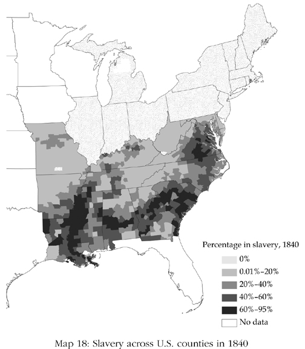
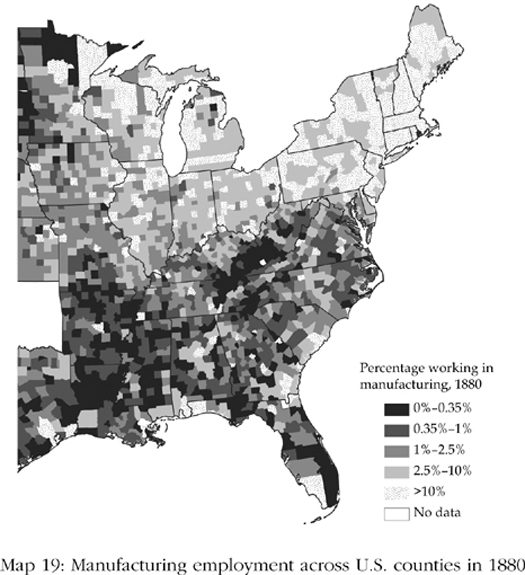
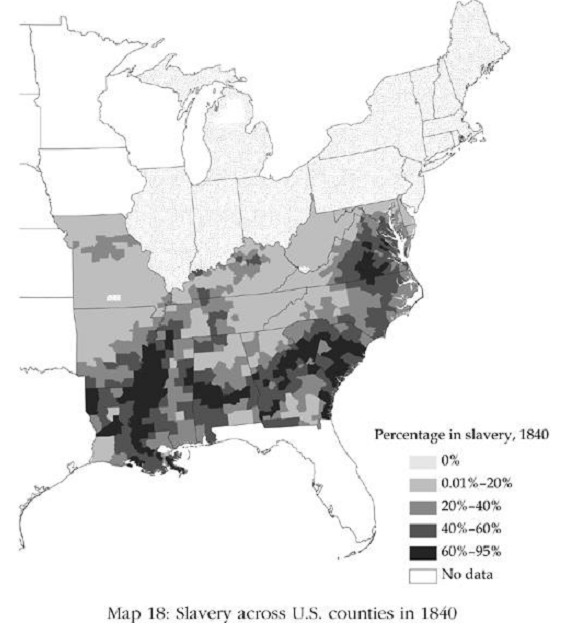
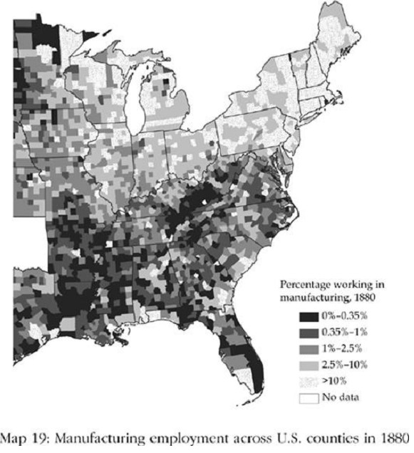
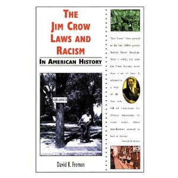

# The Vicious Circle · 第12章　恶性循环

## You Can’t Take The Train To Bo Anymore · 再也没有火车通往波城

All of the West African nation of Sierra Leone became a British colony in 1896. The capital city, Freetown, had originally been founded in the late eighteenth century as a home for repatriated and freed slaves. But when Freetown became a British colony, the interior of Sierra Leone was still made up of many small African kingdoms. Gradually, in the second half of the nineteenth century, the British extended their rule into the interior through a long series of treaties with African rulers.

> 西非国家塞拉利昂在1896年整个沦为英国的殖民地。首都自由城建于18世纪末叶，原本的目的是收容被遣返及获释的奴隶。但自由城成为英国殖民地时，塞拉利昂的内陆仍然有许多小王国。19世纪下半叶，通过与当地的非洲统治者签订一连串条约，英国逐渐将其统治扩张至内陆。

On August 31, 1896, the British government declared the colony a protectorate on the basis of these treaties. The British identified important rulers and gave them a new title, paramount chief. In eastern Sierra Leone, for example, in the modern diamond-mining district of Kono, they encountered Suluku, a powerful warrior king. King Suluku was made Paramount Chief Suluku, and the chieftaincy of Sandor was created as an administrative unit in the protectorate.

> 1896年8月31日，根据这些条约，英国宣布此一殖民地为它的保护国，并拣出重要的统治者，给以新的头衔，封之为大酋长。举例来说，在塞拉利昂东部当今的钻石矿区科诺，有个勇猛好战的国王苏鲁谷。苏鲁谷王被封为大酋长，保护国的行政单位则设在山德尔。

Though kings such as Suluku had signed treaties with a British administrator, they had not understood that these treaties would be interpreted as carte blanche to set up a colony. When the British tried to levy a hut tax—a tax of five shillings to be raised from every house—in January 1898, the chiefs rose up in a civil war that became known as the Hut Tax Rebellion. It started in the north, but was strongest and lasted longer in the south, particularly in Mendeland, dominated by the Mende ethnic group.

> 像苏鲁谷这类的国王虽然和英国当局签了条约，却不明白这些条约其实就是全权委托英国人建立殖民地。1898年1月，英国人开征茅屋税——每一家征收五先令——地方上的酋长群起抗争，演变成内战，爆发了所谓的茅屋税之乱。战事从北部开始，但最严重且持续更久的则是南部，尤以曼德族为主的曼德兰为最。

The Hut Tax Rebellion was soon defeated, but it warned the British about the challenges of controlling the Sierra Leonean hinterland. The British had already started to build a railway from Freetown into the interior. Work began in March 1896, and the line reached Songo Town in December 1898, in the midst of the Hut Tax Rebellion.

> 茅屋税之乱虽然很快平息，却无异于警告英国留意塞拉利昂内陆地区的统治。当时，英国已经开始建造从自由城通往内陆的铁路。工程始于1896年3月，1898年12月开通至桑沟镇，正值茅屋税之乱期间。

British parliamentary papers from 1904 recorded that: In the case of the Sierra Leone Railways the Native Insurrection that broke out in February 1898 had the effect of completely stopping the works and disorganizing the staff for some time. The rebels descended upon the railway, with the result that the entire staff had to be withdrawn to Freetown … Rotifunk, now situated upon the railways at 55 miles from Freetown, was at that time completely in the hands of the rebels.

> 英国国会1904年的文件有这样的记载：“塞拉利昂铁路建造期间，1898年2月爆发土著叛乱，导致工程完全停顿，人员解散。叛军攻击铁路，全部人员不得不撤退到自由城……铁路沿线的罗迪方克，距自由城五十五英里，完全落入叛军之手。”

In fact, Rotifunk was not on the planned railway line in 1894. The route was changed after the start of the rebellion, so that instead of going to the northeast, it went south, via Rotifunk and on to Bo, into Mendeland. The British wanted quick access to Mendeland, the heart of the rebellion, and to other potentially disruptive parts of the hinterland if other rebellions were to flare up.

> 其实按照1894年的兴建计划，铁路并不经过罗迪方克。由于叛乱爆发，路线才改变，从原来的东北方向转而往南，经过罗迪方克前往波城，再进入曼德兰。英国想要尽快开抵叛乱的核心曼德兰，并前往内陆其他潜在的动乱地区，担心另外的地方爆发叛乱。

When Sierra Leone became independent in 1961, the British handed power to Sir Milton Margai and his Sierra Leone People’s Party (SLPP), which attracted support primarily in the south, particularly Mendeland, and the east. Sir Milton was followed as prime minister by his brother, Sir Albert Margai, in 1964. In 1967 the SLPP narrowly lost a hotly contested election to the opposition, the All People’s Congress Party (APC), led by Siaka Stevens. Stevens was a Limba, from the north, and the APC got most of their support from northern ethnic groups, the Limba, the Temne, and the Loko.

> 1961年，塞拉利昂独立，英国人把政权交给米尔顿•马盖爵士及他的塞拉利昂人民党，该党的主要支持者在南部，特别是曼德兰，以及东部。米尔顿爵士之后，由其弟亚伯特爵士于1964年接任总理。1967年塞拉利昂人民党以些微票数在选举中败给由史蒂芬斯领导的反对党全民国会党。史蒂芬斯为北部林巴族人，全民国会党的主要支持者全来自北部族群：林巴人、坦慕尼人及罗科人。

Though the railway to the south was initially designed by the British to rule Sierra Leone, by 1967 its role was economic, transporting most of the country’s exports: coffee, cocoa, and diamonds. The farmers who grew coffee and cocoa were Mende, and the railway was Mendeland’s window to the world. Mendeland had voted hugely for Albert Margai in the 1967 election. Stevens was much more interested in holding on to power than promoting Mendeland’s exports.

> 英国兴建铁路最初的目的在于统治塞拉利昂，但到1967年，其角色已经变成经济性的，主要在于运输该国的大宗出口，包括咖啡、可可及钻石。咖啡及可可的种植户都是曼德人，而铁路则是曼德兰对世界的窗口。1967年的选举，曼德兰的选票大举倒向亚伯特•马盖。史蒂芬斯的兴趣在于抓权，至于促进曼德兰的出口，则非他所关心。

His reasoning was simple: whatever was good for the Mende was good for the SLPP, and bad for Stevens. So he pulled up the railway line to Mendeland. He then went ahead and sold off the track and rolling stock to make the change as irreversible as possible. Now, as you drive out of Freetown to the east, you pass the dilapidated railway stations of Hastings and Waterloo. There are no more trains to Bo. Of course, Stevens’s drastic action fatally damaged some of the most vibrant sectors of Sierra Leone’s economy.

> 他的理由很简单：凡是对曼德人好的就有利于塞拉利昂人民党，不利于史蒂芬斯。因此，他停止兴建通往曼德兰的铁路，而且一不做二不休，干脆把铁轨和车辆全部抛售，使事情再也无法逆转。今天，从自由城向东行，就会经过废弃的哈斯汀及滑铁卢车站，再也不会有火车通往波城了。当然，史蒂芬斯的激烈动作对塞拉利昂最有活力的经济地区造成了严重的伤害。

But like many of Africa’s postindependence leaders, when the choice was between consolidating power and encouraging economic growth, Stevens chose consolidating his power, and he never looked back. Today you can’t take the train to Bo anymore, because like Tsar Nicholas I, who feared that the railways would bring revolution to Russia, Stevens believed the railways would strengthen his opponents. Like so many other rulers in control of extractive institutions, he was afraid of challenges to his political power and was willing to sacrifice economic growth to thwart those challenges.

> 但就和许多独立后的非洲领袖一样，如果要史蒂芬斯在巩固自己的力量与促进经济发展之间做选择，他会毫不犹豫地选择前者。今天，如果想要前往波城，根本没有火车可搭，因为如同沙皇尼古拉一世害怕火车会把革命带到俄罗斯，史蒂芬斯相信铁路将会增强对手的力量。如同许多掌控榨取式制度的统治者，由于害怕自己的政治权力遭到挑战，他宁愿牺牲经济成长以阻止挑战的发生。

Stevens’s strategy at first glance contrasts with that of the British. But in fact, there was a significant amount of continuity between British rule and Stevens’s regime that illustrates the logic of vicious circles. Stevens ruled Sierra Leone by extracting resources from its people using similar methods.

> 史蒂芬斯的策略乍看之下是与英国的相抵触。但事实上，在英国的统治与史蒂芬斯政权之间有着相当显著的延续性，恶性循环的逻辑尽在其中。史蒂芬斯统治塞拉利昂，其手法与英国人如出一辙。

He was still in power in 1985 not because he had been popularly reelected, but because after 1967 he set up a violent dictatorship, killing and harassing his political opponents, particularly the members of the SLPP. He made himself president in 1971, and after 1978, Sierra Leone had only one political party, Stevens’s APC. Stevens thus successfully consolidated his power, even if the cost was impoverishing much of the hinterland.

> 他之所以能够在位直到1985年，并不是因为他受到选民的爱戴，而是因为他在1967年之后就建立了一个独裁暴政，杀害与侵扰政敌，尤其不放过塞拉利昂人民党。1971年，他把自己弄上总统的位子，1978年之后，全民国会党成为塞拉利昂唯一的政党。如此一来，史蒂芬斯成功巩固了自己的权力，只不过代价竟是把内陆地区搞得一穷二白。

During the colonial period, the British used a system of indirect rule to govern Sierra Leone, as they did with most of their African colonies. At the base of this system were the paramount chiefs, who collected taxes, distributed justice, and kept order. The British dealt with the cocoa and coffee farmers not by isolating them, but by forcing them to sell all their produce to a marketing board developed by the colonial office purportedly to help the farmers. Prices for agricultural commodities fluctuated wildly over time.

> 殖民地时期，英国治理塞拉利昂，一如他们治理大部分非洲殖民地，用的是一套间接统治的体系，其基础则是大酋长。收税、司法、治安，全都交给大酋长。至于涉及可可及咖啡农民的事，则由殖民部成立的产销协议会统筹，这个单位号称是来协助农民的。农产品的价格始终处于波动状态。

Cocoa prices might be high one year but low the next. The incomes of farmers fluctuated in tandem. The justification for marketing boards was that they, not the farmers, would absorb the price fluctuations. When world prices were high, the board would pay the farmers in Sierra Leone less than the world price, but when world prices were low, they would do the opposite. It seemed a good idea in principle. The reality was very different, however.

> 以可可为例，今年若是高价，次年就降低，因此，农民的收入也就随之起伏。产销协议会的作用，说得好听一点，是由他们而非农民来吸收波动的价格。当世界价格高涨时，产销协议会付给塞拉利昂的价格更低于此一价格，但当世界价格下跌时，他们的做法就正好相反。基本上来看，这套办法似乎很好，但实际上并不是这么回事。

The Sierra Leone Produce Marketing Board was set up in 1949. Of course the board needed a source of revenues to function. The natural way to attain these was by paying farmers just a little less than they should have received either in good or bad years. These funds could then be used for overhead expenditures and administration. Soon the little less became a lot less. The colonial state was using the marketing board as a way of heavily taxing farmers.

> 塞拉利昂的产销协议会成立于1949年。当然，单位要运作就需要有收入。至于这笔钱的来源，最方便的，无论年头好坏，就是从农民应得的报酬中扣一点下来，做为单位经常开支及行政管理之用。但没有多久，扣一点却成了扣很多。产销协议会变成殖民国对农民课征重税的工具。

Many expected the worst practices of colonial rule in sub-Saharan Africa to stop after independence, and the use of marketing boards to excessively tax farmers to come to an end. But neither happened. In fact, the extraction of farmers using marketing boards got much worse.

> 许多人都以为，下撒哈拉非洲殖民统治的劣政可以在独立后告一段落，利用产销协议会课征农民重税的情形也可以划下句号。但两者都落空了。事实上，利用产销协议会榨取农民的情况更加严重。

By the mid-1960s, the farmers of palm kernels were getting 56 percent of the world price from the marketing board; cocoa farmers, 48 percent; and coffee farmers, 49 percent. By the time Stevens left office in 1985, resigning to allow his handpicked successor, Joseph Momoh, to become president, these numbers were 37, 19, and 27 percent, respectively. As pitiful as this might sound, it was better than what the farmers were getting during Stevens’s reign, which had often been as low as 10 percent—that is, 90 percent of the income of the farmers was extracted by Stevens’s government, and not to provide public services, such as roads or education, but to enrich himself and his cronies and to buy political support.

> 1960年代中期，通过产销协议会，棕榈仁农民可以获得世界价格的56%，可可农民48%，咖啡农民49%。到1985年，史蒂芬斯辞职，由他亲手提拔的继承人马默出任总统时，上述的数字分别变成了37%、19%及27%。但低归低，比起之前，农民的所得还算高的；史蒂芬斯当权期间，甚至往往低于10%；换句话说，农民90%的收入都被史蒂芬斯政府征敛，全都进了他自己及权贵的口袋，用来收买政治支持，没有一丝一毫用于公共建设，诸如道路及教育。

As part of their indirect rule, the British had also stipulated that the office of the paramount chief would be held for life. To be eligible to be a chief, one had to be a member of a recognized “ruling house.” The identity of the ruling houses in a chieftaincy developed over time, but it was essentially based on the lineage of the kings in a particular area and of the elite families who signed treaties with the British in the late nineteenth century. Chiefs were elected, but not democratically.

> 隶属于英国的间接统治，殖民当局规定大酋长为终身职务，必须要是所谓的“王室”成员才有资格。酋长地位具有王室身份是逐步形成的，但基本上乃是某一地区的王族世系，而且是在19世纪末与英国签约的菁英家族。大酋长由选举产生，但并非通过民主的机制。

A body called the Tribal Authority, whose members were lesser village chiefs or were appointed by paramount chiefs, village chiefs, or the British authorities, decided who would become the paramount chief. One might have imagined that this colonial institution would also have been abolished or at least reformed after independence. But just like the marketing board, it was not, and continued unchanged. Today paramount chiefs are still in charge of collecting taxes. It is no longer a hut tax, but its close descendant, a poll tax.

> 谁来当大酋长，是由一个名为“部落署”的机构来决定，其成员为大酋长委任的低级村长、村长或英国官员。大家或许会想，独立之后此一机构若不是已经取消，至少也经过了改革。但就和产销协议会一样，事实并非如此，而且毫无变化。时至今日，大酋长仍然主管税收，茅屋税虽然已经不再征收，但却有了人头税。

In 2005 the Tribal Authority in Sandor elected a new paramount chief. Only candidates from the Fasuluku ruling house, which is the only ruling house, could stand. The victor was Sheku Fasuluku, King Suluku’s great-great-grandson. The behavior of the marketing boards and the traditional systems of land ownership go a long way to explain why agricultural productivity is so low in Sierra Leone and much of sub-Saharan Africa.

> 2005年，山德尔的部落署选出了一名新任大酋长。唯一够资格的候选人是法苏鲁谷王室，也是当前仅存的王室。当选人为歇库•法苏鲁谷，苏鲁谷的玄孙。塞拉利昂和下撒哈拉非洲的农业生产之所以如此低落，其症结全在于产销协议会的行事作风，以及传统的土地所有制。

The political scientist Robert Bates set out in the 1980s to understand why agriculture was so unproductive in Africa even though according to textbook economics this ought to have been the most dynamic economic sector. He realized that this had nothing to do with geography or the sorts of factors discussed in chapter 2 that have been claimed to make agricultural productivity intrinsically low. Rather, it was simply because the pricing policies of the marketing boards removed any incentives for the farmers to invest, use fertilizers, or preserve the soil.

> 1980年代，政治学者贝兹前往非洲，想要了解非洲农业生产低落的原因，即使按照经济学教科书，这里应该是最有活力的经济地区。他明白，这里之所以会如此，既于地理无关，也跟我们在第二章讨论过的那些认为农业生产力之所以低落的内在因素无关。问题其实很简单，产销协议会的价格政策抹杀了农民的进取心，使他们失去了投资、使用肥料及保护土壤的动机。

The reason that the policies of the marketing boards were so unfavorable to rural interests was that these interests had no political power. These pricing policies interacted with other fundamental factors making tenure insecure, further undermining investment incentives. In Sierra Leone, paramount chiefs not only provide law and order and judicial services, and raise taxes, but they are also the “custodians of the land.”

> 产销协议会的政策极端不利于农村的利益，关键在于这些利益缺乏政治力量。价格政策与其他根本因素互动，结果使得所有权很不安全，更进一步瓦解了投资动机。在塞拉利昂，大酋长不仅管治安、法规及司法，还兼征税，同时也是“土地管理人”。

Though families, clans, and dynasties have user rights and traditional rights to land; at the end of the day chiefs have the last say on who farms where. Your property rights to land are only secure if you are connected to the chief, perhaps from the same ruling family. Land cannot be bought or sold or used as collateral for a loan, and if you are born outside a chieftaincy, you cannot plant any perennial crop such as coffee, cocoa, or palm for fear that this will allow you to establish “de facto” property rights.

> 尽管家族、氏族及王室拥有土地使用权及传统上的权利；但到头来，谁可以在那里种田，只有酋长说了算。只有跟酋长有关系，或许出身同一王室，土地所有权才可靠。土地不能买卖，也不能抵押贷款，如果出身不是酋长世家，不可以种植多年生作物如咖啡、可可或棕榈，以防这样一来将会让人获得“实质上的”财产权。

The contrast between the extractive institutions developed by the British in Sierra Leone and the inclusive institutions that developed in other colonies, such as Australia, is illustrated by the way mineral resources were managed. Diamonds were discovered in Kono in eastern Sierra Leone in January 1930. The diamonds were alluvial, that is, not in deep mines. So the primary method of mining them was by panning in rivers. Some social scientists call these “democratic diamonds,” because they allow many people to become involved in mining, creating a potentially inclusive opportunity. Not so in Sierra Leone.

> 英国在塞拉利昂发展出来的榨取式制度，与它在其他殖民地（如澳大利亚）发展出来的广纳式制度，两者形成强烈的对比，可以从矿产资源的管理上得到充分说明。1930年1月，塞拉利昂东部的科诺发现钻石。这里的钻石不是深藏于地下的矿脉，而是冲积矿床，因此，主要的开采方法是在河中淘洗。类似的情形，某些社会科学家称之为“民主钻石”，因为这可以让许多人加入，制造一种潜在的广纳性机会。但在塞拉利昂却不然。

Happily ignoring the intrinsically democratic nature of panning for diamonds, the British government set up a monopoly for the entire protectorate, called it the Sierra Leone Selection Trust, and granted it to De Beers, the giant South African diamond mining company. In 1936 De Beers was also given the right to create the Diamond Protection Force, a private army that would become larger than that of the colonial government in Sierra Leone. Even so, the widespread availability of the alluvial diamonds made the situation difficult to police. By the 1950s, the Diamond Protection Force was overwhelmed by thousands of illegal diamond miners, a massive source of conflict and chaos.

> 淘洗钻石在本质上的民主特性，英国政府乐得故作不见，整个将之纳入保护，予以独占，名之为塞拉利昂精选信托，并转让给南非的钻石开采公司戴比尔斯。1936年，戴比尔斯获得授权，成立了钻石警卫团，是一支比塞拉利昂殖民地政府部队还大的私人武装。尽管如此，钻石冲积矿床随处都可以淘洗，警力不免顾此失彼。到了1950年代，成千上万的非法淘钻者涌入，钻石警卫团疲于奔命，成为冲突与动荡之源。

In 1955 the British government opened up some of the diamond fields to licensed diggers outside the Sierra Leone Selection Trust, though the company still kept the richest areas in Yengema and Koidu and Tongo Fields. Things only got worse after independence. In 1970 Siaka Stevens effectively nationalized the Sierra Leone Selection Trust, creating the National Diamond Mining Company (Sierra Leone) Limited, in which the government, effectively meaning Stevens, had a 51 percent stake. This was the opening phase of Stevens’s plan to take over diamond mining in the country.

> 1955年，英国政府开放部分矿场给塞拉利昂精选信托以外得到特许的采矿者，但公司仍保有岩吉马、科伊度及堂沟等矿藏最丰富的矿场。独立之后，情况越发恶化。1970年，史蒂芬斯实际上将塞拉利昂精选信托国营化，成立国家钻石矿业公司，政府（实际就是史蒂芬斯本人）拥有51%的股份。但这只不过是史蒂芬斯计划接收国家钻石矿业公司的开始而已。

In nineteenth-century Australia it was gold, discovered in 1851 in New South Wales and the newly created state of Victoria, not diamonds, that attracted everyone’s attention. Like diamonds in Sierra Leone, the gold was alluvial, and a decision had to be made about how to exploit it. Some, such as James Macarthur, son of John Macarthur, the prominent leader of the Squatters we discussed earlier (this page–this page), proposed that fences be placed around the mining areas and the monopoly rights auctioned off.

> 19世纪的澳大利亚，引起广泛注意的不是钻石，而是1851年在新南威尔士及刚成立的维多利亚州发现的黄金。和塞拉利昂钻石一样，这里的黄金也是冲积矿床，如何加以开发必须有所决策才行。有些人，例如杰出的占地户领袖约翰•麦克阿瑟之子詹姆斯•麦克阿瑟，提议在矿区周围建立围墙，拍卖独占权。

They wanted an Australian version of the Sierra Leone Selection Trust. Yet many in Australia wanted free access to the gold mining areas. The inclusive model won, and instead of setting up a monopoly, Australian authorities allowed anyone who paid an annual mining license fee to search and dig for gold. Soon the diggers, as these adventurers came to be known, were a powerful force in Australian politics, particularly in Victoria. They played an important role in pushing forward the agenda of universal suffrage and the secret ballot.

> 他们想要搞的是一个塞拉利昂精选信托的澳大利亚版。但另有许多人却希望开放黄金矿区。结果，广纳模式获胜，澳大利亚当局不仅不设立独占事业，而且只要每年缴交特许费，任何人都可以从事黄金的探寻及采掘。很快的，在澳大利亚的政治上，这些充满冒险精神的淘金人发展成为一股力量，尤其是在维多利亚，在推动普选及秘密投票上扮演重要角色。

We have already seen two pernicious effects of European expansion and colonial rule in Africa: the introduction of the transatlantic slave trade, which encouraged the development of African political and economic institutions in an extractive direction, and the use of colonial legislation and institutions to eliminate the development of African commercial agriculture that might have competed with Europeans. Slavery was certainly a force in Sierra Leone. At the time of colonization there was no strong centralized state in the interior, just many small, mutually antagonistic kingdoms continually raiding one another and capturing one another’s men and women.

> 我们已经看到，欧洲在非洲所进行的扩张及殖民统治产生了两种恶性结果。其一，大西洋奴隶贸易鼓励非洲在政治及经济上走向榨取式制度；其二，殖民地的立法及制度，使本来可以与欧洲竞争的非洲农业丧失了商业化的机会。在塞拉利昂，奴隶确实是一股力量。殖民时期，内陆地区并没有足够强大的中央集权国家，有的只是许多小王国，互相敌对，侵伐不断，彼此互掳对方的男女。

Slavery was endemic, with possibly 50 percent of the population working as slaves. The disease environment meant that large-scale white settlement was not possible in Sierra Leone, as it was in South Africa. Hence there were no whites competing with the Africans. Moreover, the lack of a mining economy on the scale of Johannesburg meant that, in addition to the lack of demand for African labor from white farms, there was no incentive to create the extractive labor market institutions so characteristic of Apartheid South Africa.

> 实际上，奴隶早已经是一种地方性现象，人口之中，以奴隶身份工作的可能占了50%。和南非（不？）一样，由于环境容易致病，白人不太可能大规模在塞拉利昂定居，因此并没有白人与非洲人竞争。另一方面，由于矿业经营缺乏约翰内斯堡那样的规模，农业上又不存在需要大量黑人劳动力的白人农场，因此，南非那种种族隔离式的榨取式劳动力市场制度无以形成。

But other mechanisms were also in play. Sierra Leone’s cocoa and coffee farmers did not compete with whites, though their incomes were still expropriated via a government monopoly, the marketing board. Sierra Leone also suffered from indirect rule. In many parts of Africa where the British authorities wished to use indirect rule, they found peoples who did not have a system of centralized authority who could be taken over. For example, in eastern Nigeria the Igbo peoples had no chiefs when the British encountered them in the nineteenth century. The British then created chiefs, the warrant chiefs.

> 尽管如此，别种力量却也存在。在塞拉利昂，咖啡及可可农民虽然没有白人和他们竞争，但他们的收入仍然会遭到产销协议会这个政府独占单位的剥削。另一方面，塞拉利昂还要受间接统治之害。在非洲许多地方，英国当局都属意于间接统治，他们发现，任何部族只要没有中央集权体系，他们都可以加以接管。举例来说，19世纪，英国人在东非的尼日利亚遭遇到没有酋长的伊哥波人时，马上就为他们设置了酋长，称为委任酋长。

In Sierra Leone, the British would base indirect rule on existing indigenous institutions and systems of authority. Nevertheless, regardless of the historical basis for the individuals recognized as paramount chiefs in 1896, indirect rule, and the powers that it invested in paramount chiefs, completely changed the existing politics of Sierra Leone. For one, it introduced a system of social stratification—the ruling houses—where none had existed previously. A hereditary aristocracy replaced a situation that had been much more fluid and where chiefs had required popular support. Instead what emerged was a rigid system with chiefs holding office for life, beholden to their patrons in Freetown or Britain, and far less accountable to the people they ruled.

> 在塞拉利昂，英国人的间接统治则是建立在本土现存的权力体系上。然而，尽管1896年受封的那些大酋长各有其历史渊源，间接统治及其授予大酋长的权力却完全改变了塞拉利昂既存的政治状况。举例来说，英国当局设置了一个社会等级制度——王室——一个过去不存在的阶层。在过去，酋长需要获得民意支持，政治流动性比较大。但间接统治实施后，世袭的贵族取代了原有制度，僵化的制度随之出现，弄出一批终身酋长，他们要负责的对象是在自由城或英国庇护者，而非辖内的百姓。

The British were happy to subvert the institutions in other ways, too, for example, by replacing legitimate chiefs with people who were more cooperative. Indeed, the Margai family, which supplied the first two prime ministers of independent Sierra Leone, came to power in the Lower Banta chieftaincy by siding with the British in the Hut Tax Rebellion against the reigning chief, Nyama. Nyama was deposed, and the Margais became chiefs and held the position until 2010.

> 另一方面，英国也乐得用其他方式颠覆制度，譬如说，用比较合作的人取代合法的酋长。事实确实如此，塞拉利昂独立后，出过两名总理的马盖家族，就是在茅屋税之乱中支持英国，反对当时在位的酋长尼亚马，因此取得下班塔大酋长的位置。尼亚马下台后，马盖家族从此把持大酋长的位置直至2010年。

What is remarkable is the extent of continuity between colonial and independent Sierra Leone. The British created the marketing boards and used them to tax farmers. Postcolonial governments did the same extracting at even higher rates. The British created the system of indirect rule through paramount chiefs. Governments that followed independence didn’t reject this colonial institution; rather, they used it to govern the countryside as well. The British set up a diamond monopoly and tried to keep out African miners. Postindependence governments did the same.

> 特别值得注意的是，殖民地塞拉利昂与独立国塞拉利昂之间不乏制度上的延续。英国设置产销协议会向农民征税，后殖民地政府依样画葫芦，而且变本加厉，税率更高。英国利用大酋长建立间接统治，独立后的政府不仅未将此一殖民制度废止，而且继续用于乡村的治理。英国建立钻石独占事业并企图排除非洲人参与，独立后的政府依旧如此。

It is true that the British thought that building railways was a good way to rule Mendeland, while Siaka Stevens thought the opposite. The British could trust their army and knew it could be sent to Mendeland if a rebellion arose. Stevens, on the other hand, could not do so. As in many other African nations, a strong army would have become a threat to Stevens’s rule. It was for this reason that he emasculated the army, cutting it down and privatizing violence through specially created paramilitary units loyal only to him, and in the process, he accelerated the decline of the little state authority that existed in Sierra Leone.

> 英国建铁路有利于治理曼德兰，史蒂芬斯却不以为然。英国信任自己的军队，曼德兰如果叛变，大可以派他们去应付；碰到同样情况，史蒂芬斯却不这样认为。和许多非洲国家一样，强大的军队往往成为统治者的威胁，基于这个理由，史蒂芬斯削弱军方的力量，压制军队，并建立只效忠于他的准军事单位而将武力私人化，也因此使得本已微弱的政府权力加速萎缩。

Instead of the army, first came the Internal Security Unit, the ISU, which Sierra Leone’s long-suffering people knew as “I Shoot U.” Then came the Special Security Division, the SSD, which the people knew as “Siaka Stevens’s Dogs.” In the end, the absence of an army supporting the regime would also be its undoing. It was a group of only thirty soldiers, led by Captain Valentine Strasser, that pitched the APC regime from power on April 29, 1992.

> 取军队而代之的，最先是国家安全局，简称I S U，成了塞拉利昂受苦受难的人民口中的I Shoot U（我毙了你）。接下来是特别安全局，简称S S D，到了人民口中，成了Siaka Stevens’s Dog（塞卡•史蒂芬斯的狗）。但没有军队的支持，到头来反而为政权的垮台埋下了祸根。1993年4月29日，在斯特拉瑟上尉的领导下，一群为数不过三十名的军人就把全民国会党的政权给拉了下来。

Sierra Leone’s development, or lack thereof, could be best understood as the outcome of the vicious circle. British colonial authorities built extractive institutions in the first place, and the postindependence African politicians were only too happy to take up the baton for themselves. The pattern was eerily similar all over sub-Saharan Africa. There were similar hopes for postindependence Ghana, Kenya, Zambia, and many other African countries. Yet in all these cases, extractive institutions were re-created in a pattern predicted by the vicious circle—only they became more vicious as time went by. In all these countries, for example, the British creation of marketing boards and indirect rule were sustained.

> 塞拉利昂的发展，也可以说是倒退，是恶性循环的最佳写照。首先是英国殖民当局建立了榨取式制度，独立后，非洲的政客也乐得接棒，整个模式与下撒哈拉非洲如出一辙。加纳、肯尼亚、津巴布韦，以及其他许多非洲国家，独立后都怀着相同的希望，然而，恶性循环却使这些国家只是榨取式制度的一再重演，而且其恶性随着时间愈演愈烈。举例来说，在所有这些国家，英国人建立的产销协议会及间接统治均持续不变。

There are natural reasons for this vicious circle. Extractive political institutions lead to extractive economic institutions, which enrich a few at the expense of many. Those who benefit from extractive institutions thus have the resources to build their (private) armies and mercenaries, to buy their judges, and to rig their elections in order to remain in power. They also have every interest in defending the system.

> 恶性循环有其本质性的症结。榨取式政治制度导致榨取式经济制度，肥了少数瘦了多数。因榨取式制度而得利的人一旦拥有了资源，便可以建立自己的军队及佣兵，收买司法，操纵选举，如此一来，不仅可以继续掌权，更可占尽优势保护体系的运作。

Therefore, extractive economic institutions create the platform for extractive political institutions to persist. Power is valuable in regimes with extractive political institutions, because power is unchecked and brings economic riches. Extractive political institutions also provide no checks against abuses of power. Whether power corrupts is debatable, but Lord Acton was certainly right when he argued that absolute power corrupts absolutely. We saw in the previous chapter that even when Franklin Roosevelt wished to use his presidential powers in a way that he thought would be beneficial for the society, unencumbered by constraints imposed by the Supreme Court, the inclusive U.S. political institutions prevented him from setting aside the constraints on his power.

> 因此，我们可以说，榨取式经济制度为榨取式政治制度的延续制造了平台，而在榨取式政治制度中，权力无价，因为权力可以无往不利，可以中饱私囊。榨取式政治制度也可以让权力的滥用无所限制。权力是否导致腐败容或有辩论的余地，但阿克顿勋爵说“绝对的权力导致绝对的腐败”，则是千真万确的。在前一章我们已经看到，富兰克林•罗斯福总统纵使是为了造福社会，不惜运用总统的权力打破最高法院的限制，但广纳式的美国政治制度却不容许，打消了他想要解除自己权力限制的企图。

Under extractive political institutions, there is little check against the exercise of power, however distorted and sociopathic it may become. In 1980 Sam Bangura, then the governor of the central bank in Sierra Leone, criticized Siaka Stevens’s policies for being profligate. He was soon murdered and thrown from the top floor of the central bank building onto the aptly named Siaka Stevens Street. Extractive political institutions thus also tend to create a vicious circle because they provide no line of defense against those who want to further usurp and misuse the powers of the state.

> 在榨取式政治制度之下则不然，权力的运用，不论其如何扭曲及反社会，都难以予以节制。1980年，塞拉利昂中央银行总裁班古拉批评史蒂芬斯的政策漫无节制，没过多久就惨遭谋杀，从中央银行大楼的顶楼被推落到一条名叫“塞卡•斯蒂芬斯街”的马路上。因此，榨取式政治制度往往造成恶性循环，原因无他，对于想要窃取及滥用政府权力的人，这种制度丝毫无法加以遏阻。

Yet another mechanism for the vicious circle is that extractive institutions, by creating unconstrained power and great income inequality, increase the potential stakes of the political game. Because whoever controls the state becomes the beneficiary of this excessive power and the wealth that it generates, extractive institutions create incentives for infighting in order to control power and its benefits, a dynamic that we saw played out in Maya city-states and in Ancient Rome. In this light, it is no surprise that the extractive institutions that many African countries inherited from the colonial powers sowed the seeds of power struggles and civil wars.

> 还有一种力量也会带来恶性循环，那就是榨取式制度制造了没有限制的权力及巨大的收入差距，其结果将会增加政治赌博的赌注。不管是谁，一旦掌控了政府，就会使他成为过度的权力及财富的收益者，因此为了掌控权力及利益，榨取式制度制造了内斗的诱因，这股推动力在玛雅城邦及古罗马就曾经上演过。由这个角度来看，从殖民政权继承了榨取式制度，许多非洲国家便撒下了权力斗争及内战的种子，一点都不令人惊讶。

These struggles would be very different conflicts from the English Civil War and the Glorious Revolution. They would not be fought to change political institutions, introduce constraints on the exercise of power, or create pluralism, but to capture power and enrich one group at the expense of the rest. In Angola, Burundi, Chad, Côte d’Ivoire, the Democratic Republic of Congo, Ethiopia, Liberia, Mozambique, Nigeria, Republic of Congo Brazzaville, Rwanda, Somalia, Sudan, and Uganda, and of course in Sierra Leone, as we will see in more detail in the next chapter, these conflicts would turn into bloody civil wars and would create economic ruin and unparalleled human suffering—as well as cause state failure.

> 相较于英格兰内战及光荣革命的冲突，这种斗争大不相同。斗争的目的不是为了改变政治制度、限制权力的行使，也不是要产生政治多元化，而是要抓权自肥，以其他人为刍狗。在安哥拉、布隆迪、乍得、象牙海岸、刚果民主共和国、埃塞俄比亚、利比亚、莫桑比克、尼日利亚、刚果共和国、卢旺达、索马里、苏丹及乌干达，当然还有塞拉利昂，我们将会在下一章更详细地看到，这种冲突转变成血腥的内战，制造了惨重的经济破坏，以及人类空前的痛苦——同时也导致了国家的失败。

## From Encomienda To Land Grab · 从赐封到强占土地

On January 14, 1993, Ramiro De León Carpio was sworn in as the president of Guatemala. He named Richard Aitkenhead Castillo as his minister of finance, and Ricardo Castillo Sinibaldi as his minister of development. These three men all had something in common: all were direct descendants of Spanish conquistadors who had come to Guatemala in the early sixteenth century. De León’s illustrious ancestor was Juan De León Cardona, while the Castillos were related to Bernal Díaz del Castillo, a man who wrote one of the most famous eyewitness accounts of the conquest of Mexico. In reward for his service to Hernán Cortés, Díaz del Castillo was appointed governor of Santiago de los Caballeros, which is today the city of Antigua in Guatemala.

> 1993年1月14日，卡比欧宣誓就任危地马拉总统，并任命卡斯第洛为财政部长，西尼巴迪为发展部长。这三个人有一个共同点：他们的祖先都是16世纪初来到危地马拉的西班牙征服者。卡比欧著名的先人是卡多纳，卡斯第洛则与贝纳尔•卡斯第洛有血缘关系，后者亲身参与征服墨西哥，所写的纪事是最著名的见证之一。科尔蒂斯为酬赏他的功劳，任命他出任圣地亚哥（现在的危地马拉的安提瓜）总督。

Both Castillo and De León founded dynasties along with other conquistadors, such as Pedro de Alvarado. The Guatemalan sociologist Marta Casaús Arzú identified a core group of twenty-two families in Guatemala that had ties through marriage to another twenty-six families just outside the core. Her genealogical and political study suggested that these families have controlled economic and political power in Guatemala since 1531. An even broader definition of which families were part of this elite suggested that they accounted for just over 1 percent of the population in the 1990s.

> 卡斯第洛与卡多纳两个人都跟其他征服者如阿瓦拉多一样，建立了自己的王朝。危地马拉社会学家阿尔竺的分析指出，危地马拉有一个由二十二个家族组成的核心群体，并通过婚姻与核心以外的二十六个家族结合。她所做的系谱及政治研究显示，这些家族从1531年起就掌控了危地马拉的经济与政治。若将哪些家族属于这个菁英阶层的定义再放宽一点，那么在1990年代，这些人占了总人口数的百分之一强。

In Sierra Leone and in much of sub-Saharan Africa, the vicious circle took the form of the extractive institutions set up by colonial powers being taken over by postindependence leaders. In Guatemala, as in much of Central America, we see a simpler, more naked form of the vicious circle: those who have economic and political power structure institutions to ensure the continuity of their power, and succeed in doing so. This type of vicious circle leads to the persistence of extractive institutions and the persistence of the same elites in power together with the persistence of underdevelopment.

> 在塞拉利昂以及多数下撒哈拉非洲，独立后，领导人承接了殖民政权所建立的榨取式制度，恶性循环于是形成。但在危地马拉，如同我们在大部分中美洲地区所看到的恶性循环，其形式更为简单也更为赤裸：拥有经济及政治力量的人直接架构制度，确保其权力得以延续，而且无往不利。这种形式的恶性循环不仅使榨取式制度得以持续不坠，使统治阶层的同一批人得以持续当权，也使得低度发展持续不变。

At the time of the conquest, Guatemala was densely settled, probably with a population of around two million Mayas. Disease and exploitation took a heavy toll as everywhere else in the Americas. It was not until the 1920s that its total population returned to this level. As elsewhere in the Spanish Empire, the indigenous people were allocated to conquistadors in grants of encomienda. As we saw in the context of the colonization of Mexico and Peru, the encomienda was a system of forced labor, which subsequently gave way to other similar coercive institutions, particularly to the repartimiento, also called the mandamiento in Guatemala.

> 西班牙征服时期，危地马拉已经居民稠密，玛雅人的总人口数约在两百万左右。但和其他地方一样，在中南美洲，疾病与剥削同样导致大量死亡，总人口数直至1920年代才又恢复到此一水平。和西班牙帝国的其他地方一样，在赐封制度下，征服者都可以分配到原住民。如同我们在墨西哥及秘鲁所看到的殖民情况，赐封是一套强迫劳役制度，后来由产品配销制度取代，这在危地马拉又称为“诫命”制度。

The elite, made up of the descendants of the conquistadors and some indigenous elements, not only benefited from the various forced labor systems but also controlled and monopolized trade through a merchant guild called the Consulado de Comercio. Most of the population in Guatemala was high in the mountains and far from the coast. The high transportation costs reduced the extent of the export economy, and initially land was not very valuable. Much of it was still in the hands of indigenous peoples, who had large communal landholdings called ejidos. The remainder was largely unoccupied and notionally owned by the government. There was more money in controlling and taxing trade, such as it was, than in controlling the land.

> 菁英阶层的组成包括征服者后裔及少数原住民，不但享有各种强迫劳役所带来的福利，而且通过名叫贸易领事馆的商业行会组织来掌控贸易，实行独占。大部分危地马拉人住在高山上，远离海岸。由于运输费用高昂，以致出口经济不振，刚开始时，土地并没有什么价值，绝大部分还是掌握在原住民手里，这些人拥有的大片称为“合作农场”的共有土地，其余部分则多属于无主之地，名义上为政府所有。如此一来，控制贸易并征收赋税当然要比掌控土地更能生财。

Just as in Mexico, the Guatemalan elite viewed the Cadiz Constitution (this page–this page) with hostility, which encouraged them to declare independence just as the Mexican elites did. Following a brief union with Mexico and the Central American Federation, the colonial elite ruled Guatemala under the dictatorship of Rafael Carrera from 1839 to 1871. During this period the descendants of the conquistadors and the indigenous elite maintained the extractive economic institutions of the colonial era largely unchanged. Even the organization of the Consulado did not alter with independence. Though this was a royal institution, it happily continued under a republican government.

> 和在墨西哥一样，危地马拉的统治阶层也把加的斯宪法看成眼中钉，恨不得跟墨西哥的统治阶层一样早日宣布独立。在与墨西哥及中美洲联邦短暂结盟后，1839年至1871年间危地马拉处于卡瑞拉的独裁统治之下。这段时期内，征服者后裔与原住民菁英阶层大多因循殖民时代的榨取式经济，贸易领事馆并未随着独立而有所改变。虽然这是当初西班牙王室设立的机构，但共和政府却乐得将它保留下来。

Independence then was simply a coup by the preexisting local elite, just as in Mexico; they carried on as usual with the extractive economic institutions from which they had benefited so much. Ironically enough, during this period the Consulado remained in charge of the economic development of the country. But as had been the case pre-independence, the Consulado had its own interests at heart, not those of the country. Part of its responsibility was for the development of infrastructure, such as ports and roads, but as in Austria-Hungary, Russia, and Sierra Leone, this often threatened creative destruction and could have destabilized the system.

> 如同墨西哥一样，独立不过是当地既有菁英发动的一场政变，他们一如往常继续掌控让他们获利良多的榨取式制度。讽刺的是，这段期间贸易领事馆依旧执掌国家的经济发展事务。但一如独立之前，贸易领事馆考虑的是自身的利益而非国家的利益，它虽然负有基础建设如港口及道路的开发责任，但就和奥匈帝国、俄罗斯及塞拉利昂一样，这种事往往会带来创造性破坏，可能动摇到制度的稳定。

Therefore, the development of infrastructure, rather than being implemented, was often resisted. For example, the development of a port on the Suchitepéquez coast, bordering the Pacific Ocean, was one of the proposed projects. At the time the only proper ports were on the Caribbean coast, and these were controlled by the Consulado. The Consulado did nothing on the Pacific side because a port in that region would have provided a much easier outlet for goods from the highland towns of Mazatenango and Quezaltenango, and access to a different market for these goods would have undermined the Consulado’s monopoly on foreign trade.

> 因此，对于基础建设的开发，抗拒总是多于落实。举例来说，当时可用的港口都在加勒比海，而且全都被贸易领事馆掌控。濒临太平洋的苏奇特佩克斯计划开辟一个港口，但领事馆根本不愿意碰太平洋这一边，因为这个地区一旦有了港口，就会为高原城市如马萨特南哥及克隆尔特南哥提供更方便的出口，并为货物打开新的市场，如此一来，势将威胁到贸易领事馆对海外贸易的垄断。

The same logic applied to roads, where, again, the Consulado had the responsibility for the entire country. Predictably it also refused to build roads that would have strengthened competing groups or would have potentially undone its monopoly. Pressure to do so again came from western Guatemala and Quezaltenango, in the Los Altos region. But if the road between Los Altos and the Suchitepéquez coast had been improved, this could have created a merchant class, which would have been a competitor to the Consulado merchants in the capital. The road did not get improved.

> 全国道路的兴建本来也是贸易领事馆的责任，但道理也一样。因此，开路根本免谈，以免强化了竞争者，或在未来危害到本身的垄断。危地马拉西部及洛萨多地区的克隆尔特南哥也有同样的交通要求。但洛萨多与苏奇特佩克斯之间的交通一旦获得改善，就会产生新的商人阶级，成为竞争者，威胁到首府地区的贸易领事馆商人。道路于是没有获得改善。

As a result of this elite dominance, Guatemala was caught in a time warp in the middle of the nineteenth century, as the rest of the world was changing rapidly. But these changes would ultimately affect Guatemala. Transportation costs were falling due to technological innovations such as the steam train, the railways, and new, much faster types of ships. Moreover, the rising incomes of people in Western Europe and North America were creating a mass demand for many products that a country such as Guatemala could potentially produce.

> 这种菁英统治的结果是，当世界其他地方都在快速改变时，危地马拉却陷入了时光扭曲，停顿在19世纪。但危地马拉终究逃不过外面世界的影响。拜科技创新所赐，如蒸汽火车、铁路及更快速的新型船只，运费因而降低了，更重要的是，西欧及北美人民的收入大幅提高，为许多产品创造了大量的需求，而危地马拉这样的国家正是这些产品的潜在产地。

Early in the century, some indigo and then cochineal, both natural dyes, had been produced for export, but the more profitable opportunity would become coffee production. Guatemala had a lot of land suitable for coffee, and cultivation began to spread—without any assistance from the Consulado. As the world price of coffee rose and international trade expanded, there were huge profits to be made, and the Guatemalan elite became interested in coffee.

> 19世纪初，靛青跟胭脂两种天然染料是主要出口的产品，但咖啡显然更有利润。危地马拉有许多适合种植咖啡的土地，咖啡栽种乃开始扩散，而且完全未经贸易领事馆的协助。等到世界市场的咖啡价格看涨，国际贸易扩张，有暴利可图时，危地马拉的菁英阶层开始对咖啡产生兴趣。

In 1871 the long-lasting regime of the dictator Carrera was finally overthrown by a group of people calling themselves Liberals, after the worldwide movement of that name. What liberalism means has changed over time. But in the nineteenth century in the United States and Europe, it was similar to what is today called libertarianism, and it stood for freedom of individuals, limited government, and free trade. Things worked a little differently in Guatemala.

> 随着自由主义运动在世界各地风起云涌，长期统治的独裁者卡瑞拉终于在1871年遭到推翻，举事者就自称是自由党。自由主义的含义或许因时而异，但在19世纪的美国及欧洲，它的含义类似今天所谓的放任自由主义，支持个人自由、有限的政府，以及自由贸易。但在危地马拉，情况稍微不同。

Led initially by Miguel García Granados, and after 1873 by Justo Rufino Barrios, the Guatemalan Liberals were, for the most part, not new men with liberal ideals. By and large, the same families remained in charge. They maintained extractive political institutions and implemented a huge reorganization of the economy to exploit coffee. They did abolish the Consulado in 1871, but economic circumstances had changed. The focus of extractive economic institutions would now be the production and export of coffee.

> 最初由格拉纳多领导，1873年之后由巴里奥斯接手，危地马拉的自由党人多半并非怀抱自由派理想的新人，大体上来说，当权的仍然是那些旧家族。他们维持榨取式政治制度，重整经济体系，大肆开发咖啡。他们的确在1871年废除了贸易领事馆，但整体的经济环境已经改变。这时候，咖啡的生产及输出成了榨取式经济制度的核心。

Coffee production needed land and labor. To create land for coffee farms, the Liberals pushed through land privatization, in fact really a land grab in which they would be able to capture land previously held communally or by the government. Though their attempt was bitterly contested, given the highly extractive political institutions and the concentration of political power in Guatemala, the elite were ultimately victorious.

> 咖啡生产需要土地及劳工。为了弄到土地开辟成咖啡田，自由党大力推动土地私有化，但事实上根本就是强占土地，任他们夺取原来共有的或政府的土地。尽管抗争激烈，但由于危地马拉的高度榨取式政治制度与高度集中的政治权力，菁英阶层还是获得了胜利。

Between 1871 and 1883 nearly one million acres of land, mostly indigenous communal land and frontier lands, passed into the hands of the elite, and it was only then that coffee developed rapidly. The aim was the formation of large estates. The privatized lands were auctioned off typically to members of the traditional elite or those connected with them. The coercive power of the Liberal state was then used to help large landowners gain access to labor by adapting and intensifying various systems of forced labor.

> 1871年至1883年间，将近一百万亩土地，大部分是原住民共有地及荒地，落入菁英阶层手中，从此咖啡产业迅速发展，目的是要成就巨大的产业。私有化土地的拍卖，买主通常都是传统的菁英阶层以及跟他们有关系的人。至于协助大地主取得劳工，则是通过自由党政府的强制力量，将各种劳役体系加以改组或强化。

In November 1876, President Barrios wrote to all the governors of Guatemala noting that because the country has extensive areas of land that it needs to exploit by cultivation using the multitude of workers who today remain outside the movement of development of the nation’s productive elements, you are to give all help to export agriculture: 1. From the Indian towns of your jurisdiction provide to the owners of fincas [farms] of that department who ask for labor the number of workers they need, be it fifty or one hundred.

> 1876年11月，总统巴里奥斯行文危地马拉各省省长，予以指示：“国家现有广大区域的土地有待耕耘开发，需要用到迄今仍然置身国家生产行列之外的劳工，阁下当尽力协助农业的外销：1、 凡有辖内农田地主要求劳工，所需无论五十或一百，请阁下自辖区内的印第安人乡镇供应。“

The repartimiento, the forced labor draft, had never been abolished after independence, but now it was increased in scope and duration. It was institutionalized in 1877 by Decree 177, which specified that employers could request and receive from the government up to sixty workers for fifteen days of work if the property was in the same department, and for thirty days if it was outside it. The request could be renewed if the employer so desired.

> 独立之后，强制征用劳工的产品配销制度始终没有废除，但现在它的范围及时间都增加了。1877年117号行政命令规定，产业若在同一管区，雇主可申请并接受政府派遣最多六十名劳工，为期十五天，若在管区之外，为期三十天。雇主若有需要，可重新提出申请。

These workers could be forcibly recruited unless they could demonstrate from their personal workbook that such service had recently been performed satisfactorily. All rural workers were also forced to carry a workbook, called a libreta, which included details of whom they were working for and a record of any debts. Many rural workers were indebted to their employers, and an indebted worker could not leave his current employer without permission. Decree 177 further stipulated that the only way to avoid being drafted into the repartimiento was to show you were currently in debt to an employer.

> 劳工召集属强制性的，除非劳工出示工作薄，显示最近已服过此类劳役，且工作表现良好。所有乡村劳工强制携带工作薄，里面记载的包括服务过的对象，以及欠工记录。许多乡下劳工都欠雇主的工，欠工的劳工未经允许不得脱离现任雇主。177号命令进一步规定，唯一可以免召的理由就是出示欠工的记录。

Workers were trapped. In addition to these laws, numerous vagrancy laws were passed so that anyone who could not prove he had a job would be immediately recruited for the repartimiento or other types of forced labor on the roads, or would be forced to accept employment on a farm. As in nineteenth- and twentieth-century South Africa, land policies after 1871 were also designed to undermine the subsistence economy of the indigenous peoples, to force them to work for low wages. The repartimiento lasted until the 1920s; the libreta system and the full gamut of vagrancy laws were in effect until 1945, when Guatemala experienced its first brief flowering of democracy.

> 劳工完全被绑死。这些规定之外，还通过了许多游民法，任何人如果无法证明自己有一份工作，马上就会根据产品配销制度或其他类型的强制劳役制度加以征召，或强制他接受农场的雇佣。如同19及20世纪的南非，1871年的土地政策，目的就是要破坏原住民的生计，迫使他们屈就低工资的工作。配销制度一直存在到1920年；工作薄以及全套游民法则要到1945年才废除；那一年，危地马拉第一次尝到短暂的民主滋味。

Just as before 1871, the Guatemalan elite ruled via military strongmen. They continued to do so after the coffee boom took off. Jorge Ubico, president between 1931 and 1944, ruled longest. Ubico won the presidential election in 1931 unopposed, since nobody was foolish enough to run against him.

> 1871年之前，危地马拉菁英阶层的统治都是通过军事强人，咖啡产业起飞后，他们依旧如此。乌比克在1931年至1944年担任总统，任期最长。1931年赢得总统选举时，乌比克完全没有对手，因为没有人会笨到跟他作对。

Like the Consulado, he didn’t approve of doing things that would have induced creative destruction and threatened both his political power and his and the elite’s profits. He therefore opposed industry for the same reason that Francis I in Austria-Hungary and Nicholas I in Russia did: industrial workers would have caused trouble. In a legislation unparalleled in its paranoid repressiveness, Ubico banned the use of words such as obreros (workers), sindicatos (labor unions), and huelgas (strikes). You could be jailed for using any one of them.

> 和贸易领事馆一样，任何事情，只要会促成创造性破坏，或危及他的政权以及他与菁英阶层的利益，他都反对到底。因此，他反对工业的理由和奥匈帝国的法兰西斯一世及俄罗斯的尼古拉一世如出一辙：工业劳工会制造麻烦。在一项堪称空前绝后的立法中，他的压迫偏执狂表露无遗，禁止使用某些文字，诸如“劳工”、“工会”及“罢工”，任何人如果用了这类字眼，便有牢狱之灾。

Even though Ubico was powerful, the elite pulled the strings. Opposition to his regime mounted in 1944, headed by disaffected university students who began to organize demonstrations. Popular discontent increased, and on June 24, 311 people, many of them from the elite, signed the Memorial de los 311, an open letter denouncing the regime. Ubico resigned on July 1. Though he was followed by a democratic regime in 1945, this was overthrown by a coup in 1954, leading to a murderous civil war. Guatemala democratized again after only 1986.

> 乌比克尽管有权，但菁英阶层才是幕后牵线人。1944年，反对力量崛起，叛逆的大学生带头，开始组织示威，民众的不满高涨，6月24日，有三百三十一人，其中不乏菁英阶层，签署了一封谴责该政权的公开信“三三一备忘录”。7月1日，乌比克辞职下台。1945年，继之而起的是一个民主政权，但在1954年遭到政变推翻，并导致一场血腥内战，直到1986年危地马拉才重获民主。

The Spanish conquistadors had no compunction about setting up an extractive political and economic system. That was why they had come all the way to the New World. But most of the institutions they set up were meant to be temporary. The encomienda, for example, was a temporary grant of rights over labor. They did not have a fully worked-out plan of how they would set up a system that would persist for another four hundred years. In fact, the institutions they set up changed significantly along the way, but one thing did not: the extractive nature of the institutions, the result of the vicious circle.

> 对于自己建立的榨取式政治及经济制度，西班牙的征服者一点都不感到良心不安，他们不远千里来到新世界，无非也是抱着同样的心思。但也正因为如此，他们所建立的制度大多缺乏长远打算。举例来说，给予劳工征用权的赐封制度只是一时之计。如何建立一套能够再持续四百年的制度，他们根本没有完整的计划。事实上，他们所建立的制度一路下来曾经有过重大改变，但始终不变的则是制度的榨取式本质，其结果就是恶性循环。

The form of extraction changed, but neither the extractive nature of the institutions nor the identity of the elite did. In Guatemala the encomienda, the repartimiento, and the monopolization of trade gave way to the libreta and the land grab. But the majority of the indigenous Maya continued to work as low-wage laborers with little education, no rights, and no public services. In Guatemala, as in much of Central America, in a typical pattern of the vicious circle, extractive political institutions supported extractive economic institutions, which in turn provided the basis for extractive political institutions and the continuation of the power of the same elite.

> 榨取的形式有变，但制度的榨取式本质及菁英阶层的认同没变。在危地马拉，赐封、产品配销及贸易独占让位给了工作薄及强占土地，但多数的玛雅原住民仍然继续扮演低工资的劳工角色，没受教育，没有权利，没有公共服务。如同中美洲大部分地区，危地马拉是典型的恶性循环，榨取式政治制度支持榨取式经济制度，回过头来为榨取式政治制度服务，并延续菁英阶层同一批人的权力。

## From Slavery To Jim Crow · 从奴隶到吉姆•克劳

In Guatemala, extractive institutions persisted from colonial to modern times with the same elite firmly in control. Any change in institutions resulted from adaptations to changing environments, as was the case with the land grab by the elite motivated by the coffee boom. The institutions in the U.S. South were similarly extractive until the Civil War. Economics and politics were dominated by the southern elite, plantation owners with large land and slave holdings. Slaves had neither political nor economic rights; indeed, they had few rights of any kind.

> 在危地马拉，在菁英阶层的严密控制下，榨取式制度一直从殖民时代持续到现代。制度的任何改变，都是适应环境改变的结果，譬如强占土地就是咖啡产业起飞带动起来的。美国南方的经济制度同样也是榨取式的，直到内战为止。经济与政治由南方的菁英阶层控制，就是那些拥有大片土地及奴隶的庄园主。奴隶没有政治权利，也没有经济权利，事实上，他们什么权利都没有。

The South’s extractive economic and political institutions made it considerably poorer than the North by the middle of the nineteenth century. The South lacked industry and made relatively little investment in infrastructure. In 1860 its total manufacturing output was less than that of Pennsylvania, New York, or Massachusetts. Only 9 percent of the southern population lived in urban areas, compared with 35 percent in the Northeast.

> 到了19世纪中叶，美国南方因榨取式的经济及政治制度而比北方贫穷得多。南方缺少工业，基础建设的投资极少。1860年，南方制造业的总产出还比不上宾夕法尼亚、纽约或马塞诸塞一个州。相较于东北部有35%的人生活在都市，南方只有9%。

The density of railroads (i.e., miles of track divided by land area) was three times higher in the North than in southern states. The ratio of canal mileage was similar. Map 18 (this page) shows the extent of slavery by plotting the percentage of the population that were slaves across U.S. counties in 1840. It is apparent that slavery was dominant in the South with some counties, for example, along the Mississippi River having as much as 95 percent of the population slaves.

> 铁路的密度（铁路里程数除以土地面积），北方高出南方三倍，运河里程数的比例亦同。地图18所示为1840年美国各州奴隶占人口的百分比。很明显，在南方的某些州，奴隶占极大比例，譬如密西西比河沿岸各州，奴隶占人口的比例高达95%。

Map 19 (this page) then shows one of the consequences of this, the proportion of the labor force working in manufacturing in 1880. Though this was not high anywhere by twentieth-century standards, there are marked differences between the North and the South. In much of the Northeast, more than 10 percent of the labor force worked in manufacturing. In contrast in much of the South, particularly the areas with heavy concentrations of slaves, the proportion was basically zero.

> 地图19所示则是这种情形所造成的结果之一，1880年制造业就业人口的百分比。当然，如果拿20世纪的标准来看，这根本算不了什么，但却清楚说明了北方与南方的差异。在东北方多数地区，制造业的就业人数都超过10%，相对的，在南方，尤其是奴隶高度集中的地区，制造业的人口基本上是零。

The South was not even innovative in the sectors in which it specialized: from 1837 to 1859, the numbers of patents issued per year for innovations related to corn and wheat were on average twelve and ten, respectively; there was just one per year for the most important crop of the South, cotton. There was no indication that industrialization and economic growth would commence anytime soon. But defeat in the Civil War was followed by fundamental economic and political reform at bayonet point. Slavery was abolished, and black men were allowed to vote.

> 甚至在南方专精的领域上，它的创新表现也乏善可陈。从1837年至1859年，与玉米及小麦相关的发明，平均每年发表的专利分别是十件和十二件；同南方最重要的作物棉花相关的专利，平均每年只有一件。工业化及经济成长何时会起步，一点迹象都没有。但内战失败之后，经济及政治的基本改革上路，奴隶制度废除，黑人也有了投票权。

These major changes should have opened the way for a radical transformation of southern extractive institutions into inclusive ones, and launched the South onto a path to economic prosperity. But in yet another manifestation of the vicious circle, nothing of the sort happened. A continuation of extractive institutions, this time of the Jim Crow kind rather than of slavery, emerged in the South. The phrase Jim Crow, which supposedly originated from “Jump Jim Crow,” an early-nineteenth-century satire of black people performed by white performers in “blackface,” came to refer to the whole gamut of segregationist legislation that was enacted in the South after 1865.

> 这些重大的改变为南方开启了彻底的转型，从榨取式制度转变成广纳式制度，并将南方带上经济繁荣的道路。但恶性循环再一次展现。榨取式制度阴魂不散，这一次不再是奴隶，而是“吉姆•克劳”（Jim Crow）在南方涌现。吉姆•克劳一词源自19世纪初期一出讽刺剧“詹璞•吉姆•克劳”（Jump Jim Crow），由戴“黑面”的白人饰演黑人，这个词后来指的是1865年之后南方为种族隔离所制订的各种法律。

These persisted for almost another century, until yet another major upheaval, the civil rights movement. In the meantime, blacks continued to be excluded from power and repressed. Plantation-type agriculture based on low-wage, poorly educated labor persisted, and southern incomes fell further relative to the U.S. average. The vicious circle of extractive institutions was stronger than many had expected at the time.

> 这些法律一直持续了整整一个世纪，直到另一波巨浪——民权运动——兴起。同一时期，在权力上，黑人持续遭到排挤与压迫，以低工资及教育贫乏的劳动力为基础的庄园式农业仍很普遍，南方的收入远低于美国的平均收入。榨取式制度的恶性循环，顽强程度远超过众人预期。

The reason that the economic and political trajectory of the South never changed, even though slavery was abolished and black men were given the right to vote, was because blacks’ political power and economic independence were tenuous. The southern planters lost the war, but would win the peace. They were still organized and they still owned the land. During the war, freed slaves had been offered the promise of forty acres and a mule when slavery was abolished, and some even got it during the famous campaigns of General William T. Sherman.

> 尽管奴隶制度已经废除，黑人也拥有了投票权，南方的经济及政治轨迹却未改变，关键在于黑人的政治力量过于薄弱，经济又无法独立。南方的种植大户虽然打了败仗，却赚得了和平。这些地主仍然极有组织，也仍然拥有土地。内战期间，解放的奴隶曾经得到承诺，只要奴隶制度废除，他们就可以获得四十亩土地及一匹驴子，有的人甚至在谢尔曼将军的著名战役期间就已经得到了。

But in 1865, President Andrew Johnson revoked Sherman’s orders, and the hoped-for land redistribution never took place. In a debate on this issue in Congress, Congressman George Washington Julian presciently noted, “Of what avail would be an act of congress totally abolishing slavery … if the old agricultural basis of aristocratic power shall remain?” This was the beginning of the “redemption” of the old South and the persistence of the old southern landed elite.

> 但在1865年，约翰逊总统撤销了谢尔曼将军的命令，期待中的土地重新分配从来没有发生。国会针对此一问题辩论时，众议员朱利安颇有先见之明地说：“如果贵族力量的旧农业基础仍然存在……国会又有什么办法完全废除奴隶制度呢？”这就是旧南方的“恢复”以及旧南方地主菁英阶层持续不坠的开始。

The sociologist Jonathan Wiener studied the persistence of the planter elite in five counties of the Black Belt, prime cotton country, of southern Alabama. Tracking families from the U.S. census and considering those with at least $10,000 of real estate, he found that of the 236 members of the planter elite in 1850, 101 maintained their position in 1870. Interestingly, this rate of persistence was very similar to that experienced in the pre–Civil War period; of the 236 wealthiest planter families of 1850, only 110 remained so a decade later.

> 社会学家维纳研究阿拉巴马州南部棉花主要产地黑人带（Black Belt）五个郡的种植大户。他利用美国的人口普查资料追踪当地家族，将不动产价值一万美元以上的列入考虑，结果发现，1850年的二百三十六个种植大户中，到1870年仍有一百零一个存留。有趣的是，此一存留的比例和内战前的情形非常相近：1850年时二百三十六个最富有的种植大户家族，十年之后仅一百一十个存留下来。

Nevertheless, of the 25 planters with the largest landholdings in 1870, 18 (72 percent) had been in the elite families in 1860; 16 had been in the 1850 elite group. While more than 600,000 were killed in the Civil War, the planter elites suffered few casualties. The law, designed by the planters and for the planters, exempted one slaveholder from military service for every twenty slaves held. As hundreds of thousands of men died to preserve the southern plantation economy, many big slaveholders and their sons sat out the war on their porches and thus were able to ensure the persistence of the plantation economy.

> 然而，1870年时二十五个拥有最多土地的种植大户中，有十八个家族（占72%）在1860年就已经名列菁英阶层；其中十六个在1850年就已经属于菁英集团。内战时期，死亡人数超过六十万，种植大户的伤亡却只是少数。法律由种植大户设计，也为种植大户服务，奴隶主拥有的奴隶只要达到二十个，就有兵役豁免权。当成千上万的人为保卫南方的庄园经济而阵亡时，许多大奴隶主和他们的儿子却置身事外，因此也才能够确保庄园经济的持续不坠。

After the end of the war, the elite planters controlling the land were able to reexert their control over the labor force. Though the economic institution of slavery was abolished, the evidence shows a clear line of persistence in the economic system of the South based on plantation-type agriculture with cheap labor. This economic system was maintained through a variety of channels, including both control of local politics and exercise of violence. As a consequence, in the words of the African American scholar W.E.B. Du Bois, the South became “simply an armed camp for intimidating black folk.”

> 战争结束后，控制土地的种植大户还是能够控制劳动力。尽管奴隶经济制度已经废除，证据显示，南方以庄园式农业及廉价劳工为基础的经济体系仍然持续存在，并通过各种渠道维持不坠，其中包括把持地方政治及运用暴力。其结果是，用美国非洲裔学者杜波依斯的话来说，南方变成“一处恐吓胁迫黑人的武装营区”。

In 1865 the state legislature of Alabama passed the Black Code, an important landmark toward the repression of black labor. Similar to Decree 177 in Guatemala, the Black Code of Alabama consisted of a vagrancy law and a law against the “enticement” of laborers. It was designed to impede labor mobility and reduce competition in the labor market, and it ensured that southern planters would still have a reliable low-cost labor pool. Following the Civil War, the period called Reconstruction lasted from 1865 until 1877. Northern politicians, with the help of the Union Army, engineered some social changes in the South.

> 1865年，阿拉巴马州议会通过黑人法，为压迫黑人劳工竖立了一个重要的里程碑。与危地马拉的177号行政命令如出一辙，阿拉巴马黑人法的内容包含游民法规，以及禁止“诱拐”劳工的法规，主要目的是要阻止劳工的流动并消除劳动力市场的买方竞争，确保南方种植大户继续拥有可靠的廉价劳工来源。内战之后，从1865年至1877年是所谓的“重建”时期。这段期间，在联邦军的协助下，北方的政治人物在南方推动了一些社会改革。

But a systematic backlash from the southern elite in the guise of support for the so-called Redeemers, seeking the South’s redemption, re-created the old system. In the 1877 presidential election, Rutherford Hayes needed southern support in the electoral college. This college, still used today, was at the heart of the indirect election for president created by the U.S. Constitution. Citizens’ votes do not directly elect the president but instead elect electors who then choose the president in the electoral college. In exchange for their support in the electoral college, the southerners demanded that Union soldiers be withdrawn from the South and the region left to its own devices.

> 但南方菁英阶层却以支持所谓的“恢复派”为掩饰，有系统地开始反扑，重建了旧体系。1877年总统选举海耶斯需要南方在选举人团中的支持。沿用至今的选举人团制度，是美国宪法规定总统间接选举制度的核心。公民的选票并不直接选出总统，而是选出选举人，再由选举人在选举人团中选出总统。南方人同意支持海耶斯，但提出交换条件，要求联邦军队退出南方，一切交由南方自行处理。

Hayes agreed. With southern support, Hayes became president and pulled out the troops. The period after 1877 then marked the real reemergence of the pre–Civil War planter elite. The redemption of the South involved the introduction of new poll taxes and literacy tests for voting, which systematically disenfranchised blacks, and often also the poor white population. These attempts succeeded and created a one-party regime under the Democratic Party, with much of the political power vested in the hands of the planter elite.

> 海耶斯同意。在南方的支持下，海耶斯当选，如约撤出军队。1877年之后的这一段时间，内战前的大种植户卷土重来，南方的“恢复”包括开征新的人头税，以及投票需接受识字测验，目的无非是要有系统地剥夺黑人的公民权，连贫穷的白人也不例外。所有这一切都顺利得逞，结果造成民主党一党执政，政治权力大半落入种植大户菁英阶层手里。

The Jim Crow laws created separate, and predictably inferior, schools. Alabama, for example, rewrote its constitution in 1901 to achieve this. Shockingly, even today Section 256 of Alabama’s constitution, though no longer enforced, still states: Duty of legislature to establish and maintain public school system; apportionment of public school fund; separate schools for white and colored children.

> 吉姆•克劳法制造了黑白隔离而且质量较差的学校。举例来说，1901年阿拉巴马修改州宪法，目的就是为此。令人惊讶的是，阿拉巴马州宪法第二百五十六条虽然已经不再施行，却仍陈述如下：“立法机构有责任建立及维持公立学校体系，分配公立学校经费，区隔白人及有色人种孩童的学校。

The legislature shall establish, organize, and maintain a liberal system of public schools throughout the state for the benefit of the children thereof between the ages of seven and twenty-one years. The public school fund shall be apportioned to the several counties in proportion to the number of school children of school age therein, and shall be so apportioned to the schools in the districts or townships in the counties as to provide, as nearly as practicable, school terms of equal duration in such school districts or townships. Separate schools shall be provided for white and colored children, and no child of either race shall be permitted to attend a school of the other race.

> 立法机构应在州内建立、组织及维持自由开放的公立学校体系，造福7至21岁的孩子。公立学校经费应按学龄学生人数的比例分配各郡，并应按照此一比例分配郡内各地区或城镇的学校，尽其所能提供地区或城镇同样的学期长度。必须提供白人与有色人种孩童不同的学校，不同种族的孩童不得进入另一种族的学校就读。”

An amendment to strike Section 256 from the constitution was narrowly defeated in the state legislature in 2004. Disenfranchisement, the vagrancy laws such as the Black Code of Alabama, various Jim Crow laws, and the actions of the Ku Klux Klan, often financed and supported by the elite, turned the post–Civil War South into an effective apartheid society, where blacks and whites lived different lives. As in South Africa, these laws and practices were aimed at controlling the black population and its labor.

> 2004年，修改州宪法第二百五十六条的修正案在州议会中以些微票数落败。剥夺公民权、诸如阿拉巴马州黑人法的游民法规、各种吉姆•克劳法，乃至三K党（Ku Klux Klan）的暴力行为，往往都有菁英阶层的资助与支持，这些事情将内战之后的南方变成为一个实际上的种族隔离社会，白人与黑人生活在不同的世界。如同南非一般，所有这些法令与措施的目的，无非就是要控制黑人及其劳动力。

Southern politicians in Washington also worked to make sure that the extractive institutions of the South could persist. For instance, they ensured that no federal projects or public works that would have jeopardized southern elite control over the black workforce ever got approved. Consequently, the South entered the twentieth century as a largely rural society with low levels of education and backward technology, still employing hand labor and mule power virtually unassisted by mechanical implements. Though the proportion of people in urban areas increased, it was far less than in the North.

> 南方出身的政治人物在华盛顿也使出浑身解数，确保南方的榨取式制度得以持续存在。举例来说，任何联邦计划或公共建设，只要会危及南方菁英阶层对黑人劳动力的控制，他们必会全力阻挡，不令通过。结果是，尽管进入了20世纪，南方大体上仍是一个农业社会，教育水平低落，工业技术落后，没有机械设备的协助，仍然使用手工操作及驴子的力量。都市人口的比例虽然增加，但却远低于北方。

In 1900, for example, 13.5 percent of the population of the South was urbanized, as compared with 60 percent in the Northeast. All in all, the extractive institutions in the southern United States, based on the power of the landed elite, plantation agriculture, and low-wage, low-education labor, persisted well into the twentieth century. These institutions started to crumble only after the Second World War and then truly after the civil rights movement destroyed the political basis of the system. And it was only after the demise of these institutions in the 1950s and ’60s that the South began its process of rapid convergence to the North.

> 举例来说，1900年时，南方的都市人口占13.5%，相较之下，东北部地区则为60%。总而言之，建基于地主菁英阶层的权力、庄园式农业，以及低工资、低教育的劳动力，美国南方的榨取式制度顺利进入了20世纪，直到二战之后才开始动摇，并在民权运动摧毁其政治基础后才真正瓦解。也只有到了1950年与1960年代，这些制度完全走入历史之后，南方才开始迅速与北方趋同。

The U.S. South shows another, more resilient side of the vicious circle: as in Guatemala, the southern planter elite remained in power and structured economic and political institutions in order to ensure the continuity of its power. But differently from Guatemala, it was faced with significant challenges after its defeat in the Civil War, which abolished slavery and reversed the total, constitutional exclusion of blacks from political participation. But there is more than one way of skinning a cat: as long as the planter elite was in control of its huge landholdings and remained organized, it could structure a new set of institutions, Jim Crow instead of slavery, to achieve the same objective.

> 美国南方的例子充分显示了恶性循环韧性十足的另一面：如同在危地马拉，南方的种植大户菁英阶层始终大权在握，他们架构经济与政治制度，确保权力的延续。但不同于危地马拉的是，内战失败后，奴隶制度废除，彻底排除黑人参政的宪法规定逆转，美国南方面对着重大挑战。但办法不是只有一种，重要种植大户菁英阶层控制着庞大的土地，仍然有良好的组织，就能架构出一套新的制度，以吉姆•克劳取代奴隶制度，达到相同的目标。

The vicious circle turned out to be stronger than many, including Abraham Lincoln, had thought. The vicious circle is based on extractive political institutions creating extractive economic institutions, which in turn support the extractive political institutions, because economic wealth and power buy political power. When forty acres and a mule was off the table, the southern planter elite’s economic power remained untarnished. And, unsurprisingly and unfortunately, the implications for the black population of the South, and the South’s economic development, were the same.

> 事实证明，恶性循环之顽强，远远超过许多人的想象，包括林肯在内。以榨取式政治制度为基础，制造出榨取式经济制度，经济制度又回过头来支持榨取式政治制度，因为经济的财富及权力收买了政治权力，恶性循环于是形成。当四十亩地及一头驴子落空时，那就表示南方种植大户菁英阶层的经济力量丝毫未变。既不令人惊讶而又十分不幸的则是，南方黑人的命运与南方的经济发展同样丝毫未变。

## The Iron Law Of Oligarchy · 寡头铁律

The Solomonic dynasty in Ethiopia lasted until it was overthrown by a military coup in 1974. The coup was led by the Derg, a group of Marxist army officers. The regime that the Derg pitched from power looked like it was frozen in some earlier century, a historical anachronism. The emperor Haile Selassie would start his day by arriving in the courtyard at the Grand Palace, which had been built by Emperor Menelik II in the late nineteenth century. Outside the palace would be a crowd of dignitaries anticipating his arrival, bowing and desperately trying to get his attention.

> 1974年，埃塞俄比亚发生军事政变，推翻了历史悠久的所罗门王朝，为首的是一群马克思主义军官组成的统筹委员会。统筹委员会所推翻的政权，仿佛是冻结在某个遥远的世纪，错置了时代。王朝皇帝海尔塞拉西一世每天抵达孟尼利克二世皇帝在19世纪所建的大皇宫广场时，宫外挤满显要朝臣，躬身等候他的莅临，渴望得到他的青睐。

The emperor would hold court in the Audience Hall, sitting on the imperial throne. (Selassie was a small man; so that his legs were not left swinging in the air, it was the job of a special pillow bearer to accompany him wherever he went to make sure there was a suitable pillow to put under his feet. The bearer kept a stock of fifty-two pillows to cope with any situation.) Selassie presided over an extreme set of extractive institutions and ran the country as his own private property, handing out favors and patronage and ruthlessly punishing lack of loyalty. There was no economic development to speak of in Ethiopia under the Solomonic dynasty.

> 皇帝在议政厅听政，高踞宝座之上（塞拉西身材矮小，为了不使他的双脚悬空，因此特别设置一名仆役，皇帝所到之处都带着垫子跟在一旁，确保皇帝脚下必有安稳的垫子可踏。仆役所携带的脚垫多达五十二个，以应付各种不同状况。）在塞拉西的领导下，是一套极端榨取式的制度，治理国家有如一己私产，顺者昌，逆者亡。埃塞俄比亚在所罗门王朝统治下，毫无经济发展可言。

The Derg initially formed out of 108 representatives of different military units from all over the country. The representative of the Third Division in Harar province was a major named Mengistu Haile Mariam. Though in their initial declaration of July 4, 1974, the Derg officers declared their loyalty to the emperor, they soon started to arrest members of the government, testing how much opposition it would create.

> 统筹委员会最初由全国各个军事单位的一百零八位代表组成。海拉尔省第三团的代表是一名陆军少校，名叫孟吉斯图•马里安姆。1974年7月4日，统筹委员会的军官们最初宣布他们效忠皇帝，但没过多久就开始逮捕政府官员，测试反弹的强度。

As they became more confident that the support for Selassie’s regime was hollow, they moved on the emperor himself, arresting him on September 12. Then the executions began. Many politicians at the core of the old regime were swiftly killed. By December, the Derg had declared that Ethiopia was a socialist state. Selassie died, probably murdered, on August 27, 1975.

> 等到他们发觉塞拉西根本就得不到支持时，就把矛头指向皇帝，并于9月12日将其逮捕，接下来，处决开始了。旧政权的核心政治人物纷纷遭到杀害。到12月，统筹委员会宣布埃塞俄比亚为社会主义国家。1975年8月27日，塞拉西身亡，可能死于谋杀。

In 1975 the Derg started nationalizing property, including all urban and rural land and most kinds of private property. The increasingly authoritarian behavior of the regime sparked opposition around the country. Large parts of Ethiopia were put together during the European colonial expansion in the late nineteenth and early twentieth centuries by the policies of Emperor Menelik II, the victor of the battle of Adowa, which we encountered before (this page). These included Eritrea and Tigray in the north and the Ogaden in the east.

> 1975年，统筹委员会开始将财产国有化，包括全部的都市与乡村土地，以及绝大部分私有财产。随着政权的威权行径不断提高，反对力量开始在全国出现。19世纪末20世纪初，欧洲殖民势力大肆扩张期间，孟尼利克二世挟阿杜瓦战役胜利的优势统一了埃塞俄比亚大部分地区，其中包括北部的厄立特里亚、提格里及东部的奥加登。

Independence movements in response to the Derg’s ruthless regime emerged in Eritrea and Tigray, while the Somali army invaded the Somali-speaking Ogaden. The Derg itself started to disintegrate and split into factions. Major Mengistu turned out to be the most ruthless and clever of them. By mid-1977 he had eliminated his major opponents and effectively taken charge of the regime, which was saved from collapse only by a huge influx of weapons and troops from the Soviet Union and Cuba later in November of that year.

> 统筹委员会的暴政统治点燃了独立运动，厄立特里亚与提格里趁索马里军事入侵讲索马里语的奥加登之际发动独立。同一时期，统筹委员会内部发生派系分裂。孟吉斯图少校以其残酷及聪明脱颖而出，他在1977年中击败主要对手，实际掌握整个政权，并于年底接获大批苏联与古巴武器及军队才免于瓦解。

In 1978 the regime organized a national celebration marking the fourth anniversary of the overthrow of Haile Selassie. By this time Mengistu was the unchallenged leader of the Derg. As his residence, the place from where he would rule Ethiopia, he had chosen Selassie’s Grand Palace, left unoccupied since the monarchy was abolished. At the celebration, he sat on a gilded armchair, just like the emperors of old, watching the parade. Official functions were now held once again at the Grand Palace, with Mengistu sitting on Haile Selassie’s old throne. Mengistu started to compare himself to Emperor Tewodros, who had refounded the Solomonic Dynasty in the mid-nineteenth century after a period of decline.

> 1978年，统筹委员会筹备推翻塞拉西政权四周年庆典。此时孟吉斯图在统筹委员会中的领导地位已经无人可以挑战。大皇宫自逊王罢黜之后就空着，他拿来当作自己统治全埃塞俄比亚的官府。庆典当中，只见他端坐镀金大椅，俨然旧朝诸皇，在那上面检阅部队。政务如今又重回大皇宫处理，坐在海尔塞拉西的宝座上，孟吉斯图自比19世纪中叶中兴所罗门王朝的皇帝特沃德罗斯。

One of his ministers, Dawit Wolde Giorgis, recalled in his memoir: At the beginning of the Revolution all of us had utterly rejected anything to do with the past. We would no longer drive cars, or wear suits; neckties were considered criminal. Anything that made you look well-off or bourgeois, anything that smacked of affluence or sophistication, was scorned as part of the old order. Then, around 1978, all that began to change.

> 当时的一位部长乔吉斯在回忆录中这样写着：“革命之初，旧朝遗风我们全都弃如敝屣，不开车，不穿西装，领带视同罪恶，任何让人看起来体面或小资产阶级的，任何跟奢华或精致沾上边的，全都被打成旧秩序。后来，到了1978年，一切都变了。

Gradually materialism became accepted, then required. Designer clothes from the best European tailors were the uniform of all senior government officials and members of the Military Council. We had the best of everything: the best homes, the best cars, the best whiskey, champagne, food. It was a complete reversal of the ideals of the Revolution.

> 物质享受逐渐被接受，然后就开始要求。欧洲最佳设计师设计的服装成了政府高级官员及军事委员会大员的制服，我们拥有的全都是最好的，最好的房子，最好的车，最好的威士忌、香槟及食物。革命的理想全都打翻了。”

Giorgis also vividly recorded how Mengistu changed once he became sole ruler: The real Mengistu emerged: vengeful, cruel and authoritarian … Many of us who used to talk to him with hands in our pockets, as if he were one of us, found ourselves standing stiffly to attention, cautiously respectful in his presence. In addressing him we had always used the familiar form of “you,” ante; now we found ourselves switching to the more formal “you,” ersiwo. He moved into a bigger, more lavish office in the Palace of Menelik … He began using the Emperor’s cars … We were supposed to have a revolution of equality; now he had become the new Emperor.

> 孟吉斯图成为独裁者的变化，乔吉斯也有生动描述：“孟吉斯图露出了原形：睚眦必报、残忍、霸道……我们当中许多人以往跟他聊天都是手插口袋，一副哥儿们的样子，如今却发现，只要他一出现，我们就立正站好，毕恭毕敬。以前跟他说话，我们总是你呀你的，现在却发现，自己不知道什么时候已经改称“您”了。他搬进了孟尼利克皇宫的办公室，又宽大又豪华……开始使用皇帝的坐车……我们原来要的是一场平等的革命，如今他倒自己当起皇帝来了。”

The pattern of vicious circle depicted by the transition between Haile Selassie and Mengistu, or between the British colonial governors of Sierra Leone and Siaka Stevens, is so extreme and at some level so strange that it deserves a special name. As we already mentioned in chapter 4, the German sociologist Robert Michels called it the iron law of oligarchy. The internal logic of oligarchies, and in fact of all hierarchical organizations, is that, argued Michels, they will reproduce themselves not only when the same group is in power, but even when an entirely new group takes control.

> 从海尔塞拉西到孟吉斯图，从塞拉利昂英国殖民总督到史蒂芬斯，这中间的转移，道尽了恶性循环的模式，其极端与怪异实在值得奉上一个特别的称号。如同我们在本书第四章提过的，德国社会学家米歇尔斯称之为的寡头铁律。米歇尔斯强调，寡头统治以及所有的阶层组织，其内在逻辑就是它们会复制自己，不仅在当权的群体内部会如此，甚至一个全新的群体接手之后亦然。

What Michels did not anticipate perhaps was an echo of Karl Marx’s remark that history repeats itself—the first time as tragedy, the second time as farce. It is not only that many of the postindependence leaders of Africa moved into the same residences, made use of the same patronage networks, and employed the same ways of manipulating markets and extracting resources as had the colonial regimes and the emperors they replaced; but they also made things worse. It was indeed a farce that the staunchly anticolonial Stevens would be concerned with controlling the same people, the Mende, whom the British had sought to control; that he would rely on the same chiefs whom the British had empowered and then used to control the hinterland; that he would run the economy in the same way, expropriating the farmers with the same marketing boards and controlling the diamonds under a similar monopoly.

> 米歇尔斯或许没有想到，这恰好呼应了马克思的一段评论：历史是会重演的——首演是悲剧，重演则是闹剧。非洲许多后独立时期的领袖，和他们取而代之的殖民地政权及皇帝如出一辙，不仅搬进同一座宫殿，运用同一个恩庇网络，使用同样的手法操纵市场与榨取资源，而且往往变本加厉。坚定反对殖民的史蒂芬斯竟然也想掌控曼德族，跟英国一样；他所依赖的一批酋长，也正是英国人赋予权力控制内陆的同一批人；处理经济事务他也亦步亦趋，用同一个产销协议会剥削农民，用相似的独占事业垄断钻石；这确实是一场闹剧。

It was indeed a farce, a very sad farce indeed, that Laurent Kabila, who mobilized an army against Mobutu’s dictatorship with the promise of freeing the people and ending the stifling and impoverishing corruption and repression of Mobutu’s Zaire, would then set up a regime just as corrupt and perhaps even more disastrous. It was certainly farcical that he tried to start a Mobutuesque personality cult aided and abetted by Dominique Sakombi Inongo, previously Mobutu’s minister of information, and that Mobutu’s regime was itself fashioned on patterns of exploitation of the masses that had started more than a century previously with King Leopold’s Congo Free State. It was indeed a farce that the Marxist officer Mengistu would start living in a palace, viewing himself as an emperor, and enriching himself and his entourage just like Haile Selassie and other emperors before him had done.

> 还有卡比拉，同样也是闹剧，悲惨的闹剧：他挥军反对蒙博托的独裁，誓言解放老百姓，终结导致国贫民困的贪污腐化，甚至带来更严重的灾难。更荒谬的是，他居然听信蒙博托时代的新闻部长伊隆哥，在他的怂恿和协助下，大搞个人崇拜，而蒙博托政权剥夺大众的模式，则是一个多世纪以前刚果自由国国王利奥波德创造的。还有信仰马克思主义的军官孟吉斯图，有朝一日也住进了皇宫，自比皇帝，还如同海尔塞拉西与之前的帝王一样积累自己和亲信的财富，这当然也是闹剧。

It was all a farce, but also more tragic than the original tragedy, and not only for the hopes that were dashed. Stevens and Kabila, like many other rulers in Africa, would start murdering their opponents and then innocent citizens. Mengistu and the Derg’s policies would bring recurring famine to Ethiopia’s fertile lands. History was repeating itself, but in a very distorted form.

> 这全都是闹剧，但其悲惨更胜于原版的悲剧，而且不只是因为希望破灭而已。史蒂芬斯与卡比拉和非洲许多统治者如出一辙，都是以杀戮政敌开始，然后以屠杀无辜百姓告终。孟吉斯图与统筹委员会的政策使得原本土地肥沃的埃塞俄比亚一再发生饥馑。历史在重演，但演出却扭曲变形。

It was a famine in Wollo province in 1973 to which Haile Selassie was apparently indifferent that did so much finally to solidify opposition to his regime. Selassie had at least been only indifferent. Mengistu instead saw famine as a political tool to undermine the strength of his opponents. History was not only farcical and tragic, but also cruel to the citizens of Ethiopia and much of sub-Saharan Africa.

> 1973年瓦娄省发生饥荒，海尔塞拉西视若无睹，最后导致群起反对他的政权。塞拉西视如无睹也就罢了，孟吉斯图更把饥荒视为打击政敌的政治工具。历史不仅是闹剧，是悲剧，对埃塞尔比亚及大部分下撒哈拉非洲的老百姓来说更是异常残忍。

The essence of the iron law of oligarchy, this particular facet of the vicious circle, is that new leaders overthrowing old ones with promises of radical change bring nothing but more of the same. At some level, the iron law of oligarchy is harder to understand than other forms of the vicious circle. There is a clear logic to the persistence of the extractive institutions in the U.S. South and in Guatemala.

> 寡头铁律——恶性循环的特殊面向——就是新领袖承诺做激进的变革，但在推翻旧统治者之后，不但承诺落空而且变本加厉。就某种程度来说，相较于恶性循环的其他形式，寡头铁律更令人难以理解。美国南方与危地马拉榨取式制度的顽强持续，其逻辑非常清楚。

The same groups continued to dominate the economy and the politics for centuries. Even when challenged, as the U.S. southern planters were after the Civil War, their power remained intact and they were able to keep and re-create a similar set of extractive institutions from which they would again benefit. But how can we understand those who come to power in the name of radical change re-creating the same system? The answer to this question reveals, once again, that the vicious circle is stronger than it first appears.

> 同一个群体几百年来不断宰制经济与政治，譬如内战后美国南方的种植大户，即使碰到了挑战，他们的权力仍能不动如山，继续维持并重新创造一套类似的榨取式制度，让他们再度获利。但我们应该如何理解那些打着激进变革的旗帜取得权力，却又再度使用相同制度的人呢？这个问题的答案再度显示，恶性循环比初看起来要更加强韧。

Not all radical changes are doomed to failure. The Glorious Revolution was a radical change, and it led to what perhaps turned out to be the most important political revolution of the past two millennia. The French Revolution was even more radical, with its chaos and excessive violence and the ascent of Napoleon Bonaparte, but it did not re-create the ancien régime.

> 但并非所有的激进变革都注定失败。光荣革命就是激进变革，其结果堪称两千年来最重要的政治革命。法国大革命甚至更激进，尽管有无政府状态、恐怖暴力以及拿破仑的蹿升，但并未让旧制度败而复活。

Three factors greatly facilitated the emergence of more inclusive political institutions following the Glorious Revolution and the French Revolution. The first was new merchants and businessmen wishing to unleash the power of creative destruction from which they themselves would benefit; these new men were among the key members of the revolutionary coalitions and did not wish to see the development of yet another set of extractive institutions that would again prey on them. The second was the nature of the broad coalition that had formed in both cases.

> 在光荣革命和法国大革命之后，更为广纳式的制度之所以出现，与三个因素大有关系。其一，新一代的商人都希望释放创造性破坏的力量，并由此获利。这些新人本身就是革命阵营的关键人物，自不希望看到另一套榨取式制度出现，使自己再度成为牺牲品。其次，这两个个案都是以广大的联盟为基础。

For example, the Glorious Revolution wasn’t a coup by a narrow group or a specific narrow interest, but a movement backed by merchants, industrialists, the gentry, and diverse political groupings. The same was largely true for the French Revolution. The third factor relates to the history of English and French political institutions. They created a background against which new, more inclusive regimes could develop.

> 例如，光荣革命就不是小团体或特定利益所发动的政变，而是一次获得商人、实业家、士绅，以及各种政治团体支持的运动。大体上来说，法国大革命亦然。第三个因素则和英国及法国政治制度的发展历程有关。这两个国家为自己打造的环境都有利于更广纳式的新政权得到发展。

In both countries there was a tradition of parliaments and power sharing going back to the Magna Carta in England and to the Assembly of Notables in France. Moreover, both revolutions happened in the midst of a process that had already weakened the grasp of the absolutist, or aspiring absolutist, regimes. In neither case would these political institutions make it easy for a new set of rulers or a narrow group to take control of the state and usurp existing economic wealth and build unchecked and durable political power.

> 在这两个国家，都有国会和分权的传统，在英国可以追溯到大宪章，法国则可以推至显贵会议。更重要的是，两次革命发生时，专制政权或有利于专制政权发展的条件都已经弱化。惟其如此，其政治制度才不利于新统治者或小团体控制政府，滥用当时的经济财富，建立既不受监督又能维持长久的政治力量。

In the aftermath of the French Revolution, a narrow group under the leadership of Robespierre and Saint-Just did take control, with disastrous consequences, but this was temporary and did not derail the path toward more inclusive institutions. All this contrasts with the situation of societies with long histories of extreme extractive economic and political institutions, and no checks on the power of rulers. In these societies, there would be no new strong merchants or businessmen supporting and bankrolling the resistance against the existing regime in part to secure more inclusive economic institutions; no broad coalitions introducing constraints against the power of each of their members; no political institutions inhibiting new rulers intent on usurping and exploiting power.

> 法国大革命后期，罗伯斯庇尔与圣茹斯特所领导的小团体虽然大权在握，而且制造了灾难性的后果，但毕竟只是暂时的，并未阻断通往更广纳式制度的道路。相对地，在有些社会中，极端榨取式的经济与政治制度行之多年，统治者的权力不受节制，情况就大不相同了。在这类社会中，既没有新一代的商人支持并资助反对力量，抗衡现行政权，争取更广纳式制度，也没有广泛的联盟足以构成彼此的牵制，更没有政治制度足以遏止新统治者篡夺并滥用权力。

In consequence, in Sierra Leone, Ethiopia, and the Congo, the vicious circle would be far harder to resist, and moves toward inclusive institutions far more unlikely to get under way. There were also no traditional or historical institutions that could check the power of those who would take control of the state. Such institutions had existed in some parts of Africa, and some, as in Botswana, even survived the colonial era. But they were much less prominent throughout Sierra Leone’s history, and to the extent that they existed, they were warped by indirect rule.

> 其结果不难想象，在塞拉利昂、埃塞俄比亚及刚果，恶性循环更加难以抵抗，往广纳式制度的移动更不容易展开。另一方面，对于那些手握大权掌控政府的人，这些地方也没有传统的制度可以加以节制。非洲某些地方存在这类制度，有的地方，如博茨瓦纳，甚至在殖民时期都还存在。但在塞拉利昂的整个历史中，这类制度就不发达，就算有，也被间接统治扭曲了。

The same was true in other British colonies in Africa, such as Kenya and Nigeria. They never existed in the absolutist kingdom of Ethiopia. In the Congo, indigenous institutions were emasculated by Belgian colonial rule and the autocratic policies of Mobutu. In all these societies, there were also no new merchants, businessmen, or entrepreneurs supporting the new regimes and demanding secure property rights and an end to previous extractive institutions. In fact, the extractive economic institutions of the colonial period meant that there was not much entrepreneurship or business left at all.

> 在英国别的非洲殖民地，诸如肯尼亚及尼日利亚，情形也是如此。至于埃塞俄比亚，在专制王朝的统治下，这类制度根本就付诸阙如。在刚果，原住民的制度则被比利时殖民统治者及蒙博托的独裁政策阉割殆尽。在这些社会，也不会有新一代的商人或企业家支持新政权，并要求保障财产权，终结旧的榨取式制度。事实上，只要是殖民时期的榨取式经济制度，根本就不会有太多的企业或商业留下来。

The international community thought that postcolonial African independence would lead to economic growth through a process of state planning and cultivation of the private sector. But the private sector was not there—except in rural areas, which had no representation in the new governments and would thus be their first prey. Most important perhaps, in most of these cases there were enormous benefits from holding power. These benefits both attracted the most unscrupulous men, such as Stevens, who wished to monopolize this power, and brought the worst out of them once they were in power. There was nothing to break the vicious circle.

> 国际社会普遍认为，后殖民时期的非洲独立国家，通过政府的计划及私人部门的经营，将可以带来经济成长。但事实上根本没有私人部门——除了农村，但农民在新政府中却又没有代表，因此也就成为新政权的第一个猎物。最重要的或许是，在这些地方，只要有权在手，就会有巨大的利益。这些利益不但吸引肆无忌惮之辈，譬如想要独揽大权的史蒂芬斯，另一方面，一旦当权了，他们连最坏的事情都干得出来。恶性循环因此无法打破。

## Negative Feedback And Vicious Circles · 负向反馈与恶性循环

Rich nations are rich largely because they managed to develop inclusive institutions at some point during the past three hundred years. These institutions have persisted through a process of virtuous circles. Even if inclusive only in a limited sense to begin with, and sometimes fragile, they generated dynamics that would create a process of positive feedback, gradually increasing their inclusiveness.

> 富裕国家之所以富裕，大体上是因为它们在过去三百年里的某个时间点，成功发展出广纳式制度。这些制度经由良性循环的过程而续存下来。即使开始时广纳性有限，有时候甚至极为脆弱，但却产生了动力，创造出正向反馈的过程，逐渐扩大广纳性。

England did not become a democracy after the Glorious Revolution of 1688. Far from it. Only a small fraction of the population had formal representation, but crucially, she was pluralistic. Once pluralism was enshrined, there was a tendency for the institutions to become more inclusive over time, even if this was a rocky and uncertain process.

> 英格兰没有在1688年的光荣革命之后变成民主政体。差得远了，只有少数人拥有正式代表，但关键的是，它是多元的。政治多元化一旦站稳脚跟，自有一股趋势推动制度愈变愈具有广纳性，纵使过程颠簸曲折。

In this, England was typical of virtuous circles: inclusive political institutions create constraints against the exercise and usurpation of power. They also tend to create inclusive economic institutions, which in turn make the continuation of inclusive political institutions more likely. Under inclusive economic institutions, wealth is not concentrated in the hands of a small group that could then use its economic might to increase its political power disproportionately. Furthermore, under inclusive economic institutions there are more limited gains from holding political power, thus weaker incentives for every group and every ambitious, upstart individual to try to take control of the state.

> 在这方面，英国是典型的良性循环。广纳式政治制度对权力的行使及滥用形成节制，同时也有利于创造广纳式经济制度，然后又回头来增强广纳式政治制度的延续力。在广纳式经济制度下，由于财富不是集中在小群体的手里，他们无法利用经济力量不成比例地扩充政治权力。更重要的是，在广纳式经济制度下，利用政治权力谋取到的利益相对有限，因此也削弱了每个群体或野心勃勃的人企图掌控政府的诱因。

A confluence of factors at a critical juncture, including interplay between existing institutions and the opportunities and challenges brought by the critical juncture, is generally responsible for the onset of inclusive institutions, as the English case demonstrates. But once these inclusive institutions are in place, we do not need the same confluence of factors for them to survive. Virtuous circles, though still subject to significant contingency, enable the institutions’ continuity and often even unleash dynamics taking society toward greater inclusiveness.

> 各种因素在关键时期汇聚，包括既有制度与关键时期带来的机会及挑战之间的相互作用，通常都是广纳式制度的肇因，如同英格兰的例子所显示。但是当广纳式制度到位了，便不再需要相同因素的汇聚才能保障制度的续存。良性循环虽然依旧受到偶然性的支配，但却能够使制度延续，甚至释放活力，带领社会走向更大的广纳。

As virtuous circles make inclusive institutions persist, vicious circles create powerful forces toward the persistence of extractive institutions. History is not destiny, and vicious circles are not unbreakable, as we will see further in chapter 14. But they are resilient. They create a powerful process of negative feedback, with extractive political institutions forging extractive economic institutions, which in turn create the basis for the persistence of extractive political institutions. We saw this most clearly in the case of Guatemala, where the same elite held power, first under colonial rule, then in independent Guatemala, for more than four centuries; extractive institutions enrich the elite, and their wealth forms the basis for the continuation of their domination.

> 良性循环使广纳式制度得以持续，恶性循环则产生巨大的力量使榨取式制度得以延续。我们将在第十四章看到，历史并非定数，恶性循环也非不能打破。但恶性循环是具有韧性的。它会创造强大的负向反馈过程，以榨取式政治制度打造榨取式经济制度，然后又回过头来为榨取式政治制度的续存打下基础。在危地马拉，这种情形再清楚不过，同一批菁英阶层的人，先是在殖民统治下，然后在独立之后，持续把持权力不放，长达四个世纪之久，榨取式制度充实了他们的荷包，他们的财富则为他们的统治支配打下了巩固的基础。

The same process of the vicious circle is also apparent in the persistence of the plantation economy in the U.S. South, except that it also showcases the vicious circle’s great resilience in the face of challenges. U.S. southern planters lost their formal control of economic and political institutions after their defeat in the Civil War. Slavery, which was the basis of the plantation economy, was abolished, and blacks were given equal political and economic rights. Yet the Civil War did not destroy the political power of the planter elite or its economic basis, and they were able to restructure the system, under a different guise but still under their own local political control, and to achieve the same objective: abundance of low-cost labor for the plantations.

> 美国南方的庄园经济，恶性循环同样一览无余，唯一不同的是，这里也展现了恶性循环遭到重大挑战时的韧性。美国内战之后，南方的种植大户失去了经济与政治控制权，庄园经济的基础——奴隶制度——遭到废除，黑人获得平等的政治与经济权利。只不过内战并未彻底种植大户菁英阶层的政治力量或其经济基础，到头来，他们仍然能够改头换面重建其体系，凭借其当地的政治力量达到同样的目的：用之不竭的低价劳工供庄园使用。

This form of the vicious circle, where extractive institutions persist because the elite controlling them and benefiting from them persists, is not its only form. At first a more puzzling, but no less real and no less vicious, form of negative feedback shaped the political and economic development of many nations, and is exemplified by the experiences of much of sub-Saharan Africa, in particular Sierra Leone and Ethiopia. In a form that the sociologist Robert Michels would recognize as the iron law of oligarchy, the overthrow of a regime presiding over extractive institutions heralds the arrival of a new set of masters to exploit the same set of pernicious extractive institutions.

> 当然，这种形式的恶性循环——菁英阶层控制榨取式制度并因此获利，进而得以持续壮大——并非恶性循环的唯一形式。一种刚开始令人想不通，但同样恶性也同样真实的负向反馈形式，塑造了许多国家的政治及经济发展，例如大部分的下撒哈拉非洲，特别是塞拉利昂及埃塞俄比亚。社会学家米歇尔斯称这种形式为寡头铁律，亦即一个掌控榨取式制度的政权被推翻，紧跟而来的新主子也利用同一套邪恶的榨取式制度。

The logic of this type of vicious circle is also simple to understand in hindsight: extractive political institutions create few constraints on the exercise of power, so there are essentially no institutions to restrain the use and abuse of power by those overthrowing previous dictators and assuming control of the state; and extractive economic institutions imply that there are great profits and wealth to be made merely by controlling power, expropriating the assets of others, and setting up monopolies. Of course, the iron law of oligarchy is not a true law, in the sense that the laws of physics are. It does not chart an inevitable path, as the Glorious Revolution in England or the Meiji Restoration in Japan illustrate.

> 这种类型的恶性循环，其逻辑在事后来看也很容易理解：榨取式政治制度对于权力的行使并没有什么限制，因此，推翻前独裁者并承接国家政权的人，使用权力或滥用权力基本上也不会受到节制；至于榨取式经济则意味着，只要大权在握、剥夺别人的资产、设立独占事业，利益及财富就会滚滚而来。当然，寡头铁律并非真正的定律，不像物理学定律那样。它无法指出某种必然的结果，譬如英格兰的光荣革命或日本的明治维新告诉我们的。

A key factor in these episodes, which saw a major turn toward inclusive institutions, was the empowerment of a broad coalition that could stand up against absolutism and would replace the absolutist institutions by more inclusive, pluralistic ones. A revolution by a broad coalition makes the emergence of pluralistic political institutions much more likely. In Sierra Leone and Ethiopia, the iron law of oligarchy was made more likely not only because existing institutions were highly extractive but also because neither the independence movement in the former nor the Derg coup in the latter were revolutions led by such broad coalitions, but rather by individuals and groups seeking power so that they could do the extracting.

> 在许多转向广纳式制度的例子当中有一个关键因素，就是一个取得权力的广泛结盟，能够挺身反对专制统治，并以更广纳、更多元的制度取代专制统治。唯有广泛结盟所发起的革命，才比较可能产生多元的政治制度。在塞拉利昂及埃塞俄比亚，寡头铁律之所以可能不只是因为既存的制度是高度榨取性的，同时也因为前者的独立运动及后者统筹委员会的政变都不是由广泛的结盟所发起，而是由想要夺取权力以便自己榨取利益的个人及团体发动的。

There is yet another, even more destructive facet of the vicious circle, anticipated by our discussion of the Maya city-states in chapter 5. When extractive institutions create huge inequalities in society and great wealth and unchecked power for those in control, there will be many wishing to fight to take control of the state and institutions. Extractive institutions then not only pave the way for the next regime, which will be even more extractive, but they also engender continuous infighting and civil wars. These civil wars then cause more human suffering and also destroy even what little state centralization these societies have achieved. This also often starts a process of descent into lawlessness, state failure, and political chaos, crushing all hopes of economic prosperity, as the next chapter will illustrate.

> 恶性循环还有另一个面向，更具有毁灭性，我们在第五章讨论玛雅城邦时曾讨论过。榨取式制度制造了巨大的社会不公平，统治阶层拥有巨额财富与不受限制的权力，因而会有许多人想夺取政府、掌控制度。所以，榨取式制度不只为下一个更高榨取性的政权铺路，同时也会引发不断的内斗及内战，造成人民的更大痛苦，甚至摧毁这些社会所达到的些许中央集权。这往往也会导致法纪荡然，政府失灵，政治混乱，把经济繁荣的希望摧毁殆尽。这些我们将在下一章详谈。

## 本章插图

Map 18

Map 19

大卫•佛里蒙《吉姆克劳法和种族主义》
