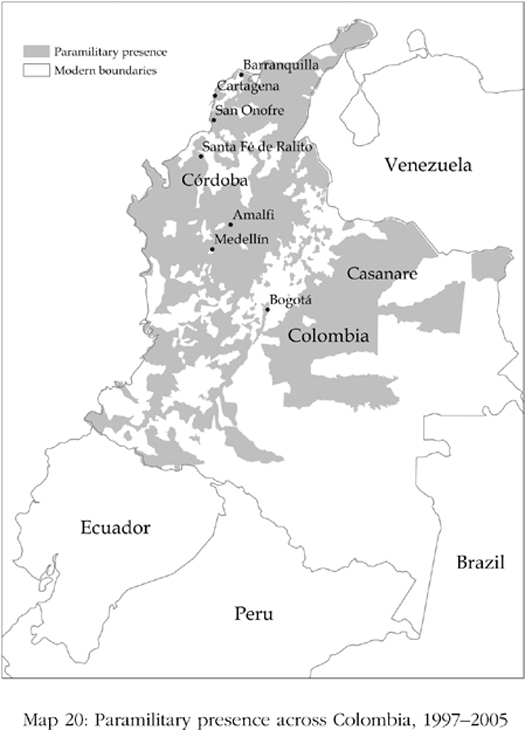
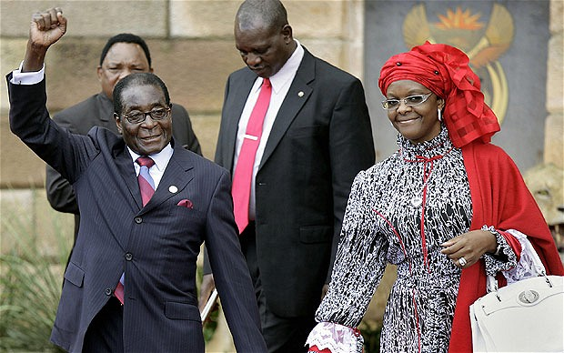
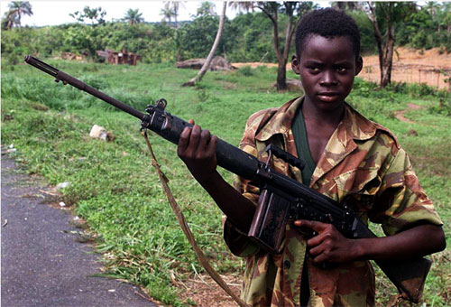
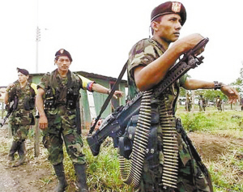
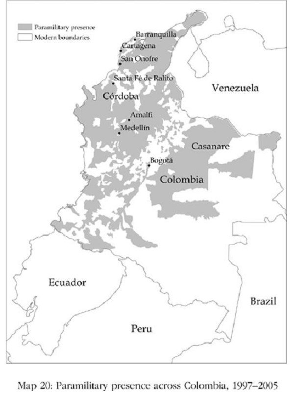
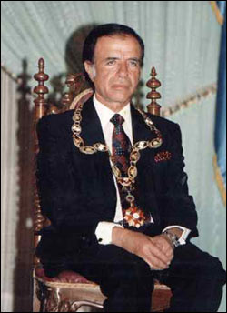
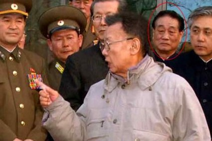
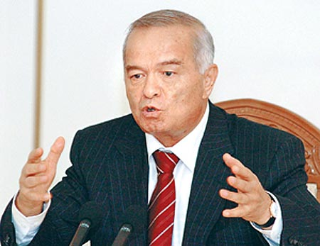
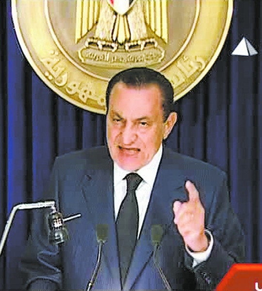

# Why Nations Fail Today · 第13章　当前的国家为什么会失败

## How To Win The Lottery In Zimbabwe · 津巴布韦的乐透大奖

It was January 2000 in Harare, Zimbabwe. Master of Ceremonies Fallot Chawawa was in charge of drawing the winning ticket for the national lottery organized by a partly state-owned bank, the Zimbabwe Banking Corporation (Zimbank). The lottery was open to all clients who had kept five thousand or more Zimbabwe dollars in their accounts during December 1999. When Chawawa drew the ticket, he was dumfounded. As the public statement of Zimbank put it, “Master of Ceremonies Fallot Chawawa could hardly believe his eyes when the ticket drawn for the Z$100,000 prize was handed to him and he saw His Excellency RG Mugabe written on it.”

> 时间，2000年1月，地点，津巴布韦的哈拉雷。主持人贾瓦瓦正在主持乐透抽奖仪式。国营乐透彩券是由部分国营的津巴布韦银行主办，1999年12月的时候，只要在账户里有津巴布韦币五千元以上存款的客户都有机会中奖。贾瓦瓦抽出彩券，整个人呆住了。当时的情形按照津巴布韦银行的公开陈述：“抽奖仪式主持人费勒•贾瓦瓦几乎不敢相信自己的眼睛，奖金津巴布韦币十万元的彩券抽出来送到他的手上时，他看到上面写的居然是穆加贝阁下。”

President Robert Mugabe, who had ruled Zimbabwe by hook or by crook, and usually with an iron fist, since 1980, had won the lottery, which was worth a hundred thousand Zimbabwe dollars, about five times the annual per capita income of the country. Zimbank claimed that Mr. Mugabe’s name had been drawn from among thousands of eligible customers. What a lucky man! Needless to say he didn’t really need the money. Mugabe had in fact only recently awarded himself and his cabinet salary hikes of up to 200 percent.

> 津巴布韦总统穆加贝自1980年统治津巴布韦以来频施铁腕，无所不用其极。总统中了乐透大奖，奖金津巴布韦币十万元，大约是该国人均年收入的五倍。津巴布韦宣布，穆加贝先生的名字是从数万名合格客户中抽出来的。多么幸运的人呀！用脚趾头想也知道，他根本不需要这笔钱。事实上，穆加贝最近才为奖励自己和他的内阁成员，大幅调薪200%。

The lottery ticket was just one more indication of Zimbabwe’s extractive institutions. One could call this corruption, but it is just a symptom of the institutional malaise in Zimbabwe. The fact that Mugabe could even win the lottery if he wanted showed how much control he had over matters in Zimbabwe, and gave the world a glimpse of the extent of the country’s extractive institutions.

> 乐透彩券只不过是为津巴布韦的榨取式制度多添一个笑柄而已。说它是贪腐，当然可以，但它终归只是津巴布韦制度已经生病的症状之一。只要他想，甚至连乐透都会中，这事除了显示穆加贝在津巴布韦予取予求之外，也让全世界都见识到了这个国家的榨取式制度。

The most common reason why nations fail today is because they have extractive institutions. Zimbabwe under Mugabe’s regime vividly illustrates the economic and social consequences. Though the national statistics in Zimbabwe are very unreliable, the best estimate is that by 2008, Zimbabwe’s per capita income was about half of what it was when the country gained its independence in 1980. Dramatic as this sounds, it does not in fact begin to capture the deterioration in living standards in Zimbabwe.

> 当前的国家为什么会失败，最常见的原因就是榨取式制度。穆加贝统治下的津巴布韦很生动地说明了这种经济与社会结果。津巴布韦国家统计数字尽管并非十分可靠，但按照最佳的估计，2008年津巴布韦的人均收入只及1980年该国独立时的一半而已。光是这一点，听起来就已经相当耸动，但事实上却还没有抓到津巴布韦生活水平恶化的全貌。

The state has collapsed and more or less stopped providing any basic public services. In 2008–2009 the deterioration in the health systems led to an outbreak of cholera across the country. As of January 10, 2010, there have been 98,741 reported cases and 4,293 deaths, making it the deadliest cholera outbreak in Africa over the previous fifteen years. In the meantime, mass unemployment has also reached unprecedented levels. In early 2009, the UN Office for the Coordination of Humanitarian Affairs claimed that the unemployment rate had hit an incredible 94 percent.

> 整个政府其实已经土崩瓦解，任何基本的公共服务几乎都付之阙如。2008年至2009年，卫生系统严重恶化，导致全国爆发霍乱，到2010年1月10日，公布罹病个案多达98741例，死亡人数4923，为过去十五年来非洲最严重的霍乱疫情。同时，大量失业也达到前所未有的程度。2009年初，联合国人道事务协调署公告，该国失业率高达令人难以置信的94%。

The roots of many economic and political institutions in Zimbabwe, as is the case for much of sub-Saharan Africa, can be traced back to the colonial period. In 1890 Cecil Rhodes’s British South Africa Company sent a military expedition into the then-kingdom of the Ndebele, based in Matabeleland, and also into the neighboring Mashonaland. Their superior weaponry quickly suppressed African resistance, and by 1901 the colony of Southern Rhodesia, named after Rhodes, had been formed in the area that is currently Zimbabwe. Now that the area was a privately owned concession of the British South Africa Company, Rhodes anticipated making money there through prospecting and mining for precious minerals. The ventures never got off the ground, but the very rich farmlands began attracting white migration.

> 如同大部分的下撒哈拉非洲，津巴布韦许多经济及政治制度，其根源都可以追溯到殖民时代。1890年，罗德斯的不列颠南非公司派遣一支远征军进入恩德贝勒人在马特贝乐澜建立的王国，同时也进入紧邻的马修纳兰，并挟优势的武器，很快地压制了非洲原住民，1901年，南罗德西亚——以罗德斯取名——殖民地在今天的津巴布韦地区成立。如此一来，此一地区成为不列颠南非公司的私有特许地，按照罗德斯的预期，经由珍贵矿物的探采，将可大赚其钱，但事与愿违，丝毫没有进展，反倒是肥沃的农地吸引了白人移民。

These settlers soon annexed much of the land. By 1923 they had freed themselves from the rule of the British South Africa Company and persuaded the British government to grant them self-government. What then occurred is very similar to what had happened in South Africa a decade or so previously. The 1913 Natives Land Act (this page–this page) created a dual economy in South Africa. Rhodesia passed very similar laws, and inspired by the South African model, a white-only apartheid state was constructed soon after 1923.

> 新垦殖者很快就兼并了土地，并于1923年脱离不列颠南非公司的管制，说服英国政府准许他们成立自治政府。接下来发生的一切就如南非十年前的翻版。1913年的原住民土地法，在南非制造出一个二元经济。罗德西亚有样学样，也通过了一项非常相似的法案，1923年之后不久，一个白人专政的种族隔离国家成立。

As the European colonial empires collapsed in the late 1950s and early 1960s, the white elite in Rhodesia, led by Ian Smith, comprising possibly 5 percent of the population, declared independence from Britain in 1965. Few international governments recognized Rhodesia’s independence, and the United Nations levied economic and political sanctions against it. The black citizens organized a guerrilla war from bases in the neighboring countries of Mozambique and Zambia. International pressure and the rebellion waged by the two main groups, Mugabe’s ZANU (the Zimbabwe African National Union) and ZAPU (the Zimbabwe African People’s Union), led by Joshua Nkomo, resulted in a negotiated end to white rule. The state of Zimbabwe was created in 1980.

> 1950年代晚期及1960年代初期，欧洲殖民帝国崩溃，约占人口5%的罗德西亚白人菁英阶层，在史密斯的领导下于1965年宣布脱离英国独立。罗德西亚的独立不仅只有少数国家承认，遭到联合国施加经济及政治制裁，黑人则组织游击队，发动游击战争，基地均设在邻邦莫桑比克及赞比亚。因为国际压力，与穆加贝的津巴布韦非洲民族联盟及恩科莫领导的津巴布韦非洲人民联盟两个主要团体发动的叛乱，结果经由谈判终结了白人统治。1980年，津巴布韦国成立。

After independence, Mugabe quickly established his personal control. He either violently eliminated his opponents or co-opted them. The most egregious acts of violence happened in Matabeleland, the heartland of support for ZAPU, where as many as twenty thousand people were killed in the early 1980s. By 1987 ZAPU had merged with ZANU to create ZANU-PF, and Joshua Nkomo was sidelined politically. Mugabe was able to rewrite the constitution he had inherited as a part of the independence negotiation, making himself president (he had started as prime minister), abolishing white voter rolls that were part of the independence agreement, and eventually, in 1990, getting rid of the Senate altogether and introducing positions in the legislature that he could nominate. A de facto one-party state headed by Mugabe was the result.

> 独立后，穆加贝迅速建立其个人统治，对于反对势力，不是予以武力扫除，就是加以兼并，其中最残暴的暴力行动，发生在1980年初期的马特贝乐澜，津巴布韦非洲人民联盟的根据地，屠杀达两万人之多。到1987年，津巴布韦非洲人民联盟并入津巴布韦民族联盟，组成津巴布韦民族联盟爱国阵线，恩科莫退出政治。穆加贝得寸进尺，将他由独立谈判所承接下来的宪法加以修改，从总理摇身一变而为总统，并取消独立协定中明订的白人投票权，最后，到1990年，干脆废除参议院，垄断立法机构的人事，方便自己予取予求。一个以穆加贝为首的一党独大国家于是诞生。

Upon independence, Mugabe took over a set of extractive economic institutions created by the white regime. These included a host of regulations on prices and international trade, state-run industries, and the obligatory agricultural marketing boards. State employment expanded rapidly, with jobs given to supporters of ZANU-PF. The tight government regulation of the economy suited the ZANU-PF elites because it made it difficult for an independent class of African businessmen, who might then have challenged the former’s political monopoly, to emerge.

> 独立之初，穆加贝接收了白人政权所建立的一套榨取式经济制度，其中包括一大堆的价格及国际贸易管制，国营事业及强制性的农业产销协议会。政府雇员迅速扩增，工作都派给爱国阵线的支持者。政府对经济施以严密管制，大有利于爱国阵线的统治阶层，因为如此一来，独立的非洲本地商人阶级无法出现，因此不至于有任何势力有能力对现行政治的垄断提出挑战。

This was very similar to the situation we saw in Ghana in the 1960s in chapter 2 (this page–this page). Ironically, of course, this left whites as the main business class. During this period the main strengths of the white economy, particularly the highly productive agricultural export sector, was left untouched. But this would last only until Mugabe became unpopular. The model of regulation and market intervention gradually became unsustainable, and a process of institutional change, with the support of the World Bank and the International Monetary Fund, began in 1991 after a severe fiscal crisis.

> 这种情况十分类似我们在第二章所看到的1960年代的加纳。当然，讽刺的是，这样一来，商人阶级就只剩下白人了。这段时期内，主要的白人经济力量，特别是高产能的农业输出部门都为受到影响，但这也只维持到穆加贝失势为止。经济管制与市场介入的模式逐渐难以维持，终于爆发财政危机，1991年，在世界银行及国际货币基金组织的支持下，一连串的制度变革开始上路。

The deteriorating economic performance finally led to the emergence of a serious political opposition to ZANU-PF’s one-party rule: the Movement for Democratic Change (MDC). The 1995 parliamentary elections were far from competitive. ZANU-PF won 81 percent of the vote and 118 out of the 120 seats. Fifty-five of these members of Parliament were elected unopposed. The presidential election the following year showed even more signs of irregularities and fraud. Mugabe won 93 percent of the vote, but his two opponents, Abel Muzorewa and Ndabaningi Sithole, had already withdrawn their candidacy prior to the election, accusing the government of coercion and fraud.

> 恶化的经济表现终于导致严重的政治反对，民主改革运动的出现对爱国阵线的一党专政形成重大威胁。1995年国会选举，爱国阵线完全没有敌手，囊括81%的选票，一百二十席中赢得一百一十八席，其中五十五席是在没有对手的情况下当选的。次年的总统选举，违法舞弊更是明目张胆。穆加贝赢得93%的选票，只不过他的两名对手穆佐雷瓦及西托利，早已在投票前就退出选举，并指控政府胁迫舞弊。

After 2000, despite all the corruption, ZANU-PF’s grip was weakening. It took only 49 percent of the popular vote, and only 63 seats. All were contested by the MDC, who took every seat in the capital, Harare. In the presidential election of 2002, Mugabe scraped home with only 56 percent of the vote. Both sets of elections went ZANU-PF’s way only because of violence and intimidation, coupled with electoral fraud.

> 2000年之后，贪腐依然，爱国阵线的掌控开始弱化，选举仅获得49%的支持，当选六十三席。这一切都是民主改革运动竞争的结果，该党囊括首都哈拉雷的全部席次。2002年总统大选，穆加贝牟足了全力才获得56%的选票。两次选举爱国阵线之所以能够过关，完全得力于暴力胁迫，外加选举舞弊。

The response of Mugabe to the breakdown of his political control was to intensify both the repression and the use of government policies to buy support. He unleashed a full-scale assault on white landowners. Starting in 2000, he encouraged and supported an extensive series of land occupations and expropriations. They were often led by war veterans’ associations, groups supposedly comprised of former combatants in the war of independence. Some of the expropriated land was given to these groups, but much of it also went to the ZANU-PF elites. The insecurity of property rights wrought by Mugabe and ZANU-PF led to a collapse of agricultural output and productivity.

> 面对政治掌控的衰落，穆加贝的回应是加强压迫并采取政策收买。他对白人地主展开全面攻击，从2000年开始，鼓励并支持一连串广泛的土地占用与征收，以战争退伍军人协会为首，由一批号称前独立战争的战士出面，大肆没收土地，但大部分却都成了爱国阵线菁英的囊中之物。穆加贝与爱国阵线的大肆搜刮使财产权失去保障，导致农业输出与产量崩盘。

As the economy crumbled, the only thing left was to print money to buy support, which led to enormous hyperinflation. In January 2009, it became legal to use other currencies, such as the South African rand, and the Zimbabwean dollar vanished from circulation, a worthless piece of paper. What happened in Zimbabwe after 1980 was commonplace in sub-Saharan Africa since independence. Zimbabwe inherited a set of highly extractive political and economic institutions in 1980.

> 由于经济崩溃，剩下来唯一能做的就是印钞票收买支持，结果又导致一发不可收拾的恶性通货膨胀。2009年1月，其他货币——譬如南非币蓝特——开始合法流通，津巴布韦货币在市场上绝迹，成为废纸一张。1980年之后在津巴布韦所发生的一切，在独立的下撒哈拉非洲其实司空见惯。1980年，津巴布韦承接的是一套高度榨取式的政治及经济制度。

For the first decade and a half, these were maintained relatively untouched. While elections took place, political institutions were anything but inclusive. Economic institutions changed somewhat; for example, there was no longer explicit discrimination against blacks. But on the whole the institutions remained extractive, with the only difference being that instead of Ian Smith and the whites doing the extracting, it was Robert Mugabe and the ZANU-PF elites filling their pockets.

> 第一个十五年，所有这些都原封未动。尽管有了选举，政治制度一点都不广纳。经济制度多少虽有改变，举例来说，不再公然歧视黑人。但整体来说，制度还是榨取式的，唯一的差别是，榨取者不再是艾恩•史密斯及白人，而是换成穆加贝及爱国阵线上场中饱私囊。

Over time the institutions became even more extractive, and incomes in Zimbabwe collapsed. The economic and political failure in Zimbabwe is yet another manifestation of the iron law of oligarchy—in this instance, with the extractive and repressive regime of Ian Smith being replaced by the extractive, corrupt, and repressive regime of Robert Mugabe. Mugabe’s fake lottery win in 2000 was then simply the tip of a very corrupt and historically shaped iceberg.

> 长期下来，制度性榨取变本加厉，津巴布韦人的收入因而崩盘。津巴布韦的政治与经济失败，可以说是寡头铁律的另一个证明——在这里，艾恩•史密斯的榨取及压迫政权由穆加贝的榨取、贪腐及压迫政权取代。2000年穆加贝的假乐透中奖，只不过是贪腐加上历史所形成的冰山之一角。

NATIONS FAIL TODAY because their extractive economic institutions do not create the incentives needed for people to save, invest, and innovate. Extractive political institutions support these economic institutions by cementing the power of those who benefit from the extraction. Extractive economic and political institutions, though their details vary under different circumstances, are always at the root of this failure.

> 当前的国家之所以失败，是因为榨取式经济制度无法产生诱因，激励人民储蓄、投资并创新。榨取式政治制度则支持这类经济制度，并为这些因榨取而获利的人巩固权力。榨取式经济及政治制度永远都是国家失败的根源，尽管因环境不同而有细节上的变化。

In many cases, for example, as we will see in Argentina, Colombia, and Egypt, this failure takes the form of lack of sufficient economic activity, because the politicians are just too happy to extract resources or quash any type of independent economic activity that threatens themselves and the economic elites. In some extreme cases, as in Zimbabwe and Sierra Leone, which we discuss next, extractive institutions pave the way for complete state failure, destroying not only law and order but also even the most basic economic incentives. The result is economic stagnation and—as the recent history of Angola, Cameroon, Chad, the Democratic Republic of Congo, Haiti, Liberia, Nepal, Sierra Leone, Sudan, and Zimbabwe illustrates—civil wars, mass displacements, famines, and epidemics, making many of these countries poorer today than they were in the 1960s.

> 在许多例子中，譬如我们会在阿根廷、哥伦比亚及埃及中看到的，这种失败呈现的是缺乏足够的经济活动，因为政治人物乐于榨取资源，或者打压任何足以威胁到他们及经济菁英阶层的独立经济活动。在某些极端的例子，譬如津巴布韦及塞拉利昂——接下来将会讨论到——榨取式制度为彻底的国家失败铺路，不仅摧毁了治安，甚至连最基本的经济诱因也扫除殆尽。其结果是经济停滞——如安哥拉、喀麦隆、乍得、刚果民主共和国、海地、利比里亚、尼泊尔、塞拉利昂、苏丹及津巴布韦等国最近的历史——内战、难民、饥馑与疫病连年，使这些国家今天比1960年代更为穷困。

## A Children’s Crusade? · 儿童十字军？

On March 23, 1991, a group of armed men under the leadership of Foday Sankoh crossed the border from Liberia into Sierra Leone and attacked the southern frontier town of Kailahun. Sankoh, formerly a corporal in the Sierra Leonean army, had been imprisoned after taking part in an abortive coup against Siaka Stevens’s government in 1971. After being released, he eventually ended up in Libya, where he entered a training camp that the Libyan dictator Colonel Qaddafi ran for African revolutionaries. There he met Charles Taylor, who was plotting to overthrow the government in Liberia. When Taylor invaded Liberia on Christmas Eve 1989, Sankoh was with him, and it was with a group of Taylor’s men, mostly Liberians and Burkinabes (citizens of Burkina Faso), that Sankoh invaded Sierra Leone. They called themselves the RUF, the Revolutionary United Front, and they announced that they were there to overthrow the corrupt and tyrannical government of the APC.

> 1991年3月23日，桑科带领一批武装人员从利比里亚越界进入塞拉利昂，攻击南部边界城镇凯拉洪。桑科是前塞拉利昂陆军下士，1971年因参与反对史蒂芬斯的流产政变被捕下狱，获释后跑到利比亚落脚，进入利比亚独裁者卡扎菲上校为推动非洲革命而成立的训练营，在哪儿认识了阴谋推翻利比里亚政府的泰勒。1989年圣诞夜，泰勒入侵利比里亚，桑科随行，然后带着泰勒的一群手下——大部分是利比里亚人及布基纳人（布基纳法索人）——入侵塞拉利昂，自称革命联合阵线，并宣称此次前来是要推翻腐败独裁的全民国会党政府。

As we saw in the previous chapter, Siaka Stevens and his All People’s Congress, the APC, took over and intensified the extractive institutions of colonial rule in Sierra Leone, just as Mugabe and ZANU-PF did in Zimbabwe. By 1985, when Stevens, ill with cancer, brought in Joseph Momoh to replace him, the economy was collapsing. Stevens, apparently without irony, used to enjoy quoting the aphorism “The cow eats where it is tethered.”

> 前一章已经提到，史蒂芬斯及其领导的全民国会党和津巴布韦的穆加贝及爱国阵线如出一辙，接收并强化了塞拉利昂殖民统治的榨取式制度。1985年，史蒂芬斯罹患癌症，由约瑟夫•马默接替，经济开始崩溃。“牛拴在哪里就吃到哪里”，史蒂芬斯常喜欢引用这句格言，看来不是说着玩的。

And where Stevens had once eaten, Momoh now gorged. The roads fell to pieces, and schools disintegrated. National television broadcasts stopped in 1987, when the transmitter was sold by the minister of information, and in 1989 a radio tower that relayed radio signals outside Freetown fell down, ending transmissions outside the capital. An analysis published in a newspaper in the capital city of Freetown in 1995 rings very true:

> 史蒂芬斯以前的吃，换了马默则变成狼吞虎咽。道路崩坏，学校解散。1987年，新闻部长把发射台给卖了，国家电视台只好停止运作，1989年，自由城外的一座转播无线电信号的无线电塔倾倒，首都的信息传播因此终止。首都自由城一家报纸1995年刊出一篇分析报道，句句属实：

by the end of Momoh’s rule he had stopped paying civil servants, teachers and even Paramount Chiefs. Central government had collapsed, and then of course we had border incursions, “rebels” and all the automatic weapons pouring over the border from Liberia. The NPRC, the “rebels” and the “sobels” [soldiers turned rebels] all amount to the chaos one expects when government disappears. None of them are the causes of our problems, but they are symptoms.

> “马默统治到了末期，停止给付公务员、教师，甚至大酋长薪水。中央政府垮台，接下来，边界遭到侵犯，”叛徒“及自动武器从利比里亚蜂拥而入。政府消失，临时执政委员会、”叛徒“及”叛军“全都一如预期地乱成一团，但它们都不是造成问题的原因，它们只是症候。”

The collapse of the state under Momoh, once again a consequence of the vicious circle unleashed by the extreme extractive institutions under Stevens, meant that there was nothing to stop the RUF from coming across the border in 1991. The state had no capacity to oppose it. Stevens had already emasculated the military, because he worried they might overthrow him. It was then easy for a relatively small number of armed men to create chaos in most of the country. They even had a manifesto called “Footpaths to Democracy,” which started with a quote from the black intellectual Frantz Fanon: “Each generation must, out of relative obscurity, discover its mission, fulfill it or betray it.”

> 马默统治下的国家应声而倒，只不过是史蒂芬斯统治下极端榨取式制度恶性循环的结果，意味着1991年革命联合阵线的入侵已经势不可挡，塞拉利昂完全无力抵抗。由于史蒂芬斯担心军队推翻自己，早已将军方去势，因此，只要有相当少数的武装分子闯入，轻易就能够在全国大部分地方制造混乱。他们甚至发表一份宣言“民主的小径”，开宗明义引用黑人知识分子法农的话：“每一个世代都应该冲破混沌，找到自己的使命，完成它或背叛它。”

The section “What Are We Fighting For?” begins: We continue to fight because we are tired of being perpetual victims of state sponsored poverty and human degradation visited on us by years of autocratic rule and militarism. But, we shall exercise restraint and continue to wait patiently at the rendezvous of peace—where we shall all be winners. We are committed to peace, by any means necessary, but what we are not committed to is becoming victims of peace. We know our cause to be just and God/Allah will never abandon us in our struggle to reconstruct a new Sierra Leone.

> 接着，开始了“我们为何而战”的部分：“我们不断地战斗，因为我们厌倦了政府一手制造的贫穷，厌倦了独裁政权与军阀连年加之于我们的人性堕落，厌倦了永远做待宰的羔羊。但我们将会节制，继续耐心等待和平的来临——到时候，我们将得胜。我们委身追求和平，安拉绝不会在我们奋力重建新塞拉利昂的时候放弃我们。”

Though Sankoh and other RUF leaders may have started with political grievances, and the grievances of the people suffering under the APC’s extractive institutions may have encouraged them to join the movement early on, the situation quickly changed and spun out of control. The “mission” of the RUF plunged the country into agony, as in the testimony of a teenager from Geoma, in the south of Sierra Leone: They gathered some of us … They chose some of our friends and killed them, two of them.

> 虽然桑科及革命联合阵线的其他领袖早先都受过政治上的冤屈，而老百姓饱受全民国会党榨取式制度的压迫，一开始时或许也是激励他们加入运动的动力，但情况急转直下，完全失控。革命联合阵线的“使命”让整个国家陷入极大痛苦，在塞拉利昂南部的基欧玛，一个青少年作证说：“他们把我们一些人集合起来……挑出我们的一些朋友，两个人，将他们杀害。

These were people whose fathers were the chiefs, and they had soldiers’ boots and property in their houses. They were shot, for no other reason than that they were accused of harbouring soldiers. The chiefs were also killed—as part of the government. They chose someone to be the new chief. They were still saying they had come to free us from the APC. After a point, they were not choosing people to kill, just shooting people.

> 这些人的父母都是酋长，家里有军靴及地产。他们被枪毙，理由不过是他们窝藏军人。酋长也遭到杀害，因为他们是政府的一部分。他们选出新的酋长，一直说他们是要来解放我们脱离全民国会党的压迫。总而言之，他们不是挑人来杀，只是枪毙人而已。”

In the first year of the invasion, any intellectual roots that the RUF may have had were completely extinguished. Sankoh executed those who criticized the mounting stream of atrocities. Soon, few voluntarily joined the RUF. Instead they turned to forcible recruitment, particularly of children. Indeed, all sides did this, including the army.

> 入侵的第一年，革命联合阵线所有理智的认知都荡然无存，任何人只要批评日益升高的暴行，桑科一律杀无赦。为期不久，便再也没有人愿意加入革命联合阵线。结果他们转而强迫征召，特别是儿童。事实上，各方面都如此，军队也不例外。

If the Sierra Leonean civil war was a crusade to build a better society, in the end it was a children’s crusade. The conflict intensified with massacres and massive human rights abuses, including mass rapes and the amputation of hands and ears. When the RUF took over areas, they also engaged in economic exploitation. It was most obvious in the diamond mining areas, where they press-ganged people into diamond mining, but was widespread elsewhere as well.

> 如果说塞拉利昂内战是一场为建立更美好社会而发动的十字军圣战，到头来，也是一支儿童十字军。冲突因杀戮及大规模的人权践踏，包括集体强暴与断手割耳截肢而大幅升高。每当革命联合阵线接管地方时，也会从事经济剥削，最明显的就是在钻石矿区，强征民伕投身钻石采矿，而且实际上，这种情形到处皆然。

The RUF wasn’t alone in committing atrocities, massacres, and organized forced labor. The government did so as well. Such was the collapse of law and order that it became difficult for people to tell who was a soldier and who was a rebel. Military discipline completely vanished. By the time the war ended in 2001, probably eighty thousand people had died and the whole country had been devastated. Roads, houses, and buildings were entirely destroyed. Today, if you go to Koidu, a major diamond-producing area in the east, you’ll still see rows of burned-out houses scarred with bullet holes.

> 暴行、屠杀与强征民伕并不是革命联合阵线的专利，政府照样如此。正因为法纪荡然，人民才难以分辨谁是军人谁是叛徒。军队纪律完全瓦解。至2001年战争结束，死亡人数可能高达八万，整个国家破坏殆尽，道路、房舍及建筑全遭摧毁。今天如果前往东部一个主要钻石生产区科伊度，被烧毁与弹痕累累的房舍触目皆是。

By 1991 the state in Sierra Leone had totally failed. Think of what King Shyaam started with the Bushong (this page–this page): he set up extractive institutions to cement his power and extract the output the rest of society would produce. But even extractive institutions with central authority concentrated in his hands were an improvement over the situation without any law and order, central authority, or property rights that characterized the Lele society on the other side of the river Kasai. Such lack of order and central authority has been the fate of many African nations in recent decades, partly because the process of political centralization was historically delayed in much of sub-Saharan Africa, but also because the vicious circle of extractive institutions reversed any state centralization that existed, paving the way for state failure.

> 到1991年，塞拉利昂政府完全失灵。我们回想一下夏姆国王在布尚是怎么崛起的：他建立榨取式制度巩固权力，榨取整个社会的产出。但话又说回来，尽管是榨取式制度又加上中央集权，却胜过卡赛河另一边的利利人，既没有治安也没有中央权威或财产权的情况。最近十年来，这种治安荡然的情形成了非洲许多国家的命运，其部分原因固然在于下撒哈拉非洲延迟了政治集权化的过程，但还有另一个原因，亦即榨取式制度的恶性循环使原有的政府集权遭到颠覆，因此走上了政府失灵的道路。

Sierra Leone during her bloody civil war of ten years, from 1991 to 2001, was a typical case of a failed state. It started out as just another country marred by extractive institutions, albeit of a particularly vicious and inefficient type. Countries become failed states not because of their geography or their culture, but because of the legacy of extractive institutions, which concentrate power and wealth in the hands of those controlling the state, opening the way for unrest, strife, and civil war. Extractive institutions also directly contribute to the gradual failing of the state by neglecting investment in the most basic public services, exactly what happened in Sierra Leone.

> 十年血腥内战期间，从1991年至2001年，塞拉利昂成为失灵政府的典型，它开始成了另一个惨遭榨取式制度蹂躏的国家，既邪恶又缺乏效率。国家之所以失败，不在于地理或文化因素，而在于榨取式制度的传统，把权力及财富集中于少数控制政府的人手中，种下动乱、冲突及内战的祸根。榨取式制度忽视最基本的公共建设，也是形成政府逐渐失灵的直接因素，塞拉利昂就是一个例子。

Extractive institutions that expropriate and impoverish the people and block economic development are quite common in Africa, Asia, and South America. Charles Taylor helped to start the civil war in Sierra Leone while at the same time initiating a savage conflict in Liberia, which led to state failure there, too. The pattern of extractive institutions collapsing into civil war and state failure has happened elsewhere in Africa; for example, in Angola, Côte d’Ivoire, the Democratic Republic of Congo, Mozambique, Republic of Congo, Somalia, Sudan, and Uganda.

> 榨取式制度剥夺人民的财富，使人民一穷二白，阻碍了经济发展，这种情形在非洲、亚洲及南美洲都司空见惯。泰勒一手掀起了塞拉利昂内战，同时也开启了利比里亚的血腥冲突，同样也在那儿导致了政府失灵。榨取式制度崩溃导致内战与政府失灵，在非洲俯拾皆是，诸如安哥拉、象牙海岸、刚果民主共和国、莫桑比克、刚果共和国、索马里、苏丹及乌干达。

Extraction paves the way for conflict, not unlike the conflict that the highly extractive institutions of the Maya city-states generated almost a thousand years ago. Conflict precipitates state failure. So another reason why nations fail today is that their states fail. This, in turn, is a consequence of decades of rule under extractive economic and political institutions.

> 榨取为冲突铺路，一如千年前玛雅城邦高度榨取式制度的下场。冲突的结果则是政府失灵。所以，国家失败的另一个原因就是政府失灵，而这又是榨取式经济及政治制度数十年统治的结果。

## Who Is The State? · 谁才是政府？

The cases of Zimbabwe, Somalia, and Sierra Leone, even if typical of poor countries in Africa, and perhaps even some in Asia, seem rather extreme. Surely Latin American countries do not have failed states? Surely their presidents are not brazen enough to win the lottery? In Colombia, the Andean Mountains gradually merge to the north with a large coastal plain that borders the Caribbean Ocean. Colombians call this the tierra caliente, the “hot country,” as distinct from the Andean world of the tierra fria, the “cold country.”

> 津巴布韦、索马里及塞拉利昂，都是非洲贫穷国家的典型，或许亚洲也不乏其例。难道拉丁美洲国家就没有失灵的政府吗？难道他们的总统就不至于厚颜无耻到诈中乐透吗？在哥伦比亚，安第斯山脉往北逐渐与一大块濒临加勒比海的海岸平原合一，哥伦比亚人称这里为“热乡”，有别于安第斯山的“寒乡“。

For the last fifty years, Colombia has been regarded by most political scientists and governments as a democracy. The United States feels happy to negotiate a potential free trade agreement with the country and pours all kinds of aid into it, particularly military aid. After a short-lived military government, which ended in 1958, elections have been regularly held, even though until 1974 a pact rotated political power and the presidency between the two traditional political parties, the Conservatives and the Liberals. Still, this pact, the National Front, was itself ratified by the Colombian people via a plebiscite, and this all seems democratic enough.

> 过去五十五年来，多数政治学者及国家都把哥伦比亚视为一个民主国家。对于这个国家，美国不仅乐于与之签订自由贸易协定，而且给予各方面的援助，特别是军事援助。哥伦比亚曾经经历过短暂的军事统治，1958年之后，选举定期举行，尽管在1974年以前，该国两个传统政党——保守党与自由党——曾经签署协定，同意轮流执政及担任总统。但不管怎么说，此一协定——国民阵线——毕竟经过哥伦比亚人民公投核准，其为民主似无疑义。

Yet while Colombia has a long history of democratic elections, it does not have inclusive institutions. Instead, its history has been marred by violations of civil liberties, extrajudicial executions, violence against civilians, and civil war. Not the sort of outcomes we expect from a democracy. The civil war in Colombia is different from that in Sierra Leone, where the state and society collapsed and chaos reigned. But it is a civil war nonetheless and one that has caused far more casualties.

> 然而，哥伦比亚虽然拥有长久的民主选举历史，却没有广纳式制度。相反的，其历史充斥着妨碍公民自由、私刑处决、对平民施暴以及内战的污点，跟我们期待的民主政治结果大相径庭。内战在塞拉利昂造成政府与社会的瓦解，国家陷入极大的混乱，在哥伦比亚虽然不同，但它仍然是一场内战，而且造成了更大的伤亡。

The military rule of the 1950s was itself partially in response to a civil war known in Spanish simply as La Violencia, or “The Violence.” Since that time quite a range of insurgent groups, mostly communist revolutionaries, have plagued the countryside, kidnapping and murdering. To avoid either of these unpleasant options in rural Colombia, you have to pay the vacuna, literally “the vaccination,” meaning that you have to vaccinate yourself against being murdered or kidnapped by paying off some group of armed thugs each month. Not all armed groups in Colombia are communists.

> 1950年代的军事统治本身就是一场西班牙文名之为”暴力“的内战产物，从此以后，层出不穷的叛乱团体，多数为共产革命分子，荼毒乡村，从事绑架与谋杀。在哥伦比亚乡村，如果想要免于这两种灾难，就必须”接种疫苗“，意思就是每个月向武装暴徒缴付保护费，换取绑架及谋杀的免疫。哥伦比亚的武装团体并非全都是共产主义者。

In 1981 members of the main communist guerrilla group in Colombia, the Fuerzas Armadas Revolucionarias de Colombia (the FARC—the Revolutionary Armed Forces of Colombia) kidnapped a dairy farmer, Jesus Castaño, who lived in a small town called Amalfi in the hot country in the northeastern part of the department of Antioquia. The FARC demanded a ransom amounting to $7,500, a small fortune in rural Colombia. The family raised it by mortgaging the farm, but their father’s corpse was found anyway, chained to a tree. Enough was enough for three of Castaño’s sons, Carlos, Fidel, and Vicente. They founded a paramilitary group, Los Tangueros, to hunt down members of the FARC and avenge this act.

> 1981年哥伦比亚主要的共产党游击团体哥伦比亚革命武装部队，在热乡安提欧吉亚省东北方一个名叫阿玛菲的小镇绑架了一名农民杰苏•卡斯塔诺，要求支付七千五百美元赎金，这在哥伦比亚农村算是一笔不小的钱。家人抵押农地筹足款项，但最后还是替被链子绑在树上的父亲收尸。卡斯塔诺的三个儿子，卡洛斯、费代尔及范森忍无可忍，成立了一个自卫组织洛坦格洛追杀革命武装部队成员复仇。

The brothers were good at organizing, and soon their group grew and began to find a common interest with other similar paramilitary groups that had developed from similar causes. Colombians in many areas were suffering at the hands of left-wing guerrillas, and right-wing paramilitaries formed in opposition. Paramilitaries were being used by landowners to defend themselves against the guerrillas, but they were also involved in drug trafficking, extortion, and the kidnapping and murder of citizens.

> 三兄弟善于组织，不久，随着自己的团体扩大，便开始与其他志同道合的类似准军事团体合作。左派游击队肆虐，因而有敌对的右派自卫组织兴起，哥伦比亚许多地区均饱受其害。自卫组织通常是地主用来防卫游击队的武力，但也涉入毒品运输、勒索、绑架及谋杀。

By 1997 the paramilitaries, under the leadership of the Castaño brothers, had managed to form a national organization for paramilitaries called the Autodefensas Unidas de Colombia (the AUC—United Self-Defense Forces of Colombia). The AUC expanded into large parts of the country, particularly into the hot country, in the departments of Córdoba, Sucre, Magdalena, and César. By 2001 the AUC may have had as many as thirty thousand armed men at its disposal and was organized into different blocks. In Córdoba, the paramilitary Bloque Catatumbo was led by Salvatore Mancuso.

> 1997年，卡斯塔洛兄弟领导的自卫组织成立了一个全国性的自卫组织，哥伦比亚联合自卫队。联合自卫队势力扩及全国各地，特别是热乡的科尔多巴省、苏克里省、玛格达列拉省及西撒省。到2001年，联合自卫队手下可供调派的武装人员多达三万，而且将组织打入了不同领域。科尔多巴有一个自卫组织布洛克卡塔通博，领导人是萨尔瓦多•曼库索。

As its power continued to grow, the AUC made a strategic decision to get involved in politics. Paramilitaries and politicians courted each other. Several of the leaders of the AUC organized a meeting with prominent politicians in the town of Santa Fé de Ralito in Córdoba. A joint document, a pact, calling for the “refounding of the country” was issued and signed by leading members of the AUC, such as “Jorge 40” (the nickname for Rodrigo Tovar Pupo), Adolfo Paz (a nom de guerre for Diego Fernando “Don Berna” Murillo), and Diego Vecino (real name: Edwar Cobo Téllez), along with politicians, including national senators William Montes and Miguel de la Espriella.

> 随着力量的成长，联合自卫队做了一个重要的决策，准备涉入政治。自卫组织与政治人物之间互有所需。联合自卫队的几名领导人筹备了一次会议，在科尔多巴省的圣塔非的拉多里与重要的政治人物会面，发表了一份联合文件，一项协定，呼吁”国家重建“，参与签署的人士包括联合自卫队的领导成员，诸如”乔治四十“、帕兹及维西诺，以及政治人物，诸如国家参议员孟提斯及埃斯皮里拉。

By this point the AUC was running large tracts of Colombia, and it was easy for them to fix who got elected in the 2002 elections for the Congress and Senate. For example, in the municipality of San Onofre, in Sucre, the election was arranged by the paramilitary leader Cadena (“chain”). One eyewitness described what happened as follows: The trucks sent by Cadena went around the neighborhoods, corregimientos and rural areas of San Onofre picking people up.

> 到了这个阶段，联合自卫队的势力已经遍及哥伦比亚，对他们来说，拿下2002年的众议院及参议院选举乃是轻而易举的事。举例来说，在苏克里省的圣奥诺夫里自治市，选举就是自我组织领袖卡德纳操盘。一个目击者描述所见到的情况：“卡德纳派遣的卡车四出，前往圣奥诺夫里附近的乡镇及农村地区载人。

According to some inhabitants … for the 2002 elections hundreds of peasants were taken to the corregimiento Plan Parejo so they could see the faces of the candidates they had to vote for in the parliamentarian elections: Jairo Merlano for Senate and Muriel Benito Rebollo for Congress. Cadena put in a bag the names of the members of the municipal council, took out two and said that he would kill them and other people chosen randomly if Muriel did not win. The threat seems to have worked: each candidate obtained forty thousand votes in the whole of Sucre.

> 根据居民的说法……数百名农民为了2002年的选举被载到普兰帕里佐镇，让他们认识参加国会选举候选人的长相，包括选参议员的莫勒诺及选众议员的里巴洛。卡德纳把市议会议员的名字都放进一个袋子，然后拿出两个说，如果里巴洛没选上，这两个人以及其他随便挑出来的人都得死。“威胁显然奏效，两个候选人在整个苏克里都得到了四万票。

It is no surprise that the mayor of San Onofre signed the pact of Santa Fé de Ralito. Probably one-third of the congressmen and senators owed their election in 2002 to paramilitary support, and Map 20, which depicts the areas of Colombia under paramilitary control, shows how widespread their hold was. Salvatore Mancuso himself put it in an interview in the following way: 35 percent of the Congress was elected in areas where there were states of the Self-Defense groups, in those states we were the ones collecting taxes, we delivered justice, and we had the military and territorial control of the region and all the people who wanted to go into politics had to come and deal with the political representatives we had there.

> 无疑的，圣奥诺夫里市长也签署了圣塔菲的拉力多协定。2002年的选举中，大概有三分之一的众议员及参议员是靠自卫组织的支持当选，自卫组织在哥伦比亚控制的地区有多广，从地图20就可以看出一个大概。曼库索在一次访问中自己也招认：“有自卫组织的省份选出来的国会议员占35%，在这些省份，收税的人是我们，伸张正义的是我们，我们有军队，控制地方上的土地，所有想要从政的人都必须来跟我们派在那里的代表打招呼商量。“

It is not difficult to imagine the effect of this extent of paramilitary control of politics and society on economic institutions and public policy. The expansion of the AUC was not a peaceful affair. The group not only fought against the FARC, but also murdered innocent civilians and terrorized and displaced hundreds of thousands of people from their homes. According to the Internal Displacement Monitoring Centre (IDMC) of the Norwegian Refugee Council, in early 2010 around 10 percent of Colombia’s population, nearly 4.5 million people, was internally displaced.

> 由此不难想象，在经济体系和公共政策上，自卫组织对政治及社会的影响。联合自卫队的扩张并不是一件和平的事。这个团体不单是对抗哥伦比亚革命武装部队而已，他们也杀害无辜的平民百姓，恐吓驱赶成千上万人致使其流离失所。根据挪威难民理事会的境内流离失所者监测中心统计，2010年初，哥伦比亚人口中大约有10%，约四百五十万人流离失所。

The paramilitaries also, as Mancuso suggested, took over the government and all its functions, except that the taxes they collected were just expropriation for their own pockets. An extraordinary pact between the paramilitary leader Martín Llanos (real name: Héctor Germán Buitrago) and the mayors of the municipalities of Tauramena, Aguazul, Maní, Villanueva, Monterrey, and Sabanalarga, in the department of Casanare in eastern Colombia, lists the following rules to which the mayors had to adhere by order of the “Paramilitary Peasants of Casanare”: 9) Give 50 percent of the municipality budget to be managed by the Paramilitary Peasants of Casanare.

> 此外，诚如曼库索所说，自卫组织根本就接管了政府及其一切职能，唯一例外的是，所收的税全进了他们自己的口袋。自卫组织领袖蓝诺斯与陶拉米那、阿瓜祖尔、玛尼、维拉鲁耶瓦、蒙特利及沙巴那加拉等市的市长都签订了特别协定，下列由”卡山那尔农民自卫组织“所订定的规则，市长必须遵守：”9.市政预算的50%由自卫组织管理。

10\) 10 percent of each and every contract of the municipality [to be given to the Paramilitary Peasants of Casanare]. 11) Mandatory assistance to all the meetings called by the Paramilitary Peasants of Casanare. 12) Inclusion of the Paramilitary Peasants of Casanare in every infrastructure project. 13) Affiliation to the new political party formed by the Paramilitary Peasants of Casanare.

> 10.市政当局所签订的每份合约10要给付（于卡山那尔农民自卫组织）。11.义务协助卡山那尔农民自卫组织所召开之所有集会。12.每一项基础建设计划均应包括卡山那尔农民自卫组织。13.加入卡山那尔农民自卫组织所组织的新政党。

14\) Accomplishment of his/hers governance program. Casanare is not a poor department. On the contrary, it has the highest level of per capita income of any Colombian department, because it has significant oil deposits, just the kind of resources that attract paramilitaries. In fact, once they gained power, the paramilitaries intensified their systematic expropriation of property. Mancuso himself reputedly accumulated $25 million worth of urban and rural property. Estimates of land expropriated in Colombia by paramilitaries are as high as 10 percent of all rural land.

> 14.完成他/她的治理计划。“卡山那尔并不是一个贫穷省份，相反的，该省的人均收入高于哥伦比亚其他任何省份，因为该省拥有油田，自卫组织觊觎的也正是这项资源。事实上，一旦大权在握，他们马上有系统地加强地产的搜刮，以曼库索为例，累积城市与乡村地产价值就高达二千五百万美元。据估计，自卫组织在哥伦比亚搜刮的土地多达全国农村土地的十分之一。

Colombia is not a case of a failed state about to collapse. But it is a state without sufficient centralization and with far-from-complete authority over all its territory. Though the state is able to provide security and public services in large urban areas such as Bogotá and Barranquilla, there are significant parts of the country where it provides few public services and almost no law and order. Instead, alternative groups and people, such as Mancuso, control politics and resources. In parts of the country, economic institutions function quite well, and there are high levels of human capital and entrepreneurial skill; in other parts the institutions are highly extractive, even failing to provide a minimal degree of state authority.

> 以哥伦比亚来说，虽然还不算是一个行将崩溃的失灵政府，却是一个政治集权不足，政令无法完全行于其领土的政府。尽管在大城市地区如波哥大及巴兰基亚仍能提供治安及公共服务，但在大部分乡下地区，不仅少有公共服务之提供，而且法纪几乎荡然，而是由另类的势力及个人——如曼库索——当家作主，控制政治及资源。整个国家一分为二，部分地区拥有高水平的人力资源及创业能力，但在别的地方，制度却是榨取式的，政府甚至连最起码的权威都没有。

It might be hard to understand how a situation like this can sustain itself for decades, even centuries. But in fact, the situation has a logic of its own, as a type of vicious circle. Violence and the absence of centralized state institutions of this type enter into a symbiotic relationship with politicians running the functional parts of the society. The symbiotic relationship arises because national politicians exploit the lawlessness in peripheral parts of the country, while paramilitary groups are left to their own devices by the national government.

> 像这样一种情况，竟然还能维持数十年至数百年，或许很难理解。但事实上，这种情况做为一种恶性循环，自有其本身的逻辑。动乱以及缺乏集权的政府体制，与运作社会不同功能面向的政治人物进入一种共生关系。在法治不彰的乡下地区，政治人物大肆搜刮，而政府又放任自卫组织团体予取予求，如此一来，共生关系形成。

This pattern became particularly apparent in the 2000s. In 2002 the presidential election was won by Álvaro Uribe. Uribe had something in common with the Castaño brothers: his father had been killed by the FARC. Uribe ran a campaign repudiating the attempts of the previous administration to try to make peace with the FARC. In 2002 his vote share was 3 percentage points higher in areas with paramilitaries than without them.

> 这种模式在2000年代尤其显著。2002年，乌里贝当选总统。这位新总统有某些地方与卡斯塔诺兄弟类似，父亲也遭到革命武装部队杀害，竞选的主要政见之一就是反对前任政府与革命武装部队媾和。在2002年的选举中，在自卫组织控制的地区，他的得票高出其他地区三个百分点。

In 2006, when he was reelected, his vote share was 11 percentage points higher in such areas. If Mancuso and his partners could deliver the vote for Congress and the Senate, they could do so in presidential elections as well, particularly for a president strongly aligned with their worldview and likely to be lenient on them. As Jairo Angarita, Salvatore Mancuso’s deputy and the former leader of the AUC’s Sinú and San Jorge blocs, declared in September 2005, he was proud to work for the “reelection of the best president we have ever had.”

> 到了2006年，他在这些地区的得票更高出11%。曼库索及其同伙既然能够在参众两院的选举中操纵选票，在总统选举中当然也做得到，更何况他们是在支持一个与他们有共同看法，对他们可能也比较宽大的总统。所以，2005年9月，曼库索的副手、联合自卫队西努及圣乔治兵团的前首脑安格力塔就宣布，他非常荣幸为”有史以来最好的总统竞选连任“效力。

Once elected, the paramilitary senators and congressmen voted for what Uribe wanted, in particular changing the constitution so that he could be reelected in 2006, which had not been allowed at the time of his first election, in 2002. In exchange, President Uribe delivered a highly lenient law that allowed the paramilitaries to demobilize. Demobilization did not mean the end of paramilitarism, simply its institutionalization in large parts of Colombia and the Colombian state, which the paramilitaries had taken over and were allowed to keep.

> 一旦连任成功，自卫组织的参议院及众议员便在国会中全力配合乌里贝的要求，特别是在修宪方面，使他能够在2006年再度竞选连任——而这在他第一次任期中则是遭到否决的。为了投桃报李，乌里贝总统发布了一项宽大为怀的法令，准许自卫组织复员。所谓复员并不是遣散自卫组织，而是让其在哥伦比亚大部分地区及自卫组织控制的地区制度化，使其得以继续存在下去。

In Colombia many aspects of economic and political institutions have become more inclusive over time. But certain major extractive elements remain. Lawlessness and insecure property rights are endemic in large swaths of the country, and this is a consequence of the lack of control by the national state in many parts of the country, and the particular form of lack of state centralization in Colombia. But this state of affairs is not an inevitable outcome. It is itself a consequence of dynamics mirroring the vicious circle: political institutions in Colombia do not generate incentives for politicians to provide public services and law and order in much of the country and do not put enough constraints on them to prevent them from entering into implicit or explicit deals with paramilitaries and thugs.

> 随着时间的推移，哥伦比亚的经济及政治制度在许多方面都已经愈趋广纳，但某些严重的榨取式制度仍然存在。这个国家绝大部分地方，法治不彰及财产权没有保障已经成了地方上的宿疾，之所以会如此，其症结则在于许多地区国家政府根本管不到，以及哥伦比亚缺乏中央集权的政府形式。但这种情形并不是不可避免的。它本身乃是恶性循环的结果：哥伦比亚的政治制度没有为政治人物制造诱因，让他们愿意为国家提供公共服务及治安，也没有足够的约束力阻止他们与自卫组织及黑帮进行或明或暗的勾结。

## El Corralito · 小畜栏

Argentina was in the grip of an economic crisis in late 2001. For three years, income had been falling, unemployment had been rising, and the country had accumulated a massive international debt. The policies leading to this situation were adopted after 1989 by the government of Carlos Menem, to stop hyperinflation and stabilize the economy. For a time they were successful.

> 2001年，阿根廷陷入经济危机。连续三年，收入下降，失业率上升，国家累积大量外债。此一情况肇因于梅内姆政府为遏止1989年以后的恶性通货膨胀以稳定经济所采用的一项政策。这项政策有一度算是成功的。

In 1991 Menem tied the Argentine peso to the U.S. dollar. One peso was equal to one dollar by law. There was to be no change in the exchange rate. End of story. Well, almost. To convince people that the government really meant to stick to the law, it persuaded people to open bank accounts in U.S. dollars. Dollars could be used in the shops of the capital city of Buenos Aires and withdrawn from cash machines all over the city.

> 1991年，梅内姆让阿根廷比索绑定美元，法定一比索兑换一美元，汇率不变。事情到此为止。嗯，还差一点。为了让百姓相信政府真的是会贯彻法令，于是说服老百姓到银行开美元账户，美元可以在首都布宜诺斯艾利斯的商店流通，而且在全市的提款机都可以提领。

This policy may have helped stabilize the economy, but it had one big drawback. It made Argentine exports very expensive and foreign imports very cheap. Exports dribbled to a halt; imports gushed in. The only way to pay for them was to borrow. It was an unsustainable situation. As more people began worrying about the sustainability of the peso, they put more of their wealth into dollar accounts at banks.

> 这项政策或许有助于稳定经济，但却有一个大缺点，那就是使得阿根廷的出口变得非常昂贵，进口变得非常便宜。出口逐渐陷入停顿，进口则大量涌入。唯一补救之道就是借债，但却非长久之计。愈来愈多的人开始担心比索还能维持多久，把更多的钱存入美元账户。

After all, if the government ripped up the law and devalued the peso, they would be safe with dollar accounts, right? They were right to be worried about the peso. But they were too optimistic about their dollars. On December 1, 2001, the government froze all bank accounts, initially for ninety days. Only a small amount of cash was allowed for withdrawal on a weekly basis. First it was 250 pesos, still worth $250; then 300 pesos.

> 不管怎么说，万一政府撕毁法令，比索贬值，他们还有美元账户可以保命，对吧？大家都担心比索固然没错，但对美元未免也太乐观了。2001年12月1日，政府冻结所有的银行账户，最初以九十天为期。每周只能领少量的现金。刚开始时，二百五十比索还抵得二百五十美元；接下来，要三百比索了。

But this was allowed to be withdrawn only from peso accounts. Nobody was allowed to withdraw money from their dollar accounts, unless they agreed to convert the dollars into pesos. Nobody wanted to do so. Argentines dubbed this situation El Corralito, “the Little Corral”: depositors were hemmed into a corral like cows, with nowhere to go. In January the devaluation was finally enacted, and instead of there being one peso for one dollar, there were soon four pesos for one dollar.

> 但这也只准从比索账户提领，任何人都不准从美元账户提领美元，除非同意把美元换成比索。但没有人愿意这样做。阿根廷人把这种情况称为”El Corralito“，意思是”小畜栏“：存户跟牛一样被关进畜栏，哪里都去不了。到了1月，贬值终于挡不住了，一比索不再是一美元，很快的，四比索才能换到一美元。

This should have been a vindication of those who thought that they should put their savings in dollars. But it wasn’t, because the government then forcibly converted all the dollar bank accounts into pesos, but at the old one-for-one exchange rate. Someone who had had $1,000 saved suddenly found himself with only $250. The government had expropriated three-quarters of people’s savings.

> 这下子，那些把钱存进美元账户的人都相信自己当初是做对了。但事情并非如此，因为政府强迫把所有的美元账户都换成比索，但仍维持原来一兑一的汇率。换句话说，原来存了一千美元的人，一转眼就发现自己只剩下二百五十美元。政府剥夺了老百姓四分之三的存款。

For economists, Argentina is a perplexing country. To illustrate how difficult it was to understand Argentina, the Nobel Prize–winning economist Simon Kuznets once famously remarked that there were four sorts of countries: developed, underdeveloped, Japan, and Argentina. Kuznets thought so because, around the time of the First World War, Argentina was one of the richest countries in the world. It then began a steady decline relative to the other rich countries in Western Europe and North America, which turned, in the 1970s and ’80s, into an absolute decline.

> 对经济学家来说，阿根廷是个令人困惑的国家。为了要说明阿根廷有多难了解，诺贝尔奖得主，经济学家库兹涅茨（Simon Kuznets）说了一句名言：国家有四种，已开发的、未开发的、日本，还有阿根廷。库兹涅茨之所以会这样想，是因为第一次世界大战前后，阿根廷还是世界上最富有的国家之一。接下来，相对于西欧及北美的其他富有国家，阿根廷却开始持续衰退，然后，到1970年及1980年代，竟变成无止境的衰退。

On the surface of it, Argentina’s economic performance is puzzling, but the reasons for its decline become clearer when looked at through the lens of inclusive and extractive institutions. It is true that before 1914, Argentina experienced around fifty years of economic growth, but this was a classic case of growth under extractive institutions. Argentina was then ruled by a narrow elite heavily invested in the agricultural export economy. The economy grew by exporting beef, hides, and grain in the middle of a boom in the world prices of these commodities.

> 阿根廷的经济表现，表面上看虽然令人不解，但从广纳与榨取制度的角度来看，衰退的原因就愈来愈清楚了。1914年以前，阿根廷的确经历过约五十年的经济成长，但却是典型的榨取式成长。当时的阿根廷由一小批菁英阶层统治，大幅投资于农业出口经济，生产牛肉、兽皮和谷物，而又适逢这类产品的国际价格飞涨，经济也就随之扩张。

Like all such experiences of growth under extractive institutions, it involved no creative destruction and no innovation. And it was not sustainable. Around the time of the First World War, mounting political instability and armed revolts induced the Argentine elites to try to broaden the political system, but this led to the mobilization of forces they could not control, and in 1930 came the first military coup. Between then and 1983, Argentina oscillated backward and forward between dictatorship and democracy and between various extractive institutions. There was mass repression under military rule, which peaked in the 1970s with at least nine thousand people and probably far more being illegally executed. Hundreds of thousands were imprisoned and tortured.

> 这类榨取式制度的成长经验既没有创造性破坏也没有创新，又缺乏持续性。第一次世界大战期间，政治动荡与武装叛乱逐渐增加，阿根廷的菁英阶层企图扩大政治体系，结果却导致动员失控，而在1930年发生第一次军事政变。从那时起直到1983年，阿根廷就摇摆在专制与民主以及各种榨取式制度之间，其间曾有大规模的军事统治镇压，在1970年代达到高峰，至少有九千人甚至更多遭到非法处决，下狱刑求者更多达十几万人。

During the periods of civilian rule there were elections—a democracy of sorts. But the political system was far from inclusive. Since the rise of Perón in the 1940s, democratic Argentina has been dominated by the political party he created, the Partido Justicialista, usually just called the Perónist Party. The Perónists won elections thanks to a huge political machine, which succeeded by buying votes, dispensing patronage, and engaging in corruption, including government contracts and jobs in exchange for political support.

> 文人统治期间有选举，虽然号称民主政治，但政治体系的广纳性却极为不足。1940年代起，庇隆窜起，民主阿根廷落入了他所创的正义党——人称庇隆党之手。庇隆党选举屡战屡胜，完全得力于庞大的政治机器，通过买票、分赃、贪污，包括以政府合约及职位交换政治支持。

In a sense this was a democracy, but it was not pluralistic. Power was highly concentrated in the Perónist Party, which faced few constraints on what it could do, at least in the period when the military restrained from throwing it from power. As we saw earlier (this page–this page), if the Supreme Court challenged a policy, so much the worse for the Supreme Court.

> 就某种意义来说，这算是一种民主，但绝不是多元化的民主。权力高度集中于庇隆党，一党独大，监督制衡付诸阙如，可以为所欲为，至少在军方自我克制不打算拉他下台的时期是如此。如我们前面所见，庇隆的任何政策，最高法院如果胆敢挑战，下场只会更糟。

In the 1940s, Perón had cultivated the labor movement as a political base. When it was weakened by military repression in the 1970s and ’80s, his party simply switched to buying votes from others instead. Economic policies and institutions were designed to deliver income to their supporters, not to create a level playing field. When President Menem faced a term limit that kept him from being reelected in the 1990s, it was just more of the same; he could simply rewrite the constitution and get rid of the term limit.

> 1940年代，庇隆以劳工运动起家。1970年及1980年代，遭到军方打压时，他的政党转而从事贿选，经济政策与制度的目的是要把利益输送给支持者，而不是要创造一个公平的竞争平台。1990年代，梅内姆总统碰到竞选连任的限制时，情形也如出一辙，大不了修宪拿掉限制就成了。

As El Corralito shows, even if Argentina has elections and popularly elected governments, the government is quite able to override property rights and expropriate its own citizens with impunity. There is little check on Argentine presidents and political elites, and certainly no pluralism. What puzzled Kuznets, and no doubt many others who visit Buenos Aires, is that the city seems so different from Lima, Guatemala City, or even Mexico City. You do not see indigenous people, and you do not see the descendants of former slaves. Mostly you see the glorious architecture and buildings put up during the Belle Epoch, the years of growth under extractive institutions.

> 从小畜栏事件就可以看出，尽管阿根廷有选举及民选政府，政府照样可以侵犯财产权，没收自己老百姓的财物，却连一点责任都不必负。对于阿根廷的总统及政治菁英，丝毫没有监督力量，当然更没有多元的制衡。相较于利马、危地马拉市，乃至墨西哥市，布宜诺斯艾利斯就是独树一格，为什么？不仅令库兹涅茨不解，凡走访过这个城市的人莫不如此。没有原住民，没有奴隶的后代，放眼所见多是辉煌的建筑和屋宇，建于榨取式制度下的成长岁月，一个”美好的时代“。

But in Buenos Aires you see only part of Argentina. Menem, for example, was not from Buenos Aires. He was born in Anillaco, in the province of La Rioja, in the mountains far to the northwest of Buenos Aires, and he served three terms as governor of the province. At the time of the conquest of the Americas by the Spanish, this area of Argentina was an outlying part of the Inca Empire and had a dense population of indigenous people (see Map 1 on this page).

> 但在布宜诺斯艾利斯看到的也只是部分的阿根廷。举例来说，梅内姆就不是布宜诺斯艾利斯人，出生于拉里欧哈省的艾尼拉科——布宜诺斯艾利斯西北方山区——曾经三任该省省长。西班牙人征服美洲时，此一地区为印加帝国的边区，有稠密的原住民定居。

The Spanish created encomiendas here, and a highly extractive economy developed growing food and breeding mules for the miners in Potosí to the north. In fact, La Rioja was much more like the area of Potosí in Peru and Bolivia than it was like Buenos Aires. In the nineteenth century, La Rioja produced the famous warlord Facundo Quiroga, who ruled the area lawlessly and marched his army on Buenos Aires. The story about the development of Argentine political institutions is a story about how the interior provinces, such as La Rioja, reached agreements with Buenos Aires.

> （见图1）西班牙人来了以后，建立赐封制度，实施高度榨取式制度，发展粮食生产，并饲养骡子供北方波托西的矿工使用。事实上，拉里欧哈比较像秘鲁的波托西地区及玻利维亚，和布宜诺斯艾利斯反而没那么像。19世纪时，拉里欧哈出过有名的大军阀基罗加，横行霸道此一地区，并曾挥军进攻布宜诺斯艾利斯。阿根廷政治制度的发展历程，其实就是拉里欧哈这些内地省份与布宜诺斯艾利斯达成和解的过程。

These agreements were a truce: the warlords of La Rioja agreed to leave Buenos Aires alone so that it could make money. In return, the Buenos Aires elites gave up on reforming the institutions of “the interior.” So Argentina at first appears a world apart from Peru or Bolivia, but it is really not so different once you leave the elegant boulevards of Buenos Aires. That the preferences and the politics of the interior got embedded into Argentine institutions is the reason why the country has experienced a very similar institutional path to those of other extractive Latin American countries.

> 停战协定约定，拉里欧哈的军阀们放过布宜诺斯艾利斯，任其发展商业赚钱，条件则是布宜诺斯艾利斯的菁英阶层放弃改造”内地“的制度。就这样，阿根廷一开始看起来是与秘鲁、玻利维亚不同的世界，但是一旦离开布宜诺斯艾利斯那些优美的林荫大道，其实一切并没有太大的差别。阿根廷的制度发展之所以和其他榨取式拉美国家如此相似，原因就在于它的制度有很深的内地政治色彩与偏好。

That elections have not brought either inclusive political or economic institutions is the typical case in Latin America. In Colombia, paramilitaries can fix one-third of national elections. In Venezuela today, as in Argentina, the democratically elected government of Hugo Chávez attacks its opponents, fires them from public-sector jobs, closes down newspapers whose editorials it doesn’t like, and expropriates property. In whatever he does, Chávez is much more powerful and less constrained than Sir Robert Walpole was in Britain in the 1720s, when he was unable to condemn John Huntridge under the Black Act (this page–this page). Huntridge would have fared much less well in present-day Venezuela or Argentina.

> 选举并没有带来广纳式政治或经济制度，是拉丁美洲共同的特色。在哥伦比亚，自卫组织就可以搞定三分之一的选举。在委内瑞拉，如同在阿根廷，民选的查维斯政府打击政敌，将他们解雇赶出公务体系，关掉自己不喜欢的媒体，没收财产。但无论他怎么做，查维斯只会更有权力，绝不会像华博尔爵士1720年代在英国所受到的重重牵制，使他无法以黑面法案判亨特里奇有罪。亨特里奇若是落在今天的委内瑞拉或阿根廷，日子可就没那么好过了。

While the democracy emerging in Latin America is in principle diametrically opposed to elite rule, and in rhetoric and action it tries to redistribute rights and opportunities away from at least a segment of the elite, its roots are firmly based in extractive regimes in two senses. First, inequities persisting for centuries under extractive regimes make voters in newly emerging democracies vote in favor of politicians with extreme policies. It is not that Argentinians are just naïve and think that Juan Perón or the more recent Perónist politicians such as Menem or the Kirchners are selfless and looking out for their interests, or that Venezuelans see their salvation in Chávez. Instead, many Argentinians and Venezuelans recognize that all other politicians and parties have for so long failed to give them voice, to provide them with the most basic public services, such as roads and education, and to protect them from exploitation by local elites.

> 民主政治之出现于拉丁美洲，原则上确实是反菁英统治的，其理论与行动都是要重新分配菁英阶层所享有的权利及机会，但其根基却深植于榨取式制度，这可以从两方面来理解：其一，数百年来榨取式制度造成的不平等始终存在，在刚冒出头来的民主政治中，会使选民比较喜欢政策极端的政治人物。这当然不是说阿根廷人民天真，认为庇隆或新近的庇隆党人诸如梅内姆或基西纳夫妇*都是无私且为人民谋福利的，或委内瑞拉人民都认为查维斯是他们的救世主。相反的，许多阿根廷人与委内瑞拉人都清楚，其他所有的政治人物及政党，长久以来根本不曾为他们发声，乃至为他们提供最基本的公共建设，诸如道路与教育，并保护他们免于被地方上的菁英阶层剥削。

So many Venezuelans today support the policies that Chávez is adopting even if these come with corruption and waste in the same way that many Argentinians supported Perón’s policies in the 1940s and 1970s. Second, it is again the underlying extractive institutions that make politics so attractive to, and so biased in favor of, strongmen such as Perón and Chávez, rather than an effective party system producing socially desirable alternatives. Perón, Chávez, and dozens of other strongmen in Latin America are just another facet of the iron law of oligarchy, and as the name suggests, the roots of this iron law lies in the underlying elite-controlled regimes.

> 因此，查维斯的政策尽管不免贪污与浪费，今天还是有许多委内瑞拉人支持，同样的，1940年代与1970年代，也还是有许多阿根廷人支持庇隆党人的政策。其二，政治之所以吸引那些强人如庇隆与查维斯，或让他们趋之若鹜，同样是由于榨取式制度作祟，而不是真想要建立一个有效的政党体系，为社会弄一些不一样的东西出来。庇隆、查维斯及拉丁美洲其他数十名强人，全都只是寡头铁律的另一个面向，而此一铁律则深植于菁英阶层所控制的政权。*阿根廷前总统基西纳，其遗孀费尔南德兹为现任阿根廷总统。

## The New Absolutism · 新专制主义

In November 2009, the government of North Korea implemented what economists call a currency reform. Severe bouts of inflation are often the reasons for such reforms. In France in January 1960, a currency reform introduced a new franc that was equal to 100 of the existing francs. Old francs continued in circulation and people even quoted prices in them as the change to the new francs was gradually made. Finally, old francs ceased to be legal tender in January 2002, when France introduced the euro.

> 2009年11月，北韩政府实施了一项经济学家所谓的货币改革。一般来说，往往都是因为严重的通货膨胀才会有这类改革。1960年1月，法国就推行了一次货币改革，采用一种新法郎，一法郎相当于原来的一百法郎，但在改用新法郎的渐进过程中，旧法郎继续流通，人们甚至仍然用之报价。最后，2002年1月法国采用欧元，旧法郎才停止做为法定货币。

The North Korean reform looked similar on the face of it. Like the French in 1960, the North Korean government decided to take two zeros off the currency. One hundred old wons, the currency of North Korea, were to be worth one new won. Individuals were allowed to come forward to exchange their old currency for the newly printed currency, though this had to be done in one week, rather than forty-two years, as in the French case. Then came the catch: the government announced that no one could convert more than 100,000 won, though it later relaxed this to 500,000. One hundred thousand won was about $40 at the black market exchange rate.

> 北韩的改革表面上也是如此。和1960年的法国一样，北韩政府也决定把货币的两个零拿掉，一百旧朝鲜元等值于一元新朝鲜元。每个人都可以拿旧钞来换新钞，只不过要在一个星期之内完成，而不是像法国那样经过四十二年。然后，真正的陷阱来了。政府宣布，每个人顶多只能兑换十万朝鲜元，虽然后来又放宽到五十万。十万朝鲜元当时的黑市汇率约为四十美元。

In one stroke, the government had wiped out a huge fraction of North Korean citizens’ private wealth; we do not know exactly how much, but it is probably greater than that expropriated by the Argentine government in 2002. The government in North Korea is a communist dictatorship opposed to private property and markets. But it is difficult to control black markets, and black markets make transactions in cash. Of course quite a bit of foreign exchange is involved, particularly Chinese currency, but many transactions use won.

> 就这样一扫，北韩政府就把北韩人民的私人财富扫掉了一大推；到底扫掉了多少我们不知道，但总数可能比阿根廷政府2002年的那一次搜刮还多。北韩的政府是共产党独裁政府，反对私有财产及市场。但黑市很难管制，而且黑市都是用现金交易。当然，外币交易是免不了的，尤其是中国货币，只不过多数交易还是用朝鲜元。

The currency reform was designed to punish people who used these markets and, more specifically, to make sure that they did not become too wealthy or powerful enough to threaten the regime. Keeping them poor was safer. Black markets are not the whole story. People in North Korea also keep their savings in wons because there are few banks in Korea, and they are all owned by the government. In effect, the government used the currency reform to expropriate much of people’s savings.

> 货币改革的目的其实是要惩罚利用这类市场的人，更重要的，是要弄清楚他们还不至于太有钱太有力量以至于威胁到政府的统治。让老百姓穷一点才安全。黑市的问题只是其一而已。由于银行很少，而且都是国营，北韩人民都是用朝鲜元存钱。货币改革云云，政府其实是要用来搜刮人民的储蓄。

Though the government says it regards markets as bad, the North Korean elite rather like what markets can produce for them. The leader, Kim Jong-Il, has a seven-story pleasure palace equipped with a bar, a karaoke machine, and a mini movie theater. The ground floor has an enormous swimming pool with a wave machine, where Kim likes to use a body board fitted with a small motor. When in 2006 the United States placed sanctions on North Korea, it knew how to really hit the regime where it hurt.

> 尽管政府贬抑市场，北韩统治阶层却很懂得享受市场所生产的东西。前领导人金正日就拥有一栋七层楼的豪宅，设有酒吧、卡拉OK以及一个迷你电影院，地下室是一座大型泳池，设有波浪制造机，让金正日可以用装有小马达的冲浪板戏浪。2006年美国对北韩实施制裁，就知道其真正的要害何在。

It made it illegal to export more than sixty luxury items to North Korea, including yachts, water scooters, racing cars, motorcycles, DVD players, and televisions larger than twenty-nine inches. There would be no more silk scarves, designer fountain pens, furs, or leather luggage. These were exactly the items collected by Kim and his Communist Party elites. One scholar used sales figures from the French company Hennessy to estimate that Kim’s annual cognac budget before the sanctions could have been as high as $800,000 a year.

> 美国禁止六十项奢侈品出口到北韩，包括游艇、水上摩托车、赛车、摩托车、DVD播放机及二十九吋以上的电视机。丝质围巾、精品钢笔、皮草或皮箱从此绝迹。这些东西正是金正日及他的共产党统治菁英的收集品。一名学者利用法国轩尼诗公司的出货清单做出估计，经济制裁之前，金正日每年光是干邑白兰地的预算可能就高达八十万美元。

It is impossible to understand many of the poorest regions of the world at the end of the twentieth century without understanding the new absolutism of the twentieth century: communism. Marx’s vision was a system that would generate prosperity under more humane conditions and without inequality. Lenin and his Communist Party were inspired by Marx, but the practice could not have been more different from the theory. The Bolshevik Revolution of 1917 was a bloody affair, and there was no humane aspect to it.

> 如果想要了解20世纪末世界上许多最贫穷地区，就非得了解20世纪初的新专制主义——共产主义——不可。马克思的理想是一套可以在比较人道的条件下营造富裕繁荣与平等的体系。列宁及他的共产党虽然以马克思为蓝本，但实行起来却和理论大异其趣。1917年的布尔什维克革命相当地血腥，一点人道也看不到。

Equality was not part of the equation, either, since the first thing Lenin and his entourage did was to create a new elite, themselves, at the head of the Bolshevik Party. In doing so, they purged and murdered not only non-communist elements, but also other communists who could have threatened their power. But the real tragedies were yet to come: first with the Civil War, and then under Stalin’s collectivization and his all-too-frequent purges, which may have killed as many as forty million people.

> 而平等也不在他的方案里，列宁及他的亲信所做的第一件事就是建立一个新的菁英阶层，自己高踞布尔什维克党的顶层。为了要达到此一目的，他们清算与铲除的对象不仅是非共产党分子，还有威胁到他们权力的同志。但接下去才是真正的悲剧：先是内战，然后是斯大林的集体化及其永无休止的清算斗争，杀人如麻，死者可能多达四千万人。

Russian communism was brutal, repressive, and bloody, but not unique. The economic consequences and the human suffering were quite typical of what happened elsewhere—for example, in Cambodia in the 1970s under the Khmer Rouge, in China, and in North Korea. In all cases communism brought vicious dictatorships and widespread human rights abuses. Beyond the human suffering and carnage, the communist regimes all set up various types of extractive institutions. The economic institutions, with or without markets, were designed to extract resources from the people, and by entirely abhorring property rights, they often created poverty instead of prosperity.

> 俄国共产党残暴、压迫而血腥，但却不是唯一，同样的经济后果与人间苦难所在多有，譬如1970年代红色高棉统治下的柬埔寨、中国及北韩，无一例外的，共产主义所带来的都是邪恶的专制独裁及人权侵犯。人民受苦及血腥屠杀之外，共产党政权全都建立了各式各样的榨取式制度。经济制度，无论有市场与否，其目的就是要榨取人民的资源，又因为视财产权有如寇仇，结果往往制造了贫穷而非繁荣。

In the Soviet case, as we saw in chapter 5, the Communist system at first generated rapid growth, but then faltered and led to stagnation. The consequences were much more devastating in China under Mao, in Cambodia under the Khmer Rouge, and in North Korea, where the Communist economic institutions led to economic collapse and famine. The Communist economic institutions were in turn supported by extractive political institutions, concentrating all power in the hands of Communist parties and introducing no constraints on the exercise of this power. Though these were different extractive institutions in form, they had similar effects on the livelihoods of the people as the extractive institutions in Zimbabwe and Sierra Leone.

> 在苏联，如我们在第五章所见，共产党制度刚开始时都能制造快速的成长，但接下来就跌跌撞撞，终至停滞。在毛泽东统治下的中国、红色高棉统治下的柬埔寨以及北韩，结果则更具毁灭性，共产党经济制度还带来了经济崩溃及饥馑。回过头来，共产党经济制度又受到榨取式政治制度的支持，把所有的权力都集中到共产党手中，完全没有权力的制衡。所有这些榨取式的制度虽然在形式上有别，但对人民生活的影响，却与津巴布韦和塞拉利昂的榨取式制度别无二致。

## King Cotton · 棉花王

Cotton accounts for about 45 percent of the exports of Uzbekistan, making it the most important crop since the country established independence at the breakup of the Soviet Union in 1991. Under Soviet communism all farmland in Uzbekistan was under the control of 2,048 state-owned farms. These were broken up and the land distributed after 1991. But that didn’t mean farmers could act independently. Cotton was too valuable to the new government of Uzbekistan’s first, and so far only, president, Ismail Karimov.

> 棉花占乌兹别克出口的45%，是该国1991年苏联瓦解后独立以来最重要的农作物。苏联共产党统治期间，乌兹别克所有的农地分别由2048个国营农场控制，1991年之后，国营农场废止，土地获得分配，但这并不表示农民就可以独立运作。对于乌兹别克新政府第一任，也是有史以来唯一的总统卡里莫夫来说，棉花的价值实在重大。

Instead, regulations were introduced that determined what farmers could plant and exactly how much they could sell it for. Cotton was a valuable export, and farmers were paid a small fraction of world market prices for their crop, with the government taking the rest. Nobody would have grown cotton at the prices paid, so the government forced them. Every farmer now has to allocate 35 percent of his land to cotton.

> 于是，管制的规定出来了，由此来决定哪些农民可以种植棉花，以及他们可以卖多少价钱。尽管棉花在世界市场上的价格很高，但农民的收入却少得可怜，其余的全都被政府收走。因此，没有人再愿意种植棉花，于是政府乃采取强制，规定每个农民都必须分出自己35%的土地种植棉花。

This caused many problems, difficulties with machinery being one. At the time of independence, about 40 percent of the harvest was picked by combine harvesters. After 1991, not surprisingly, given the incentives that President Karimov’s regime created for farmers, they were not willing to buy these or maintain them. Recognizing the problem, Karimov came up with a solution, in fact, a cheaper option than combine harvesters: schoolchildren.

> 如此一来，问题出现了。难题之一在于机具。乌兹别克独立时，大约40%的收成是由联合收割机收割。但1991年后，不管卡里莫夫总统的政权如何鼓励，农民就是不愿意再购买或维修这些机具。明白问题的严重，卡里莫夫想出一个对策，事实上是一个比联合收割机更廉价的方案，那就是学童。

The cotton bolls start to ripen and are ready to be picked in early September, at about the same time that children return to school. Karimov issued orders to local governors to send cotton delivery quotas to schools. In early September the schools are emptied of 2.7 million children (2006 figures). Teachers, instead of being instructors, became labor recruiters. Gulnaz, a mother of two of these children, explained what happens: At the beginning of each school year, approximately at the beginning of September, the classes in school are suspended, and instead of classes children are sent to the cotton harvest.

> 棉桃开始成熟，九月初就可以采收，大约就在同一时间，学校也开学了。卡里莫夫下令地方政府分派学校棉花采收配额。九月一到，二百七十万学童（2006年数字）倾巢而出，老师也不再是老师，成了劳工招募员。古尔南兹是两个孩子的母亲，她这样说：“每个学年的开始，大约都是在九月初，学校的课都停了下来，学生都不上课，而是被派去采收棉花。

Nobody asks for the consent of parents. They don’t have weekend holidays [during the harvesting season]. If a child is for any reason left at home, his teacher or class curator comes over and denounces the parents. They assign a plan to each child, from 20 to 60 kg per day depending on the child’s age. If a child fails to fulfil this plan then next morning he is lambasted in front of the whole class.

> 事先都没有征得父母都是同意。（整个采收季节）连周休都没有，如果有孩子留在家里，不管什么理由，老师和管理员就会过来指责父母。每个孩子都分配一定的工作量，每天采收二十至六十公斤，依年龄而定。孩子如果没有达到工作标准，第二天早上就会遭到痛打。”

The harvest lasts for two months. Rural children lucky enough to be assigned to farms close to home can walk or are bused to work. Children farther away or from urban areas have to sleep in the sheds or storehouses with the machinery and animals. There are no toilets or kitchens. Children have to bring their own food for lunch.

> 收成持续长达两个月，农村孩子比较幸运，分派到住家附近的田里，可以走路或搭公车前往工作。住得远的或从都市来的孩子就必须睡在棚子里或仓库中，与机器及动物共寝。工作时，没有厕所也没有厨房，孩子还必须自备午餐。

The main beneficiaries from all this forced labor are the political elites, led by President Karimov, the de facto king of all Uzbeki cotton. The schoolchildren are supposedly paid for their labor, but only supposedly. In 2006, when the world price of cotton was around $1.40 (U.S.) per kilo, the children were paid about $0.03 for their daily quota of twenty to sixty kilos. Probably 75 percent of the cotton harvest is now picked by children. In the spring, school is closed for compulsory hoeing, weeding, and transplanting.

> 这种强制劳动的主要受益者则是以卡里莫夫总统——形同乌兹别克国王——为首的政治菁英阶层。学童应该会拿到薪资，但只是应该而已。2006年棉花的国际价格约为每公斤1.45美元，而学童每天二十至六十公斤的工作配额才得到三没分左右。如今，大约75%的棉花都是由学童采收。到了春天，学校放假停课，则是强制耕耘、除草及移植。

How did it all come to this? Uzbekistan, like the other Soviet Socialist Republics, was supposed to gain its independence after the collapse of the Soviet Union and develop a market economy and democracy. As in many other Soviet Republics, this is not what happened, however. President Karimov, who began his political career in the Communist Party of the old Soviet Union, rising to the post of first secretary for Uzbekistan at the opportune moment of 1989, just as the Berlin Wall was collapsing, managed to reinvent himself as a nationalist. With the crucial support of the security forces, in December 1991 he won Uzbekistan’s first-ever presidential election.

> 所有这一切都事出有因，绝非偶然。乌兹别克就和其他苏维埃社会主义共和国一样，大家都以为苏联瓦解之后，国家获得独立，从此也展开了市场经济及民主政治。殊不知，和其他的苏维埃共和国一样，根本不是这么回事。卡里莫夫的政治生涯始于旧苏联时期的共产党，1989年，柏林墙被推倒的那一年，适逢其蹿升到了乌兹别克第一书记的位置，趁势把自己营造成一个民族主义者，并获得安全部队的支持，1991年12月赢得乌兹别克有史以来第一次的总统选举。

After taking power, he cracked down on the independent political opposition. Opponents are now in prison or exile. There is no free media in Uzbekistan, and no nongovernmental organizations are allowed. The apogee of the intensifying repression came in 2005, when possibly 750, maybe more, demonstrators were murdered by the police and army in Andijon.

> 掌权之后，便开始镇压独立的反对势力，政敌不是锒铛入狱就是流亡海外。在乌兹别克，既没有自由的媒体，非政府组织也遭到封杀。强力的镇压于2005年达到高峰，当时在安集延就可能有七百五十人（或许更多）遭到警察及军队杀害。

Using this command of the security forces and total control of the media, Karimov first extended his presidential term for five years, through a referendum, and then won reelection for a new seven-year term in 2000, with 91.2 percent of the vote. His only opponent declared that he had voted for Karimov! In his 2007 reelection, widely regarded as fraudulent, he won 88 percent of the vote. Elections in Uzbekistan are similar to those that Joseph Stalin used to organize in the heyday of the Soviet Union.

> 一手指挥安全部队，一手控制媒体，通过公民投票，卡里莫夫先把总统任期延长五年，然后又在2000年竞选连任，任期七年，得票高达91.2%。唯一的对手还宣布，自己也是投给卡里莫夫。2007年，再度竞选连任，得到88%的选票，众人皆视为舞弊的结果。乌兹别克的选举和斯大林在苏联全盛时期所用的那一套如出一辙。

One in 1937 was famously covered by New York Times correspondent Harold Denny, who reproduced a translation from Pravda, the newspaper of the Communist Party, which was meant to convey the tension and excitement of Soviet elections: Midnight has struck. The twelfth of December, the day of the first general, equal and direct elections to the Supreme Soviet, has ended. The result of the voting is about to be announced.

> 1937年，共产党党报《真理报》为传达苏维埃选举的紧张与刺激，写了一篇报道，《纽约时报》通讯记者丹尼将之翻译后改写，成了一篇著名的报道：“午夜钟声响起。12月12日，最高苏维埃第一次公平直接普选的日子结束，结果即将宣布。

The commission remains alone in its room. It is quiet, and the lamps are shining solemnly. Amid the general attentive and intense expectation the chairman performs all the necessary formalities before counting of the ballots—checking up by list how many voters there were and how many have voted—and the result is 100 per cent. 100 per cent! What election in what country for what candidate has given a 100 per cent response?

> 委员会仍然留在室内。寂静无声，灯光庄严，所有的人都全神贯注，紧张期盼，静待主席一一做好计票前所有的必要程序——核对名单检视有多少选民，又有多少人投票——结果确定是百分之百。百分之百！何等样的国家，何等样的选举，何等样的候选人，竟然得到百分之百的回应？

The main business starts now. Excitedly the chairman inspects the seals on the boxes. Then the members of the commission inspect them. The seals are intact and are cut off. The boxes are opened. It is quiet. They sit attentively and seriously, these election inspectors and executives.

> 接下来，主戏登场。主席全神贯注检视箱子上的弥封，然后再由委员会委员检视。弥封完好，然后拆封，打开箱子。四下一片静穆。选举监察员及主持人端坐，全神贯注，表情肃穆。

Now it is time to open the envelopes. Three members of the commission take scissors. The chairman rises. The tellers have their copybooks ready. The first envelope is slit. All eyes are directed to it. The chairman takes out two slips—white [for a candidate for the Soviet of the Union] and blue [for a candidate for the Soviet of Nationalities]—and reads loudly and distinctly, “Comrade Stalin.” Instantly the solemnity is broken. Everybody in the room jumps up and applauds joyously and stormily for the first ballot of the first general secret election under the Stalinist Constitution—a ballot with the name of the Constitution’s creator.

> 拆封袋的时间到了。委员会的三名委员准备好了剪刀。主席起立。报票员已经备妥抄本。第一个封袋拆口，成为全场目光的焦点。主席抽出两张选票——白色的（登录联盟苏维埃候选人一名）及蓝色的（登录民族苏维埃候选人一名）——然后朗声唱出：”斯大林同志。“顷刻间，静穆融化，室内所有的人都一跃而起，为斯大林主义宪法下一次直接普选的第一章选票雀跃欢呼，为一张上面写着宪法创始人名字的选票雀跃欢呼。“

This mood would have captured the suspense surrounding the reelections of Karimov, who appears an apt pupil of Stalin when it comes to repression and political control and seems to organize elections that compete with those of Stalin in their surrealism. Under Karimov, Uzbekistan is a country with very extractive political and economic institutions. And it is poor. Probably one-third of the people live in poverty, and the average annual income is around $1,000. Not all the development indicators are bad. According to World Bank data, school enrollment is 100 percent … well, except possibly during the cotton picking season. Literacy is also very high, though apart from controlling all the media, the regime also bans books and censors the Internet.

> 相较于这种气氛，卡里莫夫竞选连任时的悬疑场面一定也不遑多让，斯大林那一套他学得熟透，什么时候该镇压，该政治管控，如何组织选举，他显然不输给斯大林的超现实主义。在卡里莫夫统治下，乌兹别克成为一个政经制度极端榨取式的国家，人民贫穷，三分之一生活于贫困之中，年均收入约一千美元。但其他的开发指标却不差，世界银行的资料显示，就学率为100%……当然，棉花采收季例外。识字率也很高，只不过，除了媒体全都遭到控制之外，政府也禁止书籍并检查网络。

While most people are paid only a few cents a day to pick cotton, the Karimov family and former communist cadres who reinvented themselves after 1989 as the new economic and political elites of Uzbekistan have become fabulously wealthy. The family economic interests are run by Karimov’s daughter Gulnora, who is expected to succeed her father as president. In a country so untransparent and secretive, nobody knows exactly what the Karimov family controls or how much money they earn, but the experience of the U.S. company Interspan is indicative of what has happened in the Uzbek economy in the last two decades.

> 尽管多数人采收棉花每日所得不过区区几美分，卡里莫夫的家人及1989年后经过漂白的前共产党高官却都成了乌兹别克的新精英阶层，全都富甲一方。卡里莫夫的女儿古尔诺拉一手掌控家族的经济事业，有朝一日可望继承父业成为总统。在这样一个凡事神秘而不透明的国家，没有人知道卡里莫夫的家人到底控制了哪些事业，拥有多大的财富，但美国公司Interspan的经验却可以说明过去二十年来乌兹别克的经济状况。

Cotton is not the only agricultural crop; parts of the country are ideal for growing tea, and Interspan decided to invest. By 2005 it had taken over 30 percent of the local market, but then it ran into trouble. Gulnora decided that the tea industry looked economically promising. Soon Interspan’s local personnel started to be arrested, beaten up, and tortured. It became impossible to operate, and by August 2006 the company had pulled out. Its assets were taken over by the Karimov families’ rapidly expanding tea interests, at the time representing 67 percent of the market, up from 2 percent a couple of years earlier.

> 棉花并不是乌兹别克唯一的作物，某些地方也适合种茶叶，于是Interspan决定投资，并在2005年时拿下30%的当地市场，但问题就接着来了。古尔诺拉看好茶业的远景，没有多久，Interspan的员工遭到逮捕、殴打及凌虐。事业不可能再经营下去，2006年8月，公司撤出，卡里莫夫家族迅速扩张的茶业事业接收其资产，市场占有率也于一夕之间从两年前的2%暴升至67%。

Uzbekistan in many ways looks like a relic from the past, a forgotten age. It is a country languishing under the absolutism of a single family and the cronies surrounding them, with an economy based on forced labor—in fact, the forced labor of children. Except that it isn’t. It’s part of the current mosaic of societies failing under extractive institutions, and unfortunately it has many commonalities with other former Soviet Socialist Republics, ranging from Armenia and Azerbaijan to Kyrgyzstan, Tajikistan, and Turkmenistan, and reminds us that even in the twenty-first century, extractive economic and political institutions can take an unashamed atrociously extractive form.

> 从许多方面看，乌兹别克都像是一个过去时代残留下来的遗迹。在一个家族及皇亲国戚的专制把持下，整个国家死气沉沉，经济基础以强制劳工为基础——事实上，还是强制童工。除此之外，一无是处。充其量只是榨取式制度之下失灵社会的一块拼图，而且不幸的是，其他前苏联社会主义共和国——从亚美尼亚、阿塞拜疆、吉尔吉斯、塔吉克到土库曼——也都有着相同的命运，这也提醒我们，即便在二十一世纪，榨取式经济及政治制度依然能够发展出这样肆无忌惮的凶恶压榨形式。

## Keeping The Playing Field At An Angle · 不公平的游戏

The 1990s were a period of reform in Egypt. Since the military coup that removed the monarchy in 1954, Egypt had been run as a quasi-socialist society in which the government played a central role in the economy. Many sectors of the economy were dominated by state-owned enterprises. Over the years, the rhetoric of socialism lapsed, markets opened, and the private sector developed.

> 在埃及，1990年代是个改革时期。1954年军事政变推翻君主政体后，埃及一直是一个准社会主义社会，政府在经济上扮演核心角色。许多经济部门均隶属国营事业。多年之后，社会主义色彩褪去，似乎开始了市场开放、私人部门开始发展的过程。

Yet these were not inclusive markets, but markets controlled by the state and by a handful of businessmen allied with the National Democratic Party (NDP), the political party founded by President Anwar Sadat in 1978. Businessmen became more and more involved with the party, and the party became more and more involved with them under the government of Hosni Mubarak. Mubarak, who became president in 1981 following Anwar Sadat’s assassination, ruled with the NDP until being forced from power by popular protests and the military in February 2011, as we discussed in the Preface (this page).

> 然而，市场并不开放，而是被政府以及少数与国家民主党挂钩的商人所掌控。国家民主党为总统萨达特1978年所创。到了穆巴拉克总统任内，商人涉入政党渐深，政党与商人的关系也日渐密切。我们在前言中已经谈过，穆巴拉克是在1981年萨达特遇刺后出任总统，直到2011年2月才在抗议群众及军方联手下被逐下台。

Major businesspeople were appointed to key government posts in areas closely related to their economic interests. Rasheed Mohamed Rasheed, former president of Unilever AMET (Africa, Middle East, and Turkey), became minister of foreign trade and industry; Mohamed Zoheir Wahid Garana, the owner and managing director of Garana Travel Company, one of the largest in Egypt, became minister of tourism; Amin Ahmed Mohamed Osman Abaza, founder of the Nile Cotton Trade Company, the largest cotton-exporting company in Egypt, became minister of agriculture. In many sectors of the economy, businessmen persuaded the government to restrict entry through state regulation. These sectors included the media, iron and steel, the automotive industry, alcoholic beverages, and cement. Each sector was very concentrated with high entry barriers protecting the politically connected businessmen and firms.

> 大商人都位居政府要津，掌管业务多与自己的事业领域重叠。联合利华非洲、中东暨土耳其区前总裁莫哈默德出任外贸及工业部长；埃及最大旅游业者加拉那旅游公司老板兼总经理加拉那成为旅游部长；埃及最大棉花出口商、尼罗棉花贸易公司创办人阿巴查则成为农业部长。在许多经济领域，商人说服政府通过国家管制限制新人进入，包括媒体、钢铁、汽车工业、酒类及水泥，全都以高进入障碍保护政、商关系良好的商人及公司。

Big businessmen close to the regime, such as Ahmed Ezz (iron and steel), the Sawiris family (multimedia, beverages, and telecommunications), and Mohamed Nosseir (beverages and telecommunications) received not only protection from the state but also government contracts and large bank loans without needing to put up collateral. Ahmed Ezz was both the chairman of Ezz Steel, the largest company in the country’s steel industry, producing 70 percent of Egypt’s steel, and also a high-ranking member of the NDP, the chairman of the People’s Assembly Budget and Planning Committee, and a close associate of Gamal Mubarak, one of President Mubarak’s sons. The economic reforms of the 1990s promoted by international financial institutions and economists were aimed at freeing up markets and reducing the role of the state in the economy.

> 大商人向统治者靠拢，诸如艾兹（钢铁业）、沙威利斯家族（多媒体、饮料及电信业）、诺赛尔（饮料及电信业），不但接受政府保护及政府合约，向银行贷款甚至毋须附带保证。艾兹既是艾兹钢铁——埃及最大钢铁公司，生产埃及70%的钢铁——董事长，也是国家民主党高级党员及人民大会预算暨计划委员会主席，与总统穆巴拉克的儿子卡莫尔•穆巴拉克交情深厚。1990年代的经济改革是由国际金融机构及经济学家推动，目的在于打开市场，降低政府在经济上的角色。

A key pillar of such reforms everywhere was the privatization of state-owned assets. Mexican privatization (this page–this page), instead of increasing competition, simply turned state-owned monopolies into privately owned monopolies, in the process enriching politically connected businessmen such as Carlos Slim. Exactly the same thing took place in Egypt. The businesspeople connected to the regime were able to heavily influence implementation of Egypt’s privatization program so that it favored the wealthy business elite—or the “whales,” as they are known locally. At the time that privatization began, the economy was dominated by thirty-two of these whales.

> 不论在什么地方，这类改革的主要支柱都是国营事业民营化。墨西哥的民营化并未增加竞争，只是把国营的独占事业变成私营的独占事业，结果徒然肥了政、商关系良好的施林。同样的事情也发生在埃及。与当政者关系良好的商人对埃及民营化的措施具有强大影响力，使其有利于富有的商人菁英阶层，亦即当地人所说的“鲸鱼”。民营化上路时，整个经济全都落在三十二位鲸鱼手中。

One was Ahmed Zayat, at the helm of the Luxor Group. In 1996 the government decided to privatize Al Ahram beverages (ABC), which was the monopoly maker of beer in Egypt. A bid came in from a consortium of the Egyptian Finance Company, led by real estate developer Farid Saad, along with the first venture capital company formed in Egypt in 1995. The consortium included Fouad Sultan, former minister of tourism, Mohamed Nosseir, and Mohamed Ragab, another elite businessman.

> 其中一位是扎亚特，卢克索集团的首脑。1996年，政府决定将埃及啤酒专卖的阿尔阿拉姆啤酒厂民营化。以萨德为首的财团埃及金融公司参与投标。萨德为地产开发商，并于1995年成立埃及第一家风险投资公司。财团还包括前旅游部长萨尔腾、诺赛尔，以及另一名红顶商人拉加。

The group was well connected, but not well connected enough. Its bid of 400 million Egyptian pounds was turned down as too low. Zayat was better connected. He didn’t have the money to purchase ABC, so he came up with a scheme of Carlos Slim–type ingenuity. ABC shares were floated for the first time on the London Stock Exchange, and the Luxor Group acquired 74.9 percent of those shares at 68.5 Egyptian pounds per share.

> 整个团队的关系不错，但还是有所不足，出价四亿埃及镑，却以太低为由遭到退件。扎亚特的关系好得多。他拿不出钱来买酒厂，于是设计了一套施林式的巧妙计划。阿尔阿拉姆的股价第一次在伦敦股市出现浮动，卢克索集团就以每股68.5埃及镑取得74.9%的股份。

Three months later the shares were then split in two, and the Luxor Group was able to sell all of them at 52.5 pounds each, netting a 36 percent profit, with which Zayat was able to fund the purchase of ABC for 231 million pounds the next month. At the time, ABC was making an annual profit of around 41.3 million Egyptian pounds and had cash reserves of 93 million Egyptian pounds. It was quite a bargain.

> 三个月后，股份一分为二，卢克索便以每股52.5镑全数出手，净利36%，扎亚特乃以此集资，事隔一个月，仅以二亿三千一百万镑就买下了阿尔阿拉姆啤酒厂。当时的阿尔阿拉姆，光是年利润就有四千一百三十万埃及镑，现金储备九千三百万埃及镑。真是一笔好交易。

In 1999 the newly privatized ABC extended its monopoly from beer into wine by buying the privatized national wine monopoly Gianaclis. Gianaclis was a very profitable company, nestling behind a 3,000 percent tariff imposed on imported wines, and it had a 70 percent profit margin on what it sold. In 2002 the monopoly changed hands again when Zayat sold ABC to Heineken for 1.3 billion Egyptian pounds. A 563 percent profit in five years.

> 1999年，刚刚民营化的阿尔阿拉姆又买下了民营化的国营葡萄酒公司嘉纳可利，更把独占事业从啤酒扩大到葡萄酒类。嘉纳可利是个非常赚钱的公司，躲在进口酒类3000%的关税后面，销售利润率高达70%。2002年，这个独占事业再度换手，这次是扎亚特把阿尔阿拉姆卖给海尼根，售价十三亿埃及镑，五年之内获利563%。

Mohamed Nosseir hadn’t always been on the losing side. In 1993 he purchased the privatized El Nasr Bottling Company, which had the monopoly rights to bottle and sell Coca-Cola in Egypt. Nosseir’s relations with the then-minister of the public business sector, Atef Ebeid, allowed him to make the purchase with little competition. Nosseir then sold the company after two years for more than three times the acquisition price. Another example was the move in the late 1990s to involve the private sector in the state cinema industry. Again political connections implied that only two families were allowed to bid for and operate the cinemas—one of whom was the Sawiris family.

> 但诺赛尔并非总是输的一方。1993年，他买下民营化的埃尔纳斯尔装瓶公司。可口可乐在埃及的装瓶及销售，该公司拥有独占权。诺赛尔与当时公共事业部门主管关系良好，使他没经过什么竞争就拿下了所有权，两年后脱手，获利超过当初的三倍。另一个例子是1990年代末期国营电影事业的民营化。政治关系同样成为关键，居然只开放两个家族出价承购并经营，其中一个就是沙威利斯家族。

Egypt today is a poor nation—not as poor as most countries to the south, in sub-Saharan Africa, but still one where around 40 percent of the population is very poor and lives on less than two dollars a day. Ironically, as we saw earlier (this page–this page), in the nineteenth century Egypt was the site of an initially successful attempt at institutional change and economic modernization under Muhammad Ali, who did generate a period of extractive economic growth before it was effectively annexed to the British Empire. From the British colonial period a set of extractive institutions emerged, and were continued by the military after 1954.

> 今天，埃及是个贫穷国家，虽然不像南边的下撒哈拉非洲那样贫穷，但国内仍有40%的人口生活于贫穷之中，每天的生活支出还不到两美元。讽刺的是，如我们在前面所见，19世纪在阿里的统治下，在制度改革及经济现代化方面，埃及的起步是相当成功的。但在埃及被大英帝国吞并前，阿里确实也曾制造了一波榨取式的经济成长。英国殖民时期，另一套榨取制度出现，并于1954年之后由军方延续下来。

There was some economic growth and investment in education, but the majority of the population had few economic opportunities, while the new elite could benefit from their connections to the government. These extractive economic institutions were again supported by extractive political institutions. President Mubarak planned to begin a political dynasty, grooming his son Gamal to replace him.

> 整体来说，纵使经济有所成长，教育也有投资，但绝大多数的人在经济上毫无机会，而新的菁英阶层却靠着政商关系大赚其钱。在这里，榨取式经济制度又受到榨取式政治制度的支持。穆巴拉克企图建立专制王朝，培养儿子卡莫尔接班。

His plan was cut short only by the collapse of his extractive regime in early 2011 in the face of widespread unrest and demonstrations during the so-called Arab Spring. During the period when Nasser was president, there were some inclusive aspects of economic institutions, and the state did open up the education system and provide some opportunities that the previous regime of King Farouk had not. But this was an example of an unstable combination of extractive political institutions with some inclusivity of economic institutions.

> 计划眼看成功，却在2011年碰到了所谓的“阿拉伯之春”，动荡示威四起，随着他的榨取式政权崩溃告终。纳赛尔担任总统时期，经济制度上颇有些广纳性，政府也开放教育体系，确实提供了以前法鲁克国王统治时期没有的机会。但这也正好说明，榨取式政治制度与广纳式经济制度的结合是不稳定的。

The inevitable outcome, which came during Mubarak’s reign, was that economic institutions became more extractive, reflecting the distribution of political power in society. In some sense the Arab Spring was a reaction to this. This was true not just in Egypt but also in Tunisia. Three decades of Tunisian growth under extractive political institutions started to go into reverse as President Ben Ali and his family began to prey more and more on the economy.

> 穆巴拉克统治下，不可避免的结果出现了，经济制度变得愈来愈榨取，充分反映了社会中政治权力的分配。就某种意义来说，阿拉伯之春就是对这种情形做出的反抗，而且不独埃及如此，突尼斯亦然。突尼斯的榨取式制度成长了三十年，但随着总统本•阿里及其家族在经济上的日趋贪婪也开始出现了倒退。

## Why Nations Fail · 国家为什么会失败

Nations fail economically because of extractive institutions. These institutions keep poor countries poor and prevent them from embarking on a path to economic growth. This is true today in Africa, in places such as Zimbabwe and Sierra Leone; in South America, in countries such as Colombia and Argentina; in Asia, in countries such as North Korea and Uzbekistan; and in the Middle East, in nations such as Egypt. There are notable differences among these countries. Some are tropical, some are in temperate latitudes. Some were colonies of Britain; others, of Japan, Spain, and Russia.

> 国家在经济上失败是因为采行了榨取式制度。榨取式制度使国家深陷贫穷，同时也杜绝了通往经济成长的道路。这种情形所在多有，非洲有津巴布韦及塞拉利昂，南美洲有哥伦比亚及阿根廷，亚洲有北韩及乌兹别克，中东则有埃及之类的国家。所有这些国家其实都有显著的差异，有的位于热带，有的地处中纬度；有的过去是英国的殖民地，有的则是日本、西班牙及俄罗斯的殖民地。

They have very different histories, languages, and cultures. What they all share is extractive institutions. In all these cases the basis of these institutions is an elite who design economic institutions in order to enrich themselves and perpetuate their power at the expense of the vast majority of people in society. The different histories and social structures of the countries lead to the differences in the nature of the elites and in the details of the extractive institutions. But the reason why these extractive institutions persist is always related to the vicious circle, and the implications of these institutions in terms of impoverishing their citizens are similar—even if their intensity differs.

> 每个国家都有着非常不同的历史、语言及文化，唯一共通点就是榨取式制度。所有这一类的制度，基本上就是由一个菁英阶层设计一套经济制度，以广大的社会群众为刍狗，达到自肥且永久掌权的目的。但因每个国家各有不同的历史及社会结构，因此，其菁英阶层的性质及其榨取式制度的细节也就各异。但不管多么的不同，这些榨取式制度之所以能够持续存在，则是因为恶性循环作祟，至于这些制度之所以弄得民穷财尽，也是相同的道理。

In Zimbabwe, for example, the elite comprise Robert Mugabe and the core of ZANU-PF, who spearheaded the anticolonial fight in the 1970s. In North Korea, they are the clique around Kim Jong-Il and the Communist Party. In Uzbekistan it is President Islam Karimov, his family, and his reinvented Soviet Union–era cronies. These groups are obviously very different, and these differences, along with the variegated polities and economies they govern, mean that the specific form the extractive institutions take differs. For instance, because North Korea was created by a communist revolution, it takes as its political model the one-party rule of the Communist Party.

> 举例来说，在津巴布韦，菁英阶层是1970年代带头打反殖民战争的穆加贝及民族联盟爱国阵线核心分子；在北韩，是金正日身边一小撮人及共产党；在乌兹别克，则是卡里莫夫、他的家人，以及他那批经过漂白的前苏联权贵。所有这些团体，性质明显不同，加上掌控的政体与经济各异，因此所采取的榨取式制度在形式上自然也就各不相同。举例来说，北韩是共产革命的产物，因此采取的政治模式便是共产党的一党专政。

Though Mugabe did invite the North Korean military into Zimbabwe in the 1980s to massacre his opponents in Matabeleland, such a model for extractive political institutions is not applicable in Zimbabwe. Instead, because of the way he came to power in the anticolonial struggle, Mugabe had to cloak his rule with elections, even if for a while he managed actually to engineer a constitutionally sanctified one-party state. In contrast, Colombia has had a long history of elections, which emerged historically as a method for sharing power between the Liberal and Conservative parties in the wake of independence from Spain. Not only is the nature of elites different, but their numbers are.

> 1980年代，尽管穆加贝曾邀请北韩军队进入津巴布韦帮他屠戮在马特贝乐澜的对手，北韩的榨取式政治制度却不适合津巴布韦，相反的，由于穆加贝取得政权打的是反殖民斗争的旗号，因此他不得不给自己的统治披上选举的外衣，但就算如此，没隔多久，他还是炮制出受宪法加持的一党独大国家。相对来看，哥伦比亚拥有历史悠久的选举，脱离西班牙独立后，选举在历史上已经成为自由及保守两党分享权力的一套工具。菁英阶层不仅性质不同，数量也不一样。

In Uzbekistan, Karimov could hijack the remnants of the Soviet state, which gave him a strong apparatus to suppress and murder alternative elites. In Colombia, the lack of authority of the central state in parts of the country has naturally led to much more fragmented elites—in fact, so much so that they sometimes murder one another. Nevertheless, despite these variegated elites and political institutions, these institutions often manage to cement and reproduce the power of the elite that created them. But sometimes the infighting they induce leads to the collapse of the state, as in Sierra Leone.

> 在乌兹别克，卡里莫夫绑架了苏维埃政权的残余，让他握有强有力的工具镇压并谋害非我族类的菁英阶层。在哥伦比亚，则是因为国家的中央政府缺乏权威，很自然地导致菁英阶层各立门户，事实上，多到有时候他们非自相残杀不可。但话又说回来，尽管菁英阶层与政治制度形形色色，这些制度通常都会巩固或复制孕育他们的菁英阶层。只不过，就像在塞拉利昂，有时候菁英阶层的内讧也导致政府崩溃。

Just as different histories and structures mean that the identity of elites and the details of extractive political institutions differ, so do the details of the extractive economic institutions that the elites set up. In North Korea, the tools of extraction were again inherited from the communist toolkit: the abolition of private property, state-run farms, and industry. In Egypt, the situation was quite similar under the avowedly socialist military regime created by Colonel Nasser after 1952.

> 不同的历史与结构意味着菁英阶层的身份及榨取式政治制度的细节会有差别，同样的，菁英阶层所建立的榨取式经济制度在细节上也会各有特色。譬如北韩，榨取的工具一脉相承，是从共产党的工具箱里搬出来的，无非就是废除私有财产、国家农场与国营工厂。在埃及整个情况则和1952年以后纳赛尔所建立的社会主义军事统治如出一辙。

Nasser sided with the Soviet Union in the cold war, expropriating foreign investments, such as the British-owned Suez Canal, and took into public ownership much of the economy. However, the situation in Egypt in the 1950s and ’60s was very different from that in North Korea in the 1940s. It was much easier for the North Koreans to create a more radically communist-style economy, since they could expropriate former Japanese assets and build on the economic model of the Chinese Revolution.

> 冷战期间，纳赛尔倒向苏联，没收外国投资，譬如英国所有的苏伊士运河，并将大部分的经济活动都纳入国有体系。但不管怎么说，埃及1950年及1960年的情形并不同于1940年代的北韩。对北韩来说，因为他们可以没收日本人留下来的资产，又有中国革命的模式做为范本，因此，建立一个更为激进的共产主义模式经济其实再简单不过。

In contrast, the Egyptian Revolution was more a coup by a group of military officers. When Egypt changed sides in the cold war and became pro-Western, it was therefore relatively easy, as well as expedient, for the Egyptian military to change from central command to crony capitalism as a method of extraction. Even so, the better economic performance of Egypt compared with North Korea was a consequence of the more limited extractive nature of Egyptian institutions.

> 相对来说，埃及的革命充其量不过是一群军官发动的政变。因此，一旦埃及在冷战中改变立场倒向西方，对军方来说，横竖都是榨取，从中央司令部变成权贵资本主义，不过一时的权宜而已，相对来说，也就容易多了。纵使如此，相较于北韩，埃及的经济表现到底比较好，关键则在于埃及制度的榨取性比较低。

For one thing, lacking the stifling control of the North Korean Communist Party, the Egyptian regime had to placate its population in a way that the North Korean regime does not. For another, even crony capitalism generates some incentives for investment, at least among those favored by the regime, that are totally absent in North Korea. Though these details are all important and interesting, the more critical lessons are in the big picture, which reveals that in each of these cases, extractive political institutions have created extractive economic institutions, transferring wealth and power toward the elite.

> 首先是，埃及没有北韩共产党那种窒息式的控制，光是政权与老百姓之间的和缓气氛，北韩政权就做不到。其次，即使是权贵资本主义，在政权青睐的那些人当中毕竟还是激发了一些投资动机，这一点，也是北韩完全没有的。所有这些细节虽然很重要而且有趣，但更关键的教训还是在于更广阔的全貌，亦即所有这些案例都告诉我们，榨取式政治制度创造了榨取式经济制度，将财富及权力转移到菁英阶层手上。

The intensity of extraction in these different countries obviously varies and has important consequences for prosperity. In Argentina, for example, the constitution and democratic elections do not work well to promote pluralism, but they do function much better than in Colombia. At least the state can claim the monopoly of violence in Argentina. Partly as a consequence, income per capita in Argentina is double that of Colombia. The political institutions of both countries do a much better job of restraining elites than those in Zimbabwe and Sierra Leone, and as a result, Zimbabwe and Sierra Leone are much poorer than Argentina and Colombia.

> 国家不同，榨取的强度也明显各异，而且对社会的繁荣有重大的影响。举例来说，在阿根廷，宪法与民主选举虽然运作不佳，无法促进政治多元化，但运作得比哥伦比亚要好。在阿根廷，至少政府还可以独占武力。原因之一在于阿根廷的人均收入是哥伦比亚的两倍。比起津巴布韦与塞拉利昂，这两个国家的政治制度对菁英阶层的约束都做得比较好，其结果就是，津巴布韦和塞拉利昂比阿根廷和哥伦比亚穷得多。

The vicious circle also implies that even when extractive institutions lead to the collapse of the state, as in Sierra Leone and Zimbabwe, this doesn’t put a conclusive end to the rule of these institutions. We have already seen that civil wars and revolutions, while they may occur during critical junctures, do not necessarily lead to institutional change. The events in Sierra Leone since the civil war ended in 2002 vividly illustrate this possibility.

> 恶性循环还有另一层意思，纵使榨取式制度已经导致政府瓦解，一如塞拉利昂与津巴布韦的情形，但也不能一概而论。我们已经看到过，国家碰到紧要关头时虽然可能会爆发内战与革命，但却不一定带来制度的变革。2002年内战结束以来，塞拉利昂的发展就充分说明了这种可能性。

In 2007 in a democratic election, the old party of Siaka Stevens, the APC, returned to power. Though the man who won the presidential election, Ernest Bai Koroma, had no association with the old APC governments, many of his cabinet did. Two of Stevens’s sons, Bockarie and Jengo, were even made ambassadors to the United States and Germany. In a sense this is a more volatile version of what we saw happen in Colombia.

> 在2007年的一次选举中，史蒂芬斯以前领导的全民国会党重新执政。赢得总统选举的柯罗马与过去的全民国会党政府并没有什么关系，他任命的许多内阁亦然。但史蒂芬斯的两个儿子，保卡利和詹戈，却还出任大使分别驻美国及德国。从某个角度看，这情形比我们在哥伦比亚所看到的更不稳定。

There the lack of state authority in many parts of the country persists over time because it is in the interests of part of the national political elite to allow it to do so, but the core state institutions are also strong enough to prevent this disorder from turning into complete chaos. In Sierra Leone, partly because of the more extractive nature of economic institutions and partly because of the country’s history of highly extractive political institutions, the society has not only suffered economically but has also tipped between complete disorder and some sort of order. Still, the long-run effect is the same: the state all but remains absent, and institutions are extractive.

> 在哥伦比亚，长期以来，政府的权威在国内许多地方形同虚设，这是因为国内的政治菁英阶层全都只顾本身的利益，所幸核心的政府制度仍然足够强大，所以还能避免这种脱序转变成为完全失控。在塞拉利昂却不同，一则因为经济制度的性质更为榨取，再则由于高度榨取式的政治制度由来已久，整个社会不仅在经济上吃尽苦头，而且还在完全失序与多少有些秩序之间摇摆不定。但不管怎么说，长期的效应却是一样的：政府形同虚设，制度的性质则是榨取。

In all these cases there has been a long history of extractive institutions since at least the nineteenth century. Each country is trapped in a vicious circle. In Colombia and Argentina, they are rooted in the institutions of Spanish colonial rule (this page–this page). Zimbabwe and Sierra Leone originated in British colonial regimes set up in the late nineteenth century. In Sierra Leone, in the absence of white settlers, these regimes built extensively on precolonial extractive structures of political power and intensified them.

> 在所有这些个案中，榨取式制度都由来已久，至少从19世纪就已存在，每个国家都陷在恶性循环之中。在哥伦比亚及阿根廷，始作俑者是西班牙的殖民统治。津巴布韦及塞拉利昂则可以追溯到英国19世纪末叶建立的殖民政权。在塞拉利昂，即使白人垦殖者缺席，政权仍是建立在榨取式的政治权力结构上，而且还予以强化。

These structures themselves were the outcome of a long vicious circle that featured lack of political centralization and the disastrous effects of the slave trade. In Zimbabwe, there was much more of a construction of a new form of extractive institutions, because the British South Africa Company created a dual economy. Uzbekistan could take over the extractive institutions of the Soviet Union and, like Egypt, modify them into crony capitalism.

> 这些结构本身其实是恶性循环的结果，而恶性循环又要归咎于缺乏中央集权以及奴隶贸易所产生的恶果。在津巴布韦，还创造出榨取式制度的新形式，因为不列颠南非公司在那里制造了一个二元经济。乌兹别克接收了苏联的榨取式制度，然后和埃及一样，变成了权贵资本主义。

The Soviet Union’s extractive institutions themselves were in many ways a continuation of those of the tsarist regime, again in a pattern predicated on the iron law of oligarchy. As these various vicious circles played out in different parts of the world over the past 250 years, world inequality emerged, and persists. The solution to the economic and political failure of nations today is to transform their extractive institutions toward inclusive ones. The vicious circle means that this is not easy. But it is not impossible, and the iron law of oligarchy is not inevitable.

> 苏联的榨取式制度其实在许多方面都是沙皇政权的延续，同样是寡头铁律的模式。过去二百五十年中，在世界不同的地方，因为有这些不同形式的恶性循环作祟，世界的不平等才得以出现，也才得以持续。要解决当今国家在经济及政治上的失败，就必须将国家的榨取式制度转变成广纳式制度。恶性循环意味着这一切并不简单，但也非不可能，寡头铁律也不是不可避免。

Either some preexisting inclusive elements in institutions, or the presence of broad coalitions leading the fight against the existing regime, or just the contingent nature of history, can break vicious circles. Just like the civil war in Sierra Leone, the Glorious Revolution in 1688 was a struggle for power. But it was a struggle of a very different nature than the civil war in Sierra Leone. Conceivably some in Parliament fighting to remove James II in the wake of the Glorious Revolution imagined themselves playing the role of the new absolutist, as Oliver Cromwell did after the English Civil War.

> 制度中某些之前存在的广纳成分，为对抗现行政权而出现的广泛联盟，甚或历史的偶然，都可以打破恶性循环。一如塞拉利昂内战，1688年的光荣革命其实也是一场权力斗争，但斗争在性质上却迥异于塞拉利昂的内战。可想而知，光荣革命之时，国会里面某些想要赶走詹姆斯二世的人，心里想的是要让自己成为新的专制统治者，一如英格兰内战之后的克伦威尔。

But the fact that Parliament was already powerful and made up of a broad coalition consisting of different economic interests and different points of view made the iron law of oligarchy less likely to apply in 1688. And it was helped by the fact that luck was on the side of Parliament against James II. In the next chapter, we will see other examples of countries that have managed to break the mold and transform their institutions for the better, even after a long history of extractive institutions.

> 但事实却是，国会已经够强大，而且组成了广大的联盟，包含不同的经济利益及不同观点，使得寡头铁律无法在1688年发生作用。而事实上运气也帮了忙，在国会与詹姆斯二世的对抗上站在国会这一边。接下来的一章，我们将看看其他国家的例子，看看他们是如何打破窠臼，甚至是在榨取式制度已经存在了很长一段历史之后，让制度往更好的方向转变。

## 本章插图

Map 20

罗伯特•穆加贝和格蕾丝•穆加贝。格蕾丝接手经营她丈夫没收的白人奶牛场，加装许多昂贵的电气设备。英国《每日电讯报》2012年3月19日报道，津巴布韦总统罗伯特•穆加贝和妻子格蕾丝被指拖欠津巴布韦供电局22万英镑（约合人民币220万元）的电费。由于电力短缺和债台高筑，这家供电局已经开始减少电力供应，在全国实行轮流停电措施。

哥伦比亚革命武装力量士兵。 中国驻哥伦比亚使馆于2011年6月8日证实，中国中化集团下属哥伦比亚Emerald公司4名中国员工当天在哥伦比亚南部被武装分子绑架。哥伦比亚被称为“贩毒王园”，也是世界闻名的“绑票之国”。据悉，此次绑架中国工人事件系该国最大反政府武装“哥伦比亚革命武装力量”所为。http://roll.sohu.com/20110610/n309799628.shtml

哥伦比亚联合自卫军女杀手玛丽莲。 玛丽莲在2004年10月被自己的组织处决，原因很简单：她的新男友是位政府军士兵，而她的组织与政府军翻脸了。玛丽莲被组织标准处决叛徒方式处决：乱石击打，然后击毙，痛苦地结束了25岁零2个月的生命。http://photo.dahe.cn/2011/10-27/100910576.html

因涉嫌贪污和非法敛财罪，阿根廷联邦法院2004年4月20日签署缉捕阿根廷前总统卡洛斯•萨乌尔•梅内姆的国际逮捕令。花边：因2001年阿根廷经济的大衰退，前任总统卡洛斯•梅内姆被视为一个“活诅咒”。许多阿根廷人都忌讳提到他的名字。如果某个人一不小心提到，女性就会摸自己的左胸，男性就会摸自己左侧的睾丸来消除厄运。在2011年，媒体甚至拍到一名男子在与梅内姆握手的同时，他的左手在摸裤子的拉链。

朴南基（红线圈内）1986年12月被提拔为全权负责人民经济的国家计划委员长，从此一直在第一线指挥朝鲜计划经济。2010年2月被免职。另据 Daily NK报道称，两名朝鲜官员3月12日在平壤的西山体育场在一些经济官员和朝鲜中央党员面前被枪决。这两名被处决的官员是前朝鲜财政部长朴南基和另外一位未透露姓名的朝鲜国家计划委员会副委员长。报道说，执行官在行刑前宣布朴南基的罪行称他是“推行货币改革，使人民生活困苦的稀世逆贼”。北韩高层此举在于转移民众对“货币改革”的愤怒情绪。

卡里莫夫

卡里莫夫长女，古尔诺拉•卡里莫娃，绰号“乌兹别克公主”。大公网2013年11月5日讯 据台湾《中国时报》报道，港人耳熟能详的争产肥皂剧情节，正在中亚国家乌兹别克（Uzbekistan）上演。独裁者卡里莫夫（Islam Karimov）年届75，长女满心以为“继位”理所当然，却遭秘密警察头子打小报告。一份半裸照加贪污罪证黑材料档案，气得卡里莫夫怒掟烟灰盅和手机，召女儿掴骂一顿后独自痛哭，长女随即急剧失势。西方关注乌国高层权斗会否触发政变，令中亚局势不稳。

穆巴拉克
