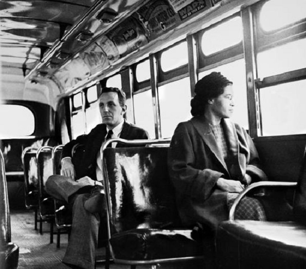
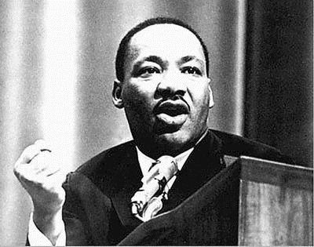

# Breaking The Mold · 第14章　打破窠臼

## Three African Chiefs · 三个非洲酋长

On September 6, 1895, the ocean liner Tantallon Castle docked at Plymouth on the southern coast of England. Three African chiefs, Khama of the Ngwato, Bathoen of the Ngwaketse, and Sebele of the Kwena, disembarked and took the 8:10 express train to Paddington Station, London. The three chiefs had come to Britain on a mission: to save their and five other Tswana states from Cecil Rhodes. The Ngwato, Ngwaketse, and Kwena were three of the eight Tswana states comprising what was then known as Bechuanaland, which would become Botswana after independence in 1966.

> 1895年9月6日，坦特伦古堡号邮轮停泊在英国南方的普利茅斯，三个非洲酋长，恩瓜托的卡玛、恩瓜克策的巴桐及奎那的赛博，下船后搭乘八点十分的特快车直奔伦敦帕廷顿车站。三位酋长此行到英国是有任务的，目的是要保住他们自己的及另外五个邦不被罗德斯夺走。恩瓜托、恩瓜克策及奎那地属茨瓦纳（Tswana），而茨瓦纳共包括八个邦，构成当时的贝专纳兰，亦即1966年独立后的博茨瓦纳。

The tribes had been trading with Europeans for most of the nineteenth century. In the 1840s, the famous Scottish missionary David Livingstone had traveled extensively in Bechuanaland and converted King Sechele of the Kwena to Christianity. The first translation of the Bible into an African language was in Setswana, the language of the Tswana.

> 几乎整个19世纪，部落都在与欧洲人做生意。1840年代，著名的苏格兰传教士利文斯顿走遍了贝专纳兰，并领着奎那的国王希凯勒皈依了基督教。圣经第一次翻译成非洲的语言，就是茨瓦纳的塞茨瓦纳语。

In 1885 Britain had declared Bechuanaland a protectorate. The Tswana were content with the arrangement, as they thought this would bring them protection from further European invasions, particularly from the Boers, with whom they had been clashing since the Great Trek in 1835, a migration of thousands of Boers into the interior to escape from British colonialism. The British, on the other hand, wanted control of the area to block both further expansions by the Boers (this page–this page) and possible expansions by Germans, who had annexed the area of southwest Africa corresponding to today’s Namibia.

> 1855年，英国宣布贝专纳兰为保护国。1853年，布尔人为逃避英国人的殖民，数以万计向内地展开大迁徙，茨瓦纳人就跟他们发生过冲突。另一方面，英国人也有自己的算盘，希望控制此一地区以堵住布尔人进一步的扩张及德国人可能的扩张。后者当时吞并了西南非相当于今天纳米比亚的地方。

The British did not think that a full-scale colonization was worthwhile. The high commissioner Rey summarized the attitudes of the British government in 1885 clearly: “We have no interest in the country to the north of the Molope [the Bechuanaland protectorate], except as a road to the interior; we might therefore confine ourselves for the present to preventing that part of the Protectorate being occupied by either filibusters or foreign powers doing as little in the way of administration or settlement as possible.”

> 英国并不认为全民殖民化是值得去做的。高级专员雷伊1885年就清楚地概述了英国政府的态度：“除了开条路通往内地以外，我们对北边的马乐普——亦即贝专纳兰保护国——根本就没有兴趣；因此，我们目前会约束自己，以免保护国的部分受到入侵或外国势力的占领，无论管理或垦殖都尽可能少有作为。”

But things changed for the Tswana in 1889 when Cecil Rhodes’s British South Africa Company started expanding north out of South Africa, expropriating great swaths of land that would eventually become Northern and Southern Rhodesia, now Zambia and Zimbabwe. By 1895, the year of the three chiefs’ visit to London, Rhodes had his eye on territories to the southwest of Rhodesia, Bechuanaland. The chiefs knew that only disaster and exploitation lay ahead for territories if they fell under the control of Rhodes.

> 但对茨瓦纳来说，事情到了1889年有了变化，罗德斯的不列颠南非公司开始从南非向北扩张，掠夺了大片土地，亦即后来成为南、北罗德西亚，今天的赞比亚和津巴布韦。到1895年，也就是三位酋长访问伦敦那一年，罗德斯盯上了罗德西亚西南方的领土，亦即贝专纳兰。酋长们都知道，如果土地落到了罗德斯的手里，灾难和剥削就在眼前。

Though it was impossible for them to defeat Rhodes militarily, they were determined to fight him any way they could. They decided to opt for the lesser of two evils: greater control by the British rather than annexation by Rhodes. With the help of the London Missionary Society, they traveled to London to try to persuade Queen Victoria and Joseph Chamberlain, then colonial secretary, to take greater control of Bechuanaland and protect it from Rhodes.

> 对他们来说，要以军事力量击败罗德斯根本就是不可能的事，但决心跟他周旋到底。最后他们决定两害相权取其轻：宁愿让英国统治也不要被罗德斯吞并。在伦敦传道会的协助下，他们千里迢迢来到伦敦，想要说服维多利亚女王及殖民大臣张伯伦，扩大对贝专纳兰的控制，免遭罗德斯的进犯。

On September 11, 1895, they had their first meeting with Chamberlain. Sebele spoke first, then Bathoen, and finally Khama. Chamberlain declared that he would consider imposing British control to protect the tribes from Rhodes. In the meantime, the chiefs quickly embarked on a nationwide speaking tour to drum up popular support for their requests. They visited and spoke at Windsor and Reading, close to London; in Southampton on the south coast; and in Leicester and Birmingham, in Chamberlain’s political support base, the Midlands. They went north to industrial Yorkshire, to Sheffield, Leeds, Halifax, and Bradford; they also went west to Bristol and then up to Manchester and Liverpool.

> 1895年9月11日，与张伯伦首次会晤，赛博首先发言，再来是巴桐，最后使卡玛。张伯伦表明，他会考虑用英国的控制阻止罗德斯。在此同时，三位酋长马上开始进行一次全国的旅行演说，竭力争取公众支持他们的要求。他们走访伦敦附近的温莎及雷丁并演说；他们去到南部的滨海城市南安普顿，去到张伯伦的政治大本营，中部地区的莱塞斯特及伯明翰；他们向北去到工业城市的约克夏、谢菲尔德、里兹、哈利法克斯及布莱福德；他们还往西去到布里斯托，然后往北到曼彻斯特及利物浦。

Meanwhile, back in South Africa, Cecil Rhodes was making preparations for what would become the disastrous Jameson Raid, an armed assault on the Boer Republic of the Transvaal, despite Chamberlain’s strong objections. These events likely made Chamberlain much more sympathetic to the chiefs’ plight than he might have been otherwise. On November 6, they met with him again in London.

> 同一时间，远在南非，罗德斯已经箭在弦上，不顾张伯伦的强烈反对，准备对布尔人的德兰士瓦共和国展开武装攻击，亦即后来惨烈的詹姆森突袭。事情发展至此，除了对酋长们的艰难处境益发同情外，张伯伦已经不做他想。11月6日，他们再度在伦敦会晤张伯伦。

The chiefs spoke through an interpreter: Chamberlain: I will speak about the lands of the Chiefs, and about the railway, and about the law which is to be observed in the territory of the Chiefs … Now let us look at the map … We will take the land that we want for the railway, and no more. Khama: I say, that if Mr. Chamberlain will take the land himself, I will be content.

> 酋长是通过翻译发言：张伯伦：我要和酋长谈土地的事，以及酋长领土内要遵守的法律……现在让我们看看地图……我们只要建铁路用的土地，其他都不动。卡玛：我要说的是，如果是张伯伦先生自己要土地，我没话说。

Chamberlain: Then tell him that I will make the railway myself by the eyes of one whom I will send and I will take only as much as I require, and will give compensation if what I take is of value. Khama: I would like to know how [i.e., where] the railway will go. Chamberlain: It shall go through his territory but shall be fenced in, and we will take no land. Khama: I trust that you will do this work as for myself, and treat me fairly in this matter.

> 张伯伦：请告诉他，建造铁路的事我会自己来，会派一个人去看着，而且只拿需要的，如果拿的是有价值的，也会做出补偿。卡玛：我想要知道铁路开到哪里。张伯伦：会经过他的领土，但会围起来，我们不会拿土地。卡玛：我相信你会像我自己一样做这件事，并相信你会公平对待我。

Chamberlain: I will guard your interests. The next day, Edward Fairfield, at the Colonial Office, explained Chamberlain’s settlement in more detail: Each of the three chiefs, Khama, Sebele and Bathoen, shall have a country within which they shall live as hitherto under the protection of the Queen. The Queen shall appoint an officer to reside with them. The chiefs will rule their own people much as at present.

> 张伯伦：我会看好你的利益的。第二天，在殖民署，费尔菲尔德把张伯伦的决定做了更详细的说明：“三个酋长卡玛、赛博及巴桐，每个人都会有一个从此置于女王保护下的国家。女王将指派一名官员驻守，酋长将统治自己的人民一如现在。”

Rhodes’s reaction to being outmaneuvered by the three African chiefs was predictable. He cabled to one of his employees, saying, “I do object to being beaten by three canting natives.” The chiefs in fact had something valuable that they had protected from Rhodes and would subsequently protect from British indirect rule. By the nineteenth century, the Tswana states had developed a core set of political institutions. These involved both an unusual degree, by sub-Saharan African standards, of political centralization and collective decision-making procedures that can even be viewed as a nascent, primitive form of pluralism.

> 对于三个酋长的出奇制胜，罗德斯的反应可想而知。在一封发给属下的电报中，他说：“被三个伪善的野蛮人打败，我当然不会咽下这口气。”事实上，三个酋长的成就相当有价值，他们挡住了罗德斯，随之而来的是他们挡住了英国的间接统治。19世纪时，茨瓦纳诸邦已经发展了一套核心的政治制度，包括政治上的中央集权及集体决策，光这两样，若以下撒哈拉非洲的标准来看，都是了不起的成就，甚至可以视为一种初始形态的政治多元化。

Just as the Magna Carta enabled the participation of barons into the political decision-making process and put some restrictions on the actions of the English monarchs, the political institutions of the Tswana, in particular the kgotla, also encouraged political participation and constrained chiefs. The South African anthropologist Isaac Schapera describes how the kgotla worked as follows: all matters of tribal policy are dealt with finally before a general assembly of the adult males in the chief’s kgotla (council place).

> 一如大宪章之促成贵族参与政治决策，为英格兰的君主加上了一些约束，茨瓦纳的政治制度，尤其是“科加勒”（kgotla），也鼓励政治参与及约束酋长。科加勒的运作，南非人类学者沙培拉描述如下：“所有有关部族的政策，最后都要提交到酋长的科加勒（议场），在由成年男性组成的大会中讨论。

Such meetings are very frequently held … among the topics discussed … are tribal disputes, quarrels between the chief and his relatives, the imposition of new levies, the undertaking of new public works, the promulgation of new decrees by the chief … it is not unknown for the tribal assembly to overrule the wishes of the chief. Since anyone may speak, these meetings enable him to ascertain the feelings of the people generally, and provide the latter with an opportunity of stating their grievances. If the occasion calls for it, he and his advisers may be taken severely to task, for the people are seldom afraid to speak openly and frankly.

> 这类会议经常举行……讨论的事情……包括部落争议、酋长与其亲属之间纷争、新捐税的征收、新公共事务的推行、酋长公布的新政令……酋长的希望遭到驳回时有所闻。由于任何人都能发言，这些会议可以让他了解民情，有机会让民众陈述冤屈。如果情况需要，他和他的参谋可能还会有苦头吃，因为大家都不怕把话讲出来。”

Beyond the kgotla, the Tswana chieftaincy was not strictly hereditary but open to any man demonstrating significant talent and ability. Anthropologist John Comaroff studied in detail the political history of another of the Tswana states, the Rolong. He showed that though in appearance the Tswana had clear rules stipulating how the chieftancy was to be inherited, in practice these rules were interpreted to remove bad rulers and allow talented candidates to become chief. He showed that winning the chieftancy was a matter of achievement, but was then rationalized so that the successful competitor appeared to be the rightful heir.

> 科加勒之外，茨瓦纳的酋长职位并非严格世袭，而是开放给任何有才能的人。详细研究过茨瓦纳另一个邦——拉隆——政治历史的人类学者卡马洛夫指出，关于茨瓦纳酋长的继承，表面上确有清楚的规定，但实际上，这些规定旨在说明如何罢免不好的统治者，让有才能的人成为酋长。他的研究显示，赢得大位要看成就，要经得起考验，有真材实料的竞争者才享有继承的权利。

The Tswana captured this idea with a proverb, with a tinge of constitutional monarchy: kgosi ke kgosi ka morafe, “The king is king by the grace of the people.” The Tswana chiefs continued in their attempts to maintain their independence from Britain and preserve their indigenous institutions after their trip to London. They conceded the construction of railways in Bechuanaland, but limited the intervention of the British in other aspects of economic and political life. They were not opposed to the construction of the railways, certainly not for the same reasons as the Austro-Hungarian and Russian monarchs blocked railways.

> 茨瓦纳有一句格言，颇有一点君主立宪的精神：“君因民之拥戴而王。”伦敦回来之后，茨瓦纳的酋长们继续努力维持自己的独立，保留自己的本土制度，不让英国插手。他们同意在博茨瓦纳修建铁路，但限制英国在经济及政治方面的介入。他们之所以不反对铁路的兴建，当然不能跟奥匈帝国及俄罗斯帝国阻挡铁路的理由相提并论。

They just realized that railways, like the rest of the policies of the British, would not bring development to Bechuanaland as long as it was under colonial control. The early experience of Quett Masire, president of independent Botswana from 1980 to 1998, explains why. Masire was an enterprising farmer in the 1950s; he developed new cultivation techniques for sorghum and found a potential customer in Vryburg Milling, a company located across the border in South Africa.

> 他们心里明白，铁路和英国的其他政策一样，只要是置于殖民控制之下，就不会为贝专纳兰带来发展。博茨瓦纳独立后担任总统（1980年至1998年）的马西雷，他的早年经验就是最好的说明。1950年代，马西雷还是个农民，非常有事业心，发展出新的高粱培育技术，并发现一个颇有可为的客户，弗雷堡碾谷，一家跨越边界设在南非境内的公司。

He went to the railway station master at Lobatse in Bechuanaland and asked to rent two rail trucks to move his crop to Vryburg. The station master refused. Then he got a white friend to intervene. The station master reluctantly agreed, but quoted Masire four times the rate for whites. Masire gave up and concluded, “It was the practice of the whites, not just the laws prohibiting Africans from owning freehold land or holding trading licenses that kept blacks from developing enterprises in Bechuanaland.”

> 他到贝专纳兰的娄贝兹火车站找站长，要求租两节车厢，要把收成运送到弗雷堡去。站长拒绝了。于是他请以为白人朋友介入。站长勉强同意，但索取的费用却是白人的四倍。马西雷放弃了，并得到一个结论：“禁止非洲人拥有自己的土地或持有贸易执照，使黑人无法在贝专纳兰发展事业的，不只是法律而已，还有白人的实际作为。”

All in all, the chiefs, and the Tswana people, had been lucky. Perhaps against all odds, they succeeded in preventing Rhodes’s takeover. As Bechuanaland was still marginal for the British, the establishment of indirect rule there did not create the type of vicious circle playing out in Sierra Leone (this page–this page). They also avoided the kind of colonial expansion that went on in the interior of South Africa that would turn those lands into reservoirs of cheap labor for white miners or farmers. The early stages of the process of colonization are a critical juncture for most societies, a crucial period during which events that will have important long-term consequences for their economic and political development transpire.

> 总的来说，酋长们乃至茨瓦纳的人民，运气算是好的。或许是他们豁出去了，总算阻止了罗德斯的掠夺，又因为英国几乎不插手贝专纳兰的统治，在塞拉利昂上演并造成恶性循环的间接统治也不曾在那里出现。另外，在南非内地进行的殖民扩张他们也逃过了，因此才使这片土地没有沦为白人矿主与农场的廉价劳工库。对多数社会来说，殖民化过程的初期阶段最是紧要关头，对于经济及政治的后续发展，这一时期内的事件具有深远的影响。

As we discussed in chapter 9, most societies in sub-Saharan Africa, just as those in South America and South Asia, witnessed the establishment or intensification of extractive institutions during colonization. The Tswana would instead avoid both intense indirect rule and the far worse fate that would have befallen them had Rhodes succeeded in annexing their lands. This was not just blind luck, however. It was once again a result of the interplay between the existing institutions, shaped by the institutional drift of the Tswana people, and the critical juncture brought about by colonialism.

> 如同我们在第九章所讨论的，下撒哈拉非洲的多数社会和南美及南亚一样，在殖民化过程中也见证了榨取式制度的建立与强化。但茨瓦纳却逃过了两次劫数，其一是高压的间接统治，另一则是遭到罗德斯吞并的毒手。但不管怎么说，这绝不是瞎猫碰上死耗子纯靠运气得来，而是又一次现行制度交互作用的结果，茨瓦纳人民的制度漂移，与殖民主义带来的关键时期都影响着它。

The three chiefs had made their own luck by taking the initiative and traveling to London, and they were able to do this because they had an unusual degree of authority, compared with other tribal leaders in sub-Saharan Africa, owing to the political centralization the Tswana tribes had achieved, and perhaps they also had an unusual degree of legitimacy, because of the modicum of pluralism embedded in their tribal institutions. Another critical juncture at the end of the colonial period would be more central to the success of Botswana, enabling it to develop inclusive institutions. By the time Bechuanaland became independent in 1966 under the name Botswana, the lucky success of chiefs Sebele, Bathoen, and Khama was long in the past.

> 三个酋长的幸运是靠他们自己打造出来的。他们采取主动，造访伦敦，而他们之所以做得到这一点，则是因为茨瓦纳部族在政治上所成就的中央集权，相较于下撒哈拉非洲的部族领导人，使他们拥有不同于一般的权威，或许也是因为在他们部族制度中早已深植了政治多元化的根苗，使他们在合法性上具有不同一般的程度。殖民时代末期，是另一个使广纳式制度得以发展的关键时期，这对博茨瓦纳的成功是更为核心的关键。1966年贝专纳兰以博茨瓦纳之名独立，酋长赛博、巴桐和卡玛的幸运及成功已经是久远之前的事了。

In the intervening years, the British invested little in Bechuanaland. At independence, Botswana was one of the poorest countries in the world; it had a total of twelve kilometers of paved roads, twenty-two citizens who had graduated from university, and one hundred from secondary school. To top it all off, it was almost completely surrounded by the white regimes of South Africa, Namibia, and Rhodesia, all of which were hostile to independent African countries run by blacks. It would have been on few people’s list of countries most likely to succeed.

> 在那一段时间，英国对贝专纳兰所做的投资极少。博茨瓦纳独立时，堪称是世界最贫穷的国家之一，整个国家，路面经过铺设的道路总共十二公里，大学毕业的国民总共二十二名，中学毕业的一百名。而最最严重的问题，则是它几乎完全被白人统治的国家——南非、纳米比亚及罗德西亚——包围，所有这些政权对黑人治理的独立非洲国家都充满敌意。没有几个人看好这个国家。

Yet over the next forty-five years, Botswana would become one of the fastest-growing countries in the world. Today Botswana has the highest per capita income in sub-Saharan Africa, and is at the same level as successful Eastern European countries such as Estonia and Hungary, and the most successful Latin American nations, such as Costa Rica. How did Botswana break the mold? By quickly developing inclusive economic and political institutions after independence.

> 但四十五年过去，博茨瓦纳却是世界上成长最快速的国家之一。今天在下撒哈拉非洲，博茨瓦纳是人均收入最高的国家，其成就媲美成功的东欧国家如爱沙尼亚及匈牙利，以及最成功的拉丁美洲国家如哥斯达黎加。博茨瓦纳打破了窠臼，它是如何做到的？答案是，独立之后快速建立广纳式经济及政治制度。

Since then, it has been democratic, holds regular and competitive elections, and has never experienced civil war or military intervention. The government set up economic institutions enforcing property rights, ensuring macroeconomic stability, and encouraging the development of an inclusive market economy. But of course, the more challenging question is, how did Botswana manage to establish a stable democracy and pluralistic institutions, and choose inclusive economic institutions, while most other African countries did the opposite? To answer this, we have to understand how a critical juncture, this time the end of colonial rule, interacted with Botswana’s existing institutions.

> 独立以来，它始终维持民主，定期举行公平竞争的选举，从未经历过内战或军人干政。政府建立强化财产权的经济制度，确保总体经济的稳定，鼓励广纳式市场经济的发展。当然，话又说回来，更具挑战性的问题是，当绝大部分非洲国家反其道而行时，博茨瓦纳却能建立稳定的民主及多元的制度，选择了广纳式的经济制度，它是怎么做到的？要回答这个问题，我们就必须先了解，在殖民统治结束时的紧要关头，博茨瓦纳的现行制度是如何发挥作用的。

In most of sub-Saharan Africa—for example, for Sierra Leone and Zimbabwe—independence was an opportunity missed, accompanied by the re-creation of the same type of extractive institutions that existed during the colonial period. Early stages of independence would play out very differently in Botswana, again largely because of the background created by Tswana historical institutions. In this, Botswana exhibited many parallels to England on the verge of the Glorious Revolution. England had achieved rapid political centralization under the Tudors and had the Magna Carta and the tradition of Parliament that could at least aspire to constrain monarchs and ensure some degree of pluralism.

> 在大部分下撒哈拉非洲，譬如塞拉利昂及津巴布韦，独立时一个机会，但却失落了，因为随之而来的是殖民时期榨取式制度的复辟。独立的初期阶段，博茨瓦纳的情形却大不相同，这又得归功于茨瓦纳传统制度所建立的环境。在这方面，博茨瓦纳有许多地方与光荣革命之前的英格兰相似。英格兰在都铎王朝统治下快速达成政治上的中央集权，又有大宪章和国会的传统，对压制君权及确保某种程度的政治多元化有起码的渴望。

Botswana also had some amount of state centralization and relatively pluralistic tribal institutions that survived colonialism. England had a newly forming broad coalition, consisting of Atlantic traders, industrialists, and the commercially minded gentry, that was in favor of well-enforced property rights. Botswana had its coalition in favor of secure procedure rights, the Tswana chiefs, and elites who owned the major assets in the economy, cattle. Even though land was held communally, cattle was private property in the Tswana states, and the elites were similarly in favor of well-enforced property rights.

> 博茨瓦纳也有相当的中央集权及相对多元的部族制度逃过了殖民主义的毒手。英格兰有新近形成的广泛联盟，由大西洋贸易商、实业家及商业取向的士绅名流组成，追求的是财产权的不容侵犯。博茨瓦纳也有联盟，茨瓦纳的酋长们以及拥有主要经济资产牛只的菁英阶层，他们都追求稳定的程序权利。土地虽属公有，但在茨瓦纳各邦，牛只是私有财产，菁英阶层也都赞成财产权的不容侵犯。

All this of course is not denying the contingent path of history. Things would have turned out very differently in England if parliamentary leaders and the new monarch had attempted to use the Glorious Revolution to usurp power. Similarly, things could have turned out very differently in Botswana, especially if it hadn’t been so fortunate as to have leaders such as Seretse Khama, or Quett Masire, who decided to contest power in elections rather than subvert the electoral system, as many postindependence leaders in sub-Saharan Africa did.

> 所有这一切，当然也不能否认有历史的偶然。在英格兰，如果议会里面那些一方之霸及新任的君主企图利用光荣革命篡夺权力，事情的发展就有可能完全不同。同样的，在博茨瓦纳，如果不是幸好有卡玛或马西雷这样的领袖，决定通过选举竞争取得权力，而不是像下撒哈拉非洲许多独立后的领袖那样破坏选举制度，事情的演变可能也会大不相同。

At independence the Tswana emerged with a history of institutions enshrining limited chieftaincy and some degree of accountability of chiefs to the people. The Tswana were of course not unique in Africa for having institutions like this, but they were unique in the extent to which these institutions survived the colonial period unscathed. British rule had been all but absent. Bechuanaland was administered from Mafeking, in South Africa, and it was only during the transition to independence in the 1960s that the plans for the capital of Gaborone were laid out.

> 在独立之时，茨瓦纳的制度就已经具有限制酋长权力对人民负责的传统。当然，在非洲，这种制度传统并非茨瓦纳独有，但特别是，经过殖民时期，在非洲仍然能够完好保留这些制度的就只有茨瓦纳而已。英国的统治几乎完全没有进来。当时，英国对贝专纳兰的治理放在南非境内的梅富根，只有到1960年代转移到独立的那段期间，才有建立首都哈伯罗内的计划提出。

The capital and the new structures there were not meant to expunge the indigenous institutions, but to build on them; as Gaborone was constructed, new kgotlas were planned along with it. Independence was also a relatively orderly affair. The drive for independence was led by the Botswana Democratic Party (BDP), founded in 1960 by Quett Masire and Seretse Khama. Khama was the grandson of King Khama III; his given name, Seretse, means “the clay that binds together.” It was to be an extraordinarily apt name.

> 建都及新构架并不是要打掉原住民的制度，反而是把它们当成基础；哈伯罗内的建设，就伴随着新“科加勒”的规划。独立的进行也是循序渐进。推动独立的首要力量是1960年由马西雷及卡玛所建立的博茨瓦纳民主党。卡玛是卡玛三世之孙，取名Seretse，意思是“粘合团结的粘土”，名字取得再恰当不过。

Khama was the hereditary chief of the Ngwato, and most of the Tswana chiefs and elites joined the Botswana Democratic Party. Botswana didn’t have a marketing board, because the British had been so uninterested in the colony. The BDP quickly set one up in 1967, the Botswana Meat Commission. But instead of expropriating the ranchers and cattle owners, the Meat Commission played a central role in developing the cattle economy; it put up fences to control foot-and-mouth disease and promoted exports, which would both contribute to economic development and increase the support for inclusive economic institutions.

> 卡玛继承的是恩瓜托的酋长，而大部分茨瓦纳的酋长及菁英阶层都加入了博茨瓦纳民主党。博茨瓦纳没有产销协议会，因为英国对这块殖民地根本没有兴趣。很快的，博茨瓦纳民主党在1967年成立了一个名之为博茨瓦纳肉品委员会，但目的不是要剥削牧场及家畜养殖户，而是在畜牧业的发展中扮演一个核心角色，建立口蹄疫的防线，促进外销，对经济发展及广纳式经济制度的促进都有贡献。

Though the early growth in Botswana relied on meat exports, things changed dramatically when diamonds were discovered. The management of natural resources in Botswana also differed markedly from that in other African nations. During the colonial period, the Tswana chiefs had attempted to block prospecting for minerals in Bechuanaland because they knew that if Europeans discovered precious metals or stones, their autonomy would be over. The first big diamond discovery was under Ngwato land, Seretse Khama’s traditional homeland. Before the discovery was announced, Khama instigated a change in the law so that all subsoil mineral rights were vested in the nation, not the tribe.

> 博茨瓦纳早期的成长几乎全都依赖肉品外销，但当钻石发现时，一切都不一样了。在博茨瓦纳，自然资源的管理也与其他非洲国家显著不同。殖民时期，茨瓦纳的酋长都反对在贝专纳兰勘探矿产，因为他们都明白，欧洲人一旦找到珍贵的金属或宝石，他们的自治也就玩完了。第一颗大钻石在卡玛的故乡恩瓜托发现。发现宣布之前，卡玛促使修改法令，使所有的地下矿物权都属于国家而非部族。

This ensured that diamond wealth would not create great inequities in Botswana. It also gave further impetus to the process of state centralization as diamond revenues could now be used for building a state bureaucracy and infrastructure and for investing in education. In Sierra Leone and many other sub-Saharan African nations, diamonds fueled conflict between different groups and helped to sustain civil wars, earning the label Blood Diamonds for the carnage brought about by the wars fought over their control. In Botswana, diamond revenues were managed for the good of the nation.

> 如此一来，确保钻石的财富不至于在博茨瓦纳制造巨大的不平等，同时利用钻石的收入加速推动政府中央集权，建立国家的官僚体系及基础建设，并投资教育事业。在塞拉利昂及许多下撒哈拉非洲国家，钻石点燃了不同派系间的冲突，成为内战持续的燃料，为了控制钻石，战争带来屠杀，因而贴上了血钻石的恶名。但在博茨瓦纳，钻石的收入却造福了国民。

The change in subsoil mineral rights was not the only policy of state building that Seretse Khama’s government implemented. Ultimately, the Chieftaincy Act of 1965 passed by the legislative assembly prior to independence, and the Chieftaincy Amendment Act of 1970 would continue the process of political centralization, enshrining the power of the state and the elected president by removing from chiefs the right to allocate land and enabling the president to remove a chief from office if necessary. Another facet of political centralization was the effort to unify the country further, for example, with legislation ensuring that only Setswana and English were to be taught in school.

> 地下矿物权的改变并不是卡玛政府唯一的建国政策。最后，在独立之前，立法会议1965年通过酋长法，1970年又通过酋长法修正案，继续推动政治中央集权的过程，取消酋长分地的权利，视情况的需要总统得罢黜酋长，以此强化政府及民选总统的权力。政治中央集权化的另一项作为则是努力促进国家统一，举例来说，通过立法确定学校只教塞茨瓦纳语及英语。

Today Botswana looks like a homogenous country, without the ethnic and linguistic fragmentation associated with many other African nations. But this was an outcome of the policy to have only English and a single national language, Setswana, taught in schools to minimize conflict between different tribes and groups within society. The last census to ask questions about ethnicity was the one taken in 1946, which revealed considerable heterogeneity in Botswana. In the Ngwato reserve, for example, only 20 percent of the population identified themselves as pure Ngwato; though there were other Tswana tribes present, there were also many non-Tswana groups whose first language was not Setswana.

> 今天，博茨瓦纳看起来是一个同质性极高的国家，没有族群及语言的分歧，完全不像其他许多非洲国家。此一结果正是语言统一之功，学校只教英语及一种国语塞茨瓦纳语，以此减少不同族群及社会团体的冲突。人口普查问到族群问题的最后一次是1946年的那一次，结果充分显示，博茨瓦纳的族群其实相当异质。举例来说，在恩瓜托，认同自己是恩瓜托人的就仅有20%；茨瓦纳固然有其他部落，母语不是塞茨瓦纳语的非茨瓦纳族群也不在少数。

This underlying heterogeneity has been modulated both by the policies of the postindependence government and by the relatively inclusive institutions of the Tswana tribes in the same way as heterogeneity in Britain, for example, between the English and the Welsh, has been modulated by the British state. The Botswanan state did the same. Since independence, the census in Botswana has never asked about ethnic heterogeneity, because in Botswana everyone is Tswana.

> 这种潜在的异质得以调和，除独立后政府的政策之外，还要归功于茨瓦纳族群的制度相当具有广纳性，举例来说，很像英国的异质性，譬如威尔士与英格兰，因不列颠政府而获得调和。博茨瓦纳政府也扮演了同样角色。独立之后，人口普查就再也没有问过族群的问题，因为大家都是茨瓦纳人。

Botswana achieved remarkable growth rates after independence because Seretse Khama, Quett Masire, and the Botswana Democratic Party led Botswana onto a path of inclusive economic and political institutions. When the diamonds came on stream in the 1970s, they did not lead to civil war, but provided a strong fiscal base for the government, which would use the revenues to invest in public services. There was much less incentive to challenge or overthrow the government and control the state. Inclusive political institutions bred political stability and supported inclusive economic institutions. In a pattern familiar from the virtuous circle described in chapter 11, inclusive economic institutions increased the viability and durability of inclusive political institutions.

> 独立后的博茨瓦纳成就了相当高的成长率，关键在于卡玛、马西雷及博茨瓦纳民主党把博茨瓦纳带上了广纳式经济及政治制度之路。1970年代钻石开始生产，不仅没有引发内战，而且为政府提供了坚实的财政基础，大量投资公共建设，想要推翻政府并控制国家的诱因相当少。广纳式政治制度带来政治的安定，成为广纳式经济制度的后盾。如同第十一章所讲的良性循环，广纳式经济制度回过头来又增强了广纳式政治制度的活力与持久性。

Botswana broke the mold because it was able to seize a critical juncture, postcolonial independence, and set up inclusive institutions. The Botswana Democratic Party and the traditional elites, including Khama himself, did not try to form a dictatorial regime or set up extractive institutions that might have enriched them at the expense of society. This was once again an outcome of the interplay between a critical juncture and existing institutions. As we have seen, differently from almost anywhere else in sub-Saharan Africa, Botswana already had tribal institutions that had achieved some amount of centralized authority and contained important pluralistic features. Moreover, the country had economic elites who themselves had much to gain from secure property rights.

> 博茨瓦纳打破了窠臼，因为掌握了关键时期——殖民结束后的独立——并建立了广纳式制度。博茨瓦纳民主党与传统的菁英阶层，包括卡玛本人，并未试图成立一个专制政权或建立榨取式制度，肥了自己而牺牲社会。这又是关键时期与现行制度之间互动的结果。如我们所见，几乎不同于所有的下撒哈拉非洲国家，博茨瓦纳已经拥有相当中央集权并包含多元特质的部族制度。此外，由于私有财产确立，国家的菁英阶层所拥有的已经极为丰厚。

No less important, the contingent path of history worked in Botswana’s favor. It was particularly lucky because Seretse Khama and Quett Masire were not Siaka Stevens and Robert Mugabe. The former worked hard and honestly to build inclusive institutions on the foundations of the Tswanas’ tribal institutions. All this made it more likely that Botswana would succeed in taking a path toward inclusive institutions, whereas much of the rest of sub-Saharan Africa did not even try, or failed outright.

> 同样重要的是，历史的不确定性也站在博茨瓦纳这一边。特别值得庆幸的是，卡玛及马西雷都不是史蒂芬斯及穆加贝。前者以茨瓦纳的部族制度为基础努力而忠实地建立广纳式制度，使博茨瓦纳更为顺利地迈向广纳式制度。而这一方面，绝大多数的下撒哈拉非洲，有的是连尝试的机会都没有，有的则是才起步就失败了。

## The End Of The Southern Extraction · 南方榨取式制度的末日

It was December 1, 1955. The city of Montgomery, Alabama, arrest warrant lists the time that the offense occurred as 6:06 p.m. James Blake, a bus driver, was having trouble, he called the police, and Officers Day and Mixon arrived on the scene.

> 1955年12月1日。阿拉巴马州蒙哥马利市，拘票上登录的犯罪时间是下午六点六分。公交车司机布莱克遇到麻烦，打电话报警，警官戴伊与迈可森来到现场。

They noted in their report: We received a call upon arrival the bus operator said he had a colored female sitting in the white section of the bus, and would not move back. We … also saw her. The bus operator signed a warrant for her. Rosa Parks (cf) was charged with chapter 6 section 11 of the Montgomery City Code.

> 他们的报告是这样写的：“我们接到一通电话后赶来，公交司机说，车上有个有色人种女性坐在白人区，不愿往后移，我们……也看到了她。公交司机给她开了一张拘票。罗莎•帕克斯依蒙哥马利市市规第六章十一条被控有罪。”

Rosa Parks’s offense was to sit in a section of the Cleveland Avenue bus reserved for whites, a crime under Alabama’s Jim Crow laws. Parks was fined ten dollars in addition to court fees of four dollars. Rosa Parks wasn’t just anybody. She was already the secretary of the Montgomery chapter of the National Association for the Advancement of Colored People, the NAACP, which had long been struggling to change the institutions of the U.S. South.

> 罗莎•帕克斯所犯的罪行是坐在克利夫兰大道公共汽车上为白人保留的区域，一项根据阿拉巴马州的吉姆•克劳法所定的罪。罗莎•帕克斯被处十美元罚金，外加诉讼费四美元。但罗莎并不是个简单人物，她当时已经是全国有色人种进步协会阿拉巴马分会秘书。为打破美国南方的制度，全国有色人种进步协会已经奋斗多年。

Her arrest triggered a mass movement, the Montgomery Bus Boycott, masterminded by Martin Luther King, Jr. By December 3, King and other black leaders had organized a coordinated bus boycott, convincing all black people that they should not ride on any bus in Montgomery. The boycott was successful and it lasted until December 20, 1956. It set in motion a process that culminated in the U.S. Supreme Court ruling that the laws that segregated buses in Alabama and Montgomery were unconstitutional.

> 对她的逮捕引发一场群众运动——抵制蒙哥马利公共汽车运动——发起人为马丁•路德•金。12月3日，金联合其他黑人领袖组织一项抵制运动，说服所有的黑人都拒绝搭乘蒙哥马利市内的任何公交车。抵制运动大获成功，一直持续到1956年12月20日，最后以最高法院裁定阿拉巴马及蒙哥马利公交车种族隔离违宪告终。

The Montgomery Bus Boycott was a key moment in the civil rights movement in the U.S. South. This movement was part of a series of events and changes that finally broke the mold in the South and led to a fundamental change of institutions. As we saw in chapter 12, after the Civil War, southern landowning elites had managed to re-create the extractive economic and political institutions that had dominated the South before the Civil War.

> 在美国南方的民权运动中，抵制蒙哥马利公交车运动是最关键的一役。一连串的事件及变化最后终于打破南方的窠臼，导致制度上的基本变革。如我们在第十二章所见，内战之后，南方地主菁英阶层成功复辟内战前支配南方的榨取式经济及政治制度。

Though the details of these institutions changed—for example, slavery was no longer possible—the negative impact on economic incentives and prosperity in the South was the same. The South was notably poorer than the rest of the United States. Starting in the 1950s, southern institutions would begin to move the region onto a much faster growth trajectory. The type of extractive institutions ultimately eliminated in the U.S. South were different from the colonial institutions of pre-independence Botswana. The type of critical juncture that started the process of their downfall was also different but shared several commonalities.

> 这些制度的细节虽然已经改变，譬如奴隶制度已经是昨日黄花，但对南方的经济动机及繁荣的负面影响未减，南方的贫穷明显甚于美国其他地方。1950年代起，南方的制度开始把这个区域推向较为快速的发展。美国南方榨取式制度的最后终结，形式上不同于博茨瓦纳独立前的殖民制度，启动其没落的关键时期在形式上也不相同，但却有几处共通的地方。

Starting in the 1940s, those who bore the brunt of the discrimination and the extractive institutions in the South, people such as Rosa Parks, started to become much better organized in their fight against them. At the same time, the U.S. Supreme Court and the federal government finally began to intervene systematically to reform the extractive institutions in the South. Thus a main factor creating a critical juncture for change in the South was the empowerment of black Americans there and the end of the unchallenged domination of the southern elites.

> 从1940年代开始，饱受歧视及榨取式制度冲击的人，譬如罗莎•帕克斯，已经拥有更好的组织对抗这些压迫。同时，美国最高法院及联邦政府终于也动起来，开始有系统介入改革南方的榨取式制度。因此，促成南方改变的关键时期，其主要因素实际上有两个，其一是南方的美国黑人获得了动能，其二则是南方菁英阶层无可动摇的支配权走上了末路。

The southern political institutions, both before the Civil War and after, had a clear economic logic, not too different from the South African Apartheid regime: to secure cheap labor for the plantations. But by the 1950s, this logic became less compelling. For one, significant mass outmigration of blacks from the South was already under way, a legacy of both the Great Depression and the Second World War. In the 1940s and ’50s, this reached an average of a hundred thousand people per year.

> 南方的政治制度，无论内战前后，都有一个思路清晰的逻辑，和南非的种族隔离统治并没有太大差别，也就是要为庄园储备廉价劳工。但到1950年代，此一逻辑愈来愈站不住脚。首先由于大萧条与二战的缘故，黑人已经开始从南方大量外移，1940年及50年代中间，达到平均每年十万人。

Meanwhile, technological innovation in agriculture, though adopted only slowly, was reducing the dependence of the plantation owners on cheap labor. Most labor in the plantations was used for picking cotton. In 1950 almost all southern cotton was still picked by hand. But the mechanization of cotton picking was reducing the demand for this type of work. By 1960, in the key states of Alabama, Louisiana, and Mississippi, almost half of production had become mechanized. Just as blacks became harder to trap in the South, they also became no longer indispensable for the plantation owners.

> 同时，农业新科技发明出现，尽管采用的速度很慢，但已经降低了种植大户对廉价劳工的依赖。大部分劳工都用于棉花收成，1950年时，几乎南方全部的棉花都还是使用手摘，但机械化摘棉已经开始降低这种手工方法的需求。到了1960年，主要的州如阿拉巴马、路易斯安那及密西西比，几乎已经半数产量机械化。在南方，黑人固然愈来愈难找到，但对种植大户来说，这些黑人不再不可或缺也是事实。

There was thus less reason for elites to fight vigorously to maintain the old extractive economic institutions. This did not mean that they would accept the changes in institutions willingly, however. Instead, a protracted conflict ensued. An unusual coalition, between southern blacks and the inclusive federal institutions of the United States, created a powerful force away from southern extraction and toward equal political and civil rights for southern blacks, which would finally remove the significant barriers to economic growth in the U.S. South.

> 因此，对菁英阶层来说，为维持旧日榨取式经济制度而奋战的理由愈来愈少。但话又说回来，这并不代表他们就心甘情愿接受制度改变。相反的，耗费时日的持久战开打。南方的黑人与广纳式联邦制度组合起来，形成一个不同寻常的联盟，产生强大力量，摆脱南方的制度，为南方的黑人争取平等的政治权及公民权，最后终于移除了美国南部经济成长的主要障碍。

The most important impetus for change came from the civil rights movement. It was the empowerment of blacks in the South that led the way, as in Montgomery, by challenging extractive institutions around them, by demanding their rights, and by protesting and mobilizing in order to obtain them. But they weren’t alone in this, because the U.S. South was not a separate country and the southern elites did not have free rein as did Guatemalan elites, for example. As part of the United States of America, the South was subject to the U.S. Constitution and federal legislation.

> 最重要的改革动力则来自民权运动。如同在蒙哥马利所为，挑战身边的榨取式制度，为争取应得的权利而抗争而动员，南方黑人获得了动能。此外，他们不是孤军奋战，因为美国南部并不是另一个国家，南方的菁英阶层也无法像危地马拉的菁英阶层那样为所欲为。既然是美利坚合众国的一部分，南方就得服从美国宪法与联邦法律。

The cause for fundamental reform in the South would finally receive support from the U.S. executive, legislature, and Supreme Court partly because the civil rights movement was able to have its voice heard outside the South, thereby mobilizing the federal government. Federal intervention to change the institutions in the South started with the decision of the Supreme Court in 1944 that primary elections where only white people could stand were unconstitutional. As we have seen, blacks had been politically disenfranchised in the 1890s with the use of poll taxes and literacy tests (this page–this page).

> 又因为民权运动能够在南方以外的地方发声，因此而唤起联邦政府的注意，南方的改革运动最后终于得到美国行政、立法与最高法院的支持。联邦介入南方的制度改革，首见于1944年最高法院裁决初选仅限白人投票为违宪。如我们所见，1890年代，黑人因受限人头税及识字测验，政治公民权遭到剥夺。

These tests were routinely manipulated to discriminate against black people, while still allowing poor and illiterate whites to vote. In a famous example from the early 1960s, in Louisiana a white applicant was judged literate after giving the answer “FRDUM FOOF SPETGH” to a question about the state constitution. The Supreme Court decision in 1944 was the opening salvo in the longer battle to open up the political system to blacks, and the Court understood the importance of loosening white control of political parties.

> 这些例行的测验是对黑人的歧视，因为白人纵使贫穷不识字照样能够投票。1960年代就有一个著名的例子，路易斯安那州一个白人接受测验，对一个有关州宪法的问题作答，答案是“FRDUM FOOF SPETGH”，居然还是被裁定识字。最高法院1994年的裁决有如重炮轰击，为黑人的长期政治抗争打开了一条出路，法院明白解除白人对政治控制的重要性。

That decision was followed by Brown v. Board of Education in 1954, in which the Supreme Court ruled that state-mandated segregation of schools and other public sites was unconstitutional. In 1962 the Court knocked away another pillar of the political dominance of white elites: legislative malapportionment. When a legislature is malapportioned—as were the “rotten boroughs” in England before the First Reform Act—some areas or regions receive much greater representation than they should based on their share of the relevant population.

> 此一裁决之后，接着来的是1954年的布朗控告教育局案，最高法院裁决，州政府授权学校及其他公共场所种族隔离违宪。1962年，最高法院又敲掉了白人菁英阶层政治支配的一根支柱：立法机关代表名额分配不公。立法机关代表名额分配不公——和英格兰第一改革法案之前的“衰废市镇”一样——某些区域或地区的代表名额超出人口应分配数。

Malapportionment in the South meant that the rural areas, the heartland of the southern planter elite, were heavily overrepresented relative to urban areas. The Supreme Court put an end to this in 1962 with its decision in the Baker v. Carr case, which introduced the “one-person, one-vote” standard. But all the rulings from the Supreme Court would have amounted to little if they hadn’t been implemented.

> 这种情形指的就是南方农业地区，种植大户菁英阶层的大本营，相对于都市地区，分配的代表往往超额。1962年，最高法院针对贝克控告卡尔案做出裁决，将这种情形予以终结，因此才开始实施“一人一票”制。但最高法院的裁决如果没有落实，那就等于什么都没有。

In the 1890s, in fact, federal legislation enfranchising southern blacks was not implemented, because local law enforcement was under the control of the southern elite and the Democratic Party, and the federal government was happy to go along with this state of affairs. But as blacks started rising up against the southern elite, this bastion of support for Jim Crow crumbled, and the Democratic Party, led by its non-southern elements, turned against racial segregation. The renegade southern Democrats regrouped under the banner of the States’ Rights Democratic Party and competed in the 1948 presidential election.

> 事实上，1890年代联邦就已经立法给予南方黑人选举权，但却没有实施，关键在于地方执法的权力掌握在菁英阶层及民主党手中，联邦政府乐得事情顺其自便。但当黑人开始揭竿而起反对南方菁英阶层时，此一支持吉姆•克劳的堡垒崩溃，民主党也在非南方成员的领导下转而反对种族隔离。脱党的南部民主党成员乃另起炉灶，高举州权民主党的大旗，角逐1948年的总统选举。

Their candidate, Strom Thurmond, carried four states and gained thirty-nine votes in the Electoral College. But this was a far cry from the power of the unified Democratic Party in national politics and the capture of that party by the southern elites. Strom Thurmond’s campaign was centered on his challenge to the ability of the federal government to intervene in the institutions of the South. He stated his position forcefully: “I wanna tell you, ladies and gentlemen, that there’s not enough troops in the army to force the Southern people to break down segregation and admit the nigra race into our theaters, into our swimming pools, into our homes, and into our churches.”

> 他们的候选人特尔孟德拿下四个州，在选举人团中获得三十九票。相较于统一的民主党在全国政治中的力量，这徒然凸显他们的不成气候，也充分显示，光凭南部菁英阶层是掌握不了民主党的。特尔孟德的竞选全力质疑联邦政府干预南部制度的能力，他说：“女士们、先生们，想要强迫南部人民解除种族隔离，让黑人进入我们的戏院，进入我们的泳池，进入我们的家，进入我们的教堂，我老实告诉你们，根本没有足够的军队可以做到。”

He would be proved wrong. The rulings of the Supreme Court meant that southern educational facilities had to be desegregated, including the University of Mississippi in Oxford. In 1962, after a long legal battle, federal courts ruled that James Meredith, a young black air force veteran, had to be admitted to “Ole Miss.” Opposition to the implementation of this ruling was orchestrated by the so-called Citizens’ Councils, the first of which had been formed in Indianola, Mississippi, in 1954 to fight desegregation of the South.

> 但他显然错了。最高法院的裁决明白表示，教育机构必须解除种族隔离，包括牛津的密西西比大学之内。1962年，经过长时间的争讼之后，联邦法院裁决，“密大”必须接收梅里迪斯，一名年轻的黑人空军退伍军人。对裁决执行的反对力量汇聚成所谓的公民会议，195（6？）4年会议首次召开于密西西比州印第安诺拉，反对南部废除种族隔离。

State governor Ross Barnett publicly rejected the court-ordered desegregation on television on September 13, announcing that state universities would close before they agreed to be desegregated. Finally, after much negotiation between Barnett and President John Kennedy and Attorney General Robert Kennedy in Washington, the federal government intervened forcibly to implement this ruling. A day was set when U.S. marshals would bring Meredith to Oxford. In anticipation, white supremacists began to organize.

> 9月13日，州长巴奈特在电视上公开反对法院的种族隔离解除令，并宣布说，州立大学宁愿关门也不会解除种族隔离。最后，巴奈特与总统约翰•肯尼迪及司法部长罗伯特•肯尼迪在华盛顿谈判，联邦政府将强制实施此项裁决。日子决定了，美国司法警察陪同梅里迪斯前往牛津。预先获知消息，白人至上主义者开始组织起来。

On September 30, the day before Meredith was due to appear, U.S. marshals entered the university campus and surrounded the main administration building. A crowd of about 2,500 came to protest, and soon a riot broke out. The marshals used tear gas to disperse the rioters, but soon came under fire. By 10:00 p.m. that night, federal troops were moved into the city to restore order. Soon there were 20,000 troops and 11,000 National Guardsmen in Oxford.

> 9月30日，梅里迪斯预定出现的前一天，美国司法警察进入大学校园，包围行政大楼。为数大约两千五百人的群众前来抗议，很快就演变成暴乱，司法警察用瓦斯枪驱散暴乱群众，但立刻遭到攻击。到晚上十点时，军队进城维持秩序。不过短短时间，牛津城内已有两万军队及一万一千国民警备队。

In total, 300 people would be arrested. Meredith decided to stay on campus, where, protected from death threats by U.S. marshals and 300 soldiers, he eventually graduated. Federal legislation was pivotal in the process of institutional reform in the South. During the passage of the first Civil Rights Act in 1957, Strom Thurmond, then a senator, spoke nonstop for twenty-four hours and eighteen minutes to prevent, or at least delay, passage of the act.

> 总计有三百人被捕。梅里迪斯决定留在学校，由美国司法警察及三百名军人保护其人身安全，最后念到毕业。在南部的制度改革中，联邦法律扮演关键角色。1957年民权法案通过的过程中，当时已经是参议员的特尔孟德为阻止法案通过，或至少达到拖延的目的，曾不停地连续发言二十四小时又十八分钟。

During his speech he read everything from the Declaration of Independence to various phone books. But to no avail. The 1957 act culminated in the Civil Rights Act of 1964 outlawing a whole gamut of segregationist state legislation and practices. The Voting Rights Act of 1965 declared the literacy tests, poll taxes, and other methods used for disenfranchising southern blacks to be illegal. It also extended a great deal of federal oversight into state elections.

> 发言当中，无论抓到什么，从《独立宣言》到各种电话薄，他都照念不误。但无济于事。1957年的法案以1964年的民权法案达到最高点。新法宣告所有种族隔离州所订的相关法律及政令皆为非法。1965年的投票权法案宣布，识字测验、人头税及其他剥夺南部黑人公民权的办法皆为非法，并将许多联邦的监督制度引入州的选举。

The impact of all these events was a significant change in economic and legal institutions in the South. In Mississippi, for example, only about 5 percent of eligible black people were voting in 1960. By 1970 this figure had increased to 50 percent. In Alabama and South Carolina, it went from around 10 percent in 1960 to 50 percent in 1970. These patterns changed the nature of elections, both for local and national offices. More important, the political support from the dominant Democratic Party for the extractive institutions discriminating against blacks eroded.

> 所有这些事件影响所及，造成南部经济及司法制度的重大变革。举例来说，在密西西比，1960年投票时，黑人合格选民大约只有5%，到1970年时，此一数字增加至50%；在阿拉巴马及南卡罗莱纳，也从1960年的10%左右增加到1970年的50%。这种情形改变了选举的本质，包括地方性的及全国性的公职。更重要的是，占优势的民主党改变政策，对歧视黑人的榨取式制度从此不再支持。

The way was then open for a range of changes in economic institutions. Prior to the institutional reforms of the 1960s, blacks had been almost entirely excluded from jobs in textile mills. In 1960 only about 5 percent of employees in southern textile mills were black. Civil rights legislation stopped this discrimination. By 1970 this proportion had increased to 15 percent; by 1990 it was at 25 percent. Economic discrimination against blacks began to decline, the educational opportunities for blacks improved significantly, and the southern labor market became more competitive.

> 接下来，整个形势开启了一系列经济制度的改变。1960年代制度变革前，纺织厂的工作几乎全面排斥黑人。1960年，南部纺织厂的员工，黑人仅占5%，民权立法打破了这种歧视。到1970年，这一部分增加到15%；1990年，则为25%。经济上对黑人的歧视开始减少，黑人的教育机会大为改善，南部的劳工市场变得比较具有竞争性。

Together with inclusive institutions came more rapid economic improvements in the South. In 1940 southern states had only about 50 percent of the level of per capita income of the United States. This started to change in the late 1940s and ’50s. By 1990 the gap had basically vanished. As in Botswana, the key in the U.S. South was the development of inclusive political and economic institutions. This came at the juxtaposition of the increasing discontent among blacks suffering under southern extractive institutions and the crumbling of the one-party rule of the Democratic Party in the South.

> 随着广纳式制度的快速增加，南部的经济获得改善。1940年，南部州的人均收入仅为全美的一半。这种情形在1940年及50年代开始改变，到1990年，差距基本上已经消失。和博茨瓦纳一样，在美国南部，广纳式政治及经济制度的发展是关键。这种情形得力于两种现象，其一，对于南部的榨取式制度加诸他们的痛苦，黑人的不满增加；其二，民主党在南部的一党独大走向衰落。

Once again, existing institutions shaped the path of change. In this case, it was pivotal that southern institutions were situated within the inclusive federal institutions of the United States, and this allowed southern blacks finally to mobilize the federal government and institutions for their cause. The whole process was also facilitated by the fact that, with the massive outmigration of blacks from the South and the mechanization of cotton production, economic conditions had changed so that southern elites were less willing to put up more of a fight.

> 同样的，这又是现行制度在为改变铺路。在这里，很重要的关键是，南部的制度存在于广纳式的联邦制度之内，惟其如此，南部的黑人最后才能动员联邦政府及制度支持他们的运动。整个过程之所以得以进行，还得力于另一个现象：黑人大量迁出南部及棉花生产的机械化造成重大的经济变化，也使南部菁英阶层更没有意愿继续奋力抵抗。

## Rebirth In China · 中国的重生

The Communist Party under the leadership of Mao Zedong finally overthrew the Nationalists, led by Chiang Kai-shek, in 1949. The People’s Republic of China was proclaimed on October 1. The political and economic institutions created after 1949 were highly extractive. Politically, they featured the dictatorship of the Chinese Communist Party. No other political organization has been allowed in China since then. Until his death in 1976, Mao entirely dominated the Communist Party and the government.

> 1949年，毛泽东领导的共产党终于推翻蒋介石的国民党政权，10月1日，中华人民共和国宣布成立。1949年后产生的政治及经济制度都是高度榨取式的。政治上，中国共产党一党专政，从此以后，中国不容许其他任何政治组织存在。毛泽东则完全掌握共产党及政府，直到1976年去世。

Accompanying these authoritarian, extractive political institutions were highly extractive economic institutions. Mao immediately nationalized land and abolished all kinds of property rights in one fell swoop. He had landlords, as well as other segments he deemed to be against the regime, executed. The market economy was essentially abolished.

> 在威权统治下，榨取式政治制度就是高度榨取式经济制度。毛泽东一上台，立即将土地国有化，一举废除所有形式的财产权。地主，以及其他有可能威胁到他的政权的人，他一律处死。市场经济实质上已经完全不存在。

People in rural areas were gradually organized onto communal farms. Money and wages were replaced by “work points,” which could be traded for goods. Internal passports were introduced in 1956 forbidding travel without appropriate authorization, in order to increase political and economic control. All industry was similarly nationalized, and Mao launched an ambitious attempt to promote the rapid development of industry through the use of “five-year plans,” modeled on those in the Soviet Union.

> 农村地区人民逐渐纳入人民公社。货币及工资由“工分”取代。工分可以用来交易货物。1956年，为强化政治及经济控制，实施路条制，未经上级许可不得在国内旅行。所有的工业同样国有化，毛泽东野心勃勃，模仿苏联模式，提出所谓的“五年计划”，企图快速推动经济发展。

As with all extractive institutions, Mao’s regime was attempting to extract resources from the vast country he was now controlling. As in the case of the government of Sierra Leone with its marketing board, the Chinese Communist Party had a monopoly over the sale of produce, such as rice and grain, which was used to heavily tax farmers. The attempts at industrialization turned into the infamous Great Leap Forward after 1958 with the roll-out of the second five-year plan.

> 有了榨取式制度，毛泽东乃打算从他一手控制的广大国度榨取一切资源。和塞拉利昂政府的产销协议会如出一辙，中国共产党垄断一切产品的销售，诸如稻米及其他谷类，并对农民课以重税。1958年后，随着第二个五年计划的推出，工业化的野心变成臭名昭著的“大跃进”。

Mao announced that steel output would double in a year based on small-scale “backyard” blast furnaces. He claimed that in fifteen years, China would catch up with British steel production. The only problem was that there was no feasible way of meeting these targets. To meet the plan’s goals, scrap metal had to be found, and people would have to melt down their pots and pans and even their agricultural implements such as hoes and plows.

> 毛泽东大言不惭地说，以小规模的土法炼钢为根本，钢铁的产量将在一年内倍增，并宣称中国可以在十五年内赶上英国的钢铁产量。唯一的问题是，根本找不到可行的办法达到此一理想。为了达成计划的目标，即使一小片铁块都不放过，人民必须烧融自己的锅盆，甚至农具如锄头及犁。

Workers who ought to have been tending the fields were making steel by destroying their plows, and thus their future ability to feed themselves and the country. The result was a calamitous famine in the Chinese countryside. Though scholars debate the role of Mao’s policy compared with the impact of droughts at the same time, nobody doubts the central role of the Great Leap Forward in contributing to the death of between twenty and forty million people. We don’t know precisely how many, because China under Mao did not collect the numbers that would have documented the atrocities.

> 原本应该照顾田地的人，如今却毁了自己的犁去炼钢，如此一来，连喂饱他们自己及这个国家的能力也一并毁了。其结果是中国农村饥荒成灾。相较于同一时期的干旱影响，尽管有学者为毛泽东的政策辩护，但毫无疑问的，这段期间多达二千万至四千万人的死亡，大跃进难辞其咎。到底死了多少人，我们无从得知，因为毛泽东统治下的中国根本不留记录，唯恐留下暴政的恶名。

Per capita income fell by around one-quarter. One consequence of the Great Leap Forward was that a senior member of the Communist Party, Deng Xiaoping, a very successful general during the revolution, who led an “anti-rightist” campaign resulting in the execution of many “enemies of the revolution,” had a change of heart. At a conference in Guangzhou in the south of China in 1961, Deng argued, “No matter whether the cat is black or white, if it catches mice, it’s a good cat.”

> 至于人均收入，下跌大约四分之一。大跃进的结果之一，是曾经发动“反右”运动，大肆屠杀“反革命”的革命名将兼中共元老邓小平改变了想法。1961年在中国南方广州的一次会议上，他主张“不管黑猫白猫，会抓老鼠的就是好猫。”

It did not matter whether policies appeared communist or not; China needed policies that would encourage production so that it could feed its people. Yet Deng was soon to suffer for his newfound practicality. On May 16, 1966, Mao announced that the revolution was under threat from “bourgeois” interests that were undermining China’s communist society and wishing to re-create capitalism. In response, he announced the Great Proletarian Cultural Revolution, usually referred to as the Cultural Revolution. The Cultural Revolution was based on sixteen points. The first started:

> 政策不管是不是共产主义的，中国需要的政策是鼓励生产以养活老百姓。但没过多久，邓小平新提出来的实用主义就吃到苦头了。1966年5月16日，毛泽东宣称，“资产阶级”的利益正在威胁革命，破坏中国的共产主义社会，复辟资本主义。为此，他宣布了开始无产阶级文化大革命，一般称为文革，以“十六条”做为张本。开宗明义说：

Although the bourgeoisie has been overthrown, it is still trying to use the old ideas, culture, and customs, and habits of the exploiting classes to corrupt the masses, capture their minds, and endeavor to stage a comeback. The proletariat must do just the opposite: it must meet head-on every challenge of the bourgeoisie in the ideological field and use the new ideas, culture, customs, and habits of the proletariat to change the mental outlook of the whole of society. At present our objective is to struggle against and crush those persons in authority who are taking the capitalist road, to criticize and repudiate the reactionary bourgeois academic authorities and the ideology of the bourgeoisie and all other exploiting classes and transform education, literature, and art and all other parts of the superstructure that do not correspond to the socialist economic base, so as to facilitate the consolidation and development of the socialist system.

> “资产阶级虽然已经被推翻，但是，他们企图用剥削阶级的旧思想、旧文化、旧风俗、旧习惯，来腐蚀群众，征服人心，力求达到他们复辟的目的。无产阶级恰恰相反，必须迎头痛击资产阶级在意识形态领域里的一切挑战，用无产阶级自己的新思想、新文化、新风俗、新习惯，来改变整个社会的精神面貌。在当前，我们的目的是斗垮走资本主义道路的当权派，批判资产阶级的反动学术”权威“，批判资产阶级和一切剥削阶级的意识形态，改革教育，改革文艺，改革一切不适应社会主义经济基础的上层建筑，以利于巩固和发展社会主义制度。”

Soon the Cultural Revolution, just like the Great Leap Forward, would start wrecking both the economy and many human lives. Units of Red Guards were formed across the country: young, enthusiastic members of the Communist Party who were used to purge opponents of the regime. Many people were killed, arrested, or sent into internal exile. Mao himself retorted to concerns about the extent of the violence, stating, “This man Hitler was even more ferocious. The more ferocious, the better, don’t you think? The more people you kill, the more revolutionary you are.” Deng found himself labeled number-two capitalist roader, was jailed in 1967, and then was exiled to Jiangxi province in 1969, to work in a rural tractor factory.

> 很快的，一如大跃进，文革开始大肆破坏经济及人民的生活，红卫兵在全国组成，清算斗争政敌，无数人遭到杀害、囚禁及下放。有人忧虑暴力过了头，毛泽东反驳道：“希特勒这个人更残忍，愈残忍愈好，你不觉得吗？杀人愈多愈是革命。”邓小平发现自己被贴上第二号资本主义同路人的标签，1967年下狱，1969年下放江西，在一家农村拖拉机工厂落户。

He was rehabilitated in 1974, and Mao was persuaded by Premier Zhou Enlai to make Deng first vice-premier. Already in 1975, Deng supervised the composition of three party documents that would have charted a new direction had they been adopted. They called for a revitalization of higher education, a return to material incentives in industry and agriculture, and the removal of “leftists” from the party.

> 1974年获得平反，毛泽东接受总理周恩来的建议，任命邓小平为副总理。1975年，邓小平受命拟定三份党的文件，若经采纳，将成为党的新路线。文件呼吁恢复高等教育活力，工业及农业奖励重回物质鼓励，以及消除党内的“左派”。

At the time, Mao’s health was deteriorating and power was increasingly concentrated in the hands of the very leftists whom Deng Xiaoping wanted to remove from power. Mao’s wife, Jiang Qing, and three of her close associates, collectively known as the Gang of Four, had been great supporters of the Cultural Revolution and the resulting repression. They intended to continue using this blueprint to run the country under the dictatorship of the Communist Party. On April 5, a spontaneous celebration of the life of Zhou Enlai in Tiananmen Square turned into a protest against the government.

> 同一时期，毛泽东的健康状况恶化，权力逐渐向邓小平亟欲拔除的极左派集中。包括毛的妻子江青及其三名亲密战友，亦即大力支持文革的四人帮，企图继续走共产党专政的老路线。1976年4月5日，民众自发地在天安门广场集会悼念周恩来，转变成为一场反政府示威。

The Gang of Four blamed Deng for the demonstrations, and he was once more stripped of all his positions and dismissed. Instead of achieving the removal of the leftists, Deng found that the leftists had removed him. After the death of Zhou Enlai, Mao had appointed Hua Guofeng as the acting premier instead of Deng. In the relative power vacuum of 1976, Hua was able to accumulate a great deal of personal power.

> 四人帮指控邓小平幕后指使，邓再度遭到罢黜，所有职位均被剥夺。周恩来死后，毛泽东任命华国锋代理总理，邓小平继续遭到冷落。华国锋利用此一权力真空累积个人实力。

In September there was a critical juncture: Mao died. The Chinese Communist Party had been under Mao’s domination, and the Great Leap Forward and the Cultural Revolution had been largely his initiatives. With Mao gone, there was a true power vacuum, which resulted in a struggle between those with different visions and different beliefs about the consequences of change. The Gang of Four intended to continue with the policies of the Cultural Revolution as the only way of consolidating theirs and the Communist Party’s power.

> 同年9月，关键时期出现：毛泽东去世。毛领导中国共产党，大跃进及文化大革命都是由他一手主导，毛一撒手，真正的权力真空才出现，因未来路线走向，内部出现不同观点与不同信念的斗争。四人帮要继续文革的政策，以此为巩固共产党执政的唯一途径。

Hua Guofeng wanted to abandon the Cultural Revolution, but he could not distance himself too much from it, because he owed his own rise in the party to its effects. Instead, he advocated a return to a more balanced version of Mao’s vision, which he encapsulated in the “Two Whatevers,” as the People’s Daily, the newspaper of the Chinese Communist Party, put it in 1977. Hua argued, “We will resolutely uphold whatever policy decisions Chairman Mao made, and unswervingly follow whatever instructions Chairman Mao gave.” Deng Xiaoping did not wish to abolish the communist regime and replace it with inclusive markets any more than Hua did. He, too, was part of the same group of people brought to power by the communist revolution.

> 华国锋虽想放弃文革，但由于自己也是靠文革才能够在党内蹿起，因此又不能自外于文革太远。于是，他致力回到一种两面光的毛泽东观点，1977年在中共党报《人民日报》上提出“两个凡是”，强调“凡是毛主席做出的决策，都必须维护，凡是毛主席的指示，都不能违反。”邓小平自己就是因革命而掌权的一分子，当然不希望罢黜共产党政权，而是代之以广纳式市场经济。

But he and his supporters thought that significant economic growth could be achieved without endangering their political control: they had a model of growth under extractive political institutions that would not threaten their power, because the Chinese people were in dire need of improved living standards and because all meaningful opposition to the Communist Party had been obliterated during Mao’s reign and the Cultural Revolution. To achieve this, they wished to repudiate not just the Cultural Revolution but also much of the Maoist institutional legacy.

> 他与他的支持者认为，即使达成重大经济成长，应也不至于危及政权的控制，也就是说，由于中国老百姓极度渴望改善生活水平，而且在毛泽东统治及文革期间，所有反对共产党的势力都已经被扫荡一空，在这种榨取式政治制度下，成长将不致变成威胁。为了做到这一点，要扬弃的不仅是文化大革命，还包括毛泽东留下来的大部分制度。

They realized that economic growth would be possible only with significant moves toward inclusive economic institutions. They thus wished to reform the economy and bolster the role of market forces and incentives. They also wanted to expand the scope for private ownership and reduce the role of the Communist Party in society and the administration, getting rid of such concepts as class struggle. Deng’s group was also open to foreign investment and international trade, and wished to pursue a much more aggressive policy of integrating with the international economy. Still, there were limits, and building truly inclusive economic institutions and significantly lessening the grip the Communist Party had on the economy weren’t even options.

> 他们明白，唯有走向广纳式经济制度，经济才有可能成长，因此，经济改革并强化诱因与市场力量的角色就成了当务之急。另一方面，也要扩大私有财产的范围，降低共产党在社会及政府中的角色，扬弃阶级斗争的观念。同时要向外资及国家贸易打开门户，融入国际经济体系。但限制还是有的，建立真正广纳式经济制度，彻底放松党对经济的控制，时候尚未到。

The turning point for China was Hua Guofeng’s power and his willingness to use it against the Gang of Four. Within a month of Mao’s death, Hua mounted a coup against the Gang of Four, having them all arrested. He then reinstated Deng in March 1977. There was nothing inevitable either about this course of events or about the next significant steps, which resulted from Hua himself being politically outmaneuvered by Deng Xiaoping.

> 这时候，华国锋的权力以及他愿意跟四人帮对抗，成了中国的转折点。毛泽东死后不到一个月，华对四人帮发动攻势，全数予以逮捕，并于1977年3月再度请邓小平出山。事情的进展，乃至接下去发生的重大变化，并非是必然趋势，而是华国锋自己在政治上技不如人，败给了邓小平。

Deng encouraged public criticism of the Cultural Revolution and began to fill key positions in the Communist Party at all levels with people who, like him, had suffered during this period. Hua could not repudiate the Cultural Revolution, and this weakened him. He was also a comparative newcomer to the centers of power, and he lacked the web of connections and informal relations that Deng had built up over many years. In a series of speeches, Deng began to criticize Hua’s policies. In September 1978, he explicitly attacked the Two Whatevers, noting that rather than let whatever Mao had said determine policy, the correct approach was to “seek truth from facts.”

> 邓鼓励公开批判文化大革命，并把和他一样在同一时期吃过苦头的人请出来，占据党内各阶层的重要职位。华则因为没和文革划清界线，使自己落居下风。加上他在权力中心毕竟是个新人，缺乏关系网络，不像邓小平早已经营多年。通过一连串的讲话，邓开始批评华的政策。1978年9月，邓公开批评“两个凡是”指出，与其凡是听毛的，“实事求是“才正确。

Deng also brilliantly began to bring public pressure to bear on Hua, which was reflected most powerfully in the Democracy Wall movement in 1978, in which people posted complaints about the country on a wall in Beijing. In July of 1978, one of Deng’s supporters, Hu Qiaomu, presented some basic principles of economic reform. These included the notions that firms should be given greater initiative and authority to make their own production decisions. Prices should be allowed to bring supply and demand together, rather than just being set by the government, and the state regulation of the economy more generally ought to be reduced. These were radical suggestions, but Deng was gaining influence.

> 同时，邓开始运用舆论对华国锋施压，其中最有力的则属1978年的北京西单民主墙，让老百姓大吐苦水。1978年7月，胡耀邦提出经济改革原则，其中包括：应赋予公司更大的主动权及决策权决定自身的产出；价格应随供需浮动，而非由政府决定；政府对经济的管制应该降低。所有这些建议都相当激进，但邓已经大权在握。

In November and December 1978, the Third Plenum of the Eleventh Central Party Committee produced a breakthrough. Over Hua’s objections, it was decided that, from then on, the focus of the party would be not class struggle but economic modernization. The plenum announced some tentative experiments with a “household responsibility system” in some provinces, which was an attempt to roll back collective agriculture and introduce economic incentives into farming.

> 1978年11月及12月，第十一届党中央委员会第三次全体会议做出了突破性的决定。不顾华的反对，决议此后党的核心目标不再是阶级斗争而是经济现代化。全会宣布了一些实验性做法，包括在某些省份实施”包产到户责任制“，打算把集体农业赶回老家，将经济刺激引进农村。

By the next year, the Central Committee was acknowledging the centrality of the notion of “truth from facts” and declaring the Cultural Revolution to have been a great calamity for the Chinese people. Throughout this period, Deng was securing the appointment of his own supporters to important positions in the party, army, and government. Though he had to move slowly against Hua’s supporters in the Central Committee, he created parallel bases of power. By 1980 Hua was forced to step down from the premiership, to be replaced by Zhao Ziyang.

> 次年，中央委员会确认”实事求是“为党的核心，同时宣告文化大革命为中国人民的灾难。这段时期内，邓小平放手任命自己人进入党政军高层。对于华国锋在中委会里面的支持者，他不急于处理，而是采取平行到位。1980年，华国锋被迫辞去总理，赵紫阳取而代之。

By 1982 Hua had been removed from the Central Committee. But Deng did not stop there. At the Twelfth Party Congress in 1982, and then in the National Party Conference in September 1985, he achieved an almost complete reshuffling of the party leadership and senior cadres. In came much younger, reform-minded people. If one compares 1980 to 1985, then by the latter date, twenty-one of the twenty-six members of the Politburo, eight of the eleven members of the Communist Party secretariat, and ten of the eighteen vice-premiers had been changed.

> 1982年，华国锋从中委会除名。但邓小平还有动作。1982年第十二次中国共产党全国代表大会，然后是1985年9月全国人民代表大会，邓小平终于完成党政高干的全面洗牌，引进更为年轻、更有心改革的人。拿1980年与1985年做个比较，政治局里，二十六个走掉了二十一个，中央书记处书记，十一个换掉八个，十八个副总理换了十一个。

Now that Deng and the reformers had consummated their political revolution and were in control of the state, they launched a series of further changes in economic institutions. They began in agriculture: By 1983, following the ideas of Hu Qiaomu, the household responsibility system, which would provide economic incentives to farmers, was universally adopted. In 1985 the mandatory state purchasing of grain was abandoned and replaced by a system of more voluntary contracts. Administrative control of agricultural prices was greatly relaxed in 1985. In the urban economy, state enterprises were given more autonomy, and fourteen “open cities” were identified and given the ability to attract foreign investment.

> 至此，邓小平及改革派的政治改革大功告成，采取一系列动作，进一步改革经济制度。他们从农业着手。胡耀邦构想的包产到户，为农村经济提供激励，1983年已经全面采行。1985年，废除政府收购谷粮，由一套比较自愿的合约体系取代，政府对农产品价格的控制大幅放宽。在城市经济方面，国营企业获得更大的自主权，选定十四个”开放城市“，全力吸引外国投资。

It was the rural economy that took off first. The introduction of incentives led to a dramatic increase in agricultural productivity. By 1984 grain output was one-third higher than in 1978, though fewer people were involved in agriculture. Many had moved into employment in new rural industries, the so-called Township Village Enterprises. These had been allowed to grow outside the system of state industrial planning after 1979, when it was accepted that new firms could enter and compete with state-owned firms. Gradually economic incentives were also introduced into the industrial sector, in particular into the operation of state-run enterprises, though at this stage there was no hint at privatization, which had to wait until the mid-1990s.

> 首先起飞的是农村经济，经济刺激的引进导致产量大幅提升。尽管农业人口相对较少（？），1984年谷类生产还是比1978年高出三分之一。农村人口开始转移到新的农村工业，亦即所谓的乡镇企业。1979年之后，新公司允许成立，并得以与国营企业竞争，这类企业便开始在国营体系之外成长，逐渐的，经济激励也开始引进工业部门，特别是国营事业的运作，尽管当时还看不见民营化的迹象，那是1990年代中期以后的事了。

The rebirth of China came with a significant move away from one of the most extractive set of economic institutions and toward more inclusive ones. Market incentives in agriculture and industry, then followed by foreign investment and technology, would set China on a path to rapid economic growth. As we will discuss further in the next chapter, this was growth under extractive political institutions, even if they were not as repressive as they had been under the Cultural Revolution and even if economic institutions were becoming partially inclusive. All of this should not understate the degree to which the changes in economic institutions in China were radical.

> 中国的重生随之而来的是重大的转移，从一套最高度的榨取式经济制度转向比较广纳的制度。市场对农业及工业的激励，继之以外来的投资与技术，使中国走上了经济快速成长的道路。但总的来说，这都还是榨取式制度下的成长，尽管其压迫性已远低于文革及其以前，经济制度也已经局部广纳。然而，我们决不能因此低估了中国经济制度改变的激烈。

China broke the mold, even if it did not transform its political institutions. As in Botswana and the U.S. South, the crucial changes came during a critical juncture—in the case of China, following Mao’s death. They were also contingent, in fact highly contingent, as there was nothing inevitable about the Gang of Four losing the power struggle; and if they had not, China would not have experienced the sustained economic growth it has seen in the last thirty years. But the devastation and human suffering that the Great Leap Forward and the Cultural Revolution caused generated sufficient demand for change that Deng Xiaoping and his allies were able to win the political fight.

> 如同博茨瓦纳及美国南部，关键的改变出现在关键时期——以中国来说，亦即毛泽东去世之后。此外，其间也有历史的偶然，高度的历史偶然，四人帮权力斗争失败并非命中注定，如果他们没有倒台，中国就不可能经历过去三十年来持续的经济成长。倒是大跃进及文化大革命造成的灾难与痛苦制造了足够的改变要求，才使邓小平及其支持者得以赢得政治上的斗争。

BOTSWANA, CHINA, and the U.S. South, just like the Glorious Revolution in England, the French Revolution, and the Meiji Restoration in Japan, are vivid illustrations that history is not destiny. Despite the vicious circle, extractive institutions can be replaced by inclusive ones. But it is neither automatic nor easy. A confluence of factors, in particular a critical juncture coupled with a broad coalition of those pushing for reform or other propitious existing institutions, is often necessary for a nation to make strides toward more inclusive institutions. In addition some luck is key, because history always unfolds in a contingent way.

> 一如英格兰光荣革命、法国大革命及日本明治维新，博茨瓦纳、中国与美国南部都很生动地说明历史并非命定。尽管恶性循环难破，榨取式制度还是能够被广纳式制度取代。但事情绝不会自动发生，也绝非轻而易举。各种因素的汇合，特别是关键时期加上推动改革的力量与有利的现行制度所形成的广泛联盟，在一个国家迈向更广纳式制度的过程中实属不可或缺。另外，运气也是关键，因为历史往往都是以偶然的方式揭开序幕。

## 本章插图

罗莎•帕克斯。“No, I will not.”当时四十二岁的罗莎对要她从白人座位区挪开的公交司机说。2005年10月24日，帕克斯夫人去世，终年92岁。

马丁路德金

密西西比大学
