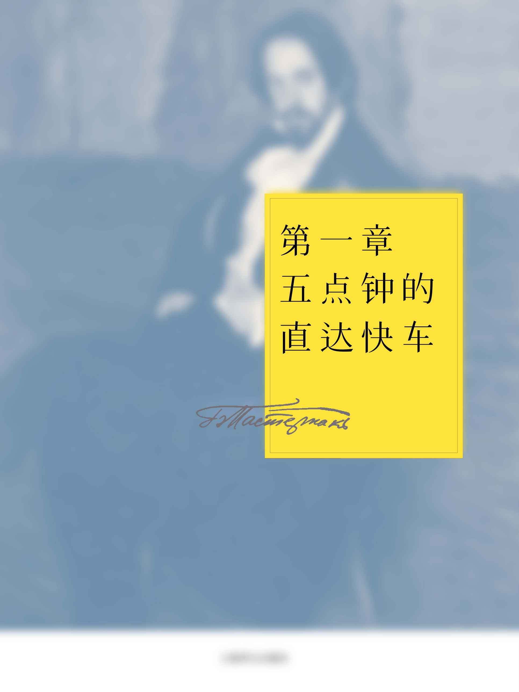

# 第一章 五点钟的直达快车

<h3 id="c001">一</h3>

人们走着走着，一边唱着《安魂曲》。当歌声停息时，送行人的脚步声、马蹄声和清风仿佛依然唱着挽歌，欲罢不能。

路上行人给送殡队伍让开路，数着花圈的数目，一边在胸前画十字。有那好奇的人，钻到送殡队伍中打听：“给谁出殡？”有人回答说：“日瓦戈。”“哦，原来是他。难怪这么排场。”“嗐，不是日瓦戈本人，是他太太。”“反正一样。愿她早升天国。好阔气的葬礼。”

临到了最后的时刻，连这屈指可数的几分钟也将一去不复回。神甫画着十字，将一把土洒在玛丽娅·尼古拉耶夫娜的遗体上，口中念念有词：“主的大地和大地的一切，天地和天地间的一切生灵。”响起了《信徒的灵魂》。接着是一阵忙乱。棺木上了盖，钉牢，开始放入墓穴。四把铁铲急急忙忙朝穴里填土。泥土像雨点似的纷纷落下。转眼堆起一个小冢。一个十来岁的男孩爬上了坟头。

在盛大葬礼完毕之后，人们通常会变得迟钝麻木。只有在这种状态下，大家才可能觉着这孩子站在母亲的坟茔上似乎想说些什么。

男孩抬起头，在坟头上茫然环视四周荒凉的秋野和修道院上的圆顶。长着翘鼻子的脸上，神色异常。脖颈伸得长长的。如果一只小狼崽这样仰起头来，不用说它就要哀嗥了。这时孩子双手掩面，失声恸哭起来。迎面刮来的乌云泼下冷雨，仿佛用湿鞭抽打他的脸和手。坟前来了一个男人，穿着窄袖皱边紧口的黑色丧服，这是死者的兄弟，那哭泣的孩子的舅舅——尼古拉·尼古拉耶维奇·韦杰尼亚平。他原是个神甫，自愿还了俗。他走到男孩跟前，领着他离开了墓地。

<h3 id="c002">二</h3>

他们在修道院里一间单身修士房中过夜，因为舅舅是这里的老熟人，才让借住的。这天正是圣母节
 <a href="06-%E7%AC%AC%E4%B8%80%E7%AB%A0%20%E4%BA%94%E7%82%B9%E9%92%9F%E7%9A%84%E7%9B%B4%E8%BE%BE%E5%BF%AB%E8%BD%A6.md#m1">
[1]
</a>
 的前夕。第二天，男孩将和舅舅一起去南方伏尔加地区的一个省城。舅舅在一家发行地方进步报纸的出版社工作。车票已经买好，行李也已打捆放在屋里。火车站离得很近，寒风拂过，传来不远处机车调头时发出的凄厉的汽笛声。

傍晚，天气骤然变冷。从屋里两扇落地的窗子向外望去，可以看到，败落的菜园一角，菜园四周丛丛刺槐；凭窗还可以看到大路上冻冰的水洼，墓地中白天安葬玛丽娅·尼古拉耶夫娜的那个角落。菜园里除了几畦冻青了的卷心菜外，周围一片荒芜。劲风吹来，叶落枝疏的刺槐，便狂摇乱舞，伏倒在大路上。

深夜，尤拉被窗子的响声惊醒。黑暗的小屋闪烁着一种神奇的、飘忽不定的白光。尤拉只穿着衬衣跑到窗前，把脸紧贴在冰冷的玻璃上。

窗外既看不见道路，也看不见墓地和菜园，只有暴风雪在肆虐，雪花纷纷扬扬，漫天飞旋。也许是暴风雪发现了尤拉；暴风雪意识到自己有无限的威力，洋洋得意地显示自己如何震慑住了孩子，它呼啸着，狂吼着，千方百计想吸引尤拉的注意。白茫茫的风雪巨浪，一层又一层从天空不停地倾泻到地面上，仿佛是一块块白色的裹尸布，笼罩在大地上。此刻世界上唯有暴风雪在大施淫威，没有什么堪与它相匹敌。

尤拉爬下窗台，第一个念头就是穿上衣服，跑到院子里去做点什么。他一会儿担心修道院的白菜被风雪埋住，再也挖不出来了，一会儿又害怕母亲被埋在雪里，无力反抗，会越陷越深，离他越来越远。

结果他又哭了一场。舅舅从梦中惊醒，给他讲基督对人们的保佑，安慰了他一番。然后舅舅打个哈欠，走到窗前沉思起来。他们开始穿衣。天光渐渐发亮。

<h3 id="c003">三</h3>

母亲在世的时候，尤拉并不知道父亲早已遗弃了他们母子俩。父亲浪迹于西伯利亚和国外形形色色的城市，过着花天酒地的生活，并且早把万贯家财挥霍一空。人们总是告诉尤拉说，他父亲有时在彼得堡，有时去参加商品交易会，最常去的是伊尔比特。

后来，一向多病的母亲发现得了肺结核。她开始常去法国南部和意大利北部治疗，尤拉陪她去过两次。他常被托付给别人照料，这些人又常常更换。就在这种动荡和不断的猜测中，尤拉度过了童年。他已经习惯了这类变化；在长期不安定的生活环境里，父亲不在家，对他来说也不足为奇。

他小时候还赶上了日瓦戈家族的好时光，那时他家的姓，常被人们用去给许多极为不同的事物命名。

当时曾有过日瓦戈纺织厂、日瓦戈银行、日瓦戈公寓、系领带和别领带用的日瓦戈佩针，甚至有一种浸糖酒的圆形蛋糕也叫日瓦戈；有一个时期，在莫斯科对马车夫说一声“去日瓦戈家”简直就像说了句“去爪哇国”，车夫就会拉着雪橇把你送到一个遥远的“国度”，你会进入一座宁静的花园。低垂的云杉枝，挂着白霜，乌鸦飞落枝头，霜花簌簌而下。乌鸦的呱呱声传到远处，仿佛是树枝折断的声音。几只纯种猎狗，从林中通道后边的新房子那里，穿过大路跑来。那里已时近傍晚，灯火通明。

然而，转眼间这一切都烟消云散。他们的家业衰败了。

<h3 id="c004">四</h3>

一九〇三年夏季，尤拉和舅舅坐着四轮马车去乡下的杜普良卡庄园，探望教师兼科普作家伊万·伊万诺维奇·沃斯科波伊尼科夫。这庄园是丝绸厂老板科洛格里沃夫的产业，他同时又是热心的艺术赞助人。

那时正值喀山圣母节，收割大忙的日子。他们到时，田里一个人也没有，也许去吃午饭，也许过节去了。太阳热辣辣地晒着没割完的麦地，仿佛是给犯人剃的阴阳头一般。鸟儿在麦地上空旋舞。田野上没有一丝风，麦秆笔直地挺立着，坠着沉甸甸的麦穗；割下的麦子一垛垛高高地摞在路那头很远的地方。久久细望过去，它们仿佛成了一个个走动着的人，正在地平线上测量，一边记录着什么。

尼古拉·尼古拉耶维奇向侧身坐在赶车座上的帕维尔说：“这里的地是谁家的？”帕维尔是出版社的听差和看门人。他坐在那里，弓着背，跷着腿，表示他并非马车夫，驾车不是他的本分。

“这片地是地主老爷的，”帕维尔答道，一边点着烟，“前边那些地，”他点着了烟深吸一口，过了半晌才用鞭梢指着另一边，说道，“那些地是农民自己的。驾！怎么睡着了？”他不时对马吆喝着，眼睛总瞟着马尾和后臀，就像火车司机盯着压力表一样。

然而，这两匹马拉车也和普通的马一样。也就是说，驾辕的那匹很卖力气，另一匹拉边套的马，在不懂行的人看来几乎是不可救药的懒虫。它只知摆出漂亮的架式，伴随着串串铃声，不停地跑着。

尼古拉·尼古拉耶维奇是去给伊万·伊万诺维奇送他的新书校样。这是一本论述土地问题的小册子，出版社迫于书刊检查日益加强的压力，希望作者再作些修改。

“县里的人们太胡闹了，”尼古拉·尼古拉耶维奇说，“在潘科夫乡把一个商人给杀了，地方自治局的育马场也叫人给放火烧了。你对这有什么想法？你们村子里人们说些啥？”

帕维尔的看法竟比要求伊万·伊万诺维奇在土地问题上收敛锋芒的书刊检查官更为严厉。

“村里人说些啥？他们说，把老百姓给惯坏了。不加管束。对我们这些人哪能这么干。一给农民自由，他们就要互相残杀，一点没错。驾，又不走了！”

今天，舅舅和外甥是第二次去杜普良卡庄园。尤拉本以为自己认得这条路。每当田野向两边伸展开去，前后的地边出现细条林带时，尤拉觉得他马上能认出该从哪儿向右拐，接着眼前会闪过科洛格里沃夫的十里庄园全景，以及远处波光粼粼的河流和庄园后的铁路。谁知他竟一次又一次地弄错。田野连着田野，穿插着一片又一片森林。无穷无尽的旷野令人心旷神怡，尤拉情不自禁地思考和幻想起未来的生活。

使尼古拉·尼古拉耶维奇日后成名的作品，那时还一本也没写出来。但他的思想已臻成熟。他不知道成名之时已经为期不远。

他即将跻身当代文学家、教授和革命哲学家的行列中。他和他们思考的问题是同样的，然而除了一些通用的术语之外，同他们没有任何共同点。那些人全都固守着某种教条，满足于词藻和假象。而当过神甫的尼古拉，却熟悉托尔斯泰主义，了解革命，并且不断地深入研究。他渴望有一种鼓舞人心而又实实在在的思想。这种思想应能在自己的发展过程中，给人指出一条非常明确的道路，使世界多少变得美好一些，并且要让孩子和无知识的人都能看得清清楚楚，就像电闪雷鸣一般。他如饥似渴地探求新思想。

尤拉很愿意和舅舅呆在一起。舅舅很像母亲。他和母亲一样自由不羁，对任何陌生事物从不抱偏见，对任何人都怀有一种高尚的平等相待的态度。他也和她一样，遇事一眼就能看穿，善于用头脑中最初想到的方式表达自己的思想。

舅舅带他到杜普良卡来，他十分高兴。这里景色异常优美。美景同样令他想起母亲。她也热爱大自然，常常带着尤拉一起出去玩。此外，尤拉还高兴能在这里见到尼卡·杜多罗夫——一个借宿在沃斯科波伊尼科夫家的中学生。尤拉觉得尼卡大概看不起他，因为尼卡比尤拉大两岁，握手时，尼卡总把手伸得低低的，还垂下脑袋，头发搭在前额，遮住了他半边脸。

<h3 id="c005">五</h3>

“劳动大众赤贫乃问题之关键……”尼古拉·尼古拉耶维奇读着修改过的手稿。

“我觉得改为问题的‘实质’好些，”伊万·伊万诺维奇说，一边就在校样上作了必要的改动。

他们在镶着玻璃的昏暗的阳台上改稿，那里堆放着浇水壶和各种园艺工具。一把破椅的靠背上搭了一件雨衣。阳台角落里放着沾有干泥巴的高筒靴，靴筒歪倒在地上。

“与此同时，死亡率和出生率的统计数字告诉我们……”尼古拉·尼古拉耶维奇念着手稿。

“应该增加‘统计年度’。”伊万·伊万诺维奇说着记了下来。

阳台上有点过堂风，他们在校样上压了几块小花岗石，以免风给吹散了。

校完稿样，尼古拉·尼古拉耶维奇急着要动身回家。

“快来雷阵雨了，我们得走了。”

“这不行，我不放您走。马上就喝茶了。”

“天黑前，我得赶回城里去。”

“说什么也不行。我听都不想听。”

花园里飘来茶炊散发的焦炭味，冲淡了阳台上的烟草和芥菜花的味道。仆人们正把酸乳、浆果和甜点心送到花园里。这时突然又听说帕维尔去河里洗澡了，还把马也牵了去。尼古拉·尼古拉耶维奇只好遵命留下来。

“趁茶点还没备好，咱们先去河岸峭壁那儿，在长椅上坐会儿，”伊万·伊万诺维奇提议说。

作为富翁科洛格里沃夫的朋友，伊万·伊万诺维奇借住在总管厢房中的两间屋子里。这幢带小园子的厢房，位于庄园杂乱偏僻的角落。厢房前入口处有一条半圆形的旧林荫道，现已杂草丛生，不通车马，只有运送建筑工地上的泥土和废料的车经过这儿，往堆垃圾的深沟里倒土和废砖石料。科洛格里沃夫是个思想开明、同情革命的百万富翁。现在他和妻子在国外。庄园里只住着他的女儿娜佳和莉帕，还有一位女教师和几个仆人。

总管房前的小园子和整个庄园是隔开的，中间有一道稠密的阔叶绣球树丛；池塘、草坪以及主人的宅邸都在小园子外边。伊万·伊万诺维奇和尼古拉·尼古拉耶维奇沿着林墙外侧走着。每隔距离相当的几步，树丛里就飞出一小群的麻雀。里面鸟儿多得难以计数。绣球树丛里一片啁啾声，仿佛在伊万·伊万诺维奇和尼古拉·尼古拉耶维奇的前面，沿着林墙有条水管在流水一般。

他们走过花房、花匠的住房和一堆不知派什么用场的碎石子，谈论着科学界和文坛上的新秀。

尼古拉·尼古拉耶维奇说：“有的人很有才华。可现在盛行各种各样的团体、协会。其实任何团体不过是庸材的庇护所而已，不论他信仰索洛维约夫
 <a href="06-%E7%AC%AC%E4%B8%80%E7%AB%A0%20%E4%BA%94%E7%82%B9%E9%92%9F%E7%9A%84%E7%9B%B4%E8%BE%BE%E5%BF%AB%E8%BD%A6.md#m2">
[2]
</a>
 、康德还是马克思。只有独自探索的人才是真正的真理探索者，他能摈斥一切并不真正热爱真理的人。世界上有没有值得我们信仰的东西呢？为数甚少。我认为应该相信灵魂的永生，这也就是对生命的另一种强而有力的称呼。应该坚信灵魂的不朽，虔诚地信仰基督。唉，您又皱眉头了，真是可怜，您对我讲的又是丝毫也没懂。”

“嗯，”伊万·伊万诺维奇哼了一声。他一头浅色卷发，身材细高灵活。蓄着的一小撮胡子，带点讥诮的味道，有点像林肯时代的美国人。他不时地把那撮胡子捏在手里，用嘴去抿须尖。“是啊，我不想说什么。您也清楚，我对这些问题的看法与您完全不同。对了，顺便问一下，请告诉我，他们怎么免了您的教职，让您还俗的？我早想问了。大概，您当时吓坏了吧？是他们把您革出教门，对吗？”

“咱们不要岔开去谈别的。其实……革出教门？不，现在也不兴这个。当时有过不愉快，后来也受到影响。例如，很长时期不许我担任公职，不许进入莫斯科和彼得堡。这些我都无所谓。咱们还是回到正题上来吧。我刚才说了，应该信仰基督。现在我再解释一下。您并不明白，一个人可以是无神论者，不知道是否有上帝，以及上帝存在的目的，不过他应该懂得，人不是生存在自然界，而是生活在历史过程中。现在看来，历史是基督缔造的，福音书是历史的基础。历史又是什么呢？若干世纪以来，人们一代又一代地系统探索死亡之谜和将来如何战胜死亡——这就是历史。为了这个目的，人们发现了数学中的无穷大和电磁波，创作了交响乐。如果没有某种热情，这样的探索是难有进展的。为了创造这种伟绩，需要精神上的武装。而福音书就包含精神所需的武器。它们是，首先，爱你周围的人。这是人们内心精力的最高形式，这充沛的精力要求得到宣泄。其次，作为现代人必不可少的思想包含这两部分：即个人自由和生活即牺牲的观点。人缺乏了这些思想，是不可想象的。您应该知道，这种观点至今仍很新鲜。在这个意义上的历史，古代人是没有的。古代有的只是丑陋的罗马暴君们的疯狂兽性，他们从来不曾想到任何奴役者都是愚蠢的。古代只有青铜纪念像和大理石圆柱，然而它们的不朽是夸张了的、没有生命的。只有基督以后的世世代代才能自由地喘气。只是在基督以后人类才开始了生活，人们不再倒毙在大街的栅栏旁，而是瞑目于历史进程中，在探索如何克服死亡的紧张劳动中，把自己献给了这一课题。嗐，我怎么高谈阔论起来了。这全是对牛弹琴。”

“这是玄学，老兄。医生禁止我谈弄玄学，我的胃口受不了。”

“那就随您啰。不谈了。您真有福气呀，这里景色多美。可您却身在福中不知福。”

阳光照在河面上，银波荡漾，使人目眩。突然，河面上涌起一层层波峰浪谷，一艘满载着马匹、大车、妇女和农夫的渡船，沉重地离开岸边，驶向对面。

“您看看，现在才五点多，”伊万·伊万诺维奇说，“您瞧，那是从塞兹兰开来的直达快车。经过这里是五点过几分。”

远处平原上，从右向左驶过一列十分显眼的黄蓝相间的专车，因距离太远而显得很小。他们意外地发现列车停了下来。火车头上冒着团团蒸气。稍后传来了令人不安的汽笛声。

“奇怪，”伊万·伊万诺维奇说，“出什么事了？列车不该在那片沼泽地停呀。咱们回去喝茶吧。”

<h3 id="c006">六</h3>

尼卡既不在花园里，也不在屋里。尤拉想，大概他躲着他们，因为觉得和他们呆在一起无聊，看来尤拉高攀不上他。舅舅和伊万·伊万诺维奇去阳台工作了，让尤拉在屋外随便玩玩。

这里真是风景如画，美不胜收！时刻都可以听到黄莺三种音调唱出的清脆歌声，当中间断一会儿，仿佛要待柔润的鸣唱全被周围吸收，才唱第二声。闷热的暑气，使花坛上缭绕着的花香无法四散开去。此情此景使尤拉想起他陪着母亲去过的几处国外疗养地。尤拉不停地东张西望。在那里的草地上空，在鸟儿的啼啭、蜜蜂的嗡嗡声中，尤拉恍惚听到母亲的声音。她在寻找他，呼唤他。尤拉因为幻觉感到一阵阵的惊颤。

他来到深沟旁，慢慢往下走去，穿过坡上稀疏干净的树林，来到了沟底的赤杨丛中。

沟底阴暗潮湿，铺满枯枝败叶和烂果。花儿很少，多节的木贼草梗，很像雕有埃及图案的手杖，和他那本《圣经》插图中的图案一样。

尤拉心里越来越感悲苦，忍不住想哭。他跪倒在地，泪珠滚滚而下。

“上帝的天使啊，我神圣的护法神啊，”尤拉祈祷着，“保佑我永不迷途。告诉我妈妈，我在这里很好，请她不要惦记。如果死后真还有生命，上帝啊，送妈妈进天国吧，愿她与光辉如日月的圣徒同在。妈妈是个非常好的人，她不会有什么罪孽的。上帝，你发发慈悲吧，别让她受折磨。我亲爱的妈妈啊！”他在极度的凄楚中仰天呼唤母亲，像在呼唤上帝新收容的侍者。而后他突然支持不住，晕倒在地。

他晕倒一会儿又苏醒了过来，听见舅舅在上面叫他。他应了一声，便从地上爬起来。蓦地，他想到刚才没有为久无音讯的父亲祈祷，妈妈过去常嘱咐他要为父亲祈祷。

不过，经过那阵昏厥以后，他觉得心头十分松快。他想继续保持这种轻松的心境，怕它消失。他想不妨下一次再替父亲祈祷，没有什么不好。

“让他耐心等一等吧，”他迷迷糊糊闪过了这样的念头。尤拉已经完全不记得父亲了。

<h3 id="c007">七</h3>

在火车二等包房里，十一岁的二年级中学生米沙·戈尔东正与父亲从奥伦堡一起前往莫斯科。米沙沉思的脸上有一对乌黑的大眼睛。父亲格里戈里·戈尔东是奥伦堡的律师。这次调到莫斯科任新职，米沙也转到莫斯科的中学学习。母亲和姐妹们在他们之前已经抵达莫斯科，正忙着安顿新居。

米沙和父亲乘上车已经过了两天多了。

车外，被阳光晒得灰白的俄罗斯，田野和草原，城镇和乡村，在尘土飞扬的灼热空气里一一掠过。络绎不绝的马车在路上移动着，沉重地拐向铁路道口。从奔驰着的火车上看去，马车好像停在那里一动不动，马儿犹如在原地踏步。

火车一到大站，旅客们蜂拥奔向车站的小吃部；夕阳从车站公园的树后斜照过来，照到旅客匆匆移动的脚和车厢下的轮盘。

世上的一切活动，单独看都是有目的的，明智的，然而联系起来看，就被整个生活洪流卷到一起，变得不很清晰，不很明智了。人们被各自的操心事所驱使，劳动着，忙碌着。然而，如果不以一种最高、最基本的超然感为主调，来调整人们各自的动机，那么一切动机都无法实施。要有这种超然感，就应让人感觉到人类生命是连续的，相信人的存在是由一个行程转到另一个行程，并且有一种幸福感，因为这一切不仅发生在埋葬死者的大地上，而且发生在别的地方。那地方有些人称为天国，有些人称之为历史，或者还有什么别的称呼。

米沙·戈尔东却是不在此规律内的一个痛苦伤心的例外。他的生命动因是一种焦虑感。他从未因无忧无虑而感到轻松和变得高尚。他意识到自己身上遗传下来的这种性格，并且忧心忡忡地注视着这种性格的流露，为此他不胜懊恼，感到自卑。

他从记事开始就经常困惑不解，为什么有的人四肢五官、语言和生活习惯与别人一样，却还是与众不同？为什么只有少数人对他有好感，大多数人却不喜欢他？他无法理解：如果你比别人差，无论怎样努力也无法改善自己的境遇。做个犹太人，这意味着什么呢？他存在的意义何在呢？这是一种无可奈何的挑战，它只会带来痛苦。那么，做了犹太人，如何补偿又如何解释呢？

米沙·戈尔东去向父亲求教。父亲说，他提问题的出发点是荒唐的，这种想法也不对。但父亲没有讲出任何深刻的道理能引起米沙深思，能使他在无可更改的事实面前心悦诚服。除父母外，米沙对大人们都渐渐产生了轻蔑和反感，因为是他们把问题弄乱的，他们自己却又无力解决。他深信自己长大成人以后，一定会解决所有的问题。

就说眼前发生的事吧，谁敢说父亲做得不对呢，谁敢说不该刹车呢？车上一个疯子突然冲到平台上要跳车，父亲追过去。疯子推开格里戈里·戈尔东，拽开车门，从全速行驶的火车上一头扎了下去，就像从游泳池踏板上跳入水中潜泳一样。

格里戈里·戈尔东拉了紧急制动阀。这事是他干的，而不是别人，所以人们就认为火车无故长时间停车是他的过错。

谁也闹不清火车迟迟不开的原因。有人说，由于紧急刹车把蒸气制动机弄坏了，有人说火车正停在一个陡坡上，火车头没有足够冲劲把列车带动起来。还有人认为，那死者是个大人物，所以和他同行的代理人要求从附近的科洛格里沃夫火车站请来见证人做现场记录。所以那位副司机爬上了电线杆打电话。检道车可能已经开出来了。

尽管洒了香水，隐隐约约还可以闻到厕所的臭气；油腻纸包里的烧鸡，也在车厢里散发出变质的气味。几位从彼得堡来的、头发花白的太太们，还照样在脸上扑粉，用手帕擦手掌，声音低哑地交谈着。火车的煤烟和浓重的脂粉，把她们一个个都打扮成了黑发的吉卜赛女人。她们从戈尔东的包房门口走过时，用披肩裹紧肩头；狭窄的甬道使她们有机会忸怩作态一番。米沙觉得她们在不满地嘟哝，或者说从她们咬嘴唇看得出是在不以为然：“嗐，你们倒说说看，太感情用事嘛！我们可不同别人！我们是知识分子！我们可受不了！”

自杀者的尸体躺在铁道路基旁的草地上。已经凝固的一道黑色的血迹，骇人地从死者的额头和眼睛上流过，仿佛把这脸一笔勾销了。这血又好像不是他身上流出来的，而是贴上去的橡皮膏、溅上去的一道泥浆，或是附着的一片湿漉漉的桦树叶子。

围观尸体的人群，走散了一些，又来了一些，有的出于好奇，有的出于同情。有一个身体敦实、满脸傲气的人，俯下身观察着。这是死者同一包房的旅伴，一个律师，他像只血统高贵的动物，穿着汗湿的衬衫。他蹙着眉，木然地站在那里。大概热得难受，他不停地用软帽扇风。不管人们怎么问，他只是耸耸肩，甚至头也不回，爱答不理地哼一句：“酒精中毒，这还不明白？这是酒鬼常有的事。”

一个身材瘦削、穿件毛线裙衣、披着钩花三角巾的妇女，有两三次走到尸体近前观看。她是寡妇季韦尔辛娜老太太，两个儿子都是火车司机。她和两个媳妇凭职工免费票坐在三等车上。那两个头巾扎得低低的安静斯文的妇女，不声不响地跟在她后面，仿佛是两个跟随修道院长的修女。她们一行三人，使人们肃然起敬，大家给她们让出道来。

季韦尔辛娜的丈夫是在一次火车事故中被活活烧死的。现在她站在离尸体几步远的地方，透过人群看到了死者，不停地唉声叹气，好像在比较两次惨祸的情境。她仿佛在说：“人人都命有定数啊，这都是上帝的安排。瞧，他因为太有钱发了疯，竟干出这样的事。”

旅客们都到尸体跟前看了一眼，然后就回车厢去了，怕行李叫人偷了。

他们从车厢跳到路基上，活动活动手脚，采朵野花，小跑几步。他们似乎觉得，只是因为在这里中途停车，才出现了这块土地；如果不发生刚才的惨祸，这些土岗草泽、宽阔的河流、对岸高坡上教堂的漂亮的房子都是不会有的。

甚至太阳也是属于这块土地的。西沉的斜阳怯生生地照着铁路两旁的情景，就像一头母牛从附近的牛群里来到路基旁，朝人们张望着。

米沙被眼前发生的事惊呆了，起初他由于害怕和对死者的同情流下了眼泪。在漫长的旅途中，这位自杀者几次来他们包房，和米沙父亲坐在一起，一谈就是几个小时。他说，在他们纯洁高尚的宁静气氛中，他的心得到了宽慰，他们理解他、体贴他。他询问了格里戈里·戈尔东有关证券、馈赠、破产和伪造之类的法律上的种种细节和诉讼方面的问题。他听完戈尔东的详细解释后，惊奇地说：“啊，原来是这样！您所说的法律比较宽容，但是我的律师的说法就不一样，他对这些问题的看法要悲观得多。”

每当这位神经质的来客逐渐平静下来，与他同行的那位律师，就从头等车厢里出来找他，拽着他去餐车喝香槟酒。

他就是现在站在尸体旁那个对一切都无动于衷的律师。此人个头敦实，表情轻慢无礼，胡子刮得干干净净，穿戴讲究。人们不由得会产生一种感觉：他的委托人经常性的激动亢奋，对他可能有利。父亲说，死者是个大名鼎鼎的富翁，心地善良的舍拉普特教徒，但已经近乎神经失常。他毫不避讳米沙，当着他面谈到和米沙同年的儿子和已经去世的妻子。后来又谈到他第二个也被他抛弃了的家庭。说到这里，他突然想起了什么事，吓得脸色煞白，语无伦次。

他对米沙表现出一种难以解释的疼爱，也许反映了他对另一个人的感情。他不时送礼物给米沙。为此每到大站，他总要去头等候车室一趟，因为那里有书卖，还有各种玩具和地方名胜纪念品。

他不停地喝酒，并且诉苦说，已经两个多月没睡觉了，每当酒醒过来，哪怕时间不长，便觉得极其痛苦，这是一个正常人难以想象的痛苦。

寻短见的前一分钟，他跑进他们的包房，抓住格里戈里·戈尔东的手，想说点什么却说不出来，然后就冲向过道平台，纵身跳了下去。

米沙正仔细端详装在木匣里的一套乌拉尔矿石标本，这是那死者送给他的最后一件礼物。突然，周围骚动起来。另一条铁路线上驶来一辆检道车。上面跳下来一个制帽上饰有帽徽的侦查员，还有医生和两名警察。他们冷漠地打着官腔，提出一连串问题，一边做记录。列车员和警察笨手笨脚地拖着尸体，磕磕绊绊地上了砂砾路基。有个女人号啕大哭起来。乘务人员请旅客回到车上去，汽笛一响，火车又开动了。

<h3 id="c008">八</h3>

“教堂那个讨厌的神甫又来了！”尼卡恼火极了，在屋子里急得乱转。客人们的声音越来越近了。他出不去，再无退路。房间里放着两张床，一张是伊万·伊万诺维奇的，一张是他的。尼卡来不及多想，就钻到自己床下。

他听见他们到别的房间找他，喊他，见他不在都感到奇怪。后来，他们进了卧室。

“瞧，没办法啦，”尼古拉·尼古拉耶维奇说，“尤拉，你自己出去走走吧，也许过会儿你的朋友就会来的，那时你们再一起玩吧。”尼古拉·尼古拉耶维奇和伊万·伊万诺维奇先谈了一会儿彼得堡和莫斯科大学闹学潮的事，尼卡也只好在他那难堪的、不体面的防空洞里呆了二十来分钟。好不容易他们才去了阳台。尼卡轻轻推开窗户，跳到外面的花园里跑了。

尼卡今天精神不佳，前一天夜里没睡着觉。

他已经过了十三岁，不愿再当孩子了。一夜没睡，他一大清早就从屋里出来。太阳冉冉升起，花园地面的露水还没有干，处处摇曳着歪歪斜斜的修长树影。影子不是黑色的，倒像湿毡那样透着深灰色。清晨醉人的清香，仿佛正是从湿地上的树影里散发出来的。影子缝里映出的长条光带，仿佛女孩纤细的手指。

蓦地，离他几步远的草丛里，有一股水银像草叶上的露珠闪烁着滑了过去。这股银色的水柱，一直往前蹿动，没有渗进泥土里。突然，它一个转弯消失不见了。原来这是一条方花蛇。尼卡不禁打了个寒战。

他是个奇怪的孩子。每当感到兴奋，他就大声自言自语。他也学着母亲，喜欢谈些高深的问题，发表点奇谈怪论。

“世界是多么美好！”他想道，“可是为什么人们生活在世上总是痛苦呢？上帝当然是有的。如果上帝存在的话，那这上帝就是我。瞧，我可以对它下命令。”说罢他瞧了瞧微微颤动着的白杨树，树上闪着水亮的叶子，好像是剪碎的薄铁片。“现在我要对白杨树下一道命令，”他使出全身力气，不是简单低语一声，而是以整个身心迸发出一种强烈的愿望，“停住！”白杨树立即听话地纹丝不动了。尼卡高兴得大笑起来，拔腿奔向小河去洗澡。

他父亲杰缅季·杜多罗夫是个恐怖主义分子，还在服苦役，原判绞刑，后蒙皇上特赦，改为苦役。他母亲是格鲁吉亚的埃里斯托夫家族的一位乖张任性的公爵小姐，而且也还年轻貌美。她总是为一些事情所着迷，例如暴动、暴乱分子、激进的理论、著名演员、贫穷的失意者。

她疼爱尼卡，把他的正名英诺肯季变着法儿叫，想出一串别人想不出的稀奇古怪的爱称，像什么“英诺契克”，或叫“诺钦卡”；母亲常带他到梯弗里斯娘家去炫耀。那里，在他们所住的庭院中有一株枝繁叶茂的大树，给他留下了深刻的印象。这是一株粗大的热带树。宽阔的叶子犹如大象的耳朵，把院子上空南方炎热的阳光都挡住了。尼卡总感觉这棵树不是植物，而是一只动物。

尼卡用父亲可怕的姓氏是危险的。伊万·伊万诺维奇征得尼娜·加拉克季奥诺夫娜的同意，准备上书沙皇陛下，让尼卡改用母亲娘家的姓。

尼卡躲在床底下，对天下一切忿忿不平的时候，他也想到要他改姓这件事：伊万·伊万诺维奇凭什么干涉人家的事，他算老几！他尼卡要狠狠教训他一番。

还有那个娜佳！难道她凭着十五岁了，就可以谁也不放在眼里吗？她对他说起话来，就好像是对一个小孩子！他也要给她点厉害看！“我讨厌她，”他不止一次对自己说，“我要杀了她！我让她跟我去划船，然后淹死她！”

妈妈也不怎么样。她当然是骗了他和伊万·伊万诺维奇。临走时，她说她去高加索，其实到了下一站她就转车北上去彼得堡。现在她倒心安理得地在那里同大学生一起和警察干仗，而他却只能在这穷乡僻壤给活活地闷死。他可饶不过他们。他要把娜佳淹死，自己从学校逃跑，去西伯利亚的父亲那儿策划一次暴动。

池塘四周长满了睡莲。小船摇进睡莲丛里，发出干爽的簌簌声。不长睡莲的地方，可以看到一泓塘水，就像西瓜切成三角瓣渗出来的瓜汁。

尼卡和娜佳摘起了睡莲。两人同时抓住一株睡莲，莲茎柔韧难折。一使劲他们两个人撞到了一起，脑袋一碰，船就像用篙撑了一下，猛地滑到了岸边。边上的睡莲被小舟碰得东倒西歪。朵朵白莲花，带着黄中透红的花芯沉进水里，挂上滴滴答答的水珠又从水里钻了出来。

娜佳和尼卡不歇手地采着睡莲。小船倾斜着，他们两人几乎是趴在船帮上采花。

“我念书念腻了，”尼卡说，“应该独立生活了，我要去挣钱，到社会上去。”

“可我正好要问你二次方程式呢。我代数学得太差，糟得差点要补考。”

尼卡觉得她话里有刺。不用说，她是要他有自知之明，提醒他人还小。什么二次方程式呀，他还没有接触过代数呢！

他的自尊心受到伤害，但他不露声色，故意装得很平静，问她说：

“等你长大了，准备嫁给谁？”

他问时心里明白，自己问得多么愚蠢。

“噢，这还太早，我大概谁也不嫁，我现在还没想这事。”

“你可别胡思乱想，以为我对这有兴趣。”

“那你为什么要问？”

“你真笨！”

他们争吵起来，尼卡心头又泛起对女性的厌恶。他吓唬娜佳说，如果她再胡说八道，他要淹死她。娜佳说：“你敢！”他拦腰抱住她。两个人就扭打起来，小船失去平衡，两人一起掉进水里。

他们俩都会游泳，可是莲茎缠着他们的手脚，他们却又够不着底。最后，两人踩着厚厚的淤泥，总算爬上了岸。水从他们鞋子和口袋里不停地往外流。尼卡尤其觉得疲乏。

如果这件事发生在不久以前，即使今年春天吧，他们从河里上岸后，湿淋淋地坐在那里，非吵吵闹闹不可，不是相互骂架，就是哈哈大笑。

可是现在他们默不作声，气喘吁吁地坐着，为刚才荒唐的举动感到沮丧。娜佳十分恼怒，气得一言不发，尼卡浑身酸痛，好像吃了人家的棍子，被打断了肋骨。

最后，娜佳像个大人似的心平气和地说道：“你是个疯子！”他也同样用大人似的口气说：“请原谅。”

他们上岸回家了，就像两只盛着水的木桶，一路滴滴答答地淌着水。他们回家要经过那条多蛇的灰土山坡，早上，尼卡就在离它不远的地方看见一条蛇。尼卡想起了夜里那种神奇的亢奋，想起了黎明时分，也想起了早上自己显示的神力，他居然能对大自然发号施令。“现在我该对大自然下道什么命令呢？”他想道。现在他最大的希望是什么呢？他觉得他最希望的是，有朝一日他能和娜佳再掉进池塘里去。他此刻多么想知道，这事将来是否还会发生。

 <a href="06-%E7%AC%AC%E4%B8%80%E7%AB%A0%20%E4%BA%94%E7%82%B9%E9%92%9F%E7%9A%84%E7%9B%B4%E8%BE%BE%E5%BF%AB%E8%BD%A6.md#w1">[1]</a>
 圣母节，东正教的节日，在俄历10月1日。

 <a href="06-%E7%AC%AC%E4%B8%80%E7%AB%A0%20%E4%BA%94%E7%82%B9%E9%92%9F%E7%9A%84%E7%9B%B4%E8%BE%BE%E5%BF%AB%E8%BD%A6.md#w2">[2]</a>
 索洛维约夫（1846—1879），俄国民粹派革命家，1879年4月刺杀沙皇亚历山大二世未遂，被处绞型。

