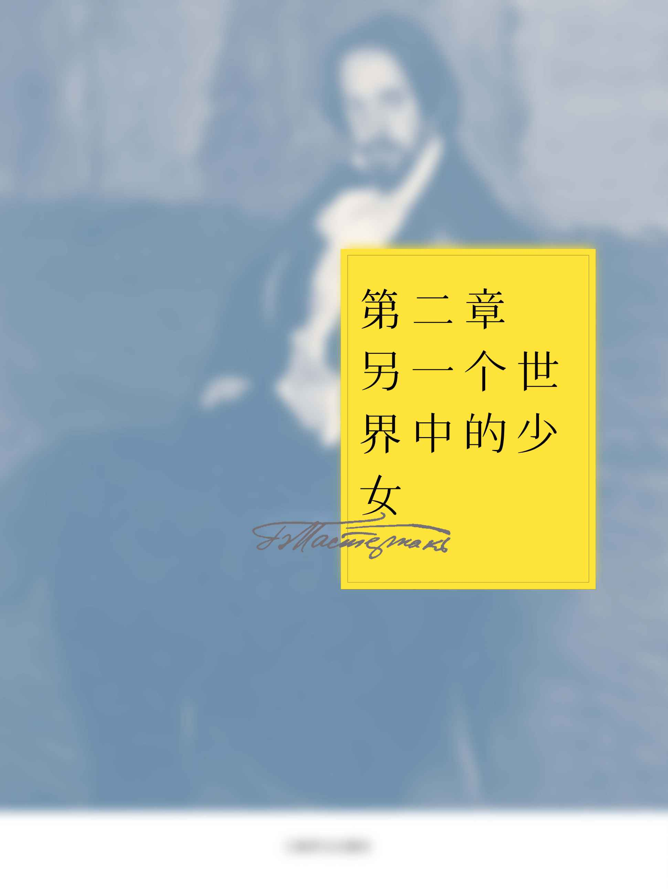

# 第二章 另一个世界中的少女

<h3 id="c009">一</h3>

俄日战争还没结束，另一些事变突然压过了战争。革命浪潮席卷俄罗斯大地，一浪高过一浪，越来越猛烈。

这时，一位比利时工程师的遗孀阿玛利娅·卡尔洛夫娜·吉莎尔，带着两个孩子从乌拉尔来到了莫斯科。她是一个完全俄罗斯化了的法国女人。儿子叫罗佳，女儿叫拉拉。她把儿子送进军官武备学校，把女儿安排到女子中学。拉拉正巧和娜佳·科洛格里沃娃同校同班。

吉莎尔太太的丈夫留给她一笔有价证券。以前证券行情不断地上涨，如今却一天天下跌。为了防止坐吃山空，也免得自己闲住无聊，吉莎尔太太在凯旋门附近，从女裁缝列维茨卡娅的后代手里，买下了一个不大的缝纫店。店铺仍沿用老牌子，原来那些主顾仍照应着，店里的设计师和学徒女工，也都一并留用。

吉莎尔太太是采纳科马罗夫斯基律师的意见才买下这个缝纫店的。他是她丈夫的朋友，自己的靠山。科马罗夫斯基是个头脑冷静的实业家，对俄国工商界的情况了如指掌。她这次从乌拉尔到莫斯科来，也是事先和他商量好的。他到车站接了他们，为他们租好房间，驱车经过莫斯科市区把他们送到军械胡同“黑山旅店”带家具的房间。是他劝吉莎尔太太把罗佳送进武备学校，把拉拉送到他推荐的一所女子中学。他心不在焉地和罗佳随便开玩笑，对拉拉却盯着看，弄得她羞红了脸。

<h3 id="c010">二</h3>

他们在“黑山旅店”住了一个月光景，然后又搬迁到缝纫店近旁的一套不大的三居室寓所。

这一带是莫斯科最糟糕的地方，到处都是马车夫聚集的下流地方，整条街都是妓院、赌场、贼窝和堕落场所。

罗佳和拉拉对房间里的龌龊、臭虫和破旧家具并不太在意。父亲去世后，母亲一直战战兢兢地过着穷日子。孩子们听惯了母亲的诉苦和哭穷。他们自知自己并不是街头没有教养的孩子，但是内心深处对有钱人怀着一种怯懦心理，就像孤儿院的孩子。他们的母亲是这种怯懦自卑心理的活生生的榜样。阿玛利娅·吉莎尔是个三十五岁左右、体态丰腴的金发妇人。她不是犯心脏病，就是弄出一些蠢事来。她胆小如鼠，特别害怕男人。因为胆小又没有主意，她常常从一个男人的怀抱投入另一个男人的怀抱。

在“黑山旅店”，他们住在二十三号房间。二十四号房间自从旅店开业以来，一直住着一个叫特什克维奇的大提琴手，他是个老好人，秃头上戴着假发，脸上总是汗津津的样子。他想劝说别人时，总像祈祷似的双手合十。在交际场合或是音乐会上演奏时，他总是向后仰头，双目充满灵感地朝上望着。他极少在家，整天呆在大剧院或音乐学院。这两家邻居有时互相照应照应，也就熟悉、亲密起来。

科马罗夫斯基来访的时候，孩子们在一旁，阿玛利娅·吉莎尔觉得很不方便。特什克维奇出门，就把自己房门的钥匙留给她，让她在那儿接待自己的朋友。不久以后，吉莎尔对邻人甘于自我牺牲已经习以为常，甚至好几次哭着去敲他的门，要求保护，免得遭到那位庇护人的欺侮。

<h3 id="c011">三</h3>

缝纫店是幢平房，离特韦尔街口不远。布列斯特铁路也就在附近。旁边是铁路职工的宿舍、机车车库和仓库。

有一个聪明伶俐的姑娘奥利娅·杰明娜也住在职工宿舍里，她是莫斯科货运站一名职工的侄女。

她是个能干的学徒工。缝纫铺以前的老板娘就很赏识她，现在的新店主也对她颇有好感，奥利娅·杰明娜很喜欢拉拉。

店里的一切都和原店主列维茨卡娅在时一模一样。疲惫的女工在机台上飞快地挪动双手，脚踩着踏板，缝纫机发狂般地飞旋。有的女工坐在桌旁，静静地缝着，手指捏着针，一次次把线拉出很远。布头布屑扔得满地都是。在车间里说话，必须提高嗓门，否则就压不过机器的响声和窗拱下鸟笼里金丝雀婉转的歌唱。金丝雀取名基里尔·莫杰斯托维奇，至于这名字的秘密，已经由原先店主带进坟墓里去了。

在接待室里，定做衣服的太太们打扮得花枝招展，围在堆满杂志的桌旁。她们站的站，坐的坐；有的倚着什么半站半坐，模仿画上的姿态；大家研究时装式样，商量着衣服的款式。在另一张桌后的经理座位上，坐着阿玛利娅·吉莎尔的助手，高级裁剪师法因娜·费季索娃。她瘦骨嶙峋，肌肉松弛的凹陷的双颊上，长着一个个肉疣。

她用焦黄的牙齿咬着骨制烟嘴，眯着一只发黄的眼睛抽着烟，鼻孔和嘴巴都喷出一股股黄烟，同时一只手还不停地在本子里记下尺寸、单据号码以及挤在店堂里的顾客们的地址和要求。

阿玛利娅·吉莎尔在缝纫铺里是个新手，也没有经验。她觉得自己还算不上名副其实的女店主。但店里的人都很老实，费季索娃也是可以信赖的。可是时局动荡不安，阿玛利娅·吉莎尔对将来的情况不敢多想，总觉得前途渺茫，干什么事总不很顺手。

科马罗夫斯基常来店里看看。他穿过店堂到吉莎尔太太家里时，顺便总要吓一吓那些试穿新衣的摩登女郎。她们一见他来，赶紧躲到屏风后面去，在那儿嬉笑着，回击他放肆的玩笑。女裁缝们则不满地讪笑他，在他背后悄悄说：“大人亲临啦！”“她的那个来啦。”“阿玛利娅的情郎。”“水牛。”“色鬼。”

大家最讨厌的是他的那条叭儿狗杰克。他有时就用皮带拴着它带来店里。这条狗直往前冲，扯得他走路跌跌撞撞。他两手前伸，攥住绳子，跟着狗朝前跑，倒像是个给人牵着的到处乱撞的盲人。

一年春天，杰克咬了拉拉的脚，还撕破了她的长筒袜。

“我要把它弄死，这条恶狗。”奥利娅·杰明娜孩子气地恨恨地对拉拉耳语说。

“是啊，这条狗真可恶极了。可是，傻姑娘，你有什么办法呢？”

“轻些，别嚷嚷，我来教你。复活节时不是有石头做的圆蛋吗？你妈妈五屉柜上就有……”

“嗯，有，有大理石的，有玻璃的。”

“对了，就是那个。你低下头，我附耳说。把那东西拿来，在猪油里蘸一蘸，外面就粘上层猪油。那癞皮狗，把它们全部吞下肚去，那条笨狗，恶鬼，就完蛋了！来个四脚朝天！它就没命了！”

拉拉笑了，心中不免暗暗羡慕：这姑娘虽然穷，可是自食其力。老百姓的孩子懂事早。可你看，她还那么天真，那么孩子气呢。什么鸡蛋呀，杰克呀……真亏她想得出来。拉拉又暗自思忖：为什么我摊上这样的命呀？什么都明白，对什么都放不下心来！

<h3 id="c012">四</h3>

“事实上妈妈是他的……怎么说呢……事实上他又是妈妈的……这字眼很难听，我不想说。既然这样，他为什么要用这样的眼神打量我呢？我可是她的女儿呀。”

拉拉十六岁刚过，但已完全发育成熟了，看上去能有十八岁，甚至更大一些。她聪慧，性格随和，长得水灵俊俏。

她和罗佳都明白，生活中一切，都要靠自己去奋斗。他们和游手好闲、家境富有的人截然不同。没有时间早早琢磨如何去钻营，也没有时间空想实际上与他们无缘的东西。非分之想才是肮脏的。拉拉是世界上最纯洁的人。

姐弟俩懂得他们一家能有今日很不容易，他们知道要想有出头之日，需要给人良好的印象。拉拉学习好——不是出于抽象的求知欲，而是因为要想免交学费，必须成为优秀生，为此必须努力学习。拉拉不仅勤奋好学，而且洗碗刷碟也手脚麻利，还在店里帮忙，替妈妈出去办事。她举止文雅娴静。她身上的一切：轻盈迅速的动作、身材、声音，灰眼睛和浅色秀发，都非常和谐、雅致。

这是七月中旬的一个星期天。每逢假日早上可以睡睡懒觉。拉拉两手枕在头下，仰卧在床上。

缝纫店里静得出奇。临街的窗子开着。拉拉听见远处一辆四轮马车从鹅卵石马路上了有轨马车的轨道，难听的辘辘声变成了车轮畅快的滑动声。拉拉想道：“我应该再睡一会儿。”城市的喧嚣就像摇篮曲一般催她入眠。

此时拉拉躺在床上迷迷糊糊，她感觉到了自己的个头，自己的卧姿，这感觉来自凸出的左肩，来自右脚的拇指。这是她的肩和她的脚，其余全是她本来熟悉的，她的心地、品格；它们深藏在她俊美的身材里，热切地向往着未来。

“应该再睡着一会才好，”拉拉想着。与此同时，脑子里却浮现出朝南的马车店此时的情景。马车行里打扫得干干净净的地板上，停着一辆辆准备出售的大马车，装着多棱的玻璃车灯，配着熊皮坐垫，多么豪华！拉拉继续想象：再往前走，在兹纳缅兵营里，龙骑兵正在操演。威风凛凛、昂首阔步的高头大马在跑圈。骑手们跑步跃上马背，时而慢步走，时而小跑，时而奔驰。兵营围墙外，一群孩子和他们的保姆、乳娘们张大着嘴惊讶地看着骑兵操练。

拉拉想：再往前就是彼得罗夫大街。“拉拉，你怎么啦！你想到哪去了啊！我不过是要让你看看我住的房子。何况我家离这儿不远。”

那天是奥莉加的命名日。她是科马罗夫斯基在马车行里的朋友的小女儿。为了庆祝奥莉加过命名日，大人们要快活地聚会一番，跳跳舞，喝点香槟。他邀请了妈妈，但她不舒服去不了。妈妈说：“你把拉拉带去吧。你不是经常对我说，‘阿玛利娅，要照顾好拉拉。’好啦，现在由你来照顾她吧。”好个照顾啊！哈—哈—哈！

华尔兹舞简直叫人神魂颠倒，旋转，不停地旋转，什么也不需要想。舞曲声里，不知不觉过去了许多时光，就像小说里描写的生活一样。可乐声一停，你就会感到似乎出了什么岔子，好像被人当头浇了一桶冷水，或是没穿衣服让人撞见了。此外，你允许别人同你如此亲热，是因为你想显示自己已经是个大姑娘了。

以前她从来没想到他舞跳得这么好。他的手多么灵巧，非常自信地搂着她的腰！但是以后她决不允许别人这么吻自己。她简直难以想象，当别人嘴唇久久地贴在她唇上时，竟然这样厚颜无耻。

不能再干这种蠢事了。永远不干了。不能再装作天真无邪，不能再摆出可怜又可爱的样子，不能再羞答答地垂下眼帘。这样总有一天会惹出祸来。那条可怕的界线，已近在咫尺。跨前一步，就会坠入深渊。再不要想舞会了，那是万恶之源，要断然拒绝。可以推说没学过跳舞，或是说拐了脚脖子。

<h3 id="c013">五</h3>

秋天，莫斯科铁路枢纽各条线路上，掀起了罢工风潮。莫斯科喀山线开始罢工。莫斯科布列斯特线也要起而响应，罢工决定已经作出，但线路罢工委员会在宣布罢工的日期上尚未取得一致意见。铁路职工都知道要罢工，现在只需要表面上有个导火线，好让罢工自发地开始。

这是十月初的一个阴冷的早晨，也是铁路上发薪的日子。但会计科好半天也不见动静。后来，一个小男孩到办事处来了，手里拿着工资表、发薪通知单和一大叠为扣薪水收缴来的劳动册。开始发薪了。列车员、扳道工、钳工和他们的徒弟、车场清洁女工，都来领工资。铁路枢纽站上，一边是车站、厂房、仓库和铁轨，另一边是一排排办公木房，中间隔着一大长条空地。人们顺着这条空地纷纷来到办事处领薪水。

城里已是初冬景象，空气中飘着踏烂的槭叶味和湿雪的潮湿味，还可以闻到火车头的煤烟和车站地下餐室刚烤好的热乎乎的燕麦面包的香气。铁路工人摇动展开或卷起的信号旗，指挥着列车编组。一趟趟列车在小旗指挥下开进开出。值班员嘟嘟地吹出种种不同哨音，挂钩员吹着他的小哨子，火车头发出低沉的笛鸣。各种声音高高低低，在车站里响成一片。烟柱仿佛没有尽头的梯子插向天空。火已烧旺的机车马上准备开车了，蒸气的热雾裹向寒冷的冬云。

铁路段长、交通工程师富夫雷金和车站区段筑路工长帕维尔·费拉蓬托维奇·安季波夫，在路基旁来回踱步。安季波夫一直埋怨维修部门卸给他更新路轨的材料不合规格。维修部门都听腻了。安季波夫认为钢的韧度不够，铁轨经受不了弯度测试。安季波夫估计，在严寒下铁轨会断裂。但是铁路局对安季波夫的意见置若罔闻，大概有人在这上面捞到了好处。

富夫雷金穿着镶有铁路制服饰边的高级皮毛大衣，敞着怀，里面是一件新哔叽西服。他小心翼翼地在路基上迈着步子，一边欣赏西服前襟的线条、笔挺的裤线和脚上那双款式高雅的皮鞋。

安季波夫说的话，他左耳进，右耳出。富夫雷金像有什么心事，过不一会儿就掏出怀表来看看，好像急着要去哪儿。

“是这样，是这样，老弟，”他不耐烦地打断了安季波夫，“可是你说的情况只有在主要路段，或是在运转频繁的直达区间才可能发生。你别忘了，你那是什么区段呀？不过是个备用线，再不就是终端线，满地长着牛蒡草和荨麻，那里顶多搞空车编组或是调车罢了。有什么可不满的！你简直疯了！那儿连这种铁轨都没必要，铺些木轨都可以对付。”

富夫雷金看了一下怀表，咔嗒一声合上表盖，就专注地眺望前面那条连接铁道的公路。远远地，在公路拐弯处驶来一辆四轮马车。这是富夫雷金的私人马车。他太太接他来了。马车夫勒紧缰绳，马紧挨路基停下来。可是马见了铁轨害怕，马车夫用女人尖嗓吆喝着，好像保姆呵斥不听话的孩子。马车一侧坐着个漂亮女人，漫不经心地靠在软垫上。

“行了，老弟，咱们以后再谈吧，”段长说罢，挥了一下手，意思是：顾不上你说的那些道理了，有比这更重要的呢。他们夫妇俩乘车走了。

<h3 id="c014">六</h3>

约莫三四小时以后，天已经擦黑，大路旁的地里冷不丁冒出两个人影，好像是从地里钻出来的。他们不时回头张望，很快就走远了。这是帕维尔·安季波夫和基普里扬·季韦尔辛。

“咱们走快些，”季韦尔辛说，我倒不担心密探跟踪我们，只怕地窖里那帮人就要扯完皮，追上我们。我真见不得那帮人。要是大家都这样扯皮，何必白费劲呢。何必设立委员会呢。又要玩火，又想保险！你也够意思，居然和尼古拉耶夫斯卡娅支持这种举棋不定的人。”

“我老婆达里娅得了斑疹伤寒。我要送她去医院。在送她去医院之前，我什么事也干不了。”

“听说今天发薪，我现在要去一趟办事处。今天要不是发薪，上帝在上，我才不理你们这一套呢。我要一分钟也不耽搁，用强制手段结束这场争吵。”

“请问你有什么办法？”

“很简单。我到锅炉房去拉响汽笛，一切全成定局了！”

他们俩告别后就分手了。

季韦尔辛穿过铁道往城里去。迎面走来一个个从办事处领了薪水的人，人数很多，他估计车站的人差不多都领了薪水。

天渐渐黑了。好些闲散工人，聚集在办事处外面路灯下的平台上。平台进口处，停着富夫雷金那辆四轮马车，富夫雷金娜还是以刚才那个姿势坐在车上，倒像从清早一直没下过车似的。她正等着去办事处领薪水的丈夫。

这时忽然下起了湿漉漉的雨夹雪来。马车夫从前座下来撑起皮车篷，他用脚顶着车尾，用力把很紧的篷撑杆扳直。这时富夫雷金娜正欣赏办事处路灯下飘洒着的银白色的雪片和雪珠。她沉浸于幻想的目光从那群工人的头上掠过，不眨眼地凝神望着，仿佛需要的话，她这目光毫不费力就能穿透这群工人，像透过雾霭和迷濛濛的细雨一般。

季韦尔辛偶然一瞥，看到了她的眼神。他感到十分厌恶，没同富夫雷金娜打招呼便走了，准备晚点去领薪水，免得在办事处遇上她的丈夫。他朝晦暗的厂房那边走去，黑乎乎的转车台隐约可见，那四周是一条条通向机车库的铁轨。

“基普里扬·季韦尔辛！”暗处有好几个人在喊他。厂房门前站了不少人。屋里有个人扯着嗓门直嚷嚷，还听见有一个孩子在哭。人群中一位妇女说道：“基普里扬·季韦尔辛，您帮帮这孩子吧。”

老师傅彼得·胡多列耶夫又在毒打他的出气包小徒工小奥西普。

胡多列耶夫原来并不是爱虐待手下人的恶魔，不是酒鬼，也不是打架不要命的人。他曾经是个仪表堂堂的工匠，莫斯科城外工场手工业区的商人和神甫的姑娘们都对他有好感。他当时向一个女子神学校的毕业生——也就是季韦尔辛的母亲——提过亲，但她没有答应，嫁给了他的朋友火车司机萨维利·季韦尔辛。

一八八八年，萨维利·季韦尔辛惨死在一次尽人皆知的车祸中：火车相撞，他被烧死。玛尔法·加夫里洛夫娜丧夫后的第六年，胡多列耶夫又来追求她，但玛尔法·加夫里洛夫娜再次拒绝了他。从此胡多列耶夫开始酗酒闹事，他认定自己的种种失意，都是这世界的罪过，他要向这世界报复。

小奥西普是季韦尔辛家看门人的儿子。季韦尔辛在工厂里总是护着这孩子，这就更引起胡多列耶夫对他的不满。

“你锉刀也不会拿了，笨蛋，”胡多列耶夫吼叫着，揪着小奥西普的头发，捶着他的脖子。“难道铸件能这么锉吗？我问你，你是不是存心要糟蹋我的东西？你这个吊眼鬼，异教徒！”

“哎哟，下次我不了，好叔叔，哎哟，我不了，不了，哎哟，疼呀！”

“我给他说过一千次，先要对好机床头，然后再拧紧卡盘，可他就不这么干，差点没把我的主轴弄断，这狗娘养的。”

“主轴我碰都没碰，好叔叔，真的，我碰都没碰。”

“你凭什么虐待这孩子？”季韦尔辛挤过人群问道。

“这是我们自己的事。你少管闲事！”胡多列耶夫出言不逊。

“我问你，凭什么你要虐待这孩子？”

“我告诉你，趁早滚开，你这个瞎指挥的社会主义者！这下流东西打死他还便宜了他呢，差点把我的主轴弄断了，这吊眼鬼！他现在没死还得给我叩头呢，我只不过拧了拧他的耳朵，揪着他的头发教训了几句罢了。”

“怎么，照你的意思，他该杀头呀，胡多列耶夫大叔？你真不害臊。这么个老师傅，这么把年纪，头发都白了，可是脑子一点也不开窍。”

“你走吧，我告诉你，趁早快走。你敢来教训我，我揍死你，狗东西！你这野杂种就是在铁路上干出来的，就在你老子鼻子底下干的。你妈这个骚娘们儿，我可知道她的底细，丑婆娘，下贱的娼妇！”

接着发生的事只用了不到一分钟：两人随手抄起车床台架上的大家伙和铁块。要不是人们赶紧拥上去把他俩拉开，两人必死无疑。胡多列耶夫和季韦尔辛脸色煞白，眼睛通红，梗着脖子，两个额头几乎要相撞。他们气得直呼粗气，一句话也说不出来。两人的手被大家从背后紧紧揪住。隔不一会儿，他们憋足劲想挣脱出来，拼命扭动身子向前冲撞，把拽住他们的同事们拖向前去。衣服上的纽扣、领钩一个个掉了下来，上衣和衬衫都扯开了，露出光肩膀。人们围着他们，大呼大叫个不停。

“凿子！夺下他手里的凿子！要砸烂脑袋的！”

“别动，别动，彼得大叔，要不然会拧坏胳膊啦！”

“怎么，咱们老跟他们这么耗着吗？把他们拉开关起来就完事了。”

突然季韦尔辛使出一股子非凡的力量，甩掉揪住他的那一大帮人，一下子冲到了门旁。大家奔过去要逮他，但发现他根本不想打架，就任他去了。他嘭地一摔门，出了厂房，头也不回大步走了。漆黑、潮湿的秋夜吞没了他。“你想着为他们好，可他们老想着给你捅刀子。”他嘟哝着，漫无目的地朝前乱撞。

这是个卑鄙虚伪的世界，锦衣玉食的阔太太望着一个劳动者，就像看着一个蠢材、傻瓜；而一个社会的牺牲品——堕落的酒鬼，竟然欺侮自己人，从中寻求满足。他觉得自己从来没有像现在这么仇恨这个世界。他加快了步子，仿佛匆忙的脚步，能使他现在紧张的脑海里憧憬的和谐合理的世界早日到来。他知道，他们近日来的种种努力、铁路上的混乱、集会上的演说，这一切都是未来的巨大斗争的具体步骤。但现在他激动到了极点，急不可耐地希望一口气跑完这场斗争的全程。他并没意识到自己在往哪里走，只是大踏步地朝前去，可他的双腿却十分清楚要将他带往何方。

过了很久，季韦尔辛才得知在他和安季波夫离开地窖以后，会议就通过了决议：当天晚上开始罢工。罢工委员会立即进行了分工，规定谁去哪儿，到哪儿去控制什么岗位。机车修配厂响起嘶哑的汽笛声，季韦尔辛觉得这声音好像发自他内心深处。汽笛声愈来愈清晰、响亮。这时从机务段和货运站出来的人群，已经离开进站信号机朝市区走去。季韦尔辛也拉响了锅炉房的汽笛，工人扔下手里的活跑到外面。这批人和前面的工人汇集到一起。

多年来季韦尔辛一直以为，那天晚上的罢工以及铁路运输的中断，靠的是他一个人的力量。只是在很久之后的审讯中，当他被指控参与罢工，而不是挑唆罢工时，他才明白过来。

汽笛拉响后，工人们从厂房里跑出来问道：“拉汽笛让我们去干什么？”有人在黑暗中回答说：“你又不聋，没听见是报警吗！去救火。”“可火在哪儿？”“总有地方着火了，要不然不会报警的。”

又有许多人走了出来，摔得房门乒乓直响。听到另有人在说：“听他瞎说呢，什么着火！乡巴佬！这叫罢工，懂吗？这是套，这是轭，别想让我再当牛马！伙计们，回家去吧。”

人聚得愈来愈多，铁路罢工开始了。

<h3 id="c015">七</h3>

直到第三天，又困又乏的季韦尔辛才回家，胡子几天没刮，冻得直哆嗦。昨天夜里气温突然下降，比往常早冷了好些天，而季韦尔辛还穿着秋装。在大门口，看门人吉马泽金迎上了他。

“谢谢您，季韦尔辛老爷，”他一迭声地说道，“亏了你小奥西普才没遭罪，我要一辈子为你祈祷。”

“吉马泽金，你疯了，我怎么是老爷呢！你可别这样叫啊。有什么事快说，天冷得很呢。”

“冻不着你，你家暖和着呢，季韦尔辛。昨天我和你妈妈玛尔法·加夫里洛夫娜从莫斯科货运站给你们弄来好多劈柴，棚子里都堆满了，全是白桦，好木柴，干着哩。”

“谢谢你，吉马泽金。你还有什么话，快说吧，你瞧，我都冻僵了。”

“我想说的是，季韦尔辛，你别在家过夜，得躲一躲啊。岗警来问过，警察分局长也来打听，谁常上你这里来。我回答说没人来。要有的话就是你的帮手，再不就是机车组和铁路上的人有时来走走。要说别的什么不认识的人，那可从来没有！”

季韦尔辛是个单身汉，同母亲和一个成家的哥哥住在一起。他们住的房子属于隔壁的圣三一教堂。

这里还住着一部分教士，还有卖水果和卖肉的两个合作社社员，他们在城里既做批发买卖又零售。但房客中的绝大部分是莫斯科布列斯特铁路的小职工。

这是一幢带有木回廊的砖房。回廊中央是肮脏的烂泥地院子。由回廊向上，是木板楼梯，梯子又脏又滑，发出一股猫腥和酸白菜味，紧挨着楼梯口是厕所和上着锁的贮藏室。

季韦尔辛的哥哥应征入伍上了前线，在瓦峰谷地方负了伤，送到克拉斯诺亚尔斯克陆军医院治疗。他妻子带着两个女儿去看望他，准备亲自接他回来。季韦尔辛家是铁路工人世家，他们出门很方便，凭职工免费票，可以到俄罗斯任何地方。现在家里人少，很安静，只有季韦尔辛和母亲。

他们住在二层，门外走廊上放着一个水桶，由运水工给他们送水。季韦尔辛上了二层，发现桶盖掉在一旁，一只生铁杯子冻在冰层上。

“一定是普罗夫干的，”季韦尔辛想着微微一笑。“他酒总也喝不够，像无底的酒坛子，也不怕烧坏肠子。”

普罗夫·阿法纳西耶维奇·索科洛夫是位诵经士，年纪不大，身材魁梧，是玛尔法·加夫里洛夫娜的远亲。

季韦尔辛把杯子从冰上拔下，盖好桶盖，拉了拉门铃。屋里的一股热气和饭菜香扑面而来。

“烧得好暖和，妈妈。暖融融的，真舒服。”

妈妈跑过来搂住他的脖子哭了。他抚摸着她的头，过了一会才轻轻推开她。

“胆子大才能成事，妈妈，”他低声说，“我这条铁路从莫斯科直到华沙全停了。”

“我知道，所以我才哭啊。你不会有好下场的呀！孩子，你最好躲到远处去。”

“你那个可爱的人，那个心上人，胡多列耶夫差点儿没砸碎我的脑袋。”他本想逗她笑的。她没听懂玩笑，认真地回答说：

“笑话他可是罪过，你该可怜他才是。没治的酒鬼，堕落的灵魂。”

“帕什卡·安季波夫，就是帕维尔·费拉蓬托维奇，被人抓走了。夜里来人抄了家，翻箱倒柜。早上把他带走了。可是他家里的达里娅，得了伤寒，正躺在医院里呢，就剩在实科中学念书的儿子小帕沙，和那聋子姨妈住在一起，还要赶他们走，不让住。我觉着应该让孩子到我们家来。普罗夫来干吗？”

“你怎么知道他来过？”

“我发现木桶开着盖，上面有个杯子，我想准是酒鬼普罗夫喝了水了。”

“你真机灵，亲爱的，说的不错。是普罗夫，是普罗夫·阿法纳西耶维奇来过。跑来想借点劈柴。我借给了他。哎呀，我都闲扯些什么呀！我全给忘了，他告诉了我一个消息。你知道吗？沙皇陛下签署了一个宣言，今后一切都要焕然一新了，谁也不再受欺压，土地分给农民，大家都和贵族一样平起平坐。你想想，这份已签了字的命令，只等着公布了。主教公会下来了新的要求，在祷告时加上对皇上的祝福。我可不是胡说，普罗夫对我讲的，可我给忘了。”

<h3 id="c016">八</h3>

帕维尔·费拉蓬托维奇·安季波夫被捕，妻子达里娅病倒在医院里，他们的儿子帕沙·安季波夫搬到了季韦尔辛家里来住。帕沙是个眉清目秀、干净整齐的男孩，淡褐色头发分梳着。他不时用刷子梳平头发，整好上衣，系正装有校服扣环的宽皮带。帕沙爱逗人发笑，而且善于观察。他能惟妙惟肖地模仿所见所闻，十分滑稽。

十月十七日的宣言公布不久，就策划举行一次大规模的游行。游行路线从特韦尔城门起到卡鲁日城门。但这次游行却没搞成，应了一句俗语：“人多嘴杂事难办”。发起游行的好几个革命组织互相争吵起来，一个接一个地退出。等到他们知道原定游行那天早上，人们还是上了街，又连忙向游行示威群众派出了自己的代表。

玛尔法·加夫里洛夫娜不顾儿子基普里扬·季韦尔辛的劝说和反对，也去参加了游行，还带上了快活的、好说话的小帕沙。

那是十一月初一个寒冷而干燥的日子。阴沉的天空就像悬着一个大铅块凝然不动。空中零零星星的雪花忽东忽西飘舞着，慢慢落到地面，道路的沟坎里聚起毛茸茸的灰色雪尘。

人们顺着大街往低处拥去，真是一片混乱。闪过一张张脸，一件件棉大衣和一顶顶羊皮帽子；有老人和孩子，穿制服的铁路工人，穿着高筒皮靴和皮外套的电车修理厂和电话局的工人，还有男女中学生和大学生。

他们唱着《华沙工人进行曲》、《你们光荣牺牲》和《马赛曲》。唱了一阵，那个在队伍前面一边退着走一边挥动帽子的指挥，突然戴上帽子不唱了。他转过了身子，背对着人群，侧耳听着旁边几个领队在说些什么。歌声乱了拍子，停了下来。这时只听见游行队伍数不清的脚踏在马路薄冰上的咔嚓声。

原来，有人好心跑来报信，告诉游行的领头人说，哥萨克骑兵正埋伏在前面。这一消息是通过电话传到附近一家药房的。

领头的几个人说：“不要紧。最重要的是要保持冷静，不要惊慌。现在要马上占领路旁一幢公共建筑物，然后告诉大家可能发生危险，让他们化整为零。”

他们开始争论，把游行群众带到哪儿去好。有的人建议去商业协会，有的人提议去高等技术学校，还有的提议去外国记者学校。

他们正在争执不下，前面已经露出一座建筑物的一角。这也是一所学校，完全可以隐蔽游行队伍，不比他们提到的地方差。

当游行队伍走到这幢楼房的前面，几个领头的就跑上大门口的半圆形平台，招呼游行队伍的先头部队停下来。进口处的好几扇大门都打开了，游行队伍全都开了进去，只见一件大氅接着一件大氅，一顶帽子接着一顶帽子，都拥上了学校正门的楼梯。

“到礼堂去，到礼堂去！”后面只有零星几人喊了几声，但人群依旧继续朝里面拥，有的来到走廊上，有的进了教室。

好不容易把人群带进了礼堂。人们各自坐到椅子上，游行领导人不止一次想对他们宣布说，前面已有埋伏。可谁也不听他们的。他们以为游行队伍所以停下来，开进这座楼里，为的就是请他们来参加临时召开的群众大会，这个会眼下就要开始了。

刚才人们好长时间又走又唱，现在想闭上嘴坐上一会儿，巴不得有人替他们代劳，喊几嗓子呢。对他们来说，眼下主要是舒舒服服休息一会儿，至于台上讲话的几个人意见有何不同，比起休息来是无足轻重的，因为他们几乎在一切方面都是志同道合的。

因此，最受群众欢迎的，倒是不使人疲倦的、听不听由你的最糟糕的演讲人。他的每句话都赢得听众雷鸣般的掌声。谁也不因为他的话被掌声淹没而感到遗憾。他们因不耐烦才急于表示同意，高喊“无耻”，还拟出了抗议的电报，而后突然间，人们听腻了演讲人单调的声音，全都不约而同地一拥而出，把演讲人丢在台上，又是一顶帽子接着一顶帽子，一排接着一排，蜂拥着下了楼梯，来到街上。游行队伍又继续出发了。

人们开大会的时候，外面落起大雪，马路变成一片白色。雪越下越大。

龙骑兵冲过来的时候，游行队伍后面的人开始还不明白是怎么回事。忽然从前面传来越来越响的呼喊声，很像刚才欢呼“乌拉”的声音。“救命呀！”“打死人啦！”的尖叫，和其他许多声音混成一片无法分辨。几乎与此同时，人群惊慌地朝两旁躲闪。骑兵冲进呼喊着的人群闪开的狭窄通道；马头、马鬃、挥着马刀的骑兵，一个接一个飞快地无声地冲过去。

半排骑兵冲过去后，掉转马头，重新整好队，又从游行队伍的尾部冲进人群。屠杀开始了。

几分钟之后，大街上几乎空无一人。人们四散奔逃，躲进了胡同。雪下得小了些。那天傍晚外面干爽得就像一幅炭画。沉入屋后的太阳，突然从屋角射过来一束束余晖，仿佛用手指触点着街上一切红色的东西：龙骑兵的红色帽冠，一面倒在地上的红旗，雪地上一道道的血迹和斑斑点点的血滴。

马路边上，有一个头部被砍伤的人，不停地呻吟着匍匐向前。几个骑兵为追击游行者，冲到了街尾，现在又排成一列往街口走去。在马蹄底下，玛尔法·加夫里洛夫娜窜来窜去寻找小帕沙，她头巾滑到了后脑勺，声音嘶哑地喊着：“帕沙，小帕沙！”她的声音整条街都可以听到。

游行时，帕沙一直跟她在一起，一面还绘声绘色学着最后一位演讲人的样子，逗得玛尔法直笑。龙骑兵冲过来，在一片混乱中他突然不知去向了。

在混乱之际，玛尔法·加夫里洛夫娜背上也挨了一鞭子。虽然，她那件棉背心很厚，没觉得痛，但她向走远的骑兵举起拳头，骂了几句。她气愤的是，他们竟敢当众抽打一个上了年纪的妇道人家。

玛尔法·加夫里洛夫娜焦急地向马路两旁搜寻。突然间，她高兴地发现男孩正在对面人行道上。那里，在卖殖民地商品的小铺和另一幢砖房之间凹进的角落，还躲着一群过路的闲人。

一名在人行道上巡逻的龙骑兵，看到这伙惊慌的人群觉得可笑，就策马把人们挤进墙角里，自己在墙角前面表演起了马戏。他骑在马上急转圈，让马用后腿旋转，又催马后退几步，而后像马戏团那样慢慢让马用后腿立起。忽然他发现前面别的龙骑兵已经回来了，于是双腿一夹马肚，跑了几步就回到了队伍里。

被截在墙角里的人也散了。刚才吓得不敢吱声的帕沙，赶紧朝玛尔法·加夫里洛夫娜奔了过去。

他们一起往家走。一路上，玛尔法·加夫里洛夫娜不停唠叨：“十恶不赦的杀人魔鬼，伤天害理的刽子手！皇上给人们自由，大家多高兴，可这些家伙忍不住了，他们非要把什么都糟蹋了，什么话都要颠倒过来不可！”

她愤恨龙骑兵，愤恨周围的世界，甚至对自己儿子也有气。她一时气急败坏，觉得现在惹出这场大祸，都是她儿子那帮糊涂虫的罪过。她骂他们是自作聪明，是冒失鬼。

“好毒的眼镜蛇！他们这些疯子想干什么？谁都不明白！就会骂呀，吵呀。还有那个说起来没完的家伙，小帕沙，你怎么学他来着？孩子，你再学一遍。哎唷，笑死我了，笑死我了！简直一模一样，太像啦。叨叨个没完。呸，多叫人讨厌，嗡嗡个不停，像只大马蝇！”

到了家里，她把儿子狠狠骂了一通，说什么她这把年纪了还要挨那骑兵鬼东西的鞭子。

“您倒是怎么啦，妈妈！难道我是哥萨克的骑兵队长，或是宪兵队长吗？”

<h3 id="c017">九</h3>

尼古拉·尼古拉耶维奇从窗口看到人们到处逃窜。他知道这是参加游行的人。他朝远处注意地看了一阵，看看这些人里会不会有尤拉或别人。可他没看到什么熟人。只觉得有个跑过去的人，好像是杜多罗夫的儿子（尼古拉·尼古拉耶维奇忘了他的名字）。这个不要命的年轻人，不久前刚从左肩取出一颗子弹，现在又到不该去的地方惹是生非了。

尼古拉·尼古拉耶维奇是秋天从彼得堡来这里的。他在莫斯科没有住处，又不愿去旅馆，就借住在自己的一个远房亲戚斯文季茨基家里。他们安排他住在阁楼拐角的一间书房里。

这幢二层的厢房，对没有子女的斯文季茨基夫妇来说太大了。这是已故的老斯文季茨基夫妇很早以前向多尔戈鲁基公爵租下来的。多尔戈鲁基这个大院包括三个院落、一个花园和凌乱坐落在园中的好几幢风格迥异的楼房。大院共有三个大门，通向三条不同的巷子。很早以前人们就管它叫穆奇大院，一直沿用了下来。

阁楼那间书房，虽有四个窗子，仍觉光线不够充足。屋里摆满了书籍、文书、地毯和版画木刻。书房外面有一个围着屋角的半圆形阳台。一到冬天，通向阳台的双层玻璃落地长窗就需要严严实实地封上。

从书房的两扇窗子和玻璃长窗望出去，可以看到前面一条长巷：路面上有长长的雪橇轨迹，两旁是参差不齐的房屋和歪歪斜斜的栅栏。

雪青色的树影，从园子里投进了书房。树干也向房里窥视着，仿佛想将枝条移到地板上来。枝条上的厚霜，就像蒙着细长的紫色的蜡泪。

尼古拉·尼古拉耶维奇倚窗望着小巷，回想起去年在彼得堡度过的冬天，想起了加邦神甫、高尔基，想起了访问维特部长、一些时髦的现代作家的情景。现在，他摆脱了这种种纷扰，躲到最早成为首都的莫斯科的宁静、安谧中来，撰写已构思好的一部作品。然而计划完全落了空！他跳出了龙潭，却又跌进了虎穴。现在他每天都要演讲、作报告，弄得自己晕头转向。今天去高等女子学校，明天去宗教哲学学会，再不就去红十字会或罢工基金委员会。要能去瑞士，到森林中的僻静处隐居下来，那该有多好。那里有宁静明丽的湖泊、群山和苍穹，那凝寂的空气对任何声响都会引起回音。

尼古拉·尼古拉耶维奇从窗口走开。他很想出去探望朋友，或者去街上随便走走。但他突然想起，那位托尔斯泰主义者维沃洛奇诺夫有公干要来，他不能离开。于是他便在屋里来回踱步。此刻他想起了自己的外甥尤拉。

尼古拉·尼古拉耶维奇离开伏尔加河畔那个闭塞小镇搬到彼得堡之后，把尤拉带到了莫斯科去认亲戚：韦杰尼亚平家、奥斯特罗梅斯林斯基家、谢利亚温家、米哈耶利斯家、斯文季茨基家和格罗梅科家。刚去时，尤拉住在一个没有条理的、爱唠叨的老人奥斯特罗梅斯林斯基那里。亲戚们都随便地叫他费季卡。费季卡暗中与养女莫季娅姘居，还自诩为反传统的人、新思想的倡导者。他辜负了亲戚们的托付，甚至手脚不干净，贪污了尤拉的生活费。于是亲戚们又把尤拉安排到亚历山大·亚历山大罗维奇·格罗梅科教授家，此后就一直寄居在那里。

亚历山大·亚历山大罗维奇·格罗梅科家的气氛极好，对尤拉的成长十分有益。

尼古拉·尼古拉耶维奇想道：“尤拉、他的中学同班同学米沙·戈尔东和格罗梅科的女儿冬尼娅，在他们家倒像是一个三角联盟，他们三人反复阅读着《爱的意义》、《克莱采奏鸣曲》，完全被童贞的说教迷住了。”

青少年时期应充分体验狂热的纯真，但是他们太过分了，竟弄得自己也糊涂起来。

他们怪得出奇，又充满稚气。使他们激动不安的情欲问题，不知为什么他们称之为“庸俗”，还把这词儿不分场合地到处乱用。如此用词，大可不必！“庸俗”在他们心目中，既意味着一种本能的要求，也表示诲淫文学，同女人的淫乱，甚至包括了整个性关系。他们每次说到这个字眼，就满脸通红或是脸色煞白。

尼古拉·尼古拉耶维奇心想：“我要是在莫斯科，决不会让他们走得这么远。羞耻之心应该有，但有一定的界限……啊，您来了，尼尔·费奥克蒂斯托维奇！欢迎，欢迎！”他大声说着，走上前迎接客人。

<h3 id="c018">十</h3>

来者是个胖子，身穿灰衬衫，腰里束着宽皮带，脚蹬毡靴，裤子的膝头隆起两个小鼓包。他给人的第一个印象，是不太务实的好好先生。夹鼻眼镜用黑色宽带系着，在鼻头上似乎愠怒地颤动着。

他在前室脱衣服就不利索：忘了把围巾摘掉，围巾的一头拖在地板上；软呢圆帽也拿在手上没放下。围巾和帽子使他很尴尬，妨碍他和尼古拉·尼古拉耶维奇握手，甚至还影响到他向主人致意问候。

“嗯……哦……”他嘟嘟哝哝不知如何是好，眼睛朝屋子的四周打量着。

“请随便放吧。”尼古拉·尼古拉耶维奇说。这时维沃洛奇诺夫才恢复常态，说起话来。

他是列夫·托尔斯泰的追随者。在这些追随者的脑海里，托尔斯泰从来不求安宁的天才思想已经平息，并且高枕无忧地入眠了，因此必不可免地日益流于浅薄。

维沃洛奇诺夫是来邀请尼古拉·尼古拉耶维奇去学校演讲，为政治流放犯伸张正义。

“我在那里已经讲过了。”

“是为政治流放犯伸张正义？”

“是的。”

“您还得讲一次。”

尼古拉·尼古拉耶维奇先推辞了几句，后来就同意了。

维沃洛奇诺夫的事已经办妥。尼古拉·尼古拉耶维奇无意再留他。他本可以起身告辞，但觉得马上就走有失礼貌，告辞前是需说几句亲切自然的话。于是又聊起来，却谈得勉强又不愉快。

“您现在是颓废派吗？热中于神秘主义吗？”

“这怎么说呢？”

“太遗憾了。还记得地方自治局吗？”

“当然。为选举的事我们一起在那儿工作过。”

“还提倡过建立乡村学校，主张办教师进修班，记得吗？”

“当然记得，当时斗争很激烈。后来，您好像去了卫生和社会救济部门？是吗？”

“干过一段时间。”

“哼，现在这帮年轻人，自诩是浮努斯
 <a href="07-%E7%AC%AC%E4%BA%8C%E7%AB%A0%20%E5%8F%A6%E4%B8%80%E4%B8%AA%E4%B8%96%E7%95%8C%E4%B8%AD%E7%9A%84%E5%B0%91%E5%A5%B3.md#m1">
[1]
</a>
 、人们的保护神，我无论如何是不信的。您这么一个有幽默感的人，对民众那么了解的人，居然和他们……我求您别信这一套了……也许我太冒昧。……是不是有什么苦衷呢？”

“您为什么不假思索就这么说呢？我们没争论什么呀。您并不了解我的观点。”

“俄罗斯需要的是学校和医院，而不是浮努斯——以人们的保护神自居的青年人。”

“没人反对这个呀。”

“农民衣不蔽体，饿得浑身浮肿……”

他们俩就这么东拉西扯地说着。尼古拉·尼古拉耶维奇明知说也无用，但还是解释起来，说明为什么他和某些象征主义派作家有来往，后来又谈到了托尔斯泰。

“在一定程度上我和您是一致的。但列夫·托尔斯泰说过，一个人对美越诚，离善越远。”

“难道您认为恰恰相反吗？难道拯救世界要靠美吗？或者靠神秘剧之类的东西？靠罗扎诺夫
 <a href="07-%E7%AC%AC%E4%BA%8C%E7%AB%A0%20%E5%8F%A6%E4%B8%80%E4%B8%AA%E4%B8%96%E7%95%8C%E4%B8%AD%E7%9A%84%E5%B0%91%E5%A5%B3.md#m2">
[2]
</a>
 和陀思妥耶夫斯基？”

“等一等，让我自己来说我的想法。我认为，如果人身上潜伏的兽性可以用威胁来制止，不管这威胁是监牢还是阴间报应，那么人性的最高象征就不是自我牺牲的布道者，而是马戏团里执鞭的驯兽人。可事实是，几百年来使人向高级阶段发展，成为万物之灵的，并非棍捧而是音乐：亦即不可抗拒的非武力的真理，以及真理的具有吸引力的榜样。自古以来，人们都认为福音书中最重要的东西，是戒条里的道德警句和劝诫。可对我来说，重要之点在于基督的箴言都来自普通生活，用日常生活来解释真理。这里依据的思想是：人们虽然是凡夫俗子，可他们的交往是不朽的；生命具有象征性，因为它的意义重大。”

“我全都没懂，您其实可以把这些写成一本书。”

维沃洛奇诺夫走后，尼古拉·尼古拉耶维奇感到极其恼火。他恼恨自己把心中一些隐秘的思想泄露给了没有头脑的维沃洛奇诺夫，这几乎是对牛弹琴。但突然间，他又不再恼恨维沃洛奇诺夫，把他完全丢到了脑后，仿佛他并未来过一般。他转而为另一件事烦恼起来。类似情况时有发生。他不记日记，但一年中偶尔也会记上一两次，把特别重要的想法写到一个厚笔记本里。现在他又拿出本子，写下一行行清晰的大字，内容是这样的：

 

今天一整天那个蠢女人施莱辛格弄得我一直冒火。她从大清早一直坐到吃午饭，花了整整两个钟头诵读象征主义作家A为作曲家B的《宇宙进化交响曲》配写的诗句，里面讲到什么行星里的精灵呀，宇宙呀、水、火、气、土四大元素的旋律呀等等莫名其妙的东西。我忍了又忍，最后实在受不了，央告她别再念了。

我恍然大悟，为什么这些东西即使在浮士德里也显得虚伪，难以忍受。这里的所谓兴趣，原来是矫饰的、虚假的兴趣。现代人并不需要这些。如果他为宇宙的奥秘而苦恼，他可以去钻研物理学，而不会去求教于赫西奥德的六音步诗集
 <a href="07-%E7%AC%AC%E4%BA%8C%E7%AB%A0%20%E5%8F%A6%E4%B8%80%E4%B8%AA%E4%B8%96%E7%95%8C%E4%B8%AD%E7%9A%84%E5%B0%91%E5%A5%B3.md#m3">
[3]
</a>
 。

但是问题不仅仅在于形式的陈旧和时代的久远。问题也不在于这些火和水的精灵，把科学已经明确揭示出的东西再次搞乱。问题在于，这种体裁与现代艺术的整个精神相互矛盾，与它的本质、它的动因相矛盾。

这类宇宙进化论对古代世界来说是自然的。当时世界上人烟稀少，人们还没有遮蔽大自然。大地上那时还存有古生物猛犸，对恐龙和龙记忆犹新。大自然是那样惹人注目，同时又那样凶险，那样近在咫尺，像抓住了你的脖颈，说不定当时世上真的到处充满神明。这是人类历史的最初几页，还只是一个开端而已。

这个古代世界，由于人类的繁衍，到罗马时代便告结束了。

罗马麇集了外来的众神和被征服的民众，拥挤得分成了天地两层，是个如回肠三转的龌龊地方。那里有达西亚人、赫鲁西亚人、西徐亚人、萨尔马特人、极北人；还有没上辐条的巨大沉重的轮子、肥得泡起的眼睛、兽奸、双下巴颏、把懂学问的奴隶杀死喂鱼、一个大字不识的皇帝。当时世上的人，比后来任何时候都多。他们密密麻麻地挤在科洛西姆斗兽场的过道里，苦不堪言。

这时，一个加利利人来到这个堆满大理石和黄金但却俗不可耐的世界。他一身圣光，飘然而至，充满了鲜明的人性，又有意显得凡俗。从此，部族和众神的时代宣告结束。诞生出了真正的人，他是工匠，是农民，是夕阳中的牧羊人。这人毫不孤高傲世。在母亲们的摇篮曲中可以听到唱他的声音，在世界各地的画廊里，可以看到他的形象，人们感恩戴德地赞颂他。

<h3 id="c019">十一</h3>

彼得罗夫大街很像莫斯科的小彼得堡。街道两旁是对称的楼房，大门上面都有典雅的雕饰；还有书店、阅览室、制图社、相当体面的烟草店、富丽堂皇的酒家。酒家正门两侧，沉甸甸的支架托着两盏瓦斯灯，罩着毛玻璃灯罩。

冬天，这地方冷清清的，似乎要拒人于千里之外。住在这里的都是些规矩正派、洁身自好、收入丰裕的自由职业者。

维克托·伊波利托维奇·科马罗夫斯基就在这里租了二层一套豪华的单身套间。这儿楼梯宽阔，扶手都是橡木的。

他的女管家爱玛·埃内斯托夫娜——应该说是他平静的幽居生活的管理员——不声不响地为他操持家务。她既事事经心，又仿佛什么事都不介入。他像一位绅士应该做的那样，慷慨地酬谢她。他不欢迎任何男客或女客来访，因为他们和他寓所里安静的、老处女一般的世界是格格不入的。寓所里像修道院一般沉寂：窗帘总是垂着，屋里干净整洁、纤尘不染，犹如手术室一般。

每个星期天的午饭前，科马罗夫斯基总爱带着那条叭儿狗去彼得罗夫街和铁匠街溜达。那位爱打牌的演员康斯坦丁·萨塔尼季，常在街口碰上他，也随他一起散步。

他们俩在人行道上闲逛，相互说些趣闻逸事和自己的看法。这些话大都没头没脑，毫无意义，还表现了玩世不恭的态度。两人只不过是想让铁匠街听到他们放肆的粗嗄的狂笑罢了，所以比狗吠高明不到哪儿去。

<h3 id="c020">十二</h3>

天气要变暖，雪水滴滴答答落在水管和屋檐的铁皮上。各家屋顶也淅沥淅沥响着，此起彼伏，就像春天已到。开始解冻了。

拉拉一路失魂落魄地走回家来。回到家里，她才明白过来出了什么事。

家里人都睡了。她又如呆如痴，心不在焉地坐到母亲梳妆台前，身上仍是那件镶着花边的淡紫近乎月白的舞裙，罩着长长的面纱，这些都是为了参加化装舞会，从缝纫店借来的。她瞅着镜中的映像，却视而不见。然后，她倚在梳妆台上抱起双臂，把头埋进臂里。

母亲如果知道了，会打死她，然后自杀的。

怎么出的事呢？怎么可能出这样的事呢？现在已经晚了。应该早就想到这些。

现在她成了所谓的堕落女人。她成了法国小说中所写的那种妇人。明天她去学校再和那些姑娘们坐在一起时，她们对她来说不过是些孩子了。上帝啊，上帝，这一切怎么会发生的呢？

以后，过了许多许多年之后，如果条件允许，拉拉将把心底的秘密告诉奥利娅·杰明娜。奥利娅会抱住她的头伤心痛哭的。

窗外，融化的雪水滴个不停，正是解冻的声响。外面有人使劲敲邻家的大门。拉拉没有抬头，她双肩抽搐着在哭泣。

<h3 id="c021">十三</h3>

“哎呀，爱玛·埃内斯托夫娜，亲爱的，这无所谓。我都烦死了。”

他把袖口、胸衣和一些别的东西，乱七八糟地扔在地毯上、沙发上；把五屉柜和抽屉拉开又推上，自己也不明白要找什么。

他太需要她了，可是这个星期天却不能见到她。他像头困兽在屋子里转来转去，无法安静下来。

她神韵高洁，无与伦比。她的双手犹如高尚的思想那样令人惊叹不止。她投在墙纸上的身影，仿佛是她纯真无邪的象征。她的衬衣质朴自然地紧绷着她那酥胸，像绷在花架上的细麻布。

科马罗夫斯基用手指叩击玻璃窗，节拍合着沥青路上不慌不忙的马蹄声。“拉拉，”他闭起眼低声呼唤，眼前又浮现出她头枕着他的胳膊、垂着睫毛熟睡的模样。睡梦中她不知道，这人竟毫无倦意一连几个钟头地望着她。她浓密的秀发散堆在枕上，像一缕青烟刺痛了科马罗夫斯基的双眼，钻进他的心中。

星期天的散步，这回半途而废。科马罗夫斯基牵着杰克才走了几步就停了下来。他想到前面又是铁匠街，又是萨塔尼季的笑料和路上一个个熟人。不，他受不了！所有这一切都会使他厌恶！科马罗夫斯基转身往回走。那条狗觉得奇怪，不高兴地仰头望望主人，无可奈何地跟在后面。

“我中了什么邪！”他想道。“这是怎么回事？难道是良心发现，是怜悯和忏悔？也许为她担心？不是。”他知道她现在呆在家里，平安无事。那么为什么她总在他脑子里盘旋不去！

科马罗夫斯基进了自家的楼门洞，爬上楼梯，拐过平台。平台上有一扇威尼斯式窗子，玻璃窗的四角饰有图案：地面和窗台上洒落着五彩的太阳光点。科马罗夫斯基又登上半截楼梯便停住了。

“不能沉溺在这折磨人的、令人消沉的相思中，她可不是个孩子啦。如果这姑娘、他亡友的女儿，由一个玩物变成他疯狂热恋的对象，那么他应该清楚这将会有什么结果，要赶紧醒悟！不要背叛自己的观念和习惯。否则一切全完了。”

科马罗夫斯基紧紧抓着宽阔的扶手，捏得手指发疼。他闭目镇定一下，然后毅然转身走下楼梯。在洒满阳光的平台上，他看到了那条狗虔诚的目光。杰克仰头望着他，仿佛是一个皮肉松弛、淌着口水的老年侏儒。

这条狗不喜欢那个姑娘，撕破过她的袜子，看见她就龇着牙乱叫。它嫉妒拉拉，好像担心主人会从她那里染上人的品德。

“啊，原来如此！你想要一切照旧，还要找那个萨塔尼季，听那些下流话、那些闲扯？为这个我得给你几下子，得抽你一顿！”

他抡起手杖抽打杰克，还用脚踢它。杰克呜呜尖叫，全身颤抖，一瘸一拐地蹿上楼，抓挠着门去向爱玛·埃内斯托夫娜告状。

光阴一天又一天、一周又一周地过去了。

<h3 id="c022">十四</h3>

啊，这简直是无法逃脱的魔圈！如果科马罗夫斯基闯入拉拉生活只是引起她的厌恶，她会反抗并且摆脱他。然而，事情却不那么简单。

拉拉感到受宠若惊，因为科马罗夫斯基这样一个头发斑白，能做她的父亲的人，各种集会上受到热烈欢迎，报刊上常见名字的仪表堂堂的美男子，居然不惜为她花钱花时间，称她是天使，带她去戏院、听音乐会，要培养她成为有“文化教养”的人。

她到底还只是个穿着咖啡色校服的未成年的女学生，在学校喜欢和同学一起嬉闹淘气。在马车上，科马罗夫斯基在车夫眼皮底下向拉拉献殷勤，或者在幽暗的包厢前座上当着全场观众与拉拉狎戏。这种隐蔽放肆的挑逗使她陶醉，撩拨得初解人事的姑娘也跃跃欲试。

然而，这种学生气的顽皮的调情很快就过去了。痛苦的沮丧心情和对自己的恐惧，却深深留在了她心中。她总是感到困倦不支。这是因为夜里常常缺觉，因为她总是哭泣，不断地头疼，再加上功课太重，整个身体变得衰弱了。

<h3 id="c023">十五</h3>

她诅咒他，她恨他。每天她都重复着这样的念头。

现在她将一辈子成为他的奴隶。他是如何使她服服帖帖、如何逼她就范的呢？如何使她迁就他，不顾羞耻地战栗着满足他的欲望？是靠长者的身份吗？是因为母亲经济上对他的依赖吗？还是他善于对她恐吓呢？不是，不是，绝对不是。这些都不是理由。

不是她俯首听命于他，而是他唯她的命是从。难道她没有看到他如何渴念她？她无所畏惧，良心是清白的。一旦她揭露他，无地自容和心惊胆战的应该是他。可问题就在于她决不会这样做。她还不那么卑鄙，而科马罗夫斯基正是以卑鄙为主要手段来对待下属和弱者的！

他们两人的区别就在于此。周围生活所以可怕，也在于此。对生活的震慑是靠雷电吗？不是，是用侧目而视和背后的窃窃私语。生活到处都是陷阱和虚伪。如果只是一根蛛丝，你一抻它就扯断消失了，可你要想从蛛网中脱身出来，只会愈缠愈紧。

所以，强者竟也受制于无耻之徒、虚弱之辈。

<h3 id="c024">十六</h3>

她对自己说：假如她是结了婚的人呢？那会有什么不同呢？她走上了诡辩之途。但有时她完全陷入了痛苦的绝望。

他不知羞耻地跪在她脚下苦苦哀求：“我们不能再这样下去。你看我是干了什么事呀。你这样滑下去，怎么得了！咱们向母亲坦白吧。我要和你结婚。”

他流着泪，反复地说着，好像她反对，不肯同意似的。然而，这一切不过是嘴上说说而已，拉拉对这种台词似的空洞语言，连听都不爱听了。

他仍和以往那样，带着蒙了长面纱的拉拉，到那家令人心碎的餐馆单间去。那里的侍者和客人们目送她走过，仿佛用目光剥掉了她的衣服。而她暗自问道：难道爱护你就可以侮辱你吗？

一天，她做了个梦。她安息在大地下面，身上除了左肋、左肩和右脚掌外，别的荡然无存。左边的乳房下长出一束蓬草。大地上人们在唱歌，《黑亮的明眸，洁白的酥胸》和《玛莎不该去河边》。

<h3 id="c025">十七</h3>

拉拉不信教。她对宗教仪式并不笃信。但有时痛苦的生活实在难以忍受，她希望心灵能有某种音乐陪伴她。不能每次都由自己来谱写这种乐曲。这音乐便是上帝解释生活的箴言。于是拉拉会不时去教堂哭一场。

十二月初的一天，拉拉心里像《大雷雨》中的卡捷琳娜一样难受，便去教堂祈祷。当时她觉得仿佛脚下的大地立刻就会崩裂，教堂的拱顶马上要坍塌。这也是罪有应得。一切都应该结束了。遗憾的是，这次和她同来的，还有那个爱叨唠的奥利娅·杰明娜。

“这是普罗夫·阿法纳西耶维奇。”奥利娅悄悄对她耳语说。

“嘘，别说了。哪个普罗夫·阿法纳西耶维奇？”

“那个诵经人，他姓索科洛夫，是我的表叔。”

“噢，你说的是诵经士。他是季韦尔辛家的亲戚，嘘，别说了，让我好好听。”

她俩到教堂时，礼拜刚开始，正在唱赞美诗：“以我灵魂，颂赞我主，以我良知，赞主圣名。”

教堂里人不多，四壁回声很响。只在前面挤着一堆祈祷者。教堂是新建的。窗子不是彩色玻璃，外面那条积雪的暗巷和巷里来来往往的行人，都看得清清楚楚。窗旁站着教堂的长老，在大声开导一个疯疯癫癫的耳背的苦老婆子，也不顾教堂里面在做礼拜，整个教堂都听见他在训人。他的声音也和那扇窗户与那条小巷一样，单调乏味。

拉拉手里捏着铜币，慢步绕过祈祷的人们，走到门旁为自己和奥利娅去取蜡烛。然后，又小心翼翼地尽量不碰着人走了回来。这会儿工夫，普罗夫·阿法纳西耶维奇已经急急忙忙唱完了九段祝福词，其实这些祝词大家都很熟悉。

“让灵魂受苦的人得福……让悲苦的人得福……让渴求真理的人得福……”

拉拉走着，猛然一惊，停下步来。这是在说她嘛。上帝说：被蹂躏的人们终有好命，他们有苦难要向人们诉说。他们的一切都在未来。上帝是这样认为的，这就是基督的旨意。

<h3 id="c026">十八</h3>

普列斯尼亚发生了暴动。拉拉的家正好在暴动区域内。离他们家不远，在特韦尔街上筑起了街垒，从客厅的窗户里就可以看见。人们从他们家院子里担去一桶桶水，浇在街垒上，把石头和废铁都冻成冰块，筑成一道坚固的冰墙。

邻院是起义者的集合地，有点像医疗站或食品供应站。

有两个男孩子来到邻院。拉拉认识他们。一个是尼卡·杜多罗夫，娜佳的朋友，拉拉就是在娜佳家里认识他的。他是拉拉类型的人，直率，自尊，沉默寡言。他和拉拉性格相似，所以拉拉对他不感兴趣。

另一个孩子是中学生帕沙·安季波夫，和奥利娅·杰明娜的外婆、季韦尔辛老太太住在一起。拉拉有时去玛尔法·加夫里洛夫娜家，已经发现这孩子对她有强烈的反应。帕沙纯洁得像个孩子，毫不掩饰见到她的欣喜之情，仿佛拉拉是一片白桦树林，上面飘浮着朵朵白云，下面是鲜嫩的青草；又时值夏季，他可以尽情地表示自己喜不自胜的感情，也不怕别人笑话他。

拉拉一发现自己对帕沙的吸引力，便情不自禁地利用这一点。不过，只是若干年以后，当他们的友情发展得很深的时候，她才开始同这温顺、谦和的孩子亲近起来。那时帕沙已经明白：自己对她爱恋至深，这一生中必是非她莫属了。

这两个男孩子所参与的，是最可怕的大人的游戏——战争，而参加这活动是要被绞死或流放的。然而，他们头上的围巾是在后颈上扎结起来的，这说明他们还是孩子，他们还有父母。拉拉就像大人对小孩一般看着他们。在他们这种危险的游戏上，罩了一层幼稚无知的色彩。周围的一切也随着染上了孩子气。像那蓝光莹莹的院子、对面那幢藏着孩子的楼房，那白霜浓重得变成了黑色的严寒的傍晚，都带着一股天真的稚气。甚至连楼里不停传出的哒哒枪声，也带有孩子气。拉拉总觉得“这是孩子们在打枪玩”。她倒并不只是指尼卡和帕沙，而是想着全城的枪战。她心里琢磨：“都是些很好的、正直的孩子。正因为很好，所以他们才打枪。”

<h3 id="c027">十九</h3>

听说有可能要向街垒开炮，他们的房子很危险。现在要搬到莫斯科别的区里熟人家去，为时太晚了，因为他们这个区已被封锁，需要就近在本区范围内找个地方避一避。他们想起了“黑山旅馆”。

到那之后才知道，早在他们之前已有不少人住了进来。“黑山旅馆”里挤得满满登登。许多人与他们处境相同。由于过去的老交情，旅馆才答应让他们住到被服间去。

为了不惹人注目，他们不想拿手提箱，把最必需的东西打成了三个包袱。但没有搬过去，能拖一天就拖一天。

缝纫店按老章程办事，虽然外面在罢工，可是店里女工们一直在干活。一个寒冷无聊的傍晚，店外突然响起了门铃。进来一个人，向缝纫店提出批评，并要求店主出来。法因娜·费季索娃来到了穿堂，想消消来人的火气。过了一会儿她招呼工人都过去：“姑娘们，上这儿来！”把她们逐个介绍给来客。客人和她们一一握手，虽然显得笨拙，却很热情。他和费季索娃谈了一会儿，就走了。

女工们回到作坊，一个个戴上头巾，抬起两只手使劲往袄袖里伸，穿上了紧身小皮袄。

“怎么回事？”阿玛利娅·吉莎尔赶出来问。

“他们不让我们干活，夫人，我们罢工了。”

“难道我……我有什么地方对不起你们的吗？”吉莎尔夫人竟哭了起来。

“您别难过，阿玛利娅·卡尔洛夫娜。我们对您并没有恶意，我们很感激您。可现在问题涉及的不是您或我们。现在大家都这样，全世界都这样。不这么干哪可能呀！”

女工们全都回家了，连奥利娅·杰明娜和法因娜·费季索娃也走了。费季索娃临走时悄悄对吉莎尔说，她不过装装样子，这样对东家和缝纫店有好处。可是吉莎尔夫人仍旧十分伤心：

“多没良心啊！真想不到，我竟看错了人！在奥利娅身上我花了多少精力啊！好了，不说她，就算她还小，可是那个老东西费季索娃也是这样！”

“妈妈，你不明白，她们不能为了咱们而例外呀，”拉拉安慰着母亲。“她们谁也不恨你，相反，现在这里发生的一切都是为了维护人的尊严，为了保护弱者、保障妇女和儿童的权利，真的，你要相信我，别再摇头了。这样做对你和对我，将来都会有好处的。”

但母亲还是一点不开窍。她啜泣着说：“你老是这样。每回我脑子里乱哄哄的时候，你就讲些莫名其妙的话。人家骑在我脖子上拉屎，可你说这还是为我好。也许我真是老糊涂了。”

罗佳不在家，住在武备学校。空荡荡的屋子里，就剩下拉拉和妈妈两个人。窗外是没有照明、没有行人的冷清的街道。房间里也和街道一样冷清。

“妈妈，咱们去‘黑山旅馆’吧，趁天还没全黑。妈妈，听见没有？不要再耽搁了，马上走吧。”

“菲拉特，菲拉特，”她们把看门人叫来，“菲拉特，亲爱的，送我们去‘黑山旅馆’吧。”

“是，太太。”

“你拿上包袱。还有，菲拉特，照看好家。现在，时局还不稳定。别忘了给金丝雀喂食、喂水。所有东西都要上锁。对了，常来看看我们。”

“是，太太。”

“多谢你啦，菲拉特。上帝保佑你。好了，上路之前咱们先在行李上坐一坐，求上帝保佑平安！”

她们来到街上。外面空气大不一样，她们仿佛是久病后刚出门。冰雪把四周装点成玉宇琼楼。声音也像是一颗颗金属珠子，在冷峭的空中向四方滚去。远处响着枪炮，忽而喑哑，忽而轰鸣，忽而一阵啪啪，似乎要把遥远的天边炸成碎片。不管菲拉特怎么说，拉拉和母亲都认为这是在放空枪。“菲拉特，你真傻。你想想，根本不见开枪的人，当然是放空枪了。依你说是谁呢？难道能是神灵开枪不成？自然都是放空枪。”

她们来到一个十字路口，被一个巡逻队截住了。嘴角挂着冷笑的哥萨克骑兵，搜了她们的身，放肆地从头摸到脚。系着带子的海军帽野里野气地歪在耳旁，好像他们都是独眼龙。

拉拉心想：“这段时间她可以不再见到科马罗夫斯基了，她们同城里其他部分已经隔绝，太幸运了！由于母亲的关系，她无法摆脱他。她不能说：妈妈，你别让他来。这样一来，全部秘密都要揭穿。可即使瞒不住，那又怎么样呢？为什么要害怕呢？噢，上帝，只要能了结这件事，她什么都顾不得了。上帝啊，上帝！她心里感到一阵厌恶，几乎立即就要晕倒在街上。现在她想起了什么？在她失身的那个单间里，挂着一张可怕的画，画上是个胖胖的罗马人。这张画叫什么？《花瓶女人》，对，就是它。没有错。是张名画。《花瓶女人》。那时她还不是妇人，不能与这幅名画相提并论。这是以后的事。那天桌上的菜肴多么丰盛。”

“你急急忙忙往哪儿跑？你疯了？我可跟不上你。”母亲跟在后面埋怨女儿，她喘着粗气，好不容易才跟上她。

拉拉快步向前，仿佛有种力量推着她疾走。她感到骄傲和振奋。

“枪声响得多带劲儿，”她想道，“祝福被侮辱的人们！祝福受欺骗的人们！枪声啊，愿你们更威风！枪声啊，你们也祝福他们吧！”

<h3 id="c028">二十</h3>

格罗梅科兄弟的家，在西夫采夫费拉热科街和一条小巷的交叉口上。兄弟俩都是化学教授。亚历山大·亚历山大罗维奇·格罗梅科在彼得堡科学院工作，尼古拉·亚历山大罗维奇·格罗梅科在大学任教。尼古拉·亚历山大罗维奇未成家。亚历山大·亚历山大罗维奇娶的是安娜·伊万诺夫娜。她娘家姓克吕格尔，父亲是乌拉尔地区尤里亚京市郊的铁矿矿主和铁厂厂长。铁矿区就在他那森林别墅所在的大片土地上，但由于无经济收益，已经废弃不用了。

这是一幢两层楼房，二层是卧室、孩子们的学习室、亚历山大·亚历山大罗维奇的书房和藏书室、安娜·伊万诺夫娜的小客厅，以及冬尼娅和尤拉的房间，整个二层都是生活用室。一层则是接待客人用的。这里窗上都挂着灰绿色的帷幔，钢琴盖擦得锃亮，还有大鱼缸、橄榄色的家具和水草的盆景。它们把屋子点缀得像一个绿影婆娑的梦幻中的海底。

亚历山大·亚历山大罗维奇·格罗梅科一家人都很有教养，很有文化，懂得并且喜爱音乐，又十分好客。家里经常高朋满座，举行室内音乐晚会，演奏钢琴三重奏、小提琴奏鸣曲和弦乐四重奏。

一九〇六年一月，尼古拉·尼古拉耶维奇出国不久，这里又举行了一次例行的音乐会。节目中原定要演奏塔涅耶夫派新秀的小提琴奏鸣曲和柴科夫斯基的三重奏。

音乐会前一天家里就开始准备了。客厅里挪动了家具，腾出了地方。钢琴调音师在大厅一角给琴调音，不厌其烦地重复一个琴音，接着弹响一连串其他的音调。厨房里宰鸡杀鸭，洗摘菜蔬，把芥末和橄榄油搅在一起准备做调味汁和冷盘调料。

舒拉·施莱辛格是安娜·伊万诺夫娜的知心好友，一大清早就来了，叫人不胜厌烦。

舒拉·施莱辛格是个瘦高女人，五官端正，脸形多少有点男人气。尤其当她斜戴着灰色羊羔皮帽的时候，使人不由想起陛下的那张脸来。她到别人家是做客，也不把帽子摘下来，只是将别在帽檐上的面纱稍稍撩起些。

当这两个朋友烦闷苦恼的时候，彼此谈谈，往往会感到轻松一些。这种轻松表现在哪儿呢？她们一谈话，相互便要说些刺激人的刻薄话，越说越狠，最后大闹一场，但马上又流着泪言归于好。经常性的争吵，对两个女友起着镇静作用，就像用水蛭放血一样。

舒拉·施莱辛格曾数度结婚。每回一旦离婚，很快就把丈夫忘到脑后，认为他们都无足轻重，所以一直保持着单身女人的冷漠淡然、无拘无束的派头。

舒拉·施莱辛格是个神智学者，同时对东正教的祈祷仪式又很有研究。甚至当她整个身心沉浸在宗教氛围的极度兴奋之中时，也会忍不住提醒诵经人或唱诗的神职人员该说什么或该唱什么。她那沙哑的嗓音冲口而出：“求主垂听”，“直至永远”，“无上光荣的基路伯天使”。

舒拉·施莱辛格还懂得数学、印度的神秘主义，知道莫斯科音乐学院和名教授的住址，知道谁和谁同居，我的上帝，她简直无事不晓。因此，生活中凡有什么大事，都请她来断案、拿主意。

举办音乐会的日子到了。客人们按时陆续来到，有阿杰莱伊达·菲利波夫娜、金茨、富福科夫夫妇、巴苏尔曼先生和太太、韦尔日茨基夫妇和卡夫卡斯采夫上校。外面下着雪，一开大门，风卷着团团棉絮般的雪花涌进屋来。男客进来时脚上穿着长筒大套靴，一个个显得心不在焉，笨手笨脚的样子；而他们的妻子正好相反。她们冻得脸颊鲜润，大衣领口敞着两个纽扣，头发上缀着点点雪花，毛茸茸的围巾搭在脑后，一个个俨然是工于心计的情场老手，那圆滑劲儿，可得提防着点呢。

一位初次赴邀的钢琴演奏家走进客厅时，客人们窃窃私语说：“他是居伊
 <a href="07-%E7%AC%AC%E4%BA%8C%E7%AB%A0%20%E5%8F%A6%E4%B8%80%E4%B8%AA%E4%B8%96%E7%95%8C%E4%B8%AD%E7%9A%84%E5%B0%91%E5%A5%B3.md#m4">
[4]
</a>
 的侄儿呢。”

向大厅后面的两扇门望去，可以看到餐厅里那张铺着雪白的桌布的长桌上已摆好酒菜。带圆粒形水晶的酒瓶里，闪烁着花楸酒的色彩，银托上摆着盛黄油和醋的亮晶晶的小瓶，还有色泽喜人的野味和冷盘，甚至每套餐具旁叠成小塔形的餐巾，花篮里散发出杏仁香气的青紫色的爪叶菊——这一切好像都在勾引客人的食欲。客人们想快些享用这人间的美食，于是急着早点开始精神的会餐。大家在大厅里一排排分别坐好。钢琴师刚坐下演奏，又传来悄悄细语：“他是居伊的侄儿哪！”音乐会开始了。

这首奏鸣曲，大家都听说既枯燥又艰涩。一听果然如此，而且还长得可怕。

因此，演奏完第一乐章休息时，评论家克里姆别科夫还同亚历山大·亚历山大罗维奇发生了争执。评论家批评了这首奏鸣曲，而亚历山大·亚历山大罗维奇却说不错。客人们抽着烟议论着，不停地挪动椅子。

此时客人们的目光又落到了隔壁餐厅里五光十色的挺括的桌布上面。大家希望继续演奏下去，不要耽误时间。

钢琴师转头朝听众看了一眼，向伴奏的小提琴手点了点头，便又开始了。小提琴手和大提琴手法杰伊·特什克维奇拉动琴弦，三重奏悲怆地响了起来。

尤拉、冬尼娅和米沙·戈尔东（现在他一半时间都住在亚历山大·亚历山大罗维奇家）坐在第三排。

“叶戈罗夫娜在招呼您呢。”尤拉悄悄对坐在他前面的亚历山大·亚历山大罗维奇说。

大厅门旁站着他家的白发老女仆叶戈罗夫娜，她焦急万分地朝尤拉看着，使劲朝亚历山大·亚历山大罗维奇点头，意思是告诉尤拉，她急着要让主人出去一下。

亚历山大·亚历山大罗维奇转过头不满地瞥了叶戈罗夫娜一眼，耸耸肩膀，可是叶戈罗夫娜还是要他出去。他们两人从大厅的一头向另一头打起了哑语手势。客人们都望着他们。安娜·伊万诺夫娜狠狠瞪了丈夫一眼。

亚历山大·亚历山大罗维奇站了起来。坐着不动是不行了。他涨红了脸，悄悄从墙角绕过大厅走到叶戈罗夫娜跟前。

“您怎么好意思这么干，叶戈罗夫娜？您有什么了不起的急事？快说吧，出什么事了？”

叶戈罗夫娜凑着他耳朵说了几句。

“什么黑山？”

“黑山旅馆。”

“那又怎么啦？”

“要法杰伊·特什克维奇马上回去，他们那里有个人快要死啦。”

“哼，快要死了。我懂得这一套。不行，叶戈罗夫娜。等这一段演奏完，我再对他说。否则不行。”

“旅馆的侍者还等着呐。马车也等着呐。我跟您说了，人都要死了，您不懂吗？是位太太。”

“不行，不行，不就三五分钟吗，没什么了不起。”

亚历山大·亚历山大罗维奇又悄悄顺墙根回到自己的座位上，拧着眉头，用手揉鼻梁。

第一乐章结束了，响起了一阵热烈的掌声。他走到演奏者跟前，告诉大提琴手法杰伊·特什克维奇说，有人来接他回去，出了事，不能再演奏了。然后朝全场举起双手，请大家静下来，大声说道：

“诸位，三重奏不得不暂停一下。法杰伊·卡济米罗维奇家里发生了不幸，我们向他表示慰问。他需要回去。在这种情况下，我不能放他一人走。他可能需要我。我和他一起去。尤拉，亲爱的，你去告诉谢苗把马车赶过来，车早已套好。先生们，我暂时出去一下。请你们别走，我很快就回来。”

两个男孩子请求亚历山大·亚历山大罗维奇带他们去，他们想坐马车在寒夜里兜兜风。

<h3 id="c029">二十一</h3>

十二月以后，虽然生活已经恢复了正常秩序，还是不时传来零星的枪声。各处不断地起火，好像是不久前的火场重又死灰复燃。

他们大概从来没像那天夜里一样，坐马车走那么长久，又走得那么远。其实旅馆近在咫尺，经过斯摩棱斯克大街、诺温斯克大街，再走过半条花园街就到了。然而酷寒和浓雾似乎把这狂颠的空间分割成了各不相同的许多碎片。路旁篝火仍旧烟雾缭绕，行人踩在冰雪上咔嚓咔嚓响，还有雪橇滑板的吱呀声。这一切令人觉得已经走了很久很久，走到了一个远得不得了的地方。

旅馆门前停了一匹有披挂的马，蹄腕骨上裹着布，驾着一辆狭长的豪华雪橇。前座上的马车夫，把裹得严严实实的脑袋，埋在大手套里取暖。

旅馆前厅里很暖和。离门口不远的衣帽间里，看门人在栏杆后面打盹，不时发出很响的呼噜声。他有时自己也被鼾声惊醒。通风器的嗡嗡声、炉里低沉的呼呼声，以及茶炊中沸水的嘶嘶声，确能催人昏昏欲睡。

大厅左边的穿衣镜前，站着一个浓妆艳抹的太太，胖乎乎的脸上脂粉厚得像扑了一层面粉，身上穿着一件在寒天里过于单薄的短皮袄。这位太太在等楼上的人下来。她转过身背朝衣镜，不时扭头看看自己的背影是否苗条。

那个冻僵了的马车夫从外面探进头来。他穿着一件束腰的长袍，看起来好似食品店招牌上画的8字面包，再加上他浑身一股寒气，就更加相像。

“小姐，他很快就下来吗？”他问镜前那位太太说。“做你们的生意，我的马都要冻坏啦！”

二十四号房间里出的事，对旅馆侍从来说算不了什么。店里几乎每天都发生叫人恼火的事。铃声时刻不停，铃一响，墙上玻璃长橱中的房间号牌，有的就得取下来，这意味着某个房间里旅客又在大发雷霆了，连他们自己也不知道想干什么，弄得侍者无法安生。

现在二十四号房间里，正给那个上年纪的傻女人吉莎尔太太灌肠抢救，给她服催吐剂，清洗肠胃。旅店女仆格拉莎忙得马不停蹄，提水进来擦地，再把脏水提出去。但在仆役下房里，还在二十四号出事之前，这里已经掀起了一场轩然大波。那时还没有派车夫捷廖什卡赶车去请医生，也没派人叫回这倒霉的大提琴手，科马罗夫斯基也还没有到，二十四号门前走廊里还没有这么多围观者。

仆役下房里的风波白天就已发生了。瑟索伊从厨房出来，弯腰低头飞快地往走廊上跑，右手高高举着一托盘饭菜。在狭窄的走廊上，有个人从餐具室出来，不凑巧正好转身，无意撞着了瑟索伊，托盘啪的一声摔在地上，汤全泼了，三个深盘和一个浅盘都打碎了。瑟索伊一口咬定，这个人是洗碗女工，该唯她是问，扣她的工钱。此时已是半夜十点多，旅馆里一半侍从就要下班，可他俩还为这事一直争吵不休。

“他白天黑夜抱着个酒瓶，就像抱着自己老婆，喝得昏天黑地，连路都走不稳，活像只公鸭，手也抖，腿也颤。再说别人干吗去撞他，干吗要砸他的碗碟，要泼掉他的汤！你说是谁推了你，吊眼的异教徒，魔鬼，谁推你啦？你这王八羔子，瞪着眼说瞎话！”

“马特廖娜·斯捷潘诺夫娜，跟您说过多少回了，您嘴巴要干净些。”

“哪值得这么大吵大闹哟，还砸了碗碟！不就是因为那个骚娘们儿吗！下贱的女人。自己干了好事，到老来弄得吞了砒霜。我们在黑山旅馆住得有年月了，还没有见过这样的野鸡和淫棍。”

米沙和尤拉在二十四号门前走廊上走来走去。情况和亚历山大·亚历山大罗维奇想象的相去太远。他原以为是大提琴师出了不幸，是一件高尚纯洁的事情。不料活见鬼，竟是这么一档子污浊肮脏、丢人现眼的事，绝不该让孩子们参与。

两个男孩在走廊上徘徊。

“你们去看看那位阿姨吧，小少爷们。”一个仆人又对他俩不慌不忙地低声说。“不要紧，进去吧。她没事了，你们不用担心，现在她全好了。你们别站在这儿。这里刚才还出过事呢，打碎了很贵重的碗。我们正忙活着，要来回走动，走廊太窄，你们进去吧。”

孩子听他的话进了屋。

房间里，原来挂在饭桌上面一个玻璃罩里的煤油灯，已经取了出来，挪到散发臭虫气味的隔板后面的半间屋里。

那是卧室，门上挂着一块落满尘土的布幔和外间隔开，挡一挡外人的眼睛。混乱中布幔忘了放下来，现在还搭在隔板上。那盏灯放在里间小凳子上，像舞台上的脚灯从下往上照着，屋子亮得刺眼。

吉莎尔夫人喝了碘酒自杀，而不是那个洗碗女仆胡说的吞的砒霜。屋里有一股呛鼻的酸味，好像是青核桃皮揉得发了黑的气味。

隔板后面，一个女仆正在擦地板。床上躺着一个半裸的女人，身上湿漉漉的又是水又是泪和汗，头发一绺绺粘在一起。她放声大哭，低头弯腰俯在一个脸盆上。两个男孩赶紧移开目光往别处看。目睹这些，实在令人尴尬，也不体面。不过这已使尤拉惊异不止：当女人处于某种难堪和极度紧张的情况时，她就不再是雕塑出来的那种形象，而变得类似肌肉发达、只着短裤赤身裸体的角斗场上的大力士了。

隔板后的人终于想起把布幔放下来。

“法杰伊·卡济米罗维奇，亲爱的，您的手呢？把手伸过来，让我握着，”女人又哭又恶心，话也说不出来，“啊，我太痛苦了！我起了疑心。卡济米罗维奇……我怀疑……幸亏这是场误会，是我神经过敏，法杰伊·卡济米罗维奇，您不知道，我现在可轻松多了！结果……结果……我也没有死。”

“阿玛利娅·卡尔洛夫娜，您要安静，我求求您，您要安静。怎么会弄到这种地步，太不像话，真的，多不应该啊。”

“现在我们回家吧，”亚历山大·亚历山大罗维奇对两个孩子嘟哝了一句，两个孩子窘迫地站在外间门边昏暗的过道上。他们倒不知该瞧什么好，就眼盯着外屋没有灯的暗角。那里壁上挂满了照片，放着个乐谱架，还有一张堆满纸张和图册的书桌。在铺着针织台布的餐桌后边，有个姑娘坐在圈椅里。她两只胳膊抱着椅背，头倚在上面睡着了。看来，她疲惫已极，屋里的吵闹声和人们来回走动都没有吵醒她。

亚历山大·亚历山大罗维奇和两个孩子真是白来了一趟，再呆下去就更不得体了。“咱们现在就走吧。”亚历山大·亚历山大罗维奇又说了一次，“等法杰伊·卡济米罗维奇出来，我向他道别一声就走。”

但从隔板后面出来的，不是大提琴手特什克维奇，却是另外一个人。这是个壮实、自信、外貌堂堂、脸刮得干干净净的男人，手里高高举着那盏煤油灯。走到桌子跟前，他把灯放进吊灯罩里。灯光照过来，把睡在桌旁的姑娘晃醒了。她朝进来的人微微一笑，眯缝着眼睛，伸了个懒腰。

米沙一看见那个陌生的男人，惊得浑身一哆嗦，两只眼紧紧盯住他不放。他拉了拉尤拉的衣袖，想告诉他什么。

但尤拉不让他说，也不愿听：“你怎么好意思在别人家里说悄悄话？他们会对你怎么看！”

这时，那姑娘和那男人演了一出哑剧。他们彼此没说一句话，只是相互传递着眼色。然而两人如此默契，简直叫人难以置信。仿佛她是他手上牵着线、由他摆布的木偶。

姑娘脸上浮起慵懒的笑意，双目半睁半闭，微张着嘴。那男人向她投去戏谑的目光，她狡黠地眨眨眼回答他。一切如此圆满地了结，他们感到欣慰。他俩的私情没有被戳穿，吉莎尔夫人自杀也没有丧命。

尤拉目不转睛地看着他们俩。他在暗处，谁也看不见他，可灯下的一切自始至终在他的视野之中。那姑娘受制于人的情形，既神秘莫测，又袒露无遗。尤拉心上涌起了复杂的感情，一种从未体验过的感情力量，使他心碎。

这就是他和米沙、冬尼娅热烈议论过的“庸俗”，以前这只不过是一个空洞的字眼罢了。他们害怕它，可又受到它的吸引。当时他们在口头上漫无边际地毫无亲身实感地议论它，现在这种力量就出现在尤拉眼前，它是那样实在具体，又显得朦胧虚幻，既具有无情的破坏性，又可怜无助。此时此刻，他们这几个孩子的那些哲理跑到哪里去了，尤拉现在该怎么办呢？

“你知道刚才那人是谁吗？”他们走到街上，米沙问他说。尤拉正想自己的心事，没有答话。

“他就是灌醉了你父亲，把他害死了的那个人。不记得了？那是在火车上。我给你讲过的。”

现在盘踞在尤拉脑子里的是那个姑娘和未来，而不是父亲和往事。开始他甚至没有听懂米沙的意思，天气太冷，说话很不方便。

“谢苗，冻坏了吧？”亚历山大·亚历山大罗维奇对马车夫说。他们坐车回去了。

 <a href="07-%E7%AC%AC%E4%BA%8C%E7%AB%A0%20%E5%8F%A6%E4%B8%80%E4%B8%AA%E4%B8%96%E7%95%8C%E4%B8%AD%E7%9A%84%E5%B0%91%E5%A5%B3.md#w1">[1]</a>
 浮努斯，罗马神话中森林和田野之神，畜群和牧人的庇护者。

 <a href="07-%E7%AC%AC%E4%BA%8C%E7%AB%A0%20%E5%8F%A6%E4%B8%80%E4%B8%AA%E4%B8%96%E7%95%8C%E4%B8%AD%E7%9A%84%E5%B0%91%E5%A5%B3.md#w2">[2]</a>
 罗扎诺夫（1856—1919），俄罗斯作家，活跃的政论家和宗教哲学家。

 <a href="07-%E7%AC%AC%E4%BA%8C%E7%AB%A0%20%E5%8F%A6%E4%B8%80%E4%B8%AA%E4%B8%96%E7%95%8C%E4%B8%AD%E7%9A%84%E5%B0%91%E5%A5%B3.md#w3">[3]</a>
 赫西奥德，生活在约公元前八世纪的古希腊诗人。他的两部史诗《神谱》和《工作与时日》流传于世，多以叙写宇宙和诸神诞生及其世系为主题。

 <a href="07-%E7%AC%AC%E4%BA%8C%E7%AB%A0%20%E5%8F%A6%E4%B8%80%E4%B8%AA%E4%B8%96%E7%95%8C%E4%B8%AD%E7%9A%84%E5%B0%91%E5%A5%B3.md#w4">[4]</a>
 凯撒·居伊（1835—1918），俄罗斯作曲家。

