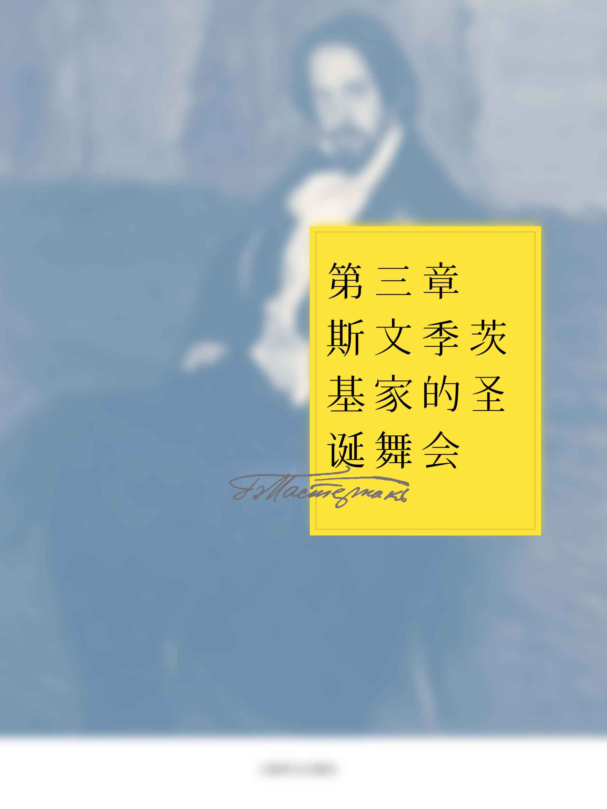

# 第三章 斯文季茨基家的圣诞舞会

<h3 id="c030">一</h3>

那年冬天，亚历山大·亚历山大罗维奇送给安娜·伊万诺夫娜一个老式衣柜。他是偶然碰上买下来的。这个乌木衣柜是个庞然大物，哪个门也进不去。所以只好卸开了运来，分几件搬进屋子，然后又开始琢磨把它放在哪儿。如果放在一楼的房间里，地方虽然宽敞，可是柜子派不上用场；二楼太挤，搁不下。于是只好在二楼他们夫妇卧室门外的平台上，腾出一块地方来安置它了。

看门人马克尔来重新装配衣柜时，带着六岁的女儿马林卡。有人给了马林卡一根麦芽棍儿糖。她抽着鼻涕，一边舔着棍儿糖和手指上的甜汁，一边煞有介事地观看爸爸干活。

开始活儿干得挺顺手。安娜·伊万诺夫娜眼看这柜子慢慢装了起来，最后只剩安柜顶了。她忽然异想天开，要给马克尔帮点忙，就踩上衣柜高高的底板，没站稳身子一晃，撞到柜壁上。那槽榫还是活动的，柜子两侧拴着的绳子，活结没有扎牢。这一撞，活结松开，安娜·伊万诺夫娜随着壁板轰隆一声仰面倒在地上。这一下可摔得很厉害。

“哎呀！我的好太太！”马克尔朝她奔过去。“您干吗要上衣柜呀，我好心的太太！没有伤着骨头吧？您摸摸看伤了骨头没有？只要没伤着骨头就好，皮肉不要紧，皮肉能长起来，俗话说，不伤筋骨就不怕。”他冲着啼哭的马林卡喝道，“不许哭，讨厌鬼！鼻涕擦干净，找你妈去。唉，太太，没您在这儿，我就装不起这柜子吗？您也有您的道理。乍一看，我确实是个看门的，可是说真的，我们家的人生来是当木匠的料。我们都干过木工。说来您不会相信，这样的家具，这样的大衣柜，我漆就不知漆了多少。再不就是红木的，胡桃木的。再比方说吧，有钱人家的女儿，您可别怪我说话粗，一个个打我眼皮底下过去不少，可都没成。原因就是我爱喝一口，专喜欢烈性酒。”

安娜·伊万诺夫娜在马克尔搀扶下，坐到他推来的圈椅上。她喘息着揉那摔伤的地方。马克尔又装起柜子来。等顶板也上好后，他说：“得啦，现在只剩安两扇门了。门装好，拿出去展览都可以。”

安娜·伊万诺夫娜不喜欢这个大衣柜。它的形状和尺寸，很像灵柩台或是皇族棺椁。这柜子引起她一种迷信的恐惧。她管这大柜子叫“阿斯科尔德
 <a href="08-%E7%AC%AC%E4%B8%89%E7%AB%A0%20%E6%96%AF%E6%96%87%E5%AD%A3%E8%8C%A8%E5%9F%BA%E5%AE%B6%E7%9A%84%E5%9C%A3%E8%AF%9E%E8%88%9E%E4%BC%9A.md#m1">
[1]
</a>
 之墓”。安娜·伊万诺夫娜指的是奥列格亲王那匹害死了自己主人的马
 <a href="08-%E7%AC%AC%E4%B8%89%E7%AB%A0%20%E6%96%AF%E6%96%87%E5%AD%A3%E8%8C%A8%E5%9F%BA%E5%AE%B6%E7%9A%84%E5%9C%A3%E8%AF%9E%E8%88%9E%E4%BC%9A.md#m2">
[2]
</a>
 。安娜·伊万诺夫娜书读得不少，但杂乱无章，常常把一些相近的东西搞混。

这次摔倒之后，安娜·伊万诺夫娜肺部就经常出毛病。

<h3 id="c031">二</h3>

一九一一年整个十一月，安娜·伊万诺夫娜卧病在床，她得了肺炎。

尤拉和米沙·戈尔东第二年春天该大学毕业了，冬尼娅也将念完高等女子学校。尤拉学医科，冬尼娅学法律，米沙在语文系学哲学。

尤拉心里，一切都在变化动荡，一切又那么超群不凡，无论是观点、习惯，还是爱好。他聪慧颖悟，常有新颖的见解，令人惊叹。

虽然尤拉十分醉心艺术和历史，但选择专业时却毫不犹豫。他认为，艺术不能成为一种职业，就像人们天生的乐观或忧郁不能成为职业一样。他对物理和自然科学兴趣浓厚，认为在实际生活中应该从事某种对人们有益的工作。于是他选择了从医的道路。

四年前，也就是读一年级的时候，他整整一学期都在解剖尸体的实验中度过。他走下螺旋楼梯，到地下解剖室去工作。那些头发蓬乱的大学生，或成堆或单独在那里：要么抱本残破的教科书背诵，四下摆开各种人体骨骼；要么在屋角默默地做解剖；要么在逗乐说笑，哄撵那些在石板地上到处乱窜的一群群耗子。在昏暗的地下室里，一具具裸露的尸体，发着青幽的磷光。这里有身份不明、自杀身死的年轻人，有保存完好尚未腐烂的溺水女人。尸体注入防腐液以后，肌肤显出了丰润、细腻的假象。尸体被解剖、肢解，制成标本。死人即使被切割成块，人体美的魅力仍然不减。所以当一个淹死的美丽女人被扔到锌面解剖台上，人们会不由地惊叹她的美丽。等肢解下一只手臂或手掌时，人们转而赞叹她部分肢体的美。弥漫着福尔马林和石碳酸气味的地下室里，一切都显得神秘。这些手脚摊开的死者的命运是神秘的，生命和死亡本身也是神秘的。而在这个地下室里，死亡主宰着一切，解剖室是死亡之家，或者说是死亡的大本营。

这种神秘的气氛压过了一切，占据着尤拉的思绪，给他的解剖工作带来纷扰。同样，他在生活中也曾碰到许多别的烦扰。对此他渐渐习惯了，分心的干扰并不令他感到不安。

尤拉善于思考，并且特别擅长写作。还在中学时代，他就希望写小说，写一本传记小说。他要在这书中像埋炸药包似的，把他所见所想之中最惊人的东西写进去。但要写这样一本书，他还太年轻。于是他只好以诗来代替，就像一个画家，为了作一幅成竹在胸的巨画，一辈子打着种种草图。

尤拉不很介意这些诗的不足，看重的是它们蕴含的活力和颖脱。尤拉认为活力和颖脱是艺术中标志着现实性的主要品格，没有这点，艺术中其余的一切便失去意义，没有价值，没有存在的必要。

尤拉知道，自己性格上许多特点的形成，要归功于舅父。

此时，尼古拉·尼古拉耶维奇侨居洛桑。那里出版了他几部著作的俄文版和译著。在这些著作中，他进一步发展了过去的历史观，认为历史是第二宇宙，是人类借助时间和记忆提出来，用以对付死亡的挑战。这些书的核心是对基督教义的新阐释。它们对新的艺术观的产生，起了直接作用。

这些思想对尤拉的朋友米沙·戈尔东影响更为显著。在这种影响之下，米沙·戈尔东选择了哲学专业。他在系里还听神学课，甚至常常考虑以后要转到神学院去。

由于舅父的影响，尤拉思想前进了一步，摆脱了某些束缚；米沙却反而裹足不前。尤拉心里明白，米沙之所以如此热中于极端化的思想，他的经历和出身起着很大作用。出于审慎和礼貌的考虑，他没有劝米沙放弃这类奇怪的打算。但他常希望米沙变得现实一些，更靠近生活一些。

<h3 id="c032">三</h3>

十一月末的一天傍晚，尤拉很晚才从大学回到家里。他感到十分疲倦，加上一天没吃东西。家里人告诉他，白天出了吓人的事，安娜·伊万诺夫娜发生了痉挛。请来好几位医生，他们都劝家里人请神甫，后来，才又改变了主意。现在安娜·伊万诺夫娜觉得好些了，神志已经清醒，吩咐尤拉一回来就立刻去见她。

尤拉听了顾不得换衣服，就去了她的房间。

屋里还看得出不久前忙乱过一阵。护士蹑手蹑脚在整理床头柜上的东西。到处扔着用过的小方巾和湿敷用的手巾。洗漱盆里还有血，染得水成了淡红色。水面上还浮着几个小玻璃针药瓶和浸泡大了的药棉。

病人浑身被汗水湿透，舌头不时舔着干燥的嘴唇，和尤拉早上最后一次看见时相比，她明显地瘦了。

“是不是诊断有误呢？”他想道，“从所有症状看是格鲁布性肺炎。看来这是危险期。”他向安娜·伊万诺夫娜问了好，讲了几句安慰病人的客套话，就让护士离开房间。他拿过安娜·伊万诺夫娜的手，开始号脉，另一只手伸进外衣口袋里取听诊器。安娜·伊万诺夫娜摇摇头，表示没有必要。尤拉明白了，她要他做的不是这个。安娜·伊万诺夫娜好不容易才说出话来：

“刚才……想让我做临终忏悔……眼看要不成了……随时都有可能死去。人要拔牙害怕疼，还得准备呢……我这可不是拔牙，是整个人，整个生命……咔嚓一下，一条命就用钳子拔掉了……可这是怎么回事呢？……谁也说不清……我觉得很难受，很恐惧。”

安娜·伊万诺夫娜停下不说了。硕大的泪珠，从面颊滚下来。尤拉沉静着没说话。过了一会儿，安娜·伊万诺夫娜又说下去：

“你有才赋……你天资高……有才赋就同一般人不一样……你一定懂得多……给我说说吧，让我能宽心。”

“说点什么好呢？”尤拉答道。他觉得坐不住，站起来在屋子里转了一圈，重新坐下，“首先我要说的是，明天您一定会好些。有这个迹象。我用生命担保。其次，您是想听听我这个搞自然科学的人，对死亡、意识、复活的信念等等有什么看法吗？是不是咱们以后再谈？不行？现在就谈？好吧，就按您说的办。可是马上就开始真怕说不好呢。”于是他滔滔不绝地讲起来，自己也奇怪，怎么会如此侃侃而谈。

“先说复活。对复活最粗浅的解释，仅是对弱者的一种安慰罢了。那是我不能接受的。基督关于生者与死者的教义，我的理解一向与众不同。几千年来历史长河中积聚起来的芸芸众生，如果复活了，哪里有地方安顿他们？整个宇宙也不够，就连上帝、善良和真理，都要无处栖身了，都要被贪婪拥挤的大群动物挤死。

“然而，有一个统一的没有止境的生命，总是充塞于宇宙之中，并且通过无数的组合和变化形式时刻在更新，如此您担心，您会不会复活，实际上您已经复活了——当您降生的时候，您就复活了，只是您没有觉察罢了。

“您是否会痛苦，肌体是否会感到自己的衰亡？换句话说，您的意识会怎样？可意识又是什么东西呢？我们来分析一下。当您一心一意想睡着，您必定会失眠。有意识地想感觉到自己的消化过程，必然会引起消化神经的紊乱。当主体把意识用于自身的时候，意识是毒剂，它是自我毁灭的手段。意识是向外照射的光，它给我们照亮了前面的道路，使我们不会绊倒摔跤；意识是机车上的车头灯，如果把这灯光朝里照，非发生车祸不可。

“那么，您的意识会怎么样呢？我指的是具体的您的意识。可您自己又是什么呢？问题的症结就在这个地方。让我们来分析分析看。您自己在您的意识里是什么？您肌体的哪一部分，您自己意识到了呢？是您的肾、肝、血管？不是的。不管您怎么去想象，您能想象出的只是您表现于外部活动中的形象：是您双手劳动时的形象，在家庭中的形象，同别人一起时的形象。下面这一点请您更注意地听：在别人心目中的人，也就是这人的灵魂。这样就清楚了，您是怎样的呢？您的意识一辈子赖以呼吸、赖以摄取营养的泉源是什么呢？就是您在别人心目中显现的灵魂，显现的不朽，显现的生命。事情就是这样！您活在别人心中，您也会留在别人心中。至于以后人们把它称为怀念，对您来说又有什么区别呢？您仍然是您，是属于未来的一部分。

“最后一点：没有什么可让您不安的。死亡并不存在。死亡与我们不相干。刚才您说到了‘才赋’，这可就是另一回事了，这与我们有关系，是我们发现的东西。而才赋从最高和最广的意义上说，是生命的一种赐予。

“圣徒约翰说，世上不会有死亡，您听听他浅显的道理吧。由于过去已经过去了，所以不会有死亡。这几乎就是说：死亡不会有了，因为我们已经见过死亡，它已经变得陈腐讨厌，而现在要求新生的东西，新生的东西是一种永恒的生机。”

他一边说着，一边在屋里踱步。然后，他走到安娜·伊万诺夫娜床前，双手放在她头上说：“睡吧。”几分钟以后，安娜·伊万诺夫娜慢慢入了梦乡。

尤拉悄悄走出房外，吩咐叶戈罗夫娜让护士去卧室。他想：“真见鬼，我成了骗人的巫医了。我喋喋不休地念咒，甩手掌施法来为人除病……”

第二天，安娜·伊万诺夫娜好多了。

<h3 id="c033">四</h3>

安娜·伊万诺夫娜身体一天天好起来。十二月中旬，她试着起床，但仍感到十分虚弱。大家劝她再好好卧床养养。

她经常让人把尤拉和冬尼娅叫到跟前，给他们讲自己童年的事，一讲就是几个小时。她的童年是在乌拉尔雷尼瓦河畔祖父瓦雷基诺庄园里度过的。尤拉和冬尼娅从来没到过那里。但尤拉听了安娜·伊万诺夫娜的讲述后，眼前很快就浮现出五千来俄亩人迹不到的黑魆魆老林和克吕格尔河岸下碎石铺底，峭壁对峙的急流，还有两三处尖刀似的插入森林的河湾。

这几天，第一次给尤拉和冬尼娅做礼服，尤拉做的是一套黑色礼服，冬尼娅是一件领口稍低的浅色缎子礼服。二十七日他们要去参加斯文季茨基家的一年一度的圣诞晚会。

这两套礼服，由男女裁缝店在同一天做好送到。尤拉和冬尼娅试了一下很满意。他们还没有来得及脱下新衣，安娜·伊万诺夫娜就让叶戈罗夫娜来叫他们去。于是尤拉和冬尼娅一身新装来到安娜·伊万诺夫娜房间。

安娜·伊万诺夫娜看见他们两人进来，就用臂肘撑起身子，看了看侧面，又让他们转过身来，说道：

“好极了。简直太美了。我还不知道新装已经做好了呢。来，冬尼娅，再让我看看。嗯，不错。我觉得好像肩头褶儿多了些。你们知道我为什么叫你们来吗？我要先说说你的事，尤拉。”

“安娜·伊万诺夫娜，我都知道。是我自己要求把那封信给您看的，大概您和尼古拉·尼古拉耶维奇一样都认为我不该拒绝继承权。等一等，您不宜多说话。现在我给您解释一下。其实您都十分清楚。

“是这样，首先我要说的是，确实存在一笔日瓦戈的遗产，但它只够供养律师，支付诉讼费用。真正有实际意义的遗产却并不存在，有的是种种债务和乱七八糟的纠纷，再就是打官司时会出现的诽谤和中伤。如果真有什么值钱的东西，难道我自己不要，愿意拱手送给法院吗？这是一场徒有其名的假官司。与其在这上面耗费精力，还不如放弃对并不存在的财产的继承权，把它让给几个冒名顶替的竞争对手和垂涎三尺的假冒的继承者吧。有一个叫爱丽斯的太太想染指这笔遗产，自称姓日瓦戈，带着几个孩子住在巴黎，我早已听说了。可现在还有别人也盯着这笔遗产。我不知道您是否知道，前不久别人才告诉我。

“原来，父亲生前迷恋过一个浪漫的怪女人，斯托尔布诺娃娅恩里茨公爵夫人，那时母亲还在世。她和父亲有过一个儿子，现在十岁了，叫叶夫格拉夫。

“这位公爵夫人喜欢离群索居。她和儿子住在鄂木斯克郊外一栋私邸里，不知靠什么生活。我见过这幢住宅的照片，房子很漂亮，有五扇无窗格的大窗，房檐饰着浮雕。最近一个时期，我常常觉得这栋房子瞪着五只充满恶意的眼睛，从遥远的西伯利亚盯着在欧洲俄罗斯的我，迟早它要看得我倒大霉。因此，我何苦去理睬那笔虚假的遗产，那些巧妙伪装的继承人，他们的恶意和忌恨，还有那些律师。”

安娜·伊万诺夫娜不同意他的看法：“再怎么说也不该拒绝继承权。你们知道我为什么叫你们来吗？”她重复问了一句，接下去说：“我想起了那个守林人的名字。还记得吗，昨天我和你们谈到过一个守林人？他名叫巴克斯！名字极少见，对吧？他是个吓人的林中黑怪，满脸胡茬直到眉梢，所以管叫他酒神！他曾经碰上过一只熊，可居然拼命挣扎了出来，面容被毁变得丑陋不堪。林子里这样的人不少，名字都挺短。为的是叫着响亮、听得清。巴克斯。有叫卢普的，还有的叫福斯特。你们再听我往下说。有时仆人向祖父通报说，某个阿夫特克或者叫福罗尔什么的来了，我们就像听到祖父两支猎枪打响似的，一下子从儿童室拥进了厨房。厨房里的情景，你们真难以想象：不是林子里烧炭的人带着一头活的小熊来了，就是从老远的护林哨所捎来一块矿石样品。祖父就给他们每人写一张签条，让他们去账房领钱，或者领粮食和子弹。森林就在我们窗子外面。那积雪可厚极了！比房子还高！”安娜·伊万诺夫娜咳了起来。

“妈妈，你别说了，这样对身体不好，”冬尼娅让母亲保重身体。尤拉也帮着冬尼娅说。

“没什么。算不了什么，噢，忘了件事。叶戈罗夫娜悄悄告诉我说，你们拿不定主意，明天去不去参加圣诞晚会。以后你们可别说这种蠢话！你们怎么这么想呢？尤拉，你是个医生，还说这样的话！好了，就这样决定了。不必多啰嗦，一定去参加晚会。现在再回来说那个巴克斯。巴克斯年轻时是个打铁的。一次打架，人家把他五脏都打坏了。他就用铁铸了一付新的。尤拉，你真傻。难道你以为我不明白？当然不是指字面的意思，可是老百姓都这么说。”

安娜·伊万诺夫娜又咳了起来，这次咳了很久，总也停不下来，咳得气都喘不过来了。

尤拉和冬尼娅一起跑到她床前。他们两人肩并肩地站在床前，安娜·伊万诺夫娜仍旧咳个不停，她抓住他们两只挨在一起的手，握在自己手里好一会儿，最后她止住了咳嗽，缓过气来，说道：

“如果我死了，你们不要分离吧，你们是天造地设的一对。你们结为夫妇吧。”接下去她又补充了一句说，“我这就算替你俩订婚了。”说着她流下了眼泪。

<h3 id="c034">五</h3>

一九〇六年春天，拉拉即将升入毕业班。这时，持续了六个月的和科马罗夫斯基的暧昧关系，就已无法忍受下去了。他善于很狡猾地利用她的沮丧心情。每当需要时，他不露声色地巧妙地提醒她委身之情，这种暗示和提醒使拉拉心慌意乱，而这正是一个好色之徒的目的。拉拉越来越深地陷入了可怕的情欲的陷阱。每次她清醒过来回想一切，不禁毛骨悚然。夜里的癫狂时的矛盾，就像巫术一般不可解释。一切都适得其反，不合逻辑；撕心般的痛苦迸发为银铃般的狂笑，反抗和挣扎却意味着许诺，占有者的手上竟落下感激的亲吻。

这种情形看来永无完结。春天，在学年末的一堂课上，拉拉想到夏天学校功课一结束，她将失去学校这个最后的避难所，那纠缠会越来越勤。于是她当机立断做了个决定，这决定在之后很长时间改变了她的生活。

那天上午天气闷热，眼看要来雷阵雨。上课时教室敞着窗户。远处的市声犹如蜜蜂在蜂巢里嗡嗡地单调地叫着。院子里传来孩子们的吵闹声。草地和嫩树叶的气味，就像谢肉节时伏特加和煎面饼的气味，让人脑袋发胀。

历史课教员正讲拿破仑的埃及远征。说到军队在弗雷瑞斯登陆时，天空骤然变暗，闪电之后雷声滚滚而来。随着一股凉风，尘埃和沙土卷进教室，两个好巴结的学生讨好地奔到走廊上去找个大人来关窗。他们一打开教室门，一阵穿堂风呼啦啦地把教室里所有课桌上练习本里的吸墨纸全都刮跑了。

等关上窗户，雨水夹带着城市上空的尘土倾泻下来。拉拉从本子里扯下一页纸，给邻座的同学娜佳·科洛格里沃娃写了一张小条：

“娜佳，我必须离开母亲独立生活。请帮我找个教几节课的差事，收入要多点。你们家认识许多有钱的人家。”

娜佳也回了她一个小条：

“家里正给莉帕找家庭教师呢，上我们家来吧，那可再好不过了！你也知道，我爸爸妈妈很喜欢你。”

<h3 id="c035">六</h3>

拉拉在科洛格里沃夫家，像靠了座大山，安安稳稳过了三年。没有人来搅扰她，甚至妈妈和弟弟也没来过，对他们她已感到相当疏远。

拉夫连季·米哈伊洛维奇·科洛格里沃夫是一个现代型的精明强干的大实业家。作为一个出身贫寒的人，他痛恨当时腐败的制度，作为一个平步青云而财势雄厚的巨富，他也痛恨这个制度。他在家里藏匿神秘分子，为政治犯找辩护律师。他像人们开玩笑说的那样，出钱资助革命，自己推翻自己这个私有者，还在自己的工厂里组织罢工。拉夫连季·科洛格里沃夫枪法高明，喜爱狩猎，一九〇五年冬天他经常在星期日驱车去白桦树林和驼鹿岛，训练工人纠察队员们射击。

这是个很出色的人。他的妻子谢拉菲玛·菲利波夫娜和他十分般配。拉拉对他们夫妇俩都由衷地尊敬。他们一家人也都爱她，待她像自家人一样。

拉拉无忧无虑生活的第四个年头，弟弟罗佳找上门来。他走起路来像纨绔子弟那样，两条长腿故意摇晃着，说起话来装腔作势地拖着重重的鼻音，慢慢吞吞往外吐字。他对她说，同届士官生们凑了钱准备离校时给校长买礼物，他们把钱交给罗佳去物色和购买。前天罗佳去赌钱输得精光。罗佳说到这儿，瘦高个子一下瘫倒在圈椅里，哭了起来。

拉拉听说后，人都凉了半截。罗佳抽抽搭搭地继续说道：

“昨天我去求过科马罗夫斯基，他拒绝和我谈这件事，但又说，如果你肯求他的话……他说，尽管你已经不爱我们了，可你还有权力指挥他……亲爱的拉拉……只要有你一句话……你明白吗，这多丢脸呀，这对士官生的名誉是多大的打击，你去找找他，对你算不了什么，求他帮个忙，你总不忍心看我因为动用这笔款项付出血的代价吧。”“付出血的代价……士官生的名誉，”拉拉满腔怨愤，激动地在屋里来回踱步，“我不是士官生，我没有名誉，对我可以为所欲为，难道你不明白，你要求我的是什么吗？你不清楚，他向你提出了什么要求吗？我一年又一年地干活，苦苦奋斗，觉也睡不够，可我都白干了。你一来，说得好轻松，什么也不管，把这一切全葬送了。见你的鬼去吧。你要开枪自杀，请吧。和我有什么相干？你需要多少钱？”

“六百九十多卢布，凑个整数，就算七百吧，”他犹豫了一下说道。

“罗佳！这怎么得了，你疯啦！你知道你说的是什么吗？你竟赌输了七百卢布？罗佳啊，罗佳！你知道吗，像我这样的一个普通人，要苦苦地干多少活才能攒起这样一笔款子啊？”

她有一会儿没说话，后来才冷漠又疏远地说道：

“好吧。我试试看，你明天来吧。来时把你要自杀用的手枪也带来。枪就算归我了，要多带点子弹，别忘了。”

她从科洛格里沃夫那里借到了这笔钱。

<h3 id="c036">七</h3>

拉拉在科洛格里沃夫家工作，没有妨碍她的学业。中学毕业后她又去大学听课。明年，一九一二年，大学课程也将顺利通过。

一九一一年春天，她的学生莉帕中学毕业了。这女孩子同一位年轻工程师弗里津丹克订了婚。他出身于一个很好的殷实家庭。父母对莉帕的选择十分满意，但是反对她过早结婚，劝她等一等。为此家里经常发生不快。莉帕是家里的掌上明珠，从小娇宠惯了，十分任性，她跺着脚对父母又哭又嚷。

在这富有的家庭里，他们把拉拉看作自己人，已经忘了她为罗佳借的钱，也没再提起这件事。

这笔债拉拉本来早就可以偿还，但她还有一项经常性的支出，这件事她对谁都秘而不宣。

她瞒着帕沙，偷偷给他的父亲、流放移民安季波夫寄钱，还帮助帕沙那位三天两头生病的唠叨没完的母亲。此外，她还向帕沙的房东补交一部分伙食费和房租，这样帕沙就可以少开支一些。这是绝对秘密的，连帕沙都不知道。

帕沙比拉拉年纪小些，对她一片痴情，百依百顺。他实科中学毕业后，她坚持要他好好坐下来补一下拉丁语和希腊语，以便日后去念大学的语文系。拉拉希望，一年后等他们都通过国家考试，她就和帕沙结婚，然后去乌拉尔的某个省城分别到男校和女校当教员。

帕沙住在靠近艺术剧院的侍从大街上一幢新盖的楼房里。这是拉拉给他租下的，房东斯文好静。

一九一一年夏天，拉拉最后一次陪同科洛格里沃夫一家去杜普良卡田庄度假。她对这片土地爱恋至深，甚至胜过土地的主人。大家都知道这一点，所以每年夏天到田庄度假时，同她有那么一个不成文的默契，她是必去无疑的。当他们乘坐的那列闷热肮脏的火车渐渐远去后，空旷的田野里一片寂静，草香四溢，拉拉置身其中，激动得说不出话来，这时大家便让她一人独自徒步从小车站去田庄。人们在车站上把行李装上大车，科洛格里沃夫老爷一家人就坐进四轮马车。那个穿着驿站车夫背心、露着猩红衬衫袖子的本地赶车人，便向坐进轿车里的老爷太太们，谈起前一个时候田庄里的种种趣闻。

拉拉顺着铁路走在朝圣者踩出来的小路上，然后拐进通往森林的草地小径。她不时停下步来，眯起眼睛深深呼吸着旷野上繁花的芳香。这芬芳比父母更亲，比情人更好，比书本更富于智慧。一刹那间，她的存在又有了新的意义。她领悟到自己生活的目的就在于要把握大地的动人心魄的美，并一一道出这美来。如果她做不到，出于对生活的热爱，她要为自己留下后代，让他们替她完成未能完成的使命。

今年夏天，拉拉来到田庄时，感到疲惫不堪——她平时过于辛苦了。如今她很容易暴躁，变得多疑，这是过去所没有的。由此她显得气量狭窄，而过去她一向性格开朗，从不拘泥小节。

科洛格里沃夫一家仍然不放她走。他们还像以前一样疼爱她。然而自从莉帕成年之后，拉拉觉得自己在这个家里是多余的人。她不接受他们的薪金。他们一定要她收下。可实际上这笔钱对她来说又是缺少不了的。可是作为一个客人挣这么一笔个人的薪水，是难以说得过去的，而且也是不符合实际的。

拉拉感到处于自欺欺人的难堪境地，自己成了科洛格里沃夫全家的累赘，他们只是不说罢了。她对自己来说也成了一个负担，她想一走了之，去哪都可以，只要能脱离这样的处境和科洛格里沃夫一家。但拉拉又认为应先归还欠科洛格里沃夫的钱。可目前她上哪也弄不来这笔钱。由于罗佳干了荒唐事，她简直成了他过错的人质，一种无可奈何的愤懑使她成天坐立不安。

在科洛格里沃夫家里，拉拉处处觉得人们对她不够尊重。如果科洛格里沃夫家的客人对她过于殷勤，她认为是把她当成了唯命是从的所谓“养女”，是个轻易就能到手的女人。如果大家不理睬她，她认为把她看作了微不足道的人，所以才视而不见。

虽然拉拉的忧郁症经常发作，她仍照样参加杜普良卡田庄上各种热闹的娱乐。她在河里嬉水、游泳、划船，夜间到河对岸参加野餐，和大家一起放焰火、跳舞。她也去参加戏剧爱好者的演出，尤其热衷于短毛瑟枪的射击比赛，其实她更喜欢用罗佳的那支轻便的左轮手枪。她熟悉这枪，射击十分准确。她开玩笑说可惜她是个女人，否则她会成为好决斗的勇士。然而，拉拉越是玩得欢，心情就越坏。她自己也不清楚究竟想干什么。

他们回城后，情况变得更为糟糕。拉拉除了上面谈的那些烦恼外，还不时与帕沙发生口角、怄气。拉拉尽量不和他大吵，因为她把他看作是自己最后的靠山。帕沙近来有些自以为是，说话带点训人的口气，弄得拉拉哭笑不得。

帕沙、莉帕、科洛格里沃夫一家人和她欠的债——这些在她脑子里跑马灯似的转个不停。拉拉对生活感到厌恶。渐渐地她精神有些失常了。她一心想摆脱过去熟悉的生活，重新开始一种新生活。她在这种情绪支配下，一九一一年的圣诞节时，做出了关键性的抉择。她决定立即离开科洛格里沃夫家独立生活，需要的钱准备向科马罗夫斯基借。拉拉觉得，经过从前那些事之后，又经过她自己已赢得的几年自由的生活，他应该慷慨地帮她，用不着多费口舌，他也不至于那么肮脏、自私。

十二月二十七日晚上，她抱着这样的目的去了彼得罗夫大街，临走时把罗佳的枪装上了子弹，扳开保险，揣在袖筒里，如果科马罗夫斯基拒不给钱，曲解她的来意，或者对她放肆，那就用手枪打死他。

街上一片节日景象，但她却心烦意乱，对四周的一切都视而不见，听而不闻。在她心里，这一枪已经打响，至于向谁放的，她完全不理会。

她清醒意识到的，只有这一声枪响。一路上，她耳朵里一直回荡着这声音。这一枪射向的是科马罗夫斯基，是自己和自己的命运，是田庄草地里挂在橡树干上的靶子。

<h3 id="c037">八</h3>

爱玛·埃内斯托夫娜开门看见拉拉，惊讶得大呼小叫。她伸手帮拉拉脱大衣。拉拉忙说：

“别碰我的手筒！”科马罗夫斯基不在家，但爱玛·埃内斯托夫娜还是劝拉拉脱下大衣，进屋里去。

“不行。我急着有事，他在哪儿？”

爱玛·埃内斯托夫娜告诉她说，去参加圣诞晚会了。拉拉拿了斯文季茨基家的地址，走下那条记忆犹新的阴暗的楼梯，走过平台上的彩纹玻璃窗，直奔穆奇大院的斯文季茨基家去。

拉拉再次来到大街上，才朝四周仔细打量了一番。这时城里正是隆冬的傍晚时分。

天寒地冻，马路结上了厚厚一层肮脏的冰层，好像是破啤酒瓶的瓶底。空气吸进肺里冷得刺人。四周弥漫着灰色的霜雪，仿佛空气中充塞了蓬乱的鬃毛在刺你的脸，像围脖上冻了冰的灰毛扎着皮肤和嘴唇一样。拉拉在空旷的大街上走着，心狂跳不停。路旁茶室和小吃店里冒出一团团的热气。寒雾中浮现出路人一张张脸，冻得活像红香肠，马头和狗头下面挂着一溜溜细长冰柱，像长了冰胡子。房屋窗子都结了厚厚一层霜花，仿佛涂上了白粉。那不透明的玻璃上，影影绰绰看到点燃的五光十色的圣诞树和欢聚着的人群，似乎屋里的主人在白色帷幕上给路人放映幻灯片。

走到侍从大街，拉拉停下脚步。她几乎喊出声来：“我不能再这样下去了。我受不了了，我要上楼找帕沙，把一切都告诉他。”她定定神，再想了想，推开面前那扇沉甸甸的很有气派的大门。

<h3 id="c038">九</h3>

帕沙用舌头顶起腮帮，吃力地涨红了脸，正对着镜子系衣领，使劲想把弯扣伸进浆洗过的胸衣扣眼里。他正准备出门做客。他还太单纯，涉世太浅，所以当拉拉推门而入，一时不知所措，因为他衣服还没全穿好。他一眼就看出她心情紧张不安，简直站立不住，进屋时一步一挪，摆动着衣裙，像在蹚水过河。

“你怎么啦？出了什么事？”他惊惶不安地奔过来迎她。

“坐到我身旁，你好好地坐着，等一会儿再穿衣服。我有急事，马上就要走，别碰我的手筒，等一等。你把脸转过去一下。”

他照她说的做了。拉拉身上穿着一套英式衣裙，她脱下外套，挂在衣钩上，把罗佳的手枪从手筒里取出放到外套口袋里。然后，回到沙发跟前，对帕沙说：

“现在你可以看了。点上蜡烛，把电灯关上。”

拉拉喜欢点着蜡烛，在幽幽的烛光下谈话。帕沙总是为她准备着一包没启封的蜡烛。他把烛台里的蜡烛头取下换上新的，摆在窗台上点着。烛芯先没着旺，劈劈啪啪溅出火星，然后才燃起箭头似的火苗。屋里充满了柔和的烛光，窗玻璃挨着蜡烛的地方慢慢融化出一个黑色圆孔。

拉拉说道：“帕沙，你听我说。我现在有点难处。你得帮我摆脱困境。你别害怕，也别盘问我，但你不要以为我们和别人一样。不能再高枕无忧了。我随时可能出事。如果你爱我，要救我不让我毁灭，那就不要拖延，咱们快点结婚吧。”

“这正是我一直希望的啊，”他打断了她的话，“你快定下日子，随你愿意哪一天，我都会高兴的。但哪怕只说三言两语，你也得明确告诉我，你出了什么事，别让我瞎猜。”

但拉拉转了话题，悄悄地避开了帕沙的问题，他们俩还谈了好久，但都和拉拉苦恼的事毫不相干。

<h3 id="c039">十</h3>

这年冬天，尤拉为了赢得学校的金质奖章，准备写一篇有关视网膜基础原理的学术论文。虽说尤拉学的是普通内科学，但他的眼科知识不亚于一个未来的眼科医生。尤拉对视觉生理学的兴趣，还反映了他天赋中的其他因素，诸如他的创造才能，他对艺术形象本质和逻辑结构的思考。

冬尼娅和尤拉乘坐一辆出租雪橇去斯文季茨基家参加圣诞晚会。他俩一起度过了童年和少年之交的六年光阴。他们相知甚深，有着共同的习惯，都爱说几句俏皮话，都爱哼哼着回答对方。现在他们一起坐在雪橇上，冷得紧闭着嘴，默默不响，只是偶尔交换一两句话。各人想着各人的心事。

尤拉想的是评选日期在即，论文要赶紧写完。可街上喧嚣繁杂的过年气氛，又使他的思想从论文转到另一些事情上去。

戈尔东所在的系里，出了一种胶版油印的大学生刊物。戈尔东任主编。尤拉早就答应给他们写一篇关于勃洛克
 <a href="08-%E7%AC%AC%E4%B8%89%E7%AB%A0%20%E6%96%AF%E6%96%87%E5%AD%A3%E8%8C%A8%E5%9F%BA%E5%AE%B6%E7%9A%84%E5%9C%A3%E8%AF%9E%E8%88%9E%E4%BC%9A.md#m3">
[3]
</a>
 的论文。彼得堡和莫斯科的青年都狂热地崇拜勃洛克，尤拉和米沙尤其如此。

但关于勃洛克，尤拉也并没能多想。他和冬尼娅坐在雪橇里把下巴埋进衣领，不时搓揉冻僵的耳朵，想着杂七杂八的事。可有一点他们俩却想到一起去了。

不久前呆在安娜·伊万诺夫娜床前的那一幕，使他俩发生了彻底的变化。他们仿佛睁开了眼睛，彼此用新的眼光看了看对方。

冬尼娅是他多年来的伙伴，他了解她，一切都明明白白，不需要任何解释。然而现在她成了尤拉思想中最难理解和最复杂的人，她在他心目中成了女人。尤拉只要稍稍发挥一下想象力，就可以把自己设想为一个登上土耳其阿勒火山的英雄，一个先知，一个胜利者，或任何其他人物，唯独无法想象出一个女人来。

于是这项无比困难的任务就落到冬尼娅瘦弱的肩上（在尤拉眼里她突然变得纤弱了，尽管她完全是个健康姑娘）。他对她充满了热切的同情和羞怯的惊讶：这正是爱恋的前奏。

冬尼娅对尤拉的态度，也发生了相应的变化。

尤拉觉得，其实他们不该离家去参加圣诞晚会，会不会在他们出门的当儿家里出什么事呢。他想起了出门前家里的情况：他们已经穿戴停当准备出门，听说安娜·伊万诺夫娜病情恶化，便到她房间说不去了，可她仍坚决反对，一定要他们去参加圣诞晚会。

尤拉和冬尼娅走到落地长窗前的深龛里，撩开窗幔看了看天气，看罢往回走的时候，两边的窗帘搭在了他俩刚上身的新衣上。冬尼娅拖着轻柔的窗帷走了几步，仿佛是新嫁娘结婚的披纱。这种相似的情景，当时在安娜·伊万诺夫娜卧室里的人，都默默看在眼里，大家都笑了。

尤拉瞧着周围，这正是不多久前拉拉见到的街景。他和冬尼娅坐的那辆雪橇，行驶时声音异常响亮，花园里和林荫道上冰冻的树丛下传来挺怪的回声，久久不散。蒙霜的窗子上灯光融融，一个个像黄玉烟晶片制成的精巧盒子，里面充溢着莫斯科圣诞节的温馨气氛，圣诞树上烛火熠熠，宾客如云，身着舞服，笑闹着捉迷藏或寻指环。

猛然间，尤拉想到，勃洛克难道不正好比是圣诞节景象吗？他是俄罗斯生活各个领域里的圣诞节，是北方城市生活里和现代文学中的圣诞节，是在今天的星光下大街上的圣诞节，是二十世纪客厅中灯光通明的松枝周围的圣诞节。他心想不必写什么论勃洛克的文章了，只需要像荷兰人那样画一幅俄国人膜拜星相家的画，再衬上严寒、狼群和黑黝黝的枞树林。

他们乘雪橇经过侍从大街时，尤拉发现一幢房子结冰的窗上，化开一个小圆孔。烛光透过小孔仿佛有意朝街上张望，窥探过路的人们，在等待什么人。

“桌上烛火幽明，烛火幽明……”尤拉暗自哼哼着一个朦胧的、尚未成形的诗句的开头。盼着毫不勉强地自然吟下去，但却没有续成。

<h3 id="c040">十一</h3>

斯文季茨基家的圣诞晚会很早以前就是照既定的老规矩办事。每到十点钟，等孩子们纷纷回家以后，便为青年人和大人再次点亮圣诞树，一直玩到天亮。有把年纪的人，在大厅里面古庞贝式的小客厅里通宵打牌。这客厅只有三面墙，一面用大铜环挂着的厚厚帷幔，同大厅隔开来。等天亮破晓时，大家就一起吃顿饭。

“你们怎么来得这么晚？”斯文季茨基的侄子乔治正急急忙忙过前厅去他叔婶那儿，步子也没停问了尤拉和冬尼娅他们一声。尤拉和冬尼娅也打算去那儿向斯文季茨基夫妇祝贺节日，脱衣时顺便朝大厅里瞥了一眼。

圣诞树罩着好几圈璀璨的烛光，暖意融融。不跳舞的宾客们像一堵黑墙在圣诞树旁来回走动、闲谈，衣裙窸窣作响，还不时踩到别人的脚上。

里圈的人们正在旋舞。一个贵族学校学生科卡·科尔纳科夫——他父亲是位检察长——指挥大家跳舞，让两人配成一对，再排列起来，他提高嗓门喊得整个大厅都听得见：“大圆圈！手挽着手！”
 
 <a href="08-%E7%AC%AC%E4%B8%89%E7%AB%A0%20%E6%96%AF%E6%96%87%E5%AD%A3%E8%8C%A8%E5%9F%BA%E5%AE%B6%E7%9A%84%E5%9C%A3%E8%AF%9E%E8%88%9E%E4%BC%9A.md#m4">
[4]
</a>
 舞者都欣然从命。他向钢琴师喊道：“演奏华尔兹！”
 
 <a href="08-%E7%AC%AC%E4%B8%89%E7%AB%A0%20%E6%96%AF%E6%96%87%E5%AD%A3%E8%8C%A8%E5%9F%BA%E5%AE%B6%E7%9A%84%E5%9C%A3%E8%AF%9E%E8%88%9E%E4%BC%9A.md#m5">
[5]
</a>
 然后就带着女伴在第一圈领头跳起了三拍舞
 、两拍舞
 
 <a href="08-%E7%AC%AC%E4%B8%89%E7%AB%A0%20%E6%96%AF%E6%96%87%E5%AD%A3%E8%8C%A8%E5%9F%BA%E5%AE%B6%E7%9A%84%E5%9C%A3%E8%AF%9E%E8%88%9E%E4%BC%9A.md#m6">
[6]
</a>
 ，舞步愈跳愈慢、幅度愈来愈小，最后只见两只脚在原地慢慢踏着，这已不是华尔兹，是行将结束的尾声。大厅响起一片掌声，给这群踩着舞步、喧哗的舞者送上冰淇淋和清凉饮料。跳得脸颊绯红的青年男女暂时安静下来，不再叫嚷嬉笑了，急不可待地大口喝下冰冷的果汁和柠檬水。等他们把杯子放回托盘，欢笑声重新又起来，比刚才热闹十倍，仿佛喝下的是什么兴奋剂。

冬尼娅和尤拉没进大厅，先到后面去看望斯文季茨基夫妇。

<h3 id="c041">十二</h3>

斯文季茨基家的几间里屋堆满了从小客厅和大厅里搬出来的东西。这里是主人幕后活动的神奇地方，是圣诞节的库房，散发出颜料和胶水的气味，堆放着一卷卷的彩纸和一盒盒跳科季里昂舞用的星星，还有备用的圣诞树蜡烛。

斯文季茨基老夫妇俩，正在礼物圆牌上编号码，在卡片和纸条上书写晚宴时宾客座位上的名字和抽彩的数字。乔治也帮着写，可他常常弄错号数，斯文季茨基夫妇心里发烦，看见尤拉和冬尼娅来，简直心花怒放，他们是看着尤拉和冬尼娅长大的，对他们很随便，不讲什么客套，就让他们也一起来帮忙。

“费利察塔·谢苗诺夫娜没有经验，这种事早该做准备，等客人一到，就忙不过来了。哎呀，你真糊涂，乔治，你把号码全搞乱了！咱们不是说好的吗：糖盒放到桌上，空盒子搁在沙发上。你呢？眉毛胡子一把抓，全乱了套。”

“安娜
 
 <a href="08-%E7%AC%AC%E4%B8%89%E7%AB%A0%20%E6%96%AF%E6%96%87%E5%AD%A3%E8%8C%A8%E5%9F%BA%E5%AE%B6%E7%9A%84%E5%9C%A3%E8%AF%9E%E8%88%9E%E4%BC%9A.md#m7">
[7]
</a>
 好些了，我很高兴。我和皮埃尔可替她担心呢。”

“可是，亲爱的，她没见好，反倒更厉害了，你说话总是颠三倒四。”

那天晚上，尤拉和冬尼娅有一半时间帮乔治和两个老人在里屋准备圣诞晚会。

<h3 id="c042">十三</h3>

他们和斯文季茨基夫妇一起忙活的时候，拉拉一直呆在大厅里。她没有穿舞会晚礼服，也不认识什么人，只不过有时任科卡·科尔纳科夫带着自己转华尔兹，好像在梦中一般，有时神情沮丧地在大厅里闲荡。

拉拉有一两次犹犹豫豫地在小客厅门前停下脚步，暗中希望面对大厅坐着的科马罗夫斯基能看见她。可是他左手里的牌像小盾似的挡着脸，眼睛盯着牌。也许他确实没有看见她，也许装作没看见。拉拉恨得快背过气去。这时，一个拉拉不认识的姑娘从大厅来到小客厅。科马罗夫斯基朝进来的姑娘瞟上一眼，这种眼神拉拉是再熟悉不过的。姑娘得意地回他一笑，脸上红晕飞起，喜形于色。拉拉看到这一幕戏，几乎失声喊了起来，她臊得满面通红，一直红到前额和脖颈。她想：“一个新的牺牲品。”拉拉好像在镜子里看见了自己和自己的那段风流韵事。但她还是要和科马罗夫斯基谈一谈，等待一个有利时机再行动，所以强迫自己平静下来，又回到了大厅。

和科马罗夫斯基同桌打牌的还有三个人。挨着他坐的就是刚才请她跳舞的那个贵族学校公子哥儿的父亲，拉拉从跳舞时三言两语的交谈中了解到了这一点。科卡·科尔纳科夫的母亲，那个穿黑礼服的高个子黑发的女人，一双目光如电的眼睛四处打量，脖子像蛇一样讨厌地扭来扭去，时而从小客厅走到大厅去看看儿子跳舞，时而回到小客厅看看玩牌的丈夫。后来，拉拉偶然间知道了，刚才引起她复杂情绪的那个姑娘，是科卡的姐姐，因此她断定的那种暧昧关系并没有任何根据。

“敝人是科尔纳科夫，”舞会刚开始，科卡·科尔纳科夫就向拉拉作了自我介绍。不过当时她没有听清楚。跳完第一支舞曲，他送她到座位上，向她鞠躬致谢时，又重复说了一次“科尔纳科夫”。这次拉拉才听清楚。她暗自想道：科尔纳科夫，科尔纳科夫。好像有些耳熟，听了让人不愉快。后来她想起来，科尔纳科夫是莫斯科高等法院副检察长。审判季韦尔辛时，他对许多铁路工人提出起诉。拉拉曾托科洛格里沃夫去求他高抬贵手，办案不要过严，可他不同意。哦，原来是他！原来如此，真有意思。科尔纳科夫，科尔纳科夫。

<h3 id="c043">十四</h3>

已经过了午夜十二点或一点。尤拉耳朵里嗡嗡直响。舞曲中间，客人们在餐厅喝茶吃点心，稍事休息又重新开始跳舞。这时圣诞树上的蜡烛已快燃尽，没有人再去换新的了。

尤拉心不在焉地站在大厅里，看冬尼娅和一个不认识的人跳舞。冬尼娅舞着经过尤拉面前时，把长长的缎裙下摆用脚一甩，后襟像鱼鳍似的一闪，又消失在跳舞的人群里了。

她跳得脸色绯红。休息时他们坐在餐厅里，冬尼娅不喝茶，轻巧地剥着香气四溢的橘子，一个接一个不停地吃。她不时从宽腰带和袖子里取出细纱手帕，小巧得就像果树上的花朵，拿它擦着唇边的汗水和手指上黏黏的橘汁。她不停地说呀，笑呀，不自觉地把手帕塞进腰带或皱边胸衣里。

现在她正伴一个不相识的人跳着，转圈时蹭着了站在一边皱着眉头的尤拉。冬尼娅顺势淘气地握了握他的手，颇有深意地朝他微笑着。有一次她和他握手时，把自己的一块手绢留在尤拉的手中。他拿起来放在嘴上吻着，闭上了眼睛。手绢混合着橘子皮香味和冬尼娅手上的热气，两者都令人心醉。这是尤拉有生以来的新体验，像电流从上到下通过了全身。这股童稚天真的馨香，亲切而又雅淡，仿佛是黑暗中的一句悄悄话。尤拉合着眼，嘴唇埋到掌中的手绢里闻着。蓦地，房里发出一声枪响。

大家都扭头朝挂着帷幔的小客厅望去。一时鸦雀无声，接着出现了骚乱。大家慌作一团，惊恐地喊叫起来。有几个人跟着科卡·科尔纳科夫朝响起枪声的小客厅跑去，正好撞上从里面跑出来的人，他们气愤地骂着，哭喊着，争吵着，谁也不听谁的。

“她这是干什么呀！她这是干什么呀！”科马罗夫斯基绝望地重复着。

“博里亚，你还活着？博里亚，你还活着，”科尔纳科夫太太歇斯底里地喊叫着，“听说这里有个德罗科夫医生。他人呢？在哪儿呀？得了，你们别说了！你们看只是擦破点皮，这可要了我的命啊！唉，我可怜的人，你可遭了罪！因为你揭发了那帮坏蛋！这个下贱的烂货，我要挖掉你的眼睛，你这个婊子！哼，现在她跑不了啦！科马罗夫斯基先生，您说什么来着？她是打您？她是向您开枪？不，我不信。我太不幸了，科马罗夫斯基先生，您别开玩笑了，我哪顾得上这个。科卡，亲爱的科卡，你倒是说话呀！开枪打了你的父亲呀……反正恶有恶报……科卡！科卡！”

一群人拥着科尔纳科夫从小客厅来到大厅。科尔纳科夫左手捂上了一块干净的餐巾，手上只是轻轻的擦伤，渗着血。他呵呵笑着告诉大家自己安然无恙。后面，离他不到几步，另一帮人架住拉拉，拽着手往前拉。

尤拉一见是她，不禁呆若木鸡。是那个姑娘！又是在这么奇怪的场合，又有那个头发斑白的家伙在场。不过此时尤拉对他已有所了解，知道他是名律师科马罗夫斯基，和父亲遗产的官司有关。同他可以不打招呼，两人装出互不相识的样子就完了。可是和她呢……那么说是她开的枪？是要打死检察长？大概是个政治人物吧。真可怜。现在她可要吃苦头了。瞧，她是多么高傲漂亮！可这些家伙呢？他们反拧着她的手拽着，好像抓了个女贼。

但他马上明白自己想错了。拉拉双腿瘫软，他们架着她的胳膊是不让她倒下。好不容易把她拖到就近的一张圈椅旁，她颓然倒在椅子上。

尤拉跑到她跟前，想救醒她。继而一想，首先该向所谓的受害者表示一下关心，才不失体面。他走到科尔纳科夫跟前，对他说：

“刚才说要找医生。我可以帮忙。让我看看您的手。哦，您真命大。您的伤根本不要紧，连包扎都不必。不过，可以擦些碘酒。费利察塔·谢苗诺夫娜来了，我们向她要点碘酒。”

这时，斯文季茨基夫人和冬尼娅朝尤拉快步走来，两人都面色如土。她们叫他赶紧丢下手里的事，快去穿大衣，家里派了人来接他们，因为家中出了事。尤拉这一惊非同小可，估计是发生了最大的不幸。他什么也顾不得了，就跑去穿大衣。

<h3 id="c044">十五</h3>

下了马车，他们飞奔进屋，但已经晚了。安娜·伊万诺夫娜已经闭上了眼睛。死神降临在他们回来之前十分钟。由于没有及时诊断出急性肺积水，在长时间窒息性发作之后，安娜·伊万诺夫娜猝然死去。

起初几个小时，冬尼娅一直号啕痛哭，全身抽搐着，谁也不认识了，第二天她安静下来，耐心听父亲和尤拉的劝慰，但她只能点头来作答，只要一张口，又像昨天那样难以抑制自己的痛苦，忍不住要呼天抢地恸哭起来，仿佛疯了一般。

在安灵弥撒停下来的间歇中，她两只美丽的长臂抱着那祭坛上花圈旁的棺木一角，守在亡母身边一跪就是几个小时。周围的人她谁也看不见。但只要她的目光同至亲好友的目光相遇，便立刻站起身来，忍痛快步跑出大厅，上楼回到自己房间，扑倒在床，把头埋在枕头里，哭着把自己肝肠俱断的痛苦倾泄出来。

近日来，尤拉由于内心痛苦，长时间站立祈祷，睡眠不足，也由于低回凄婉的哀乐和昼夜明蜡的刺激，再加上最近患了感冒，一直感到心绪纷乱却又甜丝丝的，既像梦呓般的舒适，又因悲痛而兴奋。

十年前母亲辞世时，尤拉还是个小孩子。他至今还记得，自己是如何捶胸顿足地痛哭，又悲哀又害怕。那时他想到的主要不是自己。其实他那时恐怕还不明白他尤拉是个什么人，有什么意义和价值。

当时对他来说，主要的是周围外在的事物。这外在的世界从四面八方包围着尤拉，就像一座无法通过但可以感觉到的威严的森林。母亲的死对尤拉震动极大，因为他和她原本像在这座森林中迷了路，可突然母亲不见了，只剩下他孤单一人。这森林便是世上的万物：天上的云朵，城市街道上的招牌，消防瞭望塔上的气球，以及在圣母马车前骑着马不能戴帽子只套耳罩的修道院的仆役。这森林还包括商场里的商店橱窗、星光璀璨的高远的夜空，以及那里的天主和众神。

幼时，每当保姆给他讲天神的故事，这深邃莫测的高空便仿佛低垂下来，落到育儿室保姆的裙摆旁边。当在沟谷里压低榛树枝采摘榛果时，这天穹就低得近在咫尺，伸手可及了。天空又好似沉入了育儿室那个镀金的浴盆里，在金光闪烁的盆里沐浴后，跟随保姆去巷子里小教堂参加晨祷或日祷。在小教堂里，天上的星星化为一盏盏长明灯，上帝变成神甫，众神也按威力大小在教堂中各就各位。不过，对他来说最重要的还是大人的现实世界和城市。这座城市犹如黑森森的树林，周围一片昏暗。那时，尤拉几乎以全部本能的虔诚，信仰这森林的上帝，正如信任护林人一般。

现在已是今非昔比。在念小学、中学和大学的整整十二年里，尤拉学习了古代史和神学、传说和诗歌、历史和自然科学，犹如熟悉了自家的历史和家谱。现在他已无所畏惧，不怕生活，不怕死亡；整个人世和所有的事物，都超不过他的知识范围。他觉得自己和宇宙也是平起平坐的。所以他此刻站着为安娜·伊万诺夫娜做丧礼弥撒，和当年为母亲治丧的心情完全不同了。那时他痛苦到了麻木的程度，他害怕，他祈祷。现在他听安魂祷告，把这当作直接对他讲的切身之事。他聆听着祈祷的词句，努力琢磨其中明确表达的思想，就像做任何别的事情一样。他对天地的伟力，怀着如同对伟大先辈一样的崇敬心理。而他要继承天地间博大力量的感情，与虔诚信神毫无共同之处。

<h3 id="c045">十六</h3>

“神圣的天主，神圣伟大的主，神圣不朽的主，赐福我们吧。”这是什么声音？自己在哪儿？要出殡了。该醒醒了。早上五点多钟，他和衣倒在沙发上。可能他在发烧。现在人们正到处找他，谁也想不到他在藏书室里睡着了。那里的书架一直顶到天花板，他正躺在书架后面远处的角落里。

“尤拉，尤拉！”仆人马克尔就在不远的地方喊他。该出殡了，马克尔要把花圈从楼上搬到外面去，可他找不到尤拉。再说马克尔自己也被堵在满是花圈的卧室里。因为外边楼道上大衣柜的门打开了，挤住了卧室门，马克尔出不去。

“马克尔，马克尔！尤拉！”楼下的人们呼唤他们。马克尔使劲一撞，推开了柜门，抱着几个花圈急忙往楼下跑。

“神圣的天主，神圣伟大的主，神圣不朽的主。”安魂祈祷词像阵轻风吹进小街，就停在那里了，仿佛人们举了一根轻柔的鸵鸟羽毛从空中拂过。接着，花圈、路人、饰缨的马头，神甫手里提着的长链香炉，以及脚下白色的大地，一切都开始晃动起来。

“尤拉！我的上帝，总算找到你了，快醒醒吧。”舒拉·施莱辛格找到了他，晃着他的肩头。“你怎么啦？出殡了。你跟我们去吗？”

“啊，当然去。”

<h3 id="c046">十七</h3>

安魂祈祷结束了。乞丐瑟缩着慢慢走过来，拥挤着站成两行。灵车、载花圈的双轮马车和克吕格尔家的四轮轿式马车启程，缓慢地向前移动。一辆辆出租马车赶到教堂跟前，从教堂里走出来泪痕满脸的舒拉·施莱辛格。她撩起泪湿的面纱，用探询的目光朝一排出租马车扫了一眼。找到殡仪馆的脚力之后，她朝他们点点头，招呼他们过去，然后全都进了教堂。这时从教堂里出来的人越来越多。

“现在轮到了安娜·伊万诺夫娜。她该上路啦，可怜的人儿，她这回可要走远路了！”

“是啊，可怜的人下世了。忙活了一辈子，这回去休息了。”

“你们坐马车，还是自己走？”

“腿站麻了，先走一段，然后再上车。”

“你没见富福科夫多难受吗？他望着遗体，眼泪像断线的珠子，擤着鼻子，眼睛都直了。她丈夫就在旁边。”

“他一直悄悄爱着她哩。”

送殡的人们就这样议论着，慢慢朝城区另一头的墓地走去。天气在严寒之后稍许有些回暖。街上无风，空气滞重。寒气退了，生命也完了。好像天公有意让这一天成为丧葬的日子。踩脏的雪地仿佛也蒙上了一层黑纱。墓地围墙后面湿漉漉的枞树，像生了一层银锈，黑乎乎仿佛也在服丧。

这正是尤拉永志不忘的墓地，玛丽娅·尼古拉耶夫娜也安息在这里。近几年来，尤拉没来过母亲的墓地上。“妈妈。”他从远处朝坟墓望着，几乎又像当年那样喃喃低语了一声。

人们肃穆地，甚至有些做作地在扫掉雪的墓地小径上分散走着。小径弯弯曲曲，与人们悲痛时缓慢的步履很不协调。亚历山大·亚历山大罗维奇挽着冬尼娅朝前走，后面跟着克吕格尔家的人。黑色丧服穿在冬尼娅身上，看上去很得体。

十字架上的铁链和修道院粉红色的墙壁，挂了一层毛茸茸的霜，仿佛是长着长毛的霉菌。在修道院的最里面，围墙之间拉着绳子，晾着洗过的衣服，有袖子水淋淋的衬衣、桃红色的桌布和挂得歪歪扭扭的湿床单。尤拉仔细一打量，认出这里就是当年修道院中暴风雪肆虐的地方，可现在已经面目全非，新盖了许多房子。

尤拉独自走着，快步超过别人，又不时停下来等他们。缓慢地走在后面的人们，由于丧事而感到心里空虚。可他却相反，有种不可遏制的愿望，像漩涡里的水要卷入深处似的，想去思索、幻想、探寻形式，创造出美来。他从来没有像现在这样明确地认识到，艺术向来有两个对象：它总是在思考着死亡，同时又总是以此创造着生命。伟大的真正的艺术，一是圣约翰的启示录，一是这启示录的后续。

尤拉热切地渴望从家里和学校躲出去，独自过上一两天，好在悼念安娜·伊万诺夫娜的诗句中，增添一些新的感受，增添一些生活中偶有所得的东西：比如再写进死者三两个美德，冬尼娅穿丧服的形象，由墓地回家时路上的见闻，还有修道院里晾床单的地方，很久以前一个暴风雪的夜里，幼小的他曾在这地方伤心地哭泣。

 <a href="08-%E7%AC%AC%E4%B8%89%E7%AB%A0%20%E6%96%AF%E6%96%87%E5%AD%A3%E8%8C%A8%E5%9F%BA%E5%AE%B6%E7%9A%84%E5%9C%A3%E8%AF%9E%E8%88%9E%E4%BC%9A.md#w1">[1]</a>
 阿斯科尔德，九世纪古罗斯大公。

 <a href="08-%E7%AC%AC%E4%B8%89%E7%AB%A0%20%E6%96%AF%E6%96%87%E5%AD%A3%E8%8C%A8%E5%9F%BA%E5%AE%B6%E7%9A%84%E5%9C%A3%E8%AF%9E%E8%88%9E%E4%BC%9A.md#w2">[2]</a>
 奥列格，继阿斯科尔德之后的罗斯大公，他杀死了阿斯科尔德，相传之后他被一条从他的爱马头盖骨里钻出来的蛇咬死。

 <a href="08-%E7%AC%AC%E4%B8%89%E7%AB%A0%20%E6%96%AF%E6%96%87%E5%AD%A3%E8%8C%A8%E5%9F%BA%E5%AE%B6%E7%9A%84%E5%9C%A3%E8%AF%9E%E8%88%9E%E4%BC%9A.md#w3">[3]</a>
 勃洛克（1880—1921），俄罗斯诗人、剧作家，俄象征派文学的代表人物。

 <a href="08-%E7%AC%AC%E4%B8%89%E7%AB%A0%20%E6%96%AF%E6%96%87%E5%AD%A3%E8%8C%A8%E5%9F%BA%E5%AE%B6%E7%9A%84%E5%9C%A3%E8%AF%9E%E8%88%9E%E4%BC%9A.md#w4">[4]</a>
 原文为法语。

 <a href="08-%E7%AC%AC%E4%B8%89%E7%AB%A0%20%E6%96%AF%E6%96%87%E5%AD%A3%E8%8C%A8%E5%9F%BA%E5%AE%B6%E7%9A%84%E5%9C%A3%E8%AF%9E%E8%88%9E%E4%BC%9A.md#w5">[5]</a>
 原文为法语。

 <a href="08-%E7%AC%AC%E4%B8%89%E7%AB%A0%20%E6%96%AF%E6%96%87%E5%AD%A3%E8%8C%A8%E5%9F%BA%E5%AE%B6%E7%9A%84%E5%9C%A3%E8%AF%9E%E8%88%9E%E4%BC%9A.md#w6">[6]</a>
 原文为法语。

 <a href="08-%E7%AC%AC%E4%B8%89%E7%AB%A0%20%E6%96%AF%E6%96%87%E5%AD%A3%E8%8C%A8%E5%9F%BA%E5%AE%B6%E7%9A%84%E5%9C%A3%E8%AF%9E%E8%88%9E%E4%BC%9A.md#w7">[7]</a>
 原文为法语。

