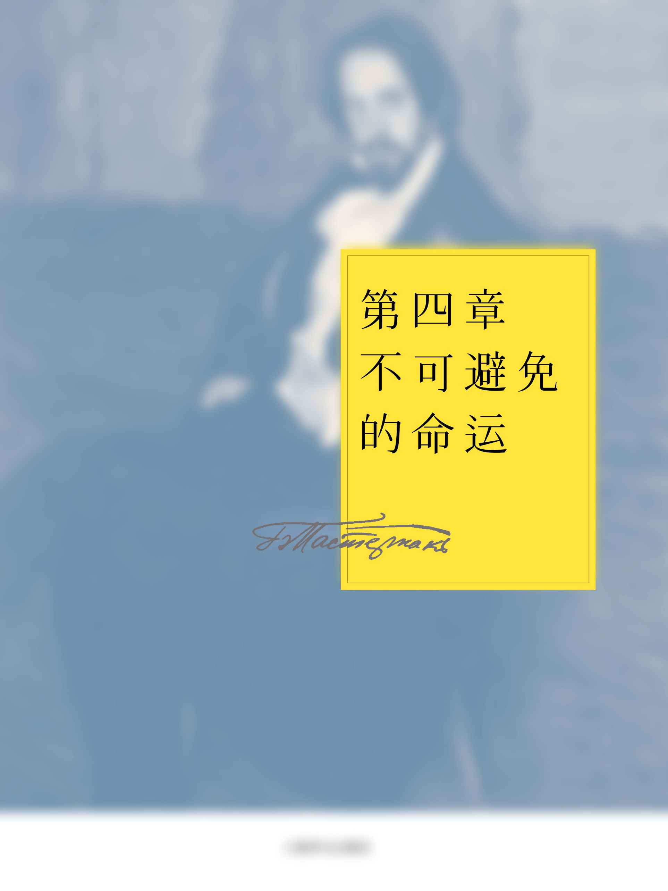

# 第四章 不可避免的命运

<h3 id="c047">一</h3>

拉拉躺在费利察塔·谢苗诺夫娜卧室的床上，处于半昏迷之中。斯文季茨基夫妇、德罗科夫医生和女仆在她周围低声说话。

斯文季茨基家客人已散，房间里都灭了灯。只有长廊式套间的中间的小客厅里，还亮着壁灯，昏暗的灯光投向一前一后的套间。

科马罗夫斯基在套间里走来走去，恼怒地使劲踩着步子，不像在别人家做客，倒像在自己家里。他时而探头望望卧室，看有什么动静，时而踅回来往另一头走去，经过缀着银色珠串的圣诞树来到餐厅。餐桌上满满登登的佳肴还没动过。每当街上驶过马车，或者桌上窜过一只小耗子，绿色的高脚酒杯就叮叮作响。

科马罗夫斯基此时怒不可遏。他心里充满烦恼和矛盾。这事多丢脸，多不像话，他简直气疯了。如今他的处境岌岌可危。这件事会败坏他的声誉，他要不惜任何代价，及早防止流言的扩散，防患于未然；如果消息已经传开，要在开始时就把它压下去。此外，他再次感到这个无所顾忌的疯姑娘确实令人倾倒。一眼就可以看出，她与众不同。她身上有一种特有的气质。看来他是无可挽回、伤透人心地毁了她的一生。她竭力想按照自己的意愿改变命运，重新开始自己的生活；为此她拼命奔突，不断地向命运抗争！

不论从哪方面考虑，他都应该帮她一把。是否给她租间房子呢？但绝不可再去碰她，相反应该回避她，远远地离开她，不要使她犯疑。要知道她可不是好惹的，弄不好还会干出意想不到的事来！

可往后的麻烦事还多着呢！这件事不会就这么了结的。法律没有睡觉，现在还是夜里，离出事还不到两个钟头，可警察局的人已经来过两次。科马罗夫斯基在厨房里和警察分局长解释了半天，才把一切对付过去。

可事情越来越复杂。得要提供证据，说明拉拉是朝他打枪，而不是针对科尔纳科夫。即使有了证据，事情也没有完结。拉拉的责任可能减轻些，但她还要受到审讯，她还是有罪的。

毫无疑问，他科马罗夫斯基将尽全力阻挠审讯，如果起诉成功，他将设法弄张精神病医师的诊断，证明拉拉开枪时精神错乱，失去控制，这样诉讼才可以了结。

想到这儿，科马罗夫斯基才开始平静下来。一夜过去了。太阳光束从外面投射进来，从一个套间穿到另一个套间，朝桌子和长椅下面探视着，像窃贼或当铺的估价人似的。

科马罗夫斯基去卧室看了看，知道拉拉并没有好转，就离开斯文季茨基家去找一个熟悉的女律师鲁芬娜·奥尼西莫夫娜·沃伊特沃伊特科夫斯卡娅。她是一个外国政治流亡者的妻子。她的寓所共有八间房，但她用不了这么多，而且花销太大，就租出去两间。其中一间不久前又空了下来，科马罗夫斯基便给拉拉租下来。几小时后，拉拉被送到了这里。她仍高烧不退，处于半昏迷状态。她患了神经性热病。

<h3 id="c048">二</h3>

鲁芬娜·奥尼西莫夫娜是个思想先进的妇女，反对偏见，同情和支持一切她所谓真正“进步和有前途的”事物。

在她的五屉柜里，有一本由起草人签名的《爱尔福特纲领》。挂在墙上的照片中，有一张是她丈夫，她的“善良的沃伊德”，在瑞士一次群众游园会上和普列汉诺夫一起照的。他俩都穿着柳斯特林短衫，头戴巴拿马草帽。

鲁芬娜·奥尼西莫夫娜第一眼就不喜欢这个生病的女房客，认为她是装病，用心险恶。拉拉昏迷时的呓语，鲁芬娜认为全是假的。她信誓旦旦地说，拉拉是模仿狱中的甘泪卿
 <a href="09-%E7%AC%AC%E5%9B%9B%E7%AB%A0%20%E4%B8%8D%E5%8F%AF%E9%81%BF%E5%85%8D%E7%9A%84%E5%91%BD%E8%BF%90.md#m1">
[1]
</a>
 。

鲁芬娜·奥尼西莫夫娜成天乒乒乓乓地用力摔门，大声哼歌，在她那几间屋里旋风似的出出进进，整天敞着门窗换空气，以此来表示对拉拉的鄙视。

她的寓所在阿尔巴特街一幢大楼的顶层。冬至以后，从窗子望出去是一片辽阔的蓝天，像春汛期浩淼无际的河水。半个冬天，这寓所总是充溢着即将来临的春的气息、春的前奏。

习习南风从气窗里送来暖意。火车站汽笛呜呜地吼着。卧病在床的拉拉，百无聊赖地回忆着遥远的往事。

她常常记起他们一家七八年前从乌拉尔到达莫斯科的那个晚上。那是难以忘怀的童年往事。

他们乘坐马车从车站穿过昏暗的小巷，穿越莫斯科城到旅店去。街灯迎面照来，然后又落在他们身后，把拱背的马车夫的影子投在墙上。他的影子越变越长，失去了比例，有时把路面和房顶都遮住了，直至忽地消失。然后一切又从头开始。

幽暗的天空中，莫斯科数不清的教堂大钟当当地敲着，地面上来来往往的马车辘辘作响。就连五光十色的橱窗和灯光，拉拉觉得好像也和大钟、车轮一样发出自己的声音，震耳欲聋。

在旅馆里，他们桌上摆着个吓人的大家伙——硕大无比的西瓜。这是科马罗夫斯基祝贺他们迁居莫斯科的礼物。拉拉觉得这西瓜是科马罗夫斯基权势和财富的象征。科马罗夫斯基举刀劈开了这个深绿色的圆形怪物，露出凉丝丝的、甜汁四溢的瓜瓤，拉拉吓得不敢出气，但又不敢不吃。她勉强地咬着粉红色香甜的瓜瓤；由于情绪紧张，瓜瓤都哽在喉咙里了。

正是这种面对高级美食和莫斯科夜市的胆怯，后来变成了对科马罗夫斯基的胆怯，而这便是以后发生的一切的主要缘由。可是现在他简直判若两人。他无求于她，从不提到自己，甚至都不露面。他总是与她保持着距离，完全无私地帮助她。

然而，科洛格里沃夫的来访就截然不同了。拉拉见他到来喜不自胜，倒并不因为他身材魁梧，仪表堂堂，而是因为他身上充溢着活力和才华。这位客人炯炯的目光和智慧的微笑，占了半个房间，以致房里显得拥挤起来。

他坐在拉拉床前，搓着双手。当他被召去彼得堡出席内阁会议，和那些官位显赫的老人们说话时，好像在和预备学校的淘气学生打交道似的。现在，在他面前的是卧病在床的拉拉，不久前他家里的一个成员，几乎就像自己女儿一样。现在他和她就像家里人那样，随便地互相看了几眼，说上两句话（他们之间的简短又深情的交谈，显得十分融洽，这一点两人心里都清楚）。他不可能像对待大人那样苛求拉拉，也不能无动于衷。他不知道该怎么同她谈话才不至使她难受。他像对孩子似的笑了笑说：

“亲爱的，你这是何苦呢？谁要看你这出戏呀？”他不再多说了，端详起天花板和壁纸上的湿斑来。接着不以为然地对她摇了摇头，继续说道：“在德国的杜塞尔多夫有一个国际展览开幕了，展出的是绘画、雕塑和园艺。我打算去看。你这里有点潮湿。你还准备长期地这么漂泊不定吗？这里可算不得什么天堂，真的。这位沃伊特太太——我这只是对你悄悄说——相当坏。我知道这个人。换个地方住吧。别老躺着。躺了一阵子就够了。该起来了。换间房子，捡起功课来，把学业完成了吧。我有个朋友是画家。他要去突厥斯坦呆两年。他的画室用木板隔成了几间房，说实在的，那倒像一套小公寓。听说，他想连同家具一起托付给个可靠的人使用。你若想去，我给你去张罗。还有一件事，请允许我公事公办。我早就想这么做了，这是我义不容辞的责任……自从莉帕……她已经毕业了……为了感谢你对她的帮助，这儿有一笔不大的款子……不不，你不能拒绝……不，我求求你，别固执己见吧……不，我不能拿回去。”

临走他不顾她反对、流泪、甚至几乎要和他打架，逼着她收下了一张一万卢布的银行支票。

拉拉病愈后，就搬到科洛格里沃夫极力推荐的住所，房子紧挨着斯摩棱斯克市场。这是一幢老式的两层砖房，拉拉的房间在楼上。底层是个货栈，住着马车夫。院子里铺的是鹅卵石，常常撒下燕麦粒和干草，一群鸽子咕咕叫着在院子里逛来逛去。它们不时扑棱棱离开地面，低低地从拉拉窗下飞过。院子里砖砌的排水沟里，常有成群的耗子窜来窜去。

<h3 id="c049">三</h3>

想到帕沙，拉拉心里很难受。拉拉病重时，人们不放他进去见她。他会作何感想呢？拉拉要杀死一个人，这个人与她毫不相干，可后来这个幸免于难的人竟出来庇护她。这一切又都发生在圣诞节他们在烛光下的一席谈话之后！如果没有那个人的保护，拉拉得被捕判刑。他使她免遭已经临头的惩戒。靠了他的帮忙，拉拉才能继续学习，平安无事。帕沙一定不胜苦恼，困惑难解。

拉拉好些后把帕沙找来，对他说：

“我是个坏女人。你不了解我，以后我会告诉你的。现在我说话感到困难，你看我不是哭得喘不过气来吗？好了，你忘了我吧，我配不上你。”

他们之间出现了一幕又一幕令人肝肠欲断的场面。当时拉拉还住在阿尔巴特大街。女房东沃伊特太太看见泪痕满面的帕沙，就赶紧从走廊跑回自己的房间，扑在沙发上笑得透不过气来，嘴里喊着：“哎哟！我受不了，真受不了！这真是……哈哈哈！好一个英雄！哈哈哈！真是个叶鲁斯兰·拉扎列维奇
 <a href="09-%E7%AC%AC%E5%9B%9B%E7%AB%A0%20%E4%B8%8D%E5%8F%AF%E9%81%BF%E5%85%8D%E7%9A%84%E5%91%BD%E8%BF%90.md#m2">
[2]
</a>
 ！”

拉拉想让帕沙离开她这个不光彩的恋人，把她彻底忘掉，结束一切痛苦。她严肃地对帕沙说，她坚决要与他一刀两断，因为她不爱他。但她说着，竟失声痛哭，叫人无法相信。帕沙怀疑她犯有种种不可饶恕的罪过，对她的话一概不信。他想诅咒她，憎恨她，可实际上却发狂似的爱她。他对她心里的种种念头，连她喝水用的杯子、睡觉的枕头，都怀有妒意。再这样下去，非发疯不可。必须尽快断然行动。他俩决定不等考试结束，马上结婚。本来打算在复活节后第一周举行婚礼，由于拉拉的要求，婚期就挪后了。

等到他们得知确能顺利毕业后，便在圣灵降临节的第二天，举行了婚礼。一切都由柳德米拉·卡皮托诺夫娜·切普尔科操办，她是拉拉毕业班的同学图西娅·切普尔科的母亲。柳德米拉·卡皮托诺夫娜是个很漂亮的女人，乳胸丰满，声音低沉浑厚，是个好歌手，同时还是个极会出点子的女人。除了一般的迷信说法和做法之外，她还常常爱添枝加叶，杜撰出不少新发明。

拉拉要去教堂举行“金冕婚礼”了——这是卡皮托诺夫娜给拉拉穿嫁衣时，学着吉卜赛女低音歌手潘宁娜哼唱着说的。这天天气酷热。教堂金色圆顶和新铺上细沙的送亲之路，都闪着黄澄澄刺目的光芒。圣灵降临节前夕砍下来的白桦树枝，已经蒙上尘土，蔫蔫地挂在教堂围墙上，叶子卷了起来，好像被火烤过。喘气都感到困难，阳光照得眼睛直冒金星。这里仿佛有成千对男女举行婚礼，因为姑娘们都像新嫁娘一样，梳着卷发，穿着浅色衣裙，年轻的小伙子们也因为过节，在头发和胡子上抹了油，穿着紧身的黑色服装。大家都很兴奋，也都热得难受。

拉拉踏上圣坛前的地毯时，另一个同学的母亲拉戈金娜，在她脚下洒了一把碎银币，祝福她将来金玉满堂，柳德米拉·卡皮托诺夫娜同样为了拉拉日后能大富大贵，告诉她在接受婚冕画十字时，要用头纱或花边掩着手指，不能光着指头；她还告诉拉拉要把手里的蜡烛举得高高的，这样她在家里可以占据上风。可拉拉宁愿为帕沙牺牲自己的未来，她尽量把蜡烛拿得低些。但却枉费心机，因为拉拉虽然使劲压低蜡烛，帕沙比她拿得更低。

出了教堂，他们直接回到拉拉住的艺术家画室，那里已经由帕沙的家里人布置一新了。婚宴开始。客人们喊着：“苦呵，酒喝不下去！”另一边的客人又一起大声响应：“加点甜的！”于是两位新人羞答答地含笑接吻。柳德米拉·卡皮托诺夫娜唱了婚礼喜歌《葡萄》，副歌“愿上帝赐给你们爱情和祝福”唱了两遍，还唱了一首《解下发辫，散开秀发！》。

宾客散去之后，只剩了他们两人，周围突然静下来，帕沙不知如何是好。在拉拉窗子对面的院子里，有一盏路灯，拉拉无论怎么拉紧窗帘，中间总留着一条缝隙，像锯开了的木板一般的细光带，从中间透射过来。这道光令帕沙不安，似乎有人在暗中窥视。帕沙吃惊地发现，他这会儿尽想路灯了，至于他自己、拉拉以及自己对她的爱情，却降到次要地位。

不久前还是大学生的帕沙（同学们戏称他“斯捷潘妮达”和“美姑娘”），在这个漫长得永无止境的夜里，达到了幸福的顶峰，同时又落到了绝望的深渊。他说出了自己的怀疑猜想，拉拉坦白相告。他问她，而每次听到她的回答，心就往下沉一次，他犹如坠入了深坑。他那受到了创伤的想象力，怎么也追不上拉拉一个又一个袒露的剖白。

他俩一直谈到天亮。这一夜成了帕沙生活里一个重大转折关头，这变化令人感到震惊和意外。翌日早上起来，他已判若两人，当人们还用原来的名字称呼他时，他不禁有些愕然。

<h3 id="c050">四</h3>

十天以后，朋友们又在这间屋里为他们饯行。帕沙和拉拉双双毕业，双双成绩优异，双双被聘去乌拉尔的同一城市工作。明天早上他们就要出发了。

大家又在这里喝酒、歌唱，十分热闹。但这一次清一色是年轻人，没有上年纪的。

客人们聚在大画室里，隔板后面是几间小起居室，放着拉拉一大一小两只柳条筐，一只箱子和一木箱的碗碟家什。屋角还放着几个行李袋。东西不少。有些行李准备第二天早晨作慢件托运。大部分东西已经收拾停当，但还没完全装好。小木箱和柳条筐还没盖上，有些富余的地方仍可放东西。拉拉一会儿想起件什么东西，就放到隔板后面的筐里，再整理—番。

拉拉到学校办公室领取了结婚证和其他证件，陪她一起回来的还有院子的看门人，他弄来一张准备明天包装用的粗席和一把结实的粗绳。这时，帕沙已经在家里招呼客人了。拉拉等看门人走后，也来应酬客人，逐个地握手问好，或者互相亲吻，然后回到隔板后面去更衣。等她更衣出来，大家朝她鼓掌、欢呼，纷纷在桌旁就座，像几天前的喜宴上那样，欢声笑语不绝于耳。善于应酬的人，已经给左右的宾客斟酒，许多只手用叉子去取餐桌中间的面包、冷盘和菜肴。他们高谈阔论，喝下酒不断咳着，争先恐后地说俏皮话。有几个人很快就有了醉意。

“我累得不行啦！”拉拉坐在丈夫旁说，“怎么，你该办的事都办了？”

“嗯。”

“累虽累，可我还是觉得很高兴，我很幸福。你呢？”

“我也一样。我心情很好。不过，这可一言难尽。”

科马罗夫斯基作为例外，也来参加了这次青年人的晚宴。晚宴快结束时，他本想说，这两位年轻朋友走后，他将感到孤单寂寞，莫斯科对他来说将是撒哈拉大沙漠。可他激动得抽泣起来，话也说不下去，只得把中断的话再说一遍。他要求帕沙和拉拉允许他和他们通信；如果太想他们的话，允许他去他们的新住处尤里亚京探望。

“这完全不必了，”拉拉漫不经心地大声回答说，“这些全是多此一举，什么通信啊，什么撒哈拉大沙漠啊，如此等等。更用不着去看我们。我们不在，上帝保佑您会过得更好。我们并不是什么无价之宝，帕沙，你说对吗？也许您能找到别的年轻人来替代我们呢。”

猛然间，拉拉想起件事，急忙起身到隔板后的厨房去，根本忘了她和谁在说话，说了些什么。在厨房里，她卸开绞肉机，把一个个零件用稻草垫着塞到碗箱的角落里，差点没让箱旁的木片扎了手。

拉拉装着绞肉机，竟忘了家里还有客人，脑子里连他们的影子都没了。突然隔板前传来一阵喧闹，这才想起了他们。她想醉酒的人总爱装疯卖傻，越是醉得厉害，就越显得特别庸俗，越喜欢这样装模作样。

这时，从敞开的窗子传来院子里一阵异常的响声。拉拉撩开窗帘，探出头去。

院子里一匹上了绊绳的马，正站立不稳，又蹦又跳。不知道这匹马的主人是谁，看来是走错了院子。天光已经大亮，但离日出还早。沉睡得就像死寂的城市笼罩在拂晓前一片浅紫的寒雾里。拉拉闭上了眼睛。这匹马与众不同的奇特的蹄声，把她带到了一个美丽而又偏僻的乡村。

这时寓所门铃声响了。拉拉注意地听了听。桌旁有人站起来去开门。来人原来是娜佳！拉拉飞奔出去欢迎她。娜佳刚下火车，光艳迷人，浑身似乎散发出一股杜普良卡庄园的铃兰香气。这两个女友站在那儿，一句话也说不出，只是大哭着紧紧拥抱，搂得对方都快喘不过气来。

娜佳代表全家人，远道来祝贺新婚并祝福她一路顺风，同时带来父母赠她的一件贵重礼物。她从手提包里取出一个用纸包着的小首饰盒。拆开包纸，咔嚓一声打开盒盖，是一条璀璨夺目的项链。

人们惊叹不止。一个酒醉方醒的客人说：

“这是粉红色的红锆宝石呢。你怎么不信呀？的的确确是粉红色的。这种宝石不比钻石差。”

可娜佳纠正他说，这是黄色宝石。

拉拉拉她坐到自己身边，给她斟酒递菜。她把项链摆在自己餐具旁，目不转睛地望着。在盒里浅紫色的软垫上，项链盘成小圈，珠光闪烁，一会儿像滚在一起的露珠，一会儿又好比一串纤巧的葡萄。

有的人酒已经醒了，又陪着娜佳喝起来。过不一会儿娜佳就给灌醉了。

不久，这里就成了沉睡的王国。大部分人准备明天去车站送帕沙和拉拉，便留在这里过夜。客人中有一半横七竖八地躺着鼾声大作。拉拉不记得自己是怎么和衣躺在熟睡的伊拉·拉戈金娜的身旁的。

忽然拉拉觉得有人在耳边大声说话，惊醒过来。这是从街上来院子里找失马的陌生人的声音。拉拉睁眼一看，吃了一惊，心想：“这帕沙怎么啦，总也不肯歇歇。傻大个儿似的站在房间里，东摸摸、西摸摸。”这时候，那人朝她转过头来，原来根本不是帕沙，是个长相吓人的麻子，脸上从太阳穴到下巴颏有一道长疤。这时她才明白过来，家里来了窃贼，强盗。她想喊可喊不出声来，突然她想起了那串项链，悄悄用胳膊肘撑起身子，斜眼朝餐桌望了一下。

项链放在面包屑和吃剩的糖果堆里。笨头笨脑的贼人没有发现，他只顾翻腾拉拉箱子里的衣服，弄得一塌糊涂。拉拉仍有些醉意，睡得糊里糊涂，辨不清是怎么回事，只觉得那人弄乱了她的行李好不气恼！她一气之下，又想喊叫，但还是张不开嘴，舌头也不听使唤。这时她就用膝盖朝睡在旁边的伊拉·拉戈金娜的胸口使劲一顶，痛得她哇哇大叫，拉拉跟着也喊出了声。窃贼失手扔下提起的一包东西，三步并两步夺门而出。男客们惊跳起来，有几个人好半天才明白出了什么事，赶紧追出去，可贼人早已逃之夭夭了。

这一场骚乱和客人们唧唧呱呱的议论，像起床号似的，把大家全吵醒了。拉拉最后一点醉意也给驱散。尽管客人们还想再打个盹，躺一会儿，拉拉说什么也不答应，把睡着的客人全催起来，连忙张罗他们喝了杯咖啡，就打发回了家，约好明天开车前在车站再见。

客人一走，她就忙开了。拉拉一向干活麻利，现在她弄完这件行李弄那件，把枕头分别塞进行李包，抽紧带子，只求帕沙和看门人的老婆别来插手帮倒忙。

一切都按时收拾妥当。帕沙和拉拉没误了火车。列车缓缓开动了，好像配合着人们挥帽送别的节拍。后来，人们不再挥手，远远地喊了三声（大概是“乌拉”），火车加速向前奔去。

<h3 id="c051">五</h3>

阴雨天气已经持续了三天。这是开战后的第二个秋天。第一年捷报频传，第二年开始节节败退。集结在喀尔巴阡山里的布鲁西洛夫第八军，本来准备越过山隘攻进匈牙利，但由于全线总退却，只好不停地后撤。俄国军队放弃了战争初期占领的加里西亚。

日瓦戈医生站在妇产医院产科大楼的走廊上，旁边就是产房。他刚把妻子冬尼娅送进医院，安排到产房里。从前人们都叫他尤拉，现在慢慢地越来越多的人叫他的名字和父称了。他已和妻子道了别，现在正等助产女医生来。他要和她说好，万一有事如何通知他，他又如何了解冬尼娅的情况。

他工作很忙，急着要赶去自己的医院。在这之前，还必须顺路去两个病人家出诊。可这会儿他都在白白浪费宝贵的时间。他瞅着窗外斜斜的细密雨丝，阵阵秋风把雨丝吹断或吹弯，就像暴风雨中被打得歪斜的麦穗。

天没全黑下来，日瓦戈还可以看见医院后院圣女街上几幢私人住宅的玻璃阳台，还有医院一幢楼房后门的电车支线。

雨淅淅沥沥、不紧不慢地下个不停，尽管雨水的悠然自得使风变得怒不可遏。阵阵狂风撕扯着缠绕在一个阳台上的野葡萄的新藤，好像要把它连根拔起，抛到空中抖动几下，然后再鄙夷地抛到地上，犹如扔掉一件破衣烂衫。

一辆机动车拖着两个挂车，经过阳台驶进医院。从车厢里抬出一个个伤员。

莫斯科的医院已拥挤不堪，尤其在卢茨克战役以后，连医院走廊和楼梯平台都挤满了伤员。市里各医院普遍超员，连妇产科也开始受到影响。

日瓦戈转过身子，背着窗户，乏得直打哈欠，脑子里空荡荡的。突然，他想起了件事：在他工作的圣十字医院外科，最近死了个女病人。日瓦戈诊断她患了肝包生绦虫病，别人都不同意他的诊断，今天要解剖。解剖能判定谁是谁非。不过他们医院里的解剖师是个酒鬼，天晓得他会怎么干。

很快夜幕四合，窗外已经什么也看不见。仿佛有根魔杖一点，霎时所有的窗户都亮起了灯光。

冬尼娅产房里走出一位身材魁梧的医生，来到走廊上。这位妇科主任医师，不管人家问他什么问题，总是翻眼望望天花板，耸耸肩了事。他的动作和表情像是在告诉你，无论科学如何进步，我的朋友，总有一些不解之谜，科学在它们面前也只好认输。

他从日瓦戈身旁走过时，微笑地向他点了点头，轻轻摆了几下他的厚实的大手，意思是说，还得等等，别着急。然后就顺着走廊去候诊室抽烟了。

这时，刚才那位不爱说话的妇科医生的助手，走了出来。她恰巧相反，极爱唠叨。

“我要是您的话，就回家了。明天我往您医院里打电话。在这之前她不会生的。我看是顺产，无需动什么手术。可是，话又说回来，她骨盆有些窄，另外又是第二枕位；她并没有阵痛，子宫收缩微弱，这些都是不利因素。不过，说这个也为时过早。最后全看临产时腹肌收缩的情况，现在还不好说。”

第二天，日瓦戈打电话去问，接电话的是医院的门房。他让日瓦戈在电话上等着，他去问问情况。日瓦戈焦急地等了十来分钟。回话来了，很不礼貌，也没有什么实在的消息：“他们让我告诉你，你妻子来医院太早，应该把她接回家去。”气急败坏的日瓦戈，要求换个了解情况的人来接电话。一个护士对他说：“目前的迹象还不明显。请您不必着急，得耐心等上一两天。”

第三天他得到消息，昨天夜里冬尼娅开始分娩了，天亮时流了羊水，阵痛从早上开始一直不断。

他又急匆匆赶到医院，在走廊上他就听见虚掩的门里传出冬尼娅撕心裂肺的喊声，好像被火车压断手脚的人在惨叫。

他不能进去看她。他把弯起的手指关节都咬出了血。他走到窗前，外边依然同前两天一样，斜风细雨，淅淅沥沥下个不停。产房出来一个护士，门里传出了新生婴儿的哭声。

“平安无事了，平安无事了。”日瓦戈高兴得喃喃自语。

“是个儿子，小男孩儿。母子都平安。”护士说得悦耳动听，“现在不能进去，过些时候会让您看的。到时候您得好好给产妇花点钱呢，她可受够了罪。头一胎嘛，总少不了吃苦头。”

“平安无事了，平安无事了。”日瓦戈喜不自胜，竟没听清护士说了些什么，也不明白护士为什么把他同刚才的事联系在一起，这和他有什么相关呢？什么父亲呀，儿子呀——他轻而易举地当上了父亲，并不觉得这有什么值得骄傲的；对这个从天而降的儿子，也没有什么特别的兴趣。这一切都进不了他的意识。重要的只有冬尼娅。冬尼娅摆脱了死神的威胁，幸运地活了下来。

离医院不远的地方，有一个他的病人，他顺路去看了一下，半小时后又回到医院。走廊上门斗和产房的两扇门都虚掩着。日瓦戈悄悄溜进门去，几乎没意识到他是在做什么。

穿着白褂子的那位高大的妇科主任医师，突然出现在他面前，仿佛是从地底下钻出来的，两手一伸挡住了他：

“哪儿去？”他拦住了日瓦戈，气呼呼地压低声音，免得被产妇听见。“怎么，您疯了吗？她有伤口，还在流血，怕感染，更不用说精神上受的刺激。真有你的，亏你还是个医生呢。”

“我不是……我就看一眼。就站在这儿，从门缝里瞅一瞅。”

“嗯，这就是另一回事了。可以吧。可得老实点！……你要留神，要是她发现了，我揍死你，打你个稀巴烂！”

产房里背对门站着两个穿白大褂的妇女，一个是助产士，一个是护士。护士手里托着一个初生的娇嫩的婴儿，哇哇哭叫着，身子一伸一蜷，活像块暗红色的橡皮。助产士在扎结脐带，使孩子脱离胎盘。冬尼娅躺在产房中间一张能升降的手术床上。床铺很高。日瓦戈由于激动，看一切都带些夸张。这张手术床好像有齐胸高的斜面写字台那么高。

现在，冬尼娅躺在高出一般病床、接近天花板的手术台上，在备受折磨之后，仿佛沉入了云雾之乡，浑身筋疲力尽，自己也轻飘如烟了。冬尼娅高卧在产房正中，像一艘刚靠岸卸完货的船，现在停泊在海湾里。这条船从缥缈的远方，载着新的灵魂，横渡死亡的海洋，来到了生命的大陆。它刚刚把一个灵魂送来大陆。如今船已抛锚，船舱里空空荡荡，整艘船正在休息。船上经过风雨侵袭被吹折的缆索和船壳板也和船一起休息了。不久前航行过哪些地方，停靠在什么码头，这一切它都忘了，脑子也休息了。

谁也不知道船上挂的国旗属于怎样一个国家，所以谁也不知道用什么语言去和它交谈。

日瓦戈回到自己的医院里，人们争先恐后向他表示祝贺。他觉得好奇怪，他们怎么那么快就知道了！

他来到住院医师室，这间屋子被大家称作肮脏的小酒馆和垃圾箱。由于医院患者太多，过于拥挤，这里成了临时的衣帽间。人们穿着套鞋从外面进来，常把别处带来的脏东西留下，地上满是烟蒂和纸屑。

住院医师室的窗前，站着那位皮肉松弛的解剖师，手里举着一个盛了浑浊液体的玻璃瓶，从眼镜上面，正在仔细观察。

“恭喜您。”他一边说一边继续端详那溶液，甚至没看日瓦戈一眼。

“谢谢，非常感激。”

“不必谢。我和此事无关。是皮丘日金解剖的。大家都很震惊，是有包生绦虫。都说您是个了不起的诊断医师！都赞不绝口。”

这时，医院的主任医师走进来，同两人打过招呼之后说：

“真见鬼。不像话，住院医师室变成了过路的走道！日瓦戈，想不到真是包生绦虫！我们全诊断错了。祝贺您。还有件不太愉快的事。又在审查您的免役证。这次没法帮您忙了。军队里的医护人员奇缺。看来您得去闻闻火药味。”

<h3 id="c052">六</h3>

帕沙·安季波夫和拉拉·安季波娃在尤里亚京安顿下来，一切都出乎意外地理想。这里对吉莎尔一家颇有好感。这给初来乍到的拉拉，减少了许多困难。

拉拉整天不停地操劳。全部家务和他们三岁的女儿卡坚卡都由她管。家里那个棕发女仆玛尔富特卡虽然尽心尽力地干活，还是帮不了太多的忙。拉拉对帕沙的事，全都要过问。她自己也在一所女中教书。她工作不息，感到十分幸福。这正是她期望的生活。

尤里亚京的一切她都喜欢。这本是她的故乡之城。一条大河雷尼瓦横贯尤里亚京市，河的中下游都可通航。乌拉尔地区的一条铁路，也经过这座城市。

冬天来临之前，尤里亚京的船主们把船只从河里抬上岸，用大车运进城里，各家把船摆到自家院子里露天过冬。院子里白色的船底总是朝着天，直到来年开春。这也是冬天来临的前奏，就像有的地方秋雁南飞或初降小雪一样。

安季波夫夫妇所住的院子里，也有一条船，白漆船底朝天晾着，卡坚卡经常钻到船下玩耍，就像在花园圆顶亭子里一样。

拉拉很喜欢这偏远省城的习俗风尚。知识分子说起话来，都像北方人似的“噢”音很重，喜欢穿毡靴和灰色法兰绒短上衣，对人真挚坦白。她情不自禁地爱上了这里的土地和纯朴的人们。

令人不解的是，帕沙虽是铁路工人的儿子，却染上了许多莫斯科城里人的痼习。他对尤里亚京的人比妻子要苛刻得多，很不喜欢他们的粗野和无知。

拉拉如今才发现，原来帕沙有一种惊人的才能，在博览群书时能吸收和积累大量知识。以前有拉拉的帮助，他读了不少书，搬到这僻静小城的几年间，他的知识更突飞猛进，连拉拉都相形见绌了。他知识渊博，比学校的同事们高出一头，所以常常抱怨说，和他们在一起枯燥无聊。在战时情况下，他们那种有些盲从的爱国主义——一种时兴的、官方提倡的爱国主义，同帕沙的比较复杂的爱国主义感情，不是一回事。

帕沙是从大学古典语文系毕业的，现在中学教拉丁语和古代史。但是这位过去的实科中学学生，突然对数学、物理和其他精密科学产生了兴趣，仿佛这一爱好过去一直沉睡着，现在突然苏醒了。他把大学里的这些课程全部自修完毕。他希望一有机会就到区里去通过考试，改行从事数学专业的工作，并带着家眷一起搬到彼得堡去。深夜苦读损害了帕沙的健康。他开始失眠了。

他和妻子的关系很好，但却非常复杂。她的善良体贴给他造成了压力。他从不敢对她稍有微词，唯恐自己毫无用心的话引起她的怀疑，以为他内心对她不满，比如说不满她出身贵族，而他却是个平民，或者责备她出嫁之前曾失身于人。他总是小心翼翼，唯恐自己无心的话被看作是对她不公正的责难。这使他俩的生活多了一层不自然的气氛。他俩都想表现得比对方更宽容更高尚，结果关系反而愈来愈复杂。

一天，他们家里来了客人。有几个是帕沙学校的同事，有一位是拉拉所在学校的校长，还有一位是仲裁法庭的仲裁员（当时帕沙是调停人），还有些其他人。帕沙认为他们全是十足的蠢材。他十分惊讶拉拉怎么对他们如此亲善，他根本不相信拉拉对谁真有好感。

客人走后，拉拉把窗子开了很久换空气，打扫房间，和玛尔富特卡在厨房里洗杯盏。然后又去看卡坚卡的被子是否盖好，帕沙是否已经睡着。然后才很快脱衣熄灯，上床在丈夫身旁躺下，自然得就像一个孩子睡到母亲身旁。

其实，帕沙只是装样子，他并没有睡着。最近他又犯失眠症。他知道还得这样躺上三四个小时才能入睡。为了能快些入睡，另外屋里的烟味难闻，他蹑手蹑脚爬起来，戴上帽子，在睡衣外面披上皮袄，走出了门外。

这天夜里晴朗寒冷。帕沙踩得脚下冰层咔嚓咔嚓地裂开来。幽光闪闪的星空，仿佛是酒精火焰，在冻硬的坑洼的黑土地上，洒下摇曳的蓝色光芒。

帕沙和拉拉住的地方和码头遥遥相对，是城市另一头街尾上最后一幢房子。过了他们的家，就是田野了。有条铁路通过这里，铁道旁矗立着一个守卫岗亭，横越铁轨是一个道口。

帕沙坐在翻倒的船底上，望着星空。这几年经常萦绕在他脑海里的念头，如今特别令他心神不宁。他觉得，这些念头迟早该有个结果，不如今晚就想出个眉目来。

他寻思：不能再这样下去了。目前的情况本来是早可以预料到的，但他明白得太晚了。她为什么允许他很小的时候就忘情地迷恋她，后来又随心所欲地塑造他？结婚前的那年冬天，她坚决要求分手，他当时为什么没及早明白过来？难道他不明白，她爱的不是他，而是对他的一种神圣使命，是体现在他身上她的一种功勋。可这种神圣高尚的使命，同真正的家庭生活哪有什么共同之处呢？最要命的是，他至今还像以前一样热恋着她。她美得叫人神不守舍。也许这并不是爱情，而只是对她的美貌和慷慨的诚惶诚恐的感激之情。唉，这些又怎么分得清呀！神仙来了也无能为力！

既然如此，该怎么办呢？要让拉拉和卡坚卡摆脱这种虚假的处境，这比解脱自己更重要。“可怎么做到呢？离婚吗？投河吗？亏你想得出来！”他生气了。“我决不会这样做，既然不准备这样干，为什么又想到这些廉价的把戏呢！”

他仰望星空，仿佛想听到星星的忠告。大大小小、疏密相间的星斗不断闪烁，有的蓝光莹莹，有的变幻不定。突然一道飞速而来的强光划破了黑夜，星光黯然失色，楼院、船只和坐在船底上的帕沙被照得通明，光束像一个人挥动着火把，从田野奔向院门。这是一列军用火车，它喷着一团团浓烟和红火，经过道口向西驶去。从去年开始，这里昼夜不停地驶过了无数军车。

帕沙微微一笑，从船板上站起来，回屋去睡觉。最理想的答案找到了！

<h3 id="c053">七</h3>

听了帕沙的决定，拉拉一下愣住了，开始还以为是自己听错了。“亏他想得出来。又在犯什么怪毛病了，”她暗自思忖，“不理他，他自己也会忘记的。”

但事实上帕沙为此已经准备了两周。他向征兵处递交了证件，学校已经找了代课教员，鄂木斯克的军事学校发来了录取通知书。他出发的日期迫近了。

拉拉号啕痛哭，就像个没知识的妇人一般，抓着帕沙的手，跪在他脚下。“帕沙，亲爱的帕沙，”她哭喊着，“你把我和卡坚卡扔给谁啊？你不能这样，不能啊！现在还不晚。我能把一切都办妥的。再说你还没体格检查。你的心脏不好。你难道不羞耻吗？一时发疯，连牺牲家庭都在所不惜，你不觉得有愧吗？当志愿兵！你一直嘲笑罗佳，说他是庸俗小人，现在你自己也步了他的后尘！你自己也想炫耀军刀，过过军官瘾！帕沙，你怎么啦，我简直不认得你了！你变了，难道你疯了？求求你，老实告诉我，看在上帝的分上，不要人云亦云，俄罗斯需要你这样做吗？”

突然，她明白过来，问题不在这里。虽然她没有完全想清楚，但主要的问题她是抓住了。她猜到帕沙误解了她对他的态度。她对他的感情中始终掺着一种母性的爱，而他却不珍惜这种母性的爱，他也不理解，这种爱比女人一般的爱情更加深厚。

她咬着嘴唇，冷得整个心都瑟缩起来，仿佛挨了打似的。她不再说什么，默默吞下眼泪，替丈夫收拾行装。

他离开她们走了。她觉得整座城市变得沉寂了，甚至天空的乌鸦也稀少了。“太太，太太。”玛尔富特卡叫她，她听不见。“妈妈，我的好妈妈。”卡坚卡拽着她的衣袖咿咿呀呀地叫着她。这是她受到的最致命的打击。她最美好的、最光明的希望破灭了。

从丈夫自西伯利亚寄来的信中，拉拉知道了他的一切情况。他很快就清醒过来，非常思念妻子和女儿。几个月以后，帕沙提前毕业，成了一名准尉军官，不久又突然被派往作战部队。军令紧急，他匆促上路，途经的地方都离尤里亚京很远，在莫斯科也没有闲暇和亲友见面。

他从前线开始来信了。这比起鄂木斯克军校的来信要有生气，不再那么满腹忧思了。帕沙想立一次功。为了嘉奖他的军功，也许可能给他休假和家人团聚，或者受一些轻伤也好。立功的机会很快就来了。在后来称之为“布鲁西洛夫突破”的有名战役之后不久，部队转入了进攻。帕沙的家信从此中断了。开始拉拉还很坦然，以为帕沙所以不写信，是因为军队不断推进，不可能在行军途中写信。

秋天，军队不再向前推进，开始构筑工事。帕沙仍然音讯全无。拉拉开始惊惶不安，去打听消息。最先只在尤里亚京打听，后来又写信去莫斯科和帕沙的军邮信箱询问，结果一无所获，哪里也没有回信。

当时县城里，许多热心慈善的太太都自愿为军队尽义务，拉拉也和她们一样，从战争一开始就在尤里亚京县医院扩建的军医院，尽自己一份菲薄的力量。

现在，她正规地学了点基础医学知识，并且在医院里通过了护士资格的考试。

作为一名护士，她向学校请了半年假，把尤里亚京的家托付给玛尔富特卡照看，带着卡坚卡去了莫斯科。到了莫斯科，她把女儿寄在莉帕家。莉帕的丈夫弗里津丹克是德籍侨民，和其他国内的被俘人员一起拘留在乌法。

拉拉终于明白了，只是在外围寻找帕沙是无济于事的。于是她决心去不久前他曾作过战的地方。为找帕沙，她到一列救护车上当护士，列车途经利斯基市开往匈牙利边境的梅索拉鲍尔奇。这个城市是帕沙在最后一封信里告诉她的地址。

<h3 id="c054">八</h3>

一列从莫斯科发车的货车，满载着塔季扬娜伤员救济协会的物资，抵达前线师部指挥所。这列长龙列车由外观不雅的多节短身取暖货车连接起来。其中有一节客车车厢，坐的是莫斯科社会活动家，来前线向官兵赠送慰劳品。里面一个人叫米沙·戈尔东。他听说师部的军医院中有一位他童年的朋友日瓦戈，医院就在附近的村子里。

戈尔东去师部索取了一张前沿地区通行证，带上证件，搭上一辆顺路的马车就去看望老朋友了。

赶车的是白俄罗斯人，也许是个立陶宛人，俄语说得很蹩脚。出于间谍恐惧症，他谈的都是官样文章，千篇一律，不说也猜得出来。他那种装出来的政治上的忠诚，使谈话枯燥乏味。所以一路上坐车和赶车的几乎都默默坐着不说话。

师部的人告诉他说，那村子就在附近，离这儿不过二十俄里或二十五俄里光景。实际上到那儿得走上八十多俄里路。因为在师部里调动军队计算距离时，习惯以一百俄里为单位计算。

一路上，在马车左侧远处的地平线上，敌人大炮不停发出沉闷的轰响，令人心惊。戈尔东从来没有亲身经历过地震。但他的判断是对的：远处敌炮阴沉的隐约可闻的隆隆声，确实极像火山爆发时的地动和轰响。天色刚暗下来，左方天际就亮起一片颤悠悠的红光，一直到天亮才熄灭。

马车拉着戈尔东经过一座座破败不堪的村落。有的村子里，老百姓已经跑散；有的村子老百姓躲进了很深的地窖。村中满地是瓦砾，一堆挨着一堆，排得就像原来的房子一样。这种遭过兵祸的村子，可以一览无遗，就像没有植被的空旷荒漠。废墟上有几个劫后余生的老妇人在翻找什么，在自家的瓦砾堆、灰炭堆里挖东西，挖得一点赶紧藏好，仿佛仍在自己屋里，外人看不到她们。她们眼看着戈尔东的马车驶近，又目送它远去，似乎在询问：世上的人们是否能很快醒悟过来，生活还能不能恢复平静安宁。

夜里，戈尔东遇上了骑兵侦察队。他们命令马车从土路上退回去，绕道从村里走。马车夫不认识乡间小路，绕来绕去白白浪费了两个钟头。天快亮时，戈尔东和马车夫才到达目的地。可是村里谁也不知道有个军医院。原来这里有两个同名村子，这里只是其中的一个。早上他们才到达军医院所在的村子。戈尔东一进村口就闻到了甘菊浸剂和碘仿的气味。他原来并不准备在日瓦戈那里过夜，到他那里呆上一天，晚上便回留在车站的同志们那里去。然而出乎意料，他竟在那里呆了一个多星期。

<h3 id="c055">九</h3>

就在这几天，前线有了动静，突然发生了变化。戈尔东所在地区的南面，一个兵团在下属部队胜利之后，突破了敌军牢固的防线。为了扩大战果，一部分先头部队，插入敌军纵深阵地，援军在后面接应，以便进一步扩大突破口。然而援军赶不上先头部队，渐渐拉开了距离。先头部队陷入敌军包围，全部被俘。由于半连人投降，准尉帕沙也被迫当了俘虏。

关于帕沙有许多传闻。有人说，炮弹爆炸时把他掀翻在弹坑里牺牲了。这消息是他同团的少尉加利乌林传出来的，好像是他在观察哨位上从望远镜里看到的，当时帕沙正带着一队士兵向敌军冲锋。

加利乌林所看到的，只是一般情况下冲锋的情景。冲锋部队要迅速，几乎是跑着通过两军阵地间的旷野，那里遍布着在秋风中摇曳的干枯蒿草和直棱棱的刺蓟草。冲锋的士兵需要无畏地逼近敌人，把躲在对面战壕里的奥地利士兵引出来拼刺刀，或者向战壕投掷手榴弹，把敌军消灭在里面。这片旷野，仿佛也在向前奔跑，没有尽头。士兵脚下的泥土，就像摇晃不定的沼泽地。准尉开始时冲在他们前面，后来混在他们中间向前跑，举起手枪在头上挥舞着，张大了嘴拼命喊：“乌拉，冲啊！”可周围的士兵和他自己都听不见喊声。他们每隔适当的距离就在地上卧倒，然后一起爬起来，又喊叫着继续朝前冲。每次卧倒，总有几个人被枪弹击中，倒下时的姿态不同于其他人，仿佛是锯断的树木直挺挺扑倒在地，再也爬不起来。

“炮火射程太远。电话通知炮兵连，”神情紧张的加利乌林向身旁的炮兵军官说道，“不。等一等，他们把炮火转向纵深，做得对。”

这时，冲锋的士兵们已经接近敌军。炮火停了。在突然降临的寂静中，站在观察哨岗的军官们紧张得心扑腾扑腾直跳。仿佛他们正处于帕沙的地位上，带着士兵冲到了奥军壕沟的前沿，马上就该出现大智大勇的奇迹了！正在这一瞬间里，前面一颗接一颗爆炸了两颗德国十六英寸炮弹。升起几股黑色的烟柱，前面的一切都被遮住了。“啊，真主啊！完了！全完了！”加利乌林嘴唇血色全无，认为准尉和他的士兵都阵亡了。第三颗炮弹就落在观察哨岗旁边。他们猫着腰，赶紧撤到后边。

加利乌林和帕沙住在同一个掩蔽部中。当后来团里其他人都认为帕沙已经牺牲，不会再回来时，就让最了解帕沙的加利乌林来保管他的遗物，以便将来交给他的寡妻，遗物中有不少他妻子的照片。

机械师加利乌林是后备军士官生，不久前才提升为准尉。他就是季韦尔辛家看门人吉马泽金的儿子小奥西普。很早以前当过钳工学徒，常常挨师傅胡多列耶夫的毒打。可是他现在得到晋升，倒还得感激那个凶神呢。

加利乌林任准尉军官以后，不知为什么把他派到后方偏远的卫戍部队服役，那里气候温暖，又平静无事。他指挥一支由半残军人组成的部队。由几个和士兵一样衰弱的老兵担任教官，每天清晨进行操练，教官自己也不记得怎么做了。此外，他还负责检查军需库的守卫。这些工作很轻松，对他没有更高的要求。一天，从莫斯科调来一批老民兵来补充他手下不足的兵员。突然他发现新到的人中，有他再熟识不过的彼得·胡多列耶夫。

“啊，我们是老相识啊！”加利乌林阴沉地笑着。“是，长官。”胡多列耶夫答道，赶紧立正敬礼。

他们之间的恩怨不能就这样了结。操练中胡多列耶夫稍有差错，准尉马上呵斥这个下等兵。而当准尉觉得他不正眼看他，眼神躲躲闪闪转向一旁时，就狠狠抽他耳光，罚他蹲两天禁闭，只给面包和水充饥。

现在加利乌林的一举一动，都带了报复的味道。可是，加利乌林觉得，利用等级服从来算旧账，是稳操胜券但并不高尚的行为。怎么办呢？他们两人不可能再呆在一起。但一个军官想把士兵从所在部队调走，除了把他送感化营以外，还能有什么借口，还能往哪里送呢。于是他借口在卫戍部队里枯燥乏味，无所作为，申请调往前线。部队上觉得加利乌林表现不错，再加上最近他在一件事上表现得也很出色，人们一致认为他是个优秀的军官，很快由准尉晋升为少尉。

还在季韦尔辛他们闹罢工的时候，加利乌林就认识了帕沙。当时帕沙在季韦尔辛家里住了半年，加利乌林（也就是小奥西普），常去他那里，过节常在一起玩。他还见过拉拉一两回。后来再没有听到他们的消息。当帕沙从尤里亚京来到他们团后，加利乌林为老朋友发生的变化感到吃惊。原来那个羞答答笑眯眯像个姑娘似的干干净净的小淘气，如今变成了一个神经质的、博学的、倨傲而抑郁的人。他聪慧，有过人的胆略，沉默又好讥讽别人。有时加利乌林审视帕沙，简直觉得在帕沙深沉的目光中，如同在两个窗口里，看到了另一个人，看到了他内心深处的思想，看到了他对女儿的思念，看到了他妻子的面庞。帕沙仿佛是神话里中了魔法的人。可现在他不在人世了。留在加利乌林手上的，是帕沙的证件和照片，还有就是帕沙谜一般的变化。

拉拉或迟或早会查问到加利乌林这里来的。他准备要答复她。但戎马倥偬，坐下来认真写封信都不可能。他还想在告诉她悲痛消息之前，让她思想上有所准备。所以，那封详尽的长信，他一拖再拖，无法动笔。后来他听说，拉拉自己也上前线当了护士。这样他又不知该往哪儿寄信了。

<h3 id="c056">十</h3>

“怎么样？今天有马吗？”每当日瓦戈医生回到加里西亚的农舍时，戈尔东总要问他。

“哪儿有马呀？你能上哪儿去呢，前后受阻，寸步难行。周围混乱到了极点。谁都弄不清是怎么回事。在南方，我们包抄或是突破了德军的许多据点。可又传说，我们有几股分散的小分队被敌人包围了。在北方，德军渡过了斯瓦泰河，据说这是当地无法强渡的一条河流。渡河的是骑兵，有一个团的兵力。他们破坏铁路线，炸毁了军需库。据我看他们正在包围我们。你看，这就是战局。你还说要什么马。卡尔宾科，快点开饭吧，动作快一点。今天我们有什么吃的？啊，有牛蹄，太好啦！”

卫生营和野战医院，以及它们下属的单位，分散在村子各处。这个村子竟奇迹般地保存了下来，房屋居然没有一幢遭到破坏，墙上西式的狭长窗子还明净光亮。

那是晴明的初秋，最后几个暖和的好天气。白天，医生和军官开了窗子打苍蝇，它们一群群黑乎乎爬在窗台上，爬在低矮的天花板上的糊墙纸上。他们敞着军上衣和衬衫，喝热汤和热茶，大汗淋漓。晚上，他们蹲在打开的炉门前，朝湿柴下的炭火使劲吹气，眼睛被烟熏得泪汪汪的，嘴里骂骂咧咧，呵斥勤务兵连生个炉子都不会。

夜里十分寂静。戈尔东和日瓦戈面对面躺在东西两边靠墙的宽铺上。中间隔着一张吃饭的桌子，沿墙是一扇狭长的窗子。房间里炉子烧得很旺，满屋弥漫着烟草味。他们把两边的小气窗打开，放进了秋夜的新鲜空气，玻璃窗上淌下了水珠。

今天，他们俩又像这些天的日日夜夜那样谈着话。远处前沿的天空，也像平时那样一片红光。哒哒的枪声一刻不停，均衡地响着。有时稍远些突然响起一两声沉闷的轰隆的炮声，震得大地微微发颤，仿佛擦着地板上的漆皮，拖过一个沉重的四角包着铁皮的大箱子。这时日瓦戈总是停下话来，注意听这轰响，过了一会儿才说：“这是德国十六英寸口径的贝尔塔大炮，这家伙有六十普特重。”接下去想继续刚才的话题，却又忘了谈的是什么了。

“村子里老有股什么怪味？”戈尔东问道，“我第一天就闻到了。一种甜腻腻叫人恶心的气味，活像耗子的气味。”

“噢，我知道你说的是什么。这是大麻。这里种了许多大麻。大麻本身总有一种叫人头晕的烂果子那样的讨厌气味。再说，这是战区，大麻地里有未被发现的腐烂尸体。这里经常能闻到腐尸气味，不足为怪。听，又是贝尔塔。”

这些天来，他们两人无所不谈。戈尔东了解了日瓦戈对战争和时代精神的看法。日瓦戈讲到他无法接受人们互相残杀的血腥逻辑，讲到他如何不忍心看到伤员的惨状，特别是某些新式武器杀伤的可怖模样，不忍目睹伤残者死里逃生后的毁容模样，他们实际上已变成一个个丑陋可怖的肉块。

每天戈尔东都陪同日瓦戈外出，在医生指引下，所到之处目睹了种种情况。他看到人们如何英勇顽强，如何以超人的毅力战胜死亡的威胁，如何临危不惧，为国捐躯。这时，他不由得因为自己无所事事的游荡而感到内心不安。但是于事无补的徒然唉声叹气，在他看来道义上也并不高尚多少。他认为，应该根据每人在生活中所处的地位，诚实和自然地工作。

一次，他去西线一个流动的红十字分队。医疗小分队在前沿阵地上的急救站抢救伤员。他亲自体验到，伤员的可怖的模样，真能让人昏厥。

他们驱车来到一座大森林旁边，树木有半数已毁于炮火。满地断枝残叶、一片狼藉的丛林里，横七竖八地扔着打坏的炮车和运输车。树干上拴着一匹乘骑。林子深处，隐约可见的森林管理所的木屋，房顶已被掀掉一半。急救站就设在管理所的办公室里。另外在大路对面的林子里，还搭了两个灰色的大帐篷。

“我不该带你来，”日瓦戈说，“战壕近在咫尺，离这儿只有一里半到两里，我们的炮兵就在那边林子里。你听听那炮声。不要充英雄好汉，我不会相信的。你现在已经吓得没魂了，这并不奇怪。情况瞬息万变。炮弹很可能落到这儿来。”

林中小路旁边，一些年轻士兵疲惫不堪地叉开穿着沉重皮靴的双腿，或是趴在地上，或是仰面躺着，浑身污垢，前胸和后背都是汗渍。他们是伤亡严重的一个班幸存的士兵，刚从持续四昼夜激战的前线撤下来，到后方作短暂的休整。士兵们像石头似的躺在地上，连笑一笑、骂几句的气力都没有。林中小路上，有几辆双轮马车拉着伤员疾驶而过，士兵中竟没有一个人回头看一眼。这原是运枪支弹药的敞篷车，没有装弹簧，颠得十分厉害。可怜的伤员连骨头都快震断，五脏都要颠出来了。送到救护站后，只能紧急处理一下，匆匆忙忙包扎好伤口；对危急伤员，简单动一下手术。所有这些伤员，都是半小时前利用战火的间歇，从战壕前的战场上运下来的。数目多得令人咋舌，有一半已昏迷过去。

这几辆马车在管理所门口停下，卫生员抬着担架从门廊上下来接伤员。帐篷里一个女护士用手撩起幕布，探头朝外面看。现在她已经下班，没有她的事。帐篷后面的村子里有两个人在大声吵架。树木高大、空气清新的林子里，回响着他们的吵闹声，但听不清吵的是什么。伤员到后，吵嘴的两个人走到路上朝管理所去了。一个怒气冲冲的年轻军官大声责问流动医疗队的医生，要他说出树林里原来那支炮兵队伍转移到哪儿去了。医生什么也不知道，这事与他不相干。他求军官别缠住他嚷嚷，因为伤员到了，他有事。可军官仍然骂个不停，把红十字会、炮兵机关和所有的人都骂了个遍。日瓦戈走到这位医生跟前，两人互相问了声好，就一起去森林管理所了。那位稍带鞑靼口音的军官，还大声骂着，一边从树上解下马，翻身上马，沿着小路进了林子。女护士一直在那里望着。

突然她吓得面如土色。

“你们干什么？你们疯了！”她对两个轻伤员大喊起来。他们自己抬着一付担架朝救护站走去。护士从帐篷里出来，朝他们飞奔过去。

担架上躺着一个面容毁得可怖的伤兵。炮弹的底壳击碎了他的脸部，他的舌头和牙齿变成模糊不清的一团血浆，但人还活着，弹片打掉脸颊，深深嵌在牙床里。这位面容惨不忍睹的士兵，用非人的微弱声音，时断时续地呻吟着，任何人听到这声音也会明白，这是哀求人们快些结束他的生命，不要让他徒然受这痛苦无穷无尽的折磨。

护士觉得抬担架的轻伤员为他的呻吟所动，准备自己用手把吓人的弹片拔出来。

“你们要干什么，难道能这样吗？这得由医生用专门的家伙来动手术。要是需要的话，医生会做的。”

戈尔东在心里说：“上帝啊，上帝啊，你就把他收容了吧，如果你确实存在的话！”

过了不到一分钟，当人们把这失去人样的伤员抬上门廊时，他大喊了一声，全身一阵痉挛，就气绝而死。

死者是预备役列兵吉马泽金。而那个在林子里大喊大叫的军官，是他的儿子，少尉加利乌林，护士是拉拉。戈尔东和日瓦戈是当时的目击者。他们全都在此邂逅，聚于一处。可是有的彼此没有认出来，有的彼此从不相识。有的人以后一直不知道今天的相逢，有的人要到后来再次相遇时才明白。

<h3 id="c057">十一</h3>

这一带村庄奇迹般地保存下来。它们仿佛是残垣断壁的海洋中一个无法解释的完好无损的岛屿。傍晚，戈尔东和日瓦戈乘马车回村。太阳西斜，他们途经一个村子，一个年轻的哥萨克，在围观人群的哄笑声中，把一枚铜币抛上天去，让一个身穿长上衣的白发犹太老人去接。老人每次都接不住。那铜币从他可怜巴巴伸开的手指缝里落到泥地上。老人弯下腰去拾那铜币，哥萨克趁势打他的屁股。围观的人们捧腹大笑，前仰后合。如果仅此而已，也还算不得太过分，但谁敢担保不越演越烈呢。从对面的农舍里，几次跑出犹太人的老伴，她喊叫着向老头伸出双手，但每次又胆怯地躲了回去。农舍的窗子里有两个小姑娘，看着自己的爷爷哭个不停。

赶马车的骑兵觉得十分可笑，勒马放慢步子，想让车上的长官开开心。日瓦戈把那个哥萨克叫到跟前，骂了他几句，叫他别玩这种捉弄人的把戏。“是，长官，”哥萨克答应得很干脆。“我们也没什么，不过就是开开心。”

后来一路上，戈尔东和日瓦戈一直没有说话。

“这简直令人发指，”快到他们住的村子时，日瓦戈才开口说。“你简直难以想象，犹太人在这次战争中受了多大的罪。战争恰好是在俄国西部、犹太人居住区进行的。他们除了承担战乱之苦、苛捐杂税和经济破产之外，还要受人任意凌辱、嘲弄，骂他们不爱国。请问他们哪里会有爱国心呢，在敌国他们倒享有一切的权利，在我们这里却只是受迫害。对犹太人的仇恨本身，从根本上看就是自相矛盾的。他们惹人反感的东西，恰恰是应该获得人们同情和好感的东西，这就是他们的贫困和居住拥挤，软弱和无力自卫。事情令人费解，这里好像有些命里注定的味道。”

戈尔东对他这番话没有作出反应。

<h3 id="c058">十二</h3>

夜里，他俩又躺在长条窗两旁的木板床上聊天。

日瓦戈对戈尔东说，他在前线曾经见到沙皇，并绘声绘色地描述了一番。

那是他抵达前线后的第一个春天。他临时被调到驻防在喀尔巴阡山盆地的司令部。这支部队把持了从匈牙利谷地进入盆地的入口。在这块盆地中央，是一个火车站。日瓦戈向戈尔东描绘了那地方的景色：山上长着参天大树，枞树和松树上面浮着团团白云，透过林木露出光秃秃的灰板岩和石墨岩的峭壁，就像厚厚毛皮上的一块块秃斑。那是四月一个阴霾的早晨；四周就像岩石一样灰暗潮湿。由于深谷四面高山环抱，谷底无风，闷热又潮湿，山谷上空笼罩着一股热气流。车站上火车头的烟雾、草地上蒸发出来的灰色热气，灰蒙蒙的群山，暗绿的树林和层层乌云——一切都如蒸腾的烟波。

当时沙皇正在加里西亚地区巡视。突然来了通知说，沙皇陛下要到驻扎此地的部队视察，他正好是这支部队的名誉司令。

沙皇随时可能到达。仪仗队已在车站列队准备迎接。人们苦苦等了一两个钟头。然后沙皇随员乘坐的两辆列车，一辆接着一辆飞驶而过。稍后，沙皇的专列才进站了。

沙皇在尼古拉·尼古拉耶维奇大公的陪同下，检阅了车站上列队的近卫军。他致意时声音很低，但每吐出一个音节，就引起山鸣谷应的雷动般的欢呼声，就像水桶中晃动的水来回荡漾。

沙皇窘迫地微笑着。看样子，他比起卢布纸币上和奖章上的头像，要显得老些，也不太修边幅。他的脸没精打采，微微有些浮肿。他不时惴惴不安地侧目看看尼古拉·尼古拉耶维奇，不知道在这种情况下需要做什么。于是尼古拉·尼古拉耶维奇恭恭敬敬地弯下腰，甚至不须说话，只扬扬眉毛或耸耸肩来向他示意，帮他解围。

在山谷中这个灰暗和闷热的早晨，沙皇的样子有点可怜。同时又令人感到困惑、害怕：这么畏缩、羞怯的人竟会是一个压迫者，这么软弱的人，竟然主宰着人们的生杀大权，或下狱处死，或赦免恕罪。

“他应该像德国国王威廉那样说话：‘我，我的宝剑和我的人民！’或者说些诸如此类的话。但一定要说到人民，这是必不可少的。可是你知道吗？他像俄罗斯人一样崇尚自然，他不屑于说这种陈腐的话。这正是他的悲剧所在。因为在俄国，不能设想会搞这种装腔作势的演戏。这些难道不正是装腔作势的演戏吗？我也明白恺撒时代的人民是怎么回事，那是指高卢人，或是斯维夫人，或是伊利里亚人。可从那时候之后，人民就变成了假想的东西。它的存在是为了让皇帝、政治家和国王们发表演说时有话可说：‘人民，啊！我的人民。’”

“现在，前线到处是新闻记者和报刊记者。他们记下‘观察’所得，把民间智者的格言、警句收集起来，采访采访伤员，提倡一种鼓吹人民灵魂的新理论。他们很像一个当代的达里
 <a href="09-%E7%AC%AC%E5%9B%9B%E7%AB%A0%20%E4%B8%8D%E5%8F%AF%E9%81%BF%E5%85%8D%E7%9A%84%E5%91%BD%E8%BF%90.md#m3">
[3]
</a>
 ，同样耽于想象，有一股按捺不住的写作狂。这是一种类型。还有另一种类型，喜爱三言两语，来上‘寥寥几笔速写和场景素描’，再加怀疑和厌世。例如我自己就读到有人写出了这样寓意性的文字：‘天灰蒙蒙的，同昨天一样。早起就一直下雨，满地泥泞。从窗口朝大路望去，路上是一行俘虏，一眼望不见头。大车拉着伤员。炮声隆隆。又在炮击了，今天和昨天一样，明天又和今天一样，日复一日，没完没了……’你看，这写得多么透彻，多么俏皮！但是，为什么他要埋怨那门大炮呢？要求炮击多样化，岂不是不可理解的苛求吗！他不该对大炮提出过分要求，倒应该对自己所作所为打个问号：为什么日复一日地说那些空洞的话，只懂得罗列，只会打些逗号？为什么不厌其烦地大讲新闻记者的人道主义，匆匆忙忙跳来蹦去活像只跳蚤？他难道不知道应该是他，而不是大炮去不断创新，反对陈陈相因吗？！他应该懂得，单凭笔记本里积累的大量无聊的资料，是翻不出什么新意来的。他不知道，如果人们没有创见，没有某种自由驰骋的天才，没有某种神话的因素，那么事实也是毫无意义的。”

“你这番话讲得妙极了。”戈尔东打断了他，“现在我要就今天咱们路上所见的事，回答你的话：类似那个哥萨克捉弄可怜的犹太老人的事情，可谓成百上千。当然，这些都是极为下流的举动，对干这类丑事的人无须讲什么道理，应该抽他们的嘴巴。这用不着多说。然而，就整个犹太人的问题来说，是需要探讨的，而其结果会使你感到非常意外。这里我说不出什么新的思想。我的想法，也和你一样，是受你舅舅的影响。

“你会问，什么是民族？是否需要对他百般照顾？也许，并不时刻想着民族，只以自己美好、庄严的事业吸引、带领民族前进，为民族争光，使民族流芳百世，这样的人倒是对民族更为有益？自然，这肯定无疑。那么，基督的时代所谈的民族指的又是什么？这并不简单地指各族人民，而是指受感召、起变化的民族。问题全都在于变化二字上，而不在于对古老原则的矢忠。我们不妨回忆一下《福音书》是怎么说的。第一，《福音书》里没有应该这样或应该那样的肯定断语。《福音书》中只有商量口气的简单天真的建议。它建议说，你们愿意按过去从未有过的崭新的生活方式过活吗？你们希望得到心灵上的愉悦吗？这个建议被人们接受了，影响一直绵延数千年之久。

“《福音书》里说，在上帝的天国里是不能分希腊人和犹太人的。这是否只是说，上帝面前人人平等呢？不然，《福音书》的主旨并不在此。在这以前的希腊哲人、罗马的道德学家、《旧约》的先知们都已悟出了这个道理。《福音书》要说的是，在天国里的理想的生活方式和交际方式中，没有民族的不同，而只有个性的不同。

“你刚才说，事实如果没有注入内在的含义，是毫无价值的。基督教、个性的神秘——这正是应该注入事实的含义。只有包含了这种内涵，对人来说才有价值。

“咱们也谈到了那些平庸的活动家，他们对整个世界，毫无真知灼见。这类二流水平的人物兴趣狭窄，只热衷于谈论某一民族的问题，首先是受苦受难的某个弱小民族。他们叨唠个没完，通过表示同情来捞取资本。而犹太人就完全是他们的牺牲品。民族意识使犹太人死死地认定：他们必须永远是一个民族，世世代代是一个民族。而许多世纪以来，正是来自这个民族的一股力量，使整个世界摆脱了这一令人感到屈辱的任务。这是多么奇怪呀！这一切怎么会发生呢？这样一个盛节，这样一个摆脱了世俗陋习的成功，这样一次超脱了平庸琐事的腾飞，这一切都发生在犹太人的土地上，用的是他们的语言，属于他们的民族。他们看到了这一切，听到了这一切，怎么又忘记了这一切呢？他们怎么能听任如此无限美好和强大的灵魂离开自己的躯壳呢！他们怎么会认为，在这个灵魂取得了胜利和主宰权的同时，他们自己却变成了失去珍贵的精神力量的一具空壳。他们情愿这样受苦受难，究竟对谁有利呢？多少世纪以来，让全然无辜的老人、妇女、儿童任人嘲弄、宰割，而他们却是那么善良，待人那么真诚——请问是谁需要这样呢？世界各国挥笔写作的爱民之人，为什么竟然如此低能呢？犹太民族的伟大思想家，为什么只满足于运用世界性的悲哀和警策的讥讽这类为人熟知的形式，而没有更大的开拓？为什么这些人为了坚持履行自己的义务，宁愿冒高压蒸气锅爆炸的那种粉身碎骨的危险，而不解散这支奋斗目标不明、又不明不白遭受蹂躏的队伍？他们为什么不说一声：‘醒悟过来吧。够了，再不必这样了。不要再像以前那样叫自己是犹太人了。不要聚居一起，各走各的路吧。去和所有的人们住到一起吧。你们是世界上最早的、也是最虔诚的基督教徒。你们之中最卑劣的、意志最薄弱的人，把你们同正义对立起来，而其实代表这正义的恰是你们自己。’”

<h3 id="c059">十三</h3>

第二天，日瓦戈回来吃中饭时，对戈尔东说道：

“你总嚷嚷要走，现在出事了吧，非得走了。但并不是你走了什么好运，是敌军又逼上来，我们又挨了揍。这算什么走好运呀！往东的路还能通，西边敌军正在逼近。已经下令让部队的全部医疗单位集中。明天或是后天就要开拔。去哪儿还不清楚。卡尔宾科，戈尔东先生的衣服准是还没洗吧。你总这样。说什么有个女人帮忙，再问仔细些，哪个女人，他自己也说不清，糊里糊涂，这个蠢东西。”

卫生勤务兵卡尔宾科嘟嘟囔囔为自己辩护。戈尔东身上穿的是日瓦戈的衬衫，已经很脏了。现在他要走，又换不下来，觉得很抱歉。日瓦戈没理勤务兵，也不看戈尔东，继续说道：

“咳，这就是我们的行军生活，像吉卜赛人一样行踪无定。刚到这里的时候，什么都不习惯，炉子安的不是地方，天花板太低，又脏又闷。可现在说什么也回忆不起来这以前我们是驻扎在哪儿啦。看惯了炉角瓷砖上的阳光，还有从炉台上移过的街上的树影，哪怕让我们在这里住一辈子也可以。”

他们不急不慢地收拾起行李来。

半夜，他们被喧哗和喊叫声吵醒，周围一片枪声和杂沓的脚步声。村子笼罩在一片不祥的凶光之中。窗前不时闪过黑影。后屋里的房东一家也醒过来，窸窸窣窣地穿衣服起床。“卡尔宾科，快去外面看看，出了什么事？”日瓦戈说。

不一会儿就全都弄明白了。日瓦戈三下两下穿上衣服，跑去医院想核实一下消息是否属实：在这一段战线上，德军击败了俄军。战线向村子移近，正在步步进逼，村子已处在火力射程之内。医院和机关等不得上级命令，必须紧急撤退，要在天亮之前离开。

“你随第一批车队走。马车现在就出发，但我已经吩咐他们等你。再见吧，我送送你。看看你能不能找个地方坐。”

他们向村头跑去，部队正整装待发。街上子弹纷飞，一片呼啸。他们弯着腰，利用墙根做掩护，跑过街上一幢幢房子。在通向田间的十字路口，可以看到榴霰弹在半空爆炸，就像大伞似的向四周散去。

“你怎么办呢？”戈尔东边跑边问。

“我得等一等。先得回去拿东西。我第二批才能走。”

他俩在村口道别。几辆大车和一辆双轮马车组成的车队出发了。开始时你碰我撞地走不开，慢慢就顺顺当当一辆接一辆地朝前走了。日瓦戈向远去的朋友挥了挥手；路旁一间木棚起火了，火光照亮了他俩。

日瓦戈像刚才来时那样，贴着农舍，靠墙角的掩护，很快回到了驻地。离开他屋门只隔两幢房子的地方，一股炮弹爆炸的气浪把他掀倒，榴霰弹打中了他。日瓦戈倒在路上，满身是血，失去了知觉。

<h3 id="c060">十四</h3>

军医院撤退到了西部靠铁路的一个偏僻小镇，和司令部相邻。那时正是二月末的回暖天气。日瓦戈住在养伤的军官病房里，床旁的窗户由于他的要求大开着。

快吃午饭了。病人们各自打发饭前的时光。他们听说医院里新来了个护士，今天第一次来他们这里查房。躺在日瓦戈对面床上的加利乌林，正在翻看刚送来的《言论报》和《俄罗斯言论报》，看到版面上新闻检查后留下的一块块空白，十分恼火。日瓦戈在读战地信箱送来的冬尼娅的信，信已经攒了一大摞。一阵阵清风吹拂着信笺和报纸。这时响起了脚步声。日瓦戈抬起眼，拉拉走进了病房。

日瓦戈和少尉各自都认出了她，而拉拉却不认识他们中的任何一个。她说：

“你们好。为什么开着窗户？你们不冷吗？”她走到加利乌林跟前问道。

“您觉得有什么不舒服吗？”她问道，一边拿起他的手替他把脉，但马上又放下了。她在他床旁的椅子上坐下，感到有些窘迫。

“真没想到，拉拉·费奥多罗夫娜，”加利乌林说，“我和您的丈夫帕沙·帕夫洛维奇在一个团服役。他的遗物我都替您保存着。”“不可能，不可能，”她连声说道，“简直太巧了。这么说您了解他的情况？请快点告诉我事情的经过！他牺牲了，是被土埋了？不要隐瞒，不必为我担心。我已经都知道了。”

加利乌林没有勇气证实她所了解的情况。他想编些瞎话来安慰她。

“帕沙被俘了，”他说，“他带他的士兵冲得太猛，被敌人截断了后路。他们被包围之后，他出于无奈投降了。”

但拉拉并不相信加利乌林的话，这次意料不到的谈话，使她无比震惊和激动。眼泪已经涌上眼眶，但她不愿在人前掉泪。她很快地站起来，走到病房外面的走廊上才镇静下来。

少顷，她又回到病房，表面上已经平静下来。她故意避开目光不看加利乌林，怕忍不住又会哭起来，径直走到日瓦戈的病床前，心不在焉地、像背书一般说道：

“您好。您有什么不舒服吗？”

日瓦戈已经注意到她的激动不安和眼泪。他想问问出了什么事，并想告诉她，他曾两次遇见过她。一次他还是个中学生，一次已是大学生。可再一想，这样显得过于亲昵，别让她误会了他的意思。接着，他又突然想起了躺在棺木里的安娜·伊万诺夫娜和冬尼娅在西夫采夫产院的哭喊声，他忍住了嘴边的话，只是简单地说道：

“谢谢您。我自己是个医生，我可以给自己治病，什么也不需要。”

“他干吗冲着我不高兴？”拉拉暗自思忖，奇怪地朝这相貌平常、长着翘鼻子的陌生人看了一眼。

几天来，天气一直变化无常，晴不起来。夜里常常吹起一阵阵暖风，送来潮湿的泥土味。

这些日子司令部里传出一些莫名其妙的消息，从家里、从内地不断有令人不安的消息传来。司令部和彼得堡的电话时常中断。现在到处都在议论政治问题。

每次拉拉值班，早晚要查房两次，同各个病房里的病人随便说上几句无关紧要的话；也和加利乌林和日瓦戈扯上几句。“这人很怪，很有意思。”她想道。“年纪轻轻的，那么不友好。长了个翘鼻子，当然算不上十分漂亮。但是个真正的聪明人，聪明得讨人喜欢，又充满活力。”不过这些都无关紧要。对她来说最主要的是尽快结束这里的护士工作，调回莫斯科去，可以离卡坚卡近些。到了莫斯科她要申请退役，辞去护士工作，回到故乡尤里亚京的中学去教书。关于可怜的帕沙，看来消息已经千真万确，没有任何希望了，因此她也没有必要再在前线充当女英雄。全是为了找他，才引出这么一大堆事情来。

现在卡坚卡在那里怎么样了呢？可怜的、没了爸爸的苦命孩子（想到这里她又掉下泪来）。近来发生了多大的变化呀！不久以前，她心中充满了对祖国的神圣的义务感、军人的荣誉感和崇高的社会责任。然而战争失败了。这是最大的不幸，于是其他的一切都失去了光彩，没有什么神圣可言了。

转眼之间，一切全变了：调子变了，气氛变了，不知道应该怎么看，应该听谁的话。仿佛过去一直有人像带孩子似的牵着你的手走路，现在突然撒手不管，让你学着自己走。四顾茫茫，一个人也没有，既无亲人，也无权威，于是就想相信最主要的东西：生活的力量，或是相信美，相信真理，让这些，而不是让那些被推翻了的、人为的规定，来完全驾驭你，比过去习惯的和平生活时期更彻底地驾驭你。那种和平生活已经消失，被取缔了。对拉拉来说（她很快就明白了这一点），卡坚卡就是她生活中唯一的绝对的目的。现在帕沙不在了，拉拉只是个母亲。她要把毕生的精力献给卡坚卡这个失去父亲的可怜的孩子。

有人写信告诉日瓦戈说，戈尔东和杜多罗夫没有征得他的同意就为他出版了书。书得到了好评，并预言他在文学上很有前途。人们在信中还告诉他，现在莫斯科很活跃又很不安定，在底层民怨日益鼎沸，我们正处于大变动的前夕，重大的政治变革已经迫在眉睫。

夜已经深了。日瓦戈劳顿不堪。他时而沉入梦境，时而又醒过来。他觉得白天紧张了一天，现在不会睡着的，也睡不着。窗外昏沉沉的风呜呜地响着，仿佛打着哈欠，睡意矇眬。风声如诉如泣：“冬尼娅，萨沙，我多么想念你们，我多么想回家，想去干我的工作。”在风声的低诉里，日瓦戈时而醒过来，时而又跌入梦境，幸福和痛苦也随之惶恐不安地迅速交替着，就像这多变的天气，这变幻不定的夜晚。

拉拉心想：“那个伤员多么关心帕沙，为他保存下这些令人心碎的遗物，可是我简直没有良心，甚至都没问一问他叫什么，从哪里来。”

第二天早上她查房时，为了弥补自己的疏忽和表示一下自己的感激之情，便仔细询问加利乌林的情况，一边嗯嗯地应和着。

“我的上帝，仁慈的上帝啊！是布列斯特街二十八号，是季韦尔辛的家，是革命的一九〇五年的冬天！小奥西普吗？不，不，我不认识奥西普，也许我不记得了，请原谅。可是时间，时间是对的，房子也是对的！确实不错，我记得这幢房子和一九〇五年！”噢，她突然活灵活现地记起了这一切！当时还练过射击，还有（天啊，快让我想想）“基督的旨意”！啊，童年的一切记得多么清晰，多么深刻，因为这是人生的开始啊！“请原谅，您的名字叫什么，少尉？对了，您已经告诉过我。谢谢您，我多么感谢您啊！奥西普·吉马泽金诺维奇，您唤起了我许许多多的回忆，许许多多的思绪！”

一整天来，她心里一直想着“那幢房子”，嘴里啊啊地感叹着，几乎出声地回忆着，思考着。

布列斯特街二十八号，多了不起！现在又响起了枪声，可是比当初要可怕得多！这可不是“孩子们打枪玩儿”。孩子都已长大成人，他们都成了军人，那些院落和村庄里的普通百姓全部成了战士！简直叫人惊讶！

伤员们拄着木棍和拐杖，一瘸一拐地走进屋来或跑步进来，隔壁病房里能走路的伤员也跑着争先恐后地嚷嚷道：

“特大消息，彼得堡巷战了！彼得堡的卫戍军向起义者倒戈了。革命了！”

 <a href="09-%E7%AC%AC%E5%9B%9B%E7%AB%A0%20%E4%B8%8D%E5%8F%AF%E9%81%BF%E5%85%8D%E7%9A%84%E5%91%BD%E8%BF%90.md#w1">[1]</a>
 《浮士德》中的女主人公。

 <a href="09-%E7%AC%AC%E5%9B%9B%E7%AB%A0%20%E4%B8%8D%E5%8F%AF%E9%81%BF%E5%85%8D%E7%9A%84%E5%91%BD%E8%BF%90.md#w2">[2]</a>
 叶鲁斯兰·拉扎列维奇，俄国童话中拯救公主性命的勇士。

 <a href="09-%E7%AC%AC%E5%9B%9B%E7%AB%A0%20%E4%B8%8D%E5%8F%AF%E9%81%BF%E5%85%8D%E7%9A%84%E5%91%BD%E8%BF%90.md#w3">[3]</a>
 达里（1801—1872），俄国作家、人种志学家和语言学家，《大俄罗斯语详解词典》编纂者。

