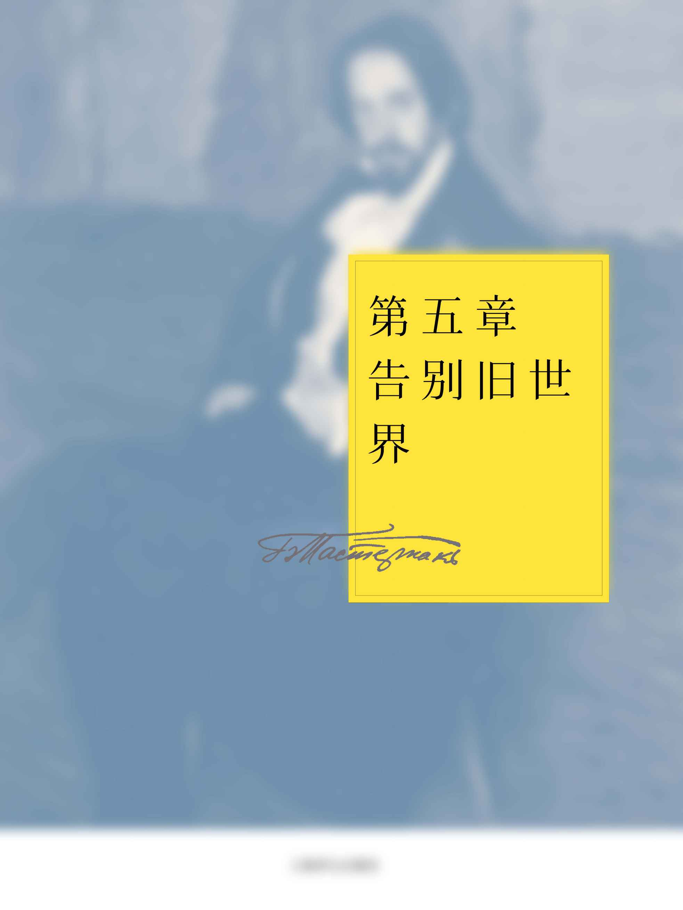

# 第五章 告别旧世界

<h3 id="c061">一</h3>

这座黑土地上的小镇叫梅柳泽耶夫。大批的军队和战车途经这里，使镇子上空弥漫了黑色的尘土，像一群群在屋顶上飞着的蝗虫。军队和战车从早到晚不停地在镇上来来往往，有从前线撤下来的，也有开往前线的，所以谁也说不清战事是在继续呢，还是已经结束。

每天都有新的工作要做，它们就像蘑菇似的老长老有。每件事都得选派人去干。日瓦戈医生本人、加利乌林少尉、拉拉护士，还有和他们一伙的几个人，总之大城市来的有知识、有经验的人，一个不漏都委派了新工作。

他们在城市管理处当干部，又去某地的驻军和卫生营里当政委。他们把这些工作的变换，当作是一种户外游戏和捉迷藏。但他们越来越想结束这种游戏回老家，去干自己的旧行当。

由于工作关系，日戈瓦和拉拉·安季波娃经常有接触。

<h3 id="c062">二</h3>

遇到下雨天，小镇上的黑尘就变成了咖啡色的泥泞，弄得所有街道——其中大多是没有铺路面的街道，十分肮脏。

小镇不大，无论在哪里，只要拐一个弯，就可以看到荒凉的草原，阴霾的低空，笼罩着一派战争的气氛，革命的气氛。

日瓦戈给妻子的信中写道：

 

军队里依旧人心涣散，混乱得很。上边正在采取措施整饬军纪，鼓动士气。附近的一些驻地部队我都去过。

最后，附带说一点，这件事我本可以早些告诉你。我在这里和一位叫拉拉·安季波娃的女护士经常在一起工作。她是从莫斯科来的，乌拉尔人。

你还记得，你母亲去世的那个可怕的夜晚，在圣诞晚会上有个姑娘朝检察官开枪的事吗？好像后来她受到了审讯。我记得那时我就对你说过，我和米沙·戈尔东在一个蹩脚的旅馆里见到过这个女大学生，那次是和你父亲一起去的。当时她还是个中学生，不记得我们当时为什么要去旅馆了。那天夜里非常冷，我现在记起好像正是普列斯尼亚发生武装起义的时候。那个女孩子就是拉拉·安季波娃。

我一直急着想回家，但事情不那么简单。倒不是工作使我们脱不开身，工作我们可以毫无影响地移交给别人。困难的是路上太难走。火车有时根本没有，有时挤得无法上去。

但我们不能再无限期地拖下去。我们几个身体已康复、也已退役和辞职的人，决定无论如何要返回家去。为了能坐上车，我们不准备同一天走，从下周开始各自分开走。其中包括我，加利乌林和拉拉·安季波娃。

我也许会突然回到家里。不过，我尽可能给你去电报。

 

日瓦戈还没走，便收到了冬尼娅的回信。

信里的句子看来不时被冬尼娅的哭泣打断，满纸泪斑和墨迹。她竭力劝丈夫不要回莫斯科，让他跟随那位不同寻常的女护士直接去乌拉尔；她一生离奇曲折，而冬尼娅生活道路却平淡乏味，是无法和她相比的。

“至于萨沙和他的未来你不必担心，”她写道，“他不会给你丢脸的，我保证用你童年时亲身体验过的我们家的教育原则来培养他。”

日瓦戈急忙给她回信：

 

冬尼娅，你疯了吗，你怎么能这样瞎猜疑！难道你不知道或是不清楚，正是对你的思念，对家庭的一片忠诚，在两年可怕的毁灭性的战争中挽救了我的生命，使我免遭各种灭顶之灾！不过，这些都不必说了。我们很快就会见面的，又要回到我们过去的生活，一切都将悄然冰释。

不过，你竟然写出这样的信，使我产生了别的忧虑。如果是我的信引起了你的猜忌，也许我确实行为有所不检。那么，我也对不住那位有可能误解我的女人，对她我也应该表示抱歉。等她巡视附近几个村子回来，我就向她道歉。过去只有省级和县级才建立地方自治机关，现在比较小的行政单位如乡里，也建立了。拉拉·安季波娃协助她一个当指导员的朋友进行这方面的工作。

虽然我和拉拉·安季波娃住在一幢楼里，好在我至今不知道她的房间在哪里，也从没打听过。

<h3 id="c063">三</h3>

从梅柳泽耶夫小镇向东和向西各有一条大道。一条是土路，经过森林，通向买卖粮食的济布申诺镇子，也属梅柳泽耶夫镇管辖，但各方面都比它强。另一条是碎石铺面，穿过夏季干枯的沼泽地，直奔比柳奇车站。这里是离梅柳泽耶夫不远的两条铁路线的交叉点。

六月在济布申诺成立了一个独立的济布申诺共和国，领头的是一个名叫布拉热伊科的当地的磨坊主，但只维持了两周。

共和国的武装力量，主要是第二一二步兵团里逃亡的士兵。他们携带枪支撤离阵地，途经比柳奇来到济布申诺，正好遇上政变。

共和国不承认临时政府，脱离俄罗斯独立。分裂派分子布拉热伊科年轻时曾和托尔斯泰有过书信来往。他宣布济布申诺为新的永恒之国。这里人人劳动，财产公有，并把乡政府改名为圣徒公署。

济布申诺一向是神奇和夸张传说的策源地。它四周都是黑森森的老林。在十六世纪末、十七世纪初变乱迭起的时代，历史文献中就提到过它，后来那一带又是盗贼出没之地。这里商贾殷富，沃野千里。这些都传为佳话。靠近前线的西部地区，奇特的迷信、习俗，老百姓独特的乡音都源于济布申诺。

现在到处流传着有关布拉热伊科主要助手的荒诞不经的传闻。人们都说他是个天生的聋哑人，等灵感来临时，他方能说话；灵感过去，又成了聋哑人。

七月，济布申诺共和国就夭折了。一支忠于临时政府的军队开了进去。倒戈的士兵被撵出济布申诺，退到比柳奇。

比柳奇的铁路后面，绵延着好几里的树林伐区，树墩上长满了草莓。没有运走的木材堆垛，被人偷走了一半；过去临时来这里伐木住的土窑，也大都坍塌了。那些倒戈的士兵就盘踞在这里。

<h3 id="c064">四</h3>

军医院占用的是伯爵夫人扎勃琳斯卡娅的私宅。日瓦戈曾在那里养过伤，后来又在那里工作过一段时间。战争一开始，伯爵夫人就把屋子捐给了伤兵医院。现在日瓦戈要离开这里了。

这幢两层楼房位于梅柳泽耶夫最好的地段，即小镇大街和中心广场（也称练兵场）的路口。以前士兵们曾在这里操练，现在，傍晚这里经常举行群众集会。

从路口上的这幢房子朝四面望去，景色十分幽美。除了大街和广场外，还可以看到邻院里并不富裕的寒酸情景，几乎和农村毫无二致。连伯爵夫人破落的后花园也可一览无余。

扎勃琳斯卡娅从不认为这幢楼房有什么独立存在的价值。县里有一座很大的“逍遥田庄”，也是属于伯爵夫人的。城里这幢房子，不过是进城办事时歇脚的地方，同时也是各地宾客去庄园度假的集散地。

现在这幢房子成了军医院。房主在她常住的彼得堡被捕。

私宅里过去的仆役，只剩下两个很有意思的女人，一个是已出嫁的伯爵女儿过去的家庭教师弗列丽小姐，还有一个是专为老爷太太做饭的厨娘乌斯吉尼娅。

脸色红润、满头银丝的弗列丽小姐，常常趿拉着一双软便鞋，穿着肥大的半旧上衣，披头散发、邋邋遢遢地在军医院里到处晃悠，和军医院的人都挺近乎，犹如当年和扎勃琳斯卡娅家里人一样。她和医院里的人说话时，拿着一股法国腔，把俄语的尾音吞掉。一说起话来就摆出一副姿势，指手画脚；说到末了总要嘿嘿大笑，接着是一阵剧烈的咳嗽。

弗列丽小姐了解拉拉·安季波娃护士的底细。她觉得日瓦戈医生和她应该相互爱慕。浪漫的性格使她热中于撮合男女间的好事，这已是积习难改。弗列丽小姐要是撞上他们两人在一起，就喜不自胜，伸出指头意味深长地吓唬他们，同时又调皮地向他们眨眨眼睛。拉拉·安季波娃莫名其妙，日瓦戈感到恼火。但弗列丽小姐像一切怪女人一样，不轻易放弃自己视为珍宝的想入非非的念头。

乌斯吉尼娅的性格更为怪僻。这个女人长得不匀称，头尖体胖，挺像只抱窝的母鸡。乌斯吉尼娅冷漠精明到了刻薄的地步，虽然她很理智，但要讲到迷信，她具有不可遏止的幻想力。

乌斯吉尼娅知道许多民间符咒。她如果出家门，总得对灶火和门锁孔念一通避邪咒语。她出生在济布申诺，据说是乡村巫师的女儿。

乌斯吉尼娅可以整年不开口，可一旦谈兴大发，就像决堤的洪水无法收拾。见到什么不平之事，她总要挺身而出。

济布申诺共和国垮台后，梅柳泽耶夫执委会开展了一场反对无政府主义思潮的斗争，而济布申诺正是这个思潮的发源地。每天傍晚，练兵场上自然地形成只有寥寥数人参加的平静的群众集会。梅柳泽耶夫的闲着无事的居民，以往夏天也常常在消防队大门旁扎堆儿谈天。梅柳泽耶夫文教局鼓励这种集会，派出文教局的人或请外来的人指导这里的活动。他们认为关于那个会说话的聋哑人的传说是济布申诺种种传闻中最荒诞不经的，所以讲话时常常要揭露他。但是梅柳泽耶夫手艺工人、士兵和过去阔人家的女佣，对此另有不同的看法。那个聋哑人在他们眼里并非荒诞不经，他们总护着他。

人群里三三两两地喊叫着，为聋哑人说话，喊得最积极的是乌斯吉尼娅。起先她不敢露面，女人家总羞于当众说话，但慢慢地她胆子变大了，经常批驳那些不受梅柳泽耶夫居民欢迎的演说家。这样一来，不知不觉间她竟成了一个名副其实的大庭广众下的演说家了。

从军医院那些敞开的窗子里面，常常可以听到广场上人们的喧哗笑语。到了特别寂静的夜晚，还能够听清楚人们发言中的个别语句。每当乌斯吉尼娅发言时，弗列丽小姐总要跑进屋来，让大家静心细听。她毫无恶意地用蹩脚的俄语学着乌斯吉尼娅的话：

“共和国！共和国！……济布申诺！聋哑人！叛徒！叛徒！”

弗列丽小姐暗暗为这个巧舌如簧的泼辣女人感到自豪。这两个女人既很要好，又没完没了地相互抱怨。

<h3 id="c065">五</h3>

日瓦戈准备要离开这里了。他去各处向人们一一告别，同时办理一些必要的证件。

这时，附近战线的一个新任政委，正好路过梅柳泽耶夫镇去部队。人们说起他时，好像他还是个未成年的孩子。

正值大反攻的前夕。军队里想方设法要鼓舞斗志，好使士气能有明显的转变。设立了革命军事法庭，恢复了不久前废除的死刑。

日瓦戈临走前必须去卫戍司令那里除名。在梅柳泽耶夫这个工作是由一位军队首长负责的，人们简称他为“县首长”。

他那里通常挤得水泄不通。过道和院子挤得到处是人，连办事机关窗外的半条街，也站满了。办公桌跟前，人都挤不过去，声音嘈杂，谁也听不清别人在说什么。

这一天，不是接待日。办公室里没什么人，很清静。文书们对愈来愈复杂的公文事务很头痛。他们默默地写着，有时相互交换着讥讽的眼色。首长办公室里欢声笑语，听那声音好像他们正在开怀畅饮，喝着什么清凉饮料。

加利乌林从里面走出来，看见日瓦戈就伸手弯腰，招呼日瓦戈去里面和他一起热闹一番。

日瓦戈反正要去办公室请首长签字。进里屋后，他发现那里简直乱得一塌糊涂。

小镇上那位头号新闻人物和当代英雄——新政委，不去干自己的本职工作，却跑到这儿来了，这里既非司令部的重要部门，也与军事无关。但他却面对着一群军队文职人员，在那里夸夸其谈。

“这位也是我们这儿的一个重要人物，”县首长向政委介绍日瓦戈说。可是政委正说得眉飞色舞，看都没看他一眼。县首长转过身子在日瓦戈递过来的证件上签了字，很客气地伸出手，让日瓦戈在屋子中央的一张矮脚软凳上坐下。当时在场的人中，只有日瓦戈一人规规矩矩地坐着，其他人很随便放肆，坐的姿势稀奇古怪。县首长手支着脑袋，像皮却林
 <a href="10-%E7%AC%AC%E4%BA%94%E7%AB%A0%20%E5%91%8A%E5%88%AB%E6%97%A7%E4%B8%96%E7%95%8C.md#m1">
[1]
</a>
 似的懒散地半躺在书桌旁，他的那位助手踡着腿高坐在沙发一侧的扶手上，像坐在女式小马鞍上一般。加利乌林反骑在一张椅子上，两手抱着椅背，脑袋靠在上面。那位年轻的政委，一会儿双手撑着跳上窗台，一会儿又跳下来，像个打旋儿的陀螺在办公室急匆匆地转来转去。他口若悬河，滔滔不绝地谈着比柳奇士兵倒戈的事情。

新政委和人们对他的传说相去不远。他细高身材，风度翩翩，完全还是个孩子，燃烧着崇高的理想之火。听说他出身名门，父亲可能是个参政员，二月革命时曾带领一队人马率先冲进国家杜马。别人向日瓦戈介绍他时，说他姓金采，也许是金茨——说得不太清楚。政委说一口标准的彼得堡方言，口齿十分清楚，稍稍带点波罗的海的口音。

他穿的是紧绷在身上的四个贴兜的军上衣。大概他觉得自己太年轻，有些不自在。为了显得老成些，他装出一种不屑的神态撇着嘴，还故意驼着背，两只手深深插在马裤兜里，肩头崭新硬挺的肩章就翘了起来。这副模样确实很像粗笔勾勒的骑兵形象，因为从肩头到脚正好可以画出两条斜线，在底端交叉到一起。

“离这里几站地的铁路线上，驻扎着一个哥萨克骑兵团，是红军，很可靠。把他们调来包围叛军，就万事大吉了。军团司令一再要求尽快解除他们的武装，”县首长向大家说。

“哥萨克？绝对不行！”政委发火了，“现在不是一九〇五年，不是革命前的演习！在这个问题上，咱们是针锋相对的，你们的将军是自作聪明。”

“还没付诸行动。一切只是纸上谈兵，是个设想罢了。”

“我们和司令部达成过协议，他们不干预我们作战的决定。调用哥萨克我不反对。就算这样吧。但我个人要采取一些理智的步骤。叛军是露营的吗？”

“怎么说呢，反正他们的营地很牢固。”

“很好，我想去他们那里一趟。告诉我怎么去找这些可怕的人，这些绿林强盗。虽说他们造了反，甚至是临阵脱逃，但他们是人民。先生们，这一点你们可别忘了。而人民就像孩子一般，需要了解他们，懂得他们的心理，要用特殊的方法。必须善于触动他们最高尚的、最敏感的心弦，这样才能奏效。

“我到他们那里的伐木场去，和他们谈谈心。你们将看到他们秩序井然地返回原来的阵地。咱们打赌好吗？你们信不信？”

“不好说。但愿如此！”

“我对他们说：‘弟兄们，就拿我来说吧。我是一个独生子，一家人全指望着我，但我什么都放弃了；为了你们能获得自由——世上没有人享受过这种自由，我牺牲了荣誉、地位、双亲之爱。我，还有许多和我一样的年轻人，都这样做了，且不说老一辈光荣的先驱、流放的民粹派、身陷囹圄的民意党人所做的牺牲。我们是为一己的私利而奋斗吗？是我们个人的需要吗？现在你们已不是过去那种普通人，而是世界上第一支革命大军的战士。你们扪心自问，是否配得上这样光荣的称号？现在祖国正在流血，在竭尽全力摆脱缠在她身上的毒蛇般的敌人。可你们却上了一帮江湖骗子的当，变成了一群毫无觉悟的败类，一群践踏自由、无法无天的恶棍。你们贪得无厌，得寸进尺。啊，我一定要说得他们动心，让他们感到羞耻！”

“不不，这样太冒险，”县首长提出反对意见，一边暗中和他的副手交换意味深长的眼色。

加利乌林也劝政委不要去干这种蠢事。他了解二一二步兵团的那些亡命徒，过去二一二团也属于他所在的师管。不过政委把他的话当做耳旁风。

日瓦戈一直急着要走。政委的天真幼稚使他感到窘迫。可是县首长和他副手，这两个爱讥笑人的机灵鬼的狡猾和世故，也高明不到哪儿去。一种是愚蠢，一种是滑头，倒挺般配。两者又都表现为滔滔不绝的高谈阔论，而本身极其无聊、空洞，枯燥乏味。这些恰是生活极力要摆脱的累赘。

啊，有时他多么盼望能摆脱人们平庸的高调，回到貌似寂静无语的大自然中去，回到苦役般漫长而艰难的、默默无闻的劳动中去，回到无言的沉沉梦境中去，沉浸在真正乐曲的宁静中，沉浸在心旷神怡的恬静中！

日瓦戈想到他还得同拉拉·安季波娃作一次交谈和解释，不管怎么说，这是不愉快的事。尽管如此，他还是乐意有机会见她一面。但她未见得会回来了。日瓦戈抽了个空，赶紧站起来悄悄离开了办公室。

<h3 id="c066">六</h3>

其实她已经回来了。这是弗列丽小姐告诉他的，还说拉拉·安季波娃回来时很累，匆匆吃过晚饭，就回自己屋里去了，不让人去找她。弗列丽小姐又对他说：“不过，您可以敲门试试，大概还没睡。”“去她那里怎么走？”日瓦戈问道，弄得弗列丽小姐莫名其妙。原来，拉拉·安季波娃房间在二层走廊的尽头，旁边几间堆放着扎勃琳斯卡娅的家具什物，门上都挂着锁。日瓦戈以前从没去过那儿。

天很快就黑下来。外面的天地显得小了。在幽暗的黄昏里，房子和围栏仿佛挤成了一堆。院子里的树木在灯火下，好像从远处挪到了窗子跟前。这是个闷热的夜晚。人稍一活动便大汗淋漓。一束束煤油灯光，照在院中的树干上，像是往下淌的一道道肮脏的汗水。

日瓦戈登上楼梯，到最后一级又停下来。他寻思人家出门刚回来疲惫已极，现在敲门不太合适，也不受欢迎。最好还是明天谈吧。他改变了主意，又若有所失地走到走廊的另一头。那里有一扇对着邻院的窗户，日瓦戈探出头去望望邻院。

夜幕里充满神秘的悄声细语。走廊近处的水池中，在滴答滴答地流水，缓慢而均匀。窗下有人在低声絮语。院子尽头的菜园里，有人在浇黄瓜，把水从一个桶里倒到另一个桶里，水从井里提上来的时候，井上的链条铮铮作响。

世上的百花仿佛突然一起散出香气，好像白天大地一直在沉睡，现在苏醒过来，吐出阵阵沁人心脾的芬芳。伯爵夫人的古老花园中，满地堆积着枯枝败叶，连走路都不方便。繁花初放的老椴树，香气氤氲，浓郁袭人，像一面高墙似的全身散发出香气。

从右面围墙外边，传来街上的喧闹声。一个休假的士兵大声吵嚷，门乒乒乓乓地响着，听得到片断的歌声。

大得出奇的暗红色月亮，从伯爵夫人花园中乌鸦巢的后面冉冉升起。开始时，月亮红得像济布申诺蒸汽磨粉机厂的砖墙颜色，后来渐渐变黄，颜色像比柳奇铁路旁的水塔。

窗台下面，除了紫茉莉花香外，还隐约可辨带些花茶味的新料草的香气。院子里拴着一头母牛，一个主妇正在喂草。牛刚从老远的乡下买来，白天走了一天，累了，再加上想念老家的伙伴，所以不肯吃这陌生的女主人手里的青草。

“好，好，别淘气了。哞！哞！你要抵人，看我不收拾你这鬼东西，”主妇低声喂它吃草。可是母牛恼怒地把头扭来扭去，再不就伸长脖子伤心地哞哞叫着。在梅柳泽耶夫黑乎乎的干草棚上面，星光闪烁，似乎同情地望着母牛，仿佛星星上有另一种世界的牲畜圈，那里的牲口都在心疼它。

周围的一切都在神秘地发酵、变化和成长。生命的欢乐犹如一阵和煦的微风，吹拂着田野和市镇，屋宇和墙垣，树木和人的躯体，所到之处，都能引起阵阵震颤。日瓦戈想遏止这种感染，就去练兵场听听大会上人们的议论。

<h3 id="c067">七</h3>

月亮已到中天。天穹下的万物沐浴在月色里，像是洒上了一层厚厚的白粉。

广场四周是公家的石砌圆柱大楼，台阶前投下了硕大的房影。似乎地上铺了一块块黑色地毯。

大会正在对面的广场上举行。如果仔细听，可以听到广场那头所有的发言。但日瓦戈却被这里美丽的景色迷住了。他在消防队门口的一条长椅上坐下，无心去听对面人们的讲话，却欣赏起四周的夜景来。广场两边是一条狭窄僻静的小巷，里面隐隐绰绰看得出是东倒西歪的破旧小屋。巷子里泥泞得无法通行，就像在村里一样。烂泥地上一排长长的柳条篱笆，很像戳在河里水面上的鱼篓和虾筐。

屋里都敞开着玻璃窗，半明半暗地闪着光。房前小院里种着一行行挂露水的玉米，淡棕色的玉米穗和玉米须，犹如涂了层油，闪闪发光。玉米快要蹿进屋里来了。坍塌的篱笆后面，一株株苍白纤细的锦葵孤孤单单地朝远处望着，就像穿着衬衣的村妇，因为屋里太热，到外面来吸口新鲜空气。

月光笼罩下的夜色，令人惊叹不已，就像看到了仁慈之心或是洞察一切的天赋。突然这皎洁宁静的神话世界被一个熟悉的似曾听过的声音所打破，语气从容而又铿锵有力。听起来是那么悦耳、热情，而且充满信心。日瓦戈仔细一听，立刻认出这是政委金茨，是他在广场上讲话。

大概地方政府因为他威信高，请他出面讲话以表示对政府的支持。他十分激动地批评梅柳泽耶夫居民散漫，无纪律，批评他们轻信布尔什维克，受到了不良影响，还告诉大家说，布尔什维克是济布申诺事件真正的罪魁祸首。他讲话的意思和刚才在卫戍司令办公室说的差不多，提醒大家不要忘记存在着强大和残酷的敌人，不要忘记祖国正面临危难。他才讲了一半，有人就开始打断他。

有人要求别打断讲话，有人高喊不同意，呼叫声此起彼伏。不同意演讲人意见的愈来愈多，喊声愈来愈响。陪同金茨一起来的一个人，当起了大会主席，大声说不准随便插话，要求大家遵守会场秩序。一些人要求让一位妇女发言，另一些人就嘘她，请金茨讲下去。

这时，从人群中挤出一个妇女，走到权充讲台的倒放的木箱跟前。她并不想登上木箱，挤到前面就站在箱子旁边。大家都认识这个女人。会场静了下来，女人吸引了会场的注意。她便是乌斯吉尼娅。

“政委同志，您刚才说到济布申诺，后来又说到眼睛，说要眼明心亮，不要受骗上当。可我听来听去，您也只会说说布尔什维克和孟什维克。别的我没听出什么来。至于说不要再打仗，要像兄弟姐妹一样和睦相处，这是《圣经》里的意思，不是孟什维克说的；说到工厂要交给穷人，这也不是布尔什维克的发明，是人类的同情心。还有那个聋哑人，又拿他来责怪我们，您不说我们都听腻了。老说这个有啥意思！他怎么得罪您了？是因为他原来是个哑巴，突然没请示谁就说起话来了吗？那又怎么样呢？有什么了不得呢？天下这类怪事多着哪！比方谁都知道的那头母驴，它对主人说：‘巴兰，巴兰，我实话对你说，可别去那里，你会后悔的！’谁都知道巴兰不听劝，还是去了。它就像你说的那个‘聋哑人’。他想谁听它的呀，那驴子是头牲口嘛。他不理睬牲口的话，后来后悔也来不及。您大概也知道那后果怎么样吧。”

“怎么样呢？”人群里有人问道。

“不说了，”乌斯吉尼娅不客气地回了一句，“知道得太多，当心老得快。”

“这不行。你给我们说说结果，”问话的人不肯罢休。

“结果，结果，真烦人！最后巴兰变成了一根盐柱。”

“你开什么玩笑，大婶子！这是罗得。罗得的妻子，”大家喊了起来，哗然一片。大会主席请大家安静下来。日瓦戈回屋睡觉去了。

<h3 id="c068">八</h3>

第二天晚上，他见到了拉拉·安季波娃。他在餐具室找到了她，她正在熨衣服，面前熨好的衣服摆了一摞。

餐具室在二层朝果园那头的一间房子里。在这里生茶炊，手拉升降机从下面厨房送上来的菜在这里盛盆，脏盆碗送下去给女工洗。在餐具室里还保存着军医院的物资清单，根据清单在这里查点餐具和衣物；有人闲时来这里休息或是约会。

朝果园的窗户敞开着。餐具室中可以闻到一种古老花园里常有的椴树花香和兰芹枯茎的苦涩味，还有屋里两只烧炭熨斗冒的烟气。拉拉·安季波娃替换着使用这两只熨斗，每回用完就把它放在通气管上再次烧热。

“您昨天怎么没来敲我的门？弗列丽小姐说您找过我。不过您不来是对的，那时我已经躺下了，也不能让您进屋去。噢，您好！小心弄脏了衣服。这里有炭末子。”

“看来，军医院的衣服全都是您熨的吧？”

“不，这里不少是我自己的。您不是老取笑我，说我走不出梅柳泽耶夫去吗？现在我可真要走了。瞧，我已经在准备行装，收拾东西了。等收拾完了就开路。我去乌拉尔，您去莫斯科。日后要有人问日瓦戈医生：‘您是否记得有个小镇叫梅柳泽耶夫的？’您会说：‘不太记得，’‘拉拉·安季波娃是谁？’‘毫无印象。’”

“嗯，就算这样吧。您去各个村子走了一趟，怎么样？农村情况好吗？”

“三言两语可说不清。熨斗冷得好快！请您把那只热的递给我，如果您不麻烦的话。就在烟道口上搁着。这一只请您再放到那儿去。对，谢谢啦。农村什么样的情况都有。这要看村里的居民怎么样。有些村子的居民劳动好，肯干，这样的村子还过得去。有的村子可尽是酒鬼，地都荒着。那些地方看着就可怕。”

“尽说些傻话，哪儿是什么酒鬼？您未必懂很多！那里根本没有人，男人全部应征入伍了。好了，不说了。地方上新的革命政权怎么样呢？”

“说到酒鬼，您讲的可不对，我不同意。要说当地政府嘛，往后的麻烦事多着呢。上面的各项指示不符合实际情况，乡里没人合作。农民目前感兴趣的只有土地问题。我顺路去了‘逍遥田庄’。地方真美！您要能去看看就好了。春天被放火烧掉了一部分，还遭过抢劫。柴棚烧掉了，果树熏黑了，房子正门也熏黑了。济布申诺我没去，没去成。但是到处人们都对我说，传闻的那个聋哑人确有其人。他们还告诉了我他的相貌，据说是个年轻又有文化的人。”

“昨天在广场的大会上，乌斯吉尼娅还使劲为他说话呢。”

“我刚回来，他们又从‘逍遥田庄’送来整整一车乱七八糟的东西。我不知对他们说过多少回了，让他们不要再惊动‘逍遥田庄’。我们自己东西不少嘛！可今天早上卫戍司令部的守卫又拿着县首长的签条来要东西。说急需伯爵夫人的一套银茶具和水晶玻璃的酒具。说借用一晚上，用毕归还。我们可清楚这‘归还’是什么意思。东西得丢掉一半。听说要开个晚会，来了个什么贵宾。”

“噢，我猜出八九分了。来人是前线的新政委。我偶然见到了他，他打算去收拾倒戈的士兵，包围起来解除武装。政委不过初出茅庐，办事幼稚可笑。这里有人建议调用哥萨克，可他想用眼泪感化他们。说什么民众就像小孩子一样，如此等等，以为这一切不过是儿戏。加利乌林极力劝阻，让他不要去惊动那些沉睡的野兽，交给他们来收拾吧。可这样的人一旦认准了一个想法，难道能说服得了吗？您听我说，先放一放熨斗。这里很快会发生一场不可想象的混战，我们都对此无能为力。我很希望您能在这之前离开这里！”

“什么事也不会有的，您夸大其词了。不过我反正也要走。但不能这样说走就走。需要把东西列成清单交上去，否则好像我偷了东西。可是移交给谁呢？这倒是个问题。为这些东西我没少受累，可是回报我的只有埋怨。我把扎勃琳斯卡娅的财产都登记在军医院名下，这本是根据法令办事。可有人认为，我是故作姿态，似乎我希望用这样的办法为伯爵夫人保住财物！真是卑鄙！”

“咳，这些地毯呀，瓷器呀，您不必放在心上，丢就丢了吧。为这些东西苦恼自己，何苦来！是啊，昨天我没见到您，心里十分遗憾。当时我兴致极好！我会告诉您我内心的全部秘密，回答一切伤脑筋的问题！不，我不是开玩笑，我多么想敞开来谈一谈，对您讲讲我的妻子、儿子、我的生活。真见鬼，难道一个成年男人就不能和一个成年女人谈话吗？一谈马上就得被人怀疑有什么隐情吗？岂有此理！让这些说法都见鬼去吧！

“您熨呀，熨呀，我是说您熨衣服好了，不要管我，我说我的，要不少时间呢。

“您想想，现在是什么时候！可我们正好生活在这样的时代。这样前所未有的时代，在世上也千载难逢。您想想，整个的俄罗斯，屋顶都被掀掉了，我们和全体人民都无遮无盖。没有人来关心我们。自由，真正的自由，不是口头的自由，不是写在要求书里的自由，是从天而降、出乎意料的自由。自由来得意外，是阴差阳错的结果。

“每一个人都无所适从，变成了一个庞然大物！您注意到这一点没有？好像每个人都为自己、为自己身上发现的英雄气概，背上了沉重的包袱。

“您还熨您的呀。您怎么不说话了？您不觉得枯燥吧？我给您换换熨斗。

“昨晚我去看了一次群众大会。惊人的场面！我们的母亲——俄罗斯活动起来了，她再也呆不住了，她来回地走也走不完，不停地说也说不够。还不光是指人们；天上的星星，地上的树木，也聚集到一起来议论。夜间的花朵同样在作哲理的思考。一幢幢的砖石楼房都起来聚会了。这有点像《福音书》里写的，是不是？仿佛回到了圣徒时代。您还记得圣保罗是怎么说的吗？‘你们要用各种语言说话并且预卜。你们要祈求获得解释的才能！’”

“您说树木和星星也像参加了大会，这我能理解。我明白您的意思。我自己也常常有这样的感觉。”

“这种情形一半是战争造成的，其余是革命的后果。战争把生活突然打断了，似乎生活可以暂时缓一缓（真是荒唐之极！）。革命的爆发，就像胸中憋了一口气，闷了太久，不吐不快。每个人都复苏了，新生了，人人都变了样，发生了根本的转折。也许不妨这么说：每个人都经历了两种革命，一种是个人自身的，另一种是全体共同的。我觉得，社会主义是个大海洋，所有个人自身的革命应该像江河入海，汇入其中，流进这生活的海洋，特色鲜明的海洋。我说的生活海洋，是指在绘画中看得见的那种生活，是含有伟大意义、创造性地丰富发展了的生活。现在，人们决心不在书本中去体验它，而要在自己身上体验它；不是抽象地、而是在实践中体验这种生活。”

日瓦戈的声音突然颤抖起来。这是他精神开始亢奋的流露。拉拉·安季波娃停下手里的活，朝他投去严肃和惊诧的目光。他思路乱了，一下子忘记说的是什么。过了一会儿他才又说下去。他无暇顾忌什么，任情发泄起来：

“这些天来，我多么渴望能生活得诚实、有益！多么渴望成为普天欢庆中的一员。然而，在大家欢欣鼓舞的时刻，我却看到了您深奥莫测的忧郁眼神，茫茫然地不知投向何处，仿佛在非常遥远的国度寻找什么。我恨不得付出一切，但求您能收起愁容，能满意自己的命运，无须求助于任何人、任何东西。但愿您有一个亲人，一位挚友或是丈夫（他最好是军人），他握住我的手，让我不必为您的命运担忧，不必因关心您而使您徒增烦恼。可是我会抽出自己的手，用力一甩，算了……啊，我忘乎所以了！请原谅。”

日瓦戈的话音又泄露了他内心的波澜。他一甩手，窘迫不堪地站了起来，走到窗前，脸朝窗子站着，用臂肘撑在窗台上，手掌托腮，茫然望着黑魆魆的花园深处，试图恢复平静。

熨衣板搭在桌子和另一个窗子上，拉拉·安季波娃绕过它走到屋子中间，离日瓦戈有几步远。“唉，我一直担心会出这样的事！”她仿佛喃喃自语。“多么不幸的迷误啊！尤拉·安德烈耶维奇，不要这样，这样不行。哎哟，您瞧，因为您我闯了大祸！”她大声嚷着赶紧跑回熨衣板跟前。她忘了把熨斗从衣服上拿起来，冒起了一股焦糊味的轻烟，衣服熨坏了。

“尤拉·安德烈耶维奇，”她接着说道，当的一声气恼地把熨斗放到炉圈上。“尤拉·安德烈耶维奇，听我的话，您去弗列丽小姐那里呆一会儿，喝杯水，亲爱的，再回来。但愿您回来时是平时的样子。您听见了吗？尤拉·安德烈耶维奇？我相信您能做到这一点。就这样办，我求求您。”

他们之间再也没有出现过类似的谈话。一周以后，拉拉·安季波娃离开了军医院。

<h3 id="c069">九</h3>

又过了些日子，日瓦戈也开始整理行装，准备上路。他离开梅柳泽耶夫的前一夜，下了一场吓人的暴风雨。

狂风怒吼，大雨滂沱，风雨声响成一片。暴雨时而直泻房顶，时而趁着风势在街巷里横扫，仿佛是以水柱步步为营在攻占街道。

雷声隆隆不绝于耳，连缀成一片均匀的轰响。在接连不断的电光中，仿佛看到市街匆匆远去，街旁的树木也弯着腰朝同一方向奔跑。

夜里，弗列丽小姐被一阵急促的敲门声惊醒。她惊慌地坐起，侧耳谛听大门外的动静。敲门声仍然不停。

她想，难道整个医院里就没有一个人肯出去开门吗？她这么一个老太婆倒应该为大家担风险，就因为她天生为人诚实，富于责任感吗？

且不说扎勃琳斯卡娅家里的人，他们都是阔佬，是贵族，可军医院呢？这是人民自己的财产嘛，他们把军医院扔给谁来管呀？比方说，那些卫生员究竟跑到哪里去了？大家都一哄而散，领导也罢，护士、医生也罢，全都走了，可是楼里还有伤病员呢。楼上外科病房里还有两个锯了腿的重伤员（那里原来是会客室），楼下洗衣房旁边的储藏室里，住满了传染病人。乌斯吉尼娅那鬼东西又不知去哪儿串门了。这傻女人，眼看要下大雨，可是鬼迷心窍非去不可。现在倒有了在别人家里过夜的正当理由。

谢天谢地，敲门声停了。大概看看没人来开门，只得无可奈何地走了。天气这么坏还上别人家去！会不会是乌斯吉尼娅？不可能，她有钥匙。我的上帝，吓死人，又敲起来了！

再怎么说，这也太不像话！日瓦戈自然难怪了，他明天就走，心思早已在莫斯科，在旅程上了。可是加利乌林呢？他听见敲门，居然还睡得那么死，那么坦然，大概指望最后她这个体弱无力的老婆子起来开门——在这可怕的地方，可怕的雨夜给陌生人开门。

突然她想道：“加利乌林！不对，哪儿还有加利乌林！因为她睡得懵懵懂懂，才会想到加利乌林。什么加利乌林！他早跑得连影子都没有了。不就是她自己和日瓦戈一起把他藏起来，给他换上便衣帮他逃跑的吗？还告诉了他这一带的道路和村庄怎么走。这事发生在叛兵自行裁决打死金茨那件可怕的事之后。他们追捕加利乌林，从比柳奇一直赶到梅柳泽耶夫，一路不断放枪，在全城进行搜查。什么加利乌林！”

当时正巧有一个装甲营经过小镇，否则这里大概早已夷为平地。亏了这支装甲部队，才保护了居民，镇压了叛兵。

暴风雨势头减弱，渐渐远去。雷声也变得稀疏，在远处喑哑地响着。雨停停下下，水滴从树叶和斜槽上流下来。无声的闪电，照亮了弗列丽小姐的房间，白光并不立即离去，仿佛在屋里搜寻什么。

隔了好一会，突然，敲门声又重新响起，而且敲得更急，好像唤人求救。风又刮大了，雨点随着哗哗落下。

“来了！”弗列丽小姐不知对谁喊了一声，接着又为自己应声吓得要命。

她突然猜测到了什么，连忙下床，趿上拖鞋，披上睡衣，跑去叫日瓦戈，要不一个人太害怕了。原来，日瓦戈也听到了敲门声，手里拿着根蜡烛正迎面从楼梯上下来。他们俩都猜想到一起去了。

“日瓦戈，日瓦戈！有人在敲大门，我害怕一个人去开门，”她用法语喊道，然后又用俄语补充道：“您看吧，这不是拉拉，就是加利乌林。”日瓦戈也被这敲门声惊醒。他想一定是自己人，或者是加利乌林逃不出去回来躲一躲，或者是护士拉拉·安季波娃路上难走又返回来。

在门厅，日瓦戈让弗列丽小姐拿着蜡烛，自己用钥匙打开锁，下了门闩。一股劲风吹开了他扶着的大门，吹灭了烛火，一阵冰冷的雨点打了他们一身。

“谁敲门？谁呀？这儿有人吗？”弗列丽小姐和日瓦戈轮流在黑暗中问着，但没人回答。突然间他们听到后门的方向响起了刚才的敲门声。现在细听，好像敲的是朝花园的那扇窗户。

“看来，是风吹的，”日瓦戈说，“为了保险，您还是去后门看一看，我就在这里等着，如果确实有人敲门，不是其他别的原因，我们不致两头都错过了。”弗列丽小姐朝屋里走去，日瓦戈来到外面门廊遮檐下，现在，他的眼睛已经习惯了黑暗，可以看到天光已渐渐放亮。

城市上空，乌云疯也似的疾驶着，像受到追捕的逃犯。云絮低得几乎擦着了树梢，树朝同一个方向倾斜着，像一把把弯弯的扫帚横扫着天空。灰色的楼墙经雨水一淋，成了黑色。

“怎么样？”日瓦戈向回转来的弗列丽问道。

“您说得对，没有人。”接着她又说，“刚才到楼里各处看了一遍。餐具室的玻璃窗被椴树枝打破，地板上积满了水。拉拉房间里也一片汪洋，到处是水。”

“这儿的一扇百叶窗掉了下来，窗子撞来撞去。您明白了吧，原因全在这儿。”

他们俩又说了几句，锁上门，各自回屋睡觉，两人都有些遗憾，不过是庸人自扰罢了。

他们本来以为，大门一开，准定进来他俩都熟悉的拉拉·安季波娃，浑身淋得精湿，瑟瑟发抖。等她抖掉身上雨水的时候，他们俩就可以询问经过情形。她更衣之后，会下楼到厨房里来，在熄了火却仍有热气的炉旁暖暖身子。她会告诉他们路上的各种遭遇，一边理着头发，和他们说说笑笑。

他们锁上了大门，可是还觉得浑身是水的拉拉·安季波娃，就在楼房拐角的街口上。因为刚才他们对拉拉的归来是那么确信无疑啊。

<h3 id="c070">十</h3>

人们认为，车站士兵哗变的间接肇事者，是比柳奇电报局的科利亚·弗罗连科。

科利亚是梅柳泽耶夫的一个有名的钟表匠的儿子。从他生下来，梅柳泽耶夫的人就都知道他。小时候，他常住在逍遥田庄上的一个仆人家里。在弗列丽小姐的照管下，他和她的两个学生，也就是伯爵夫人的两个女儿，一起玩耍。弗列丽对科利亚十分了解。那时他已开始学说法语。

在梅柳泽耶夫公路上，无论天好天坏，人们常常看到科利亚骑着自行车，不时抬头望望电线杆和电线，检查线路有没有毛病。他骑车不扶车把，仰着头，双手抱在胸前，身上穿得很少，也不戴帽子，脚上是一双夏季帆布鞋。

镇上几家的电话，用的是车站的分线；这些都归科利亚在车站总机室掌管。

他总是忙得不可开交，车站上的电报、电话他得管；有时站长波瓦里希恩临时出去，他还要管行车信号、区截调度，因为这些装置也设在总机室。

科利亚由于常常要同时管好几部机器养成了习惯，说起话来很特别。当他不愿回答、不想和别人搭话时，他讲话就含混不清，断断续续，令人费解。人们传说，出事那天他过分滥用了自己的权力。加利乌林从城里打来电话，他对他置之不理，实质上使加利乌林的良好计划全部落空，可能在无意之中，使后来发生的事情变成了一场惨剧。

加利乌林让科利亚请政委来接电话，当时政委正在车站上或车站附近。加利乌林是要告诉政委，他马上就去伐木区与政委会面，在这之前不要采取任何行动。科利亚不愿去找金茨，借口电话线正占着，要向驶近比柳奇的列车发信号。实际上他却千方百计地想把这列载着哥萨克骑兵的列车，拦截在前面的一个会让站上。

可是列车还是驶进了车站，这使科利亚感到不快。

火车头慢慢驶进月台上阴暗的遮阳里，恰好停在总机房那扇大窗子的对面。科利亚把印有铁路字徽的深蓝厚呢窗帘全部拉开。石条窗台上的大托盘里，放着一个大凉水瓶和一个菱形厚玻璃杯。科利亚在玻璃杯里倒上水，喝了几口，朝窗外望着。

司机看见科利亚，在机车里向他友善地点点头。“哼，臭狗屎，床板里的臭虫！”科利亚怒气未消，对司机吐了吐舌头，举起拳头表示威胁。司机完全明白科利亚的意思，他自己也耸耸肩，朝后面的车厢点下头，意思是说：“我有什么办法？你来试试看。可厉害着哪。”“不管怎么说，你是废物，胆小鬼！”这些话都表现在科利亚脸上。

各个车厢纷纷牵出战马。马犟着不肯走。没过一会儿，响起了马蹄踏在木板上低沉的笃笃声，接着石砌月台上传来一阵清脆的嗒嗒声。哥萨克终于牵着不停地扬起了前蹄不愿向前的军马横过铁路道口。

铁轨尽头杂草丛生，生锈的轨道上停着两排报废的车厢。上面的油漆任凭风雨侵蚀，已全部脱落，木头也已霉烂、蛀空。因此，头上几节破破烂烂的取暖货车，同报废车厢后面的原木材，同白桦树上的多孔菌，同上空聚集的团团白云，重又恢复了往日的亲近。

到了林子边上，一声令下，哥萨克翻身上马，向伐木区疾驰而去。

二一二团里的叛军被包围了。骑兵在树林里看起来总比在开阔地上显得高大威武。士兵一下就被震慑住了，尽管他们在地窖里也有枪支。哥萨克个个马刀出鞘。

金茨从骑兵队里跑出来，站在中间一堆结实平整的木柴堆上，对被包围的叛军开始发表演说。

他又像往常那样大谈什么军人的天职，祖国的意义之类崇高的话题。但这些观念在这里没有市场。叛军人数极多。他们在战争期间吃尽了苦头，变得十分粗野，又疲惫不堪。金茨谈的大道理，他们早就听腻了。四个月来左派和右派说客的恭维，使他们变得狂妄起来。他们都来自普通的老百姓，金茨的外国姓名和波罗的海口音，使他们对他兴味索然。

金茨也感觉讲得太冗长，对自己气恼起来，但又想他这样做为的是让人们容易听懂，可他们非但不感激他，反而十分冷淡、厌烦。他愈来愈暴躁，决定对他们改用强硬的语气，说些早有准备的恐吓的话。他没听见士兵中间出现的一片抱怨声，提醒他们说，革命军事法庭已经建立并已开始执法。他威胁说，如果他们不放下武器，交出他们的头目，就可能被处以死刑。如果他们拒绝这样做，就证明自己是可耻的叛军，是毫无觉悟又目空一切的暴徒。士兵对这种讲话早已不习惯了。

几百名士兵吼叫起来。有些人嗓音低沉，几乎不怀什么恶意地说：“你说了一通就得了，够了，别说了。”但有些人充满仇恨，尖声尖气、歇斯底里地喊了起来，吸引了人们的注意：

“同志们，你们听见他怎么骂我们了吧，跟过去有什么两样！还是军官那副德行！这么说我们是叛徒啰？可你自己是哪个地方来的，大人先生？何必跟他费时间。还不清楚吗？他是德国人派来的奸细。喂，你拿证件出来看看，贵族老爷！你们干吗傻乎乎地张着嘴，杀我们的刽子手们！来吧，把我们捆起来吧，把我们吃了吧！”

结果，连哥萨克也越来越腻烦金茨枯燥乏味的讲话了。他们在下边也窃窃私语：“别人都是暴徒，下流货，这位老爷呀！”有人把军刀收进刀鞘，开始只是一两个，后来大多数都这样做了。接着一个个下了马。等差不多都下了马，他们乱糟糟不成队形地朝林中空地迎着二一二团走去。人们全混杂起来，两边士兵友好地称兄道弟。

“您应该想办法悄悄溜掉。”哥萨克的军官紧张地对金茨说，“道口旁停着您的车。我们派人去让他们把车开到这里来。您快走。”

金茨依从了。但偷偷溜走他觉得太不体面，于是他没有按军官的要求谨慎从事，几乎是堂而皇之地朝车站走去。他心里其实万分紧张，但为顾全面子，强自镇定，不慌不忙地走着。

离车站已经不远了，一出林子就到。金茨走到林边已能看到前面的铁路。这时他才第一次回头看了一下。他身后紧跟着一些持枪的士兵。“他们想干什么？”金茨暗自嘀咕，一边加快了步伐。

尾随在后面的士兵也加快了速度。他们和金茨仍然保持着原来的距离。前面就是破车厢的双层木板。金茨一绕过车厢，拔腿就飞跑。刚才运来哥萨克的列车，已经开入调车场。铁路线上全无障碍。金茨飞奔着越过了铁路。

他奔跑着跳上高高的月台。这时，从那几辆破车厢后面蹿出了追赶他的士兵。波瓦里希恩和科利亚向金茨喊了几声，一边直打手势，让他躲进车站来逃命。

但是，祖祖辈辈教育出来的荣誉感，城里形成的、不畏牺牲的荣誉感，虽然在这里并不适用，却妨碍着他躲进车站去逃命。他以令人难以置信的毅力，克制着剧烈的心跳。他觉得应该向他们发出呼吁：“弟兄们，你们好好想想，我哪是什么奸细？”他想：“要是对他们说点真诚的话，会使他们醒悟过来悬崖勒马的。”

这几个月来，每当金茨想到要建立功勋，要向人们发出热忱的呼吁，他便不知不觉会联想到高台、讲坛，甚至椅子。他一站在高处，就可以向人们呼喊，用热情的讲演去鼓动人们。

车站门口的大钟下面，有一个又高又大的消防水桶，桶顶盖得严严实实。金茨跳上水桶对朝他逼近的士兵喊了几句动人的话，但他声音很怪，话也颠三倒四。这时他离车站敞开的大门只有几步了，一闪身就可以躲进去。他却对士兵喊起话来。他表现出来的非凡的勇气，使士兵们感到震惊，都愣住不动，放下了手中的武器。

但是，金茨挪到桶盖的边上，盖子踩翻了。他一条腿落入水桶里，另一条挂在桶外。结果就骑在木桶帮上。

这尴尬的模样，逗得士兵们哄然大笑。最前面的一个士兵开枪打中了这个倒霉政委的脖子。他应声倒地，其他士兵一拥而上用刺刀把他捅死。

<h3 id="c071">十一</h3>

弗列丽小姐给科利亚打了电话，要他给日瓦戈在火车上找一个好座位，并且威胁他说，如果他不干，她就要揭发科利亚的罪行，没他的好下场。

科利亚一边回答弗列丽，一边还像往常那样接着另一个电话，从他话里夹杂的十位数来看，他同时还在向第三处拍发密码电报。

“普斯科夫，电报局，你听见了吗？什么叛军？什么帮忙？弗列丽小姐，您说什么呀？胡说八道，别耍滑头，请别催，先放下话筒，您妨碍我工作。电报局，普斯科夫，普斯科夫：36，逗号，0015。嗐，这狗东西！线又断了。什么？什么？听不见。怎么又是您，弗列丽小姐？我不已经明明白白地告诉您了吗？不行，我没办法。您去找波瓦里希恩吧。胡说八道，别耍滑头。36……见鬼……又来了，别打扰我的工作，弗列丽小姐。”

可是弗列丽小姐还在说：

“你别想哄我，你这骗子手！什么普斯科夫，什么普斯科夫，骗子手！我要把你的事全说出去。明天你给日瓦戈找个座位。别的我不愿跟凶手讲话，你这个小犹大，叛徒。”

<h3 id="c072">十二</h3>

日瓦戈上路的那天，天气闷热得叫人难受。像前天那样，一场大暴雨即将来临。

满地葵花子壳儿的车站旁的小镇子上，土坯房和一群群白鹅在黑压压凝聚不动的乌云逼视下，显得苍白而惊恐不安。

车站前面和两侧是很宽阔的草地。上面的草都被踩乱，挤满了无数等车的旅客。他们各自要去不同的方向，等了已有好几个星期。

候车的旅客中有一些老人，穿着灰粗呢外衣，顶着热辣辣的太阳，在人群里走动，打探各种消息和传闻。几个十四五岁的默不作声的孩子，用胳膊撑着地侧身躺在草地上，手里拿着光秃秃的树枝，仿佛在放牧。他们光腚的弟妹们撩起衬衫，在他们脚边窜来窜去，背上晒得微微变红。他们的母亲平伸双腿坐在草地上，棕色的无领上衣歪歪扭扭地敞开着，怀里搂着吃奶的娃娃。

“那次枪声一响，人们就像羊群似的四散逃走。看着真讨厌！”站长波瓦里希恩厌恶地对日瓦戈说。他们俩在躺倒的人群中间绕着弯穿行，车站里面也罢，车站门口也罢，乱七八糟都躺着人。

“转眼之间，草坪上一个人也没有了！我们又看到了这块草地。一时真让人高兴！他们在这里安营扎寨有四个月了，连草地是什么样的都忘记了。这儿就是金茨丧命的地方。战争期间我见了许多可怕的情景，本该习惯了。可那次见了他，心里真难受！主要是死得不值得。为了什么？他有什么对不起那些士兵的？他们还算是人吗？听人说，他是家里的命根子哩。现在，请往右走，这边走，这边走，请到我们办公室来。这趟车您就别想上去了，会把您挤死。我给您安排了另一趟区间车。这趟车是我们自己调配的，现在编组得差不多了。但是您上车以前可不能说，对谁也不能说！不然的话，他们会把车拆成碎片，连个挂钩都不留。夜里，您在苏希尼奇换车。”

<h3 id="c073">十三</h3>

这辆秘密列车编组完毕，从车场慢慢倒入车站。草地上的人们一见，一窝蜂地朝它直冲过去。高岗上的人们连滚带爬地奔下来，又爬上了铁道路基。人们你推我搡地向车上拥去，有些人跳上了保险杠和踏板，有的人爬进了车厢的窗户，爬上了车顶，一眨眼工夫，列车还没停下来已经挤得满坑满谷。等它驶近月台时，更塞得像沙丁鱼罐头，从上到下都是人。

日瓦戈奇迹般地挤进了过道台。然后，更加莫名其妙地挤到了车厢的过道。

于是他就呆在过道里，坐在自己行李上，这样一直到苏希尼奇。

带雨的乌云早已吹散。田野上烈日炎炎，遍地都可以听到螽斯虫不停歇的狂噪，甚至压过了火车行进的隆隆声。

站在车窗前的旅客，遮住了光线，他们长长的影子投在地板上、座位上和椅背上，重重叠叠摞在一起。车厢容不下，影子又穿出对面的车窗，投在斜坡上，随着奔驶的车影起起伏伏地移动着。

车厢里面一片嘈杂，有的扯着嗓子唱歌，有的骂架，有的打牌。列车停站时，车内的喧闹和围在车外的旅客们的吵嚷，混成了一片，仿佛是海上的风暴，震耳欲聋。火车中间突然停站时，也像海上的情形一样，会突然莫名其妙地平静下来，可以听到月台上顺着火车走路的急促脚步，行李旁的忙乱和争吵，有时远远地还传来送行者的只言片语，甚至辨得出老母鸡的低鸣和车站小花园里树叶的簌簌声。

这时，从车窗外飘进一股熟悉的香气，仿佛专给日瓦戈送来的，像路上发来的电报，又像是从梅柳泽耶夫寄来的问候。这缕缕清幽的香气就在周围缭绕，来自上空，是田里野花和花坛的香气不能比拟的。

日瓦戈被挤得无法活动，不能走近车窗。但他即使看不到，也能想象出窗外的椴树。它们就长在路基旁边，繁枝密叶上黑乎乎地积着煤烟尘土，静静地伸向车厢顶盖，上面缀满繁星般闪烁着的小花。

这馥郁的香气伴他走了一路。到处人声鼎沸，到处椴树争芳斗艳。

这无处不在的花香，仿佛一直走在这趟北上列车的前面，就像一个遍及各个枢纽站、岗亭和小站的传闻。旅客们每到一处，就听到这个传闻，不是从别处传过来的，就是在当地得到证实了的。

<h3 id="c074">十四</h3>

夜里，火车抵达苏希尼奇。一个殷勤的老式打扮的脚夫，带着日瓦戈摸黑越过铁轨，帮他从后门上了火车，坐进了二等车厢，这是一列刚刚进站的临时加开的列车。

脚夫用一把乘务员的钥匙打开后面的车门，刚把日瓦戈的行李放到入口台上，一个乘务员过来就要把行李推下去，脚夫于是和他争执了几句。还是日瓦戈开口把他说动了，发了善心，搭讪着不知跑到哪去了。

这趟神秘的列车负有特殊使命，车速很快，各站停的时间很短，并且有武装保卫。车厢里的人非常少。

日瓦戈坐的包房里，小茶桌上点了一支明亮的蜡烛，窗板已经放低，但窗外钻进来的劲风，吹得火苗不停摇曳，蜡烛四周挂满了烛泪。

蜡烛的主人是包房里唯一的旅客，一个浅发青年，从他修长的手脚来看，身材十分高大。他活动手脚时，显得毫无气力，倒像折叠家具上没有拧紧的部件。年轻人懒散地仰头倚坐在窗旁的软席上。日瓦戈进包厢时，他正半躺着。见日瓦戈进来，便客气地欠了欠身，坐得比较礼貌些。他的座位下面似放着一堆墩布条。突然，墩布动弹起来，从下面钻出一只呜噜呜噜煞有介事叫着的垂耳猎狗。它闻了闻日瓦戈，望了望他，就在这房里转悠起来，爪子轻巧地向前甩动，颇像它的主人甩动着二郎腿。不一会儿，它又按主人的吩咐呼哧呼哧钻到座位底下缩成一团，成了打蜡地板上用的粗呢拖把。

这时日瓦戈才发现，包房衣钩上挂着一支装在枪袋里的双筒猎枪，皮革子弹带，还有一个满装着猎获物的口袋。

原来，这个年轻人是出门打猎归来。

他十分健谈，面带笑容，想和日瓦戈马上攀谈起来。谈话时，他直勾勾地盯着日瓦戈的嘴巴。

这年轻人尖声细嗓，颇不悦耳；调门一高，就变成了刺耳的假嗓音。他还有个怪毛病：说的是俄语，可元音“y”发得很怪，像法语的软音“u”，或是德语的变元音“ü”，而且，连这个怪里怪气的“y”，他发起来也很吃力，甚至变成尖叫，比别的音都响。刚开始交谈，他头一句话就使日瓦戈惊诧不已，里面一连几个ü。

“昨天早晨，我才打了野鸭。”
 <a href="10-%E7%AC%AC%E4%BA%94%E7%AB%A0%20%E5%91%8A%E5%88%AB%E6%97%A7%E4%B8%96%E7%95%8C.md#m2">
[2]
</a>
 在他比较注意的时候，还能克制不犯这个毛病；只要稍一疏忽，就又不行了。

“这是什么怪毛病呢？”日瓦戈想道，“我好像在书里看到过，有点印象。我作为医生应该懂得这些，可记不起来了。是脑子有什么问题，引起了语言障碍。不过他的话听起来十分可笑，让人忍不住想笑。所以简直不能和他谈话，还不如爬上铺去睡觉。”

日瓦戈上了铺准备休息。这时年轻人问他要不要灭了蜡烛，是否会妨碍日瓦戈睡觉。日瓦戈向他表示感谢。他就吹灭了蜡烛。包房里黑了下来。

包房的车窗关上了一半。

“咱们是不是把窗子关上？”日瓦戈问道，“您不怕有贼吗？”

年轻人没有回答他。日瓦戈又大声问了一声，但是他仍然没有答腔。

日瓦戈划了根火柴，他想看看伙伴怎么了，是不是这么一会儿工夫离开了包房，或者已经睡着了，这更难令人相信。

原来，年轻人只是睁着双眼坐在座位上，见日瓦戈俯下身来，就对他笑了笑。

火柴熄灭了。日瓦戈又燃了第二根火柴，借着火光，他把问话又重复了一遍，等年轻人回答。

“随您的便，”这位猎人回答得很痛快，“我没什么值钱东西。不过，最好别关，太闷。”

“真没想到！”日瓦戈心想，“看来是个怪人，只有很亮的时候，才肯说话。现在他说话清楚极了，怪毛病也没了，简直无法理解！”

<h3 id="c075">十五</h3>

日瓦戈觉得极度疲乏。上周发生的那些事情，上路前的紧张、准备行装，加上早晨上车的拥挤，这一切弄得他筋疲力尽。他想，现在舒舒服服躺下，马上就会入睡。但事与愿违，过度的疲劳反使他失眠。天快亮时，他才睡着。

漫漫长夜里，尽管思绪万端，但实际上只围绕两个萦绕不去的中心，它们时分时合。思念的第一个中心，是冬尼娅、家庭和以前安适的生活。那时的生活，处处充满诗情画意，甚至细枝末节都莫不如此，亲切而坦诚。夜里日瓦戈忐忑不安地想着那种生活，但愿能一如既往，恢复原样。他躺在茫茫黑夜中奔驶的列车里，急切地盼着回到阔别两年之久的生活中去。

属于这一中心的，还有对革命的信仰和赞美。这里的革命是指中产阶级所理解的革命，也就是一九〇五年崇拜勃洛克的一群青年学生所理解的革命。

在这些日瓦戈感到亲切和熟悉的思绪里，还包括战前一九一二到一九一四年间在俄罗斯思想界、艺术界和俄国命运——整个俄罗斯的命运以及日瓦戈本人的命运——中初露端倪的那些新生征兆、那些美好的许诺和前景。

战后，日瓦戈希望再回到这样的气氛中，恢复和继续这种气氛，就像他想着返回久别的家园一样。

第二个中心里的思念，内容也是新的，但却是另一种不同的新东西！它不是自己所习惯的、基于旧基础上的新东西，而是不依人们意志为转移、不可回避的、为现实所决定的新东西。它来得突然，像地震一般。

这个新东西就是战争，是它的血腥和恐怖，是战祸中的流离失所和人性沦丧。此外，还包括战争带来的考验和教给人们的生活能力。再有就是战争把他抛去的荒僻小镇、和他萍水相逢的人们。还有革命。不过如今这场革命不再像一九〇五年大学生所理想化了的革命；这个革命诞生于战争中，是流血的革命，是毫不留情的士兵革命，是熟知这股力量的布尔什维克所领导的革命。

护士拉拉·安季波娃也属于这第二个中心。战争把她抛到意想不到的地方。她过去的经历如何，他全然不知。她不责备任何人，只有无言的埋怨；她沉默寡言得神秘莫测，而沉默使她显得坚毅有力。属于这个中心的新东西，还有日瓦戈真心实意地努力约束自己不去爱她，就像他一生中努力去爱所有的人（更不消说爱家庭和亲人）一样。

火车风驰电掣。迎面吹来的风透过半开的窗子，吹得日瓦戈头发又脏又乱。夜里车站上的情景与白天毫无二致，人群骚动嘈杂，椴树簌簌摇曳。

有时从茫茫夜地里向车站辘辘驶来几辆四轮大车和轻便双轮马车。人声、车轮声和树叶的沙沙声汇成一片。

每逢此刻，日瓦戈似乎明白了为什么这些黑魆魆的树影簌簌作响，睡意矇眬的树叶含混不清地窃窃私语些什么。原来，它们谈论的正是日瓦戈躺在上铺辗转反侧思考的问题：俄罗斯日甚一日的动荡不安，俄国的革命，革命的艰难痛苦，以及革命最终的伟大意义。

<h3 id="c076">十六</h3>

第二天日瓦戈醒得很晚，已经过了十一点。“马尔吉斯，马尔吉斯！”那青年猎人正低声呵斥呜呜叫着的猎狗。日瓦戈感到奇怪，包房里还是只有他们两人，再没有别的乘客上来。一路过来的车站，他从小就很熟识。火车驶过卡卢加省以后，就直入莫斯科省中心。

日瓦戈像战前那样舒舒服服地梳洗完毕，回到包房进早点，这是他那位奇怪的旅伴请他吃的。现在日瓦戈可以仔细打量他一番了。

此人最主要的特点是十分健谈好动。这位陌生旅客喜好说话，不过目的不在于交际和交换思想，而在说话本身，在于发音吐字。与人交谈时，他仿佛坐在弹簧上不停地上下颤动，莫名其妙地纵声大笑，喜滋滋地连连搓手。如果这还不足以表达内心的兴奋，他就用手掌拍打自己的膝盖，笑得眼泪直流。

昨天交谈时他表现出的乖张举止，今天又重演了。这位猎人说话杂乱无章，让人吃惊。他时而无的放矢地表白一番自己，时而对一些毫无恶意的问题充耳不闻，不予理睬。

他滔滔不绝地讲了许多自己的情况，稀奇古怪又语无伦次。看来，他是夸大其词。他的观点极端片面，否认一切成规，显然企图以此哗众取宠。

所有这些，使日瓦戈觉得许久以前似曾相识。类似的激进思想，上一世纪的虚无主义者就提倡过，稍后陀思妥耶夫斯基的某些主人公也说过，而最近直接继承他们衣钵的，便是俄罗斯外省的整个知识界。这里的知识分子常常比彼得堡和莫斯科更为激进，因为他们地处僻远的外省，保存了原来的东西，而在首都这已经落后过时了。

这青年告诉日瓦戈，他是一位著名革命家的侄子，可自己的双亲恰恰相反是无可救药的顽固分子。他称他们为死硬派。他们家在离前线不远的地方有座相当大的庄园。这位年轻人就在那里长大。他的父母与叔叔一生交恶，但叔叔不记仇，如今利用自己的影响尽量使他们摆脱许多倒霉的事。

这位口若悬河的青年对日瓦戈说，在思想观念上他同叔叔相近，无论对生活、政治和艺术的看法，他都是个极端主义分子。这倒有点别佳·韦尔霍文斯基
 <a href="10-%E7%AC%AC%E4%BA%94%E7%AB%A0%20%E5%91%8A%E5%88%AB%E6%97%A7%E4%B8%96%E7%95%8C.md#m3">
[3]
</a>
 的味道——不是指他的左倾思想，而是指他的夸夸其谈和堕落。他马上又要以未来派自居了，日瓦戈暗想道。果然不出所料，他谈起了未来派。接着日瓦戈猜他现在又要谈体育运动了，还要谈赛马或者溜冰场，或者法国式摔跤。果然，话题转到了狩猎上来。

青年说，他在老家就打过猎，还夸口说，他是个神枪手，倘若他没有生理缺陷能入伍当兵的话，在军队里他定是个出色的射手。

这时他发现日瓦戈疑问的眼神，惊叫起来：“怎么？难道您一点没有察觉？我以为您已经猜到我的毛病了呢。”

他从口袋里取出两张卡片，递给日瓦戈。一张是他的名片。他是复姓，全名是马克西姆·阿里斯塔尔霍维奇·克林佐夫-波戈列夫希赫，或者只用单姓波戈列夫希赫，他请日瓦戈就这么称呼他。为了尊敬他的叔叔，所以他只用这个单姓。

另一张是印着小方块的表格。每一格里画着两手交叉的不同手势。这是聋哑人的手语字母表。日瓦戈到此才恍然大悟。

原来，波戈列夫希赫曾是加尔特曼或奥斯特罗格拉茨基聋哑学校的高材生，也就是个聋哑人。在学校他靠观察教师喉头肌肉的运动，娴熟地掌握了靠眼力、而不靠听觉说话的本领，和别人交谈也采用同样的办法。

日瓦戈琢磨了一下他家乡所在地和打猎的地方，开口问道：

“请原谅我唐突，您可以不回答我。请问您和济布申诺共和国和它的创建，可有什么关系吗？”

“您怎么知道……请问……这么说您认识布拉热伊科吗？有关系，有关系！当然有关系。”波戈列夫希赫哈哈大笑，前仰后合，使劲拍膝盖。接着又海阔天空地说了一大通。

波戈列夫希赫说，布拉热伊科对他来说只是个媒介物，而济布申诺也不过是试验他自己思想的地方罢了。日瓦戈很难听懂他讲的那些思想观点。波戈列夫希赫的哲学，一半是无政府主义，另一半纯粹是猎人的呓语。

波戈列夫希赫俨然以神谕的口气，胸有成竹地预言，不久的将来将要发生极重大的变故。日瓦戈内心同意他的说法，感到这种动乱多半无可挽回，但这个讨厌的毛孩子说话时那种目空一切的权威态度，惹得他十分生气。

“等一等，您别着急，”他不很有把握地说，“这都不错，一切都可能发生。但依我之见，目前不是进行您那种冒险试验的时候，因为周围是一片混乱，一片崩溃景象，而且有敌军压境。应该让国家有所恢复，在剧烈变动之后喘一口气，然后才谈得上再来一次大变动。应该先取得一种相对的安定和秩序。”

“这是天真的想法，”波戈列夫希赫说，“您所说的崩溃，同您赞美的理想秩序，同样是正常的现象。这种破坏是大规模建设计划的必然的前奏。社会破坏得还不够。应该让它彻底崩溃，那时真正的革命政权才能在另一种全新的基础上把社会重新组织起来。”

日瓦戈觉得很不是滋味，离开包房来到走廊上。

列车不断加速，驶近莫斯科。迎面是近郊的白桦树林和星罗棋布的别墅，掠过窗口，又落在后面。没有遮阳的狭长月台上，站着去别墅度假的男男女女。列车驶过后，他们被远远抛在火车扬起的烟尘中，仿佛是骑在旋转木马上。火车汽笛声一声接着一声。林中一切空间都荡起了回声，扩向远方。

许多日子以来，日瓦戈现在第一次清晰地意识到他在哪儿，他在干什么，一两个小时之后等候他的是什么。

三年来的变化，不通音信，迁徙，战争，革命，震动，炮击，毁灭的场面，死亡的场面，破坏的桥梁，废墟，大火——充满这一切的三年，倏忽之间变成了一个巨大的空白，空洞无物的空白。经过长期的中断之后，现在头一件真正的大事，就是他正坐着火车一步步驶近了自己的家——这使他感到头晕目眩。他的家没有遭到破坏，还存在于世界上。那里每一块石头都非常亲切。这才是生活，这才是感受，这才是寻奇探胜者所追求的东西，这也才是艺术的宗旨所在——回到亲人怀抱，回归自我，获得重生。

树林留在了后面。列车冲出绿色林海，驶到一片开阔地。前面是辽阔的缓坡。坡地上是一垄垄深绿叶的马铃薯。在坡顶的地头上，摆了一些从温室卸下来的玻璃框架。火车朝坡地行驶，火车后面，黑紫色的大片乌云遮住了半边天。太阳从云后射出缕缕光芒，照得温室框架上的玻璃闪烁刺眼。

骤然间，一片斜雨从乌云中洒落下来，阳光里雨点闪烁着急速落下，正好与奔驶列车的轮声合拍，仿佛这阵雨想赶上列车，唯恐自己落在后面。

日瓦戈还没转过目光，山后已经出现了基督救世主大教堂。紧接着便是整个莫斯科城的圆顶、房盖、楼宇和烟囱。

“到莫斯科了。”他回到包房说，“该准备下车了。”

波戈列夫希赫赶紧站起来，在猎物袋里掏了一阵，挑出一只比较大的野鸭来。

“拿着吧，”他说，“留个纪念。我和您在一起愉快地度过了整整一天。”

无论日瓦戈如何推辞，他都不依。“那好吧，”日瓦戈只得收下，“把这当作给我妻子的礼物吧。”

“送给您妻子！送给您妻子的礼物，”波戈列夫希赫高兴地连声说，好像“妻子”这个词他是第一次听到，高兴得哈哈大笑，手舞足蹈，连那条猎狗也钻出来分享他的快乐。

火车接近了站台。车厢变暗，仿佛进入夜晚。波戈列夫希赫把野鸭包在一张铅印告示里，递给了日瓦戈。

 <a href="10-%E7%AC%AC%E4%BA%94%E7%AB%A0%20%E5%91%8A%E5%88%AB%E6%97%A7%E4%B8%96%E7%95%8C.md#w1">[1]</a>
 皮却林，莱蒙托夫小说《当代英雄》中的男主人公。

 <a href="10-%E7%AC%AC%E4%BA%94%E7%AB%A0%20%E5%91%8A%E5%88%AB%E6%97%A7%E4%B8%96%E7%95%8C.md#w2">[2]</a>
 俄语中“早晨”、“打”、“野鸭”三词都含元音“y”。一句中三次发此音而不准，故听来刺耳。

 <a href="10-%E7%AC%AC%E4%BA%94%E7%AB%A0%20%E5%91%8A%E5%88%AB%E6%97%A7%E4%B8%96%E7%95%8C.md#w3">[3]</a>
 陀思妥耶夫斯基小说《群魔》中的人物。

