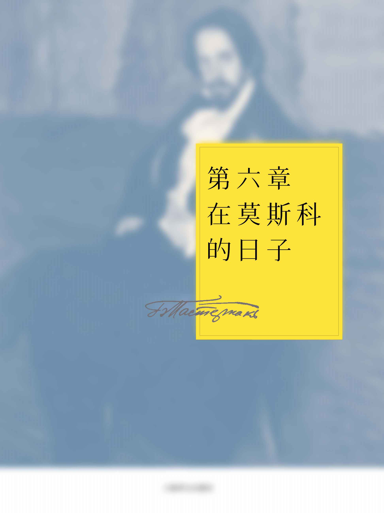

# 第六章 在莫斯科的日子

<h3 id="c077">一</h3>

在车上一直坐在小包房里不活动，日瓦戈觉得只是列车在行驶，时间是停滞不动的，似乎现在还只是正午时分。

当马车载着日瓦戈和他的行李，从斯摩棱斯克市场熙熙攘攘的人群里好不容易挤出来时，天色已近傍晚。

日后，日瓦戈回忆起斯摩棱斯克市场时，总觉得当时人们都拥到广场上来，不过是习惯使然，不是别的原因。因为空空荡荡的货摊上，遮阳伞都已放下，货柜甚至都上了锁。到处是牲口粪和垃圾，广场久已无人打扫。这里没有什么买卖可做。这些或许确实是当时的情况，也可能是后来几年的生活造成的印象。

他依稀记得，当时就见到过瑟缩街头的老人，瘦骨嶙峋却穿戴不错。他们站在那里默默地责怪过路行人，不说什么话，只是向人们兜售无人需要也无人问津的东西，例如假花、有玻璃盖和气哨的圆咖啡酒精壶、黑纱晚礼服和旧公务员的制服。

一般的人们拿出来卖的，都是生活里必不可少的东西：一块块很易变硬的配给黑面包、肮脏发潮的糖块、一切两半的包装马合烟（八分之一俄磅）。

市场上到处叫卖一些莫名其妙的旧物，每倒一次手，价格就涨一次。

马车拐进了广场旁的一条小胡同。背后夕阳慢慢落山，阳光照在他们背上。在他们前面，有一辆空运货马车辘辘地走着，马车在路面上不停地颠簸，扬起的滚滚尘埃，在夕阳的余辉里仿佛是燃烧的青铜。

他们总算超过了挡在前面的运货马车，快马加鞭向前奔去。马路中间，人行道上，处处可见扯破的旧报纸和从屋墙、栅栏上撕下来的海报，日瓦戈大感意外。一阵风刮来把报纸往北吹去，过来的车辆行人又把乱纸往南带。

他们很快驶过几个路口，前面是两条小巷的路口，他的家就在眼前。马车停了下来。

日瓦戈从马车上下来，走到大门口，按了按铃。这时他激动得呼吸急促，心咚咚地跳。没有人应声。日瓦戈又按了一下。还是没人来开门。他焦虑不安地连连按了几下，等按到第四次时，才听到门里有人卸下门栓和铁链。门开了，冬尼娅手扶着门站在他面前。这意外的重逢，使他们在一瞬间相顾愕然，谁也没听见谁的惊呼。但冬尼娅的手扶在敞开的门上，好像是伸开胳膊准备拥抱。这使他们醒悟过来，像疯了似的紧紧拥抱起来。过了一会儿，两人同时说起来，互相打断对方。

“快告诉我，家里人都好吗？”

“好，好，你放心。一切都好。我不该在信里说蠢话，请你原谅。以后还得谈谈。你怎么不打个电报来？先让马克尔把你的东西拿进来。啊，我明白你奇怪为什么叶戈罗夫娜没来开门。她去乡下了。”

“可是你瘦了。不过多么年轻苗条呀！我现在先把马车打发走。”

“叶戈罗夫娜去乡下买面粉。其余的用人都辞了。现在只用了一个新人，你不认识，叫纽莎，是个姑娘，照看萨沙，别的没什么人了。大家都知道你要回来，都等着你呢，戈尔东、杜多罗夫，还有别的人。”

“萨沙怎么样？”

“他还好，上帝保佑。他刚睡醒。你要不是刚下火车，可以马上就去看他。”

“爸爸在家吗？”

“我不是信里已经给你写了吗？他从早到晚都在区杜马。当了主席，可想而知。马车钱你付了吗？马克尔！马克尔！”

他们俩站在人行道中间，身旁是网篮、手提箱，挡住了路。路人走过时，朝他们从头到脚打量一番，张望着驶去的马车和敞开的大门，想看看还会发生什么事。

这时，马克尔从大门口朝年轻的老爷太太跑了过来。他衬衫外面穿着件背心，手里拿着看门人的便帽，边跑边嚷嚷：

“我的天啊，这不是尤拉吗！可不是吗？就是他，我们的小鹰！尤拉·安德烈耶维奇，亲爱的，你没忘了我们，我们一直为你祷告，总算回家了！你们干什么？嗯，没有见过？”他不客气地对好奇的路人说，“快走吧，先生们。瞪着眼瞧什么呀！”

“马克尔，你好啊，咱们拥抱一下吧。瞧你，快把帽子戴上。有什么好消息？妻子怎么样，女儿怎么样？”

“她们能怎样，混日子呗。托你的福。要说什么新消息嘛，你在前线打仗那会儿，你瞧，我们也没闲着。这里弄得又脏又乱，魔鬼都嫌，你简直弄不清是怎么回事！街没人扫，房子漏了没人修，就像过斋日似的肚子里空空的，一点油水也没有。”

“马克尔，我要在尤拉·安德烈耶维奇面前告你一状。尤拉，他老这样叨唠没个完。他说话那个粗劲，我真受不了。大概是想讨你的好。其实，他心里可有主意呢。你别替自己辩了，马克尔。你脑子缺根弦，应该学得聪明些。毕竟你不是住在生意人家里嘛。”

马克尔把行李提到前室，关上了大门，低声地、信赖地对日瓦戈说：

“你听见了吧，冬尼娅·亚历山大罗夫娜对我不高兴。她老这样呢，说什么，马克尔，你两眼一抹黑，一点文化没有，就像烟囱里的黑油烟。还说什么，现在别说小娃娃，就是哈巴狗、家养的小狮子狗，都懂事理了呢。她当然说得在理，我没说的。可是尤拉，信不信由你，有学问的人不过只是看了一本书呀，未来的共济会会员，那书在石头下压了一百四十年。要我说呢，现在他们把我们给出卖啦。尤拉，你懂吗？一个小钱不值地给卖了，连烟都不给闻一闻。你瞧，冬尼娅·亚历山大罗夫娜不让我张嘴，又在那儿摆手呢。”

“能不摆手？就这样吧，马克尔，把行李放在地板上就走吧，谢谢你。要有事，尤拉·安德烈耶维奇会叫你的。”

<h3 id="c078">二</h3>

“总算走了，真缠人！信不信由你，演戏给你看呢。在人前装傻瓜，暗地里却磨刀霍霍。只是还没琢磨好去干谁，还装出一副可怜相。”

“瞧你说得也太厉害了吧！我看，他不过是喝醉了，不过是醉后胡言罢了。”

“你说，他什么时候清醒过？算了，去他的吧，真见鬼。现在，我担心萨沙别又睡着了。要不是铁路上流行伤寒……你身上有虱子吗？”

“好像没有。我一路很舒服，就像战前似的。要不我先稍微洗一下，大致洗一洗，等以后再好好洗。你去哪儿？为什么不从客厅走？你们上楼走另一条楼梯呀？”

“噢，是这么回事！你还不知道。我和爸爸考虑再三，决定把一层的几间房借给农业科学院。否则冬天我们生不起火。还有楼上也太大。准备借给他们。人还没来，他们的研究室要设在这里，还有植物标本和种子标本要搬来。千万可别引来耗子，因为有粮食嘛。不过眼下房子弄得蛮干净。噢，对了，现在房间叫做居住面积。从这儿走，这儿。怎么这么没脑子。要绕道走后面的楼梯。懂了吗？跟我来，我带路。”

“你们把房子让给别人，很好。我在军医院的时候，医院也占用了一个有钱人的住宅。一间套一间的穿廊式房间，有的房间里还保留着镶木地板。屋里还有种在木桶里的棕榈树，夜里就像魔鬼似的在你床头伸着大巴掌。从前线下来的伤员，常常在梦中吓得惊叫起来。不过，他们神经也不大正常，内部受了震伤。后来只好把木桶搬出去。我看，阔人家确实有些不健康的东西。没用的东西多得很。比如说家具过多，房子过多，多愁善感，又废话连篇。大家住挤一些，这样很好。应该多让出去一些，借给他们少了。”

“你袋子里有个东西探出脑袋来了！鸭子脑袋，鸟的嘴。多好看！一只野鸭！你从哪儿弄来的？我简直不敢相信自己的眼睛！眼下这可值钱哪！”

“火车上人家送的。说来话长，以后告诉你吧。你看要不要把它拿出来，送到厨房去？”

“那当然。我这就让纽莎去褪毛，开膛。大家都说今年冬天要挨冻受饿，说得很可怕。”

“是啊，别人都这么说。刚才我在火车上望着窗外，心里想有什么能比和睦家庭和工作更重要呢？其他问题都不决定于我们。确实，看来许多人会遭到不幸，有的人想逃到南方高加索去，从那儿再往远处走。我不能这样。一个真正的男子汉，应该与祖国同甘苦、共患难，要挺得住。我认为，这是不言而喻的。你们就不然了。我要让你们躲过这场灾难，想把你们送到一个比较安全的地方去，比如去芬兰。瞧，现在我们每跨上一级就谈半小时，什么时候才能走到楼上啊。”

“不，等一等。告诉你个消息，非常重要！我差点儿忘了。尼古拉·尼古拉耶维奇来了。”

“哪个尼古拉·尼古拉耶维奇？”

“你舅舅。”

“冬尼娅！这不可能吧？这太巧了！”

“是啊，真的来了。他从瑞士来。绕道伦敦，经过芬兰。”

“冬尼娅！你不是开玩笑吧？你们看见他了？他在哪儿？能不能马上去找他，就是现在？”

“你这么着急！他住在朋友的郊外别墅。他说过，后天回来。他变得很厉害，你会失望的。他经过彼得堡的时候，路不通，在那里耽搁了一阵，已经布尔什维克化了。爸爸和他争得面红耳赤。咱们真是走一步停一步呢。上去吧。这么说，你也听说以后日子很难熬，会有困难、危险，前途未卜啊。”

“我自己也料到了。没什么。搏斗一下吧。总不会全都毁灭吧。咱们先看看别人怎么过。”

“听说，往后没有劈柴，没有水，也没有电。钱也不能流通了。不向城市供应商品。咱们又停下来了。上去吧。你听我说。阿尔巴特大街一家作坊卖一种又浅又矮的炉子，都说好用。点上几张报纸可以把饭烧熟。别人给了我个地址。趁现在还有，赶紧去买。”

“对，我们要买一个。冬尼娅，你想得真周到！可是我还想着尼古拉舅舅这件事呢！你看，真没想到！”

“我有个这样的打算：二楼一侧留出一块地方；咱们和爸爸、萨沙、纽莎在那里占它两三间房，一定要互相联通的。这样就和其他房间完全隔开来，堵死，就像大街上独门独院一样。中间的屋里，摆上那么一个火炉，烟囱走气窗出去。洗衣、做饭、吃饭、会客都在这间房里，这样炉火就能充分利用了。上帝保佑，也许这样我们能熬过一冬天。”

“怎么能熬不过呢，当然熬得过冬天。这毫无疑问。你的计划太好了。好样的。这样吧，为了祝贺你的计划被采纳，咱们吃顿烤鸭，再请舅舅来我们的新居。”

“太妙了。让戈尔东带些酒精来。他能在实验室弄到。现在看看房间吧。这间就是我刚才说的。选得可以吧，不错吧？你把手提箱放下，下去把网篮拿上来。除了舅舅和戈尔东，还可以请杜多罗夫和施莱辛格。不反对吧？你还记得洗澡间在哪儿吧？洒上点消毒药水。我这就去萨沙那儿，让纽莎下楼去。等我弄好了，就叫你。”

<h3 id="c079">三</h3>

到莫斯科后，他最感新奇的，就是这个小男孩。萨沙刚出生，日瓦戈就应征入伍了，对儿子能有什么印象呢？

入伍以后，一天日瓦戈在出发之前去医院看望冬尼娅。他到那儿正赶上婴儿喂奶，没放他进去。他坐在外厅等着。产妇室在顶头，妈妈们靠墙躺在那里。有一条走廊通到婴儿室。这时走廊上响起婴儿尖细的啼哭，大约十个到十五个婴儿一起哭叫着。护士们每人左边抱一个，右边抱一个，像挟两大包东西似的，送去让母亲喂奶。她们走得很快，生怕襁褓中的婴儿着凉。

“哇，哇！”小娃娃们的哭声丝毫不带感情，他们齐声哇哇，唱着同一个调，仿佛这是他们应尽的义务。只有一个孩子的声音与众不同。他也是哇哇哭，听起来也毫无痛苦，但并不是为了尽什么义务；他的声音低沉、郁闷而不满。

当时，日瓦戈已经决定给儿子取名萨沙，以此表示对岳父亚历山大的尊敬。不知为什么他觉得这低声哭叫的正是他的孩子，因为这哭声有个性，预示着他未来的性格和命运，这哭声包含着孩子名字萨沙——亚历山大的特色。日瓦戈真猜对了。这个孩子确实就是小萨沙。这是他对儿子的头一个印象。

以后日瓦戈对儿子的印象，主要来自冬尼娅寄给他的一些照片。照片上是一个活泼可爱的胖娃娃，大大的脑袋，噘着一张小嘴，笨拙地弯着腿站在铺开的被子上，他举起两只小手，好像就要蹲下去跳舞。那时他才一岁，刚开始学步；现在已经两岁，开始咿呀学语了。

日瓦戈提起箱子放在靠窗的牌桌上，解开箱上的皮带。这房间过去派什么用来着？日瓦戈认不出来了。看来，冬尼娅已经换过家具，或者又重新糊了墙纸。

日瓦戈打开皮箱，准备取出刮脸用具。从窗户望出去，前面正好是教堂钟楼，圆柱之间升起了一轮皎洁的满月。月光洒在打开的箱子上，照在上面的衣服、书籍和梳洗用品上，屋里的光线一变，日瓦戈又认出了这房间。

这是已故的安娜·伊万诺夫娜的储藏室，过去用来堆放坏了的桌椅和没有用的旧办公用具。这儿有她娘家的家传文案、夏天收藏冬衣的大木箱。安娜·伊万诺夫娜在世时，房间四角里东西一直堆到天花板，一般不让人进去。但每逢大节日，小客人来得特别多，就可以在楼上到处跑、跳、淘气，于是贮藏室也开放。孩子们在那里扮强盗，藏在桌子底下，用烧焦的软木塞涂个大黑脸，穿上化装舞会的衣服。

日瓦戈站了一会儿，回忆着儿时的情景，然后他又下楼去，到一层前厅把网篮拿上来。

厨房里，纽莎正蹲在炉灶前，把野鸭放在一张报纸上褪毛。她是个腼腆、胆小的姑娘。看见日瓦戈提着网篮进来，涨得满脸通红，赶紧站起身来，一边用手掸掉围裙上的鸭毛。她向日瓦戈问了声好，就上去帮忙。日瓦戈回声“谢谢”，说他自己能提。

他刚跨进旧贮藏室，就听见隔壁第二间或第三间屋里妻子在唤他：

“尤拉，你可以进来了！”

他就向萨沙那间屋走去。

现在的儿童室，是过去他和冬尼娅做功课的房间。小床上坐着个孩子，远不像照片上那么漂亮。但却酷似尤拉的母亲，已故的玛丽娅·日瓦戈，几乎是一个模子里铸出来的，比她死后留下的任何画像都更逼真。

“这是爸爸，这是你的爸爸，给爸爸做个小勾儿看看，”冬尼娅不停地说着，一边放下小床的床栏，可以让日瓦戈搂他，把他抱起来。

日瓦戈走到萨沙近前。这个满脸胡子的陌生男人，大概吓着了萨沙，萨沙不喜欢他。当日瓦戈弯下身去时，萨沙倏地站起来，抓住了妈妈的衣襟，气鼓鼓地抬手就给了他一巴掌。这一大胆的举动把萨沙自己都吓了一跳。他赶忙投进母亲怀里，把脸埋在她的衣服里，伤心地哇哇大哭起来。

“真是的，真是的，”冬尼娅埋怨着他，“萨沙，你怎么能这样。爸爸会以为萨沙不好，萨沙是个坏孩子。你亲亲爸爸，让他看看，你亲得多好。别哭，哭什么，不要紧，小傻瓜。”

“随他去吧，冬尼娅，”日瓦戈说，“别难为他，你也不必懊恼。我知道，你又在胡思乱想了，把这事看得太认真，以为这是不祥之兆。这都是胡扯。其实是很自然的。孩子从来没见过我。明天跟我熟了，拉都拉不开呢。”

可他自己走出房间时，心头也沉甸甸的，感到这不是好兆头。

<h3 id="c080">四</h3>

几天过去了，他发现自己很孤独。他并不怪罪任何人。看来，这是他自己所希望的，现在实现了。

他的那些朋友们，不知怎么都变得平庸浅薄了。他们失落了自己的世界，也失落了自己的聪慧。在日瓦戈的记忆里，他们个性要鲜明得多。看来，过去他对他们估计过高。

过去，旧的社会秩序允许有闲阶级任情地想入非非，拿衣食无着的人作话题标新立异。他们过着闲散的生活，高谈阔论，但只有少数人能够享受，大多数人都在忍饥挨饿。在那种条件下，多么容易把这些当成他们的真实面目和独特个性。

可下层民众刚一站立起来，上层阶级的特权一旦被废除，他们转跟之间就失去了光彩，毫无遗憾地放弃了自己独立的思想；看来他们实际上从未有过独立的思想！

现在日瓦戈感到亲近的，只是不尚辞藻、不唱高调的人，是妻子、岳父、三两个同事、普通的朴实的职员和工人。

享用野鸭和酒精的晚宴，按计划在他回家后的第二天或第三天举行了。在此之前，他已经和宾客见过了面，所以宴会上他们不是头一次重逢。

在那饥荒年月，一只肥鸭对客人来说是稀世佳肴，可就着鸭肉吃的面包太少，使这顿美餐大为减色，甚至使人感到气恼。

戈尔东是把酒精装在毛玻璃塞的药瓶里带来的。在黑市上酒精属于最抢手的交换物。冬尼娅手里总是拿着那药瓶，需要喝时便倒出来一些掺上水，有时兑浓了，有时兑稀了，全凭她的感觉。喝后才发现，饮用浓度不同的酒，比喝同一浓度的烈酒更容易醉人。这也叫人气恼。

最使人不快的是，他们的晚宴与当时的条件太悬殊。简直难以想象这条小巷里还有谁家此时能如此大吃大喝。窗外是静悄悄、黑漆漆、忍饥挨饿的莫斯科。店铺里空空如也，至于野味和白酒，人们连滋味都忘记了。

看来，只有当你的生活与周围人的生活相仿佛，能淹没在生活的大海中时，那才是真正的生活，而独得的幸福并不是幸福。所以，当这鸭子和酒精在莫斯科成了唯一佳肴时，它们便不再是酒，也不再是鸭子了。这不由得令人黯然。

宾客也给日瓦戈留下了不快的印象。当年的戈尔东爱苦思冥想，寡言少语，不善辞令，叫人觉得可爱。他曾是日瓦戈的挚友，中学里大家都喜欢他。

现在他来了个自我否定，对自己的精神面貌作了不当的修正。他极力装得乐观豁达，追求机智俏皮，并且嘴上总挂着“有意思”、“多有趣”之类的话。这些不是他惯用的语言，因为戈尔东从来不认为生活是一种娱乐。

杜多罗夫到来之前，戈尔东谈起了杜多罗夫的婚事，他认为这故事十分可笑。这事在同事之间广为传播，日瓦戈还一无所知。

原来，杜多罗夫结婚已有一年光景，后来又与妻子离了婚。这桩趣闻最精彩却不可信的部分是这样的：

杜多罗夫被错征入了伍。他一边在部队服役，一边不断申诉。在军队里，由于他漫不经心，在街上不给长官敬礼，常常被罚去值勤。后来他复员了，很长一段时间，一看见军官立即举手敬礼。他看花了眼，总觉得满眼都是军官的肩章。

这个阶段里他干什么都丢三落四，大大小小的错事不断。一天他在伏尔加河的码头上认识了两个姑娘，是姐妹俩。他们在等同一条轮船。由于他老有幻觉，仿佛左右都是军人，又由于有到处乱敬礼的积习，他变得神不守舍，还没看清姑娘，就爱上了那个妹妹，急急忙忙向她求婚。“多有趣，是不是？”戈尔东问道。但他不得不匆促收场。门外响起了故事主角的声音。杜多罗夫走了进来。

他发生了相反的变化。以前他是个懒散、任性的公子哥儿，现在却成了一个严肃的学者。

中学时代，他因为参与政治犯的越狱计划，被学校开除。有一段时间他先后在形形色色的艺术学校里呆过一阵子，最后却学了古典人文科学。杜多罗夫在战争期间大学毕业，比他的同学晚一些。现在留在大学里担任两个教研室的课程：俄国史和世界通史。在俄国历史方面，他写了伊万雷帝时期土地政策的论文；在世界通史方面，他对圣茹斯特也颇有研究。

如今他总是侃侃而谈，声音低哑，仿佛正患感冒，双眼若有所思地平视着前方的某一点，仿佛在给学生讲课。

晚宴结束前，施莱辛格也插进来争论攻击；本来就已激动万分的主人与宾客，这时更七嘴八舌地喊了起来。日瓦戈对杜多罗夫从小学时代就一直客套地用“您”。现在杜多罗夫又用您问了他几次：

“您看没看《战争与和平》和《椎形长笛》？”

日瓦戈早就对他说了自己的看法，但由于大家争论热烈，杜多罗夫没有听见。过了一会儿，他又问道：

“您看过《椎形长笛》和《人》吗？”

“我不是已经回答您了吗？因诺肯季。您没听见，是您的过错。好吧，就算我没说，现在再说一遍。我一直喜欢马雅可夫斯基的作品。他继承了陀思妥耶夫斯基的风格。准确一些应该说，他的诗仿佛是陀思妥耶夫斯基作品中一些年轻叛逆者的抒情之笔，例如伊波利特、拉斯柯尔尼科夫和《少年》的主人公。真是无与匹敌的天才力量！是那样铮铮有声的无可妥协和毫不讳言，最重要的是，他以大无畏的气魄把这些愤慨掷向社会，甚至投向远处的空间！”

自然，晚宴上的中心人物无疑是尼古拉舅舅。冬尼娅以为尼古拉·尼古拉耶维奇去别墅了，其实并没有。他在侄子日瓦戈到达莫斯科的那天，就已回到了城里。日瓦戈和他见过两三次面了。他们已经畅谈过，惊喜得大呼小叫，笑声不止。

他们第一次见面，是在一个晦暗的傍晚，细雨蒙蒙。日瓦戈来到尼古拉·尼古拉耶维奇的旅馆。这时旅馆要经市政当局批准才能接待顾客。但尼古拉·尼古拉耶维奇是个知名人物。在城里他还有许多的关系。

旅馆倒有点像无人管理的疯人院。空空荡荡，乱七八糟，楼梯和走廊上脏不堪言。

从舅舅那间不整洁的房间里向大窗子外面望去，可以看到空旷无人的大广场。在那些疯狂的日子里，广场仿佛不再是旅馆窗前那个真实的广场，而是夜里恶梦中见到的广场，使人感到可怕。

对日瓦戈来说，这是震撼心灵的、永难忘怀的、意义深远的一次会面。他青年时代崇拜的偶像，青少年时代左右他思想的主宰者，现在又活生生地站在他的面前。

尼古拉·尼古拉耶维奇的白发更使他神采奕奕。外国式的宽大西服十分合身。他并不见老，还是个相貌堂堂的美男子。

无疑，比起当前所发生的重大事变来，他显得逊色。重大的事变遮住了他的光彩。但是日瓦戈从来不想用这样的尺度去衡量他。

尼古拉·尼古拉耶维奇谈到政治问题时，镇定而从容，语气冷静而又带些诙谐。这给日瓦戈留下深刻的印象。他善于自持，这一点上他超过了如今的俄国人，显出外来人的特色。这一特点很显眼，不大合时宜，令人感到不受用。

其实呢，他们第一次见面时那么热烈拥抱，那么激动流泪，那么兴奋急促地交谈，又那么经常默然相对，并非是由于上面的原因。这是两个具有创造精神而又有着血缘关系的亲人的重逢。虽然过去的一切获得重生又浮现在眼前，分离后的种种情景也涌上脑际，但只要一谈到主要的东西，一谈到创造型人物所熟知的问题，那么一切关系便隐没不见了。不再有舅甥关系，也不再存在年龄的差别，只剩下唯一的一种关系，那就是一种个性与另一种个性、一种力量与另一种力量、一种气质与另一种气质的相近。

近十年来，尼古拉·尼古拉耶维奇从未有机会像今天这样畅谈创作的魅力、创作使命的本质，谈得那么尽意和痛快淋漓，那么恰到好处。从日瓦戈这方面来说，这样透彻精辟的分析算是闻所未闻，令人神往和感奋。

他们俩不时高兴地喊叫起来，激动地在屋里走来走去，为两人观点的不谋而合，兴奋得抓耳挠腮，或者走到窗前，默默地用手指敲打玻璃，惊讶两人何以如此地相互理解。

这是他们第一次会面的情景，后来在公众场合，日瓦戈还曾多次遇见尼古拉·尼古拉耶维奇，但这时他表现得很不一样，判若两人。

尼古拉·尼古拉耶维奇认为自己在莫斯科是客人，情愿自外于莫斯科。那么，这时他是否认为彼得堡或别的什么地方是他的故乡呢，这也无从知晓。当一个政治上的演说家或有魅力的社会活动家，这是他的向往。或许他指望在莫斯科也会举办政治沙龙，就像法国大革命时期国民公会前罗兰夫人举行的沙龙。

他经常去莫斯科僻静的小巷，探望热情好客的女友们，常常善意嘲笑她们和她们丈夫政治上的模棱两可和落后，嘲笑他们一贯爱坐井观天。现在他又在她们面前高谈阔论报纸上的时事新闻，就像过去在人前炫耀自己读过的禁书和俄耳甫斯经文一样。

据说，他在瑞士留下了一位年轻的新恋人，还有一些没做完的工作和一本没写完的书。他回祖国来，是为了亲身领略一下轰轰烈烈的革命风暴，如果日后能安然脱身，他要重新回到阿尔卑斯，那就又会销声匿迹了。

他赞成布尔什维克，时常举出两个“左派”社会革命党的人，作为自己的志同道合者，一个是笔名为米罗什卡·波莫尔的新闻记者，另一位是时评家西尔维娅·科捷里。

冬尼娅的父亲亚历山大·亚历山大罗维奇嘟嘟囔囔地埋怨他说：

“尼古拉·尼古拉耶维奇，您偏到哪去啦，实在可怕！哼，您的那些米罗什卡！误入歧途！还有您的那位利季娅·波捷里。”

“是科捷里，”尼古拉·尼古拉耶维奇更正他说，“名字是西尔维娅。”

“叫波科里还是波布里，全无所谓，不在乎两个字。”

“但是，对不起，还是应该叫科捷里，”尼古拉·尼古拉耶维奇耐心地要求他改正。他和亚历山大·亚历山大罗维奇接着又往下谈：

“我们争论的是什么？论证这样的理论是无聊的。这是普通常识。多少年来，人民的大多数过着难以想象的生活。不管哪本历史教科书，不论如何下定义，称为封建主义和农奴制，或者称为资本主义和工厂企业，总之这些制度的反常或不合理，早已显示出来，并必然导致旧制度的变革，只有这种变革才会引导人们走向光明，使一切各得其所。

“您也知道，对旧秩序作一些修修补补，是无济于事的，需要彻底打碎旧制度。很可能，随之而来的是整个大厦的倾覆。这又有什么可怕呢？光是害怕还不能避免它。这只是时间问题。您能驳倒这样的看法吗？”

“嗐，要谈的不是这个。难道我指的是这个？”亚历山大·亚历山大罗维奇气恼地说，争论的气氛一下子又炽热起来。

“您的那些波布里和米罗什卡不是善良之辈。他们言行不一。另外，他们说的话也不合逻辑，自相矛盾！不不！您先等等，我这就给您看篇东西。”

他拉开书桌抽屉，找那本刊有矛盾观点文章的杂志。他打开又推上抽屉时，弄得乒乓直响。这一阵乱响倒使他口齿伶俐起来了。

亚历山大·亚历山大罗维奇喜欢在说话的时候有旁的声音干扰他，这样可以掩饰他嘟嘟哝哝的说话中间的冷场，平时他就用“呣，呣”、“嗯，嗯”来补空。而每当他寻找东西，比如在昏暗的前厅寻找另一只套鞋时，他就会滔滔不绝；再比如，当他肩上搭着浴巾站在浴室门口的时候，或者吃饭时要递过去一个大菜盘或给客人们斟酒的时候，他说话就十分畅快。

日瓦戈很喜欢听岳父说话。他爱听亚历山大·亚历山大罗维奇家里人特有的柔和的卷舌音，有点像低唱似的说话调子。这是他很熟悉的、老莫斯科的发音。

亚历山大·亚历山大罗维奇蓄着短髭的上唇稍稍外突，就像胸前微微翘起的蝴蝶结。他的上唇和领结之间，似乎有点共同之处，这使亚历山大·亚历山大罗维奇显得真诚感人，又天真稚气。

客人们快离席时，舒拉·施莱辛格才到，时间已经很晚了。她刚开过会，直接从会场上来的，身上穿着短上衣，戴着顶工人便帽，迈着有力的步子走进屋来。她和在场人一一握手问好，说着马上就大发牢骚。

“你好，冬尼娅。你好，亲爱的亚历山大。不像话，你们不能不承认。人们到处说日瓦戈回来了，莫斯科哪儿都传开了，可你们最后才告诉我。你们真不像话，看来我配不上你们。这位让人望眼欲穿的人物呢？让我过去，你们围得水泄不通。你好！好样的，了不起！大作拜读了。我什么也不懂，可是很有才气啊，这一目了然。尤拉。我要和你好好谈谈。年轻人，你们好。啊，果戈奇卡，你也在这里！鸭子，鸭子，叫嘎嘎，要想吃啥，请说话！”

她最后这几句笑话，是对亚历山大·亚历山大罗维奇家的那个八竿子也打不着的亲戚果戈奇卡说的。此人对任何刚抬头的力量总是崇拜得五体投地。因为他呆头呆脑，再加又滑稽可笑，人家管他叫“小鲨鱼”，也有叫他“绦虫”的，因为他长得又瘦又高。

“你们在这里又吃又喝的！好，我马上就赶上你们。唉，诸位先生们，你们闭目塞听，什么事都不知道啊！世界上发生了什么事？真是惊天动地啊！你们走出去看看真正基层的群众大会，那里有生活里真正的工人，生活里真正的士兵，他们可不是从书本里跑出来的。在他们面前，你敢说一句什么战争要打到彻底胜利吗？他们会让你吃不了兜着走的！我刚才听了一个水兵的发言！尤拉，听得简直让人忘乎所以！真充满了激情！说得头头是道！”

施莱辛格的话不断被别人打断。他们七嘴八舌各嚷各的。她坐到日瓦戈旁边，拉起他的手，把头凑过去，为了压过别人的喊声，像对着话筒似的，声音不高也不低地说道：

“尤拉，什么时候我带你去一趟，让你见见他们。你懂吗？你应该像希腊神话中的安泰那样和土地结合在一起。你干吗瞪大了眼睛？我的话你觉得奇怪？难道你不知道，我是一匹久经沙场的战马，出身贝斯士热夫女校
 <a href="11-%E7%AC%AC%E5%85%AD%E7%AB%A0%20%E5%9C%A8%E8%8E%AB%E6%96%AF%E7%A7%91%E7%9A%84%E6%97%A5%E5%AD%90.md#m1">
[1]
</a>
 ，尤拉。我蹲过拘留所，在街垒上作过战。当然如此！你当怎么着？唉，我们不了解人民，我刚从人民群众中来。我正为他们筹建图书馆。”

她喝了点酒，现在显然醉了。就是日瓦戈也喝得脑袋发沉。他没有发现施莱辛格怎么跑到屋子那头去了，而他则在屋子另一头，靠着餐桌。他正站在那里说话，看来他本意是并不想讲的，开头大家仍吵吵闹闹，不听他的。

“诸位……我想说……米沙·戈尔东！果戈奇卡！安静点……真没办法，冬尼娅，他们不好好听！诸位，听我说两句。史无前例、闻所未闻的事变正日益逼近。在它发生的前夕，让我向你们表示自己的祝愿：一旦事变发生，上帝保佑我们不要失散，不要丧失自己的灵魂。果戈奇卡，你先别喊什么‘乌拉’，我还没说完呢。那两边的人别说话了，注意听我讲。

“战争进入了第三年，人民已经形成了自己的看法。或迟或早前线和后方之间的界线总得消失，鲜血流成的河将冲到每个人的面前，把那些蜷缩在自己安乐窝里、逍遥自得的人统统淹没。这股血的洪流就是革命。

“在革命时期，你们会觉得像在战场上一样，生活都停止了，一切个人的事都结束了。世界上除了屠杀和死亡，别的什么都不存在。如果我们长寿，有朝一日能够读到有关这一时期的回忆录的话，那时我们才会明白，我们这五年或十年的经历，会比其他人一百年所经历的还要丰富。

“我不知道，人民会不会自觉地奋起，团结战斗，也许这一切只是以人民的名义来进行。这种重大的事件是无需戏剧性的证明的。即使没有这点，我也是深信不疑的。对巨大事件去溯本求源是无聊的。缘由并不存在。家庭的口角有自己的起因。在相互揪头发、摔碗碟以后，怎么也弄不明白，谁第一个动的手。一切真正伟大的事物，像宇宙一样是无所谓开端的。它突然出现在你的面前，却不知是如何发生的，仿佛是个永恒的存在，或者从天而降。

“我也认为，俄罗斯注定会成为有史以来世界上第一个社会主义王国。当这事发生时，我们会惊得目瞪口呆，等清醒过来时，失去的记忆有一半我们再也无法恢复。我们不会记得事件的先后，也不想去寻找巨大变故的原委。我们会习惯新的秩序，就像习惯远处的森林和天上的白云一样。我们所到之处，这种秩序无处不在，不会再有别的秩序。”

日瓦戈还说了些话，这时完全清醒过来了。但他还听不清旁人说的话，回答得也牛头不对马嘴。他看到大家都喜欢他，却驱赶不掉心头的郁闷，茫然不知所措。于是他又说：

“谢谢大家，谢谢。我看出了大家对我的感情。我受之有愧。请不必对我这样厚爱，不必如此情切，好像日后再没有机会表示更深的情意。”

大家都大笑鼓起掌来，以为他是有意在说俏皮话。可是他却不知如何躲避那迫在眉睫的不幸，虽然他渴望着善，并能够争取幸福，却感到无法掌握未来。

客人们慢慢散去了。一个个疲倦得拉长了脸，不时像马一样张开大嘴打哈欠。

临走前，他们拉开窗帘，把窗子打开。窗外已是一片淡黄的曙光，潮湿的天空，叠垒着浑浊的土灰色的云层。“看来我们聊天的时候，下过一场雷阵雨，”一个客人说道。“我来时，路上就挨了淋。好不容易才跑到这儿。”施莱辛格证实了这一说法。

无人的小巷里还晦暗无光。树叶上滴滴答答淌着雨水，湿淋淋的麻雀不停地啾啾叫着。

轰然滚过一声响雷，仿佛耕犁在天际划了一条垄沟，然后一切又复平静。接着一连四响沉雷，就像秋天从翻松的土垄里用铁铲扔出几个大土豆的声音。

雷声把屋里的烟味和尘土都廓清了。骤然间，生命的要素，如水、空气、幸福的追求、土地和天空，仿佛一股股电流袭来，都变得切实可感了。

小巷里充满了散去的客人的说话声。他们出了门仍然高声议论着什么，简直和刚才屋里的争吵没有什么不同。声音渐渐远去，小巷逐渐静了下来。

“太晚了，”日瓦戈说，“我们去休息吧。世界上所有的人里，我只爱你和爸爸。”

<h3 id="c081">五</h3>

八月过去，九月也近尾声。冬日不可避免地临近了，在人世间，一种即将来临的冬眠般的气氛弥漫在空中，人们都在谈论它。

需要准备过冬，要储存好食物和取暖的劈柴。但在唯物主义凯旋的日子里，物质变成了概念，食物和劈柴被粮食问题和燃料问题所取代。

城里居民就像在陌生事物面前的孩子一样，感到无可奈何。这陌生事物扫除了一切旧日的常规，留下了一片空白。其实它本身就是城市的产物，是城市居民自己造成的结果。

周围的人们还自欺欺人地夸夸其谈。日常生活还按照旧习惯跛子似的勉强挣扎着向前。但是日瓦戈看到了生活的真实面貌。

生活必然的未来是躲不过他的眼睛的。他们面临着考验，甚至是毁灭。留给他们的屈指可数的日子，眼看一天天逝去。

如果没有日常琐事、工作、操劳，他定会发疯。妻子、孩子、谋生的需要，救了他的命；这就是每天的生活，看病和出诊，最实际的事，不可不做的事。

他明白，在未来这个庞然大物面前，他太渺小。他既惧怕未来，又热爱未来，并且暗自引为骄傲。他好像同世界告别一般，最后一次用充满激情的目光贪婪地望着云朵和树木，望着路上的行人，望着这个在不幸中痛苦呻吟的伟大的俄罗斯城市。为了美好的未来，他愿意做出牺牲，然而他却是束手无策。

他从旧马厂街路口的俄国医生协会药房旁边穿过阿尔巴特大街时，常常站在街心如此这般地观看天空和过往行人。他又回到原来的医院工作。这所医院沿用原来的名称，叫“圣十字”医院，圣十字协会当然已经解散，但还没有给医院想出更合适的名称。

医院里已经开始分化。温和派认为日瓦戈是个危险人物，这些人的愚钝令日瓦戈生气。政治上的激进派认为日瓦戈不够先进。所以他既不属于前者，也不属于后者；处于上不着天，下不着地的境地。

在医院里日瓦戈除了份内工作，还受院长委派负责督管医院的统计报告。他见到了不知多少报表、调查表、履历表，填过不知多少各式各样要求严格的统计表！死亡率、发病率的增长数字、职工的财产情况、他们的政治觉悟水平、参加选举的比例、燃料、粮食和药物匮乏的情况——这一切中央统计局都要了解，需要一一统计出来。

日瓦戈填写这些表格时，就坐在医师值班室窗旁自己那张旧桌上。各式各样的表格在他桌子右角摞得老高。除了完成自己定期的医学著述外，他还抽空在这里写自己那本《舞台人生》，写写调子低沉的日记，在当时的记事本中还写下一些散文、诗和各式各样的随笔杂感，都是有感于半数人失去了自我，又不知自己在扮演什么角色。

圣母升天节以后，阳光变成了金秋的奶黄色，照得值班室的白墙金灿灿的。早上开始出现霜冻。冬日的山雀和喜鹊，开始躲进斑驳明亮的疏林中。这些日子里天高气爽，穿过天地间的透明的空气流，从北方涌来一股深蓝色的寒光。宇宙间的一切，都看得清晰，听得清楚。断断续续传来远处的清脆声响。远方澄澈可辨，仿佛展现出未来许多年的生活。

这种稀薄空旷的感觉，如果不是如此短暂，且唯有在秋末早到的黄昏才会出现，人们会难以呼吸的。

医生值班室满是秋阳的夕照。那早早落山的太阳，光线非常鲜亮、透明、滋润，就像熟透了的白浆苹果。

日瓦戈伏在书桌上写东西，一边思索着，不时蘸蘸墨水。医生值班室的大窗前面，静静地掠过三五只飞鸟，屋子里不时映出它们无声无息的影子，有时落在他写字的手上、摞着表格的桌上和墙壁地板上，而后又无声无息地消失了。

“枫树已经掉叶子了，”解剖员走进来说道。他原来是个身强体壮的汉子，现在瘦得皮肉松弛，像口袋似的挂了下来。“它大风大雨都不怕，可来一次晨霜就落到如此地步！”

日瓦戈抬起头来。刚才窗前掠过的神奇飞鸟，原来是飘落的绛红色枫叶。叶子从树上飘下，在空中旋舞着飞开去，然后落在树旁医院的草坪上，像一颗颗蜷曲的橙黄色星星。

“窗缝泥过了吗？”解剖员问道。

“没有，”日瓦戈说着，又继续写起来。

“怎么还不泥呢？是时候了。”

日瓦戈全神贯注地写作，没有回答。

“唉，可惜塔拉修克走了，”解剖员继续说道，“他可是个能人啊。修鞋，修表，什么都会。世上什么东西他都弄得到。应该泥窗户了。咱们只好自己动手。”

“没有油灰。”

“可以自己调嘛。我有个配方。”解剖员告诉他，怎样用阿利芙油和白垩拌成油灰。“不过，算了吧。我打扰您了。”

他走到另一扇窗子跟前，摆弄着自己的各种瓶子和标本切片。天渐渐黑了。过了一会，他又说：

“您要保护眼睛。天已经黑了。还不来电。咱们回家去吧。”

“我再干一会儿，二十来分钟。”

“他妻子现在在医院里当护士。”

“谁的妻子？”

“塔拉修克的。”

“我知道。”

“可是他本人却不知去哪儿了。到处乱跑。夏天，回过两次家。还来过医院。眼下在乡下什么地方建设新生活。他是个布尔什维克士兵，这样的人您在街上和火车上都可以见到。您想知道这里的奥秘吗？就说塔拉修克吧，您听我说。他是个多面手，什么都干得漂漂亮亮。不论干什么，又麻利又好。在前线打仗的时候也一样。他像琢磨手艺似的，把战争琢磨个透。战场上他竟成了个神枪手。在战壕里或潜伏哨位上，他的眼力和手上功夫全是第一流的！他得了不少奖章不是因为勇敢，而是因为百发百中的枪法。他干一行爱一行，喜欢上打仗了。他认为武器就是力量。武器可以使他出人头地。他自己就希望成为一种力量。武装起来的人，就不再是一个普通人。在古时候，这样的人都由射手沦为强盗。你现在要想从他手里夺下枪，那可不容易。于是发明了新的说法，像‘调转枪口’之类，他真就倒戈了。就是这么回事。这也就是马克思主义。”

“而且还是货真价实的马克思主义呢，来自生活本身的马克思主义。您想得到吗？”

解剖员走到自己桌前的窗旁，又摆弄了一会儿试管。然后说道：

“那个炉匠怎么样？”

“谢谢您把他介绍给我。是个十分有趣的人。我们谈黑格尔、克罗齐，谈了差不多有一个钟头。”

“那当然啰！他是海德堡大学的哲学博士。炉子怎么样呢？”

“别提了。”

“漏烟？”

“糟糕透了。”

“烟筒装得不对吧？应该跟炉子接上，可他大概是把烟筒从气窗里通出去了吧？”

“烟筒他是接在荷兰炉上了。可是烟出不去。”

“那就是没有找到烟道，用了通风道。再不就是走了排气孔。可惜塔拉修克不在！您将就用一阵吧。莫斯科也不是一天就建设齐全的。生炉子可不是弹琴玩。要学学。劈柴准备好了吗？”

“哪儿去弄劈柴？”

“我给您把教堂看门人叫来。他是个偷劈柴的能人。他会把栅栏拆了当柴烧。不过我先提醒您，对他要讲好价钱，要不然会漫天要价。要么去找一个木料浸染女工。”

他俩下楼到了传达室，穿上大衣，来到街上。

“干吗去找人治臭虫
 <a href="11-%E7%AC%AC%E5%85%AD%E7%AB%A0%20%E5%9C%A8%E8%8E%AB%E6%96%AF%E7%A7%91%E7%9A%84%E6%97%A5%E5%AD%90.md#m2">
[2]
</a>
 ？”日瓦戈说，“我们家里没有臭虫。”

“和臭虫毫不相干！我说东，您说西。我说的不是臭虫，而是木材。这女人什么都能弄得来卖。把木头房子和木墙都买下来，当劈柴卖。手上东西多着呢。走路小心瞧着点，别绊倒了，黑得像锅底。过去，我蒙上眼睛在这里都能走。每块小石子我都清楚。土生土长的本地人嘛。后来把栅栏拆了，我睁着眼都不辨东南西北，就像到了一个陌生的城市。一些过去没见过的叽里旮旯儿都暴露出来了！树丛里那些帝国风格的房子，还有那些放在花园里的露天圆桌和破破烂烂的长椅。最近有一天，我在三岔路口路过几个荒芜的院落，见一个上百岁的老太婆，用根拐棍挖土。‘老奶奶，上帝保佑您。您挖蚯蚓钓鱼吗？’我这么说，当然是开玩笑啰。可是她一本正经地说：‘不是，老爷，我找蘑菇呢。’可不是吗？现在城里跟树林里一样，到处是腐叶和蘑菇气味。”

“我知道这地方，是不是在谢列勃良街和莫尔恰诺夫卡路口？我路过那里总会碰上稀奇古怪的事。不是碰见个二十多年未见过面的人，就是碰上什么别的。据说，那里背阳处，还有拦路抢劫的。这也不奇怪。这地方四通八达。那里有许多路可以通往斯摩棱斯克市场的老贼窝。抢了你，剥了你的衣服，就没影没踪了，你追去吧。”

“这里路灯灯泡太暗，难怪人家把打得青肿的眼叫做灯泡子。你可别撞个鼻青脸肿的。”

<h3 id="c082">六</h3>

确实，在那个地方，日瓦戈经常碰到各种意想不到的事。晚秋一个寒冷昏黑的晚上，正是十月革命起义之前不久，他在这拐弯的地方撞上一个昏厥过去的人横躺在人行道上，摊开双手，脑袋斜靠着石墩，两条腿伸在马路上。他偶尔发出一两声低微的呻吟。日瓦戈大声喊他，想让他苏醒过来。他含混不清地说了些没头没脑的话，一时又昏了过去。他头被击伤，满脸是血。日瓦戈匆忙检查了一下，发现颅骨并没伤着。这人显然是遭到了持械者的抢劫。“皮包，皮包。”他轻声说了两三声。

日瓦戈就近在阿尔巴特街的药房打了电话，让圣十字医院的老马车夫赶来车，送这不知名的伤员去医院。

原来受害人是位著名政治活动家。日瓦戈治好了他的伤。此后许多年他就成了日瓦戈的庇护者，使他在那充满怀疑和不信任的时代，避免了许多麻烦。

<h3 id="c083">七</h3>

这是个星期天。日瓦戈休息，不必去医院上班。他们在西夫采夫街的家里，按照冬尼娅的安排，已经集中到三间居室里准备过冬。

这一天天气阴冷，寒风刺骨，天空密布阴霾，晦暗已极。

大早上就生起了取暖炉子。炉子往外倒烟。冬尼娅对生炉子一窍不通。纽莎费力地想把几块潮湿劈柴引着。冬尼娅在一旁指手画脚，瞎出主意。日瓦戈看见这种情况，知道应该怎么办，就想去帮个忙。但是冬尼娅轻轻推着他的肩，把他撵到门外，一边说：

“你去自己房间吧。本来就够头昏了，全都乱了套，你总爱瞎说一气来碍我的事。你懂什么，一插手只会火上浇油。”

“啊，浇油，冬尼娅，这不是太妙了吗？有了油，炉子马上就着旺了。苦就苦在我既不见油，又不见火。”

“现在顾不上说俏皮话。你明白吗？有时候是顾不上说笑话的。”

炉子没生着。星期天的计划全打乱了。原来大家指望天黑以前把该做的事做完，傍晚可以休息，现在落了空。吃饭推迟了，有人本打算用热水洗个头，还有其他种种计划，一概无法实现。

过了不一会儿，满屋是烟，呼吸都感到困难。大风把烟逼回屋里，黑色的浓烟悬在屋子半空，倒像童话中大松林里的妖怪。

日瓦戈把家人都撵到旁边的两间屋里，打开了气窗。他把炉子里的劈柴取出了一半，在炉膛的碎劈柴中掏一条小道儿，放上桦树皮和碎根作引火。

气窗里涌进一股股清新空气，吹得窗帘飘起来。书桌上的纸也吹落了几页。远处有扇门被风刮得砰的一声响。钻进屋里的风，吹得屋里剩下的烟满地乱窜，好像猫在追赶耗子。

燃着的劈柴哔剥作响，火焰蹿起老高。炉子熊熊着了起来。炉身被烧得显出一个个火团，好像肺病患者脸上的红晕。屋里烟渐渐散了，最后完全消失了。

屋里变得亮堂起来。玻璃窗上蒙着水汽，这是前不久按解剖员教的办法泥好的窗户，暖烘烘、油腻腻的油灰气味直冲鼻子。摞在炉子四围烘烤的小劈柴，也散发出一股苦涩的、刺激喉咙的云杉树皮的焦味，而新锯的潮湿的山杨树，散发着香水般的清香。

这时，尼古拉·尼古拉耶维奇舅舅突然撞了进来，就像气窗里猛然涌入的气流。他进来就告诉大家说：

“街上在巷战。支持临时政府的士官生和支持布尔什维克的卫戍部队交了火。几乎到处发生冲突，到处都在起义。我一路过来，有两三次遇上枪战。一次在德米特罗夫卡，另一次在尼基特城门。不能直接过来，只好绕道走。尤拉，快点。穿上衣服，咱们上街去。这一定要看看。这是历史，这种情况千载难逢呀。”

可是他自己一扯就是两个钟头，接着又吃饭，等要回家时，才拉着日瓦戈一起走。这时戈尔东先到了一步。他也和尼古拉·尼古拉耶维奇一样，飞奔进屋，也带来同样的消息。此刻巷战又有发展，出现了新的情况。戈尔东说街上的射击加剧了，路上行人有的被突然飞来的流弹击毙。据他说，城里的交通全都中断了。他能来到这儿，几乎是个奇迹，现在回去的路已被切断。

尼古拉·尼古拉耶维奇不听他的话，还想上街，可过了一分钟便折回来。他说小巷里出不去，外面子弹嗖嗖乱飞，把拐角处的砖石和泥灰都打了下来。街上空无一人。人行道已不能通行。

这几天，萨沙患了感冒。

“我说过一百遍，不要把孩子带到火炉前面烤，”日瓦戈十分生气，“过热比受冻更有害。”

萨沙喉头发炎，出现高烧。他一生病就害怕恶心和呕吐，产生了一种异常的恐惧心理。而且时时觉得就要发作。

日瓦戈拿了喉镜要检查他的喉部，可他推开父亲的手，闭上嘴，憋着气喊叫，怎么劝说、怎么吓唬都没用。后来萨沙一不留神突然张嘴打了个大哈欠。日瓦戈见状飞快地把勺子塞进儿子嘴里，轻轻压住舌头，赶紧看了看他的喉咙，只见咽喉红肿，扁桃体上布满了化脓的斑点。这使日瓦戈着实吃了一惊。

过了一会儿，日瓦戈又用计从萨沙嘴里取出些活体。亚历山大·亚历山大罗维奇自备有显微镜，日瓦戈凑合做了化验。幸好不是白喉。

但到第三天夜里，萨沙突然发生喘鸣性喉痉挛，浑身发烫，呼吸困难。日瓦戈不忍心看他受罪，却无法解除可怜的孩子的痛苦，冬尼娅觉得孩子快要死了。他们把他抱在手上在屋里走来走去。这样萨沙好像舒服一些。需要给萨沙喝牛奶、矿泉水或苏打水。但这时巷战正在高潮，密集的枪炮声一分钟也不停。即使日瓦戈冒生命危险越过射击区，到了战线那边也碰不到一个人。在局势没有彻底明朗之前，全城仿佛都停滞不动了。

不过有一点已经十分明显，到处都传来消息说，工人占了优势。只有个别的小股士官生还在挣扎，而且都是分散作战，已与司令部失去了联系。

西夫采夫街位于士兵占领区。士兵们正从多罗戈米洛夫向市中心进击。小巷里也挖了战壕，从德国战线上撤下来的士兵和年轻工人们就呆在这里，他们和附近一带的居民已经熟悉了，成了他们的邻居。当人们从门里探出头来张望，或走到街上去的时候，他们就友善地和居民开开玩笑。这一地区的交通已经恢复。

被困在日瓦戈家里三天三夜的戈尔东和尼古拉·尼古拉耶维奇，这时候也回家了。萨沙三天重病期间，有他们在，日瓦戈觉得宽慰不少，而冬尼娅也原谅他们给她家中乱上添乱。他们为了感激好客的主人，觉得应该不停地和主人说说话。于是他们在三天里不停地东拉西扯，使日瓦戈感到十分疲倦，以至于也乐于和他们分手了。

<h3 id="c084">八</h3>

日瓦戈得知他们两人安全地回到了家。但与此同时也知道武装对峙并没有全部结束，以前传说警戒都已解除是不确切的。各处还有军事冲突，有一些地区仍无法通行。日瓦戈还不能上医院去，其实他早就急于工作了，再加上医师值班室的抽屉里还有他的手稿《舞台人生》和学术札记。

人们只敢在附近活动，早晨，就近买些面包。路上碰着拿牛奶的人，就围上去打听在哪儿买到的。

城里时而又响起枪声，吓得街上的路人纷纷逃回家去。大家都猜双方大概正在谈判，谈判是否顺利，可以从枪声的疏密去判断。

旧历十月底的一天，晚上十点左右，日瓦戈正急匆匆地去拜访附近的一个同事，其实也没特别的事。这一带平常是很热闹的，如今行人很少。日瓦戈几乎一个路人也没碰上。

日瓦戈快步走着。天上飘着薄薄的初雪，但风很大，而且越吹越狂，几乎要起暴风雪了。

日瓦戈从一条小巷出来，又拐进另一条巷子，已经记不清转过多少弯了。突然，雪纷纷扬扬地大起来，暴雪大作。这样的风雪要是在旷野上，定会呼啸着铺天盖地，可在城里却好像迷了路，在狭窄的小巷里反复盘旋。

在人们的精神世界和物质世界里，或远或近，在天上和地上，仿佛都发生了类似的情况。个别地方传来负隅顽抗的最后几声枪响。远处天际映出已经扑灭的大火的微弱反光，像一个个小气球升起又破碎了。风雪也在空中一阵阵旋转呼啸，从日瓦戈脚下潮湿的马路和人行道上卷起一阵阵雪雾。

在一个路口，一个报童高喊着“号外，号外”，从他身边跑过，腋下夹着一叠刚出厂的报纸。

“不用找钱了，”日瓦戈说。报童好不容易把还发潮的报纸分出一张，塞在日瓦戈手里，转眼之间又隐没在风雪之中，就像刚才猛然从风雪中出现一样。

日瓦戈走到附近的路灯下，赶紧浏览一遍。

这张号外只印了一面，登着来自彼得堡的一则政府公告。公告中宣称已经组成人民委员苏维埃，俄罗斯已建立起苏维埃政权并将实现无产阶级专政。下面是新政权的第一批法令，还有其他各种电讯。

风雪吹打日瓦戈的眼睛，报上落了层灰色雪糁。但妨碍他看下去的并不是这些。这一时刻的伟大和永恒，震撼着他，使他无法冷静。

日瓦戈为把这公告读完，环顾左右想找个有光亮、避风雪的地方。原来他又跑到了自己那个神秘的路口，站在谢列勃良大街和莫尔恰诺夫卡的交叉口。旁边是一幢五层楼房，正门宽阔，灯光明亮，门上装着玻璃。

日瓦戈进了大门，站在灯下细读各种电讯。

他听到楼上有脚步声。有人下楼来了，脚步不时停下来，仿佛有些犹豫。果然不出所料，下楼的人突然改变主意，又折回去快步上楼了。上面打开了一扇门，传过来两人说话的声音；由于有回响，听起来很不清楚，不知谈话的是男人还是女人。接着门又砰的一声关上，刚才下楼的那人，迈着坚定的快步走下来。

日瓦戈正埋头看报，没打算抬眼打量旁人。那人跑到楼下，突然收住了脚步。日瓦戈抬起头朝下来的人看了一眼。

面前是一个十八岁上下的小青年，反穿着硬邦邦的翻毛鹿皮短大衣，就像西伯利亚人似的，头上的皮帽也是翻毛的。他脸色黝黑，眼睛细长，像吉尔吉斯人。这孩子脸上有某种贵族的气质。他那忽闪的眼神，不外露的精明，很像是外来的混血儿身上的特质。

这男孩显然把日瓦戈误认为某个熟人，此时不知如何是好。他腼腆又惶惑地望着日瓦戈，仿佛知道他是谁，只是不敢开口说话。为了解除他的误会，日瓦戈打量了他一番，冷淡的眼神使孩子不想再和他接近。

男孩不知如何是好，一句话没说就往门口走去。到了门口，他又回头望了望，才推开那扇不太牢的、沉甸甸的大门，出去后哐啷一声关上。

过了十来分钟，日瓦戈也出了大门。他忘了那个孩子，也忘了找人的事，脑子里塞满了报上的消息，迈步回家。路上又碰上件事，虽然是生活琐事，然而在那些日子里却也非同小可。他的注意力全被吸引过去。

在离家已经不远的地方，他在黑暗中撞上了一堆横放在马路边人行道上的木板和圆木。旁边的小巷里有个机关。大概这是公家送来的燃料，是郊外木屋拆下的一堆旧料。木材在院子里搁不下，所以占用了街面。这一大堆木材由一个荷枪的哨兵守卫着，他在院子里踱来踱去，不时还走出院子巡视。

哨兵拐进院里的时候，恰好一阵旋风卷起浓重的雪雾；日瓦戈毫不迟疑地转到木材堆后面灯光照不到的暗处，左右摇动着慢慢把压在最底下的一根沉木头晃松了，再使劲把它从木堆里拉出来，扛上肩。他竟不觉得特别压肩（自家的东西不觉重嘛），悄悄顺着背阴的墙根扛到了西夫采夫街家里。

这段粗木到的正是时候，家里的劈柴眼看就要烧光。他把圆木锯开，破成整整一大堆劈柴，然后蹲在炉前添火，默默地坐在颤抖发响的炉门前。亚历山大·亚历山大罗维奇把圈椅挪近炉边取暖。日瓦戈从衣兜里掏出报纸递给岳父，一边说：

“没看过吧？欣赏欣赏吧，读一读。”

日瓦戈仍旧蹲着，拿一个小火钩拨弄炉膛里的劈柴。他大声地自言自语说：

“一次绝妙的外科手术！一下子就出色地把发臭的旧脓包全切除了！对于几个世纪以来人们顶礼膜拜而不敢抗争的不公正制度，这是一个直截了当的简单明了的判决。

“他们如此果敢彻底，表现了某种人们早就熟悉的民族精神，有普希金那种无条件追求光明的良知，有托尔斯泰那种正视事实的精神。”

“普希金？你说什么？别着急。我马上就看完了。我不能一边看一边听你说。”亚历山大·亚历山大罗维奇打断女婿的话，误以为日瓦戈嘟嘟哝哝的独白是对他说的。

“最重要的，是弄清伟大在哪里？倘若交给谁一个任务，要他创造新世界，开始一个新世纪，他必定先要清理地基，先要等旧时代结束，然后再开始建设新时代。他需要从整数开始。重起一行，另起一页。

“现在可好！这史无前例的历史上的奇迹，这一创造，一下就闯入了奔流不息的普通生活的最深处，全然不管这日常生活的进程如何。它并非从头开始，而是在中间发端；这不是预先选好的日期，而是随随便便的普通日子，是城里电车穿梭往来的高峰时刻，这一点才是最伟大之处。只有最伟大的事件才不择地点与时间。”

<h3 id="c085">九</h3>

冬天到了，正如人们预料的，虽然不像之后接连的两个冬天那样可怕，却也相差不远：阴暗，饥饿，寒冷。整个冬天，人们在破坏习惯了的一切，改造一切生存根基，拼命挣扎，抓住即将流逝的生活。

可怕的冬天，一来就是三年，一年接着一年。现在回想起来，那些可怕的事仿佛都发生在一九一七到一九一八年的冬天，其实某些事可能是稍后才发生的。这连续的几个冬天已经混成一片，很难一年年地区分开来。

旧生活和新秩序还不协调。新旧之间还没发生一年后国内战争中那种势不两立的敌对关系，但两者之间也缺乏联系。新与旧各据一方，彼此相对，旗鼓相当。

那年，各种机构都在进行改选：居委会、各种组织部门，还有各种民政事务机关。它们的成员也在变化。都派有权力无限的政委，都是意志坚定的人，身穿黑色皮夹克，揣着手枪，很能吓唬人；他们很少刮脸，更少睡觉。

他们熟知手上只有小票面公债券的可怜巴巴的小市民的习性。对这些人，他们毫不留情地讥讽挖苦，好像对待被逮住的小偷。

这些人掌管着一切，就像纲领所要求的那样。于是一个创举接着一个创举，一个联合接着一个联合，全都布尔什维克化了。

圣十字医院现在已改名为第二人民医院。医院里发生了很大变化。一部分职工被解雇，许多人自动辞职，因为觉得在这里工作好处不大。这些人大都是收入很高、掌握时兴医术的医生，生活优裕，又能说会道。他们辞职是出于私心，却装作出于公民责任感而采取的示威性辞职行动。这些人对留在医院工作的人是不屑一顾的，甚至和他们几乎断绝来往，对日瓦戈的态度就是这样。

晚上，日瓦戈夫妇常谈谈生活里的一些事：

“星期三别忘了上医生协会的地下室去取冻土豆。有两口袋。我先要问清楚几点钟能下班去帮你。用雪橇得两个人一起拖才行。”

“好的。来得及，尤拉。你早点睡吧，已经很晚了。事情反正也做不完。你需要休息一下。”

“目前正闹传染病。体质的虚弱降低了人的抵抗力。你和爸爸脸色很难看。得想点办法才好。可有什么办法可想呢？我们太不照顾自己了。要注意身体。喂，你没睡着吧？”

“没有。”

“我不担心自己，我身体壮。可万一我病倒了，你别干蠢事，别留在家里，赶快送医院去。”

“尤拉，你说什么呀！上帝保佑你。你干吗说这些不吉利的话呀？”

“你要记着，往后没有正直的人，没有朋友啦，更没有知交。如果出了什么事，只有靠皮丘日金。当然，如果他还健在的话。你没睡着吧？”

“没有。”

“那些鬼家伙，扔下医院挣大钱去，倒成了公民责任感强，有原则性。见了面，他们勉勉强强才伸出手来。‘您还在他们那儿服务？’他们扬起眉毛问我。我说，‘还在那儿工作。对不起，我为自己的艰苦感到自豪，并且尊敬那些虽使我们艰苦却更给我们荣誉的人。’”

<h3 id="c086">十</h3>

在很长一段时间里，大多数人经常吃的只是黄米稀粥和鲱鱼头汤。炸鲱鱼块充作第二道菜。黑麦不上磨，麦粒不去皮，拿来煮粥吃。

冬尼娅认识的一位女教授，教她怎么在荷兰炉底烤面包。面包准备卖掉一部分，得的钱用来补偿使用从前的瓷砖壁炉的消耗。这样他们就可以不再用折磨人的小铁炉，它漏烟，烧不旺，根本不暖和。

冬尼娅面包做得不错，可是一点也卖不出去。他们只好放弃原有计划，依旧使用那个铁炉子。日瓦戈一家生活十分贫困。

一天早晨，日瓦戈照例外出上班。家里只剩下两块劈柴。冬尼娅穿上皮大衣上街去“碰碰运气”，由于身体虚弱，她虽然穿了皮大衣，在太阳底下也还冻得发抖。

她在附近几个巷子里转悠了有半个小时光景。那里有时有近郊的农民来卖蔬菜和土豆，但不太容易碰到他们。挑货来卖的农民，要被拘留。

她很快就碰上了要找的对象。冬尼娅跟着一个穿粗呢上衣的身强力壮的小伙子往回走。这人拉着一辆轻巧如玩具般的雪橇，小心地拐进了他们家的院子。

在雪橇蒲席下的韧皮车筐里，装着一堆桦树圆木，粗细与十九世纪旧式庄园栏杆相去不远。冬尼娅知道这种木柴不经烧，说是桦木，不过骗人而已，实际上是一种劣质木料，而且刚砍下不久，没法当柴烧。但是别无选择，不容你挑拣。

这个青年农民抱了五六次，就把雪橇上的木柴全送到了楼上，然后抬走了冬尼娅拿来交换的那台镶镜小衣柜，装上雪橇，准备送给自己女人。他们又顺便谈了以后换土豆的事，他提出要换门旁那架钢琴。

日瓦戈回家来，对妻子买劈柴的事没说什么。其实，把那个小衣柜劈了当柴烧更合算。只是他们不忍心把柜子毁掉。

“你看见桌上那张便条了吗？”妻子问道。

“是医院院长的吗？已经有人对我说了。我知道，要我出诊。我一定去，先歇一会儿。可是路很远，在凯旋门那儿，我有地址。”

“他们答应的报酬真奇怪，你看了吗？你还是把条子看一看吧。一瓶德国白兰地或是一双长筒女袜。拿这些东西来请你去。他们是什么人呢？不很地道，另外对我们现在的生活也一无所知，是什么暴发户吧？”

“看来，是采买一类的人。”

当时，国家已消灭私营商业，一些小私商以及承租商和委托商，都称做采买；在经济困难时期，国家和政策稍稍放松，他们签订合同，由他们向国家提供各种商品。这些人中已经没有旧商行的经理和大商店的老板，他们都被打倒，一蹶不振。如今只是些小业主，做生意还没几天，没有殷实的家底，是新起来的生意人或外地商人，战争和革命使他们发了财。

日瓦戈喝了一杯掺奶和糖精的热开水，就出诊去了。人行道和马路上盖着厚厚的积雪，从大街一侧的屋墙到另一侧的屋墙，有的地方积雪齐了一层楼的窗子。路上不时有人不声不响、有气无力地背着可怜的一点粮食，或者用小雪橇拉着，几乎见不到马车。有些房前还挂着原来商店的旧招牌，现已成了与招牌毫不相干的合作商店和消费合作社。它们都紧锁大门，窗户装着铁栏杆，有的门都钉死了，店里货架上空空如也。

商店无货上着锁，不仅因为商品短缺，还因为全面改造生活（其中包括商业）的工作还只限于较大的方面；至于这些封门的小铺子，就像那些小业主们，还排不到日程上来。

<h3 id="c087">十一</h3>

日瓦戈去的那家，在布列斯特街尾，靠近特韦尔城门。

这是一幢十分古老的营房式砖楼，里面有个院子，贴着内墙建了三层的木结构回廊。楼里的居民正按原定计划在开大会，参加大会的还有一位区苏维埃来的女代表。正开着会，突然军管会来楼里检查持枪证，没有持枪证的武器一律没收。检查队长告诉区苏维埃代表说，她不必走，因为搜查要不了很长时间，等检查过的居民陆续回来，就可以继续开会。

检查眼看要结束了。现在轮到请日瓦戈看病的那家，这时日瓦戈正好赶到。他要去的回廊梯口，守着一个士兵，肩上挎了杆用绳子拴着的枪。他说什么也不让日瓦戈上楼。检查队长问清原委后，让士兵放医生上去，说等他看完病再搜查。

这家的男主人是个文质彬彬的年轻人，黝黑的脸膛没有一点光泽，忽闪着一双忧郁的黑眼睛。看来他心情紧张：既为妻子的病担忧，又为眼前搜查着急，而且对医生和医学有一种异乎寻常的崇敬。

为了不浪费医生的时间和精力，主人想尽可能讲得简单扼要。可他越着急，说得就越乱、越啰嗦。

屋里满是抢购来的各式家具，有高级的，也有一般的便宜货；这是为了把钱换成保险的实物。成套家具中掺杂着个别的不配套的东西。

那年轻人认为，他妻子患了神经性恐惧症。他啰啰嗦嗦地讲起他们曾贱价买进一个带音乐装置的老式自鸣钟。钟早已不走了。当时是作为钟表工艺珍品买下的（主人还带日瓦戈到隔壁房间看了看）。他们甚至认为，这台钟未必能修好。可突然多年未上弦的钟自己走了起来，而且还响起了复杂的法国小步舞曲，后来又停了。“我妻子吓坏了，”青年人说，“她觉着这是给她报的丧钟，于是一病不起，尽说胡话，不吃不喝，也认不得我了。”

“因此你就认为是神经受了强烈刺激？”日瓦戈怀疑地问道，“请带我去看看病人。”

他俩走到隔壁房间。房顶上挂着枝形细瓷吊灯，一张宽大的双人床两侧，放着两个红木床头小柜。外侧躺着一个个子不高的妇女，眼睛又黑又大，被子一直盖到鼻子下面。当她看见有人进屋来，就要他们出去，手伸出被子使劲一甩，睡衣宽大的袖子一直滑到腋窝。她不认得自己的丈夫，旁若无人地低声唱起了一支忧伤的曲子。她越唱越伤心，就放声恸哭。后来，又孩子似的抽抽搭搭，哭着说要回家去。她不让日瓦戈给她看病，不论医生站在床的哪一边，她总转身背对着他。

“应该让医生看看才是，”日瓦戈说，“不过，即使不看，我也明白了。她得了斑疹伤寒，而且不轻。她够痛苦的，很可怜。我想最好送她去医院。问题不在于条件是否方便，主要是需要经常的护理。患了斑疹伤寒，开头几周的护理是非常重要的。你们有车吗？最好用一辆马车把病人送到医院去，哪怕是一辆拉货车也可以。当然，出门要给病人穿暖和点。我给你们开个证明。”

“行，我去想办法。但请等一等。难道她真得了伤寒吗？太可怕了！”

“很遗憾，确实如此。”

“如果她不在我身边，我怕她会死去。您是不是可以到家里来给她看病，尽可能多来几次？您要什么酬谢都可以。”

“我已经向您说明白了，重要的是要对她做经常的观察。您听我说，这是万全之策。现在无论如何要弄辆马车来，我给她开一张入院单。我们最好去你们居委会开。证明需要居委会盖章，此外还要办一些别的手续。”

<h3 id="c088">十二</h3>

经过盘问和搜查的居民，披着厚厚的披肩或穿着皮大衣，一个个回到了没生炉子的居委会来，以前这里是个存放蛋品的货栈。

屋子一头摆着办公桌和几把椅子。可人太多，不够坐。于是就把长方形的空蛋箱翻过来，放在四周充当坐凳。屋子另一头，是摞得老高的空蛋箱，快顶到天花板了。碎鸡蛋的蛋白蛋黄和地上的刨屑冻成了团，扫到墙角堆着。在这堆刨屑里耗子窜来窜去，有时还跑到前面的砖地上，然后又钻回去。

耗子一窜出来，有个胖女人就尖叫着跳到蛋箱上。她装腔作势地翘着手指捏起裙角，脚上那双摩登的长筒靴，在箱盖上跺个不停，故意嘶哑着嗓子，像喝醉了似的喊道：

“奥利卡，奥利卡，你这儿尽是耗子。哎呀，讨厌的东西，又窜过去一只！哎呀呀，这畜生还有灵性！样子多凶！哎呀呀，爬上箱子来了！可别钻到裙子里。哎唷，吓死我了，哎唷，吓死我了！先生们，请你们别往这边看。对不起，我忘了现在不叫先生，叫公民同志。”

这哇哇乱叫的女人穿件敞怀的羊皮短大衣。她垂着个皮肉松弛的双下巴，往下是高高隆起的乳胸和绷着绸裙的肚子——这三个隆起物不停地颤悠。想必在那三流商人和掌柜的圈子里她一度算是个风骚女人。可现在她肿眼泡下面的猪眼，都快眯成一条缝了。很早以前，她的一个情敌朝她洒过硫酸，可没有烧着，只有两三滴撩在她左颊和左嘴角，留下两个不明显的小疤，这反倒给她增添了几分姿色。

“别嚷嚷，赫拉布金娜。简直没法开会了。”坐在桌后的一位妇女说。她就是新选举的主席，区苏维埃代表。

这幢房子的老住户很早就了解她，她也很了解住户。开会前，她和过去扫院子的法京玛大婶随便地小声说了一会儿。以前法京玛和丈夫、几个孩子都住在肮脏的地下室，现在她同女儿两人已搬进二层楼上两个光线充足的房间了。

“法京玛，现在怎么样？”女代表问道。

法京玛抱怨说，她一个人管不了这么大的房子和这么多的住户，谁也不肯帮忙。分摊给各户扫院子扫街的事儿，谁也不干。

“别发愁，法京玛，我们要给他们点厉害看看，你放心好了。这算什么居委会！太不像话啦！刑事犯把这儿当避风港，可疑的人没登记也住在这里，我们要撵他们走，另选新的居委会。我要举荐你去居委会，你可别推托不干。”

法京玛赶紧求女代表千万别这样，可是女代表不理她。她看了看屋子里到的人已经够数，便让大家安静下来，三言两语来了个开场白，会就算开始了。她批评了以前居委会工作不得力，建议大家提名新的候选人，组织新班子，之后还谈了些其他问题。说完，她又随口说道：

“同志们，还有这么件事。我直截了当同大家说说。你们这幢房子面积大，适合作招待所。我们常碰到这样的事：各地代表来莫斯科开会，没地方住。上面决定把这幢房子划归区苏维埃，用来接待外地来宾，并取名季韦尔辛招待所。季韦尔辛在流放前曾在这幢房子里住过，这是大家都知道的事。有反对意见吗？下面谈谈搬迁的问题。这不用着急，有一年时间。楼里的劳动人民，由我们提供住房，至于非劳动人民，我们事先在这里打招呼，希望他们自己去找住房，期限是十二个月。”

“我们谁是非劳动人民？”“我们这里没有非劳动人民！”“都是劳动者！”会场四处嚷嚷起来，有个人喊得特别响：“这是大国沙文主义！现在各族人民平等了，我知道你暗中指的是谁！”

“一个一个说！让我回答谁！各民族是什么意思？和这有什么相干，瓦尔德尔金公民？比方说，赫拉布金娜吧，她算是什么民族？可也要让她搬走。”

“你搬我试试！咱们走着瞧，看你怎么搬我，你这烂沙发！用你狗逮耗子！”赫拉布金娜在气头上骂了女代表几句莫名其妙的难听话。

“你这条毒蛇！女妖婆！不要脸的家伙！”法京玛气急败坏地说。

“法京玛，甭理她。我自己知道怎么办。赫拉布金娜，闭上你的嘴，你别得寸进尺！听着，闭上嘴，要不然我马上送你上班房，用不着等查封你酿的私酒和私设的赌场。”

屋里吵得简直要翻天。谁也不听谁的。正在这个时候日瓦戈来到了会场。他在门口随便找个人问道：“谁是居委会的？”那人双手拢着嘴巴，提高嗓门压过吵闹声拖长声音喊道：

“加—利—乌—林—娜！上这儿来，有人找。”

日瓦戈以为自己听错了。过来的是一个微微驼背的瘦女人，就是那扫院子的。日瓦戈简直惊呆了：她和儿子太像了。但他没有说出自己是谁。他说：“你们楼里有个妇女（他说了她的姓）得了伤寒。需要采取预防措施，以免传染。此外，需要把病人送去医院。我给她开了入院单，请居委会证明一下，该去哪里办手续？”

加利乌林娜以为他问的只是如何送病人上医院，而不是证明。她说：“区苏维埃要派马车来接杰明娜同志。杰明娜同志心好，我跟她说说，她会把车让给病人坐的。别发愁，医生同志，我们可以把你的病人送到医院去。”

“噢，我说的不是这个！我问的是，在哪儿可以给开个证明盖章。当然，如果有马车的话……对不起，请问您是不是中尉奥西普·吉马泽金诺维奇·加利乌林的母亲？打仗的时候我们曾在一起。”

加利乌林娜全身一颤，脸色刷地白了。她抓住日瓦戈医生的手说道：

“咱们到外面去，去院子里谈。”

刚跨出门，她就急促地说道：

“你小声些，上帝保佑，可别让人听见了。你别坑害我。奥西普走错了路啦，你倒说说，奥西普成了什么人？他是学徒出身的手艺人，奥西普也明白，眼下普通百姓日子好过多啦，这明摆着嘛，没啥可说的。我不知道，你怎么想，你没事，可奥西普有罪啊，上帝不会饶恕他。奥西普的父亲当兵的时候被打死了，死得好惨呀，脸炸没了，手脚都没了。”

她再也说不下去，甩了一下手。过了一会，平静下来，她又继续说道：

“咱们走吧。我这就给你张罗马车。我知道你是谁。他在家呆了两天，说起过你。他说，你认识拉拉。她是个好姑娘。我记得，过去她常来我们这里。她现在怎么样了，这就难说啦。难道有钱人会去反对有钱人吗？奥西普可是有罪过啊！杰明娜同志肯借车的。你知道杰明娜是谁吗？就是奥利娅·杰明娜，在拉拉妈妈的缝纫店里当过女工。我说的就是她。也在这里住过。是这院子里的人。咱们走吧。”

<h3 id="c089">十三</h3>

天完全黑了。四周罩上夜幕。只有杰明娜的小手电在他们五步前照出一个白圈，从一个雪堆移到另一个雪堆。它不能给人照亮，反倒把道路弄得扑朔迷离。周围是漆黑的夜，那幢房子已经落在身后。就是在那里，许许多多的人都熟识拉拉。她小时候常常去，据说她后来的丈夫帕沙·安季波夫也是在那里长大的。

杰明娜半开玩笑地关切地问他：

“前面不用手电，您真能回家吗？啊？要不我把它借给您，医生同志。是啊。我和拉拉都是小姑娘的时候，我就非常喜欢她，简直爱上了她。他们家开了个缝纫店，有个作坊。我在那儿当过徒工。今年还见到了她。她是路过，路过莫斯科去别处的。我对她说，你别犯傻了，要去哪儿？留下来吧。咱们住在一起，会找到工作的。哪肯听呀！她不愿意，随她的便吧，她嫁给帕沙是出于理智，不是因为爱情，从那以后老是疯疯癫癫的。到了还是走了。”

“您对她怎么个看法？”

“小心！这里很滑。我说了多少回了，让大家别在门前泼水，谁也不听。问我对她的看法？我怎么想的？说这个有什么意思，没时间想。我到了，这是我住的地方。听说她那当军官的弟弟好像给枪毙了，这事我没告诉她。不过她母亲，也就是我过去的东家，我倒也许能救她，替她去奔走奔走。好了，我到了，再见。”

他们就在这儿分了手。杰明娜的手电光照上狭窄的砖石楼梯，又向前移到楼梯旁肮脏的墙上，日瓦戈医生却被一片黑暗吞没。左边是花园凯旋街，右边是花园马车街。从远处看，夜里在黑色的雪幕上，这两条街已不像普通的街道，倒像是在一排排房屋组成的密林里的两条林间小路，仿佛是到了乌拉尔或西伯利亚的人迹罕至的密林中。

家里既温暖又明亮。

“你怎么回来那么晚？”冬尼娅问道。没等他回答又说：

“你不在的时候，家里出了件怪事。简直叫人难以相信。我忘记告诉你了。昨天，爸爸把闹钟弄坏了，心里十分懊恼。这是家里最后一只钟了。他想修修，拨弄来拨弄去也没修好。街口有个钟表匠，张口得三磅面包，真是漫天要价。怎么办呢？爸爸懊丧极了。可是出人意料，一小时前突然铃声大作，震得耳朵疼，闹钟又响了！真奇怪，又突然走了起来！”

“这是给我报丧呢，我要得伤寒了，”日瓦戈开玩笑说，接着他给家人讲了一个病人家里自鸣钟的故事。

<h3 id="c090">十四</h3>

其实日瓦戈过了很长时候才染上伤寒病。在他生病之前的这段时期里，他们一家的日子最难过。他们忍饥挨饿几乎濒临绝境。日瓦戈好不容易找到了他抢救过的那位路上被抢的党员。他为日瓦戈帮了不少忙。但国内战争开始后，他的这位庇护人经常在外地奔波。另外，这人从自己的观点出发，认为当时的困难是很自然的现象，他还隐瞒了自己也在挨饿的事实。

日瓦戈也曾去找过住在特韦尔城门附近的那个采买商。但是几个月来，连那人的影子也没见，他那病愈了的妻子也毫无音讯。他们那幢楼房里的住户，变化不小。杰明娜上了前线。日瓦戈要找居委会主任加利乌林娜，也没找到。

一天，他凭购物证按官价买到一车劈柴，从温达夫车站运回去。一辆马车拉着劈柴沿着长长的市民街朝前走，他在一旁护送这车意外的财产。突然，他觉得市民街变得不像原样了。他身子晃晃悠悠，两腿支持不住人便倒下了。他意识到自己倒霉了，得了伤寒症。马车夫把摔倒在地的日瓦戈医生扶上柴车，凑合着拉回家。这些情况日瓦戈都已不记得了。

<h3 id="c091">十五</h3>

他断断续续地昏迷了两周。在幻觉中他仿佛看见冬尼娅把两条花园街摆到了写字台上：左边是花园马车街，右边是花园凯旋街，又把台灯挪到两条街的附近，橙黄的灯光暖融融地把街道照得通明。现在他可以工作了。于是他提笔写了起来。

他埋头写作，笔锋酣畅。过去一直想写也应该写，却总写不出的东西，现在总算写下来了，如愿以偿了。不过他脑海里还不时出现一个眼睛细得像吉尔吉斯人的男孩，身上穿一件西伯利亚人和乌拉尔人的敞怀翻毛短大衣。这孩子出现后就不断打扰他的写作。

不言而喻，这个小男孩就是他死神的精灵，或者简单地说就是他的死神。不过，如果死神能帮他写诗，那又怎么可能是死神呢，难道死神还能给人什么帮助吗？

他的诗章不写复活，也不写死亡，而是介乎两者之间的那些日子。他把诗章题为《惶惑》。

他过去一直想写这些时日：一股风暴在三天之内席卷了黑色的百孔千疮的大地，向爱的不朽化身发起进攻，卷起巨石和泥块扑向爱神，就好像潮汐冲上海岸，将海岸埋葬在下面。他想描绘在这三天之中，人间的黑色风暴如何咆哮、推进、退却。

有两行押韵的诗句一直萦绕在他脑际：

 

是那么乐于亲近

已该是摆脱梦境

 

谁那么乐于亲近它呢？是地狱、破坏、毁灭和死亡。而与此同时，又有春天、抺大拉的马利亚和生命。但也应该摆脱梦境。应该苏醒并站立起来。应该复活了。

<h3 id="c092">十六</h3>

日瓦戈逐渐恢复了健康。初时他有点迟钝，对周围的一切无力细想，听其自然，记忆里空空荡荡，见了什么也不惊不怪。妻子喂他吃白面包、黄油，还给他喝加糖茶水和咖啡，他觉得这是病人恢复时必须和理应吃的，却不明白眼下不可能弄到这类美食。他吃得津津有味，有如在欣赏诗篇和童话。可是等他脑子开始清楚了，对妻子的第一个问题就是：

“你从哪儿弄来的？”

“都是你那个格兰尼亚送来的。”

“哪个格兰尼亚？”

“格兰尼亚·日瓦戈。”

“格兰尼亚·日瓦戈？”

“可不是吗？就是你那个住在鄂木斯克的弟弟叶夫格拉夫，你的异母兄弟，你昏迷的时候，他常来看望。”

“穿着鹿皮翻毛大衣吗？”

“对，对。难道你在昏迷中看见他了？据他说，他曾经在一幢房子的楼梯上和你打了个照面。他看出是你，想上前去认你，可你吓得他不敢上前。他尊敬你，喜欢读你的书。真不知他从哪儿弄到这些东西的！有大米、葡萄干、白糖。他已经回去了。让我们也去他那里。他这人不同寻常，有点神秘。依我看，他和政府关系密切。他说得离开大城市，去个一两年，回到民众中去呆一阵。我和他商量了回克吕格尔老家的事。他极力主张我们回去。到那儿自己能种个菜园子，附近有树林。我们总不能就这么听天由命、束手待毙呀。”

这年四月，日瓦戈全家动身离开莫斯科，去遥远的乌拉尔尤里亚京市附近的瓦雷基诺庄园。

 <a href="11-%E7%AC%AC%E5%85%AD%E7%AB%A0%20%E5%9C%A8%E8%8E%AB%E6%96%AF%E7%A7%91%E7%9A%84%E6%97%A5%E5%AD%90.md#w1">[1]</a>
 1878年成立于彼得堡的贝斯士热夫女子学院。

 <a href="11-%E7%AC%AC%E5%85%AD%E7%AB%A0%20%E5%9C%A8%E8%8E%AB%E6%96%AF%E7%A7%91%E7%9A%84%E6%97%A5%E5%AD%90.md#w2">[2]</a>
 俄语中“治臭虫的人”和“木材浸染女工”为同音词。

