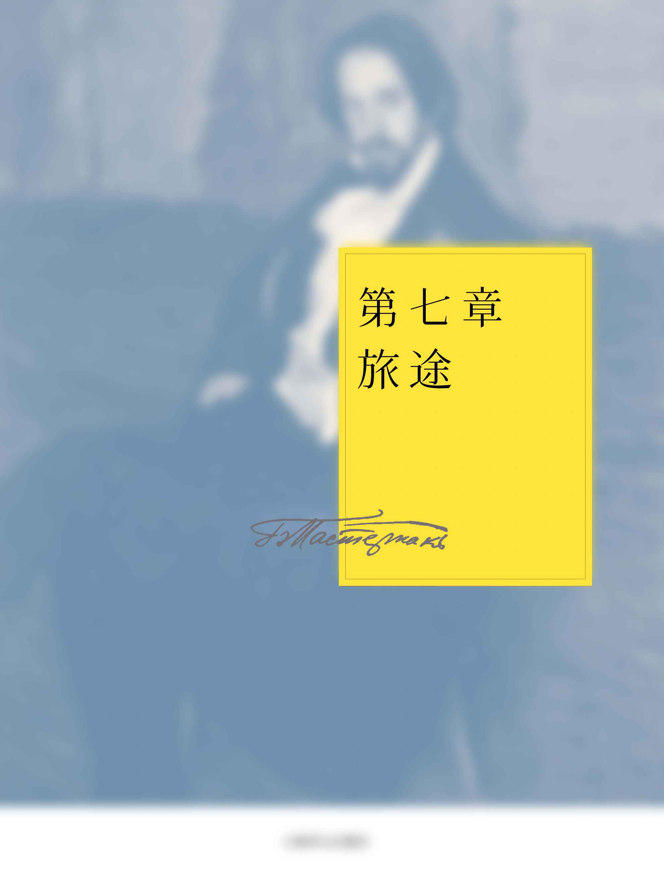

# 第七章 旅途

<h3 id="c093">一</h3>

已经是三月末了，天气开始转暖，仿佛春回大地，其实每年的料峭春寒还在后面呢。

亚历山大·亚历山大罗维奇一家匆匆整理行装准备上路。现在他们楼里的住户增加了很多，住得满满登登，赛过了外面的麻雀。为了瞒住这些住户，只说是复活节前进行大扫除。

日瓦戈原是反对去乌拉尔的，不过他没有阻挡他们。他认为这种想法实现不了，希望事到临头计划落空。结果事情竟慢慢办成了。现在已到了认真谈谈的时候。

为此开了一次家庭会议，他又向妻子和岳父说了自己的疑虑。

“这么说，你们认为我错了，我们还是非走不可？”他讲完了自己的反对意见。妻子说：

“你让我们再熬上一两年，到那时会制定出新的土地条例，可以在莫斯科附近申请一块土地开个菜园。可是这一两年的日子怎么过呢？对此你是一筹莫展的。其实这才是大家最想知道的。”

“这是白日做梦，”亚历山大·亚历山大罗维奇和女儿看法一样。

“好吧，我投降。”日瓦戈也同意了，“主要是情况不明，心里无底使我举棋不定。我们现在是瞎子走路，方向不明，对要去的地方两眼一抹黑。在瓦雷基诺庄园住过的三个人，两个——妈妈和外祖母——已经过世。外祖父克吕格尔作为人质还关在监狱里，如果他还活着的话。

“在战争的最后一年，外祖父把森林和工厂假卖出去。算是卖给了某个人，也许是卖给了银行，也许假装转到了别人名下。对外祖父干的这件事，我们一无所知！现在这些土地算是谁的呢？倒不是说地产归谁所有，这无所谓。问题是谁在负责？谁在管理？森林是否还在采伐？工厂是否还开工？最后一点，现在的瓦雷基诺是什么政权，等我们回到那里时，又会是什么政权？

“你们总爱提管家米库利齐恩，把希望都寄托在他身上。可是谁告诉过你们，这个老管家还活着，并且还住在瓦雷基诺庄园呢？再说我们对他也毫不了解，我们所以记得他，全是因为外祖父念他名字时发音特别费劲。

“不过，也犯不着争论了，既然你们决定要去，我也随你们一起去。需要打听一下，现在该怎么办手续？不必再拖延了。”

<h3 id="c094">二</h3>

为了打听这些情况，日瓦戈去了雅罗斯拉夫车站。

大厅里排成长龙似的旅客，挤在围栏中的小甬道上，缓缓向前移动。石板地上，到处躺着穿灰色军大衣的人，不时翻身、咳嗽、吐痰。不知为什么，他们一说话非得大声嚷嚷，拱顶发出震耳的回响，他们却全然不予理会。

这些穿灰大衣的人，大多是患了斑疹伤寒的病人。医院里已经超员，所以等危险期一过，第二天就让他们出院。日瓦戈作为医生，也曾遇到类似情况，同样不得不赶他们走，但他没想到病人竟这么多，而且是到车站来找栖身之所。

“您得弄个出差证才行，”一个围着白工作裙的搬运工告诉他，“需要天天来看，眼下火车太少，得碰机会。这个当然不用说（搬运工用大拇指捻了捻食指和中指）……要送点面粉什么的，不给点好处，您就休想走成。嗯，要是有这个（他用手指弹了弹喉头）……那可就神了。”

<h3 id="c095">三</h3>

正在这个时候，亚历山大·亚历山大罗维奇应邀出席了几次国民经济最高苏维埃的协商会议，日瓦戈被请去为一位重病的政府要员看病。为了酬谢他们，给他们两人各发了一张内部供应商店的配给单（这是当时第一个内部商店），这在当时是最好的酬报了。

这个商店设在西蒙诺夫修道院旁卫戍部队的仓库内。日瓦戈和岳父走过教堂的院子和兵营的院子，从院子进入石拱顶的地下室，入口处没有门坎，顺着斜坡要下去很深。里面越走越宽，横摆着一个长长的柜台。仓库管理员站在柜台后面慢条斯理地称食物递给顾客，有时还离开柜台去库房取货。每发放一份就大笔一挥从单子上划去一项。

来领食物的人并不多。仓库管理员瞅了瞅日瓦戈他们的配给单，对他们说：“口袋！”他们拿出各种各样的枕套（其中还有女式的小枕套），撑开接货，仓库管理员给他们装上，其中有面粉、大米、通心粉和糖，还有腌猪油、肥皂和火柴，最后每人还给了一个纸包，回家才发现是一块高加索干酪。这些食物使他们惊讶得目瞪口呆。

翁婿两人急急忙忙把一个个小包塞进两个大背袋里，想尽快离开，免得恩赐他们这么多东西的管理员觉得他俩不知好歹，惹他心烦。

他们从地下室出来，感到满心欢喜，倒不是为这点吃食高兴，而是因为意识到他们并不白活在世上，是有用的人，到家里年轻主妇冬尼娅一定会夸奖一番，他们也受之无愧。

<h3 id="c096">四</h3>

这几天来，翁婿两人经常出门跑机关，办理各种出差证件和保留房屋居住权证件。冬尼娅忙着挑拣应该带走的东西。

她心事重重地在他们住的那三间房里跑来跑去，忙忙碌碌。每件小东西她都掂量半天，最后才决定是否放进那堆准备带走的东西里去。

只有很少一部分东西是自己需用的行李，其余的都是准备在途中或到达目的地以后换取必需物品的。

敞开的气窗吹进来阵阵春风，可以闻到一股刚切开的新鲜白面包的香味。院子里公鸡啼鸣，孩子们在嬉戏。房里空气越是清新，从箱子里拿出来的冬衣散发的樟脑味就越是刺鼻。

要说路上需带物品的取舍标准，可有一整套理论呢，这是已经离开莫斯科的人提出的。他们这些体会在留下来的亲友中广为流传。

在冬尼娅脑子里，这些经验之谈都变成了必须遵守的简明指南，一条条记得清清楚楚。她甚至觉得院子里除了麻雀的啁啾和孩子的吵嚷，还有一个神秘的声音从外面不断向她提示。

她反复地琢磨：“要带布，带布。最好裁成衣料，可沿途要检查，很危险。万全之策是剪成衣服，用大针脚缝好。总之，要带布，织物，衣服也可以，最好是外衣，还不能太旧。没用的东西少带，沉重的家伙全不带。因为经常得自己拿着，根本别想用柳条筐或箱子。要把反复挑选过的一点东西，打成女人和孩子都能背动的包袱。盐和烟是很有用的，不过根据过去的经验，带它们有很大的危险。要带二十和四十卢布面额的纸币。最难的事是跑那些证件。还有其他，等等，等等。”

<h3 id="c097">五</h3>

动身前突然刮了场暴风雪。狂风卷着一团团灰色雪雾升到半空，接着又旋转着落到地面，给昏暗的街巷铺上一片缟素。

家里一切都已收拾停当。那三间房和留下的东西都托付给了一对老夫妇照管，他们是叶戈罗夫娜在莫斯科的亲戚。去年冬天冬尼娅才认识，他们帮冬尼娅用旧东西、旧衣服和没用的家具换过劈柴和土豆。

马克尔是靠不住的。他到了民警局，这是他给自己选中的政治俱乐部。在那里他倒没有抱怨过去的东家亚历山大·亚历山大罗维奇如何吸他的血，但是却责备他们多年来有意让他混混沌沌，不告诉他猴子变人的道理。

叶戈罗夫娜的亲戚是对老夫妻，老头儿过去当过店员。冬尼娅向他们作了最后一次交待，领着他们一个个房间看，告诉他们哪个钥匙开哪把锁，什么东西放在什么地方，又同他们一起试开了柜子和抽屉，详详细细地作了交代和解释。

屋里的桌椅都靠墙堆好，准备带走的包袱搁在一旁，窗帘也已摘下。暴风雪原来被挡在暖融融的窗帘之外，现在却毫无阻拦地从光秃秃的窗子外探进头来，望着空空荡荡的房间。暴风雪引起了他们无限的思绪。日瓦戈想起了自己的童年和母亲的死，冬尼娅和亚历山大·亚历山大罗维奇想起了安娜·伊万诺夫娜的死和丧葬，他们都觉得今天是在这幢房子里度过的最后一夜，以后再也见不到了。其实他们都想错了，但当时他们都心照不宣，生怕会引起对方伤心。怀着这种情绪每个人都回顾着在这幢房子里发生的往事，强忍着夺眶欲出的眼泪。

虽然心里难受，冬尼娅在人前还保持着大家闺秀的风度。她不停地和那个受托看管房子的女人说话。冬尼娅过于夸大了那女人所起的作用。为了表示自己对他们的感激，冬尼娅说声“对不起”就跑到隔壁房间里，一会儿拿来块头巾送她，一会儿拿来件女上衣，再不就是一块花布或混纺希丰纱。送她的布都是深底白格或白点图案，倒有像临走前夕光秃秃的窗子外面那夜幕中的方格砖墙，和飞舞着的点点雪珠。

<h3 id="c098">六</h3>

天刚放亮他们就动身去车站。楼里的住户这时都还没起床，可被同楼的泽沃罗德金娜发现了。她事事爱出头露面，领着大伙儿干这干那。她挨家把睡着的人都叫起来：“同志们，请注意，快点起来，快点，亚历山大·亚历山大罗维奇一家要走了，咱们得去告别。”

大家拥进穿堂和后门的楼梯口（正门全年都封着），在楼梯台阶上围成个半圆形，仿佛准备照集体相。

睡眼惺忪的邻居，一个个披着单薄的大衣，缩着身子耸起肩，不让肩上的大衣滑下来。有的人仓促中没来得及穿袜子，光脚丫在肥大的毡靴里不停互相踢打。

那年头很难弄到酒，可是马克尔不知在哪灌饱了烈酒，歪歪扭扭地靠在栏杆上，差点没把栏杆压坍。他自告奋勇要去车站送行李。没让他去，他还很不高兴，好不容易才支开了他。

院子里天还黑着。风停了，雪却下得比夜里更大。鹅毛大雪，懒洋洋飘落下来，离地面不远处又停下来，仿佛正犹豫是否要落到地面去。

他们一家出了小巷来到阿尔巴特大街的时候，天渐渐放亮了。白茫茫的雪幕仿佛从天上一直垂到地面，遮住了大街，雪幕的毛边在路人脚下晃来晃去，仿佛人们没在走动，只是原地踏步。

路上空无一人。他们离开西夫采夫时，没碰到任何人。走不多远，一辆空马车赶上了他们。马车夫浑身上下都是雪，仿佛沾满了面粉，马也浑身雪白。马车夫的要价，以当时的钱算数目很大，实则不值几文，这样他们连人带行李都上了车。只是日瓦戈把东西放到车上，自己却愿步行去车站。

<h3 id="c099">七</h3>

在车站，冬尼娅和亚历山大·亚历山大罗维奇已经排进了黑压压的长队，长龙两边都拦着木杆。现在旅客不能在月台上车，要跑到半里地外站口扬旗的地方上车，因为站台结了冰，满地垃圾，又没人清扫，火车没法开进月台。

纽莎和萨沙没有随妈妈和外祖父一起排队。他们在车站外厅宽大的遮檐下溜达，偶尔朝里看看是否该跟大人一起进站。他们身上有股浓重的煤油味，为了预防带伤寒菌的虱子，他们的脚踝、手腕和脖颈都抹了厚厚一层煤油。

冬尼娅看见丈夫过来，向他招了招手，但不等他走近，老远就喊着告诉他去哪个窗口交验出差证件。他就转身往那边去了。

“让我看看，给你盖的什么章？”等他回来时，她问道。日瓦戈隔着栏杆递过去一叠折起来的证件。

“这是乘坐代表车厢的优待证，”站在冬尼娅后面的人，从她肩头望过来，认出了证件上的章。站在她前面的人是个地道的法律通，世上各种条例无一不晓，他详细地解释说：

“有了这个章，只要列车挂有高级车厢，您就可以要求进去。这也就是客车车厢。”

这个图章引得排队旅客们议论纷纷：

“哪里有啊，你到前面找找看。也太舒服了吧。眼下能在货车上找个座就谢天谢地啦。”

“您这位出差的同志，别听他们瞎说。您听我给您解释。目前有的车次取消了，但有一种混合列车，既是军车，又是囚车，既运牲口，也坐人。说话不费力，爱说什么就说什么，可是干吗瞎说一气把人给弄糊涂呢？该把事情解释清楚嘛。”

“就你能解释！真有学问！他有代表优待证，这不完全说明问题。你先到前面打量打量他们，然后再发议论吧。难道像这样打扮的人也能坐代表专车？太显眼了嘛！代表专车坐的全是阶级兄弟。他能逃得过腰里插枪的水兵们的眼睛？他们马上就会发现，他是个有产阶级，何况还是个医生，过去是当老爷的。水兵掏出枪给他一下子，就像打死个苍蝇。”

这时队伍里出现了新情况。要不然，人们出于对日瓦戈和他家属的同情，不知会议论出什么名堂来。

队伍里早就有人注意到车站宽大的厚玻璃窗外发生的情况。月台上的遮檐很长，一直延伸到远处。所以遮檐尽头落雪的景象让人更觉得离得很远。由于距离太远，飘落的雪花好像停在空中下不来，似乎是作鱼饵的面包屑，浸透水后才缓慢地沉下水去。

早就有人往那里走去，或是成群结队，或是单独一人。开始时人数并不多。再加上飘忽不定的雪幔障着眼，候车的人看不清，以为是铁路工人上那边去干活。但后来发现他们一群一群直往冒烟的火车头那边走。

排队的人吼了起来：“开门，你们这些骗子！”人群骚动起来，向门口挤过去，后边的人又使劲推前边的人。

“瞧瞧，他们干的是什么事！把我们严严实实挡在这边，可那儿不排队，绕后门上车！他们一下子就会把车厢都占了，可我们还在这儿傻站着！开门，你们这些恶棍。我们要砸了！嗨，伙计们，使劲推啊！加油！”

“你们这些蠢东西！眼红啦？”那个法律通又开腔了，“这些人是从彼得堡抓来当劳工的。原来应该派去北边的沃洛格达，现在把他们弄到东部战场去，是强制性的，有人押解，去挖战壕。”

<h3 id="c100">八</h3>

他们已经在火车上坐了三天，可是离莫斯科还不很远。沿路一派冬天景象：铁轨、田野、森林以及村里农舍屋顶都覆盖着皑皑白雪。

日瓦戈一家很幸运地在车厢左前方上层铺板那里找到了安身之处，紧挨着车顶下灰蒙蒙的长条小窗。他们一家人都安顿在那里，没有挤散。

冬尼娅有生以来第一次坐货车。在莫斯科站上，是日瓦戈把她和纽莎抱起举到车厢离地面很高的沉重滑门旁，才上了车。后来在路上她们也慢慢学会自己爬上爬下了。

起初，在冬尼娅眼里，货车就像一个个安着轮子的猪圈。她觉得这种长方形的木笼，只要一震动和碰撞就会散架。三天来，每当火车刹车、启动或拐弯时，车里的乘客就会前后冲撞，左右颠簸。车厢底下的大轴咔嚓咔嚓直响，像自动玩具上的小鼓手在敲打鼓槌。可是一路走得很顺利，冬尼娅白白担忧了一场。

列车有二十三节车厢（日瓦戈一家在第十四节），遇到月台不长的车站，列车只有几节车厢能靠上月台，不是列车的前部、尾部就是中部。

前面几节是军车，中间几节坐的是普通旅客，后面几节是征集来的劳工。

劳工近五百人，年龄不等，三教九流干什么的都有。

他们共占了八节车厢，里面各色人物应有尽有。其中有穿戴讲究的阔佬，彼得堡交易所的经纪人和律师，也有划为剥削阶级的高级马车夫、地板打蜡工、澡堂工人、收破烂的鞑靼人、从解散的精神病院里逃出的疯子以及小商人和修士。

前一类有钱人脱了外衣，围着烧得通红的小火炉坐在矮圆木墩上，谈笑风生，十分热闹。这些人有各种关系，一点不发愁。他们有权势的亲戚在莫斯科为他们奔走。即使办不成，以后在路上也可以花钱赎出来。

其余的人，有的穿着敞怀的长袍，脚上穿着靴子；有的穿着束腰带的衬衫，光着脚；有的留着大胡子，有的没留胡子。他们站在气闷的车厢门旁，手扶着门框和横梁，满脸愁容默默望着路旁的田野、村庄和乡民。他们没有亲友能帮忙，前途渺茫。

规定的车厢里装不下，有些劳工就被安插在中间几节车厢，同普通旅客混杂在一起。第十四节货车上也有。

<h3 id="c101">九</h3>

每当火车驶近车站，躺在上铺的冬尼娅就吃力地抬起身子（因为车顶太低没法坐起来），从半开的门缝里往下看看车站上是否有东西可换，是否值得下车。

现在车又快要进站了。火车越走越慢，她从瞌睡中醒了过来。货车在纵横交错的转换道岔上震颤着，咯噔咯噔响个不停。这预示着前面的车站比较大，停车时间比较长。

冬尼娅弯腰坐在铺板上揉揉眼，理了一下头发，伸手在一个袋子里翻找，从底下掏出一块毛巾，上面绣着公鸡、乌克兰小伙子、马轭和轮子。

这时日瓦戈也醒了，先跳下铺板，再扶妻子下来。

敞开的车门前面，闪过一个个岗亭和信号灯，接着就是车站附近坠着皑皑厚雪的树木；那伸出的树枝好像向列车友善地捧上盐和面包表示欢迎。火车还没停下，车速还很快，水兵们就往洁净的雪地上跳，然后朝车站拐角跑去。房墙后面总有一些非法出卖违禁食品的乡下妇女。

水兵身着黑色制服，宽宽的肥裤腿，军帽后垂着飘带，走起路来横冲直撞，不可一世。人们一见赶紧让路，仿佛躲避高速滑雪或滑冰运动员似的。

在车站拐角处，附近农村来的村妇们一个挨一个站在那里，躲躲闪闪，耳热心跳，仿佛正在给自己算命似的。她们卖的东西有黄瓜、乳渣、熟牛肉和盖着棉罩子又香又热的黑麦面卷边饼（有人买时才把饼子取出来），妇女和姑娘们都扎着头巾，巾角塞在短皮大衣里。有些水兵和她们调笑，臊得她们满脸通红，同时又非常害怕他们，因为取缔投机买卖和自由市场的各种巡逻队、工作队，大多数都是由水兵组成。

村妇们的忐忑不安不多会就消失了。列车停稳，其他乘客也下了车。不只水兵，别的人也都过来了。买卖做得十分兴旺。

冬尼娅肩上搭着那条毛巾，从一个个摊贩前走过，仿佛她要去车站后面捧把雪来洗脸。卖吃食的妇女已经有好几个招呼她说：“喂，喂，这位城里的太太，你那块毛巾想换什么吗？”

但是，冬尼娅没有停下来，和丈夫继续往前走。

在最后的货摊上，站着一个围黑底红花头巾的女人。她看见了冬尼娅的那条绣花毛巾，一双火辣辣的眼睛马上亮了起来。她往四下里看看，知道没有什么危险，三步并两步走到冬尼娅跟前，掀起篮子上的盖布，急匆匆地低声说道：

“嗳，你瞧瞧这个。这东西你没见过吧？不想换吗？别琢磨了，还有别人要呢。怎么样，你的毛巾换半片儿？”

冬尼娅没听清她最后几个字，又问道：

“你说什么，亲爱的？”

那农妇指的是半片野兔，她手上拿的是整整齐齐切成两半的油煎野兔。她又说：“换吧，毛巾换半片儿。你瞪眼瞧什么？告诉你这可不是狗肉，我丈夫是打猎的，这是真的兔肉。”

她们成交了。双方都觉得自己占了大便宜，对方吃了亏。冬尼娅感到于心有愧，好像自己不诚实地欺骗了那位可怜的农妇。可是那妇人心满意足，想赶紧离开这是非之地。她招呼旁边一个卖完货的农妇，两人踩着雪地小径回家去了。

这时，人群突然骚乱起来。有个老太婆大声嚷道：“小伙子，你怎么走了？钱呢？你什么时候给过我，这不要脸的家伙。哎，你这个黑了心的，叫你呢！连头都不回。站住，站住，同志先生！来人哪，有人抢东西啦！就是他，就是他，抓住他！”

“哪一个？”

“就是脸上没有毛的那个，走着还笑呢！”

“那个衣袖破了的？”

“就是，就是，抓住他，不要脸的东西！”

“就是那个袖子上有补丁的？”

“就是，就是，哎呀，我的上帝，我被人抢了！”

“出什么事了？”

“吃了老太太的馅饼和牛奶，吃饱喝足就溜了。老太太正哭呢。”

“这可不行，该逮住他。”

“你去逮他试试。全身上下都是武装带和子弹。他还要抓你呢。”

<h3 id="c102">十</h3>

第十四节货车里也有几个去劳动营的人，由押送兵沃罗纽克管着。这里面有三个劳工显得很特别，被抓原因都不一样。一个是过去彼得格勒官办酒店的会计普罗霍尔·哈里托诺维奇·普里图利耶夫，车上的人都叫他出纳；一个是十六岁的瓦夏·布雷金，小五金商店的学徒；还有一个是白发苍苍的合作主义革命分子科斯托耶德·阿穆尔斯基，革命前被判过各种劳役，如今在新时代又跻身新劳工队伍。

他们初来时是互不相识的陌生人，七拼八凑抓来的。上了路他们才慢慢熟悉。在路上他们从相互的交谈中才知道，出纳员普里图利耶夫和商店学徒瓦夏是同乡，都是维亚特卡人，再过一会儿，这趟火车就要路过那里。

普里图利耶夫是马尔梅日市人，个子不高，平头，一脸麻子，模样丑陋不堪。灰上衣紧绷在身上，腋下汗湿得黑乎乎的，像女人的长裙背心裹着丰满的胸部。他少言寡语活似一座石雕，常常几个小时坐着沉思，不停抠着雀斑手上的肉疣，直到抠出血才罢。肉疣已开始化脓。

去年秋天，他从涅瓦大街走到铸造大街路口时，正好遇上街头搜捕。要他出示证件。他持有的是非劳动者四类粮卡。拿这张卡他什么东西也没领到过。可这次就因为这张粮卡，他被拘捕了，和以同样理由从街上抓去的许多人一起送到了军营。他们这一批人，原来说是要派去沃洛格达，途中又折回来经过莫斯科开去东部战线。在阿尔汉格尔斯克挖战壕的那批劳工，开始也是这么被送去战场的。

普里图利耶夫的妻子在卢加，战前在去彼得堡之前，他在那里工作。妻子听说他被抓的消息后，立即赶到沃洛格达去找他，想把他从劳动营里弄出来。但是这支劳动队正好和她走岔了方向，她白忙了一场。以后更没法找到他了。

普里图利耶夫在彼得堡与佩拉盖娅·尼洛夫娜·季娅古诺娃同居。当巡逻队在涅瓦大街路口截住他时，正好他刚和她分手，准备到另一条街上去办事，他还远远望见她的背影在铸造大街熙熙攘攘的人群中逐渐消失。

这位季娅古诺娃体态丰盈，很有风度，一双手很漂亮，还梳着一条大辫子。她不时深深叹着气，把辫子时而从左肩、时而从右肩甩到胸前。她是自愿来车上陪送普里图利耶夫的。

真奇怪，这个泥塑木雕似的普里图利耶夫究竟有什么值得女人动情的呢？就在这趟列车靠前些的一节车厢里，还有普里图利耶夫的另一个相好，不知她是怎么上的车。她叫奥格雷兹科娃，是个纤瘦的浅发姑娘。季娅古诺娃骂她是“臭鼻孔”和“骚货”，还有别的更难听的叫法。

这两个冤家对头一触即发，所以相互尽量躲着不见面。奥格雷兹科娃从不上这边的车厢来。真叫人猜不透，她究竟用什么办法去会她的心上人？也许，当全体乘客下车给机车搬煤和劈柴的时候，她从远处望望他，这样便心满意足了吧。

<h3 id="c103">十一</h3>

瓦夏的来历又和他们不同。他父亲在战场上被打死。母亲让瓦夏从乡下去彼得堡舅舅那里学手艺。

瓦夏的舅舅在阿普拉克辛市场开小五金铺。冬天他被叫到苏维埃去问话，走错了门，进了隔壁的单位，这正巧是劳工委员会接收站。屋里满处是人。等传唤的人数够了，红军战士就把他们围起来，押解去谢苗诺夫军营过夜，第二天早上又押到车站去了沃洛格达。

大批居民被捕的消息在城里不胫而走。第二天，许多家属都跑到车站来与亲人告别。瓦夏和他的舅妈也来找舅舅。

在车站上，舅舅求卫兵放他到栏杆外去会会妻子——这个卫兵就是现在十四节车厢押送劳工的沃罗纽克。沃罗纽克想，谁能担保他一定回来呢，就不让他走。舅舅和舅妈就把侄儿作抵押。沃罗纽克放了他舅舅，把瓦夏圈进了围栏。可舅舅和舅妈再也没有回来。

原来这是场骗局，受骗上当的瓦夏放声大哭。他跪在沃罗纽克脚下，吻他的手，哀求放他走，但毫无用处。押解兵说什么也不放，倒并不是他心肠硬，因为当时时局动乱，军纪十分严厉，押解兵要确保押送人数与花名册上人数相等，不然自己要掉脑袋。这样瓦夏就进了劳工队。

合作主义分子科斯托耶德·阿穆尔斯基不论在沙皇政府或现在政府的监狱里，看守们都挺敬重他，犯人们与他相处得很不错。他认为瓦夏的事，实在情理难容，几次三番去劝说押送队队长。队长也认为这确是骇人听闻的误会，但是放他走的手续太麻烦，半道上没法解决，只能到目的地后再说。

瓦夏五官端正，眉目俊秀，就像画里的宫廷侍卫和上帝的安琪儿，纯洁无瑕，天真可爱。常喜欢席地坐在大人的身旁，双手抱膝，仰头叫他们说话或讲故事。你从他脸部表情的变化：时而热泪盈眶，时而笑得前仰后合，就可以猜到他们在讲什么。谈话的内容在这敏感的孩子脸上反映得就像镜子一般清楚。

<h3 id="c104">十二</h3>

日瓦戈家的铺席里来了个客人——合作主义分子科斯托耶德，他吃着兔肉，啧啧有声地嘬着兔子前腿。他怕吹了穿堂风着凉，想找个没风的地方，他说：“风真大，是从哪儿钻进来的？”最后，他找了个风吹不着的地方坐下来，说：“现在好了。”他啃完前腿，舔了舔手指头，然后用手帕擦了擦手，谢过主人又说道：

“你们这里的风是从窗子钻进来的，一定要把它糊住。好了，现在咱们再来讨论问题吧。医生，您说得不对，油炸兔肉确实是上好的食物。但是由此得出结论，认为农村日子好过，这至少应该说是欠考虑，请原谅，这种匆忙的结论是危险的。”

“啊，先等一等，”日瓦戈不同意他的说法，“请看看这里的车站。树木没遭砍伐，栅栏也完好无损，还有这里的集市！这些农妇！您想想，这是多大的幸福！有的地方还生机勃勃！还有人春风满面，并非所有的人都在痛苦呻吟。就凭这一点，一切都可以原谅了。”

“真要这样就好了。然而，这只是假象。您何以得出这样的结论？您离开铁路线往外走上一百里，就会看到处处都是农民起义。您一定会问，起义反对谁？既反对白军，也反对红军——反对任何执政者。您会说，啊哈，农民向来敌视任何政权，其实农民自己也不知道他们想要什么。请原谅，您先别得意。农民对这一点比我们清楚得多，但是他需要的东西和我们截然不同。

“革命使农民从沉睡中苏醒，他满以为世世代代的宿愿即将实现：不再依靠任何人，以自己的劳动过自由自在的庄园式的生活，独立自主，对任何人都不负有义务。然而，他们从旧政府的桎梏下解放出来，又落入了新的革命极权政权更沉重的压迫下。现在农村惶惶不安，也无法安宁。可您却说农村日子好过。老兄，您一无所知，据我看，您也并不想了解。”

“您说的对，我确实不想了解。您说得不错。啊，得了吧！我何苦要了解这么多，又何苦为此争论呢？时代无视我的意见，并把它的意志强加给我。我当然也可以置现实于不顾。您说，我说的情况与现实不符。然而，现在在俄罗斯是否存在现实呢？我认为现实被人们吓破了胆，躲了起来。我愿意相信农村在革命中取得胜利，繁荣昌盛，如果连这一点都错了，那我该怎么办呢？何处寄托我的精神，又听信谁的话呢？可我需要生活，我是个有家室的人。”

日瓦戈挥了一下手不再说了，挪到铺板旁边，让亚历山大·亚历山大罗维奇继续和科斯托耶德去争论。他从上铺俯视着下面。

下边普里图利耶夫、沃罗纽克、季娅古诺娃和瓦夏正在一起聊天。由于列车离普里图利耶夫的故乡越来越近，他就讲起了如果坐车回老家，应该在哪一站下车，下车后又怎么走，是步行还是骑马。瓦夏听他提到熟悉的大小村名，兴奋得两眼放光，在地上直蹦，嘴里高兴地重复着这里大大小小的村名，这些村子对他来说仿佛是神奇的童话。

“您在旱渡口下车吗？”他兴奋得气喘吁吁地问了几次，“那当然！我们村的会车站！我们在那儿下车！然后，您大概走布伊村吧？”

“然后穿过布伊村。”

“我不是说了吗？要走布伊村，布伊村。我可熟悉啦！那是我们村的拐口。从那儿一直往右就到我家的鹬鸟村，叔叔，要上你们那里，大概要向左走，过河向前走吧？您听说过一条叫佩尔加的河吗？您哪能不知道我们这条河！要是去我们村，就要沿着河一直走。我们老家鹬鸟村就在这条河岸旁，在河上游！就在陡岸上！河岸可陡啦！我们管它叫单面山。站在顶上，吓得你不敢往下看，太险啦，一不小心就会摔下去。我说的是真的。有人在那儿采石头做磨盘。在鹬鸟村有我的妈妈，还有两个妹妹。阿廖卡和阿丽什卡。季娅古诺娃阿姨，我妈就像您，皮肤挺白，挺年轻。沃罗纽克叔叔！沃罗纽克叔叔！看在上帝的分上，我求求你……沃罗纽克叔叔！”

“叫什么？你干吗像布谷鸟似的不停地叫沃罗纽克叔叔、沃罗纽克叔叔？倒像我自己不知道我不是阿姨，是叔叔吗？你想要我干什么？让我放你逃跑？你说是不是？你溜了，我可就完蛋了，死路一条！”

季娅古诺娃心不在焉地望着远处，没有作声。她抚摸着瓦夏的脑袋，若有所思地理着他淡褐色的头发。有时她朝瓦夏点点头，用眼神和微笑向他示意，要他学乖些，不要当着大家乞求沃罗纽克放他。再等一等，一切都会好的，放心吧。

<h3 id="c105">十三</h3>

火车从中俄罗斯继续往东行驶，意外事件接踵而至。前面很不安全，是武装匪徒横行的危险地带和不久前刚平息了叛乱的地区。

列车经常在中途停车，巡逻队上车来检查行李、证件的次数越来越多。

一天夜里，火车又在中途停车。没有人上车检查，也没让车上的人起来。日瓦戈不知是不是出了事，就下车去看。

四周一片漆黑。不知为什么列车停在了两站之间的里程标旁，周围是一片枞树。早已下车的旅客们在车旁不停地跺脚，告诉日瓦戈说，他们没有出什么事，好像司机自动停的车，理由是这一带太危险，要求检道车先作检查，否则他拒绝开车。旅客代表已经去和他谈判，必要的话还得给他点好处。听说水兵也去找司机了，司机可顶不住他们。

这时，机车旁边的雪地不时被烟囱和灰箱中的火光照亮，好像篝火映在地上的反光。突然，又升起一条火舌，把前面的雪地、火车头照得通亮，可以看见几个黑影从机车旁跑过去了。

最头上的一个看来是司机。他跑到踏板那头，纵身越过缓冲杆，就不见了。追赶他的水兵也学他的样，跑到栏杆顶头，在空中一闪就消失了，仿佛被大地吞没。

日瓦戈不知出了什么事，和几个好奇的旅客朝火车头走去。

在火车前方空荡荡的路段上，他们看见司机站在路基旁齐腰深的雪地里，追捕他的水兵围着他站成一个半圆，也半身埋在雪里，就像猎人围住了一头野兽。

司机大声嚷道：

“谢谢你们这些暴风雪中的海燕！我竟落到了这种地步！你们拿着枪来对付自己的工人兄弟！就因为我说了列车不能往前开！旅客同志们，你们可以替我证明，这是个什么地方。这里什么人没有！有人把螺丝帽拧掉。见他妈的鬼，关我什么事，我怕啥？我，他妈的，我不是为自己着想，是为你们好，怕你们出事。我关心你们，你们就这么报答我。来吧，开枪吧，水兵战士们！旅客同志们，你们都是见证人。来吧，我就在这儿，我不躲。”

站在路基上的人群，七嘴八舌地嚷嚷，有的人着急地喊道：

“你这是干啥？……别犯糊涂了！……哪会呢……谁会让他们这么干……他们无非吓唬吓唬你……”

有些人在一旁大声地煽风点火：

“别怕他们，加夫里尔卡，别怕，咱们的火车头！”

第一个从雪地里走出来的水兵，是一个红棕发的高个子，脑袋特别大，脸因此显得扁平了。他平静地朝大伙儿转过身来，用带点乌克兰口音（像沃罗纽克）的低音从容不迫地向旅客说了几句。在夜里的异常环境中，他这种不慌不忙的语调，听起来有些滑稽。

“对不起，大家干啥这么吵嚷？风很大，你们会冻着的，公民们，快点离开这儿回车厢去吧！”

人群慢慢散开，各自回车厢去了。司机还很激动，那红棕头发的水兵走到司机跟前，说：

“别再闹腾了，司机同志，别再站在雪坑里了。开车走吧。”

<h3 id="c106">十四</h3>

第二天，火车越开越慢，唯恐在几乎被大风雪埋得看不见的铁路上出轨。最后在一个毁于火灾、变得面目全非的荒凉小站的废墟旁停了下来。车站被火烧焦的正墙上，还依稀可见“下凯尔梅斯”几个大字。

这一带不仅车站上留有火灾的遗迹，车站后面还能看到一座大雪覆盖的荒凉的村落，看来和车站一样也遭了劫难。

村里最头上的一幢房子被大火烧得一片焦黑，邻屋屋角坍塌了，断了的木柱朝里戳着。街上到处扔着雪橇的破支架、倒塌的栅栏、锈蚀的铁器、破破烂烂的家什和器皿。被大火夷为平地的地方，只见一片被煤烟子和炭屑染黑的脏雪；救火时浇的水已经结成了冰，一块块焦木冻在冰里。这一切全是大火和扑救留下的痕迹。

村里和车站并非完全不见人迹。偶尔还可以看到几个活人。

车站站长从废墟里走出来迎接列车。列车长跳下月台后，十分关切地问道：

“难道整个村子都烧了吗？”

“你们好，欢迎你们。烧就烧了吧，后来还有比火烧更糟的事呢。”

“我不明白您的意思。”

“还是不明白好。”

“难道您是指斯特列尔尼科夫？”

“正是他。”

“你们犯了什么过错呀？”

“不是我们。和我们毫不相干。我们代人受过，被一起捎上了。您没看见远处的村子吗？他们才是罪魁祸首。是属于乌斯季·涅姆达乡的下凯尔梅斯村。我们就因为他们遭了罪。”

“他们怎么啦？”

“他们几乎可以说是罪大恶极。他们赶走了贫农委员会，这是第一条；违抗命令不向红军提供战马，要知道，他们鞑靼人个个都爱马如命，这是第二条；第三，他们违抗征兵动员令。”

“原来如此。那就全明白了。所以他们就挨了炮弹？”

“正是。”

“是装甲车上发的炮？”

“当然。”

“太惨了。这事真遗憾。不过，这不是我们管得了的啊。”

“再说事情已经过去了。眼下也没有什么好消息告诉你。你们在这儿得停上整整一两天。”

“别开玩笑。我送的可是前线的增补部队，不是无关紧要的。我的车从来不喜欢停。”

“哪是玩笑呀！路轨上都是积雪，您自己也瞧见了。暴风雪在这一带刮了有一个星期，路全都被雪盖住了。可又没人打扫。村子里有一半人逃散了。让剩下的人去干，他们干不了。”

“咳，真糟透了！完了，完了！现在怎么办呢？”

“我们想办法把路轨清扫出来，再开车吧。”

“雪深吗？”

“倒不能说太深。有的地方深。风斜着刮，雪一股股积到路基上，最难通过的是中间一段。有三公里要清扫。这确实是很重的活儿。这一段完全堵死了。再往前就好些，有森林，林木挡住了风雪。后面是空旷地，风吹走了不少，雪积得也不厚。”

“咳，见你的鬼去吧。真是倒霉！我让车里的乘客下来帮忙。”

“我也这么考虑。”

“只是请您别去惊动水兵和红军战士。车上有很多劳工队的人，再加其他乘客，将近七百人。”

“足够了。等铲子送到，我就让他们下车。铲子不够，已经派人去附近村子里借了。能借到。”

“真倒霉！您看，咱们对付得了吗？”

“怎么不行。俗话说，众人拾柴火焰高嘛。不过是铁路上的雪，一条干线嘛。您说怎么不行呀！”

<h3 id="c107">十五</h3>

旅客清扫积雪，整整扫了三天三夜。日瓦戈一家包括纽莎，都积极地参加了。这几天是他们旅途中最美好的时光。

这地方笼罩着一种隐秘而难以言传的气氛，人们有些像普希金笔下普加乔夫的豪放和粗犷，又有些像阿克萨科夫描写的愚昧和落后。

村子的破败景象，寥寥无几的残存村民那种躲躲闪闪的神情，使此地的神秘气氛更浓重了。这些村民吓破了胆，躲着车上的旅客，相互之间也不交往，害怕被人告密。

乘客区分不同类型分批出去劳动，四周布有卫兵把守。

铁路线划成不同地段，各小组分地段同时劳动。各组铲除积雪后，中间还留着高高的雪堆，把人们隔离开来。这几个雪堆要到最后才清除。

这几天虽冷却很晴朗。白天全在外面劳动，到晚上才回车上睡觉。因为人多铲子少，大家轮流干活，每一班干的时间很短，所以不觉得疲倦。这样适度的劳动几乎是一种享受。

日瓦戈一家去铲雪的那个地段，空旷开阔，景色秀丽。这里的地势由路轨向东是缓缓的斜坡，再远去是波浪起伏的丘陵，连接天际。

山坡上有一座孤零零的、四面受风的房子。周围有花园环绕。夏季想必草木葱茏，然而现在已叶落枝疏，挂满白霜，不能给房子挡风御寒了。

厚厚的积雪把地面的一切抹平，隐去了棱角。但冬雪却掩盖不住山坡上明显的高低不平之处。春天这里大概是一条弯弯曲曲的溪流，雨水从山坡上汇合到路基下面的高架桥底。现在这条溪流被厚厚的积雪盖住，就像一个孩子蒙头藏在一条厚被下面。

这座房子里是有人住呢，还是已归乡里或县里的土地委员会所有，空着任它坍塌？原来的房主在哪里，他们怎么样了？逃亡国外了吗？也许已经死在农民的手里？或者由于名声好，在县里暂且充当技术专家？如果他们一直留着没走，斯特列尔尼科夫饶过他们了吗？说不定镇压富农时连他们也一起遭了殃？

山顶上的这座房子引起人们的好奇，却悲伤地沉默着。不过当时既没有人发问，也没有人回答。阳光照着雪地，白花花一片，令人目眩。铁铲方方正正地铲起积雪，干松的雪块熠熠闪光，仿佛布满了钻石！日瓦戈回忆起遥远的童年时代。那时年幼的尤拉带着镶边的浅色风帽，牢牢地扣着一排衣钩，穿着黑色卷毛羊皮袄在院子里玩雪。他把耀眼的雪切成锥形、方块、奶油蛋糕、城堡和穴居的城镇。啊，那时生活在世上感到多么甜美啊，周围的一切是多么令人神往啊！

不过，这三日露天的劳动也给人味香饭饱的感觉！这毫不奇怪。每天傍晚，参加劳动的人都能吃到新鲜的热面包，不知是根据谁的命令，也不知从哪儿弄来的。面包烤得油亮、喷香，两边裂着口，底下的厚皮沾着少许炭屑，烤得松软适度，恰到好处。

<h3 id="c108">十六</h3>

他们渐渐对车站的废墟产生了好感，犹如攀登雪山时爱上了临时的栖身之所。车站的格局、建筑的外形，以至断壁残垣，都在他们的记忆里留下了深刻的印象。

每天傍晚太阳落山时，他们才返回车站。太阳一如既往，总在一个地方沉下，就是报务员值班室窗旁那棵老白桦树的后面。

此处车站的外墙已经向里面倒塌，碎砖头堆在屋子里。但对着完好的窗子的那面后墙倒没受损坏，一切都完好如旧：墙上的咖啡色墙纸；带通气孔的瓷瓦炉，上面有系链条的铜盖；还有墙上挂着的镶在黑框里的工具清单，都保留下来。

夕阳还像车站没遭破坏时一样，照在炉台的瓷瓦上，棕色的墙纸变成暖融融的一团火，桦树影子投在墙上，像是挂着一条女人头巾。

在车站的另一端，通向卫生室的门已被封死，门上有张通告，看样子还是二月革命初或此前不久贴上去的，上面写道：

 

鉴于药物及包扎用品等原因，请病人暂勿求医。故此封闭，特此通告。

乌斯基·涅姆达区主任医官启。

 

等人们把各段之间联接处的雪堆也都铲除后，整条平整的线路就呈现在眼前，箭也似的飞向远方。铁轨两侧堆着铲起来的雪，旁边的两排黑森森的松树林墙，就好似黑色镶边。

远远望去，整条铁轨附近，都站着手持铁铲的人群。现在人们才第一次看清了全体乘客，发现人数竟这么多，不由得十分惊奇。

<h3 id="c109">十七</h3>

听说再过几小时列车就要出发了，尽管天色已晚，黑夜即将来临。开车之前，日瓦戈和冬尼娅又去最后欣赏了一番铁路上清除积雪后的景色。路基上一个人也没有。日瓦戈和妻子站在那里眺望远方，偶尔交谈几句，然后返回车厢。

往回走的时候，他们听见两个女人在声嘶力竭地对骂。两人马上听出那是奥格雷兹科娃和季娅古诺娃的声音。那两个女人和日瓦戈夫妇一样，都是向车尾走去。只不过她们隔着列车在车站那一侧走，而日瓦戈和妻子是在树林这一侧走。长长的列车把这两对人隔开了。而那两个女人几乎与日瓦戈夫妇总有距离，有时超过他们几步，有时落在后面一大截。

两个女人都怒不可遏，可是越来越显得精力不济。她们有时大声喊叫，有时又低得像耳语；看来由于步履不稳双腿无力，在雪地上不时要绊倒。听起来像是季娅古诺娃在后面追赶奥格雷兹科娃，追上了，就对她挥舞拳头。她用最不堪入耳的话臭骂情敌。这些脏话出自她这个仪表端庄的太太之口，声音又如此甜美，让人听起来比一个粗鲁男声说脏话要丑恶百倍。

“哼，你这个荡妇，你这个不要脸的婊子，”季娅古诺娃喊道，“人家到哪儿，你就上哪儿，扭着屁股使媚眼！你这条母狗，迷着我家蠢材还嫌不够，又盯上了孩子，冲着他摇尾巴，你要坑害小孩子呀！”

“这么说，你又是瓦夏的合法老婆啦？”

“我要叫你知道知道什么是合法老婆！你这脏嘴，你这祸害！惹急了我，我让你活不成！”

“哎呀，哎呀，你敢打人！放开你的爪子，你这疯婆子！你要把我怎么样？”

“我要你死，臭婊子，不要脸的野猫，一双贼眼！”

“我有什么好说的，我当然是母狗、野猫。可你是咱们这儿的贵族太太，是阴沟里生的，大门底下结的婚，胎里怀的是耗子，生出来的是刺猬……救命呀，救命呀，好心的人们，快来呀！哎呀，这女强盗要杀人啦！救救我这姑娘吧，救救我这没爷娘的孤儿吧……”

“咱们快点走，我实在听不下去，真叫人恶心。”冬尼娅催促着丈夫，“非出事不可。”

<h3 id="c110">十八</h3>

转眼间，景色和天气全变了。火车已经驶过平原，在丘陵和山冈之间穿行。近日来刺骨的北风停息了，南来的风带着暖意，仿佛是从炉子里吹来的。

山坡上林木层叠。铁路穿林而过，火车先要爬上陡坡，然后再缓缓下坡。火车呼哧着驶进密林，几乎有些拖不动了，就像一个上年纪的护林人领着一大帮旅客徒步在林子里走，四处张望，一样东西也不愿遗漏。

其实，此时还没有什么可看的东西。森林里一切都在睡梦中，静悄悄的，和冬天一样。只是偶尔当林木的低枝抖落身上的积雪时才会发出窸窸窣窣的声音，好像在解下脖套或松开衣领。

日瓦戈非常困倦。这些天来，他一直躺在上铺睡觉，有时醒过来，就想想事，谛听周围的动静。但现在还没什么好听的。

<h3 id="c111">十九</h3>

正当日瓦戈贪睡之际，春天的气息开始融化漫山遍野的白雪。他们离开那天，莫斯科就降雪了，以后大雪下了一路，在乌斯基·涅姆达他们扫了三天的雪，而且茫茫千里都是无边的雪野。所有这些积雪，都开始融化了。

起初积雪只在底层悄悄地慢慢地融化。这项雄伟的工程进行到一半时，秘密就暴露了出来，于是便出现了奇迹。积雪沉下去，春水泛上来，发出咕噜噜的声响。人迹不到的密林有了动静，森林中万物苏醒了。

春水不愁无处可淌。它沿着峭壁飞落下来，蓄积成池，又溢向四周。很快森林里到处水雾弥漫、溪流喧嚣。一股股春水在林中地上弯弯曲曲地游动，遇到挡住它们去路的积雪就渗入雪下；到了平坦的地面便哗哗地奔流，或者往低处急泻直下，溅起阵阵水雾。土地的水分已经饱和了。那千年古松的树冠耸入云霄，通过树根吸取水分，树根周围聚了一团团淡褐色沫子，就像留在唇边的啤酒沫。

天空为春意所陶醉，为馥郁的春的芬芳而眩晕，躲进了云层。毡毛似的乌云垂着四边，低低从树林上空飘浮而过；一阵阵充满泥土芳香和汗气的温暖的春雨，从云端直泻大地，冲走了地面上最后残留的一些黑色的碎冰块。

日瓦戈睡醒了。他用一只胳膊支起身子，朝已卸下窗子的窗棂探过头去，静静谛听着周围的声响。

<h3 id="c112">二十</h3>

火车渐渐驶进采矿区，村落增多了，区间的距离缩短了，车站一个接一个。旅客流动极为频繁，一般就在中间的小站上上下下。路程不远的旅客，随便找个地方将就着，也不躺下睡觉；到夜里他们就在货车的门旁凑合呆着，一边低声闲聊只有他们了解的当地的事，等到了下一个转车站或小站就得下车了。

三天来，上上下下的乘车旅客无意中透露出了一些消息。日瓦戈得出了结论：北方白军占了上风，已经占领尤里亚京，或正准备攻打尤里亚京。如果他没听错，那个白军司令名叫加利乌林，是他在梅柳泽耶夫军医院养病时很熟悉的病友。看来不像是个同名者。

这些消息，日瓦戈一字也未向家里人吐露，怕他们白白担惊受怕，因为这终究还只是谣传而已。

<h3 id="c113">二十一</h3>

还不到半夜，日瓦戈突然醒来，感到身心充满朦胧的幸福感。列车正停在一个车站上。车站笼罩在白夜的透明雾霭中。这白夜的朦胧，给人一种既雄伟又纤巧的感觉。这说明此处是开阔空旷的地带，又说明错车站地处高冈，可以无阻拦地鸟瞰一切。

月台上，一个个人影压低了嗓门，放轻脚步从货车旁走过。这也使日瓦戈由衷地感动。他觉得人们走路如此小心，是出于对列车上入睡乘客的照顾和尊重。这只有在战前才可能如此，那是很遥远的过去了。

日瓦戈医生猜错了。其实这时车站上正人声鼎沸，到处鞋声笃笃，和别的车站上一样。原来不远处有个瀑布，是它送来了清新和自由的气息，大大扩展了白夜的范围。是它赐给睡梦中的日瓦戈一种幸福感。

瀑布永无休止的奔流，压倒了错车站上的喧闹，以至造成了一切安静的错觉。

日瓦戈并不知道附近有瀑布，他呼吸着湿润的清新空气，又酣然入睡了。

货车底铺上有两个人在说话。其中一个问道：

“怎么样，你的那帮人老实了吧？还敢翘尾巴吗？”

“你说的是店铺小老板吧？”

“嗯，那些粮店老板。”

“把他们制服了。听话着呢。只要拿其中一个开刀，来个杀一儆百，别人就全都老实了。让他们都缴了税。”

“一个乡缴了多少？”

“四万。”

“瞎说！”

“我干吗瞎说呀？”

“四万，见鬼！”

“四万俄担粮食。”

“真有你们的，了不起，了不起！”

“四万俄担细面粉。”

“其实呢，也没啥了不起。这一带地多好！是出商品粮的地区。这里顺着雷尼瓦河往上就是尤里亚京，村村都丰衣足食，到处是粮食集散站。那舍尔斯托比托夫兄弟，佩列卡契科夫和他几个儿子，全都是做粮食批发买卖的。”

“轻些。别把人家吵醒。”

“算了，不说了。”

说话的人打了个哈欠。另一个人说：

“躺下睡会儿，怎么样？好像车就要开了。”

这时错车站的另一条轨道上，一列老式特别快车从后面急驶而来，隆隆的车声转眼间就响得震耳欲聋，连瀑布的声音都听不见了。它从列车旁飞驰而过，汽笛嘶鸣、车轮轰隆，最后尾灯闪了几下，便在前方消失得无影无踪。

下面那两人又谈了起来：

“现在糟了。我们这趟车一时开不了呢。”

“是啊，这回得等了。”

“多半过的是斯特列尔尼科夫，是装甲专列嘛。”

“大概是他。”

“他对反革命可凶狠得厉害。”

“这趟专列是去镇压加列耶夫的。”

“那是什么人？”

“加列耶夫是个哥萨克首领。听说，他和捷克军队一起守着尤里亚京。这个加列耶夫，活见鬼，把码头都占领了，现在还在他手里。”

“大概是加列耶夫公爵吧。我记不得了。”

“没有这么个公爵。看来是阿利·库尔班。你弄混了。”

“没准是库尔班。”

“那就是另一回事了。”

<h3 id="c114">二十二</h3>

天快亮时，日瓦戈又醒了。他又做了个好梦。他一直沉浸在自由自在和怡然自得的状态中。这时火车又停着，也许这是另一个站，也可能仍停在原来的站上。又听到哗哗的瀑布声，很像原先那个瀑布，可说不定是另一处的瀑布。

日瓦戈一闭眼又迷糊过去。睡梦中他听到一阵混乱和奔跑声。科斯托耶德和押送队长吵了起来，他们互相对骂。车厢外却比刚才更美好，田野里飘来一股清新诱人的芳香。这神秘的、春意盎然的、疏淡的东西，黑白相间，令人想到五月的风雪，湿漉漉的雪花一落到地上就融化了，地面上不会因积雪而变白，相反倒更黑了。这清香透明、黑白相间的东西是什么呢？啊，是稠李！日瓦戈在梦中猜了出来。

<h3 id="c115">二十三</h3>

早晨冬尼娅对日瓦戈说：

“尤拉，你真是个怪人，整个人充满了矛盾。有时候飞过一只苍蝇，你就醒了，睁眼等到天亮。可刚才这里又吵又闹，乱糟糟的，倒没有把你吵醒。夜里出纳员普里图利耶夫和瓦夏逃跑了。瞧，出了多大的事！季娅古诺娃和奥格雷兹科娃也不见了。别着急，还有呢。沃罗纽克也开小差了。真的，人跑了，不见了。真难以想象。你听我说。他们怎么跑的，是一起逃走，还是分别逃走，又是如何跑掉的，这些谁也弄不清。当然可以认为，沃罗纽克发现那些人逃跑后，怕担责任，就开了小差。可是其他人呢？他们是自愿离开这里的？或是被迫的？那两个女人就叫人怀疑。但是谁杀谁，是季娅古诺娃杀了奥格雷兹科娃，还是奥格雷兹科娃杀了季娅古诺娃，这是没人能解开的谜。押送队长从列车这头到那头来回奔跑。他喊道：‘不许你们鸣笛开车！我以法律的名义要求你们不抓住人，不许开车。’列车长不听他的，说：‘你疯了！我送的是前线的增补部队，这是头等的紧急任务，哪能等你们那些痞子！真亏你想得出！’他们两个都怪罪科斯托耶德，说他是有头脑的合作主义分子，事情就发生在他身旁，却没制止一个无知识、无觉悟的大兵干蠢事。他们还说，‘你还算是个民粹派呢。’科斯托耶德当然也不示弱，他反驳说：‘真有意思。按照你们的说法，押解兵倒应该由犯人来看管？这可真是母鸡打鸣的稀罕事。’出事的时候我推你身子，又推你肩膀，叫着：‘尤拉，快起来，有人逃跑了！’你一点反应都没有！就是打炮也震不醒你……唉，对不起，这以后再说吧。你们看……多美啊！爸爸、尤拉，你们瞧瞧，外面的景色多么美！”

他们都躺在铺板上，探出脑袋，望着窗外的景色。窗外是春水漫漫、无边无际的泽国。有的地方河水溢出堤岸，河汊的水一直淹到路基旁。从铺板上望去，窗外的景色就近在眼前，缓缓行驶的火车仿佛在水面滑翔。

水面平静如镜，只在列车驶过时，偶尔映出火车铁青色的倒影。温暖的阳光在水面上画出一个个油亮的光圈，就像厨娘用蘸了油的羽毛在炙热的馅饼上涂油。

无边无际的春水淹没了草地、坑洼和灌木。仿佛连那团团白云也被淹没了，一缕缕地沉入水底。

在这一片泽国中央，隐约可见一条狭长的土地，上面的树木上插天空，下映倒影，好像悬在空中。

“看，野鸭！一窝鸭子。”亚历山大·亚历山大罗维奇望着远处叫道。

“在哪儿？”

“靠近小岛。不是那边，是这边。向右看，向右。哎呀，真见鬼，飞了，吓着了。”

“啊，我也看见了。亚历山大·亚历山大罗维奇，我有事想和您谈谈。不过以后谈也行。我们的劳工和那两个女人都是好样的，他们逃得对。我想，他们都平平安安地走了，谁也没有伤害谁。河水要流动，人也要跑啊。”

<h3 id="c116">二十四</h3>

北方的白夜快要结束。山岳、丛林和悬崖都看得清清楚楚，可全像是画出来的，大概连它们自己也不相信是真的。

小树林刚刚开始泛绿。其中有几丛稠李已经开花。这林子长在峭壁下不远的地方，那里也是一块不大的崖角。

附近便是瀑布。但并不容易看到它，只有站在小树林旁，从悬崖边上才能看到。瓦夏懒得去那里看瀑布，不愿担惊受怕，也没心思去欣赏美景。

瀑布在这里是最为壮观的，相比之下周围一切都逊色了。正因为独一无二，它使人望而生畏，变成了某种有生命有意识的东西，变成了神话中向人们索取贡物、加害地方的巨龙或大蟒。

瀑布泻在半山腰突兀的尖石上，分成了左右两股。上面那截瀑布几乎凝然不动，下截却不停地左右摆动，仿佛瀑布的双脚微微打滑：站稳了，滑一次重又站住，不论摇摆多少回，最后还是立在那儿。

瓦夏把羊皮袄铺到地上，躺在小树林边。天色微明时，从山头飞下一只大翅鸟。它在树林四周悠然地回旋一周，就落在瓦夏身旁的冷杉树梢上。他抬起头来，望着这蓝颈灰胸脯的佛法僧鸟，十分动情地用乌拉尔土语低声唤着鸟儿：“罗尼亚札。”然后他站起身，把铺在地上的羊皮袄披到肩上，穿过林中空地，走到和他一起逃跑的季娅古诺娃身边，对她说：

“咱们走吧，阿姨。您瞧，您都冻坏了，上牙直打下牙。您瞪眼瞧什么，吓坏了吧！您没听明白吗？我们应该走了。您可得明白呀，咱们该上村子里去。村子里对自己人好，会把我们藏起来的。我们已经两天没吃东西，会饿死的。沃罗纽克叔叔大概在那里闹翻了天，他们会来追我们的。季娅古诺娃阿姨，我们该走了，直说是该逃了。我真不知拿您怎么办，阿姨，您整天整夜地总不吭气，您总该说话呀！您是愁得话也不会说了吗？是吗？您想什么呢？您把奥格雷兹科娃阿姨撞下了车，可您不是有意害她，是无意撞了她一下，我亲眼看见的。后来她从草丛里爬起来就逃跑了，一点没伤着。普里图利耶夫叔叔也一样。他们会撵上我们，我们又会凑到一起的，对吗？最要紧的是别折磨自己，那您就会说话啦。”

季娅古诺娃从草地上站起来，向瓦夏伸出手，轻声说：

“好孩子，咱们走吧。”

<h3 id="c117">二十五</h3>

火车顺着高高的路基爬坡，车身咔嚓咔嚓地响。路基两旁是种类驳杂的幼林，枝梢还没有路基高。再下面是春水刚退的草地。沉淀了泥沙的草地上，东一根西一根横着圆枕木。这些木头大概是附近林场准备流送的，春汛把它们冲到了这里。

路基两旁的幼林几乎是光秃秃的，还像冬季一样。树枝上长满烛泪般的叶芽，正是在这些叶芽中生发着新的、过去所没有的东西。叶芽微微突起，像斑驳的泥浆，可正是这新添的乱泥浆里，孕育着生命，它用绿色的火焰点着了抽芽吐叶的树木。

幼林里到处可见挺立的白桦，枝上成对绽开的嫩叶，仿佛是痛苦地扎在树上的尖齿和箭头。白桦树叶散发出一股股调漆用的木精气味，在树干上闪闪发亮，用眼睛就能断定是什么味道。

不一会儿火车开到了林场，冲散的圆木可能就是在这里堆放的。林子拐弯处，可以看到一块空地，撒满了木屑和木片，中间堆着三丈左右长的圆木。火车开到林场，司机拉了制动阀。火车震了一下，就停住了。列车站在椭圆形坡地的顶端，微向下倾。

火车上响起几声短促的哨声，还有人喊了几句，乘客不听哨声也明白，司机停车是想要储备一些燃料。

货车的门向左右两侧拉开。车上的乘客都拥上路基，人数几乎和整整一个小城镇的居民差不多。只有前面几节车里去前线增援的士兵没有出来，他们从不参加任何临时的紧急任务。

空地上那一堆堆小柴禾还装不满煤水车。需要运走一些三丈长的圆木，得把它们锯断。

司机组的工具库里有锯子。参加劳动的人分成两人一组，每组发一把锯子。亚历山大·亚历山大罗维奇和女婿合用一把。

前面军车里的士兵，从打开的车门里探出一张张笑嘻嘻的脸，这里有从没打过仗的年轻人，海军学校的高年级学生，他们好像坐错了车厢才和已有家小的严肃工人混在一起。工人们也没有上过战场，刚从军事班集训结束就派去前线。这些年轻的士兵有意吵吵嚷嚷，和年纪大一些的水兵们逗笑、胡闹，省得胡思乱想。他们知道，考验的时刻已经临近。

好开玩笑的人们逗那些拉锯的，只听一阵阵哄笑：

“哎，老爷爷！你看看嘛，我是个娃娃，还要吃奶，可干不了体力活。”“喂，玛芙拉！小心别把裙子锯破了，那会着凉的。”“嗨，年轻姑娘！别到林子里去啦，还是嫁给我，跟我走吧。”

<h3 id="c118">二十六</h3>

林子里竖着好几个叉形支架，是用两根木桩钉成的十字交叉的架子，一端埋在泥里。有一些支架还空着。日瓦戈和亚历山大·亚历山大罗维奇就在那里锯了起来。

这时正是初春。大地从雪里露出脸来，就像半年前刚刚落上雪花一样。树林里潮气很重，地上堆积着陈年落叶，犹如屋子里扔满多年来扯碎弄乱的收条、信件和通知，还没来得及打扫。

“慢慢拉，要不然您很快就累了。”日瓦戈医生对亚历山大·亚历山大罗维奇说，一边放慢速度，使动作均匀些。接着他又提议歇一会儿再干。

林里是一片咿咿哑哑的锯子声，有时几把锯子的声音协调起来，有时又各拉各的。远处传来了早来的夜莺的啼啭。百舌鸟每隔很长一段时间啼上几声，好像在吹通被脏物堵塞的长笛。就连火车阀门喷出来的蒸气，也发出歌唱似的咕咕声，像儿童室里酒精炉上牛奶煮沸了的声音。

“刚才你想和我谈什么，”亚历山大·亚历山大罗维奇提醒说，“你没忘吧？火车经过一片大水，看见鸭子飞起来的时候，你好像有什么事，说要和我谈谈。”

“噢，是的。我不知道怎么能说得简单明了。您瞧，我们越来越靠近是非之地了……这里一切都动荡不安。咱们很快就会到目的地。不知道尤里亚京的情况如何。咱们得商量一下，以防万一。我指的不是思想观点，这个绝不可能在春天的树林里，用五分钟的时间就说清楚、弄明白。我们两人彼此十分了解。我们三个人，您、我和冬尼娅，同其他许多人一起在今天构成一个统一的世界，我们之间的差别，仅在于我们对这个世界认识的程度有所不同。我不是要谈这个。这是很简单的道理。我要说的是，我们需要及早商量好，如果发生某种意外情况，我们各自应该怎么行事，才不致为对方感到羞愧，也不致给对方丢脸。”

“行了，我已经明白了。我喜欢你这样提出问题。你表达得很确切。我可以告诉你。你记不记得在一个风雪的晚上，你带回来一张印着政府最早几项法令的号外？你还记得吧，那法令是如此坚决断然，真是闻所未闻。这种直率态度使我折服。然而这样的法令只是在制定者的头脑里才能保持原有的面貌，即使这样恐怕也只是在公布的头一天里。政治上的狡诈可以在第二天就把它完全推翻。我该对你说什么呢？这种哲学对我是格格不入的。现在的政权和我们是对立的。他们搞变革并没有征求过我的同意。但他们又表示信任我，我就要对我所做的一切负责，哪怕有时的行动并非出于自愿。

“冬尼娅问我，咱们能不能赶上种菜蔬的季节，会不会耽误了下种的时间。怎么回答她呢？我对这里的土壤条件不了解。气候条件又怎么样呢？夏天太短。这里种的东西能熟吗？

“话又说回来，难道我们迢迢千里到那里去只是为了想种菜园子吗？俗话说：‘跑七里地去喝一口粥。’现在用它来开玩笑都不合适了，因为很抱歉，我们的路程是三四千里。然而，坦率地说，我们辛辛苦苦地跑去，完全是另有所图。我们的目的是要按现代的方式去那里苟且偷安，要与他们一起来挥霍祖先留下来的森林、机器和生产工具。不是去重振外祖父的产业，而是去耗用他的产业，和他们共同挥霍成千上万的卢布，换得一个寒酸的苟活。而且这一切都如现时这样混乱不堪，叫人难以理解。哪怕给我黄金，我也不会像以前那样去接收一个工厂，即使白送给我，也是如此。那样干是愚昧野蛮，犹如赤身裸体到处乱跑，或是把文化识字丢个一干二净。不，私有财产的历史在俄罗斯已经结束了。至于我们格罗梅科一家人，还在上一代时便已经失去了发财的欲望。”

<h3 id="c119">二十七</h3>

车厢里又闷又臭，使人无法睡觉。日瓦戈医生汗涔涔的头枕在湿透的枕头上。

他怕吵醒别人，轻手轻脚地从铺上爬下，又轻轻把门推开一道缝。

迎面吹来一股黏乎乎的湿气，就像在地窖里脸碰上了蜘蛛网。他知道这是雾。“有雾，明天大概会很热，太阳会很厉害。难怪那么憋气，心里也感到闷得慌。”

他在跳下路基之前，站在门口静静听了听周围的动静。

列车停在一个大枢纽站上。周围静悄悄的，一片迷雾，火车似乎并不存在，也无人理睬，像已被人遗忘。看来它停在最不引人注意的地方，距车站还很远，中间铁轨纵横交叉，像张起一张巨网。如果那里天崩地裂，车站塌陷，列车上也无人知晓。

远处传来两种微弱的声响。

列车后方，他们来的地方，传来均匀的击水声，仿佛在涮衣服，又像湿旗帜在风中拍打旗杆。

列车前方传来阵阵轰隆声。到过战场的日瓦戈医生不由得大吃一惊，竖起了耳朵。

轰隆的响声低沉而平稳，他听了一会儿就断定那是远射程火炮发射的声音。

“看来我们跑到前线了。”日瓦戈医生想道。他摇了摇头，从车厢跳下。

他朝前走了几步。前面只剩了两节车厢，火车头拉着前头车厢已经开走，甩下了他们。

“难怪昨天他们都是一副跃跃欲试的样子。”日瓦戈医生暗自想道，“看来他们已知道，一到目的地，立即要上火线。”

他绕过最前面的车厢打算越过铁轨到车站去。冷不丁从车厢后面蹿出一个持枪的哨兵，轻轻地厉声喝道：

“去哪儿？口令！”

“这是什么车站？”

“什么站也不是。你是什么人？”

“我是从莫斯科来的一个医生。我和我家里人都乘这趟列车。这是我的证件。”

“你的证件管个屁用。黑天里我那么傻来看你的证件，不怕坏了眼睛吗？你没见正下雾吗？不用看你的证件，我打老远就知道你是个什么医生！听听，你们这些医生正对我们开十二英寸的大炮呢！该狠狠地给你一家伙，可是还早点。快回去，饶你一条命。”

“他看错人了。”日瓦戈医生心想。但和哨兵争辩是没有意义的。确实，最好还是趁早离开这儿。日瓦戈医生掉头往回走。

这时，他背后的炮声停了。那里是东方。太阳已在晨雾中升起，阳光透过浮动的雾气，就像在浴室的蒸汽里晃动着的赤身裸体的人影。

日瓦戈医生顺着一节节车厢朝前走。过了最后一节，还继续往前走，脚下是松软的沙地，脚步越陷越深。

刚才听到的均匀的击水声越来越清晰。沙地缓缓向下倾斜。日瓦戈医生又走了几步，眼前便出现了一些轮廓不清的物体，在雾中看去显得特别庞大。日瓦戈又迈近一步：黑暗中显出了岸上几条渔船的船尾。前面是一条大河。河水缓慢地、无精打采地拍打着船舷和岸边码头的木板。

“谁让你在这儿瞎跑？”又一个哨兵从岸旁蹿了出来。

“这是什么河？”日瓦戈医生竟脱口问了一句，其实挨了刚才的呵斥，他根本什么也不想问。

哨兵没理他，拿起警哨放到嘴里，想把前面那个哨兵招呼过来。他还没吹响，那个悄悄跟在日瓦戈身后的哨兵已经走过来了。两个哨兵商量着什么。

“没啥可说的。他是什么家伙再清楚不过啦。问‘这儿是什么车站，是什么河？’想来蒙混我们。你看怎么样，直接拉到河滩那儿去毙了，还是押到前面的车厢去？”

“我看还是押到车厢里去，看上面怎么说。身份证！”第二个哨兵大吼一声，把日瓦戈手里的几张证件一把夺了过去。

“老乡，你看住他。”不知他对谁说了一句，就和另一个哨兵顺着铁道朝车站走去。沙滩上躺着一个人，看样子是个渔夫。他咳了一声坐起来，表示这儿有个人。

“他们肯带你去见头头，算你运气。朋友，看来你有救了。可是你千万别怪罪他们，这是他们的责任。现在是人民的天下啰。兴许以后有好日子过，可现在还不能这么说。他们正在捉一个人，看样子是把你错当了那个人，以为就是你，这下子可逮住工人阶级的仇敌了，可惜弄错啦。万一有危险，你想办法见他们头头。可不能听这些家伙的。他们觉悟高，这可最糟糕了！干掉你在他们看来，不算一回事。他们要让你跟他们走，你可别去。你说，我要见你们头头。”

从渔夫口里日瓦戈打听到，前面就是有名的通航河道雷尼瓦河。临河的车站叫拉兹维利，是尤里亚京市郊的河运工业区。他还打听到，在河的上游两三里远的尤里亚京，红军一直与白军作战，现在好像已经打退了白军。渔夫还告诉他说，拉兹维利也发生了骚乱，现在好像也已平息；现在这一带十分平静，因为车站附近的居民都迁走了，四周遍布警戒哨。他还听说，在那几个驻扎军事机关的车厢里，有边区军事委员斯特列尔尼科夫的专列，他的证件就是给这人送去了。

过了一会儿，从那边来了个哨兵。他不像刚才那两个，他拖着枪走路；再不就拿枪往前面一戳一戳地走，仿佛搀扶着一个喝醉酒的朋友，要不扶着，那醉鬼会倒下去。他押着日瓦戈医生去见军事委员。

<h3 id="c120">二十八</h3>

哨兵押解着日瓦戈来到由皮顶篷连接起来的两节沙龙车厢门口。哨兵向守卫报过口令后，他们就进了车厢。车厢里本来是欢声笑语，他们刚一进去，立刻变得鸦雀无声。

哨兵领着日瓦戈通过狭窄的甬道，来到车厢中间一个宽敞的单间，这里安静整齐。在这个清洁舒适的单间里，几个衣冠楚楚的人正在办公。那位转眼间成了全区威名赫赫的党外军事专家的斯特列尔尼科夫，他的司令部竟是这样，和日瓦戈医生所想象的相去太远了。

不过，看来他活动的中心并不在这里，而是在前面的前线司令部里，更靠近作战的地方。这里只是他个人生活的场所，有一间不大的私人办公室和一张行军床。

由于这个原因这里才如此安静吧。这里好像是海滨温水浴场的走廊，地面上铺着软木和地毯，工作人员都穿着软底鞋走路。

车厢中间的这个地方，原来是餐室，铺着地毯。现在改成了办公室。屋里放着几张桌子。紧靠门坐着的一位年轻军官对日瓦戈说：“等一会儿。”这话说完，其他的人就认为自己不必再搭理日瓦戈医生了。这个军官漫不经心地朝哨兵点了下头，表示他可以走了。哨兵从走廊上过去时，枪托磕着金属横板，哐啷哐啷响个不停。

日瓦戈医生一进车厢，老远就看见了自己的证件。它们摆在最里边那张桌子的边上。那里坐着一个旧军官派头的年纪较大的校级军官。他是统计官，正仔细琢磨着军事地图，不时参阅一本手册，拿到近处核对，剪剪贴贴，嘴里还念念有词。他抬眼朝四周的窗子挨个地看了一圈，然后说：“今天天气可要热了。”仿佛这是他扫视全部窗子后得出的结论，好像每扇窗子外面的天气都各不相同。

一个技术兵正趴在地上维修出了故障的电线。当他爬到一位年轻军官的桌子跟前时，军官就站起身来让他。他邻桌是一个身穿草绿男军衣的女打字员，正费劲地修理出了毛病的打字机，滚筒斜出了槽，夹在筒架里不能动弹。那位年轻军官站在她凳子后面，居高临下地帮她检查机器的毛病。这时技术兵爬到了打字员跟前，也帮着从下边检修扳手、拨杆和传动装置。那个校官派头的军官也走过来帮他们。大家都围着打字机，忙个不停。

眼前的景象使日瓦戈医生悬着的心放了下来。如果他是一个要被处死的人，就难以设想这些十分清楚他命运的人，能当着他的面专心致志忙这类琐事。

“不过，谁知道他们怎么想呢。”他想道，“他们怎么这样泰然自若呢？旁边大炮在轰鸣，人们在厮杀，而他们却在预测今天的热度，不是战斗激烈的程度，而是天气炎热的程度。或许因为他们已经司空见惯了吧，所以对什么都无动于衷了。”

他呆在那里无事可做，便透过对面的窗子朝外面望去。

<h3 id="c121">二十九</h3>

窗外，列车前面剩了最后一段铁路，直通拉兹维利火车站；车站就在拉兹维利近郊的山上，依稀可辨。

从路轨到车站之间，架着一条没刷油漆的木板天桥，中间有三个平台。从这里望去，这一段铁路线好像是旧机车的停放场。没有煤水车的旧机车，头顶上的烟囱活似大口杯子和靴筒，头对头地夹在破破烂烂的旧车厢堆里。

早上热气蒸腾，天空变得白蒙蒙一片。破旧机车的堆放场、市郊基地、铁轨上的破烂火车、生锈的屋顶和商店招牌，这一切构成了一幅荒凉的图画。

在莫斯科时，日瓦戈不曾留意城市里的商店招牌何其多，也不曾注意它们占去了建筑物很大的门面。这里的招牌却令他想起了这一点。招牌上的字一般都写得很大，从这里隔很远都可以看得清。招牌低压在歪歪斜斜的平房破窗户上，低矮的小房子被遮得几乎看不见，就像农村小孩戴着父亲的大帽子，连脑袋都套了进去。

这时晨雾已经完全消散。只是左边在遥远的东方，还有一些残雾，但也正往两旁飘动，像舞台上开启的帷幕。

离拉兹维利车站三里左右，在更高些的大山上坐落着一个大城市，是地区的或一省的首府。太阳光给城市抹上一层浅黄的色彩，远远望去显得线条粗疏。房屋层层叠叠，依山而造，很像廉价的民间版画上的圣阿托斯山或是苦行僧隐居的修道院。山顶中央矗立着一座大教堂。

“尤里亚京！”日瓦戈医生感到激动，“这是故去的安娜·伊万诺夫娜经常回忆的地方，也是护士拉拉·安季波娃常常提到的城市！我听她们说过不知多少次，自己却是第一次见到它，而且又是在这样的境遇中。”

这时，低头修打字机的军官把注意力移到了窗外。他们朝窗外转过脑袋。日瓦戈医生也朝那里望去。

车站天桥上，有人押送着几个俘虏或犯人，其中一个是头部受了伤的中学生。伤口已经包扎，纱布还渗出血来，他那汗流满面的黝黑脸庞上，涂抹得尽是血污。中学生走在被押人员的最后，旁边是两个红军战士。他之所以引人注目，不仅因为这叛逆者英俊的脸上透出一股刚毅之气，也不仅因为人们为他的年轻感到惋惜，主要是和两个押解兵之间不同寻常的关系，引起人们的好奇心。他们的举动同他们的身份很不相称。

头缠绷带的中学生，制帽不时滑落下来。他不愿摘下来拿在手上，就不停地正冠，不顾头上的伤口，把帽子使劲往绷带上压。那两个红军战士总是主动给他帮忙。

这悖于情理的荒唐行为，仿佛有着某种象征含义。日瓦戈医生有感于这种举动的深意，忍不住也想跑到天桥上去，对中学生大声道出不吐不快的一个警句。他想对孩子和车厢里所有的人说：出路不在于墨守形式，而在于摆脱形式。

日瓦戈医生移开了目光。这时斯特列尔尼科夫已经大步流星进了办公室，站到了屋子当中。

作为医生，日瓦戈见过许多性格难以捉摸的人，可为什么至今就没遇到过一个性格如此鲜明确定的人呢？何以生活没使他们两人相遇呢？他们的生活道路为什么从来没有交叉到一处呢？

不知怎的一眼便看清了，此人是意志的完美化身。眼前的形象正是斯特列尔尼科夫自己所想象的理想形象，因此他的精神和外表必然都是完美无缺的，包括他那匀称而又漂亮的头脸，他走路疾速的步伐，两条长腿蹬着高筒靴，靴子可能不干净，但看起来像擦得精光锃亮，还有他那灰呢军服皱皱巴巴的，但给人印象倒很挺括，像是亚麻布料做的，一切都完美无缺。

会产生如此的效果，是因为他很有才气，这是一种自然的才气，毫不做作的才气，能在任何生活条件下驾驭自如的才气。

无疑，此人应有某种才干，但未必是独创型的才干。他的一切举止中所流露出来的才干，可能只是一种模仿的才能。那个时候，所有的人都爱模仿点什么。或是模仿历史上名垂千古的英雄，或是模仿在战场上、在城市起义中亲眼见过、留下深刻印象的显赫人物。此外，也可能模仿公认的民众英雄，或是名列先进的优秀同志。或者干脆就是相互模仿。

出于礼貌，斯特列尔尼科夫见了日瓦戈这个外人后，没有表现出奇怪和有什么不便。相反，他对其他人讲话时，仿佛医生也是这个圈子里的人。他说：

“我祝贺大家。我们把他们赶跑了。这好像是一次战场游戏，而不像真正的战事，因为他们同我们一样，也是俄罗斯人，只是头脑里有糊涂观念；他们自己不肯放弃这些糊涂念头，我们不得不用武力打掉他们的念头。他们的司令官是我的朋友，出身是比我更地道的无产阶级。我们在一个院子里长大。他一生中为我做了许多好事，我很感激他。但我还是很高兴能把他撵过了河，也许撵得更远。古里扬，请快点接好线。不能只靠通讯兵和电报了。你们注意到今天多热吗？可我还是睡了一个半小时。哦，是这样……”他想起医生的事，朝日瓦戈转过身子。他想起来为什么叫醒了他。那不过是件小事，这个人正为此事被拘留在这儿。

“是这个人吗？”斯特列尔尼科夫审视日瓦戈，从头打量到脚，“丝毫不像。这伙蠢材！”他不禁笑起来，对日瓦戈说：

“请原谅，同志。他们把您当成另一个人了。我的哨兵搞错了。您可以走了。这位同志的劳动手册呢？噢，这是您的证件。请原谅我的不礼貌，我看一下。日瓦戈……日瓦戈……日瓦戈医生……是莫斯科来的。请上我那儿去一下。这里是秘书室，我的车厢就在前面。请吧。我不会耽搁您很久的。”

<h3 id="c122">三十</h3>

这个斯特列尔尼科夫到底是什么人呢？令人不解的是，一个非党人士居然能被提到要职上，而且站稳了脚跟。没有谁熟悉他，因为他虽是莫斯科人，大学毕业后就去外省教书；战争中被俘时间很长，前不久还毫无音信，人们以为他已经牺牲。

他是由一位进步的铁路工人季韦尔辛举荐作保的。斯特列尔尼科夫小时候是在季韦尔辛家长大的。当时掌握任免权力的人因此相信了他。在情绪过分激昂、观点过于极端的年月里，斯特列尔尼科夫的革命性也是不知节制的，但却表现得真诚和狂热。他的狂热并非人云亦云，而是有他的整个生活做基础，他所特有的，绝不是一时心血来潮。

斯特列尔尼科夫没有辜负人们对他的信任。

这一时期的军旅生涯中，他南征北战，参加了乌斯基·涅姆达和下凯尔梅斯战役，平息了古巴索夫地区农民武装反抗征粮队的暴乱，镇压了熊泽车站第十四步兵团抢劫粮车的事变。他还参与平定了拉辛分子的兵变（他们在图尔加图城举事后，持械投向白军），参与了镇压奇尔金河口码头的军事暴动，那次叛军杀死了一名忠于苏维埃政权的司令官。

在上述这些地方，他都以迅雷不及掩耳之势突然行动，判断，分析，做出决定，干得迅速、严厉、果断。

他乘着专车四处奔波，终于制止了整个地区的士兵普遍逃跑的现象，彻底改组了征兵机构。红军征兵工作得以顺利展开，新兵接收委员会的工作变得热火朝天。最近，由于北方白军压境，形势严峻，斯特列尔尼科夫不久前又被委以新的重任，指挥直接的军事行动，完成战略和战术任务。他介入后的积极后果，很快就显示了出来。

斯特列尔尼科夫知道，有种流言叫他“刽子手”。他对此坦然处之，并无畏惧。他出生在莫斯科，是工人的儿子。父亲因参加一九〇五年革命而被流放。那些年里他还小，没有参加革命活动，后来进入大学，家境优裕的学生闹学潮时，他没有卷入；当时穷学生入了大学，特别珍惜机会，比有钱人的子弟刻苦、努力。大学毕业时，他已有了极其渊博的学识。除了完成古典文学的学业外，还自学了数学。

按照法律，他可以免服兵役，但他却自愿上了前线，被俘时是准尉军官。后来，得知国内发生了革命，便于一九一七年底逃回俄国。

他身上有两个突出的特点、两种突出的愿望。

他的思维异常清晰，富于逻辑。而且他难得地道德高尚，为人公正；他的感情炽热而纯洁。

他要做个开拓新路的学者，然而，他还欠缺那种勇往直前的魄力，不善于通过始料未及的发现，去冲破原有的头头是道却空洞无物的预测。

他想做出一番事业来，但他的原则性中又缺乏心灵的灵活。要知道对心灵来说，不存在一般的规则，而只有具体个别的事例；心灵的伟大之处，就在于它以小见大。

斯特列尔尼科夫从儿时起就憧憬着最高尚、最光明的事物。他认为生活是一个广阔的竞技场，人们应诚实地恪守规则，在竞争中追求达到完美的境界。

日后证明，事实上并非如此，但他并没想到是自己错了，是自己把世界的秩序给简单化了。于是他把不平深深埋入心底，幻想有朝一日自己能成为一个法官，在生活和歪曲生活的罪恶之间作出审判，他要维护生活，为生活伸张正义。

失望使他变得冷酷。革命给了他武装。

<h3 id="c123">三十一</h3>

斯特列尔尼科夫带着日瓦戈来到自己的车厢，口中不停地重复道：“日瓦戈，日瓦戈，有些像商号。再不就是贵族的姓。是啊，从莫斯科来的医生嘛。要去瓦雷基诺。怪事。为什么突然要离开莫斯科去这样的穷乡僻壤？”

“去穷乡僻壤正是我的希望。想寻找安静。去偏远的村镇，去默默无闻的地方。”

“您看，多么富有诗意。是瓦雷基诺吧？这一带我都熟悉。过去是克吕格尔家的矿厂企业。说不定你们还是亲戚吧？也许是继承人？”

“为什么用这种嘲讽的口气呢？哪里是什么‘继承人’？不过，我的妻子倒是……”

“瞧，说对了吧。你们是想白军了？很抱歉，你们来迟了一步。这地区白军已被肃清。”

“您还要取笑我吗？”

“再说，您又是个医生，是个军医。现在是战时。这倒直接与我有关。您是个逃兵吧。绿色分子
 <a href="12-%E7%AC%AC%E4%B8%83%E7%AB%A0%20%E6%97%85%E9%80%94.md#m1">
[1]
</a>
 也有躲到森林中去隐居的。您的理由呢？”

“我两次受伤后复员，纯粹因为不适合在军队服役。”

“那您拿出人民教育委员会或是人民卫生委员会的签条，证明您是‘可靠的苏维埃人’，是‘同情分子’、是‘奉公守法’的吧。现在世上正进行着可怕的清算。好心的先生，现在谈不上什么富有同情心和奉公守法的医生，现在只有启示录中那种执剑的生灵和长着飞翼的野兽。不过，我已经对您说过，您自由了，我绝不食言。但只是这一回。我有种预感，我们还会相遇的，到那时就不会这样对您说话了。您可要当心。”

他的威胁和挑战，没有使日瓦戈感到慌乱。医生说：

“我知道您对我的全部看法。站在您的立场上，这种看法完全正确。您想和我争论的问题，正是我有生以来内心里一直争辩的问题，是同假设的对手不断争论的问题，并且应该说我已经从中得出了某些结论。但三言两语是说不清的。如果我确实可以走的话，请允许我不再向您作什么解释就离开这儿；如果我没有这个自由，那就听候您的处置了。我没有什么需要对您辩白。”

这时，电话铃声打断了他们的谈话。电话联系已经修复。

“谢谢，古里扬，”斯特列尔尼科夫拿起话筒，扑扑吹了几下说，“亲爱的，请派个人来送日瓦戈同志。别再闹出什么不愉快来。请给我接拉兹维利，我要拉兹维利肃反委员会运输处。”

只剩下斯特列尔尼科夫一人了，他给车站打电话说：

“刚才押来一个青年，他把帽子直往耳朵上压，可头上扎着绷带，简直胡闹。嗯，如果需要的话，立即给他治疗。嗯，要像爱护眼睛一样爱护他，您个人要对我负责。如果需要的话，可以给他一份口粮。对。现在谈正事。我还要说话，没完呢！真见鬼，另外一个声音插进来了。古里扬！古里扬！我的电话线断了。”

“说不定他是我中学预备班的学生呢。”他一时不再打算和车站继续通话，心里想，“如今长大了，倒来造我们的反。”斯特列尔尼科夫暗暗计算自己教书、打仗和当俘虏的年份，看是否和那个青年军官的年龄相符。然后他在窗旁眺望远处的尤里亚京，目光搜寻着岸边城门附近他家的住所。他的妻子和女儿会不会出人意料地还住在那里呢？要能去看她们该多好！马上就去！不，这是绝对不可能的！那完全是另一种生活呀。首先应该结束目前新的生活，然后才能回到那中断了的生活中去。他总有一天会回去的，总有一天！可究竟是几时呢？

 <a href="12-%E7%AC%AC%E4%B8%83%E7%AB%A0%20%E6%97%85%E9%80%94.md#w1">[1]</a>
 指苏联国内战争时期，1919—1920年间比较活跃的农民武装。

