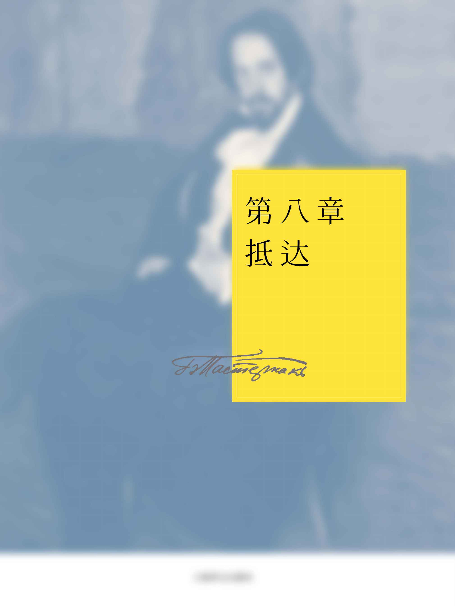

# 第八章 抵达

<h3 id="c124">一</h3>

载着日瓦戈医生一家来到此地的列车，还刚刚停到车站后侧的线路上，就被一排排别的列车遮挡起来了。维系了一路的同莫斯科息息相关之情，在这个清早就此中断了，结束了。

这里开始展现出另一番天地，一个外省的世界，它有着另一个属于自己的引力中心。

此地的人们，相互过从比首都密切。虽然尤里亚京—拉兹维利铁路区段肃清了闲人，由红军把守着，当地市郊的乘客不知怎么还是钻到铁路线上，照现在的说法是“潜入”。他们把车厢挤得满满登登，取暖货车入口也全是人，还有的人挨着列车在路轨上来回走动，要么就站在自己车厢门外的路基上。

这些人互相全都认得，老远就打招呼，靠近了便寒暄问候。他们的穿着谈吐，同京城人稍有差异，饮食既不一样，习惯也自不同。

出于好奇，不由得让人想知道这些人怎么生活，道德面目和物质条件如何，他们怎样克服种种困难，又怎样摆脱法律的约束。

谁知不久就得到了最生动的答案。

<h3 id="c125">二</h3>

日瓦戈医生由一个哨兵跟着朝自己的列车走去。哨兵把枪拖在地上，像拿了根手杖似的拄着它走路。

天气闷热。太阳晒热了铁轨和列车厢顶。洒落了石油的地上，闪着黄色反光，像镀了层金。

哨兵的枪托过处，在沙子上留下一条沟痕，还不时碰到枕木上发出声响。哨兵说：

“天气好起来了。正该春播，种燕麦、小麦，要么种黍子，是最好的时候。荞麦还早点。我们那儿到阿库林娜节
 <a href="14-%E7%AC%AC%E5%85%AB%E7%AB%A0%20%E6%8A%B5%E8%BE%BE.md#m1">
[1]
</a>
 才种荞麦。我们是莫尔尚斯克人，唐波夫省的，不是本地人。唉，医生同志！要不是国内战争这灾祸，要不是该杀的反革命，这个季节我哪能跑到外地来逛？这内战使我们阶级闹矛盾，您看它都干了些啥勾当！”

<h3 id="c126">三</h3>

“谢谢。我自己来。”日瓦戈医生谢绝了旁人的帮助。取暖货车上人们弯腰伸手想拉他上去，他纵身一跃，跳进车厢，站稳脚便和妻子拥抱到一起。

“可回来了！谢天谢地，总算平安无事了！”冬尼娅一个劲儿说。“不过你平安回来，对我们可不算新闻。”

“怎么不算新闻？”

“我们全都知道啦！”

“打哪儿知道的？”

“哨兵来告诉的。要不然提心吊胆，我们可怎么受得了呀？就这么，我和爸爸差点儿没急疯。你看他睡得多死，别想叫醒他！焦虑过度，一躺下像个死人，怎么也晃不动。这里又有了新乘客，一会儿我给你介绍几个。先告诉你一下周围的人在谈什么。车厢里的人都庆贺你化险为夷。啊……这就是他！”她突然转过头去换了话题，向取暖货车角落里挤在人堆中的一位新乘客，介绍了自己的丈夫。

“萨姆杰维亚托夫。”那里传过一个声音，接着一群人中站起来一个戴软礼帽的，拨开众人向外挤。

“萨姆杰维亚托夫，”日瓦戈这时心里琢磨。“我还当是俄罗斯古派人物呢，像传说中的大密胡子，腰上打褶的外衣，皮带上缀着铜片。这却像个美术爱好者，透着花白的小卷发，八字胡，下巴上的胡髭短而尖。”

“怎么样？斯特列尔尼科夫恐吓您了吧？您可实说呀。”

“没有，干吗恐吓我？谈话是很认真的。他至少是个很有魄力、很重要的人物。”

“那还用说。这个人我略有所知。他不是我们这儿的人，是你们莫斯科人。就和近来我们这里的新鲜事一样，也是打你们京城传来的，是外来货。光凭自己的脑子可想不出来。”

“这位安菲姆·叶菲莫维奇
 <a href="14-%E7%AC%AC%E5%85%AB%E7%AB%A0%20%E6%8A%B5%E8%BE%BE.md#m2">
[2]
</a>
 ，尤拉，是个博学家，无所不知，听说过你，也知道你父亲，知道我爷爷，还有许许多多的人。你们认识一下吧。”冬尼娅顺便毫无表情地问了一句：“你一定也认识这里的一位教师安季波娃吧？”对此，萨姆杰维亚托夫同样淡淡地回答说：“您提安季波娃干什么？”日瓦戈听见这话没有答腔。冬尼娅继续说：

“安菲姆·叶菲莫维奇是布尔什维克。你可当心，尤拉。提防着他一点。”

“真的吗？我可怎么也想不到。看外表更像个贵族模样。”

“我父亲开过一个旅店，有七辆三套马车拉客。我本人受过高等教育。的确是社会民主党人。”

“尤拉，你听听安菲姆·叶菲莫维奇说的什么。不过，说了不怕你生气，你这名字和父称可太绕嘴了。好啦，你听我告诉你，尤拉。咱们碰上了好运气。尤里亚京市不能接我们这趟车，城里到处着火，桥也炸坏了，无法通过。列车要顺着联结支线绕行，转到另一条路线上去，恰好是我们应该走的线路，泥炭车站就在那条线上。你看多巧。用不着转车，用不着拖着行李穿街走巷，从这个车站上那个车站。可是得左拐右拐转好大一阵子，才能上得了正路。绕行要花很长时间。这全是安菲姆·叶菲莫维奇给我讲的。”

<h3 id="c127">四</h3>

冬尼娅的话果然说中。列车时而向前，时而向后，在车辆拥挤的线路上来回开动，有时重新编排原有车厢，有时又挂了新的。线路上还行驶着别的车次，挡得这趟车许久开不到旷野上去。

地势多坡，使半个城市淹没在远方。只是偶尔在地平线上闪现出楼顶、工厂烟囱、钟楼上的十字架。城郊有一处大火，黑烟被风吹走，在空中飘成一片，活似一束马鬃。

日瓦戈医生和萨姆杰维亚托夫坐在取暖货车的边沿，双腿垂在门口底板上。萨姆杰维亚托夫一直在给日瓦戈讲着什么，用手指点远方。有时，飞驶的取暖货车发出隆隆巨响，盖过了他的声音，以致什么都没有听清楚。日瓦戈反问一句，安菲姆·叶菲莫维奇把脸贴近医生，扯着嗓子喊，才能把重复讲的话送进他耳朵里去。

“那是‘巨人’电影院给点着了。士官生们陷到了里面。不过他们早就已经投降了。总之战斗还没结束。您看到钟楼上的小黑点了吗？那是咱们的人。

“我可什么都看不见。您是怎么分辨出来的？”

“这边是霍赫里基着了火，是个手工业的郊区。有商业街的科洛捷耶夫在它旁边。我为啥关心这个呢？我家的旅店就在商业街上。火势不大，还没蔓延到中心区。”

“你再说一遍，我听不见。”

“我是说中心区、市中心，教堂、图书馆。我家的姓萨姆杰维亚托夫，是把萨恩多纳托改成俄文发音的。我们好像是杰米多夫的后代。”

“又没听清楚。”

“我说萨姆杰维亚托夫是萨恩多纳托改头换面变来的，大概出自杰米多夫家族，就是公爵杰米多夫萨恩·多纳托夫。谁知道呢，也许是瞎说，是家族神话。这片地方叫下斯皮尔金。尽是别墅，是寻欢作乐之地。这名字很怪吧？”

他们面前展现出一片旷野，上面铁路纵横交错。一排排电线杆缓缓地向天边退去。宽阔的石子路蜿蜒曲折，可同铁轨媲美。石路时而隐没在地平线后，时而在拐弯处露出一条波浪般的弧线，旋即又复不见了。

“我们这条大道是有名的，穿过整个西伯利亚。是靠苦役修出来的。现在是打游击的据点。总而言之，我们这儿不错呀。住惯了就能适应了。城里的新鲜事你们会喜欢的，比如我们那种给水站，十字路口上的；还有冬季里露天的妇女俱乐部。”

“我们不准备住到城里，要去瓦雷基诺。”

“我知道。你妻子对我说了。反正你们总得进城去办事。我一眼就猜出她是谁家的人。眼睛、鼻子、前额，同克吕格尔一模一样。完全像她外祖父。这一带的人们，都记得克吕格尔。”

旷野尽头是两座高高的红色圆墙储油罐。高柱上耸立着工业广告。其中一幅广告两次映入日瓦戈医生的眼帘，上面写着：

 

莫罗和韦钦金。播种机、打谷机

 

“过去这是个很有名气的商行，生产的农具很好。”

“我听不见。您说的什么？”

“我是说商行，明白吗？商行。生产农具的。是个股份公司。我父亲也有股份。”

“您刚才说是开旅店。”

“旅店是旅店。两个不矛盾。他不傻，尽往好的企业里投资。‘巨人’影院就有他的股票。”

“你好像很引为骄傲？”

“是指我父亲的机灵吗？那当然。”

“那你的社会民主党呢？”

“请问这与它有什么相关？那上面写着呢，说谁要主张马克思主义，就一定窝窝囊囊，无所作为？马克思主义是一种真正的科学，是解释现实生活的学说，是研究历史环境的哲理。”

“谈马克思主义和科学？同一个不太熟识的人争论这个问题，至少不够谨慎。不过还是说说吧。马克思主义太不善于控制自己，所以成不了科学。科学一般都要稳重些。讲马克思主义和客观性吗？我不知道有比马克思主义更封闭、更远离事实的思潮。每个人都关心如何在实践中检验自己。可是掌握权力的人们为了制造自己洁白无瑕的神话，千方百计地回避真理。政治丝毫打动不了我。我不喜欢漠视真理的人们。”

萨姆杰维亚托夫把日瓦戈医生的话只当成是一些俏皮的怪话，笑笑而已，没加反驳。

这时列车正在换道，每当开近道岔，一个腰带上系着牛奶罐子的中年女道岔工，连忙把手里正织着的毛线活儿换到另一只手里，弯身把道岔上的圆柄扳过去，火车便向后退去。等列车缓慢地后退，她直起身子举着拳头朝列车作个威胁的手势。

萨姆杰维亚托夫以为这举动是冲他来的。“她这是对谁呀？”他思忖着。“好像有点面熟。是格拉莎吗？像她。我这是想到哪儿去了？不见得是她，比格拉莎老得多。又干吗冲我来呢？俄国发生了事变，铁路上一片混乱，她这个可怜人一定很苦，于是我就成了罪人，朝着我攥拳头。去她的吧，值得为这个也伤脑筋吗？”

终于，扳道女工摇了摇旗，对司机喊了句什么，才放列车通过继续赶路。当第十四节取暖货车厢驶过时，她朝着坐在货车上闲聊的两位碍眼乘客，吐了一下舌头。萨姆杰维亚托夫便又陷入沉思。

<h3 id="c128">五</h3>

燃烧着的城市的郊区、状如礼帽的储油槽、电线杆和广告牌渐渐远去不见，展现出另一番景色，树林，小山，其中不时露出弯弯曲曲的石子大路。这时，萨姆杰维亚托夫说道：

“站起来告个别。我马上要下车了。再过一个地段，你们也该到了。当心可别坐过头。”

“这一带您真的十分熟悉吗？”

“了如指掌。方圆一百里以内吧。我是法官呀！干了二十年，办案，到处跑。”

“直到现在吗？”

“那可不。”

“现在还能有什么官司呀？”

“您要什么有什么。旧的契约业务没有完成，债务不清等等，官司很多，不得了。”

“这类的官司，还不都废除了呀？”

“名义上自然如此，可实际上却同时存在相互排斥的事物。一方面要实行企业国有化，燃料归市苏维埃，兽力车归省经济人民委员会；另一方面人们又都想过得好一点。这是过渡时期的特点，理论和实践还不能一致。这就得要那种机灵人，善于经营的，像我这种性格的。能赚就赚，管它三七二十一呐。像我父亲常说的，偶尔也会挨巴掌。全省得有一半人靠我办事。趁着办木材供应的案子，我会去看望你们。自然只能是骑马去。我那马腿跛了。它要不瘸，我才不坐这破玩意儿颠簸呢。你看走的这么慢，还叫火车呐。我要去了，会对你们有用的。你们米库利齐恩那家人，我非常了解。”

“您知道我们来的目的、我们的想法吗？”

“大体上知道。猜得出。可以想象。人自古以来就眷恋土地，想用双手养活自己。”

“那怎么样呢？您好像不赞成？您怎么看？”

“天真的幻想，田园诗的幻想。干吗要这样呢？愿上帝保佑你们，不过我不信上帝。这是乌托邦，是原始的办法。”

“米库利齐恩会怎么对待我们？”

“不让你们进门，赶走了事，这么做也对。没有你们就已经是乱糟糟的，一千零一夜，工厂停工，工人跑散，生活没有着落，饲料奇缺，突然间你们又来了，鬼使神差，够叫人高兴了！就是他把你们打死，我也能给他找到理由。”

“您看，您是布尔什维克，可自己也不否认这不是什么生活，这是自古没有过的荒唐事，荒诞无稽。”

“一点不错。可这是历史的必然性，必须通过这一关。”

“为什么是必然性呀？”

“您怎么，是小孩子还是装糊涂？您不是从月球上来的吧？寄生虫饭桶骑在挨饿的劳苦人脖子上，把他们折磨得要死，还非忍受着不成？更何况还有别的欺压凌辱。人民正当的愤怒，难道还不好理解吗？人民希望公正的生活，寻找真理，难道不是很明白吗？您是不是觉得在杜马里通过议会办法已经取得了根本的变革，可以不必搞专政了？”

“咱们说的不是一码事，就是争一百年也不会有结果。我本来很倾向革命，但现在我认为靠强力是什么也得不到的。只有用善行才能引人向善。不过问题不在这儿。还是回来谈米库利齐恩吧。要是等待我们的是这种前景，又何必去呢？我们应该打道回府。”

“简直是糊涂话。第一，难道只有在米库利齐恩那儿才有一线光明吗？第二，米库利齐恩是异常心善的，心善得出格了。他吵嚷一阵，坚持一阵，就会软下来，还会解囊相助。”于是萨姆杰维亚托夫讲起了往事。

<h3 id="c129">六</h3>

“二十五年前，工艺学院大学生米库利齐恩从彼得堡来到这里。他是由警察押送发配来的。米库利齐恩到这里之后，在克吕格尔手下当了管事，娶亲成家了。我们这里，东采夫一家有四个姊妹，比契诃夫那三姊妹多一个。尤里亚京的学生们，都在追求她们：阿格里平娜、阿芙多季娅、格拉菲娅、谢拉菲玛，父称是谢韦里诺夫娜，人们把这父称变了一下，干脆叫她们谢韦里娅卡，也就是‘北方姑娘’。米库利齐恩娶的就是‘北方姑娘’中的大姑娘。

“不久这对夫妻生了个儿子。出于崇尚自由的思想，糊涂父亲给孩子起了个少见的名字：利韦里，叫白了就是利夫卡。孩子虽然淘气，可显露出多方面的很不错的才能。战争爆发后，利夫卡在出生证上多添了几岁，才刚十五就自愿跑到前线当了兵。阿格里平娜·谢韦里诺夫娜本来就身体病弱，经不起这个打击，竟一病不起，前年冬天死去了，那恰是革命的前夕。

“战争结束，利韦里回了家。你当他是什么人啦？这已经是一位挂了三枚十字勋章的准尉，当然也是一个从前线派来的做宣传工作的彻头彻尾的布尔什维克代表。您听人说过‘绿林兄弟’吗？”

“没有。”

“那就不必讲它了，这样听起来也没劲儿。那您从车厢里往外观赏石子大路，也没啥意思啦。大路妙在哪呢？现在那里有游击活动。什么是游击队？这是国内战争的骨干主力。这支力量由两个方面组成：担负革命领导责任的政治组织和战败后拒绝服从旧政权的基层士兵。这两个方面一结合，便形成了游击武装。它的成分是很杂的，基本上是中农。但除中农外，您什么人都见得到。这里面有贫农，有免去教衔的僧侣，有同父辈对阵的富农子弟。还有思想上的无政府主义者，没有身份证的叫花子，被撵出中学的超龄的浪荡青年，也有奥德俘虏，因得到获释返国的保证才参加进来的。就是这样一支成千上万的人民军队的一个部分，称作‘绿林兄弟’，由绿林兄弟中一位同志指挥，也就是利夫卡，利韦里，是阿韦尔基·斯捷潘诺维奇·米库利齐恩的儿子。”

“您说什么？”

“就是这样。我再往下讲。妻子死后，米库利齐恩续了弦。第二个妻子叶莲娜·普罗克洛夫娜是个中学生，刚毕业就成了亲。她天生幼稚，却也有点存心装作幼稚；她年纪轻轻，却还要往年轻里打扮。装着这种样子叽叽喳喳，喋喋不休，像个天真的小傻瓜，又像地里的百灵鸟。她一见到你，就开始考你。‘苏沃洛夫是哪一年诞生的？’‘列举一下三角形全等的各种情形。’考住了你，弄得你下不来台，她可兴高采烈了。再过几个小时，你会亲眼看到她，可以检验我的描写对不对。

“她那丈夫也有自己的怪毛病：成天咬个烟斗，爱拽几个斯拉夫古词语，什么‘毫无顾忌’，‘乃由此故’。他本该到海上去显身手，大学念的是造船。这种专业特点只留在了表面上，留在了习惯里。好刮胡子，整天价烟斗不离嘴，谈话从牙缝往外挤，倒很和气，慢条斯理的。他像一般吸烟人那样翘着下巴，灰色眼睛冷冷的。还有一个细节差点忘了说，他是社会革命党人，被边区选为代表参加立法会议。”

“可这一点非常重要呀。这么说父子两人针锋相对。是政敌吗？”

“看起来自然是，可实际上原始林并不同瓦雷基诺作对。还是往下说吧。东采夫家剩下的姑娘，就是阿韦尔基·斯捷潘诺维奇的妻妹，至今还都在尤里亚京，待字未嫁。时代变了，姑娘们也变了。

“剩下的年纪最长的阿芙多季娅，是市阅览室的图书管理员。她是位皮肤黝黑的俊小姐，非常腼腆，无缘无故就两颊绯红，像枝芍药。阅览室里鸦雀无声，她一患上慢性伤风，能连续打二十个喷嚏，窘得她恨不得钻进地缝里去。可又有什么办法，她这是神经质所致。

“第二个是格拉菲娅，姊妹里最出众的。这姑娘很厉害，能干活，对什么劳动全不厌恶，人们异口同声，都说绿林游击队长利夫卡像他这位姨妈。人家刚刚看到她在裁缝店干活或是在织袜子，一转眼工夫她又成了理发师。你注意了吗？在尤里亚京铁路上一个扳道女工朝咱们挥拳头。我当时心里琢磨，真想不到，格拉菲娅上铁路干护路工来了。后来想大概不是她，因为那人太老了。

“小女儿谢拉菲玛，家里最受累的人。她是个有学问的姑娘，十分渊博，研究过哲学，喜欢诗。可在革命的年头，受到普遍高涨的情绪、街头集会、广场演说等等的影响，竟发了疯，陷入宗教的癫狂。姐姐们一去上班就锁上门，可她从窗子里跳出，沿街招手；聚来了行人，她就宣传基督要二次降世，人世到了末日。哎呀，我讲起来没个完，就到站了。你们在下一站下车，准备一下吧。”

等安菲姆·叶菲莫维奇下了车，冬尼娅说：

“我不知道你怎么看这件事，但我觉得是命运使我们同这人相逢。我感到他在我们的生活里会起某种恩人的作用。”

“非常可能，冬尼娅。不过我不太喜欢人们认出你和外祖父长得相似，不太喜欢这里都记得你外祖父。就连斯特列尔尼科夫听到我说瓦雷基诺时，也忿忿地插了一句：‘是瓦雷基诺克吕格尔的工厂吗？你们别是他的亲戚吧？不是他的继承人吧？’”

“我担心在这儿咱们比在莫斯科更显眼，离开那里为的就是不惹人注意。

“当然，现在是木已成舟，后悔也无益于事。最好是不抛头露面，隐蔽起来，遇事谨慎些。总之我有种不祥的预感。把咱们的人叫起来吧，装好东西，扎紧皮带，准备下车。”

<h3 id="c130">七</h3>

冬尼娅站在泥炭车站月台上，一遍又一遍地数人和行李，生怕把什么忘在车厢里。她感觉到脚下是站台上踩实了的沙土，可心里仍在怕坐过了站，耳朵里还是火车飞驶的轰响，尽管眼睛看见列车确实停在月台上不动。这些使她什么也看不到，听不见，什么也想不了。

远途的乘客从取暖货车上同她告别，她没有发现。她也没看见列车怎么开走的。只是当她注意到其他的路线，注意到对面的绿地和蓝天，才发觉那趟列车已经不见了。

车站是座砖房，一进去两侧各有一条靠椅。从西夫采夫来的莫斯科旅客，在这一站下车的仅有几个人。他们放下东西，在一条长椅上坐下来。

站上的宁静、冷清、整洁，使来客感到惊奇。周围没有聚集的人群，没有吵骂，反而觉着很不习惯。这里好似穷乡僻壤，生活落在了历史后面，赶不上潮流。它还远远没有达到首都那样的粗野蛮横。

车站掩映在白桦树丛中。到站时，车厢里已经发暗。轻轻摇曳的树冠洒下阴影，爬动在人们手上、脸上、月台洁净潮湿的黄沙地上。树顶禽鸟的鸣声，同绿树丛一样的清新。圆润清脆的啼啭，响遍整个林子。白桦丛中，有两条道路横切而过，一是铁路，一是乡间大道。低垂的白桦枝条，如同拂地的宽大衣袖，把两条路都遮蔽起来。

冬尼娅突然如梦初醒，一下子意识到了周围的一切：清脆的禽鸣、林中的静谧清新、充溢四周的恬静安宁。她脑海里本已准备好一句话：“我不相信我们能平安到达。你知道吗？你的那个斯特列尔尼科夫当着你的面可能宽宏大度，放了你走；但可以发来个电令，趁我们下车时一网打尽。亲爱的，我不相信他们的善，这全是幌子。”

不过她没说出这句话，见了周围迷人的景色，反倒脱口而出：“真美啊！”此外再也说不出什么，泪水涌上来，她放声大哭。

站长老头听到她的哭声，从房里走出来，迈着小碎步走到长椅前，恭敬地举手在红缨制帽的前檐致礼，然后问道：

“也许这位小姐需要点镇静药？车站药房里有。”

“没什么了不得。谢谢你。不需要了。”

“路上忙碌，担惊受怕，这是常有的事，很普遍。再加上像到了非洲似的炎热，此地是很少见的。还有尤里亚京出的事。”

“路过时从车里看到了大火。”

“我要是没猜错，你们大概从俄罗斯来吧？”

“从别洛卡缅来。”

“莫斯科人呀？那太太神经受不住就不奇怪了。听说莫斯科都打成平地了？”

“那是夸大。不过确实见识了不少。这是我女儿，这是女婿，这是他俩的孩子。这是我们家年轻的保姆，纽莎。”

“你们好，你们好！非常荣幸。我多少知道一点。萨姆杰维亚托夫从萨克马枢纽站打来个铁路电话说的：日瓦戈医生一家从莫斯科来，请您尽力协助。这位医生就是您喽？”

“不，日瓦戈医生是他，我的女婿；我干的是另一行，搞农业，农艺教授。”

“对不起，认错了，请原谅。认识你们非常高兴。”

“听您这么说，您认识萨姆杰维亚托夫？”

“怎么能不知道他，神通广大的人。我们的依靠，我们的活路。没有他，我们在这儿早就完蛋了。他说：请您尽力协助。我就说：遵命。就这么许了愿。是要用马，还是帮点别的忙？你们打算去哪儿？”

“我们要去瓦雷基诺。那离这很远吗？”

“去瓦雷基诺？怪不得我觉着您女儿非常像一个人。原来你们去瓦雷基诺！这一下子全明白了。要知道这条铁路是我和伊万·埃内斯托维奇一起修的。我马上想办法去找车。我唤个人来，弄一辆马车。多纳特！多纳特！你先把东西搬到旅客候车室。怎么能弄来匹马？你跑一趟，去茶馆问问行不行。好像巴克斯清早在这儿来着。你打听一下，兴许还没走。你就说要拉四个人，东西差不多没什么。是从外地新来的。快点去吧。对您呢，太太，我算个长辈要劝你一句。我是有意不问您和伊万·埃内斯托维奇有多密切的血缘关系，在这一点上您要多加小心。可别对谁都推心置腹。现在是什么时候，您自己要明白吧！”

提到巴克斯的名字，来人奇怪地互换一下眼色。他们都还记得故去的安娜·伊万诺夫娜讲的那个神话般的铁匠，他用铁给自己打出全套永远不坏的内脏，以及地方上别的不足信的故事传说。

<h3 id="c131">八</h3>

拉车的是匹产了驹的白牝马，赶车的是个扇风耳、大毛脸、雪白头的老人。他浑身上下由于各种原因全是白色的。新织的树皮鞋还没来得及穿黑，裤子和衬衫穿久了已经褪色变白。

白牝马身后跟着匹漆黑如夜的小马驹，高高抬着那还未长硬的软骨腿，头上是一卷卷的小毛，整个像是手工刻出的玩具。

马车在沟坎上颠簸，乘客手抓车沿免得摔下去。他们心境平和。梦想正在实现，他们越来越接近目的地。晴明佳日的傍晚时分，是那么慷慨大方，迟迟不急逝去。

沿途一会儿穿过树林，一会儿上了露天的空旷地。在林子里，车子碰上粗木棍一颠，车上的人就全撞到一起，他们佝偻着，蹙起眉头挤作一团。一入开阔地，旷野仿佛满心欢喜地自动摘下帽子，于是旅客也舒展身子，坐得宽松些，不断抖动脑袋。

这里地处山区。山形总是各异其面。远方群山雄踞傲立，影影绰绰一片，默默地俯视着车上旅人。喜人的淡红光芒，在田野上追逐着旅人，给他们安宁和希望。

一切都使他们惬意，一切都令他们惊讶。而最甚者，莫过于赶车怪老头喋喋不休的闲话了。在他的话里，已然消亡的古俄罗斯字词的遗迹、鞑靼用语、地方话特征，同他本人莫名其妙的杜撰混杂到了一起。

每当马驹落到后面，白马便停下来等它。马驹用自由随便的跳跃，啪啪响着平稳地赶上来，然后迈出长腿怯怯地靠近大车，直起长脖子把小头伸过车辕去吮母乳。

“我还是弄不明白，”冬尼娅颠得牙齿发响，一字一停地问丈夫，害怕猛然一震会咬破舌头。“这难道能是妈妈讲过的那个巴克斯吗？你记得讲的那些乱七八糟的事吗？有个铁匠，殴斗时肠子给人打出来了，他给自己又做了副新的。一句话，铁匠巴克斯是个铁肚肠。我知道这全是胡编的童话，可当真是说的他吗？这难道真是那个人？”

“当然不是。第一，你自己就说这是胡编的民间传说；第二，据妈妈说，在她那时候这传说就有了一百年的历史。咱们干吗这么大声讲话？老头听见了要生气的。”

“他啥也听不见，耳背。就是听见也不明白咋回事，有点傻气。”

“哎，费多尔·涅费德奇！”不知为什么老人用个男人名字称呼牝马，他比旅客更清楚，这分明是匹母马。“瞧这热劲儿，真恨死人！”

他突然唱起一段民谣，是从前此地工厂里编的：

 

再见了，厂里的账房！

再见了，矿区的大院！

我吃腻了厂主的粮食，

一塘池水给我喝完。

岸边游动着天鹅，

分开了水面的漪涟。

不是酒劲叫我跌跌撞撞，

瓦夏给害得好个可怜。

可我不是傻瓜呀，玛莎！

玛莎，我可不再受骗！

我要进到谢里亚巴城里去，

奔辛捷久利哈找点活干。

 

“我的马儿呀，你忘了上帝！人们看看吧，这该死的东西。你抽它一鞭，它让你下车。费多尔呀涅费德奇，你啥时候上路？这片树林叫原始林，它可没头没尽。那里边农民聚众，驾——是绿林弟兄。费多尔·涅费德奇，怎么又停下了，你这鬼头。”

忽然，他转过身端详着冬尼娅说：

“年轻人，你怎么想？当我没瞧出你是谁家的？你可不难认呀，我一看就行了。我不说瞎话，真的认出来了！认出来了！我不敢相信自己这两颗珠子，活脱模样是克里格夫！（老人把眼睛叫珠子，把克吕格尔叫成克里格夫。）你说不定是他孙女吧？我还能认不得克里格夫呀？我在他那儿过了一辈子，一直到没了牙。什么活儿、什么职业全干过！当过坑木工，管过轧滚，住过马场。驾——走呀！又停了，缺腿的东西！这是冲你说呢，听见没有？

“你方才说这是哪一个巴克斯，就是那个铁匠吗？真有你的，小姐，眼神够机灵，可有点犯傻。你说的巴克斯，就是波斯塔诺戈夫，是那铁匠的外号，人叫铁肚肠波斯塔诺戈夫。他一百五十年前就入土了，进了棺材。我现在同他不一样，姓梅霍诺申。名字一样，同名不同姓，像他不是他。”

老人把他们已经从萨姆杰维亚托夫口里知道的米库利齐恩夫妇的情况，又一点点用自己的话讲了一遍。他叫那男的是米库利齐，女的是米库利齐娜。管现在的妻子，他称作后婚；讲到死去的“原配”则说那是个蜜甜女人，是白色的天使。当讲起游击队首领利韦里，听说他名声没传到莫斯科，首都没谁知道绿林弟兄，他觉得不可想象：

“没听说过？没听说绿林同志？这么说莫斯科长了耳朵干啥用？”

黄昏来临。旅客的身影越来越长，在马车前不停奔逐。如今沿路尽是宽阔的旷野。零零散散长着滨藜、飞廉、柳兰，高高的硬茎，顶上有孤零零的花束。落日余辉贴着地面从下方照上来，长茎就如骑手们在田间稀疏布下的不动的哨兵，黑影幢幢。

远远地在前方尽头处，平川贴上了横着隆起的高地。高地如一面墙阻在前面，墙下可以想象到有个峡谷或一条河流。那里的天穹好似围上了一个篱笆，乡间大道正好通到篱笆的入口。

高崖上显露出一座长形白色的单层房子。

“看见冈顶上面的高台了吧？”巴克斯问道。“你们说的那个米库利齐和米库利齐娜就在那里。底下是条冲沟，人们叫它舒基玛。”

从那个方向传来连续两声枪响，引起许多散落的回音。

“这是怎么回事？是游击队吧，老大爷？别是朝我们放的吧？”

“上帝保佑！哪是什么游击队。斯捷潘诺维奇在山沟里吓唬狼呢。”

<h3 id="c132">九</h3>

他们同主人们初次见面，是在厂长住房的院落里。出现了一个令人难熬的场面，开始是冷场，而后是忙乱喧哗。

叶莲娜·普罗克洛夫娜傍晚到林中散步刚回到院里。晚照追着她的背影，穿过了整个林子，从一棵树旁移到另一棵树旁，树也染成了同她的浓发一样的金黄色。她穿着夏衣，很单薄；满脸绯红，正用手帕擦着走热了的面颊。敞开的前颈上套了条松紧带，连着背后的草帽。

迎面向她走来的，是手持猎枪的丈夫，刚从深谷里上来，准备马上擦清冒了烟的枪筒，因为卸子弹时发现了毛病。

突然，在石子铺的大门入口，一片嘈杂声里巴克斯飞快地驱车送来了自己的礼物。

亚历山大·亚历山大罗维奇迅速同所有的人下了车，开始说明来意。他讲得结结巴巴，一会儿摘下帽子，一会儿又戴上。

有那么一刻，不知所措的主人真的呆若木鸡，而可怜的来客羞得满面通红，同样真的不知如何是好。这个局面，不仅当事者，就连巴克斯、纽莎、萨沙都不言自明。感到难堪的恐怕还有牝马和小驹、金黄色的阳光和盘旋在叶莲娜·普罗克洛夫娜周围不时落到她脸上颈上的草蚊。

“我不明白，”阿韦尔基·米库利齐恩终于打破沉默说，“我不明白，根本不明白，永远也不会明白。我们这儿是南方怎么着？有白军？是产粮区？干吗偏选中我们这里？为什么鬼使神差，把你们送到这来了？”

“真有意思，你们想过没有，阿韦尔基·斯捷潘诺维奇要担多大责任？”

“叶莲娜，你别打岔。的确如此，她说得一点不错。你们想过没有，这对我是多大的负担？”

“我的上帝！你们没明白我们的意思。我们求什么呢？极其有限嘛。丝毫不想打搅你们，不想破坏你们的安宁。只求在这空旷的破房里占个角落，在菜园里占那么一丁点闲置不种的土地，没人见的时候从林子里拉车劈柴。这难道算得了很多，算得了奢求吗？”

“是呀。可世界大得很，为啥非找我们？为什么这面子偏赏给我们，而不是别人？”

“我们知道您，想来您也听到了我们的情况。我们对您可不是外人，您对我们也不是外人。”

“啊，那是因为克吕格尔吗？因为你们是他的亲人吗？在现在这种年头，你怎么敢公开承认这些情况呢？”

米库利齐恩五官端正，头发向后梳着，走路迈着稳重的大步，夏天穿件斜领衬衫，腰间绦带上挂了把小刷子。这种人古代是当水上强盗，到了现代便成为一种终身的大学生，或一种幻想型教书人。

米库利齐恩把自己的青春献给了解放运动和革命，他只是担心自己活不到革命的一天，或者革命爆发后过于温和而满足不了他那激进而血腥的狂热。现在革命来到了，把他最大胆的设想也弄得底朝天，但他天生一贯地喜爱工人，在“圣山巨人”厂子里率先建立了工厂委员会，建立了工人监督，结果落了空，一事不成，镇上工人都跑散了（一部分是拥护孟什维克的），自己落个孤家寡人留在空荡无人的村里。眼前这件荒唐事，这不速之客——克吕格尔的余孽，他感到是命运对他的嘲弄，命运有意地恶作剧，于是他忍无可忍了。

“不，这太岂有此理了。无法想象。你们明白吗？你们给我造成多大的危险，使我落到什么处境。我大概真的发了疯。我不理解，根本不理解，永远不会理解。”

“真有意思，你们知道吗？就是没有你们，我们已经坐在火山口上啦。”

“叶莲娜，你等等。我妻子说得不错。没你们来日子已经不好过了。猪狗的生活，像住疯人院。整天像夹在两堆烈火中间，看不到出路。一些人百般非难，因为我儿子是赤色的布尔什维克，受人民爱戴的人。又有一些人不高兴把我选进了立法会议。谁都不满意，你就受着吧。这会儿又来了你们。实在不愿意替你们去挨枪子。”

“您说的什么呀！快冷静一下吧！上帝保佑！”

过了不一会儿，米库利齐恩怒气变为善意，说：

“行啦，在院子里吼叫上一通也就可以了。到屋里再喊吧。往后我看没什么好，不过到底怎样，还猜不透。我们可不是土耳其大兵，不是异教徒，不会把你们赶到林子里去喂给虎狼吃的。叶莲娜，我想最好请他们到棕榈树那屋去，在书房隔壁。到那再商量把他们往哪安排。我想在园子里找个地方给他们住。请进屋去。巴克斯，把东西搬进来，帮帮客人的忙。”

巴克斯照吩咐去做时，只听他连声叹息：

“天哪！行李像云游僧带的，不过几个布包，连一只皮箱都没有！”

<h3 id="c133">十</h3>

入夜渐凉。来客梳洗完毕，女人们在腾出的房间里安排过夜。萨沙下意识地习惯了大人兴致勃勃听他讲孩子话，所以顺着大人的意思聒噪不绝，结果却大失所望。今天他的唠叨并不成功，没有谁理睬他，离家时没带上小黑马驹，心里很不自在，因此当大人呵斥两句让他安静点，他就哇哇大哭起来，害怕把他当成不合格的坏孩子送回儿童商店里去，因为他总以为自己是生在儿童商店、后来被父母抱到家中的。他用高声哭叫向周围人们表示自己真诚的恐惧，但他这可爱的糊涂想法，没有产生通常的效用。大人们在外人家里感到拘束，行动显得匆忙，只知不声不响地干自己的事。萨沙赌了气，用保姆的话说是变蔫了。大人喂他吃完饭，好不容易哄着睡下，最后总算沉沉入梦。米库利齐恩家的乌斯吉尼娅，带纽莎去吃晚饭，领她熟悉房里的一些秘密。冬尼娅和男人们，被请去进晚茶。

亚历山大·亚历山大罗维奇和日瓦戈，打招呼说出去一下，便来到房门檐下，吸口新鲜空气。

“这么多星星！”亚历山大·亚历山大罗维奇说。

夜已黑了。丈人和女婿站在檐下相距两步，便看不见对方。从房子后窗口，射出一束电灯光，落到冲沟里。光柱中雾蒙蒙的，是潮湿阴冷的草丛、树木和其他东西。这束亮光没照到谈话人身上，反而衬得他们周围更加墨黑。

“明天一早就去看看他答应给我们的耳房，要能住人，马上动手修一修。修房的工夫，地也就解冻了。那时要不失时机地翻耕打埂。我听着，他话里好像有意给我们些土豆种。也许是我听错了？”

“是答应了，是答应了，还给别的种籽，我亲耳听到的。他许给咱们的那个角落，咱们穿过花园时已经看见了。你知道在哪儿吗？是在正房后一片荨麻地中间。耳房是木头的，正房是石砌的。我在马车上指给你看过，还记得吗？我想就在那里打埂，照我看那是块花坛用地。反正从远处我感觉是这样，也许我猜错了。小路得让开，不能耕，花坛底下一定有不少厩肥和腐土。”

“明天看看吧。我不敢说。那块地大概杂草丛生，硬得像石头。庄园里应该有菜田的，也许还在，但闲着没种。这一切明天就能弄清楚了。这里清早必定还有霜冻，夜里会冷的。咱们已经到了这里，到达目的地，这真够幸运了！这事值得咱们相互祝贺一番。这里很好，我挺喜欢。”

“人也非常好。特别是他本人。女人有点装腔作势。她好像对自己有什么不满意，自己身上有什么不称心的地方。因此就没完没了地叨唠，故作傻态。她像是急着要转移人们对她外表的注意，以免对她产生不好的印象。草帽不摘挂在背上，这也不会是马虎忘记了。这样倒真的很配她的脸型。”

“咱们进屋吧，在这呆得太久了，不太好意思。”

亮着灯的厨房里，围着吊灯下的圆桌，主人们和冬尼娅守着茶炊在喝茶。翁婿两人去厨房，穿过了漆黑的厂长办公室。

办公室整个一面墙是个宽大窗子，镶了一整块玻璃，窗户临着谷地。日瓦戈在天没黑时就已发现，凭窗可以眺望谷地对面的远方和巴克斯拉着他们驶过的平川。靠窗户摆了一张长度齐墙的宽大的设计台或是制图台。桌面上横放一支猎枪，左右两边都空着，越发显得台桌宽敞。

此时日瓦戈走过办公室，又一次羡慕地瞥了一眼景致开阔的窗子、宽大舒适的台桌、布置得当的宽敞房间。两人进了厨房走近餐桌时，这个印象首先化作了惊叹，由日瓦戈对主人脱口说出：

“你们这地方太好了。还有您的办公室也极好，吸引人工作，鼓舞人的精神。”

“您用水杯还是茶杯？茶喜欢淡的还是浓的？”

“你看，尤拉，米库利齐恩的儿子小时候做的立体镜多好啊。”

“他到现在也没长大，没变得老练，虽然为苏维埃政权从科穆奇手里夺下一个又一个省份。”米库利齐恩说。

“你说从谁手里？”

“科穆奇。”

“这是谁呀？”

“这是西伯利亚政府的军队，主张恢复立法会议的权力。”

“我们这一天里不断地听人夸奖你们的孩子。你们完全有理由为他感到骄傲。”

“这是乌拉尔景致，是立体照片，也是他拍的，用的是他自己做的镜头。”

“这饼里放的是糖精吗？好吃极了。”

“您说哪去了。这种偏僻地方还能有糖精呀？弄不到！这是纯糖。我不是从糖罐里舀给您的嘛。您没注意吧？”

“真的没注意。我看照片来着。茶叶大概也是原茶吧？”

“带茶花的。自然是原茶。”

“哪儿弄来的？”

“送上门来的。一个熟人。很现代的活动家，思想非常左倾，是省经济人民委员会的正式代表。从我们这儿拉木材进城，借熟人关系给我们带来点米、肉、面粉。西韦尔卡（她这样叫自己丈夫阿韦尔基），西韦尔卡，把糖罐给我推过来。好，现在请您回答，格里博耶多夫是哪年死的？”

“好像是一七九五年生人，什么时候被人打死我记不清了。”

“再来杯茶？”

“不要了，谢谢。”

“现在有这么个问题。请你们说一说，什么时候，在哪些国家之间签订的《奈梅亨和约》？”

“叶莲娜，别折磨人了，让他们休息一下吧，路上累了。”

“现在还有个有趣的问题。你们列举一下放大镜都有哪些种类，在什么条件下能获得真相、变相、实相和虚相？”

“您哪里来的这些物理学问？”

“我们尤里亚京这地方有过一个高明的数学家，在两所中学里教过书，男生中学和我们学校。他讲得真好，棒极了。没人比得了。常常是把东西嚼烂了放到学生嘴里。他姓安季波夫，娶了当地的一个女老师。女孩子们都迷恋他，爱得发狂。后来自愿上前线再也没回来，给打死了。人们爱说，斯特列尔尼科夫政委、我们的神剑和上帝的执刑官，就是安季波夫再世。这当然是一种童话。两人也不像。可话说回来，谁知是怎么回事。什么事都会有。再喝一杯吧。”

 <a href="14-%E7%AC%AC%E5%85%AB%E7%AB%A0%20%E6%8A%B5%E8%BE%BE.md#w1">[1]</a>
 俄历6月13日为阿库林娜节，民间传统中的荞麦节。

 <a href="14-%E7%AC%AC%E5%85%AB%E7%AB%A0%20%E6%8A%B5%E8%BE%BE.md#w2">[2]</a>
 安菲姆·叶菲莫维奇是萨姆杰维亚托夫的名和父称，如此称呼，表示尊敬。

