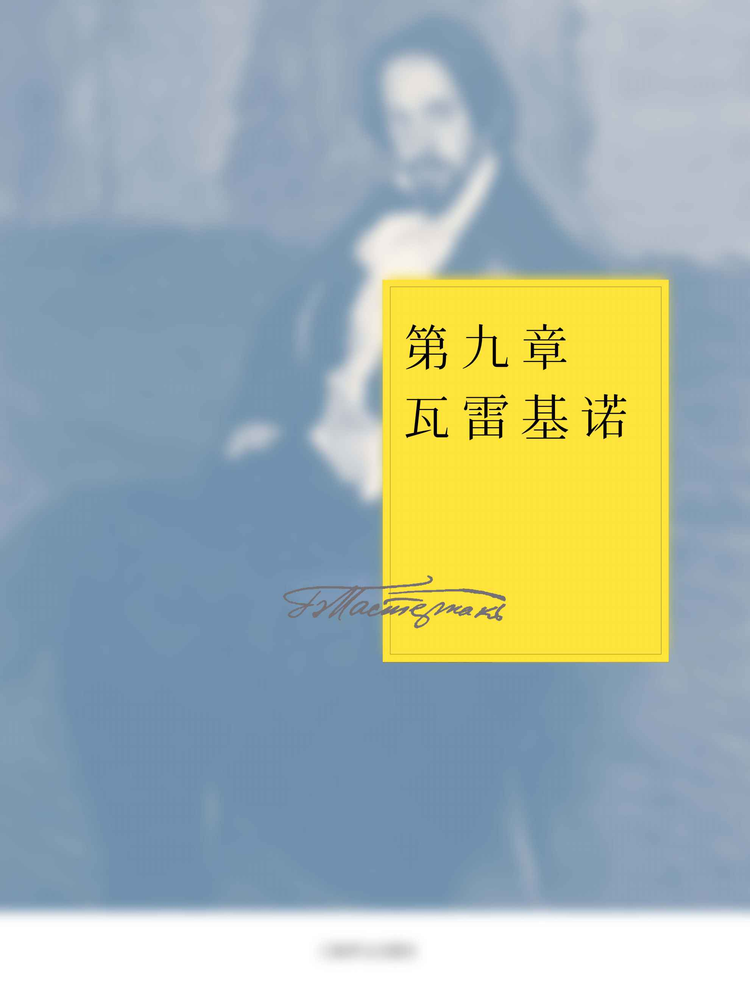

# 第九章 瓦雷基诺

<h3 id="c134">一</h3>

冬天空闲时间多了，日瓦戈开始写各种札记。他记道：

 

美好的夏日何以褒扬，

不错确是神奇的时光；

我要问怎来的赐与，

无缘无由竟如此大方。

披星戴月为自己和家庭劳动，修筑房屋，耕作土地，以求温饱；模仿创造宇宙的上帝，像鲁宾逊那样创造一个自己的世界，又像母亲那样一次再次赐给自己新生——这是多么幸福呀！

当你的手在活动、在劳作、在干杂活儿或是木工；当你给自己定出体力可行的合理任务，从而获得成功和喜悦；当你一连六个小时在露天里用斧头削个什么东西或者挖土，享受着清新的空气——每当此时，有多少念头纷呈在你脑海里，有多少新意重重涌来。这些思想、发现、反复，没有记到纸上而一闪即逝，但这并不是损失而是收益。城里的隐居者啊，你用浓黑的咖啡或是烈烟来支撑颓废的神经和想象，你哪里知道最强大的麻醉剂，在于真实的穷困和健全的体魄。

我到此为止，不再发挥了，不想鼓吹托尔斯泰的平民化和归向土地；我不想对土地问题上的社会主义加添自己的修正；我只是确认事实，却无意把我们偶然的厄运概括成为体系。要从我们这个实例引出结论，是会有争议的，不相宜的。我们如今的家业，内容过于纷杂；只有其中一小部分，即储备起来的蔬菜和土豆，可以算作我们双手劳动的结果。其余的一切，是靠了别的来源。

我们使用土地是不合法的，擅自隐蔽地耕作而没有纳入国家的统计之内。我们伐木，是一种不可饶恕的盗窃行为，因为偷的是国家（以前属于克吕格尔）的财富。我们所以得到庇护，是由于米库利齐恩的纵容；他的生活来源大体上也是如此。我们侥幸无事，是因为离城很远，幸亏城里还不知道我们的所作所为。

我放弃了医学，避而不谈自己是医生，免得招来不自由。可是总有好心人远在天边也打听到了瓦雷基诺来了个医生，从三十里外跑到这儿求医，有的抱着母鸡，有的带着鸡蛋，有的送来黄油以及别的东西。不管我怎么谢绝酬报也休想推掉，因为人们不相信无酬白得的医病方子能有什么效力。就这样，行医也给我添点收入，但我们和米库利齐恩家主要的支柱还是萨姆杰维亚托夫。

真难理解，这人怎能把如此对立的东西集于一身。他真诚地拥护革命，尤里亚京市苏维埃给予他的信任，他完全受之无愧。他有强大的授权，可以征调瓦雷基诺的木材，甚至不需要对我们和米库利齐恩打招呼，我们也丝毫不会介意。从另一方面说，他要想贪污公款，真是不费吹灰之力；不管拿什么、拿多少，谁也不会说个不字。没有人同他平分秋色，他不需要打点任何人。那他为什么要关心我们，帮助米库利齐恩一家，支持着这里所有的人，比如泥炭车站的站长？他总在奔波，带这个东西那个东西，又同样眉飞色舞地分析讲解陀思妥耶夫斯基的《群魔》和《共产党宣言》。我有种印象，倘若他不这样显然无谓地给自己的生活找这类麻烦，他就要寂寞地死去。

<h3 id="c135">二</h3>

过不久日瓦戈医生又记道：

 

我们定居在老爷旧宅的后房里，是两间木板屋。安娜·伊万诺夫娜小的时候，这房间是克吕格尔给贴身家仆、家庭裁缝、女管家、上年纪保姆住的。

房子已很破旧。我们相当迅速地修复了它。靠了懂行人的帮助，我们把通过两间屋的火炉烟道重新盘过，如今加了几个拐脖，保暖要好多了。

在花园的这一角里，过去布局的痕迹已不复存在，新种的植物掩盖了一切。可现在是冬天，周围一片肃杀萧条，活着的东西掩饰不了已死东西的陈迹，旧时留下的特征经雪一装点，反更显眼。

我们算是幸运。今秋干燥暖和。土豆在雨季和寒流来临之前，就全挖了出来。除去归还米库利齐恩的部分，我们收了二十多麻袋，全存入地下的主囤里，露出地面的囤口用牧草和破衣盖严。地窖里又存起了两木桶黄瓜，是冬尼娅腌的，还有两桶她做的酸白菜。新鲜的白菜散开晾到木桩上，两棵扎在一起。胡萝卜埋到了干燥的沙土内。这里还有足够多的新收的萝卜、甜菜、芜菁。地面上屋子里放着不少豌豆和大豆。柴棚里拉回来的劈柴，能烧到开春。冬天我喜欢闻地窖里的暖气；当冬季天还未亮时，你一手举着微弱欲灭的烛火，稍稍掀起地窖入口的小盖，马上有一种菜根混着土和雪的浓味扑鼻而来。

等你由板棚里出来，天光还未发亮。门吱呀一响，或你不小心打个喷嚏，或是脚踩得雪地出声，远处菜田里冒出雪地的白菜根后，便会跃出一些白兔四散而逃；四周雪地上横七竖八全是它们大步蹿跳的足迹。周围此起彼伏地响着长久不停的狗吠。鸡已叫了三遍，现在听不到它们的声音了。天色开始放亮。

一望无际的雪原上，除了野兔的足迹外，还有猞猁的脚印，一窝连着一窝，整齐得像穿线的针脚。猞猁走路像只猫，后爪跟着前爪，据说就这样一夜能走出几十里路。

这里下夹子捕猞猁。有时可怜的灰兔落网，从夹子上取下时已经被雪半掩，冻僵冻硬了。

起初，春夏时节，我们感到很苦，常常是筋疲力尽。现在到了冬日傍晚，我们得以休息了。多亏萨姆杰维亚托夫供给我们煤油，我们围坐在煤油灯旁。女人们缝衣或者编织，我或是亚历山大·亚历山大罗维奇大声诵读。炉里生着火，我这个早被公认的司炉工，负责及时关好风门保住热气。如果有块没着完的木头妨碍燃烧，我就把它夹出来，还带着烟，夹到房外远远扔到雪地里。木头溅着火星，如点燃的火炬在空中飞过，照亮了黑暗中沉睡的花园以及许多四方形白色水坑，落到雪地上嘶嘶叫着熄灭了。

我们没完没了地读《战争与和平》、《欧根·奥涅金》以及所有的长诗，读俄文版的司汤达的《红与黑》、狄更斯的《双城记》、克莱斯特
 <a href="15-%E7%AC%AC%E4%B9%9D%E7%AB%A0%20%E7%93%A6%E9%9B%B7%E5%9F%BA%E8%AF%BA.md#m1">
[1]
</a>
 的短篇小说。

<h3 id="c136">三</h3>

春天将至时日瓦戈医生记道：

 

我感到冬尼娅有了身孕，就对她说了。她不同意我的揣测，我却深信不疑。在肯定无疑的征兆出现之前，一些先期不大明显的迹象也是瞒不过我的。

妻子的脸上起了变化。倒不能说是变丑了。可过去完全在她把握之中的外表仪容，如今却不肯听她的了。她被将要从她身上出世而不再属于她自己的未来物所控制。女人面容失去自身的控制，表现为生理上的惶惑；这时脸上要失去光泽，皮肤变粗，眼睛流露着不由她自主的异样的光彩。她仿佛无力顾及而把一切全荒废了。

我和冬尼娅从来没有相互疏远过，这一年的劳动尤其使我们形影不离。我观察到冬尼娅十分机灵、有劲、不知疲倦，非常有计算地安排活茬，干完一件不失时机地接着干另一件。

我一向认为，任何一次妊娠都无可非议；这一与圣母有关的教义，反映了普遍的母爱思想。

每个正在生产的女人，都有着孤独、漠然、淡泊的神态。而男人在这至关重要的瞬间，却无所事事，仿佛他绝未参与其中，一切全是从天而降。

女人自己生出后代，自己抱婴儿到安静的去处，把摇篮摆在安全地方。她默默地、温顺地自己哺育培养孩子。

圣母说：“向你的儿子和你的上帝多作祈祷吧！”她的口中说出了赞美诗的一些段落：“我的灵魂为孩子、为我的救星高兴。看到自己奴隶的驯顺，上帝从此会保佑所有的妊娠。”她这是讲自己的婴儿。这婴儿会使她获得颂扬（“他给我创造出伟大”），他是她的光荣。每个女人都能够说这句话。她的上帝就在孩子身上。伟大人物的母亲，应该熟悉这种感受。而所有的母亲，绝无例外地都是伟大人物的母亲。倘若后来的生活欺骗了她们，那不是她们的过错。

<h3 id="c137">四</h3>

我们反复地诵读《欧根·奥涅金》和一些长诗。昨天萨姆杰维亚托夫来了，带来不少礼品。大家尝着美味，满面春风。论起艺术来，谈个没完。

很早以来我就有这么一种看法：艺术并不是包容无数概念和纷纭现象的整个方面或整个领域；恰恰相反，艺术是一种狭小而集中的东西，是对文学作品中某一要素的称呼，是作品体现的某种力量或某一真理的名称。所以我从未认为艺术是形式的对象、形式的方面；它更多地属于内容的一部分，隐蔽而又神秘的一部分。这一切对我来说都是明明白白的，我有着深切的体会，可是如何表现和表述这一思想呢？

作品是以其许多方面诉诸读者的，如主题、见解、情节、人物。但最主要的是存在于作品中的艺术。《罪与罚》里存在的艺术，较之其中拉斯科尔尼科夫的罪行，更为惊人。

原始的艺术、埃及艺术、希腊艺术、我国的艺术——这些在千万年间大概都曾是同一种东西，后来也流传为一种统一的艺术。它是关于生活的某种思考、某种肯定；由于它表现无所不包的广阔含义，不能把它分解为一些孤立的词语。当这一力量的一小部分进入某一作品较为复杂的混合体中时，艺术要素的意义就会超过其余一切要素的意义，从而成为所描绘内容的本质、灵魂、基础。

<h3 id="c138">五</h3>

有些着凉，咳嗽，大概还有低烧。一整天嗓子眼像有东西堵着，喘不上气来。我的情况不妙。这是大动脉的毛病。是受到遗传的最初的兆头，可怜的妈妈一生患有心脏病。真是如此吗？竟是这么早吗？要真这样，我在人世是活不长的了。

房间里积了点煤气。有股熨衣服的味道。一边熨一边从没烧旺的火炉里夹出冒火苗的煤块，填进熨斗里，熨斗盖儿像咬牙似的咯咯作响。这引起我一些回忆，但记不起是回忆什么了。身体不适，连记忆力也不行了。

萨姆杰维亚托夫带回了上等肥皂，大家一高兴搞起了大扫除，所以，萨沙两天没人照看。我写这些的时候，他正钻到桌子底下，坐在桌腿之间的横板上，学着萨姆杰维亚托夫的样子，好像用雪橇拉着我走；萨姆杰维亚托夫每趟回来，总要用雪橇拉他去玩。

我病一好，应该去市里一次，去读点地方志和历史书。听人说这里有个极好的市图书馆，是几个富翁捐助办的。很想写点东西，要抓紧。一转眼便到春天啦。到那时就顾不上读书和写东西了。

头痛加剧。睡得不好。做了一个杂乱无章的梦。这种梦一醒来马上就会忘记。梦全飞出了脑海，意识里只留下了惊醒的原因。是我心里的一个女人声音，响彻了梦境的周围，终于把我吵醒。我记住了这个声音，当回忆它的时候，遍数我认得的女人，想找出这发自胸腔的低微柔润的声音属于何人，可谁也没有这种声音。我心想，可能我同冬尼娅习惯成自然，才听不出她的声音。我迫使自己忘记她是我的妻子，把她的音容笑貌推到能如实分辨的远处。结果，那个声音仍然不是她。就这样到了没有弄个清楚。

顺便谈谈梦。一般认为梦是日里所想，是白天清醒时给人留下深刻印象的东西。我的观察所得，恰恰相反。

我不止一次发现，正是白日初露端倪的东西，未全清晰的思想，无心说出又未被注意的话，夜里获得了充实的血肉复又来临，变成了梦呓的主题，像对日间的冷淡进行报复似的。

<h3 id="c139">六</h3>

明彻的寒夜。眼前的一切异常清晰，浑然融成一体。大地、空气、弯月、星斗，被寒意凝结起来。花园的林荫路旁，落下一排分明的树影，仿佛是镂刻出来的一般。又总觉得有些黑影在各处横穿小径。硕大的星斗如蓝色云母灯，在林中树杈的空隙里悬挂着。小星则似夏野的甘菊，遍布夜空。

每到傍晚，都要继续普希金的话题。大家分析第一卷里皇村中学诗作的格律。的确有许多的因素取决于选用怎样的诗格。

在长诗行的小诗里，最能体现少年壮志的是阿尔扎马斯
 <a href="15-%E7%AC%AC%E4%B9%9D%E7%AB%A0%20%E7%93%A6%E9%9B%B7%E5%9F%BA%E8%AF%BA.md#m2">
[2]
</a>
 时期的诗作。他立志绝不落后于先辈，为哄骗叔父假编神话，故作华丽，装得堕落享乐而又思想早熟。

但很快这位年轻人就从摹仿奥西昂或帕尔尼，从写《皇村回忆》转向写短诗行的作品《小城》，或《致姊妹》，或后来作于基希涅夫的《致我的墨水瓶》，或者转为《致尤京》的节奏。这样，未来的普希金便在这个青年身上完全觉醒了。

阳光和空气、生活的喧闹、物象和实质，如穿户入室一般涌进他的诗中。外部世界的景物、生活器物、各种名词，摩肩接踵地抢占诗行，于是便把意义较虚的词类排挤了出去。物象、物象，还是物象，排列出了诗的韵脚。

正是这种后来闻名于世的普希金四步诗，仿佛成了衡量俄国生活的某种单位，成了俄国生活的长短尺寸，好像是照着整个俄罗斯生活拓下来的尺寸，犹如做靴子画脚样，或是照手掌大小决定买手套的号码。

后来也是这样，俄罗斯人民讲话的节奏，他的口语语调，通过涅克拉索夫三音节的变格和涅克拉索夫扬抑抑格，在节奏延续的长短中得到了体现。

<h3 id="c140">七</h3>

多么想在承担公务、干农活或行医的同时，酝酿出一点其他有分量的东西，写成一部学术著作或文学作品呀。

每个人生来都是要做浮士德的，以便能拥抱一切，体验一切，表现一切。促使浮士德当科学家的，是前人和同代人的谬误。科学中的进步，是靠排斥律获得的，从批驳现有的谬见和错误理论开始。

促使浮士德当艺术家的，是老师的诱人的范例。艺术中的进步，是靠吸引律获得的，从模仿、效法、崇拜心爱的东西开始。

是什么东西妨碍我担任公职、治病、写作呢？我想不是困苦和漂泊，不是动荡和频繁的变化；而是在我们今天得到广泛流行并占据统治地位的空洞夸张的风气，诸如：未来的霞光，建设新世界，人类的灯塔。听到这些话，开初感到想象力多么开阔，多么丰富。可事实上追求辞藻正因为平庸无才。

只有普通的东西经过天才之手，才会变得神奇。这方面最好的例子便数普希金。他是何等热烈地讴歌诚实的劳动、义务、日常的习俗！如今我们这里称小市民已有谴责之意。这种贬义早在《家谱》一诗中便出现了：

我是小市民，我是小市民。

 

《奥涅金的旅行》里又有：

 

而今我的理想——家庭主妇，

我的愿望——是平静，

再加肉汤，最好要大盆。

在俄罗斯全部气质中，我现在最喜爱普希金和契诃夫的稚气，他们那种腼腆的天真；喜欢他们不为人类最终目的和自己的心灵得救这类高调而忧心忡忡。这一切他们本人是很明白的，可他们哪里会如此不谦虚地说出来呢？他们既顾不上这个，这也不是他们该干的事。果戈理、托尔斯泰、陀思妥耶夫斯基对死做过准备，心里有过不安，曾经探索过深义并总结过这种探索的结果。而前面谈到的两位作家，却终生把自己美好的才赋用于现实的细事上，在现实细事的交替中不知不觉度完了一生。他们的一生也是与任何人无关的个人的一生。而今，这人生变成为公众的大事，它好像从树上摘下的八成熟的苹果，逐渐充实美味和价值，在继承中独自达到成熟。

<h3 id="c141">八</h3>

出现了春天的先兆，开始解冻。空气里飘着煎油饼味和伏特加酒气，像过谢肉节似的。这里恰是一语双关，谢肉节一词又有油腻腻的意思。森林里的太阳，半睡着眯起油腻腻的眼睛；林子也半睡着竖起针叶般的睫毛；水坑在正午闪着油腻腻的光。大自然打哈欠，伸懒腰，翻了个身又睡着了。

《欧根·奥涅金》的第七章里，写到春天、奥涅金走后空荡荡的老爷家宅、山下水边的连斯基坟墓。

还有夜莺这春色的情人，

通宵唱着。一片野玫瑰的芳芬。

为什么用“情人”？一般说来，这比喻是自然贴切的。确实是情人。此外，正好和“芳芬”凑上韵脚。但这里的声音形象是否也套用了英雄传说里的“夜莺强人”呢？

在英雄传说里，这个夜莺强盗叫奥基赫曼之子。对他的描绘非常精彩：

一听他呀夜莺的啼啭，

一听他呀野兽的凄厉，

茂密的青草纷纷倒下，

浅蓝的花朵簌簌落去，

黑树林也俯首弯腰，

所有人都陈尸大地。

我们抵达瓦雷基诺，时值早春。没过多久，稠李、赤杨、榛林等全变绿了，特别是在米库利齐恩窗下的谷地舒基玛里。又过了几夜，夜莺就放开了歌喉。

我仿佛第一次听夜莺歌唱，惊讶它的叫声何以会同其他禽鸣分得那么清楚，大自然何以不经过渡一下子跳跃到这样丰富而特异的啼啭。它的不断变换的曲调是如此多样，它的清晰而四方远扬的声音是如此有力！屠格涅夫曾在某处描写过这种哨音、树精的笛声、百灵断断续续的叫声。特别突出的是两种啼叫，一是急促贪婪而且华丽的啾——啾——啾，有时一连三声，有时没有准数。披着露水的灌木丛，呼应般地摇晃一下，又像被人搔痒似的卖弄地颤抖一阵。另一种啼声分成两个音节，像诚挚的呼唤，像乞怜，像要求或告诫：“醒醒——醒醒——醒醒！”

<h3 id="c142">九</h3>

已是春天。我们在备耕。没有时间再记日记。写点这样的笔记是很快乐的。那只好等到冬天再续写了。

前几天，这回真是在谢肉节里，一个生病的农民坐着雪橇，穿过泥泞进了院子。自然我拒绝接待。“对不起，亲爱的，我不干这个了。既没有足够的药品，又没有必要的设备。”可哪里推脱得了。“帮帮忙吧。皮肤上长东西。求你行行好。身上有病呀。”

有什么办法呢？人非草木，孰能无情？我决定收下他。“脱衣服吧。”我给他检查。“你得的是狼疮。”我一边检查，一边斜眼望望窗台上一大玻璃瓶石炭酸（上帝呀，可别问我是从哪里弄来的，还有些别的最需要的东西！这一切都靠了萨姆杰维亚托夫）。我一看，另一辆雪橇朝院子奔来，开初我觉得是个新病人。可突然而来的是弟弟叶夫格拉夫。有一阵工夫，他同家里人冬尼娅、萨沙、亚历山大·亚历山大罗维奇在一起。后来我空下来，也参加进去。大家开始问这问那：怎么来的，从哪儿来的？他同往常一样躲躲闪闪，不正面回答，只是微笑，令人感到神奇莫测。

他在这客居了大约两星期，经常去尤里亚京，后来忽然销声匿迹，不知去向。这段时间里我已看出他比萨姆杰维亚托夫更有影响；而他干的事和交往的关系，则更令人不解。他本人的来历如何？哪来的这么大神通？他是干什么事的？他在走之前曾许诺减轻我们的家务，好让冬尼娅有工夫教育萨沙，让我有时间行医和弄文学，我们打听他为此打算做点什么，又是笑而不答。但他没有骗人。有些迹象说明，我们的生活条件的确会有变化。

真叫人奇怪！他是我的异母兄弟，同我一个姓。而我对他的了解，其实不如对所有其他人的了解。

这已是他第二次闯入我的生活，充当善心的天神，充当解决一切难题的庇护者。或许，每个人一生中除了出场的人物之外，还需要有一种看不见的秘密力量存在，一种不召自来的几乎是象征性人物的存在。在我的一生中，起着这一隐蔽施恩者作用的，就是我的弟弟叶夫格拉夫。

 

日瓦戈的札记到此结束。往后他没有继续写下去。

<h3 id="c143">十</h3>

日瓦戈坐在尤里亚京市阅览室大厅里，浏览借出来的书籍。可容百人的多窗大厅，摆着几条长桌，靠窗一端的桌角很窄。天色一黑，阅览室就关闭。春季傍晚，城里不供电。不过日瓦戈本来就没呆到晚上，中饭时便离开城里了。他总是把米库利齐恩交给他用的那匹马留在萨姆杰维亚托夫家的旅店中，整个上午去读书，中午就骑马回瓦雷基诺的家。

在常来市图书馆之前，日瓦戈很少到尤里亚京市里。他没什么特别的事要进城办。医生对这个城市不很熟悉。所以当他眼见阅览厅里渐渐坐满尤里亚京市民，有的离他远些，有的就在身边，产生一种感觉，好像他是站在城里一个熙熙攘攘的路口，同城里人一个个结识；又好像不是城里读者汇集到大厅中，而是他们居住的街道和楼房聚向这里。

其实，现实中真正而非假想的尤里亚京市，透过阅览厅的窗子，也可尽收眼底。在中间最大的一扇窗外，摆着一桶白开水。读者休息时去楼道抽烟，围着水桶喝水，把杯里残水泼到涮洗缸里，聚在窗口欣赏市景。

读者有两种。一种是本地老住户中的知识分子，他们占多数；一种是普通市民。

第一类读者里，多数人穿着不富裕，不修边幅，已然沦落。其中有些人身体病弱，脸庞瘦削，皮肉松弛，原因有多种：或是饥饿所致，或是染上黄疸，或是由于水肿。他们是这里的常客，熟识图书馆的人员，来这里像回到了家。

来自市民的读者，面庞美丽而健康，穿戴整洁如同过节，走进大厅时像进教堂似的羞怯，却弄出很大声响，倒不是因为不懂规矩，是因为不会控制自己有力的脚步和嗓音，越不想出声音却越是弄出声音来。

窗子对面的墙壁凹进一块，里面摆了一个高台，台后高处有三个阅览室工作人员，一个老管理员，两名助手。一个助手气冲冲的，戴着毛围巾，一副夹鼻镜一会儿取下，一会儿戴上，看得出不是根据视力的需要，而是根据心绪的变化。另一个穿了件黑纱女衫，大概是胸部有病，因为手帕总不离开鼻和嘴，说话呼吸老捂着不放。

这几个图书馆职员，和那半数读者一样，脸面浮肿、瘦削、松弛；皮肤发蔫发松，土里掺绿，颜色活似腌黄瓜和灰苔。三个人轮番地干同样的事，低声给新读者解释借书办法，分检索书单，出借和收回图书，抽空还要编制什么年度报表。

说来奇怪，面对窗外真实的市容和坐在大厅里想象出的城市，他不禁思绪纷纷。加之这里人们似乎有着浮肿的共同特征，都像患了甲状腺病，日瓦戈不知怎的想起了他们抵达尤里亚京车站的那天清早看见的气鼓鼓的女扳道工，整个城市的景象，以及同他在车厢里席地而坐的萨姆杰维亚托夫，还有那人对这块地方的介绍。介绍的一些情况，还是在未到此处前很远的地方讲的。日瓦戈此刻却想把那天听到的情况，同现在身临其境的所闻所见联系起来。但他记不得萨姆杰维亚托夫提到的一些地名，所以也无从入手。

<h3 id="c144">十一</h3>

日瓦戈坐在大厅的一角，周围堆着书刊。他面前放着地方行政的统计期刊，还有边区人种志方面的几篇著作。他打算再借两本有关普加乔夫生平的著作。但身穿纱衫的管理员，手帕紧捂着嘴低声说：一个人一次不能借出那么多，如果想借需要的研究著作，得先把手头的期刊资料还一部分回去。

因此日瓦戈更专心迅速地读起没接触过的书籍，以便选出最需要的东西，其他拿回去换他感兴趣的历史著述。他飞快地翻阅文献，浏览目录，神情专注，目不旁顾。大厅人多，并不妨碍他，不分他的心。他已把邻座的人们研究透了，不抬眼也好像看得见左右的邻居，并且感到在他离开之前周围不会换人，正好似窗外城里的教堂和大厦不会移动地方一样。

太阳没有驻脚。它不断移位，这会儿工夫从图书馆东面转过来，射到南面的窗子上，照得靠近南窗的人无法读书。

患伤风的那个女管理员，从桌后高台上下来，朝窗口走去。窗上半垂着打褶的白布帷幔，放下来可以使光线变得柔和宜人。她把所有窗帷全放开，只没动靠边那扇背阴的窗子，拽拽绳，把它上面的小气窗拉开，便接连打起喷嚏来。

等她打到十下或十一下，日瓦戈才猜到这是米库利齐恩的妻妹，是萨姆杰维亚托夫讲的东采夫家的一个姑娘。他随着其他读者抬头朝那边望去。

此刻他发现了大厅里的变化。大厅另一端出现了一位新读者。日瓦戈立即认出了拉拉·安季波娃。她背朝日瓦戈医生坐着，正同伤风的女管理员低声讲话，管理员朝拉拉·安季波娃俯下身去窃窃耳语。看来这番谈话对她起了良好的作用，她不仅一下子治愈了自己的伤风，还摆脱了神经上的紧张。管理员向拉拉·安季波娃投过热情感激的一瞥，从嘴上取下一直捂着的手帕揣进衣兜，回到自己座位上，一脸喜气，露着自信的微笑。

这个感人的小场面，被某些在座的人看在眼里。各个角落的人们都同情地望着拉拉·安季波娃，也都露出了笑意。凭着这点微不足道的迹象，日瓦戈断定这个城里的人们认识她，喜欢她。

<h3 id="c145">十二</h3>

日瓦戈的第一个念头，是起身走过去看望拉拉·费奥多罗夫娜。可是接着一种不符合他性格、但在同她的交往中早已形成了的拘谨和不自然，又占了上风。他决定不去打搅她，也别中断了自己的工作。为了逃避不时朝她张望的诱惑，他把椅子侧过来，几乎是背对着读者埋头看书。他手里拿了本书，膝上又摊开了另一本书。

然而他的思绪却离他钻研的对象，相去不啻十万八千里。与学问毫不相关，他突然明白过来：那次在瓦雷基诺冬夜睡梦里听到的声音，正是拉拉·安季波娃的声音。这一发现使他大为惊异；他为了从座位上望见她，猛地把椅子挪回原状，惹得周围人们很奇怪。接着他便一直看着她。

他是从背后望到她半个侧面。她穿着浅色细格工作服，扎了条宽腰带，聚精会神地读着，像孩子似的朝右边歪着脑袋。偶尔她沉思起来，抬眼看看天花板，或者眯眼向前方凝视，然后复又一只手支案托腮，一只手握着铅笔大字疾书，从书中抄录些什么。

日瓦戈边观察边印证了自己在梅柳泽耶夫的老印象。他心想：“她不想招人喜欢，不想显得美丽诱人。她鄙视女人这一天性，并且好像因为自己这么漂亮而自责。她自我敌视的倨傲神气，越发十倍地增添了妩媚。

“她的一举一动，都是那么可人。她读书的样子，完全不像人的高级活动，而像是一切动物无不能做的极简单的事。就仿佛她提一桶水，或是削土豆皮。”

医生这么寻思着，情绪就平静下来。心里展现出了一个难得见到的世界。脑子不再杂乱无章地东想西想。他不禁一笑。拉拉·安季波娃的出现，对他和那神经质的管理员，起到了同样的作用。

他不管椅子放得正不正，不顾周围干扰和分散注意力，又工作了一个到一个半小时，比拉拉·安季波娃来前更加全神贯注。他翻遍桌上小山般的一摞书，找出了最需要的东西，甚至顺便读完了新遇到的两篇主要文章。决定到此打住之后，他开始收拾去还书。此时他心里没有任何别的杂念。他坦然而绝无他意地想道，既然认真干完了工作，他有权利同善良的老朋友见上一面，这个欢悦是理所应得的。可当他站起来环视一下阅览室时，却没有找到拉拉·安季波娃，她已经不在了。

医生把大大小小的一摞书送到出纳台上，这时拉拉·安季波娃送还的书还摆在那里没有收走。这全是有关马克思主义的参考书。看来她作为一个重新改换专业的旧教师，正在业余自修政治学科。

书里夹着拉拉写给图书目录室的索书单。纸片的一角露在外面。上面写着拉拉的住址，很容易看到。日瓦戈抄下来，可对奇怪的地名不胜惊讶：商人街，雕像楼对面。

日瓦戈一打听，马上了解到“雕像楼”在尤里亚京是个家喻户晓的名字，就好像莫斯科一些地方采用教区的名称，或者像在彼得堡人人都知道“五角地”一样。

这是一幢钢材般深灰色的楼房，雕有古希腊罗马的女神，手执鼓琴和面具，是个商人戏迷在上一世纪建造作为家庭戏院用的。商人后裔把房子卖给了商人参议会。商人街由参议会得名，房子就坐落在街角上。由此“雕像楼”成了这一片地方的名称。如今楼里驻有市党委会。在它倾斜下坠的墙壁上，过去贴着剧院和马戏团的节目广告，现在则是政府的法令和决定。

<h3 id="c146">十三</h3>

五月初一个寒冷的风天。日瓦戈医生在城里办完事，到图书馆转了一下，突然改变原来的全部计划，跑去找拉拉。

风卷起一股股细沙和尘土，使他不得不一再停步。日瓦戈医生转过身子，眯起眼睛低了头，等灰土刮过去继续上路。

拉拉住在商人街和新斯瓦洛奇胡同的拐弯处，正对着背靠蓝天的黑乎乎的“雕像楼”。日瓦戈医生第一次看见这幢房子，它果然名不虚传，给人一种奇怪不安的印象。

楼房上缘整整一排全是一人半高的女神雕像。在两股遮天蔽日的大风之间，医生忽然感到清一色的女人从楼房里出来站在阳台上，俯身在栏杆上，望着他和这条商人街。

拉拉住处，有两个通路，一是从街上进入正门，一是从胡同走进后院。日瓦戈医生不知有前一条路，就顺着第二条路去找。

当他从胡同转进院门时，一阵风刮来，卷起整个院落里的尘灰和垃圾，遮住了院子。一群母鸡咕咕叫着从他脚下飞起，扑向黑色的风幛，它们身后有只公鸡在追逐不放。

等灰尘散去，日瓦戈看到拉拉正在井旁。风头来时，她已经打满两桶水，用扁担担到左肩上。她连忙蒙上头巾，怕弄脏了头发，在前额上扎了个结；双膝夹着被风鼓起的宽大的长衣襟，怕给风掀起来。她刚想挑水往家走，又停下了，一阵风过来吹掉了头巾，飘乱了头发；头巾飞到栅栏边母鸡咕咕叫的地方。

日瓦戈医生追上去捡起头巾，到井边递给慌乱的拉拉。她向来总保持从容自然，这时虽说又惊讶又惶惑，连叫也没叫一声。她只是脱口而出：

“日瓦戈！”

“拉拉·费奥多罗夫娜！”

“真想不到！真巧呀！”

“把桶放下，我来挑。”

“我从不半途而废，非做到底不可。您要是到我这儿来的，咱们走吧。”

“还能找谁呀？”

“那谁知道呢。”

“还是挪到我肩上吧。您干活时，我可闲不住。”

“这算什么活儿呀。不给您挑。您会溅到楼梯上。还是说说，哪股风把您给吹来啦？在这儿呆了一年多，就没工夫来看看？”

“您怎么知道的？”

“什么事传不开呀？再说我又在图书馆看见了您。”

“那为什么不喊我？”

“我不信您没看见我。”

拉拉挑着晃动的水桶，轻轻摆着走在前面，医生跟着走过了低矮的过道。这是底层阴暗的走廊。拉拉在这里迅速蹲下把桶放到地上，取下肩上的扁担，直起腰用不知哪里掏出来的小手帕擦手。

“走吧。我从楼里把您领到前门去，那儿亮些，您在那里等一会。我把水从后门提进去，收拾一下上面的屋子，换换衣服。您看看我们的楼梯，台阶是生铁的，还铸了花纹。从上往下，隔着楼梯什么都看得见。是幢老房子。轰击的时候给震了一下，是炮击。你看石头都裂开了，砖墙上有眼有缝。我和卡坚卡出去时，把房门钥匙藏在这个窟窿眼里，再塞上块砖头。您记好了。或许您什么时候来串门，遇上我不在，请您自己打开门进去，就像到家一样，别客气。过一会我就会回来。现在钥匙还在里面呢。不过我不需要，我从后面进屋，从里边把门打开。只有一点很糟糕，老鼠多。多极了，让你不得安生。房子太破，墙壁摇晃，到处是缝隙，能堵我就堵，同老鼠斗，可没什么效果。也许您什么时候来帮帮忙？咱们一起把地板和墙脚堵严实。好吗？您在楼梯口站一会，随便琢磨点什么。我不会让您久等，一会儿就喊您。”

在楼梯口等着的时候，日瓦戈医生打量起正门剥落的墙壁和楼梯上的生铁阶梯。他心想：“在阅览室里，我把她读书那种聚精会神的劲头，比作干真正事业的激情和热情，比作体力劳动。相反也是如此，她挑水和读书一样，那么轻松，毫不费劲。她干什么都动作优美。仿佛她在童年就开始了生活的起跑；现在她的一举一动都借助这股冲劲，使她显得自然而轻巧。这可以从她弯腰时背部的曲线和她的一颦一笑中看出来——笑时口唇张大，下巴变圆；也可从她的思想和谈吐中见出。”

“日瓦戈！”从二层房门口传来拉拉的喊声。于是日瓦戈就拾级而上。

<h3 id="c147">十四</h3>

“把手伸给我，小心点跟着我走。这有两间屋太黑，堆满了东西直到天花板。小心别撞上碰痛了。”

“真的像个迷宫。我自己可找不到路。这是怎么搞的？是修房子吗？”

“不，根本不是。不是因为这个。这套住宅是别人的，我都不知道是谁家的。我们有过一套，是公家的房子，在中学校的大楼里。后来尤里亚京苏维埃的房管处占了中学校舍，把我和女儿迁到这套被人丢下的住宅里，占住了一部分。这儿原来摆着旧主人的家具，很不少。我不需要别人的东西，就全堆到这两间里，把窗子刷上了白粉。别放开我的手，不然会走错路。对，就这样。往右拐。现在转出来了。这就是我的屋门，这儿就亮些了。小心门坎，别绊了脚。”

日瓦戈同引路的拉拉进了屋，对着门的墙上恰好开着一扇窗户。日瓦戈向窗外一望，不禁大为惊异。窗子朝院开，看到的是邻近楼房的后院和河岸上城郊的荒地。那里放牧着山羊和绵羊，它们的长绒毛好像展开的皮袄大襟，把地上的尘土卷了起来。此外，在荒地的两根木杆上，正冲着窗口竖着医生熟悉的一块牌子：“莫罗和韦钦金。播种机、打谷机”。

受了这块广告牌的影响，日瓦戈开口就对拉拉讲起自己一家来乌拉尔的情况。他忘了听说过关于斯特列尔尼科夫很可能是她丈夫的谣传，不假思索地说了自己在车厢里同政委相遇的经过。他这一番话给拉拉留下了特别深刻的印象。

“您见到斯特列尔尼科夫了？”她马上反问。“我目前什么也先不对您讲。不过这太巧了，简直像注定你们要见面似的。等以后我找时间告诉您，您会惊异得大叫。要是我没理解错您的意思，他给您的印象不错而不是不好？”

“对，恐怕是这样。他本可以不见我的。我们经过受到他镇压和破坏的地区，我准备着见到一个暴虐的粗野军人，或是狂暴的革命者，结果哪样都不是。一个人出乎你的意料，不同于你先期的想象，这是好事。人一归结为某种类型，这人就完了，就是遭到了非议。要是不能把他归到哪一类里去，要是他不代表什么，那么要求于他的东西，他至少已有了一半。他从自我中得到了解放，他的极小部分已得以不朽。”

“据说他是非党人士。”

“对，我觉得是这样。他靠什么唤起人家的好感呢？这是个难逃厄运的人。我感到他不会有好下场。他得偿还自己造的孽。革命中无法无天的人之所以可怕，不在于他是恶人，而在于他是失去控制的机器，是脱了轨的火车。斯特列尔尼科夫就是这种发狂的人，不过他不是念书念疯的，而是被痛苦经历逼疯的。我不了解他的隐秘，可我相信他有自己的隐秘。他与布尔什维克的合作纯属偶然。暂时布尔什维克还需要他，就忍着他，能够同路。一旦没有这种需要，他们马上会毫不可惜地抛掉他，踩烂他，像对付在他之前的许多军事专家一样。”

“您这么以为吗？”

“必然如此。”

“那他有救吗？比如说不能逃跑吗？”

“往哪跑呀，拉拉·费奥多罗夫娜？从前沙皇时代可以逃跑。可现在你试试看。”

“遗憾。听您这么一讲，我对他倒产生了同情心。您变了。以前您说到革命，不这么激烈，不这么气愤。”

“问题就在于凡事总有个限度，拉拉·费奥多罗夫娜。经过这么一段时间，本该做出一定结果来了。可事实说明，对于革命的鼓吹者来说，变革的混乱是他们心里唯一喜爱的局面；他们可以不吃饭，但非得做出一点世界范围的动作。开辟天地，经历过渡时期——这就是他们的目的本身。任何其他的事，他们都不愿去学习，也什么都不会做。但您知道他们为什么无休无止地准备，忙得不可开交吗？是由于他们缺乏某些训练有素的人才，是由于他们平庸。人来到世上是要生活，而不是为生活做准备。而且生活本身，生活现象，生活的恩赐，都十分诱人却又非同小可。既然如此，干吗要用幼稚杜撰出来的蹩脚喜剧，去冒充生活呢？就像让契诃夫笔下天真无邪的人们出逃美洲这种荒唐的事儿。好了，说得够多了。现在该轮到我问问题了。我们坐火车靠近城区时，正是你们这儿发生事变的早晨。您当时是不是也受到很大惊动？”

“那还用说。自然喽！四周全是大火。我们自己差点儿没给烧死。我已经对您说过，住的楼房直摇晃。院门旁至今还有一颗没爆炸的炮弹。抢劫、扫射、一片混乱。和每次改朝换代一样。那个时候我们已经很有经验，习以为常啦，不是头一次嘛。白军在的时候更不得了。放冷枪报私仇，敲诈勒索，无法无天。最主要的我还没对您说。我们那位加利乌林，是捷克军里的了不得的人物，好像是个将军兼省长。”

“我知道。听说过。您见他了吗？”

“常常见他。我靠他帮助救了不少人的性命，也掩护了不少人。应该说句公道话。他的为人无懈可击，仗义，不同于任何小人物，什么哥萨克军的大尉呀、乡村警察呀等等。可当时逞威风的正是这些小官，而不是行为端正的人们。加利乌林给过我多方的帮助，这得谢谢他。要知道我们是老熟人。我还是小姑娘时，常常到他住的院子里去。那里住着许多铁路工人。我小时候亲眼看到了贫困和劳累。因此我对革命的态度和你不同。革命对我更亲切些，其中许多事我感到很贴心。谁料他突然成了上校，就是这个小男孩，看门人的儿子。后来竟当上白军的将军。我是从文职人员的环境里出来的，搞不清楚军衔。论职业我是个历史教员。情况就是如此，日瓦戈。我帮过许多人。常去找他，还一起回忆起您来。要知道我在所有的政府里，都有关系和保护人，可在一切制度下都感到沮丧，遭到损失。只有在很不像样的书里，活着的人们才分裂为两个阵营，互不相干。而事实上一切全互相交错着。如果在生活里只扮演一个角色，在社会上只占据一个位置，也就是说总是一个模样，那可真是无能到不可救药了！想不到您到了这里。”

一个八岁左右的小姑娘走进来，扎着两个小发辫。她细长的眼睛，透了几分顽皮和狡黠。她笑的时候，就把眼睛微微抬起。她在门外就发现母亲这里有客，但迈进门坎时觉得脸上应该表现出意外的惊讶。她向他行了个屈膝礼，目不转睛、毫无畏缩地盯着日瓦戈医生；这是一个过早思虑、孤独成长的孩子。

“这是我的女儿卡坚卡。您多关照呵。”

“在梅柳泽耶夫，您给我看过照片。长得这么大了，样子也变了！”

“你原来在家呀？我当你去玩了。怎么没听见你进大门呢？”

“我从窟窿里掏钥匙，那里面藏了好大的一只老鼠。我叫了一声就跑开了！我想非吓死不行。”

卡坚卡说着，绷紧了十分俊俏的小脸蛋，瞪大了顽皮的小眼睛，张圆了小嘴，活似从水里拽上来的一条小鱼。

“好了，回自己屋去吧。我求叔叔留下吃午饭，等把炉里的饭拿出来，我就喊你。”

“谢谢您的好意，我只好抱歉了。我们家里因为我总进城，把午饭改到六点。我一般不迟到，路上得骑三个多小时，有时整整四个小时。所以我才来得这么早。请您原谅，我过一会就走。”

“再坐半个小时嘛。”

“好。”

<h3 id="c148">十五</h3>

“现在我也坦率说了吧。您讲的那个斯特列尔尼科夫，就是我的丈夫帕沙，帕维尔·帕夫洛维奇·安季波夫。我没相信他死的传闻，是做对了；就跑到前线去找他。”

“这一点我不感到惊奇，精神上是有准备的。我听到这个神话，就认为这是胡扯。所以我才毫不在乎，同您非常随便、不假思索地讲到了他，仿佛这些谣传并不存在。谣言本身是无稽之谈。我见到过这个人。怎么能把您同他联系到一起呢？你们之间有什么共同之处？”

“可实际上是这样，尤拉·安德烈耶维奇。斯特列尔尼科夫就是安季波夫，我的丈夫。我赞同一般人的见解。卡坚卡也知道这事，并且为自己的父亲骄傲。斯特列尔尼科夫是他的化名、笔名，像所有革命家一样。出于某种考虑，他不得不冒他人之名生活和行动。

“这次他攻打尤里亚京，朝我们投炸弹，明知我们在这里，却一次也没有打听我们是否活着，为的是不暴露自己的秘密。这在他看来自然是理所当然的。如果他来问他该怎么办，我们也会劝他这样做。你也许会说，我能平安无事，市苏维埃能提供勉强过得去的居住条件，等等，这些都说明他在暗中关照我们。这一点反正你们是说服不了我的。离这里不过咫尺之遥，他居然能忍住不来看望我们一下！这我怎么也想不通，超出了我的理解能力。这是我所无法企及的，不是生活，而是某种罗马时代的公民忠勇，是当今一种大智大勇。不过我受到了您的影响，也开始学您的调子说话了。我自己并不愿如此。咱们不是志同道合的人。在一些难以把握、可有可无的事情上，咱们两人的理解是一样的。可在重要的事情上，在生活的哲理上，还是做个论敌吧。再回过来说斯特列尔尼科夫。

“而今他在西伯利亚；您说得对，我也听到消息说人们都在责备他，我听了心里冰冷。现在他在西伯利亚，在我们部队纵深突进的地段上，正在打败他小时同院的旧友，后来又是战友的那个可怜的加利乌林。他的真名和我们的夫妇关系，是瞒不过加利乌林的，但这人极体贴人，从来没让我有所感觉，虽然一听到斯特列尔尼科夫的名字就火冒三丈，不能自持。总而言之，他目前正在西伯利亚。

“他以前在这儿的时候（呆过很久，总是住在铁路上的车厢里，您就是在那儿看到他的），我很想能和他偶然相遇。偶尔他去司令部，就是原来立宪会议委员会和立宪会议军队的军事处的所在地。命运满足了巧合。司令部的入口，在一间厢房里，恰恰是我为别人的事来找加利乌林，他接见我的地方。比方有次在武备中学，出了件很轰动的事。学生们开始伺机枪击不称心的教员，藉口他们信仰布尔什维克主义。有时候发生迫害和殴打犹太人的事件。顺便说一句，我们这些城里人和从事脑力劳动的人，我们的一半熟人，都是犹太人。每逢有人残害异族，干那些可怖可鄙的行径时，我们除了感到气愤、羞愧、怜惜外，还觉到自己的犹豫而极难堪，因为我们的同情多半是理智上的，给人以缺乏真诚的不良印象。

“人们过去把人类从偶像崇拜的桎梏中解放出来，现在又群起献身于从社会弊端里解放人类的事业，然而他们却无力从自我中解放出来，无力摈弃已经过时、丧失了意义的犹太这一名称。虽然正是他们亲自为他人打下了宗教基础，如果能很好了解他人，会感到他人是极为可亲的，但他们仍不能超越自己而完全融于他人之中。

“大概是压制迫害逼得人采取这一无益和自毙的姿态，导致他宁愿作自我牺牲而羞惭地离群索居，结果只能带来灾难。不过这里面也含有内在的衰竭，许多世代以来的历史的疲倦。我不喜欢他们这样带有讽意的自我鼓励。不喜欢他们思想的平庸乏味，不喜欢他们蹩脚的想象力。这些东西令人生厌，就好像老年人议论老、病人议论病一样。您同意吗？”

“我没想过这个。我有位同事，叫戈尔东，他也是这种见解。”

“我曾经来过这里守候帕沙，希望他能来这里或从这里出去。从前厢房当过省长将军的办公室。现在门上挂了个小牌：‘群众来访处’。您大概看到了吧？这是城里最漂亮的地方。门外的空场上铺着条石。过了广场是城市果园，有红莓、槭树、山楂树。我站在人行道上的求见者中间候着他。当然我不会硬要他接见我，没对人说我是他妻子。我们的姓不一样嘛。这也谈不上忍心不忍心。他们遵循的完全是不同的规矩。例如他的亲生父亲帕维尔·费拉蓬托维奇·安季波夫，曾是被流放的政治犯，工人出身，现在在离这很近的一处地方法院工作，正是他过去的流放地。还有他的朋友季韦尔辛。两人都是革命军事法庭的成员。您猜怎么着？儿子对父亲也不公开身份，父亲还认为理所当然，并不生气。既然儿子处于隐蔽状态，那就不能相认。这种人顽强极了，只知道原则、纪律。

“说到底，就算我能证明我是他妻子，又算得什么！是那种太平时候吗？还能顾得上老婆吗？全世界无产者！改造天下！这个不一样，这个我懂，要说妻子，不过是有两条腿的动物罢了，去它的吧，那有什么了不起！

“副官对求见的人挨个问了一遍，放进了几个人。我没有说出姓名；他问有什么事，我回答是私事。可以预料非遭到回绝不成。副官耸耸肩，疑惑地打量我一番。就这样，我一次也没能见到他。

“您会以为他厌弃我们，不爱我们了，早已忘到脑后？不，恰恰相反！我非常了解他！他极重感情，为了这个真是什么都做得出来！他非得把所有这些战功花环扔到我们面前，绝不肯空手而回，要光荣凯旋，好使我们也永垂不朽，使我们惊讶万状！简直像个孩子！”

卡坚卡又回到屋里。拉拉搂起她，摇晃，胳肢，亲吻，紧抱着不放，弄得孩子莫名其妙。

<h3 id="c149">十六</h3>

日瓦戈策马从城里返回瓦雷基诺。这个地方他已走过无数次了，习惯之后也就不太注意周围，如同没见一般。

他走近林中的岔路口。这里往前是直通瓦雷基诺的大道，旁边又分出一条小路通到萨克玛河边的渔村瓦西里耶夫。岔口上竖着第三根郊区的木杆子，上面也是块农具广告牌。医生每次到这里，都赶上日落。今天也正近黄昏。

两个多月之后，有次他进城到黄昏时没有回来，留在了拉拉家里，回到家推说因事耽搁，在萨姆杰维亚托夫的旅店里住了一夜。他早同拉拉·安季波娃你我相称，唤她拉拉，她唤他日瓦戈。日瓦戈一直瞒着冬尼娅，对她隐瞒着越来越严重、越来越出轨的行径。这简直是难以想象的。

过去他爱冬尼娅近乎崇拜。她的内心世界，她的安宁，对他来说重于世上的一切。他尽力维护她的声誉，甚于她父亲和她本人。为保护她的尊严，他会亲手把欺人者撕成碎块。可如今这个欺人者竟是他自己。

在家里同亲人相处，他感到自己是个未被戳穿的罪人。家人一无所知，还习惯地对他十分敬重，越发使他无地自容。有时一家正谈得起劲时，他突然想起自己的过错，一阵发呆，根本听不进也弄不懂周围在说什么。

倘若这是在进餐的时候，没咽下的一口饭犹如骨鲠在喉，他便放下勺子，推开盘子，泪水堵得说不出话。冬尼娅奇怪地问：“你怎么了？是不是在城里听到什么坏消息了？抓了什么人吗？还是枪毙了谁？告诉我吧，别怕我难过。你会轻松些的。”

是不是他认为别人胜过冬尼娅才背叛了她呢？不是，他没有选择，没有比较。“爱情自由”的思想，“感情的权利和需要”之类的字眼，同他是格格不入的。这么说，这么想，在他看来是很卑鄙的。在生活里他从不拈花惹草；不把自己看成是半人半神，或者是什么超人；不要求自己享有特权和优待。良心的谴责使他难以忍受。

“往后怎么办？”偶尔他问自己，得不到回答，便盼着出现奇迹，希望有某种意外的情况干预，把事情了结。

不过今天他不那样想了。他决心强行打开症结。他往家走时，心里已拿定主意。他决定向冬尼娅和盘托出，求得她的宽恕，再也不去见拉拉。

自然，并非一切都已妥帖。比方他觉得还有一点说得不够明确，那就是他同拉拉将永远断绝来往，一刀两断。今天上午他告诉她准备向冬尼娅公开一切，今后他俩不可能再相会了。可这会儿他感到他对她说得太委婉，不够坚决。

拉拉忍住自己沉重的心境，不表露出来，免得日瓦戈痛苦。她理解就这样他已经够痛苦了。她极力镇定地听完他的决定。他俩是在旧房主那间朝着商人街的空荡冷清的房间里，谈了这次话。顺着拉拉的面颊，流下了她无意识、不感觉的泪珠，恰似在对面雕像楼的石雕脸上，此刻正流下一滴滴雨珠。她真心实意，绝非故作宽容地说：“你觉得怎么好就怎么办吧，不要管我。我一切都能忍受住。”她说着，并不知道自己在哭，没有去擦泪水。

日瓦戈一想到拉拉可能理解错了他的话，想到自己又骗了她，给她留下虚假的希望，恨不得转身骑马回城去，把未尽之意说个清楚，而主要是该同她更热烈、更温柔地告别一次，这才更符合终生诀别的态度。他好不容易克制住自己，才继续向前奔去。

随着太阳渐渐西沉，林中弥漫了寒气和昏暗。仿佛进了澡房的门，闻到泡软的桦木条上阔叶的潮湿味。一群群蚊子悬在空中一动不动，好像浮在水面的鱼漂，但嗡嗡地唱着一个细细的调门。日瓦戈在脑门上、脖颈上不知拍了多少下。手掌拍在汗湿的皮肉上，劈啪作响；与此十分和谐地相互呼应的，是骑马发出的一切其他声响，如鞍子的吱呀声，马蹄在泥泞中沉重的哒哒声，还有马腹里发出的一连串闷响。突然，在日落的远方响起夜莺的歌唱。

“快醒！快醒！”夜莺这样唤着劝着；这几乎像快到复活节时的唤叫：“我的灵魂啊，我的灵魂，快醒来吧，为何还沉睡不起？”

他脑子里忽然出现一个极简单的念头。忙个什么呢？他既然对自己许下了诺言，是不会后退的。他一定要揭露自己。可谁规定了非得在今天呢？对冬尼娅还什么也没有透露。留到下一次再摊牌也还不迟。在这个空隙里他可再去城里一次。能够同拉拉把话谈开，说得深切诚挚，以此偿还所有的痛苦。啊，那样该多好哇！再合适不过了！奇怪，怎么方才没有想到呢？

一设想还能够见到拉拉一回，日瓦戈不禁欣喜若狂，心剧烈地跳起来，他重又在想象中品味着幽会的欢乐。

前面是城边的木房区，是木板铺成的人行道。他朝拉拉那里去。马上到新斯瓦洛奇胡同，城区的空地和木房就要结束了，再往前已是石子路。路旁的市郊小屋一闪而过，像是迅速翻过一本书的书页，是用大拇指压着哗啦啦翻过，而不是用食指一页页掀过的。他的心都要跳出来了！就在那里，在城市的那一头住着拉拉。那里是傍晚雨霁的一片白色。他是多么喜欢去她家路上的这些熟悉的小屋啊！恨不得把它们捧在手上亲吻一下。屋顶上还有只开一扇小窗的阁楼。在雨街的白雾里，灯火映在一片片水洼中。一到那里，他又会从造物主手里接过一件上帝创造的白玉般的珍品。门启处，站着裹了黑纱的人影。接着是同她的亲近；她宛如北方皎夜那么矜持、那么凉爽，独立不羁；又像头一排海浪拍岸而来，你摸着黑，踏着沙岸迎浪奔去。

日瓦戈扔下缰绳，从鞍上向前倾倒，搂住马颈把脸埋到鬃毛里。马儿把这温情的表示当成是求它出力，便登登跑了起来。

在平稳的疾驰中，仿佛马蹄轻轻点地，仿佛大地躲着马蹄，不断向后退去。马蹄声里，日瓦戈除去感到喜悦的心跳之外，还听到了喊叫声，当时以为是自己的错觉。

近处一声枪响吓了他一跳。医生抬起头，抓住缰绳勒紧。马儿跑了几步，撇开腿朝两侧猛跳几下，退了退，蹲下身，准备直立起来。

前面的路分成两岔。路边写着“莫罗和韦钦金。播种机、打谷机”的广告牌，在夕照中像在燃烧。三个武装人员骑马横在路上，挡住不让通过。一个是武备中学的学生，戴着制帽，穿着打褶的外衣，胸前交叉挂着机关枪子弹袋；一个是骑兵，身着军大衣，头戴平顶羊皮帽；还有一个很吓人，像从化装舞会来的，身材肥胖，穿了棉裤棉衣，头上是压得很低的宽檐牧师帽。

“不许动，医生同志。”三人里领头的戴着羊皮帽的骑兵，缓和而平静地说。“如果听从指挥，我们保证你的充分安全。不然请你别见怪，我们就枪毙你。我们部队里已经毙了一个医助。我们把你作为医务人员，强行征集入伍。你下来把缰绳交给年轻的同志。我再提醒一回。只要一有逃跑的念头，我们绝不客气。”

“你是米库利齐恩的儿子利韦里，绿林兄弟的同志吗？”

“不是，我是他的联络官卡缅诺德沃尔斯基。”

 <a href="15-%E7%AC%AC%E4%B9%9D%E7%AB%A0%20%E7%93%A6%E9%9B%B7%E5%9F%BA%E8%AF%BA.md#w1">[1]</a>
 海因利希·冯·克莱斯特（Heinrich von Kleist，1777—1811），德国剧作家、小说家。

 <a href="15-%E7%AC%AC%E4%B9%9D%E7%AB%A0%20%E7%93%A6%E9%9B%B7%E5%9F%BA%E8%AF%BA.md#w2">[2]</a>
 指阿尔扎马斯社，1815—1818年间彼得堡的文学团体。

