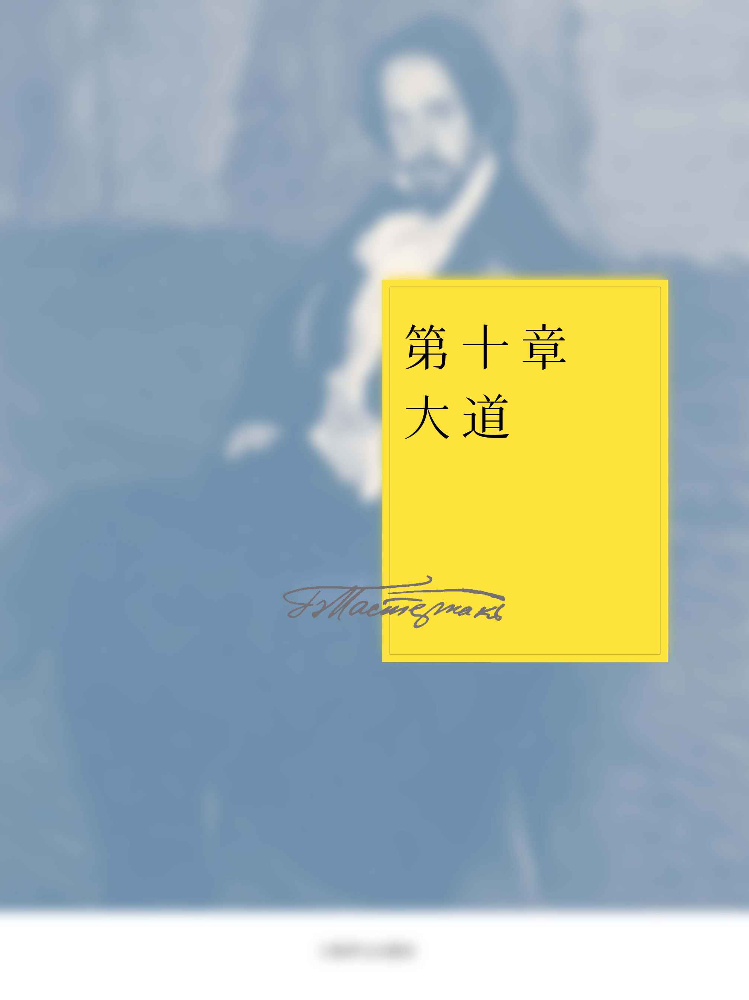

# 第十章 大道

<h3 id="c150">一</h3>

连接不断的城市、乡村、车站：圣十字镇、奥梅利奇诺车站、帕任斯克村、特夏茨、雅格林新村、钟楼镇、自由小站、牧人村、克日姆小村、卡塞耶沃车站、神文村、小叶尔莫莱村。

大道经过这些地方向前延伸。这是西伯利亚最古老的驿路。它像切面包一样，把城市在中心大街上一劈为二；而通过村庄时毫不返顾，把夹道建起的房屋远远地甩到身后，或者突然拐弯，划一个弧形，打一个勾，随之扬长而去。

很久以前没铺设经过霍达特镇的铁路时，大路上奔驶着三套马的邮车。从一端过来的是一群群马车队，载着茶叶、粮食、工厂铸出的生铁；另一端来的，是士兵从投宿站押解过来的一批批犯人。他们齐步向前，镣铐同时发出哗啦哗啦的声响。这是些无可救药的亡命之徒，像天上闪电那样令人畏惧。四周的森林喧闹着，林子昏黑，不能通行。

大道活似一个大家庭。城与城相亲，村与村相恋。在霍达特镇上，大道同铁路相交，这里有机车修理厂、机械厂，都是铁路的附属企业。赤贫的人们挤在工棚里煎熬、病死。流放的政治犯服完苦役，懂技术的就到这些工厂来当师傅，留在了村镇上。

在整个这条线上，起初的苏维埃早已被推翻。有一段时间，掌权的是西伯利亚临时政府，现在整个区域里全被最高执政者高尔察克的政权所取代。

<h3 id="c151">二</h3>

在某地的两站区间，大道一直在爬坡上山。放眼远眺，世界越展越宽。似乎爬坡没有尽头，眼界也没有尽头。等人马走乏，停下来想喘息一下，才发现爬到了山顶。前面大路连着一座桥。桥下奔腾着湍急的克日玛河。

河对岸，在更加陡峭的高地上，出现了圣十字修道院的砖墙。大道在修道院斜坡下面绕过，又在市郊几家后院之间拐了几次弯，便进入了市区。

到了主要广场上，大道又贴着修道院的地界而过；修道院绿色大铁门正朝着广场敞开着，入口拱门上雕有圣像，周围镶着半环形的金色题字：“为带来生命的十字架欢欣吧，虔诚的胜利是不可征服的。”

冬天即将过去。正值复活节前的一周，大斋期行将结束。路上的雪已经发黑，解冻开始了。屋顶上却仍是皑皑白雪，好像戴着一顶顶高高的厚皮帽。

爬上圣十字修道院钟楼找打钟人玩耍的孩子们，往下一看，房屋就像堆聚在一起的小匣子。人们个个犹如小黑点，走近房屋。凭他们的动作姿势，可以在钟楼上认出是谁。一些人靠近屋墙，围看最高执政者关于征集三种年龄新兵的命令。

<h3 id="c152">三</h3>

夜晚带来不少始所未料的情况。天变得暖和了，这在现在的季节是不同寻常的。落着濛濛细雨，雨那样轻飘，仿佛没等落地便在空中散为水雾。不过这只是错觉。温暖的雨水，一股股四散流去，足足把地上的积雪冲个精光，地面全成了黑色，又像出汗似的泛出亮光。

低矮的苹果树都已含苞待放，树枝奇妙地搭到果园的栅栏上，探到街上来。枝上七零八落地滴下水珠，打在木板人行道上，那声音像参差不齐的鼓点，传遍全市。

照相馆院子里一条小狗托米克，被锁上了过夜，此时又狂吠，又哀嚎。许是让它的吠声吵烦了，一只乌鸦在加卢津家果园里也破着嗓子聒噪，全城都听得见。

在城里地势较低的地区，有三马车货物运到商人柳别兹诺夫家。可他不肯收这批货，说这是弄错了，他从来没订过这种货物。赶车人因天色已晚，要求留宿。商人把他们骂了一通撵走了，连大门也没开。他们这番争吵，全城也听得清清楚楚。

教堂时间六点多钟，普通时间也就是午夜时分，圣十字修道院那口最重的大钟微微晃动了一下，传出低沉甜美的音浪，飘移着同黑夜中的雨雾混合到一起。音浪离开洪钟，好似春汛冲下的大土块离开了河岸，渐渐下沉，融化在河水里。

这是斋期星期四的前夜，彻夜祈祷读《福音书》第十二节的日子。在雨幔深处，隐约可见一些灯火向前移动，还照出了人们的额头、鼻子、脸庞。他们是做斋戒晨祷去的。

过了一刻钟的光景，从修道院那边传来渐近的走在人行道小桥上的脚步声。小铺女掌柜加卢津娜，晨祷刚开始一会就回家去了。她走得不稳，跑一阵停一下，头上蒙着块围巾，皮袄敞着。在闷气的教堂里她感到不适，便走了出来，现在由于没听完祈祷，已经第二年没做斋戒祷告而羞愧、懊悔。不过，她痛苦的原因不在这里。白天她看见到处张贴的征兵命令，不胜愁苦。她那可怜的傻儿子捷廖沙就该服役去。她极力驱赶头脑里的这种不快，可是在昏暗中处处泛白的告示，使她摆脱不掉。

拐个弯就到家了，没有几步路，不过在屋外她觉得舒服些。她想在外面呆一会，不愿进那气闷的房间。

她心里充满了悲愁的思绪。如果要她依次地诉说出来，她语汇不够，而且说到天亮也说不完。可在街上，种种不快之念纠结成一团，只需要几分钟，从修道院到广场尽头走上两三个来回，便都可以驱散了。

喜庆的节日就在眼前，家里却一个人也没有，都各奔东西，只剩了她孤身一个。怎么，说剩她一个不对吗？养女克休莎不算。她是外人嘛。人心难测呀！她也许是朋友，也许是敌人，也许是暗中的对手。她是丈夫符拉斯前妻的女儿，符拉斯说是养女。也说不定不是养女，而是私生女？也许根本不是女儿，而是别的什么人！男人的心思，谁猜得透呀？话说回来，这姑娘可真挑不出什么毛病，聪明、漂亮、品行也好，比傻瓜捷廖沙和她的养父可聪明多了。

就这样，临近复活节时只剩她一个在家，别人全走了，飞向四面八方。

丈夫符拉斯沿着驿道去给那些新兵宣讲去了，祝福应征的人们去建立战功。这个傻子还不如多为自己儿子操点心呢，别让他去冒丧命的危险。

儿子捷廖沙也在家里呆不住，节前就跑得无影无踪了。他去神文镇上找亲戚玩乐，想在经受折磨之后开开心。这孩子被实科中学开除了。中学前一半，每年留级，倒也没出什么事。读到八年级，人家不客气地把他撵了出来。

啊，真令人心烦！我的上帝呀！为什么心里这样烦乱，啥都不想干。百事不遂心，活着没意思！这是怎么啦？是因为闹了革命吗？不，不是！一切都怪这战争。打仗把好样的男子汉都打死了，剩下的全是孬种、废物。

她原来的老家（父亲是承包人）生活可不像现在这样。父亲不酗酒，有文化，家境富裕。两个姊妹也好，波利娅和奥利娅。她们名字相近，人也相似，一对美人儿。那几个来找父亲的木匠师傅，个个魁梧精神，长相漂亮。忽然间姊妹俩异想天开（因为家里不愁吃穿）要织六种毛色的围巾，真能出点子。结果织得妙极了，围巾在全县到处闻名。常常是办什么事都像个样——教堂的仪式、舞会，都漂漂亮亮。家中的人们，他们的举止也是如此，别看全是普通人，是一般市民，农民和工人。那时的俄罗斯，也年轻漂亮，有真正的崇拜者、真正的卫士，可不是现在这些人能比得了的。如今一点神气都没有了，尽是些律师呀、犹太人呀，白天黑夜就知耍嘴皮子、耍笔杆的废物。符拉斯和一群朋友，想靠香槟酒和良好的祝愿，把从前的黄金时代再拉回来。可是用这种办法，难道能够重新获得丢失的感情吗？为了这个，得能移山倒海才行。

<h3 id="c153">四</h3>

加卢津娜不止一回走到了卸货地，就是圣十字修道院的进货广场。由这儿回她家，要向左去。可每次她都改变了主意，转身又朝修道院旁边的小巷走去。

进货场足有一片耕地那么大。从前到了集市的日子，农民的马车把广场塞得满满的。货场一端是叶列宁街尾，另一端是倾斜的弧形，边缘上盖起一排单层或两层的小房子，全是货仓、账房、店铺、手工作坊。

这里过去在太平年月，那个戴副眼镜的大笨熊布留汉诺夫穿件长襟礼服，时常端坐在自家有四扇门板宽的店门旁，读他那小报。这人是厌恶女色的家伙。店里经营皮革、松焦油、车轮、马鞍、燕麦、料草等。

店堂晦暗的小橱窗里，成年摆着尘封的硬纸盒，装的是用绸带花结扎起的成对的喜烛。橱窗后面是间不大的屋子，没有家具；要不算几个垛在一起的圆形蜡料，连货物的影子也没有。可就在这屋里，却有不知住在哪里的经营蜡烛的巨商派来的不为人知的代理人，谈成一笔笔上千卢布的地板漆、蜡料、蜡烛的交易。

这里，在一排店铺正中，是加卢津家开的出售殖民地来货的店铺，有三开间的门面。店里掌柜和伙计们整天没完没了地喝茶，然后一天三次用喝淡的茶水擦那没刷漆的地板。这儿的年轻女掌柜，时常很乐意坐在账桌旁。她喜欢的颜色，是雪青色、紫罗兰色，就是那件特别庄重的教堂礼服的颜色，丁香含苞待放时的颜色，她那件最好的丝绒衫的颜色，她厨房里玻璃酒具的颜色。她觉得，这是幸福的颜色，回忆的颜色，逝去的俄罗斯革命前的处女时代，也都是淡紫色的。于是她喜欢久久坐在店里的账桌旁，因为弥漫着玻璃缸中淀粉、白糖、深紫色茶藨子香味的店堂，是一片淡紫的暮霭，恰是她最喜欢的色彩。

这里，在一个角落中，紧挨着木材仓库有一座旧薄板盖起的两层楼房，老得四周下沉，像辆破旧的马车。楼里共有四套住宅，两个入口，正面两个楼角，一边一扇大门。底层左半是扎尔金德开的药店，右半是公证人事务所。药店上头住着专做女服的老裁缝，有一大家子人的什穆列维奇。对着裁缝家，在公证人上面，杂居了许多房客。挂满大门口的各种牌匾，说明了他们的职业。这里可以修表、定做皮靴。这里有茹克和施特罗达克合伙开的照相馆，这里还有个卡明斯基的雕刻小店面。

由于这套住宅里过于拥挤，照相师傅的两个帮手，修版的谢尼亚·马吉德松和大学生布拉热英，在院子里柴棚的过道账房中，搭起一间暗室。看来这会儿他俩也在干活儿，因为从账房小窗口看得见洗相片时开着的那盏怒气冲冲的小红灯，模模糊糊在闪动。就在这个窗口底下，锁着叫得整条叶列宁街都能听见的小狗托米克。

“简直是大杂烩。”加卢津娜路过灰楼时心里想。“又穷又脏，全凑到这儿来了。”但她马上又想到，符拉斯反对犹太人可不对头。这些人都是无足轻重的，对国家命运没什么大相干。不过你要去问问什穆列维奇老人，为什么这样乱糟糟、纷纷扰扰，他会弯下腰，做个鬼脸龇着牙说：“都是犹太人在捣鬼。”

唉，她这是想些啥呀？脑子里都装了些啥呀？问题不在这里嘛。问题难道出在这儿吗？问题出在城市。俄国不是靠城市支撑的。可是人们认准了受教育，就学城里人的样子，又没学成。这叫离了这边岸，又到不了对岸。

也许正相反，问题出在愚昧上。科学家隔着地能看到地底下，什么都事先能预见。咱们这种人是事到临头才着急，总像盲人骑瞎马。现在就是受过教育的人，也不好过呀。这不，城里无粮，全跑乡下来了。请问，这一切你可搞得明白吗？神仙也说不清呀。

我家乡下的亲戚，可就不一样啦。你看谢利特温家、舍拉布林家、潘菲尔·帕霍赫家、涅斯托尔和潘克拉特·莫德赫兄弟。自己说了算，自己做得了主。都在大道两旁修起了新房院，看着叫人眼馋。每家全种了十五公顷左右的庄稼，有马，有羊，有牛，有猪。存粮足够吃三年。农具也漂亮，有收割机器。对他们，高尔察克也要巴结拉拢；林子里的游击队政委，同样拉他们过去。他们戴着乔治十字勋章刚从战场上回来，马上就被抢着请去当教官，有肩章也好，没肩章也好。只要你是内行，哪里都要你。你总会派上用场的。

不过现在该回家去了。一个女人没完没了这么逛荡，可太不雅观了。在自家的果园子里当然好喽，可是园子里满处泥泞，脚都拔不出来。这会儿心里倒好像轻松些了。

加卢津娜的思想完全乱成一团，弄得毫无头绪。就这样，她走近了家门。在她未及迈进门坎，在檐前踏脚之际，眼前又浮现出许多各种各样的景象。

她想起了自己较为了解的现在霍达特镇的一些领头人物，想起了从各地首府流放来的政治犯，像季韦尔辛、安季波夫、无政府主义者夫多维钦科（绰号“黑旗”）、当地的钳工戈尔舍尼亚·别中内。他们全是聪明人，前半辈子一直没有安分守己，这会儿准是又在打什么主意，在准备什么。离开这个，他们活不下去。他们是守着机器过活的，自己也变得像机器一样冷酷无情。他们在绒衣外面套件短夹克，抽纸烟要用骨质烟斗，说怕传染上什么，喝水要喝煮开的水。符拉斯准定是一事无成，这些人能按自己的意志改变一切，总会如愿以偿的。

接着她想到了自己。她明白自己是个很出色、很特别的女人，姿容依旧而又聪明过人，心地也不错。可在这穷乡僻壤，她的这些品格没有一项能得到别人承认，也许到哪去都如此。有一支整个后乌拉尔地区都熟悉的唱一个傻女人先捷秋丽哈的下流曲子，只有头两句可以记录下来：

 

先捷秋丽哈把辆马车卖掉，

拿了钱买来三弦琴戏闹。

 

再往下不堪入耳了。圣十字村的人们唱这支歌的时候，加卢津娜老觉得是在影射她。

她痛苦地叹了口气，走进屋去。

<h3 id="c154">五</h3>

她没有在前厅停留，没脱皮袄径直进了卧室。这间屋的窗子，是朝果园开的。此刻是夜里，窗外窗里几乎都是一片昏黑。一圈圈皱皱巴巴垂着的窗幔，同院中轮廓模糊的一圈圈低垂的黑色秃枝，差不多一模一样。在残冬的果园里，塔夫绸般的黑夜，透露着早春深紫色温和的地气。房间里也几乎是相似的两种要素结合到了一起，由于窗帷没抖净，有股尘土气，闷得难过，但随着节日临近而出现的深紫色暖气，使郁闷得到缓解。

圣像上的圣母，从挂满银饰的法衣中抽出一双黝黑的瘦手，掌心朝上举起来。她的每个手掌上，似乎有她自己古罗马名字的前两个和后两个拉丁字母，表示着“上帝的母亲”。嵌在金色底座中的石榴石玻璃神灯，漆黑如墨；灯光散落到卧室地毯上，像破碎的星星闪烁不停。

加卢津娜解下头巾，脱下大衣，笨拙地转了个身，突然肋下又一阵刺痛，胸口发紧。她吓得喊了一声，接着喃喃念道：“给悲哀者伟大的庇护吧，纯洁的圣母！快救救我吧！人世的救星！”随后便哭了起来。等这一阵痛平复，她开始宽衣。后颈的领钩和后腰的衣钩，总也捏不住，埋到轻纱的褶缝中。她费劲地摸索着。

这时养女克休莎走进来，惊讶她这么早回了家。

“您干吗摸黑呀，妈妈？要我给您拿盏灯来吗？”

“不用了。这也看得见。”

“妈妈！奥莉加·尼洛夫娜，让我给您解开。您别受罪了。”

“手指不听使唤，实在没法。该死的裁缝就想不到把衣钩钉得像个样，这只瞎母鸡！恨不得把衣边全撕下来甩到她脸上去。”

“圣十字修道院那里，唱得很好听。夜里静极了，全传了过来。”

“唱得好，可我的感觉却不好。又是浑身疼。这真要命，我不知该怎么办。”

“用顺势疗法的那个医生斯特多勃斯基，给您治得还好吗？”

“尽出些无法做到的主意。你说的那位是个庸医。一点不顶用。这是一。第二，他走了。他离开了这儿，而且不只他一个。节前一个个全跑出城去了。是不是预测到地震啦？”

“那还有被俘的匈牙利大夫，也给您治得很好嘛。”

“又说胡话。告诉你，谁都不在了，全跑光了。克列尼·莱奥什同另一些匈牙利人，不知怎么过了边境线，就被强迫在军队服役，后来收编到红军里。”

“您完全是神经过敏的缘故。是神经官能病。用民间普通的消灾办法治，就能出现奇迹。您记得吗？有个大兵的妻子给您念咒挺见效。手到病除。我忘了这女人叫什么。她的名字记不得了。”

“你简直把我当一个愚昧无知的傻瓜了。背着我，说不定还要唱先捷秋丽哈的歌子骂我呢。”

“亏您说得出，妈妈！最好还是告诉我那个大兵女人叫什么吧。名字就在嘴边上。我不想起来心就放不下。”

“她呀，名字比裙子还多呢。不知告诉你哪个好。她叫库巴丽哈，又叫梅德韦季哈，也叫兹雷达丽哈。还有十来个外号。她也不在附近了。人一走，哪里找去呀？这个上帝的奴仆，蹲过克日姆监狱，因为药死了胎儿，还有什么卖药末的事。她大半嫌牢里寂寞，就逃跑去了远东。我不是对你说了吗？人们全跑走了，像符拉斯·帕霍莫维奇、捷廖沙、特别随和的波利娅阿姨。有良心的女人，全城就剩你我两个傻瓜了。我这可不是说笑话吧。想治病，根本没办法。出点事，人就完了，唤天天不应，唤地地不灵。听人们说莫斯科一位有名的大夫住在尤里亚京，是个教授，是一个自杀了的西伯利亚商人的儿子。我本来琢磨请他来看病，这会儿工夫在大道上设了二十多个红军哨卡，打个喷嚏都能知道。现在别说这个吧。你去睡好了，我也躺下睡睡看。大学生布拉热英正灌你迷汤呢。你干吗不理人家？反正你躲不过这种事。看你脸羞得通红。你那个不幸的大学生，在这神圣的夜晚还在工作，洗相片呢。他是在洗我的相片、印我的相片。他们自己不睡觉，扰得别人也睡不好。他们那只小狗托米克叫得全城都听得见。就连该死的乌鸦，也在我们的苹果树上叫个没完。看起来这一夜我又甭想睡好了。你干吗这么不高兴呢？太小性了。大学生们本来就是姑娘们喜欢的对象嘛。”

<h3 id="c155">六</h3>

“狗怎么叫成这样呀？该去看看怎么回事。无缘无故它不会叫的。你停停，李多奇卡，别出声，停一分钟。得把情况弄清楚。没准儿是对面打来了呢。乌斯东，你别走。还有你，西沃勃留，也在这等着。没你们去也成。”

中央代表李多奇卡，没听见人家叫他停停别讲，疲惫不堪却仍连珠炮似的往下演讲：

“西伯利亚现在的资产阶级军人政权，实行抢劫杀戮、横征暴敛的政策，应该使迷惑不清的人们猛醒了。这个军人政权不仅敌视工人阶级，从本质上看也是敌视全体劳动农民的。西伯利亚和乌拉尔的劳动农民应该懂得，只有同城市无产阶级和士兵结成联盟，同吉尔吉斯和布里亚特的贫苦人民结成联盟……”

最后他终于听清人家要他先别讲了，这才停下来，拿手帕擦擦汗脸，疲倦地垂下浮肿的眼皮，闭上了眼睛。

站在旁边的人们低声对他说：

“歇一歇，喝点水吧。”

有人向心情不安的游击队长报告说：

“你着什么急？一切都正常。暗号灯还在窗台上放着。说得形象些，岗哨正瞪大眼睛盯着四周呢。我认为可以继续报告了。你讲吧，李多奇卡。”

宽敞的柴棚里面，清出了柴禾。在空出来的地方，常常召开秘密集会。集会地点前面挡着一垛码到天花板的木柴，把传达室与大门和集会地点隔开，作为掩护。出现危险情况，可以保证与会者转入地道，而后在修道院墙外康斯坦丁诺夫死胡同的僻静尽头，从地道出口爬上来。

报告人戴顶细棉布的黑帽，把整个秃顶全罩了起来，脸色青绿无神，留着黑色的络腮胡子。他神经一紧张就出汗，总是满脸汗水。他把没抽完的烟头，凑到桌上煤油灯烫人的火苗边，使劲地吸着，又低弯下腰看那桌上散乱的纸张。近视眼紧张而迅速地扫过材料，好像在嗅它们的味道。然后又用疲惫无神的声音继续讲：

“城乡贫苦人民的这个联盟，我们只有通过苏维埃才能实现。愿意也好，不愿意也好，西伯利亚农民如今也要追求西伯利亚工人早就开始为之奋斗的目标了。他们的共同目的，就是推翻仇视人民的海军和哥萨克将领的专制，通过全民的武装起义建立农民和士兵的苏维埃政权。与此同时，为了对付资产阶级雇佣的武装到牙齿的哥萨克军官，起义者必须进行顽强持久的正确的阵地战。”

他又停下来擦把汗，闭上了眼睛。有个人不遵守会议规矩，站起身举举手，想发表点见解。

游击队长，确切些说是后乌拉尔地区克日姆游击联队的军事首长，就坐在报告人鼻子尖底下，一副故意满不在乎的神气，不时粗鲁地打断报告人，丝毫不把他放在眼里。令人难以相信，这么年轻的一个军人，简直还是孩子，居然统帅整个的军队、联队；人们都听他的指挥，对他毕恭毕敬。他坐在那里，用骑兵大衣裹住胳膊和双腿，大衣领子和袖子搭在椅背上。看得见他里面穿了件军衬衫，从肩上拆线的针脚看得出以前戴过准尉肩章。

他的左右站着两个默不作声的年轻人，是他的卫队队员，与他年纪相仿，穿着已经开始变灰的白羊皮短袄，袄上有羊羔皮的镶边。他们两人化石般漂亮的脸上，除了显示着对首长的盲目忠诚，为他准备赴汤蹈火，没有其他任何表情。他们毫不理会这次会议，毫不理会这里提出的问题和辩论的情况，既不说话也不笑。

除了这些人外，柴棚里还有十到十五个人。有的站着，有的坐在地板上，不是双腿直伸，就是蜷起膝盖，身子靠在墙上或是壁上突出的圆木上。

给贵客们摆上了几把椅子，上面坐着三四个工人，是参加过第一次革命的老人，其中有容颜大变的阴郁的季韦尔辛，有总对他点头称是的老朋友安季波夫。他们都称得上是革命向之礼拜的神圣人物，坐在那儿像一尊尊沉默威严的雕像；在他们身上，政治上的倨傲已经压倒了一切活生生的人的特点。

柴棚里还有些值得一提的人物。俄国无政府主义的中坚分子夫多维钦科，绰号“黑旗”，一刻也不能安静，一会儿从地板上站起，一会儿又坐到地板上，一会儿在柴棚中间踱步，一会儿又停在正中。这是个高大肥胖的人，大脑袋大嘴巴，头发如狮鬃。他们这批军官，几乎都参加了最近一次俄土战争，至少是参加过俄日战争，他是个整天耽于梦呓的幻想家。

由于他心肠太好，也由于他个头硕大，妨碍他关注细小事物，因之对所发生的一切，他都注重得不够，又常常理解错误，就把相反的意见也当成自己的意见，对谁都表示赞同。

紧挨着他，在地板上坐了一个他的熟人，森林猎手斯维里德。虽然斯维里德没当过农民，但从他那黑呢绒衬衫的开襟，可以看出他眷恋土地的气质。他进大门时把这衬衫连同十字章卷成一团，拿它在胸口蹭了蹭。这是半个布里亚特人，好心肠而没有文化，头发像小细辫，留着稀稀拉拉的短髭和稀疏得只有几根毛的胡子。蒙古气质使他脸变得老气了，总是皱巴巴地露出同情的微笑。

带着中央委员会军事指令巡视西伯利亚的报告人，还没有发挥完自己的思想。对于出席会议的多数人，他都不感兴趣。但作为革命者和自小热爱民众的人，他不胜爱慕地望着坐在对面的小小统帅。他不仅原谅了这个孩子的一切粗鲁举动，把这些当成是土生土长的潜在革命性的表现，而且极为欣赏他的鲁莽行为，正像热恋的女人会喜欢情人露骨的无礼行为一样。

这个游击队首领就是米库利齐恩的儿子利韦里。中央来的报告人，过去是劳动团合作主义分子，倾向于革命的社会主义者，叫科斯托耶德阿穆尔斯基。最近他重新考虑了自己的立场，承认自己观点的错误，写了几份长篇声明悔过。之后不仅被接受参加了共产党，并且入党不久便被派去完成责任如此重大的工作。

把这项工作交给他这么一个对军事一窍不通的人，是出于对他革命资历的尊重，对他铁窗磨难的尊重，也由于估计到他过去搞过合作社活动，应该比较熟悉西部西伯利亚起义地区农民群众的情绪。在这个问题上，他对农民的了解，远比军事知识更加重要。

政治信仰的转变，使科斯托耶德判若两人。他改变了自己的外表、动作和作风。谁也不记得过去他什么时候秃过顶、留过胡须。或许这一切都是假扮的？党规定他要严格隐蔽。他的化名是别列德涅和李多奇卡同志。

夫多维钦科不合时宜地表态说他同意指令中包含的各点，引起一阵喧嚷。等喧声平息，科斯托耶德继续说：

“为了尽可能全面包括不断发展的农民群众运动，必须立即同省委所在区域的所有游击队建立联系。”

接下去科斯托耶德讲到接头、暗号、密码和交递情报的方法。然后他又转入了细节。

“要报告游击队：哪些地方有白匪机关的军火、军需、粮食仓库；何处藏有大量现金以及警卫体系。

“必须缜密而又十分详尽地研究下列问题：游击队的内部机构、首长、军事纪律和同志间纪律、秘密工作、游击队同外界的联系、对地方居民的态度、战地革命军事法庭、敌占区的破坏战术（如破坏桥梁、铁路、轮船、驳船、车站、手工厂及其技术设备、电报局，煤矿、粮食制品）。”

利韦里忍着忍着，实在憋不住了。在他看来，所有这一切全是于事无补的外行的胡诌。他说：

“非常精彩的报告。我要牢记在心。看起来这一切都得无条件地接受，才能不失去红军对我们的支持。”

“当然喽。”

“可是，我的好同志李多奇卡，您这一套孩子打小抄的玩意儿，我怎么实行呢？要知道我的三个团的兵力，包括炮兵和骑兵，早已在进军途中，并且把敌人打得狼狈不堪。”

“真精彩！真有气魄！”科斯托耶德心想。

季韦尔辛打断了他俩的争论。他不大喜欢利韦里出言不逊的口气。他说道：

“请原谅，作报告的同志。我这意见没有把握。也许我把指令里的一点给记录错了。我再念它一遍。我想核对一下：‘极其希望吸收革命时身处前线并参加士兵组织的老兵参加委员会。希望委员会组成中包括一两名军士和军事技术员。’科斯托耶德同志，这记得对吗？”

“对。一字没错。都正确。”

“那么请允许我讲这样一点意见。关于吸收军事专家这一条，令我感到不安。我们几个参加一九五年革命活动的工人，还不习惯信任当兵的。他们之中总有反革命一起混进来。”

周围一片喊声。

“够了！通过决议吧！念决议！人该走了。太晚了。”

“我同意多数人的意见，”夫多维钦科那沉雷般的低音响起来，“要说得高雅一些，应该是这样：公民的法典要在民主的基础上，自下而上地发展，就像插在土里成活后的枝条，枝条不可像栅栏木桩似的从上往下打进去。雅各宾专政的错误就在这里，因此议会才被热月政变搞垮。”

“这太明显了。”斯维里德支持了这位一起漂泊在外的朋友。“小孩子也明白这道理。早该想这事，现在晚了。如今我们只有作战，而且硬往前闯。一软就完了。要不像什么话，摆开架式又往回缩。自己做事自己当。自己跳了水，别说是淹死的。”

“要有决议！要有决议！”四面八方都在喊。人们又说了一会儿，话题越来越缺乏联系，你说东，我说西。天亮时散了会。人们极为小心地一个一个散去。

<h3 id="c156">七</h3>

大道上有一处风景宜人的地方。坐落在陡坡上、被帕任卡小河急流隔开的神文村和小叶尔莫莱村，几乎是毗连的。神文村从高处漫坡而下，小叶尔莫莱村在它下方闪烁着斑斓的色彩。神文村已在为入伍新兵送行；在小叶尔莫莱村，由施特雷泽上校领导的接收委员会还在工作，复活节暂停之后，要检查这个村和邻近几个小村落应征青年的身体。因为征兵，村子里住了民警马队和一些哥萨克。

今年复活节来得晚，春天却来得早。这是复活节的第三天，和暖无风。靠着大道边在神文村大街的露天地里，给整装待发的新兵摆好了饯行的餐桌。为了不妨碍过车，桌子放得不很整齐，像条歪歪扭扭的长蛇，上面覆盖的白桌布垂到了地上。招待新兵的吃食是大家凑的份子。主要是复活节剩余的佳肴，有两只熏火腿，几个甜圆面包，两三个甜乳渣糕。桌上摆了长长一排小粗碗，放着腌蘑菇、腌黄瓜、酸白菜。还有一盘盘自制的大块的乡下面包，宽盘子里码着小山一般的彩蛋，以粉红色和天蓝色为最多。

餐桌旁的嫩草地上，扔满了打破的蛋壳，有粉红色、天蓝色，还有蛋壳里层的白色。小伙子们穿在外套里面的衬衫，就有天蓝和粉红的颜色，姑娘们的连衣裙，也是天蓝和粉红的色彩。上面天是蔚蓝的，云是淡红的。云朵在天空缓缓地整齐地移动着，仿佛天也随着云一起飘浮。

符拉斯·帕霍莫维奇·加卢津身上用绸布宽腰带扎着的衬衫，也是粉红色的。他一阵小跑，皮靴后跟咔咔响，两脚左右撇着，从帕夫奴特金家的房门高阶上来到餐桌旁。帕夫奴特金的房子正在餐桌上方的一个高坡上。他跑来就说：

“这杯是百姓自己酿的土酒，我当香槟为你们大家干杯，孩子们。很快要上路的年轻人、新兵先生们，希望你们一切都好，祝你们平安。我还想在许多别的方面也祝贺大家。请诸位注意。在大家面前是条背负十字架的遥远道路，挺胸卫国，打击强寇。他们杀害我们的兄弟，血染祖国大地。人民幻想不流血地讨论革命成果。可是布尔什维克党是外国资本的走狗。人民的理想、立宪会议，被他们粗暴的刺刀冲散了，鲜血成河。背井离乡的年轻人！高举起蒙受耻辱的俄国武器吧！我们有负忠诚的盟国，看到德奥跟在红党后面东山再起，我们无不感到耻辱。上帝同我们在一起，孩子们！”加卢津还在往下说，可喊声淹没了他的话。大家呼叫乌拉，要求把加卢津抬起来摇晃。他把杯子贴到唇上，一口口呷着粗制的土酒。他喝这个东西，不感到是乐事，因为喝惯了精制的葡萄酒。但意识到这是他为社会作了牺牲，也得到莫大的满足。

“你爹真是好样的。野兽听了也动心。那个杜马里的什么米留科夫算个啥呀！不得了！”在一片醉酒的喧嚷声中，戈什卡·里亚贝赫咬着半醉的舌头，对自己的朋友和邻座捷廖沙·加卢津夸赞他的父亲。“一点不假，是个好样的！他是不白卖力气的！想凭三寸不烂之舌，换得你不去当兵。”

“胡说什么呀，戈什卡！你也不亏心！倒想得出——不去当兵。等和你同一天接到入伍通知书，看你还说不说‘不去当兵’了。咱们也许上一个部队呢。现在中学把我开除了，这些坏蛋！妈妈要死要活的。可千万别弄去当志愿兵。大概是行！派去当大兵。要说爸爸在大庭广众讲话，那真没说的。你猜主要靠啥？天生的！没有什么系统的教育。”

“听说桑尼卡·帕夫奴特金的事了吗？”

“听说了。那传染病真那么厉害吗？”

“一辈子也好不了。最后是面黄肌瘦，一死拉倒。怪他自己嘛！人家警告过他别去。主要是得看跟谁胡来。”

“他现在怎么办呢？”

“悲剧！本想自杀算了。这会儿在叶尔莫莱的委员会里正检查身体呢，多半会取上。他说要参加游击队去，向社会的罪恶报仇。”

“听着，戈什卡。你说到传染。如果不到那里去，也可能染上别的病。”

“我知道你说的什么。看来你就干这个。这不是病，这是见不得人的恶习。”

“戈什卡，凭这个话我能扇你耳光。不许你这么糟蹋朋友，尽胡说八道。”

“我开个玩笑，你别发火。我想对你说什么呢？我在帕任斯克村。有人到那里作过一个报告：‘个性的解放’。非常有意思。我很喜欢这个报告。我干脆去当无政府主义者。那人说，我们有种内在的力量，就是性别和性格，这照那人说是动物电磁的觉醒。你瞧！够得上个神童了。哎呀，我喝得太多了。周围这么吵，耳朵都要聋了。我受不了啦，捷廖沙，别说了。我说，你这狗崽子，闭嘴吧！”

“戈什卡，你再给我讲一讲。社会主义一类的词儿，我还不是全明白。比方说怠工分子，是个啥词儿？什么意思？”

“我虽说讲这些可算个教授，可我对你说过了，别缠着我，我喝醉了。怠工分子就是说某人和某人结成了团伙。要是说你是怠工分子，就是说你和别人抱团儿了。懂了吗？笨蛋。”

“我也这么想，这是个骂人词儿。还有你说的电的力量完全正确。我看到卖电腰带的广告，就想从彼得堡订购一个来，好提高效率。铁路代收货款。这时突然发生了新的事变，哪还顾得上电腰带呀。”

捷廖沙没能说完。不远的地方一声雷鸣般的爆炸声，压过了这群醉鬼的喧闹。餐桌上的吵嚷，霎时停了一会儿，接着更乱哄哄地喧腾起来。桌旁有些人一个接一个急忙起身。站得稳的没有摔倒，可有的想躲到一边去，因为站不住，倒到餐桌底下，立刻鼾声大作。女人们惊呼起来。局面一片混乱。

符拉斯·帕霍莫维奇的眼睛朝四下搜寻，想找到罪魁祸首。他起初以为这声巨响就出在库捷伊，离这儿很近，也许在餐桌附近。他的脖颈伸得长长的，脸如猪肝，扯着破嗓子大吼：

“这是哪个犹大钻到我们队伍里胡作非为？这是谁家的狗崽子拿手榴弹扔着玩？不管是谁，就是我亲生儿子，我也非掐死不可。公民们，我们可不能容忍开这种玩笑。我要求搜捕。把神文村全围起来。非得把挑衅的祸首抓住。别让他跑掉。”

开始人们还听他讲。后来注意力转向小叶尔莫莱村公所上空慢慢升起的黑烟柱。大家都跑向高崖去看那里发生了什么事。

从叶尔莫莱着火的村公所里，跑出几个没穿衣服的新兵，有一个光着脚和身子，刚提上裤腰；后面出来的是施特雷泽上校和其他正在检查挑选新兵的军人。一些哥萨克和民兵骑着马，挥着战刀挺着身，马也伸直腰，像弯弯曲曲的蛇在村子里左右奔突。那是在搜什么人，抓什么人。许多人沿大路向叶尔莫莱村奔跑。叶尔莫莱村的钟楼，响起急促不安的报警钟声。

事件的发展极为迅猛。黄昏时分，为了继续搜查，施特雷泽和哥萨克们出了村，爬高来到邻近的库捷伊村。他们在四周布置好岗哨，开始搜查每一幢房子、每一个田庄。

这时，一半的新兵早已酩酊大醉，睡得死人一样，有的把头伏在桌沿上，有的躺到桌子下面。等得知村里来了民兵时，天色全黑了下来。

有几个青年为躲避民兵，撒腿往村后跑，找到一个仓库地窖，就你推我搡地挤了进去。黑暗中分辨不清是谁家的仓库，但从鱼腥和煤油味判断，这是合作商店的底层货仓。

藏躲的人们，没做任何亏心事。但他们躲起来，是犯了个错误。多数人所以跑，是出于慌乱，醉醺醺地心里犯糊涂。有几个人是怕自己一些可疑的熟人坑害了自己。如今这里一切都带上了政治色彩。调皮捣蛋和流里流气，在苏维埃方面被看做是反动的帮派活动，在白军肆虐的地方就成了布尔什维克。

原来，小伙子们钻进底层之后就有人告诉他们，这库房地板下面的窖子里，已经挤满了人。这里躲着几个神文村和叶尔莫莱村的人。神文村的人都烂醉如泥，有的一边打呼一边呻吟，又咬牙又哎哟，有的恶心呕吐。库房底下黑暗如漆，又闷又臭。最后钻进来的人，用土和石块堵上洞眼，怕被人发现。不久，醉汉的鼾声和哼哼完全停止了，出现一片死寂。人们都睡得很安稳。只是一个墙角里有两个人在窃窃私语。那就是被吓得半死、怎么也安静不下来的捷廖沙和叶尔莫莱村一个富农家好斗的科西卡。

“你小点声，别嚷嚷，狗崽子！你这臭小子，非把大家全给坑了！你听，施特雷泽那伙人正到处搜查呢。从村口拐过来，正顺着商业街走呢，说话就到这儿啦。来了！别出声，别喘气，不然我掐死你！总算你走运，去远了。他们过去啦。你干吗要跑到这里来？往这躲个啥呀？谁会动你一根毫毛？”

“我只听戈什卡在喊叫‘快逃命’，我就钻了进来。”

“戈什卡不一样，他们家全家都挂了号，是不良分子。他们在霍达特镇上有亲戚。是卖手艺的，工人血统。你别乱动好吗？好好躺着，你这个蠢家伙。墙边一堆堆拉的屎尿。你一动就蹭一身，还要沾到我身上。你闻不到臭味是怎么着？施特雷泽干吗要全村搜捕？他在抓帕任斯克村的人，外来的人。”

“科西卡，这到底是怎么回事？怎么开始的？”

“都是因为桑尼卡，是桑尼卡引起的。我们脱光身子站成一横排检查。轮到桑尼卡，该他检查了。可他不脱衣服。桑尼卡喝了点酒，来检查时就不大清醒。文书说了他，叫他脱衣，态度很礼貌，对桑尼卡称呼您。是个军队里的文书。桑尼卡对人家却很粗鲁：我就不脱，我才不愿把身子亮给所有的人看呢。好像他是不好意思。说着他侧身凑到文书身旁，似乎要抡起胳膊打人的下巴。真是如此。可你猜怎么着。一眨眼的工夫，桑尼卡弯腰抓起办公桌腿，连桌子带上面的墨水、军人名单，一股脑掀倒在地。施特雷泽由村公所跑出来喊叫说：‘我不能容忍目无王法，我让你们知道知道什么是不流血的革命，在征兵处犯法有什么结果。谁是挑头的？’”

“桑尼卡朝窗口奔去，口喊：‘救命啊，快找衣服。留在这儿全要完蛋，同志们！’我抓起衣裤，边跑边蹿到了桑尼卡跟前。他一拳打碎玻璃，就蹿到街上，一溜烟不见了。我抬腿紧追。还有些人也去追。我们撒腿猛跑，可身后已有追兵。你要问我这一切都为着啥，谁也说不清楚。”

“那么炸弹呢？”

“什么炸弹？”

“谁扔了颗炸弹？不是炸弹喽，是手榴弹。”

“天哪！哪是我们呀？”

“那是谁？”

“我怎么知道？反正是别人干的。他看到一片混乱，心想趁乱把村子给炸掉，一定会当是别人干的。可能是哪个政治犯搞的。帕任斯克村的政治犯，在这儿多极了。轻点，别出声，有人说话。你听听，施特雷泽又返回来了。唉！这下可完了。你别出声呀。”

人声渐近，靴子响，马刺响。

“别和我争了。你骗不了我。我不是好哄的。肯定有人说话。”传来上校越来越清晰的长官腔的彼得堡口音。

“可能是错觉吧，阁下。”小叶尔莫莱的村长、打鱼老人奥特维亚日斯金劝他说。“这是个村子，里面有人说话，又有啥可奇怪的呢？这里不是公墓嘛！也许有人说话。家家都有说话的活人。说不定是家神在梦中掐谁的脖子呢。”

“好哇，好哇！我让您装疯卖傻，作出一副可怜相！还家神呢！你们在这儿太放任了。等你们这里闹腾出世界革命来，那可就晚了。什么家神呀！”

“哎哟，阁下呀，上校先生！这里谈什么世界革命呀！尽是些糊涂虫，目不识丁！念旧的圣礼书，还结结巴巴、颠三倒四。他们还说得上什么革命呢。”

“你们是不见棺材不落泪啊！把合作社房子从上到下搜查一遍，所有木槽全翻一翻，柜台底下也得看看。还要搜查一下旁边的小房。”

“遵命，阁下。”

“要抓桑尼卡、戈什卡、科西卡。活的死的都行，绝不能放跑他们。还有加卢津家的小崽子。别看他爹讲些爱国的话，蒙骗我们。我们可不上当。凡是小铺老板出来演说，那事情就不妙了。那就大可怀疑了，因为违背自然。根据秘密的情报，他们在圣十字修道院的院子里，藏政治犯，召开秘密会议。要把这小子抓住。我还没想好怎么处置他。如果能发现点什么，我会不客气地把他吊死示众。”

搜查队往前走去。等他们走远，科西卡·涅赫瓦廖内赫问吓傻了的捷廖沙·加卢津：

“听见了吧？”

“嗯！”他低声回答，声音全变了。

“如今我和你、桑尼卡、戈什卡，只有进林子一条路。我不是说长远在那呆下去。得等这边明白过来。他们弄明白了，那时再看，也许我们再回来。”

