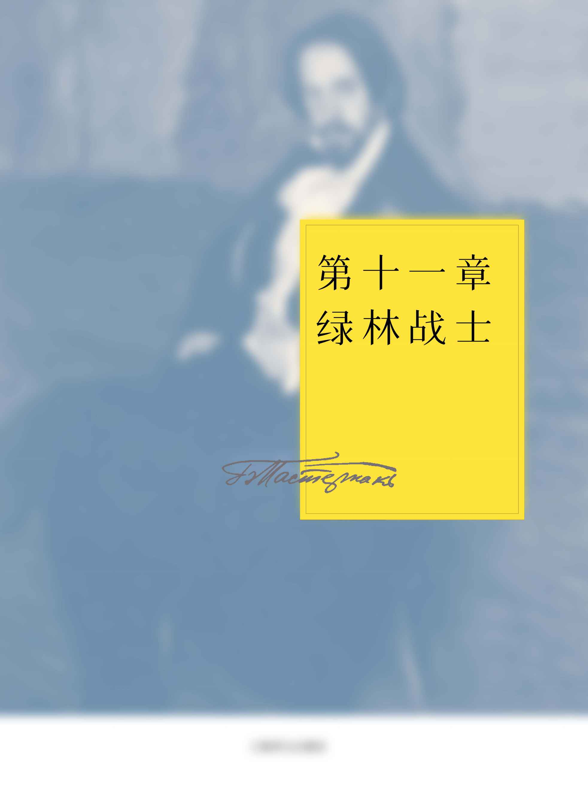

# 第十一章 绿林战士

<h3 id="c157">一</h3>

日瓦戈被俘跟随游击队，已经是第二个年头了。这种受裹胁的不自由，界限十分不清。日瓦戈当俘虏的地方，没有壁垒包围。对他并不防备，也不监视。游击部队总是转移调动，日瓦戈便随他们一起转移。这支部队路经村庄和省区，同当地居民不分彼此。同居民混杂一起，融合在他们之中。

看起来日瓦戈并非不自由，也不是俘虏，只是他不会利用这自由罢了。医生受制于人的俘虏地位，同生活里其他形式的强制，是没什么两样的。后者同样是看不到摸不着的，仿佛根本就不存在，是异想天开。虽说没有桎梏、锁链、看守，医生不得不安于自己的不自由，尽管这种不自由表面上看似乎是杜撰出来的。

他三次试图逃离游击队，每次都被抓了回来。这三次逃离都没把他怎么样，但他明白这无异于玩火，以后再没试过。

游击队长利韦里·米库利齐恩很赏识医生，叫他睡到自己帐篷中去，喜欢和他做伴。这种强加于人的亲近，日瓦戈认为是一种累赘。

<h3 id="c158">二</h3>

这时期游击队几乎不断向东转移。有时候，这种转移是从西部西伯利亚驱赶高尔察克的总的进攻的一部分。可也有时候是白军深入游击队后方企图形成包围圈，那么同样方向的移动就变成了撤退。日瓦戈医生很长时间弄不明白其中的奥秘。

游击队常常沿着大道转移，有时直接就走大道。大道沿途的小城镇和村庄，可能白军占着，也可能红军占着，这要看军事上的胜败。从外表上看，很难判断出那里是什么政权。

农民游击部队穿过这些村镇的时候，这支绵延不断的队伍就成了村镇的主要角色。道路两旁的房屋好像退缩到了地里，而走在泥泞中的骑兵、马、炮，还有聚成一堆堆的穿着军大衣的高个子步兵，在路上显得比房屋还高大。

有一回就在这么一个小城里，日瓦戈医生去接收一座英国药品仓库；这是一份战利品，是卡贝尔将军所属军官团撤退扔下的。

这是个昏暗的雨天，只有两种颜色。有灯光的地方都是白色，没有光照的地方全是黑色。医生心里也是一种阴郁的失落感，没有一丝柔和的色调。

由于军队频繁过往，道路被彻底破坏，如今变成了一条黑色的泥浆路，不是所有地方都可以蹚过去。大街上，有时要隔很长一段距离，才能穿过马路，街道两旁的人要过街还得多走好些路才行。正是在这种情况下，医生在帕任斯克遇上了乘火车来乌拉尔的同伴佩拉盖娅·季娅古诺娃。

她先认出了日瓦戈。他没能一下子确定这个面庞熟悉的女人是谁，只见她在街那边就像从河渠对岸向他投来模棱两可的目光：如果他认出她来就立即打招呼，否则也不相认。

只一会儿工夫，他全都记了起来。眼前浮现出那拥挤不堪的货车车厢、被赶去服劳役的人群、押送人员、辫子搭到前胸的女乘客。在这幕场景的中央，他看到了自己的家人。前年全家迁徙的细节，复又历历在目。他日夜思念的亲切面容，一个个浮现在眼前。

他点头示意，让季娅古诺娃沿街向前走几步，那里踩着泥水里的石块可以过人。他走到那儿，过了街，便同季娅古诺娃互致问候。

她对他讲了许多事情。她提到那个和他们同坐一辆取暖货车、天真无邪的漂亮男孩瓦夏，被冤枉地抓去强制劳动。她在鹬鸟村里就住在瓦夏妈妈家里。她向医生描述了在这里生活的情况。在瓦夏家里她很满意。只是村里人对她侧目而视，嫌她是外来的人，还造她的谣，说她好像同瓦夏过分亲昵。弄得她只好离开，免得给人坑了。她来到圣十字镇，住在姐姐奥莉加·加卢津娜家中。她是听说有人在帕任斯克村见到了普里图利耶夫，才起意来这儿的。结果全是谣传，可她找到了工作就留了下来。

这时她的一些十分亲近的人，遇到了不幸。从鹬鸟村传来消息说，全村因为破坏了征粮法，遭受了军事制裁。看来瓦夏家的房烧毁了，瓦夏家也死了人。在圣十字镇里，加卢津一家的房屋和财产被剥夺了，女婿被关进了监狱，也许给枪毙了。外甥下落不明。破产后姐姐奥莉加起初衣食无着，现在到钟楼镇上给一个乡下亲戚干活糊口。

出于巧合，季娅古诺娃就在日瓦戈医生要去没收财产的那家帕任斯克药店里做清洗工。靠药店生活的人，包括季娅古诺娃在内，在没收之后都要失业。可日瓦戈医生没有权力取消没收的决定。当移交货物的时候，季娅古诺娃也在一旁看着。

日瓦戈的马车从药店后院赶进来，停在药店仓库门前。从屋里抬出一包包药品、装在柳条筐里的瓶子和箱子。

店主那匹瘦弱无力的驽马，也从畜栏里和人们一样郁郁不乐地看着。下了一天的雨，这时已近黄昏，天空稍稍放亮，西沉的太阳透过乌云的缝隙偶尔露露脸。紫铜的光芒洒到院落里，令人不安地照亮了稀粪的水洼，上面不起一点涟漪，粪汤重得风吹不动。可是公路上的积水，经风一吹就漾起微波，闪出朱砂的反光。部队沿着大路两旁不断地向前走着，不时绕过深水坑和洼地。在充公的这批药品中，有满满一罐可卡因——游击队长近来染上了吸可卡因的坏毛病。

<h3 id="c159">三</h3>

在游击队里，医生的工作多得很。冬天有斑疹伤寒，夏天有痢疾。此外，在恢复军事行动的战斗日子里，送来的伤员剧增。

尽管军事失利，主要是撤退行动，游击部队却不断得到补充；农民军所过之处，那里新的起义者便来投靠；还有从敌人营垒投诚过来的。日瓦戈医生随军的一年半中，游击部队增加了十倍。在圣十字镇上召开地下司令部会议时，利韦里·米库利齐恩把自己的兵力夸大了十倍。如今队伍达到了他所说的规模。

日瓦戈有几个助手，是多少有些经验的新卫生员。帮他治病的左右手，一是匈牙利共产党员、被俘的军医克列尼·莱奥什，营区里人们叫他莱尤什同志；另一个是医助，南斯拉夫人安格利亚尔，也是奥地利战俘。日瓦戈同前一个讲德语，后一个出生在巴尔干的斯拉夫族中，马马虎虎能懂俄语。

<h3 id="c160">四</h3>

根据国际红十字协会公约，军医和卫生部队的职员，无权参与交战双方的军事行动。但有一次日瓦戈医生不得不违心地破坏了这条规定。双方遭遇发生冲突时，他正好在战场，只好同战士共命运，也举枪还击了。

游击队散兵线占据着森林的边缘，两方交火时，日瓦戈正好在那里，就同电话员并排卧倒。游击队背后是密林，前面是一片空旷地，光秃秃毫无遮掩。白军就在那里发起进攻。

他们已经逼近。日瓦戈看得很真切，能辨出每个人的脸。这是来自首都非军人阶层的一些年轻孩子，另一些中年人，是从预备役里动员来的。但起主要作用的是前一种人，是青年，不久前自愿入伍的大学一年级和中学八年级学生。

日瓦戈不认识其中任何人，但有一半面孔他觉得眼熟，见过，认识。有的人似乎像他过去中学的同窗。说不定这是那些人的弟弟？又有的人他仿佛从前在戏院和大街的人群中碰到过。他们富于表情的动人面孔，他感到亲切，像自家人。

忠于职守的思想鼓舞着他们，个个都无畏地、挑战似的做出兴奋和大胆的样子。他们以分散队形前进，直挺着胸膛，威仪胜过了真正的近卫军。而且无视危险，既不跑，也不卧倒，不利用地形，尽管空地并不平坦，有小坡和土包可供隐蔽。游击队射来的子弹，几乎把他们全都打倒。

在白军前进的光秃的开阔地中央，有一棵烧焦的枯树。它或是遭雷电劈了，或是被篝火烧了，或是在此前的战斗中炸断烧坏了。每一个向前冲锋的志愿兵，都要瞟它两眼，真想躲到大树干后面更安全、更准确地射击，但都克制着这种诱惑，继续向前走去。

游击队员们的子弹是限量的，不得不节省使用。有过一道命令，人们也相约，射击必须是在近距离，有几个目标就发几枪子弹。

日瓦戈医生手中没有武器，趴在草丛里观战。他的同情全部都在视死如归的孩子一边。他从心眼里盼孩子们得胜。这些孩子出身的家庭，多半是与他气味相投，受过同样的教育，有同样的道德观，对事物有共同的看法。

他脑海里闪过一个念头：跑出去向他们投降，这样便可以得救啦。不过这一步纯是冒险，会危及生命的。

当他举起双手跑到空旷地中央，恐怕两边来的子弹早把他撂倒，令腹背同时中弹。自己人打他，是惩罚他叛变；别人打他，是弄不清他的意图。其实他不止一次置身于这种情势中，琢磨遍了所有的可能性，早已认定这些救命的计划全都无济于事。日瓦戈克制着矛盾的心情，继续趴在那儿，脸冲着空旷地，从草丛里空手观察着战事的进程。

然而，面对周围你死我活的斗争，一直静观而无所作为，那是不可思议也非人力所能达到的。问题还不在于应该忠于他被迫追随的那个营垒，也不在于他需要自卫。问题在于他必须遵循过去的惯例，服从他眼前和周围种种事变的规律。对此无动于衷，是大逆不道的。得像别人一样地行动。正在进行战斗，人家向他和他的同志开枪，所以应该还击。

因此，当趴在一起的电话员抽搐一阵后仰身不动了，日瓦戈就爬过去解下他的背包，拿起步枪，回到原来位置上，一枪一枪地放起来。

但是怜悯心使他不敢瞄准他所赞赏和同情的青年人。而糊里糊涂地朝天鸣枪，也过于愚蠢荒唐，违背他的本意。所以他等到在他和目标之间不会有进攻者出现的一瞬间，朝着焦树的目标开了枪。这里他用了自己的方法。

他一边不断校正瞄准器，一边轻轻地不用劲地扣扳机，好像不打算射击似的，这样直到机头掉下，发生巨响，似乎一切完全出乎意外。就这样，日瓦戈一向枪法很准，把枯树低垂的干枝打得四处乱飞。

可是，太可怕了！不论日瓦戈医生怎样倍加小心，生怕击中什么人，在枪响的关键的刹那间，不是这个就是那个进攻者，总还是进入了他和枯树之间的瞄准线上。有两个人被他打伤，第三个人就倒霉了，被他打死，倒在离大树不远的地方。

终于，白军指挥官看到进攻无望，便下令撤退。

游击队人很少。他们的主力部队一部分正在行军，一部分正与更强大的敌军交火，退到了一边。这支小分队没去追赶败兵，免得暴露自己的数量单薄。

医助安格利亚尔带着两名卫生员抬着担架来到林子边上。日瓦戈医生命令他们抢救伤员，自己走到躺着不动的电话员身旁。他模模糊糊地盼望电话员还有口气，能救活他，可电话员已经咽了气。为了最后证实这一点，医生解开他胸前的衬衫，听听心脏是否跳动。他的心脏已停止了跳动。

死者脖子上用细绳系着一个护身香囊。日瓦戈把它解了下来。里面破布包着一张磨烂了边儿的破纸片。日瓦戈一打开，纸片便一分为二，碎末纷纷落下。

纸上写的是《赞美诗》第九十篇里的话，祷文已由人们做过不少改动，由于无数次的辗转重复，离原文越来越远。从教堂斯拉夫语的文本抄来的段落，在这小条上是用俄语写的。

《赞美诗》中原来说“住在至高无上者神秘之境的神”，现在改成了“住在高处”。“你将不怕夜晚的恐怖，也不怕白天疾飞的箭”，这一句改成了强烈的敦促语气：“别怕疾飞的箭”。《赞美诗》说“他已知我名”，条子上改为“他记起我名”。“于苦难中我将和他在一起，我将救他”，误为“我将从黑暗中把他救出”。

《赞美诗》的话，人们认为具有神力，能使人避开枪弹。早在前次帝国主义战争中，士兵就随身带着《赞美诗》的摘抄，作为自己的护身符。几十年过去了，许久之后，被捕的人开始把它缝在衣服里，囚犯夜里被带去检察官处受审时，也暗自念着这些诗句。

日瓦戈从电话员身旁走开，到了空旷地上被他击毙的年轻白军的尸体旁。青年人漂亮的脸上，流露出天真无辜和宽恕一切的痛苦表情。“我干吗把他打死？”日瓦戈医生心里想。

他解开死者的大衣扣，把衣襟敞开。大衣里衬上，大概是母亲用爱抚之手精心绣出了美术体的名和姓：谢廖沙·兰采维奇。

从谢廖沙衬衫的袖窝里，掉出拴在小链条上的闪闪发亮的小十字架、颈饰，还有个金色的扁匣或烟盒，小盒半开着，盖上好像被钉子戳了一下。里面掉出折起的纸片。日瓦戈打开一看，简直不敢相信自己的眼睛。那同样是《赞美诗》第九十篇，但是打字的，完全保留了斯拉夫语的原样。

正在此时，谢廖沙呻吟起来，伸了伸腿。他还活着。后来弄清楚了，他是受了轻微的内伤。子弹将落时打在母亲给的驱邪符的盒壁上，这救了他的命。可是，这个昏迷躺倒的人怎么处置呢？

此时交战双方的人们，都已打红了眼。俘虏没有活着押送到目的地的。敌方的伤兵，就地全都给打死了。

由于绿林游击队人员经常流动，不是进来一些新的志愿者，就是逃跑一些投敌的老队员，谢廖沙·兰采维奇在极端保密的情况下倒不妨假充不久前刚依附的新的同盟者。

日瓦戈从战死的电话员身上扒下外衣，把自己的意图告诉了安格利亚尔，由他帮着给没有苏醒的年轻人换好了装。

他和医助一同护理这个孩子。等谢廖沙伤全养好，他俩就放他走了，虽然这孩子没有对自己的恩人隐瞒，他还要回到高尔察克的军队里去，还要继续同红军作战。

<h3 id="c161">五</h3>

秋天，游击队在狐湾扎营，这是在一处高冈的小林子里，底下一条翻着浪花的湍急小河，环绕高冈的三面流去，水涡冲刷着河岸。

在游击队来之前，卡贝尔军团的人马曾在此处过冬。他们靠自己的双手和附近居民的劳动，加固了林子的防护，可到春天却弃之而去。如今在他们没有炸毁的掩蔽所、战壕和通讯沟里，分散居住着游击队员。

利韦里·米库利齐恩让日瓦戈医生到自己的土屋里同住。一连两个晚上，他同日瓦戈闲谈，使医生无法入睡。

“我真想知道，我那尊敬的父亲，现在在干些啥事？”

“上帝呀，我实在受不了这装腔作势的口气。”日瓦戈医生暗自叹息，“可真像他父亲呢！”

“从咱们以前的谈话来看，我觉得您对阿韦尔基·米库利齐恩已经足够了解。而且我感觉，您对他的看法相当不错。是吧，先生？”

“利韦里·米库利齐恩，明天咱们要召开选举的预备大会。除此之外，很快要审判贩酒的卫生员。我同莱奥什医生还没准备好这方面的材料。我们俩明天碰头谈这件事。可我两夜没睡觉了。咱们明天再谈吧。您行行好。”

“不，还是回来谈谈阿韦尔基·米库利齐恩，您怎么看这个老家伙？”

“您的父亲还很年轻嘛，利韦里·米库利齐恩。您何必那样看他呢？现在我可以回答您。我常对您说，我弄不清楚社会主义的各种差别，也看不出布尔什维克同其他社会主义者之间的特殊差异。您父亲属于那些近期给俄罗斯带来动乱和不安的人物之一，这些人有功啊。阿韦尔基·米库利齐恩是革命的典型，革命的性格。他同您一样，是俄国酵母的代表。”

“这是褒还是贬？”

“我再次请求把这场争论改到适当的时机去。此外我想提醒您，您又没有节制地吸起可卡因来了。你擅自滥用属于我管的药品。它应该用于别的用途，且不说这是毒品，而我得对您的健康负责。”

“您昨天又没去上课。您对社会活动无动于衷，就像没知识的村妇和保守顽固的小市民。可您是个博学的大夫，并且自己似乎在写什么东西。请问，这怎么协调得起来？”

“我也不知道。大概根本就无法协调，毫无办法。我是够可怜的。”

“随和胜过骄傲。与其这么挖苦讥笑，倒不如看看我们课程的大纲，那您会觉得自己不该如此傲慢的。”

“上帝保佑您，利韦里·米库利齐恩！哪是什么傲慢呀！我对您的教育工作，是五体投地的。要讲的问题，在日程表上反复地写过，我读过了。您关于士兵道德上的成长的想法，我都清楚。我对这些思想，是双手赞成。您讲到的人民军队战士对待同志、弱者、无力自卫者、妇女应有的态度，对于纯洁和荣誉等观念的态度，所有这些几乎就是构成某个宗教派别的东西。这是一种托尔斯泰精神，是对高尚生活的一种理想。是我的少年时代所向往的。难道我会去讥笑它们吗？

“不过，第一，普遍完善的思想，要照十月革命以来的理解，不能使我感到鼓舞。第二，这一切离开未来的现实还远得很，可光为论说这些东西，就已经血流成河了，恐怕是手段与目的不符。第三，这是主要的，每当我听到改造生活，我就失去自制力而陷入绝望。

“改造生活！能讲出这种话的人们，即使很有生活阅历，也是从来没有认识生活，没有感觉到它的精神，它的灵魂。对他们来说，生活只是一团粗糙的、没有经过他们雕琢而变得精细的材料，这材料正需要他们去加工。但是生活从来不是什么材料，不是什么物质。我可以告诉您，生活是个不断自我更新、总在自我加工的因素，它从来都是自己改造自己。它本身就比我的您的那些蹩脚的理论，要高超得多。”

“不过您若能来参加会议，同我们这里优秀的、非常好的人们交往，我敢说定会提高您的情绪。您就不会再郁郁寡欢。我知道您为什么这样。您心情压抑，因为我们总是挨打，您看不到光明的前景。不过朋友，任何时候也不要惊慌失措。我知道一些关系我个人的十分可怕的事（暂时还不能公开），那我也没有发慌。我们的失利是暂时性的。高尔察克的覆灭是必然的。记着我这句话吧。您会看到的。我们必定胜利。您尽可放心。”

“啊，真没得说。”日瓦戈医生心里想。“看他多幼稚、多近视吧！我一直不停地对他讲我们的观点截然不同，他硬把我抓来，硬留在身边；还想当然地以为他的失利定会使我灰心，他的计划和希望定会给我增添勇气。真是自我陶醉！革命的利益和太阳系的存在，在他看来是同一回事。”

日瓦戈心里一紧，他一言未发，只是耸耸肩，丝毫不想掩饰利韦里的天真幼稚使他根本无法忍受，但他竭力控制自己。这却没能瞒过利韦里。

“朱庇特
 <a href="17-%E7%AC%AC%E5%8D%81%E4%B8%80%E7%AB%A0%20%E7%BB%BF%E6%9E%97%E6%88%98%E5%A3%AB.md#m1">
[1]
</a>
 ，您生气了，就是说您没道理。”利韦里说。

“您总该明白了，所有这一切都栽不到我头上。什么‘朱庇特’，什么‘不要惊慌失措’，‘谁说了一就该说出二’，‘莫尔干完了自己的事，莫尔可以走了’——这些全是庸人之见，这些话对我全不合适。我能说一，但绝不说二，不论您怎么样。我可以承认你们是俄国的灯塔和解放者，没有你们俄国会毁于贫困和愚昧。但即使这样，我也顾不上想你们，我看不上你们，我不喜欢你们，你们这些人全见鬼去吧。

“你们思想的主宰者，满嘴的民间谚语，可忘了一条主要的谚语：强扭的瓜不甜。他们一向根深蒂固地认为，要去解放那些其实并不要求这种解放的人们，给他们送去幸福。你一定以为对我来说世界上最美好的地方，莫过于你们的营地和你们这些人吧。大概我还应该为你们祝福，谢谢你们夺去了我的自由，谢谢你们把我从家庭、从儿子身边、从住宅中、从事业中——从我所珍视的一切和我赖以生存的一切中解放了出来。

“有消息说一支来路不明的非俄国部队突袭了瓦雷基诺镇。又说镇子完全被破坏，被抢劫一空。卡缅诺德沃尔斯基不否认这一点。好像咱们两家的人都万幸得以逃脱。是些神话里那样的斜眼人，全穿着棉上衣，戴着毛皮高帽，大冷天里过了冰封的雷尼瓦河，什么也不说就把镇上所有活物全打死，然后像来时一样神秘地消失不见了。这事您知道吗？是不是真的？”

“胡扯。瞎编的。道听途说的消息，给无事生非的人传开了。”

“如果您真像自己对士兵进行道德教育那样，善良宽厚，那您就放我远走高飞吧。我去寻找自己的家人，现在我连他们是否活着，住什么地方，全都不知道。如果您不是那样，就请您住口吧，不要再打扰我，因为其余的一切引不起我的兴趣，别怪我动火。最后，我总还有权利哪怕只是想睡个觉呢！”

日瓦戈趴在行军床上，把脸埋进枕头里。他尽力想不听利韦里的解释。可利韦里继续安慰他，说开春一定能击溃白军。国内战争要结束，会出现自由、安宁、和平。那时谁也不敢扣住医生了。在那之前，应该忍耐一下。在忍受了那么多痛苦以后，在做出那么多牺牲以后，在久等之后，时间不会太长了。再说医生往哪儿去呀？就从他本人的利害来说，现在也不能放他一个人去任何地方。

“这魔鬼又老调重谈了！又在拨弄他那三寸不烂之舌！几年来老是这一套，难道就不害臊？”日瓦戈暗自叹息，气得鼓鼓的，“自我欣赏起来了，夸夸其谈的家伙，可怜的可卡因迷。没日没夜的。和他在一起觉也睡不成，日子真难过，该死的东西！我实在恨透了他！上帝有眼，我有一天非打死他不可。

“冬尼娅呀，我可怜的人儿！你还活着吗？你在哪里？天哪，你早就该生产了呵！你分娩可顺利吗？我们生了个儿子还是女儿？所有我的亲人们，你们怎样了？冬尼娅，我对你永远有愧、有罪！拉拉，我怕唤你的名字，因为一唤你，我心都要碎了。上帝啊！上帝啊！可这一位总在演说，没完没了，真是个可恨的无情的畜生！哪一天我忍无可忍，就把他打死，打死。”

<h3 id="c162">六</h3>

晴和的初秋已经过去。如今是金秋的响晴日子。在狐湾的西头，有座木制的高台拔地而起，那是保存下来的志愿兵的碉堡。日瓦戈约好在这里同自己的助手莱奥什医生会面，商量几件共同有关的事。等人的工夫，他踏着已经坍塌的战壕边沿踱步，登上了警戒台，透过机关枪眼眺望河对岸绵延远去的森林。

秋光在林中已经清晰地区别出针叶林和落叶林两个世界。针叶树竖起根根刺，像一堵阴森的、甚至漆黑的高墙。落叶树在它的空隙处，星星点点，闪着酒红的颜色，就像有一座座金顶楼阁的古代小城。整个城市都是用落叶松的圆木，在密林深处建筑起来的。

日瓦戈医生脚下的壕沟里，路上经晨霜打过变硬的车辙里，塞满了卷曲的干柳叶，细得像剪过了似的。秋气里散发着这种褐色落叶的苦涩，还夹杂着许多别的味道。日瓦戈贪婪地吸进冷渍苹果般的复合的馨香、干叶的苦涩、潮湿泥土的芳香，以及九月蓝烟的焦味，就好像篝火泼上了水或火场用水扑灭后冒起的蒸气。

日瓦戈医生没有发觉，莱奥什从后面走近了他。

“您好，医生。”他用德语说。接着他们谈起了公事。

“我们有三件事要商量。私贩土酒、改造军医院和药房，第三是我一再坚持的要在行军条件下门诊治疗精神疾病。也许您不认为有这个必要，可据我的观察，我们都要疯了，亲爱的莱奥什，而且现代精神病具有传染性。”

“非常有意思的问题。我以后再谈这些。现在我要讲的是另一件事：营房里议论纷纷。私自酿酒的人引起了同情。许多人还在为那些躲避白军从乡下逃出来的家属担忧。有一部分游击队员拒绝离开营房开拔，因为他们的妻儿父母就快坐马车来到了。”

“是呀，是得等一等他们。”

“可眼看就要选举总指挥官，我们部队和不属于我们的其他部队的总指挥。我想唯一的候选人就是利韦里同志。一群青年推举另一个人，夫多维钦科。支持他的，是敌视我们的一派，属于卖私酒的那一伙，是富农和小店主的子弟，高尔察克军队的逃兵。他们闹腾得最凶。”

“据你看，私自造酒卖酒的那些卫生员会怎么处置？”

“依我看要判他们死刑而后赦免，缓期执行。”

“咱们扯远了。现在商量正事吧。要改造医院。这是我首先想要研究的。”

“好吧！但我应该说，我对您预防精神病的建议，一点不觉得奇怪。我也是这种看法。如今出现而且广为流行的最典型的一些精神疾病，它们带有一定的时代特征，是一个特殊的历史时期的产物。我们游击队里有个沙皇军队的士兵，非常有觉悟，具有天生的阶级本能，叫潘菲尔·帕雷赫。他就因为这个精神失了常，担心自己的亲人；万一他被打死，家人落到白军手里要受他的牵连。这是十分复杂的心理。他的家人好像在难民马车上，正追赶咱们的队伍。我语言不太通，不能问个明白。你向安格利亚尔或者卡缅诺德沃尔斯基打听一下，应该给他检查检查。”

“我对帕雷赫是非常了解的，我还能不知道他？有段时间我们在部队的会议上碰过面。黝黑的面庞，一脸凶相，额头很低。我不明白您发现了他什么长处。他总是主张极端的措施，严惩，处死！我对他一直很反感。好吧，我给他看看。”

<h3 id="c163">七</h3>

这是一个明朗的晴天。像整个前一星期一样，干爽无风。

大军营里一片喧响，仿佛是远处海涛隐隐约约的潮声。不时可以听见在林中来回走动的脚步声、人们的话语声、抡斧、打铁、马嘶、狗叫、鸡鸣。一群群人，脸膛黧黑，牙齿洁白，笑呵呵地在林子里来来去去。有的向医生打招呼，点头致意；不认识他的人不打招呼就擦身而过。

尽管游击队员们不等到乘马车跟踪而来的游击队家属，不同意离开狐湾，现在马车距营地已只剩几站路，树林里也已准备很快拆掉营房，向东转移。人们在修理东西，擦洗物品，钉木箱，清点马车，还要检查大车是否有毛病。

林子中央有一块踩实了的空地，像古墓或古城的遗迹，当地人称它是大丘。这是一般召集部队大会的地方。今天又要在这儿开全体会议，准备宣布重要的事情。

树林里还有不少没有变黄的绿叶。林子深处几乎是一片新鲜的青绿。下午低沉的太阳，从林子背后射进日光。树叶浴着阳光，仿佛叶子是透明的玻璃瓶碎片，向外发出绿色的火焰。

联络官卡缅诺德沃尔斯基在自己档案室旁边的露天空地上，把他从卡贝尔团部抄获的作废的材料，以及游击队自己的一大堆报表，堆起来点火销毁。火堆恰好迎着太阳光。阳光像穿透绿林一般穿透了火焰。火苗因此看不清楚，只是从荡漾跳动的云母般的热气流，能判断出来有什么东西在燃烧。

林中四处点缀着各种成熟的野浆果，有倒挂着的鲜艳的碎米荠，有砖头般棕褐色的松软的接骨木，红白相间的一串串绣球花果。像火苗和树叶一样透明的花斑蜻蜓，扇动嗡嗡作响玻璃般的双翼，在空中缓慢地飞舞。

日瓦戈从小就爱看晚霞映照的森林。那时他觉得自己也仿佛被霞光照透了。似乎有一股鲜活的精神涌进心胸，传遍全身，然后在后肩生出一对翅膀来。每个人少年时代都会形成某种先入为主的幻象，它终生难忘，好像成了他自己的内在面貌、自己的形象。正是这个少年时的第一幻象，如今在他心里鲜明强烈地复苏了过来；周围的大自然、树林、晚霞和放目所及的一切，全融合成了一个无所不包的女孩形象。“拉拉啊！”他闭上眼睛轻轻唤了一声，也许只是在脑海里询问了一下整个自己的一生、整个世界、整个浮现在眼前、沐浴在霞光中的天地。

然而眼前的现实的事件仍在继续。俄国发生了十月革命，他被困在游击队里。想着想着，他不觉走到了卡缅诺德沃尔斯基的火堆旁边。

“在销毁文件？还没烧完呀？”

“早着呢。”

日瓦戈医生用皮靴头踢了一下，弄散了一摞东西，这是白军司令部往来的电报。他脑子里模糊地猜想，在这里一定会找到谢廖沙·兰采维奇的名字，可却没发现。原来这是去年密码电话的汇集，没什么意思，而且简略得不知所云，诸如：“奥姆斯克致第一复制件奥姆斯克地图四十俄里叶尼赛未到。”他用脚踢开另一堆材料，散了一地过去游击队会议的记录。最上面一张纸上写着：“十分紧急。放假问题。改造监察委员会成员。日常工作。由于伊格纳特村女教师的起诉缺乏证据，部队委员会认为……”

这时卡缅诺德沃尔斯基从口袋里掏出个东西，递给了日瓦戈医生说：

“万一撤离营地，这是你们卫生队的时刻表。队员家属的马车离这不远了。营里的分歧今天可以得到解决。这一两天我们就可能转移。”

医生朝纸条扫了一眼，叹息说：

“这比上次给我们的时间更少。可伤员增加了多少啊！能活动的、打绷带的可以步行，但他们人数极有限。重伤员我拿什么运走呀？药品呢？病床呢？设备呢？”

“设法简装吧。需要适应形势。现在有另外一件事，是大家对您的一致请求。这里有个同志，久经考验，忠于事业，是个极好的战士。可他出了什么毛病。”

“是帕雷赫吗？莱奥什对我说了。”

“对。您去他那儿一趟吧。给他诊断一下。”

“是精神上的毛病吗？”

“我想是。总叨叨什么逃跑。看来是幻觉。失眠，头疼。”

“好吧。我马上就去。现在我有空。大会什么时候开始？”

“我想已经集合了。您去干吗？您看我也没去。咱们不去，会也照样开。”

“那我去看帕雷赫了。说实在的，我站都站不稳，困极了。利韦里·米库利齐恩夜里喜欢议论，累得我不行。怎么去找帕雷赫呢？他在哪儿？”

“大石坑后面有个小桦树林，您记得吗？很小的一片白桦幼林。”

“我能找到。”

“那儿的空地上，是指挥官的营房。我们拨给帕雷赫一个帐篷，他在等家眷来，老婆和孩子正坐马车往这里赶呢。所以他一个人占了个帐篷，凭他对革命的贡献，算是营级指挥官的待遇！”

<h3 id="c164">八</h3>

去找帕雷赫的路上，医生觉得再也迈不动步了。他已疲惫不堪。几夜缺觉的结果，使他异常困顿想睡。本可以回到掩蔽部小憩，但他怕去那里，因为利韦里随时会来，又要打扰他。他在林中一块没多少杂草的地方躺下了。整个林子里铺满金黄的树叶，是周围树木的落叶聚集到这空地上来，堆成一个个方块。阳光也洒到了这片黄色地毯上。由于双重的色彩交错在一起，眼睛都发花了。看着这颜色像读小字书，又像听人总单调地絮叨，催人入睡。

日瓦戈医生躺在绸缎般簌簌响着的树叶上，胳膊垫在头下，胳膊下面是布满青苔的高高低低的树根。他马上迷糊了过去。催眠的斑斓光点像方块饰物，覆盖了他躺在地上的身躯；在光线和树叶构成的万花筒里，他变得不易察觉，不易发现了，仿佛戴上了隐身帽。

可刚过一会儿，他由于过度想睡，反而醒了。直接原因只能在一定的范围内才发生作用，超过了这个范围就会产生反效果。日瓦戈医生那得不到休息、不能安静的意识，仍在乱哄哄地转动着。凌乱的思想旋风般翻滚，像一辆破汽车的轮子，几乎要发出咔咔的声音来。心里这种纷乱折磨着医生，惹他生气。“利韦里这个混蛋！”他忿忿地想，“世上现在已经有上百条理由可以让人发疯，他还嫌少。他囚着我，同我拉交情，胡说闲扯，就这么平白无故把个健康人弄得神经衰弱。早晚有一天我得把他打死。”

从朝阳的一面飞过一只褐色细斑的蝴蝶，像一小块时合时开的彩布。日瓦戈医生睡眼惺忪地跟踪着它。蝴蝶落在与它色彩最相似的东西上，落在褐色小斑的松树皮上，同树色完全融合到一起。蝴蝶不知不觉地在树上消失，正像日瓦戈在太阳的光影中，从人们眼中完全消失一样。

日瓦戈沉浸在他所熟悉的一连串思绪中。他在许多医学论文中，间接涉及这些思想。他写到过意志和合理性，认为这是不断完善的适应力的结果；写到过拟态，讲到摹仿和预防；写到过适应能力最强的人会起死回生，讲到自然淘汰的道路也许就是培育和产生意识的道路。什么是主体？什么是客体？怎样说明它们两者的同一？在日瓦戈医生的思索中，达尔文同谢林联系到了一起；飞过的蝴蝶同现代绘画、印象派艺术联系到了一起。他想到了造物，想到了生物，想到了创作，想到了伪装。

他又睡着了，可过了一分钟便再次醒来。不远处低沉的细语，惊动了他。虽然只传过来几个词儿，也足以使日瓦戈听明白：他们在密谋什么非法的勾当。看来，密谋的人没看见他，没想到有人在附近。倘若他现在发出响动暴露了自己，那非得赔上一条命。日瓦戈屏息静气，侧耳细听起来。

有几个声音他很熟悉。这是些渣滓、游击队的败类、混进来的一伙孩子，有桑尼卡、戈什卡、科西卡，跟他们跑来的捷廖沙，形形色色的饲马兵。同他们在一起的，还有扎哈尔，这是个最坏的家伙，参与了酿私酒的事，因为供出了主犯暂时没追究他的责任。令日瓦戈吃惊的，是这里面还有一个“银连”的游击战士西沃勃利艾，是首长警卫队的队员。按照拉辛和普加乔夫那些农民领袖传下来的习惯，这个深得利韦里信任的亲信，被人们称作“大王耳”。原来他也参与了阴谋活动。

谋反的几个人是在同敌人前沿侦察部队派来的代表密谋。来人的谈话完全听不清楚，他们同叛徒讲话的声音太低；只是从密谋者窃窃私语中间的停歇，日瓦戈猜出那是轮到了敌方军使讲话。

讲话最多的是酒鬼扎哈尔，沙哑着嗓子，总是骂骂咧咧。他大概是主谋。

“现在你们都听仔细了。主要的是不许声张，隐蔽好。谁要顶不住了去告发，看见芬兰刀了吧？我就拿这把刀把他肠子捅出来。明白吗？现在咱们哪边都不讨好，不管在哪儿也是提心吊胆。所以得将功折罪。要干件了不起的事。他们要求把他活捉了，用绳子捆上。你们听说没有，如今他们的百人长古列沃伊要到这片森林里来（有人纠正他名字说得不对，他没听清楚，又错改为‘将军加列耶夫’）。这样的好机会，不会再有。这就是他们派来的代表。他们会给你们说清楚。他们讲非捉活的不可。你们自己问问吧，谁想讲话就说吧。弟兄们，你们说点什么。”

派来的几个人开始讲话了。日瓦戈一个字也听不清。后来大家全都沉默好半天，看来，他们大概讲得很详尽。然后又是扎哈尔讲起话来。

“听见了吧，弟兄们？现在你们自己看到了，是啥宝贝、是啥了不起的人物管着咱们。值得为他卖命吗？这算个啥人呢？这是个败类，花花公子一个，再不就是修道士。捷廖沙，我看你敢再大声出气，轮不到你笑话人。就是这样，好像从小是修道士，你要跟着他，最后总得当修道士，别想成家。听听他讲的那些话吧：我们要赶走这类人，不许说脏话，反对酗酒，对女人要态度好。日子能这么过吗？总而言之，今天晚上在河边渡口，石头堆那儿。我引他去荒地。咱们一拥而上。搞掉他费什么劲？等于吐口唾沫。难在哪儿呢？他们非要活的，要捆起来的。要是不能按咱们的办法去办，我自己就收拾了他，亲手打死他。他们那边要派人来支援的。”

说话的人还在滔滔不绝地讲阴谋行动的计划，一边同其他人渐渐远去了。日瓦戈医生再听不到他们的声音。

“他们这不是要搞利韦里吗？一伙坏蛋！”日瓦戈又惊又气地想，早忘了自己曾多次诅咒折磨自己的那个人，盼着他死掉。这帮混蛋打算把他出卖给白军，要么就打死他。怎么制止这事呢？到烧文件的火堆那儿去，装作无意的样子，然后不点名地告诉卡缅诺德沃尔斯基。再设法提醒利韦里有危险。

可是卡缅诺德沃尔斯基已不在那儿了。火堆快要燃尽。他的助手照看着，免得火被刮跑。

突袭竟没有发生，及时得到了制止。原来这个阴谋已经败露。这一天真相被彻底戳穿，密谋者全给抓了起来。西沃勃利艾在这件事里扮演了双重角色，既是密探又是挑唆者。日瓦戈医生对他越发觉得反感。

<h3 id="c165">九</h3>

消息传来，逃难的家属带着孩子们离这只剩两站地了。在狐湾，人们正准备很快要与家人见面，而后便拔营出发。日瓦戈去看帕雷赫。

日瓦戈医生到时，他正站在帐篷门口，手里握了把斧头。帐篷前面是高高的一堆新砍来的小白桦树枝。帕雷赫还没有砍枝杈。有的枝干就是当地砍下来的，树干沉重地倒下时折断的枝杈扎进潮湿的泥里。有的是他从不远处拖回来压到柴堆上的。桦树枝既不贴地，也没理顺，压乱的弹性枝条不断抖动摇晃。它们好像伸手踢脚，不让帕雷赫来砍，而且堆成一个绿油油的小山，挡住他那个帐篷的入口。

“这是准备迎接贵客，”帕雷赫解释他在做什么，“妻子孩子来了，这帐篷太低。下雨往里灌水。我想用木块垫高，砍了不少树枝。”

“潘菲尔·帕雷赫，你别以为会让家眷住到你的帐篷里来。哪能让不当兵的，妻子呀孩子呀，同部队住在一处，哪有这种事！准是把他们安置在附近的马车上。你有空可以去见见，尽点义务。要说住进帐篷，恐怕不会的。我倒不是为这个来的。听人说你越来越瘦，不想吃喝，不能睡觉？脸色还好嘛！就是胡子太长了。”

潘菲尔·帕雷赫是个壮实的农民，一头蓬乱的黑发和胡须；由于头骨大，像个圆环或铜箍压在太阳穴上，额头不平，给人印象有两个前额。帕雷赫这副样子看起来，凶狠不善，好像总在斜眼或翻着白眼看人。

十月革命开初时，人们有鉴于一九五年的先例，担心这次革命也变成上层少数开明人物史上的短暂事件，而不触及深广的下层人民，得不到巩固，于是便对人民极力进行宣传，灌输革命思想，使他们惊觉，使他们愤怒，煽动他们起来。

在开初这些日子里，像士兵帕雷赫这样的人，本来不要任何宣传就极端仇视知识阶层、老爷、军官，在一些激烈的左派知识分子眼里，都成了难得的发现，成了无价之宝。他们的惨无人性，被当成神奇的阶级觉悟；他们的野蛮，成了无产阶级坚定性和革命本能的楷模。帕雷赫获得的名声，恰是如此。他深得游击队首长和党的领导人的信任。

在日瓦戈看来，这个神情阴郁、不大合群的大力士，由于心地空虚，思想单调贫乏，引不起他的兴趣。这人似乎发育不大正常。

“咱们进帐篷谈吧。”帕雷赫请他进去。

“不必了。再说我也钻不进去。在外面谈好些。”

“好，就随你的便。也的确像个小洞，坐到树枝上聊聊吧。”

他们坐到白桦树干上，树干还不时滑滚弹动。

“俗话说，讲起来容易，做起来难。可我的事讲起来也不容易。三年也说不完，不知从哪开头。

“这么说吧。原先我和老婆一起过活。两个人都年轻。她管家务。我没什么不满意的，一直当农民种地。后来有了孩子。后来征了兵。被赶到前方侧翼去打仗。战争嘛就是战争，我对你还有啥好讲的？你亲眼看到了战争，医生同志。完了就是革命。我开了窍，一个士兵打开了眼界。问题不在德国人，不在德国佬，问题在自己人。我们是世界革命的战士，刺刀往地上一戳，离开战场回家去，去打资产阶级！全是这类的事儿。这些你自己都知道，军医同志。往下是国内战争。我进了游击队。这有许多事我漏过不讲了，要不好久也说不完。现在呢，眼前也好，往后也好，我现在是怎么看的呢？高尔察克这个坏蛋，从俄国前线撤下来第一和第二斯塔夫罗波尔斯基兵团，还有奥伦堡哥萨克骑兵团。我又不是小孩子，还不懂呀？我又不是没在军队里干过。咱们的事不妙呀，军医同志，咱们要完蛋。他这个狗娘养的，想干什么？想把咱们包围起来。

“现在是老婆、孩子和我在一起。要是他如今得了逞，他们哪里逃得脱呀？难道他能懂得他们没有罪过，他们什么也没参加吗？他绝不会这么看。他会因为我，把我妻子五花大绑，上刑审问，为了我的事要折磨我的妻子、孩子，抽筋剥皮。你想想现在还睡得着，吃得下吗？别看我像铁人似的，真会发疯的。”

“你真是怪人，帕雷赫。我不能理解你。多年没见家眷你也过来了，他们音信全无，你也没有伤心。眼下今天明天就能相会了，你不高高兴兴的，却给他们唱挽歌。”

“从前是从前，现在是现在，差别大了。白匪强盗要吃掉我们。倒不是为我担心。我的命运是进棺材，看来我是罪有应得。可我不能把自己的亲人们也带到那去。他们要落到豺狼手里，要把他们的血一口口喝光。”

“所以你才说逃跑逃跑的？人家说你老梦见逃跑的人。”

“唉，那个算了，不说它吧，医生。我没有全对你讲。我还没有说出主要的呢。好吧，你听我说出难受的真话来吧。你别责怪我，我全对你坦白。

“我把许多像你这样的人，都给报销了，我手上染了许多老爷、军官的血，还有别的。数目人名都不记得，反正人血像水一样地流。有个小伙子总在我脑子里转悠，我打死了个青年，怎么也忘不了。我为什么把个孩子打死呢？他逗得我发笑，笑得喘不上气来。我这么一笑，就给了他一枪，简直是犯混。毫无理由！

“那是二月革命的时候，还是克伦斯基掌权时期。我们举行暴动。那是在铁路上。他们给我们派来一个青年人、鼓动员，要讲话号召我们进攻，让我们战斗到最后胜利。这样就来了一个士官生作鼓动。是个瘦弱的孩子，手里拿着‘战斗到最后胜利’的标语。他举着标语跳到消防水桶上面，消防水桶那时摆在车站上。他一跃上去，想站得高些号召人们参加战斗，突然脚下木盖翻了个儿，他掉到了水里。嘿，可笑死了人！我笑得前仰后合，心想非笑死不可，多滑稽呀！这时我手里端着一支枪。我一个劲儿地哈哈大笑，好像他搔了我胳肢窝。笑着笑着我端起枪，砰的一声就把他撂倒了。我自己也不清楚怎么会放了枪，好像有谁推了我的手似的。

“所以呀，我就老梦见人们在逃跑。一到夜里就看见车站。那时觉得可笑，现在觉得难过。”

“是在梅柳泽耶夫市，比柳奇车站上吗？”

“忘了。”

“是和济布申诺居民一道暴动吗？”

“忘了。”

“是哪个战线？在哪个战线上？是西部战线吗？”

“好像是西部。都可能是。我不记得了。”

 <a href="17-%E7%AC%AC%E5%8D%81%E4%B8%80%E7%AB%A0%20%E7%BB%BF%E6%9E%97%E6%88%98%E5%A3%AB.md#w1">[1]</a>
 朱庇特是罗马神话中的神祇，亦即希腊神话中的宙斯，掌管天界众神，这里是戏称。

