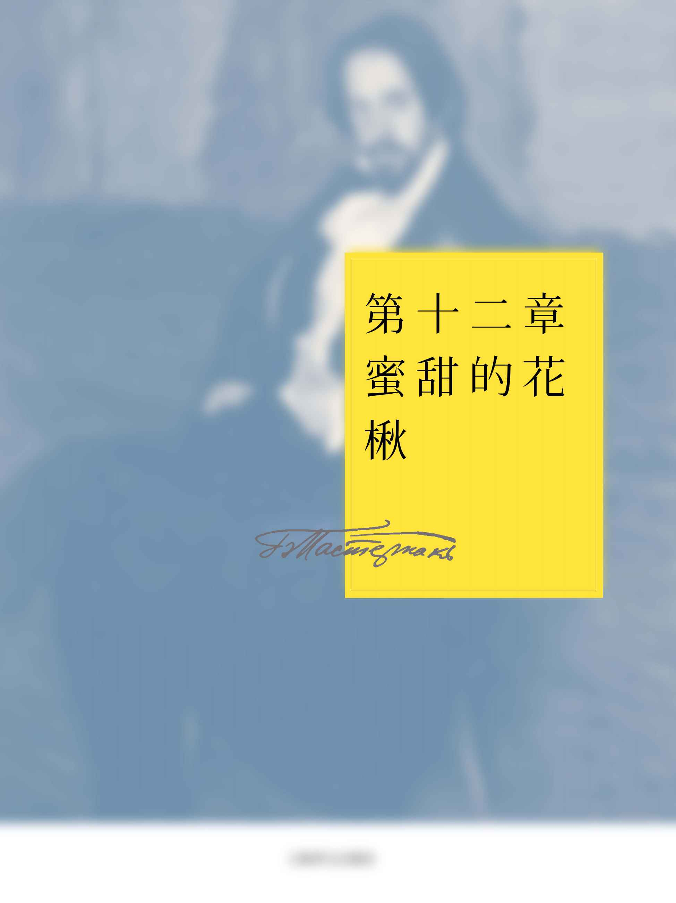

# 第十二章 蜜甜的花楸

<h3 id="c166">一</h3>

游击队家眷乘着大车，带着孩子和行装，追随部队已经走了很久。在车队的最后，是数不清的牲口群，主要是牛群，总数有几千头。

同游击队员们的妻子一起来到营房里的还有一个新人，士兵的妻子兹雷达丽哈，也叫库巴丽哈，专给牲口看病，算个兽医，暗地里还是个占卜女人。

她头上歪戴着一顶扁圆小帽，穿件苏格兰皇家步兵的豌豆色军大衣（是英国给最高统治者供应的军需品）。据她说，这些东西是她利用犯人的帽子和长衫改制而成的。又据说好像是红军把她从克日姆中央监狱解放了出来，也不知为什么她被高尔察克关在那里。

这时游击队已经驻扎在一个新地方了。原先估计这只是暂居之所，调查周围情况之后要找个长期稳定的过冬去处。后来情况发生变化，游击队只好留在这儿过冬。

这个新驻地，一点不像不久前放弃的狐湾。这里茫茫一片林海，是难以通行的原始林区。同大道和营地相对的那一面，森林一望无际。开初的日子，当部队开辟营地、安置住处时，日瓦戈空闲时间较多。他深入到林子各处去观察，体会到在这林海中极易迷路。通过第一次周游，有两个地方吸引了他的注意，印在脑海里难以忘却。

秋天的森林现已变得光秃秃，可以一眼望穿，好像通向林中的大门豁然敞开。林子出口处和营区出口处，长着一棵孤零零的漂亮的赤褐色的花楸树，在所有树木中，唯有它还保留着火红的叶子。它长在泥泞的低洼沼地上面的小山顶上，托起一片片平展开的深红色硬果，插向入冬前阴沉沉黑铅般的天穹。一身鲜艳羽毛的迎冬小鸟，像寒天的云霞；还有灰雀和山雀，都落到花楸树上，慢慢地挑拣着啄起一颗颗果子，仰头伸颈，使劲吞进去。

树雀之间，仿佛产生了生动的亲密关系。似乎花楸树把这全看在眼里，挣扎了好久才让步，出于怜悯雀儿，解衣把乳头递过去，就像母亲哺育婴儿。“唉，拿你们有啥法子。吃吧，吃吧。饿就吃吧。”说着露出了笑容。

另一处在林子里面，更是佳境。

这是个高冈，像尖顶丘陵，一面是陡崖。崖下本来容易想象与上面不同，或是小河，或是谷地，或是僻静的草地；谁知下面与上面完全一样，只是距崖顶极深，那里林子的树冠还在脚下。这很可能是地陷的结果。

仿佛这片云层下阴森雄浑的林子，绊了一跤，往下栽去，眼看要坠入地底下去，千钧一发之际幸运地留在了大地上，于是得以保全，如今还在下面呼啸。

不过林冈另有更妙之处。它的周围全是陡立的巨大花岗岩，很像史前时期石冢上刨光的石板。日瓦戈第一次到此，见后便断定，这块岩石地绝非出自天然，它带有人工雕琢的痕迹。这里可能是古代多神教的庙宇，不知是什么偶像崇拜者，曾在此处祭祀神祇。

在一个阴冷的早晨，此处执行了对阴谋案十一名主犯和两名酿私酒卫生员的死刑。

二十名对革命忠心耿耿的游击队员，以司令部特别卫队为核心，把犯人们押解到此。他们围成半圆形，举枪快步把犯人赶到石崖边上；除了跳崖，这里是再无出路。

审讯、长期禁闭、拷打，使他们没了人样，满脸胡须，面色发黑，有气无力的，像幽灵一样可怕。

从开始审查就下了他们的枪。这会儿谁也想不到再摸摸他们临刑前身上是否有武器，认为这样做太卑鄙，是嘲弄死到临头的人。

突然间，同夫多维钦科并排走的他的朋友，和他一样也是个思想上的老牌无政府主义者勒扎尼茨基，朝押送的人们开了三枪，目标对着西沃勃利艾。勒扎尼茨基是个神枪手，但由于紧张，手一抖没有击中。又是出于对过去同志的照顾和怜悯，押解的人们没有扑向勒扎尼茨基，也没有不等统一命令便提前放枪。勒扎尼茨基还剩有三发子弹，但愤怒间忘了这一点，加上懊悔失手未中，举起勃朗宁就往石头上摔去。一击之下响了第四枪，误伤了犯人帕奇科利的腿。

卫生员帕奇科利大叫一声，抱住腿摔倒在地。在他身旁的帕夫奴特金和扎哈尔·戈拉兹德赫，架起他来便向前拖，怕同伴们慌乱中把他踩了，因为此刻人们除了自己，什么都记不得了。帕奇科利跛跳着一条腿朝赶他们过去的石崖边走去，因为受伤的脚不敢着地，一面不停地嚎叫。他这非人的哀吼很有传染力。所有的人像得到信号一样，都不再能控制自己。于是乱成了一团。响起骂人声，有人哀告求情，有人诅咒。

少年犯捷廖沙掀掉一直戴在头上的镶黄边的中学制帽，跪在地上爬着跟那群死囚往可怕的石崖退去。他捣蒜一样向押送队叩头，不停地哭叫着央告，神志已不很清楚：

“我错了，弟兄们，饶了我吧，再也不敢了。别打死我呀。我这么小，死得太早。让我再活几年，再看一眼我的妈妈。原谅我吧，弟兄们，饶了我吧，我要吻你们的脚，给你们背水。哎呀，可惹了大祸。完了，妈妈，妈——妈——”

死囚中间还有个声音哭诉，看不清是谁：

“我的好同志啊！怎么能这样？你们别糊涂呀。咱们一起打了两场战争，流了血；为了一个事业坚持斗争。可怜可怜我们，放了我们吧！我们一辈子也忘不了你们的恩情，我们要将功赎罪，用事实证明。你们聋了吗？怎么不说话？你们身上不戴十字架吗？”

有人冲着西沃勃利艾喊道：

“好哇，你这个出卖耶稣的犹大。我们对你算什么叛变。你这狗东西，自己才是双料的叛徒。你对沙皇宣过誓，打死了自己的沙皇；对我们表过忠心，又把我们给出卖了。趁着现在还没出卖你那个利韦里，去和他亲嘴吧，早晚你会出卖他的。”

夫多维钦科至死不动声色。他高扬着头，白发迎风飘动着，像公社社员对公社社员那样，高声对勒扎尼茨基说道：

“别低三下四的，勒扎尼茨基！你抗议也打动不了他们。这些新爪牙、新刽子手不会理解你的。但你用不着垂头丧气。历史会澄清一切的。后代一定会把政委专权的暴君们和他们干的丑事，钉到耻辱柱上。我们是在世界革命的曙光中，作为思想的殉难者死去。精神革命万岁！全世界无政府主义万岁。”

二十支枪按照一个无声的、只有射手听得到的命令，同时打响，放倒了一半犯人，大多数毙了命。对其余的人，又放了一枪才击毙。叫捷廖沙·加卢津的孩子，抽搐的时间最久，但最后还是挺直身子一动不动了。

<h3 id="c167">二</h3>

把营地再往东移动，迁到另一处去过冬，这念头并没有马上打消。游击队不断派出侦察兵和巡逻兵，调查大道对面沿着维特托克和克日姆分水岭的一带地方。利韦里经常离开营地去原始林中，把医生一个人留下。

可是，再想往别处转移，已经为时过晚，无处可去。这是游击队连遭巨大失利的时期。白军在最终覆灭之前，决定一举消灭森林中的非正规部队，集中了所有战线上的力量，共同包围游击队。游击队受到四面八方的进逼。倘若包围圈的半径极小，这形势不啻是场灾难。广阔的回旋余地救了他们。入冬前敌人没有能够收紧侧翼，因为那里是人迹难到的茫茫的原始森林，结果便来不及把农民部队围紧。

尽管如此，想往任何地方移动都已不可能。当然，如果真有转移的计划，保证取得一定的军事优势，也不是不能通过战斗越出包围圈，占据新的阵地。

但却没有那样一个深思熟虑的计划。人们都已筋疲力尽。下级指挥官自己就丧失了信心，对下属战士没什么影响力。高级指挥官天天晚上开军事会议，提出各种对抗方案。

应该停止寻找另外的过冬之地，就在占据的密林深处巩固下来，准备过冬。冬天这里大雪封路，敌人没有很好的滑雪装备难以入林。应该挖壕储存大量的粮食。

游击队的管家皮修林报告说，面粉和土豆严重不足，牲口数量倒足够。皮修林估计到冬天主要食品是肉和乳类。

冬衣也缺乏。一部分队员半裸着身子。于是把营区里的狗尽数宰杀。精通制皮子的人们，用狗皮给游击队员缝制翻毛皮袄。

日瓦戈医生要求给运输工具，遭到了拒绝。马车如今有了更为重要的用途。最后一次转移中，重病号用担架抬着走了四十里。

日瓦戈的药品，只剩了奎宁、碘和硫酸钠。用于手术和包扎的碘，是晶体制剂，必须在酒精中溶解开。人们后悔取缔了土酒生产，就去找当时得以解脱的从犯，委托他们修复破坏了的蒸馏设备，或者再造一套。一度取缔的土酒生产，为了医疗目的重又得到恢复。营区里人们只是互递眼色，摇头而已。酗酒现象重又出现，更加助长军营里日益严重的瓦解趋势。

新酿造的酒精浓度几乎达到一百度。这么烈性的液体，很容易化开晶体制剂。后来在入冬时，日瓦戈正是用浸泡过金鸡纳树皮的这种土酒，治疗因天冷又复发的斑疹伤寒。

<h3 id="c168">三</h3>

这些日子里，日瓦戈医生常常看到帕雷赫和他的家眷。整个夏天，他的妻子儿女在露天的尘土飞扬的大道上奔跑度过。可怕的经历，吓破了他们的胆，唯恐还会发生可怕的事。颠沛流离给他们烙下了不可磨灭的印迹。帕雷赫的妻子和三个孩子（一男二女），都是一头被阳光晒褪了色的浅色头发，眉毛变得整齐而发白，风吹日晒变黑的面庞。孩子还太小，难说流露出艰险经历的迹象。可母亲脸上由于惊吓所致，毫无生气，只剩下端正的轮廓，紧闭成一条线的双唇，以及随时准备自卫的紧张而呆滞的痛苦。

帕雷赫爱他们一家人；特别对孩子，简直爱得发狂。他用磨快的斧头尖，在木块上削出兔子、熊瞎、公鸡等玩具，手工之麻利，令日瓦戈医生惊讶不止。

他们来后，帕雷赫有了笑容，精神大振，开始慢慢复原。可马上又有消息说，因为家眷在此给营区情绪带来了有害的影响，必须把游击队同家小分开，使营区摆脱多余的非军人的累赘；派足够的人护送逃难马车队到远处土屋里屯集。这类传闻极多，而实际上的准备并不多。医生不相信这种措施能行得通。但帕雷赫却又阴沉起脸来，从前梦见的逃跑的人又来找他。

<h3 id="c169">四</h3>

刚入冬时，有几个原因使营区很长时间陷入不安；情况捉摸不定，严重而混乱；有的事互不协调，令人莫解。

白军完成了预定的对起义军的包围。指挥完成了这一行动的是维齐恩、克瓦德里和巴萨雷戈将军，他们都以坚定果决著称。营区里起义者的家眷们，一听到这些将军的名字便胆战心惊。没有离开家园而留在敌人包围圈之外自己村庄里的和平居民，只要听到他们的名字，也莫不如此。

上面说过，人们看不出敌人有什么办法能缩小包围圈。这一点尽可放心。可是，对于包围又不能不加考虑。对局势束手无策，便是在精神上壮大敌人的力量。应该设法从敌人的圈套（即使是不构成危险的圈套）里挣脱出来，目的在于显示军事力量。

为了这一目的，游击队调集了大量兵力对付包围圈的西线。经过许多天激烈战斗，打垮了敌人，突破这里的防线进入敌军后方。

突围打开的口子，形成了进入原始森林到达起义者驻地的自由过道。新的逃难人群，蜂拥而来同他们会合。这股和平的村民，已经不限于游击队员的近亲了。由于害怕白军的讨伐行动，周围所有的农民都惊动起来，抛弃自己老家，自然而然地投奔林中的农民军，把它看作自己的保护者。

可是营区里人们却希望摆脱吃闲饭的人。游击队无力顾及外人和新来的人。难民来时，有人就跑出去迎接，让来人停车，然后转弯到奇利姆卡河边垦荒地上的水磨方向去。这地方是由水磨附近一些庄园组成的，名叫院群。计划在院群里开辟一个难民过冬的处所，设一个仓库，储存专门拨给他们的粮食。

就在作出这些决定的时候，局势按着自己的轨道发展，弄得营区领导措手不及。

击退敌军的胜利局面，竟又复杂化了。白军把击败它的游击部队放进包围圈之后，又扎起口袋，恢复了原来的战线。深入白军腹地、脱离主力的小分队，被切断了重返森林回到自己人身边的道路。

逃难的家属也出了问题。在人迹罕见的密林中，是极易走岔道的。被派出迎接的人，没找到难民的踪迹。女人们则顺其自然地向原始林深处运动，沿途表现出惊人的机敏，砍倒了两边树木，用它们架桥铺路，开辟出了前进的道路。

所有这一切，同森林司令部的意图截然相反，完全打乱了利韦里的计划和一些决定。

<h3 id="c170">五</h3>

他正是为这件事在大发雷霆。此刻他同斯维里德一起站在离公路不远的地方。公路到这里有一段要穿过原始林。路中间站着他属下的一些指挥官，他们正争论要不要剪断公路旁电线杆上的电线。最后的决定权属于利韦里，可他却同流浪猎人谈个没完。利韦里朝他们挥挥手，意思是他马上到他们那边去，让他们等着别走。

斯维里德很长时间一直不能忍受谴责和枪毙夫多维钦科这件事。此人毫无罪过，就因为他的威信堪与利韦里媲美，给游击营带来了分裂。斯维里德打算离开游击队，重新过他那自由自在的日子。可这哪办得到呢？既然入了伙，卖了身，如今要离开森林兄弟，会落个被枪毙的下场。

天气坏得无以复加。一阵阵狂风，紧贴着地面撕碎云絮，云块黑得像飞舞的煤烟子。突然乌云抛下雪花，大雪犹如某种白色怪物，抽搐着匆匆奔走。

前一分钟里，远方似乎扯起一块白色的帷幔，地面盖了一层白雾。一分钟之后，雾气全消，暴露出炭黑的大地，远处倾盆的斜雨把天空也染成黑色。土地再也吸收不了更多的雨水了。过一会儿放亮时，乌云散开来，像有几扇窗子从上面打开，让天空透透气，闪烁着白玻璃般的冷光。雨水不被土地容纳，聚在坑洼和湖泊里，也像敞开的小窗口，充满了同样的光芒。

恶劣天气的烟雾，沿着针叶林的树顶游动，却穿不进林中，正如水透不过胶布。电线上坠着雨滴，好似串珠；几根线密集在一起，没有被风刮断。

斯维里德是被派到密林深处寻找家属的人员之一，他想把自己所见讲给首长听。他想讲讲由于种种不同的而又显然无法执行的命令相互冲突，造成了一片混乱。他也想讲讲那些失去信念的极端懦弱的女人们，干出了怎样伤天害理的事。有的年轻母亲，背着包袱，抱着吃奶的孩子徒步跋涉，发现没奶了，跌跌撞撞，急得发疯，就把孩子扔到路边，把包袱里的面粉倒掉，转身往回走。情愿快死了事，免得慢慢饿死。情愿落到敌人手里，免得喂了林子里的野兽。

另一些极其坚强的女人，却做出了坚毅勇敢的表率，连男人也望尘莫及。斯维里德还有不少其他的情况要说。他想警告首长，营区里存在发生新暴动的危险，远比镇压下去的那一次威胁更大。可是他一时找不出合适的话来，因为利韦里很不耐烦，暴躁地催促他，最后弄得他一句话也说不出了。而利韦里总是打断斯维里德，倒不光是因为路上有人等他，一个劲儿朝他点头呼喊，还因为这两个星期里人们接连不断找他，都讲了类似的意见。所以这一切利韦里早已知道。

“你别催我，首长同志。我本来就笨嘴拙舌的。词儿到了牙缝里也能塞住，在嗓子眼能噎死。我要对你说啥呢？你到难民车队去一趟，给那些婆娘们讲讲西伯利亚的规矩。你看看她们闹成什么了。我问你，咱们是‘一切为了打败高尔察克’，还是要搞妇女战争？”

“说简单点，斯维里德。你没见在喊我吗。别兜圈子。”

“现在那个女妖精兹雷达丽哈，天晓得她是个什么人，说收下我当牲口医……”

“是兽医，斯维里德。”

“我就是说的这个，要给牲口看流行病的。可是现在她根本不管你的什么牲口了，变成了个女修士，做起祈祷来，把大路上逃难的家眷全勾引过来了。她还对她们说什么，自作自受吧，谁让你们卷起铺盖就跟着红旗跑。下次记着别跑啦。”

“我不明白你是说的哪些难民。是咱们游击队的，还是别的什么人？”

“自然是别人。是新来的，别处的难民。”

“不是有命令让她们到院群村奇利姆卡水磨那里去吗？她们怎么到了这里？”

“哎呀，还说院群村呢！你那个院群村，全烧光了，只剩一堆火场。水磨和整个奇利姆卡都变成了木炭了。她们到了奇利姆卡，看到烧得精光，一半人就发了疯，哇哇哭叫着往回跑，到白军那边去了。另外的人转过头来，赶着马车队上这儿来了。”

“通过了密林和沼泽？”

“斧头是干什么用的呀？咱们派了些男人去保护她们，也帮她们一起开路。听说她们开出了三十俄里的路。还搭上了桥。你看看，这哪是女人呀！她们干的这事，你想三天也不一定想得出来。”

“好家伙！你还高兴呢？三十里路开通了。这不是正合白军维齐恩和克瓦德里的意吗？打通了进原始森林的大道，连大炮都运得进来。”

“要埋伏，要埋伏，派人埋伏就没事了。”

“上帝保佑，不要你说我也想得到。”

<h3 id="c171">六</h3>

白天变短了，五点钟就黑下来。近黄昏时，日瓦戈从利韦里同斯维里德拌嘴的那段路上横穿而过，朝营区走去。快到空地和高冈附近，就是被视为营区界标的花楸树所在的高坡下，他听见一个兴奋而挑逗的歌喉，这是库巴丽哈，他戏称这个土医生是自己的竞争对手。这女人用刺耳的尖声，唱出粗俗欢快的歌子，大概是什么民谣。人们在听她唱，不时爆发赞赏的笑声，有男人也有女人。接着一切都沉寂了。大家多半是散了。

这时库巴丽哈换了一种唱法，低声细气地，以为周围只她一个人在。为了不陷到沼地里去，日瓦戈摸着黑在小径上行走，绕过花楸树前一块泥泞的空场；走着走着，突然呆立不动了。库巴丽哈唱起了一支古老的俄罗斯歌曲。日瓦戈竟不知道这首歌。也许这是她即兴胡编的？

俄罗斯民歌就像拦河坝里的水。你感觉它是停滞不动了。其实在深处它并没有停住，不断地溢出闸门；表面的平静是假象。

这民歌采用各种手法，通过回环、对偶等等，使歌词内容缓慢地发展。到某一极限时，内容猛然揭开，让我们大吃一惊。善于克制和把握自己的哀愁的力量，正这样表现出来。这是一种想用言辞使时间停滞的近乎疯狂的尝试。

库巴丽哈一半是唱，一半是说：

 

一只小兔在大地上奔跑，

奔跑在大地间，奔跑在雪原上。

它跑近一棵花楸，

向大树哭诉悲伤。

我这兔心何尝是胆怯的心，

胆怯的心，慌里慌张。

我怕的是野兽的出没，

野兽出没，饿狼的饥肠。

花楸啊花楸，可怜我吧，

你这美丽的一方。

别把你的美丽交给凶险的敌人，

凶险的敌人，老鸦的疯狂。

你把鲜红的果子撒给风吧，

撒给劲风，撒给大地，撒给雪场，

抛向我的家园，

扔进那最靠边的一间房，

扔进那最靠边的一扇窗。

我心上的人儿啊，

就在那房里躲藏。

请俯耳告诉我的心肝，

我这炽烈燃烧的希望。

我愁苦，是个囚中的士兵，

异乡有无限的忧伤。

我要冲出痛苦的囚禁，

回到我美丽的花楸树旁。

<h3 id="c172">七</h3>

士兵妻子库巴丽哈，给帕雷赫老婆阿加菲娅·法捷夫娜的病牛驱邪治病。人们把牛从畜群里赶出来，牵到树丛中，把牛角拴在树上。女主人坐到牛前腿旁边的树墩上，那个女巫医坐在后腿旁的挤奶小椅上。

其余好多牲口，挤在一块不大的林中空地上。四周是黑压压的云杉树林，云杉高耸如山，下宽上窄，仿佛盘坐在舒展开来的粗枝上。

西伯利亚当时养了一种出色的瑞士牛。所有的牛几乎全是同一毛色，黑底白斑。由于饥饿、受苦，长期迁徙和过度拥挤，它们已筋疲力尽，并不比主人好受多少。牲口互相挤来蹭去，都快发昏了。母牛忘了自己是雌是雄，像公牛似的吼叫，吃力地爬到别的牛身上，拖着松弛又沉重的乳房。被压在底下的小牝牛，翘起尾巴使劲挣脱，逃进树林，把灌木和树枝都踩断了。看牛的老人和孩子，喊叫着紧追上去。

林中空地上面，黑白交织的雪云，仿佛被困于云杉树冠在寒空中围成的圈子里，也同样狂躁纷乱地相互拥挤着，纵跳着，一片压向另一片。

在远处聚堆的好奇的人们，妨碍库巴丽哈干事。她凶狠狠地从头到脚扫视众人。但承认他们碍事，未免有损自尊心。一种演员的自重，使她没有出声。于是她装作没发现这群闲人。日瓦戈医生躲在人群背后观察着。

这会儿他才第一次看清楚她。她头上是从来不换的英国船形帽，身上是干涉军的豌豆色的大衣，翻领不经心地翘着。其实，内在的热情使这个并不年轻的女人闪动着年轻的黑眼睛和黑眉毛；脸上那股傲气分明说：她对穿什么衣服或不穿什么衣服，根本不放在心上。

但帕雷赫妻子的气色，令日瓦戈吃了一惊。他差点没认出她来。只有几天工夫，她就老得可怕了。鼓出的眼睛，好像立刻要掉出深凹的眼眶。细瘦的脖颈上，看得见青筋搏动。内心的恐惧，竟把她变成这个样子。

“挤不下奶来，亲爱的。”阿加菲娅说道。“我想是不是停奶啦。可不对呀，早该有奶了，就是挤不出。”

“哪里是停奶。你没见奶头上有个小疮吗？我给你点草，抹上猪油给牛擦擦。自然，我还得念念咒语。”

“再有件倒霉的事，就是丈夫。”

“我念点咒，不让他再游逛啦。这个办得到。叫他回来守着你，拽都拽不开，说说第三件倒霉事吧。”

“他不是游逛。要那样就好了。糟糕的是正好相反，像贴到我和孩子们身上一样，心血为我们熬干了。我知道他想些什么。他琢磨营里要把我们遣散，我们得各奔东西。我和孩子要落到巴萨雷戈部下手里，他同我们不在一起，没人保护我们。他们会折磨死我们，拿这个取乐。我知道他的心思。真担心他会对自己干出什么事来。”

“咱们想想办法，解除他的痛苦。说第三件倒霉事吧。”

“没有第三个了。就这些，牛和丈夫。”

“你看呀，你这当母亲的，倒霉事并不多嘛。都是上帝的恩典呀！这样的母亲，打着灯笼难找呢。大不了才两桩伤心事，一件还是丈夫太心疼你。治牛你给什么报酬？现在咱们就来看病。”

“你要啥呀？”

“上好的面包加上丈夫。”

周围哈哈大笑。

“你是闹着玩怎么的？”

“好，要嫌贵，把面包减了，给个丈夫也足够了。”

四周笑得更热闹了。

“什么名字呀？我不是问丈夫，是问牛。”

“大美牛。”

“你数一数吧，这牲口群里能有一半叫大美牛的。好吧，就是它，给它去去病。”

她开始给乳牛驱邪。起初，咒语真是对牛而发，后来起了兴，给阿加菲娅讲了一大通巫术和它的用法。日瓦戈如同着了迷一样听这呓语般的胡说八道，很像从俄国欧洲部分往西伯利亚迁徙途中，听那个叫巴克斯的马车夫有声有色的唠叨。

库巴丽哈念道：

“玛尔戈西娅仙姑，来我们这儿做客吧。礼拜二礼拜三，去去邪去去灾。治奶头，下奶来。你好好站着，大美牛！别把小凳给踢翻。站得稳，下奶多。丑八怪，你快来，摘下疮，扔下田。巫医话，重如山。

“什么都得会呀，阿加菲娅！会拒绝，会下令，会许诺，会画符。你吧，看着周围心里想这是森林。其实这是魔鬼同英国兵碰到一起，正砍杀呢，就像你们这些人和巴萨雷戈的人作战一样。

“再比方说，你往我指的地方看一看。不对，不是那儿，亲爱的。你用眼睛看，别用后脑勺，看我手指的地方，就是那儿，就是那儿。你以为那是什么？你想是风吹柳树，把柳枝缠到一起了吧？要么是想鸟儿准备搭窝吧？那样就好了。可这正好是魔鬼的把戏。这是美人鱼给自己女儿编桂冠。它听到有人的声音，就扔下跑了。被人们给吓跑了。夜里它会来编完的，你看着吧。

“再说说你们这红旗吧。你怎么想呢？想这是面旗帜？其实可不是旗帜，这是瘟姑娘红色的摇巾。为啥我叫摇巾呢？用头巾向年轻娃娃招呼，对他们使眼色，引诱他们去杀人，去死，去散布瘟疫。可你们就信了，说是红旗，说要全世界无产者、全世界的穷人都来我这儿。

“现在什么都得明白呀，阿加菲娅。一切，一切，全得知道。什么鸟呀，什么石头呀，什么草呀。现在比方说，这个鸟是椋鸟，这个兽是胡獾。

“再比方说你看上了谁，只管说出来。不论是谁，我都能把他给你迷住，就是你们的首长利韦里，就是高尔察克，就是伊万王子，都能行。你以为我吹牛，瞎说？我可不是瞎说。你听我说。等到冬天，田野里出现暴风雪，旋风卷起雪柱，我把刀子插到旋转的雪柱里，一直插到刀柄。等从雪里抽出来，刀子全沾满了血。你看怎么样？啊？你当我是吹牛？那旋风里怎么会有血？这是风，是空气，是雪花嘛。可偏偏不对，这不是风，不是暴风雪，是打了离婚的女妖把自己的小妖崽丢了，在田野里哭喊着找，总是找不见。我的刀子刺到她身上，这才有血。我拿这把刀子，随便把什么人的脚印刮下来，砍下来，当块绸布似的缝到你衣襟上，那不管是谁，高尔察克也好，斯特列尔尼科夫也好，一位新沙皇也好，都会跟着你走。你到哪儿，他就到哪儿。你以为我只会瞎说，像什么‘全世界无产者和穷人全来我这里。’”

“还举些例子，比方现在天上往下掉的是石块，像下雨一样。人一出门，石头就砸脑袋。又如有人正赶着马车在天空跑，马蹄踢到屋顶。再有像古代的魔法师发现，妻子身子里有的带着种子或是蜜，或是貂毛。披甲兵露出自己的肩膀，像打开了匣子盖，从肩胛骨底下用长剑挖出一斗麦子，或是一堆蛋清，或是一些蜂蜜。”

世上有时会出现非常深沉强烈的感情，其中又总掺杂一些怜悯。我们所崇拜的对象，越是被我们爱得深，越是使我们觉得是种牺牲品。在某些人身上，同情女人已经达到不可思议的程度。他们受同情心的驱使，把女人摆到了不能实现的、世上绝无而只存在于想象之中的地位上，于是因爱她而妒忌，妒忌周围的空气，妒忌自然界的规律，妒忌在她之前的千百年的过去。

日瓦戈有足够的文化教养，听得出巫医最后的话可能是诺夫戈罗德或伊帕季耶夫的编年史里开场的内容，因为后来多有歪曲，就变成了伪作。许多世纪以来，巫医和说书人口头世代相传，便以讹传讹了。更早的时候，抄写人就有许多错讹。

为什么传说的魔力竟引他如此动心？对无稽之谈，对毫无意义的幻念，他何以如此认真，似乎这全是现实的情况？

仿佛拉拉裸露出左肩。像用钥匙打开藏在大柜中的小铁箱的密门，人们用长剑插进划开了肩胛骨。于是在她内心深处，发现了她心灵珍藏的秘密。那是足迹到过的别人的城市，别人的街道，别人的房屋，别人的天地。它们如一卷卷彩带，流了出来，舒展开来，连绵不断。

天哪！他是多么爱她呀！她又是多么姣好！恰是他一向所想象和期望的那样，恰是他需要的那样。可是，指的什么呢？好在哪里呢？难道能指得出来，分析得出来吗？不，不能！只记得她周身那无与伦比的简洁而流畅的线条，是造物主把她从头到脚地如此一挥而就；就是这副绝妙的体态，奉献给了他的心灵，犹如用床单紧裹着的浴后的婴儿。

然而如今他竟流落此地，这么一种境况！只有森林、西伯利亚、游击队。游击队被围困，他将与之共命运。这岂不见鬼，这岂不荒唐。日瓦戈眼前和脑海里，又是一阵眩晕。周围一切都飘浮起来。这时落起了雨点，原来预料要下雪的。一个巨大的模糊的头影，这是不同寻常的、他所钟爱的人的头影，从林中空地一端投向另一端，就像城里房屋间挂起的巨幅标语。这个影子在哭泣，渐紧的雨珠吻着她，淋洒着她。

“回去吧。”听到女巫医对阿加菲娅说，“我给你家的牛消了灾，它会好的。向圣母祈祷吧。”

<h3 id="c173">八</h3>

密林的西部边界上发生了战斗。可林区极大，以至战斗就好像发生在一个国家遥远的边陲上。困在密林中的兵营又有那么多人，不论开走多少上战场，总还是剩下的居多。所以林子里从未空无人迹。

远方战斗的轰响，几乎传不到营区深处。但林中突然响起几声枪击，紧密相连；一下便又转为杂沓的连射。恰巧在枪声起处的人们，立即四散跑开。营区预备队的人，奔向自己的马车，引起一片慌乱。所有的人都开始准备战斗。

不一会儿又恢复了平静。原来警报不确。可大家又开始往枪响的地方聚拢。人越来越多，不少是后来过来的。

人们围着一个躺在地上的血肉模糊的人。这人右臂和左腿已被剁去，只残存了半个身子。真难以想象这个只剩一只胳膊一条腿的不幸的人，怎么爬回了营区。砍下的胳膊大腿血淋淋地绑在他背上，还系着一块木牌，写了长长一段话。其中除了谩骂之外，还说这是对某一支红军部队所犯野蛮罪行的报复。森林游击队同这支队伍并无关系。此外上边还写着，如果游击队不在规定的期限里向维齐恩将军的代表投降缴械，便要对所有的人如法炮制。

痛苦的残者流着血，不时昏厥过去，吐字不清地断断续续用微弱的声音，讲了在维齐恩将军的后方军事侦察和侦缉部队里所受的折磨和拷问。给他判的是绞刑，作为恩典改为砍掉一手一足，为的是这样子送到游击营来吓唬人。他们抬他走到离营区警戒线还有一段路时，就把他扔下，命令他自己爬行，不时在他身后朝天空放枪催逼他前进。

他吃力地翕动嘴唇。为了听清楚他那含糊的低语，人们弯腰俯到了他身上。他说：

“你们可要小心呀，弟兄们。他突破到你们这儿来了。”

“我们设了伏兵。那里会有大仗，我们挡得住。”

“突破，突破！他是想搞突然袭击。我知道。哎呀，我受不了啦，弟兄们。你们看，我血要流光了，咳的也是血。马上就不行了。”

“你先躺躺，歇一会，不要说话了。你们别让他讲话了。看不出吗？这对他不好。”

“我身上没一点好地方啦，这个吸血鬼，狗杂种。他说，你拿你自己的血洗澡吧，你说你是什么人。可我说啥呀，弟兄们。我自己是个真正的逃兵。是呀，我从他那儿投奔了你们。”

“你总是他怎么样怎么样。到底是谁在那边这么折磨你？”

“哎呀，弟兄们，我身子里面好难受。让我喘口气，我就说。是头子别克希恩，上校施特雷泽，维齐恩的人。你们在林子里什么都不知道。城里一片惨叫。简直拿活人炼铁，割人皮做皮带。抓了人往黑洞洞的地方一塞，不知是到了哪儿。用手四周一探，是罐子火车。车笼子里挤了四十多人，只穿着内裤。你要敢推这笼子，马上伸进只手来，碰上谁就抓走谁。像宰小鸡一样，我的上帝哟。有的吊死，有的崩了，有的拷打。打得遍体是伤，往伤口撒盐，浇开水。你要拉屎，逼着你吃下去。对孩子，对女人，哎呀，我的妈！”

可怜的人已是奄奄一息。他没来得及讲完，大吼一声就断了气。人们一下子全都明白了是怎么回事，纷纷摘下帽子，画起十字来。

晚上，另一个更可怕的消息传遍了整个营房。

当时围在这血人周围的人群中也有帕雷赫，他看见了这人，听了他讲的事，读了木牌上充满威胁的话。

他经常为自己死后亲人的命运感到担忧，这一下子膨胀到了极点。在他的想象中，亲人们已被抓去慢慢地受折磨，好像看见了他们痛不欲生的面孔，听见了他们的呻吟和呼救。为了不让他们以后痛苦，也为了减轻自己的痛苦，他抑郁成狂，亲手杀死了他们。就是用那把给女儿和爱子削木头玩具的锋利如刀片的斧头，砍死了妻子和三个孩子。

奇怪的是，他干完这事后没有马上自杀。他怎么想的呢？他还有什么前途可言呢？有什么指望和打算呢？这显而易见已是一个疯子，是无可救药的废人。

当利韦里、日瓦戈医生和部队委员会成员开会讨论怎么处置他的时候，他正在营区里自由地游荡，低垂着头，混浊发黄的眼睛斜望周围却什么也看不清。他脸上一直挂着迷惘的傻笑，表现出非人力所能消除的痛苦。

没有谁可怜他，人们纷纷避开他。有人要求对他举行群众审判，但没得到支持。

在这个世上，他再也无事可做。拂晓时他从营区消失了，像一只染上狂犬病的畜生。

<h3 id="c174">九</h3>

早已入了冬，天寒地冻。在寒冷的雾气中，不时出现零零散散、毫无联系的一些声响和物状，停停动动，最后复又消失。太阳也不是人间习惯了的那个太阳，好像换了另一个，犹如一个赤红的大球悬在林子上空。它呆板而缓慢地射出缕缕棕黄色的浓重如蜜的光芒，就好似在梦中或在童话里。阳光在洒下的中途，凝滞在空气里，粘附到树木上。

毡靴轻轻踩在雪地上，每一步都发出愤怒的吱嘎吱嘎的响声。人们套在毡靴里的看不见的双脚在四面八方的路径上移动。向上望，是戴了长耳风帽、穿着半截皮袄的一个个人形，似乎不连着靴子独自在空中游动，犹如旋转着的一个个天体。

相识的人们，不时停下步来交谈。他们把头凑近，面孔都像从澡堂出来红彤彤的，胡髭却冻硬得像刷子。一团团黏乎乎的热气，从他们嘴里冒出，连成一大片，同他们短促简略的话，太不成比例。

在一条小径上，利韦里同医生相遇了。

“啊，是您呀？有日子没见了。晚上请到我的土屋来。住我那儿吧。像从前一样，好好聊聊。有些消息告诉您。”

“送信的回来了吗？瓦雷基诺有什么消息？”

“我家和您家的情况，汇报时一字没提到。我从这恰恰得出了令人安心的结论。这就是说他们及时躲开了。不然一定会提到他们。不过，这些见面再谈好啦。我等你。”

到土屋后，日瓦戈医生又重复一遍自己的问题：

“您快告诉我，关于咱们两家的情况，您听到了些什么？”

“您又只看鼻子底下一点事。咱们两家的人，看来还活着，没有危险。问题不在他们那儿。有非常重要的新闻。想吃点肉吗？是冷牛犊肉。”

“不，谢谢。别扯闲话。快说正事。”

“遗憾。我可要吃点。营区里发现了败血病。人们都忘了面包和青菜是什么滋味。秋天的时候，当时有难民在，本该有组织地去采集胡桃和浆果。我告诉您，咱们现在形势极好。我以前预见的情况，如今实现了。坚冰已经打破。高尔察克全线溃退。这是全面的、不可避免的溃败。您看！我对您说过什么呀？可您却垂头丧气了。”

“我什么时候垂头丧气了？”

“您一直如此。特别是维齐恩夹攻我们的时候。”

日瓦戈医生想起了不久前秋天枪毙了叛乱者，帕雷赫杀死了妻儿，还有永无休止的毒打和杀戮。白军和红军互相比赛残忍，轮番地在暴虐程度上压过对手，仿佛把残忍翻了几番。血见得多了人就恶心，觉得自身的血往喉咙里钻，往头上涌，遮住了眼睛。这绝不是什么垂头丧气，这完全是另一回事。可怎么对利韦里解释清楚呢？

土屋里有一股呛人的煤气味。这气味粘到上腭，刺激鼻孔和嗓子。屋里亮着劈成细薄片的松明，插在三脚铁架上。一根烧完，残头就掉在地上盛水的脸盆里，利韦里再插上一根新的点上。

“您看见我点什么吗？油烧光了。劈柴已经干透，松明着得极快。是呀，营地里发现了败血病，您真一点也不想吃牛肉？有败血病。您怎么管的呀，医生？不见您要求司令部开会，讲讲情况，给领导上堂课说说什么是败血病，用什么办法同疾病作斗争。”

“看在上帝面上，您别再折磨人。关于咱们俩的亲人，您有什么确切的消息吗？”

“我已经对您说过了，关于他们一点准确的情报也没有。不过关于最近的整个军事形势，我知道的还没给您讲完。国内战争结束了。高尔察克被打得头破血流。红军正沿着铁路干线，向东追击他们，目的是把他们扔到海里去。另一路红军兼程来同我们会师，以便合力消灭高尔察克的数量众多而又分散各地的后方力量。俄罗斯南方已经肃清了敌人。您怎么不高兴呀？这还嫌少吗？”

“不对。我很高兴。可我们的家眷在哪儿呀？”

“反正不在瓦雷基诺，这就是最大的幸运。虽然夏天卡缅诺德沃尔斯基的传说，正如我的估计，没得到证实。您记得吧，当时瞎传说有一群来历不明的人攻占了瓦雷基诺，可村镇现在全空了，看来是出了什么事。真是万幸，两家人事先都撤出了那里。咱们可以相信，他们得救了。据我的侦察兵说，少数留在那里的人也是这么估计的。”

“尤里亚京呢？那儿怎样了？在谁手里？”

“也是莫名其妙，一定也搞错了。”

“怎么呢？”

“说白军还在那里。这无疑是胡说，显然不可能。现在我给您论证一下就清楚了。”

利韦里又新插了一根松明，拿出揉皱的双折地图，把要看的部分叠在外面，不需要的折在里面，拿着铅笔指着地图讲起来：

“您看，在所有这些地区白军全被击退了。这儿，这儿，还有这儿，整整一圈。您注意看吗？”

“是的。”

“他们不可能还留在尤里亚京一带。不然的话，交通一切断他们就一定要落入包围圈。这一点，他们的将军们无论如何平庸也不会不明白。您穿上皮袄了？要上哪去？”

“对不起，我出去一会儿，马上就回来。这儿马合烟和松明味太呛人。我不大舒服，到外面透透气去。”

医生从土屋里上来，到了外面，拿手套掸去横在门口供人们坐的粗木上的积雪，弯腰坐下，双手托着脑袋，沉思了起来。冬季的密林，森林中的营地，在游击队度过的十八个月，全不存在了。他忘记了这些。他的脑海里只有自己的亲人。他猜想他们的境况，可一个比一个更可怕。

仿佛在暴风雪中的田野上，冬尼娅抱着萨沙在往前走。她用被子裹着儿子，自己的双脚陷在雪中；她使劲拔脚，大雪朝她压来，风把她吹倒。她摔倒又爬起，双腿软弱无力，竟站不住。唉，可他总是忘记，总是忘记她已有两个孩子，小的还在喂奶。她的两只手全占着，和奇利姆卡那些逃难的女人一样，那些难民由于痛苦和过分紧张，几乎失去了理智。

她两只手全占着，周围却没有一个人能帮忙。萨沙的爸爸不知去向。他离得很远，总是很远，一辈子都各自一方，这可是爸爸吗？真正的爸爸有这样的吗？她自己的爸爸在哪儿？亚历山大·亚历山大罗维奇在哪里？纽莎在哪里？其余的人都在哪里？天哪，最好不给自己提这些问题，最好不去想，最好不去细琢磨。

日瓦戈医生从圆木上站起身，打算再下到土屋去。突然间他念头一转，不想回到利韦里那里去了。

滑雪板、装着面包干的口袋、逃跑所需的一切，他早就准备齐全。他把这些东西，埋在营区警戒线外一棵高大冷杉树下面的雪堆里，为了不误事，还在树上作了一个特殊的记号。这时，他便沿着雪堆中间踏出的人行小路，朝那里走去。圆月照着地面。医生知道夜里在哪儿设岗，顺利地绕过了岗哨。但在上冻的花楸树所在的空地旁边，一个哨兵老远就对他喝叫一声，用力一蹬滑雪板，直着身子朝他滑过来。

“站住！要开枪了！是什么人？快说清楚。”

“你怎么啦，弟兄，犯傻了？自己人。还没认出来？你们的日瓦戈医生。”

“对不起。你别生气，日瓦戈同志。没认出来。不过就是日瓦戈，再往前也不让走了。一切都得按规矩办。”

“那好吧。口令：红色西伯利亚；回答：打倒干涉军。”

“这就是另一回事了。要去哪，随你的便吧。大黑夜里，你去找哪个魔鬼呀？有病人？”

“睡不着觉，口渴得要命。想走一走，吃口雪，可看到花楸树上全是冻果子，打算过去嚼几个。”

“啊，阔佬的毛病，冬天吃野果。三年了，我们不停地敲打，也没把你敲打好。还是一点觉悟也没有。去嚼你的花楸果吧，疯子。我才不心疼呢。”

哨兵用力起跑，站在吱呀响的长雪板上离开了这里，在整片雪地上越走越快，拐进远方疏发般的冬日光秃秃的树丛后面。日瓦戈医生通过小径，来到上面提过的那棵花楸树下。

树上有一半盖着雪，一半是冻僵的果叶。两个坠雪的秃枝向前探着迎接他。他想起拉拉两只雪白的长臂，圆润热情的长臂，不由得抓住树枝，把大树向自己怀里拉过来。花楸树也仿佛有意识地回报，把他从头到脚都洒上了白雪，他口中喃喃有声，自己也不知道说些什么，自己也不记得自己：

“我会见到你的，我的美人，我的花楸夫人，我的亲人。”

夜很明亮，天上悬着圆月。他走到密林深处那棵难忘的冷杉前，挖出自己的东西，离开了营区。

