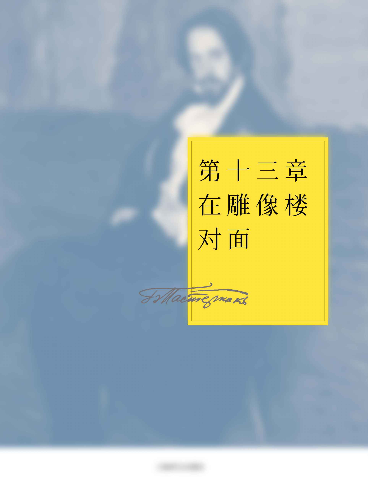

# 第十三章 在雕像楼对面

<h3 id="c175">一</h3>

商人大街沿着起伏的小山坡，朝小斯帕斯街和新斯瓦洛奇巷方向延伸而下。城里地势高处的楼房和教堂，俯瞰着这条大街。

街角有幢带浮雕像的深灰楼房。在它那倾斜的巨大四角石基上，黑乎乎的满是刚贴上的各种政府报纸、政府法令和决定。行人在路上一停就好半天，三五成群地默默无声地看着告示。

刚刚解冻之后，空气很干燥。现在又转冷了，接着天气显著变冷。不久前已是昏黑的时刻，这会儿天色还很亮。冬天过去还不久。雪消融之后的空旷地上，充满光亮，直到傍晚也还明晃晃的一片。这光亮使人激动，引人遐想，又令人惴惴不安。

不久以前白军撤出城去，红军开了进来。结束了射击，结束了流血，结束了惶惶不可终日的战争状态。但这同样令人惴惴不安，如同冬日的离去和春日的变长。

路上行人凭着还没黑下来的暮色，读到了下面一则通告：

 

居民周知：凡有支付能力者可用五十卢布领取一本工作手册，地点：尤里亚京苏维埃粮食处，十月街（原总督街）五号，一三七室。

凡不持有工作手册，或填写有误以至作伪者，将按战时法令从严惩处。工作手册使用方法的详尽说明，刊于尤里亚京苏维埃执委会通告，今年第八十六期，张贴在尤里亚京苏维埃粮食处，一三七室。

 

另一个通告讲到城中有足够的粮食储备，但好像全被资产阶级隐藏起来，目的是破坏粮食分配，并在粮食问题上制造混乱。通知结尾说：

 

囤积和隐藏粮食者，一经发现就地枪决。

 

第三张告示则写道：

 

为了正确组织粮食工作，凡不属于剥削分子的人，均可参加消费者公社。详情可询问尤里亚京苏维埃粮食处，十月街（原总督街）五号，一三七室。

 

还有一张是警告军人的告示：

 

未缴武器或无新的许可证而持有武器者，将受到法律严惩。换领许可证可在尤里亚京革命委员会，十月街六号，六十三室。

<h3 id="c176">二</h3>

有个人走近围看告示的人群。他面容瘦削，许久没有梳洗，所以显得黝黑。看样子很像野人，后面背着背囊，手里拄着根棍子。蓬乱的长发里还不见银丝，可深褐色胡子却已开始变白。这人便是尤拉·安德烈耶维奇·日瓦戈医生。身上的皮大衣，多半早在路上被人扒去了，也许是他拿来换了吃食。他穿的是同别人换来的短袖破旧衣服，已经不能御寒。

他的背包里，只剩经过市郊最后一个村庄时人们施舍的一丁点面包，还有一小块黄油。大约一小时之前，他从铁路线那边进了城区，可从城门走到这十字路口，却整整花了一个钟头，因为最近几天他走路劳累过度，身子虚弱不堪。他常常走走停停，极力支撑着，免得摔倒在地，去亲吻城里的石头街道。他曾经不再抱希望重见这个城市，因此一见之下，兴奋极了，好像看到了一个重生之人。

他这次徒步跋涉，大部分时间，也就是有一半路程，是沿着铁路线走的。这条铁路全线废置不用，被大雪覆盖。沿线停着一整列一整列的白军客车和货车，由于大雪封路、高尔察克全面溃败、燃料耗尽而滞留在此。这些卡在途中不再走动、并且埋入大雪的列车，像一条绵延不断的长带，足有几十俄里长。它们成了在大道上拦路抢劫的武装匪徒的堡垒，成了刑事和政治逃犯以及当时不得已的流浪者等人的栖身之所。但最为常见的，是它们成了众人合葬或一家合葬的墓地。沿线有严寒和斑疹伤寒肆虐，城郊整村整村的人都死于非命。

那个时代正应了一句古话：人对人，是豺狼。赶路人见了赶路人，转身就拐弯。迎面相遇就得打死对方，免得被对方打死。个别地方也出现过人吃人的事。人类文明的规律，到此寿终正寝。起作用的，是禽兽的规律。人们重又回到了史前穴居时代的梦境中。

有时路边悄悄过来一个单身人影，或者前方远处有人惊慌地横穿小径，日瓦戈只要有可能，总尽力绕开。可这些人影，他却时常觉得眼熟，似乎在哪里见过。他有一种幻念，好像所有这些人都是从游击队营地来的。多数情况下这是错觉，可有一次认得很准。一个小青年从雪堆下面的国际卧席车厢爬了出来，解完手又钻到雪堆里面去了，他确实是林子里的弟兄。这是枪毙时装死的捷廖沙·加卢津。当时没有对他添枪，他昏迷中躺了很久，醒来后爬着离开了行刑地，躲在森林里养好伤，现在化名偷偷潜回自家的圣十字镇，途中为了避人耳目才躲进埋在雪中的车厢里。

这种种景象，给人的印象仿佛属于某个非人间的超验的世界。它们似乎是另一星球上某种不为人知的生活的一部分，阴差阳错地被带到地球上来。唯有自然界忠于历史，它展现给人们的画面，同当代画家的描绘还是一致的。

一连几个冬日的傍晚都很寂静，时而浅灰色，时而浅红色。在明亮的霞光里，白桦树勾勒出如纤细笔触一般的灰黑的梢头。岸边是群山似的白雪，雪下被污浊的河水打湿；河里一层薄冰罩着灰蒙蒙的雾气，冰下流着一股股黑水。正是这样一个傍晚，灰色透明的寒冷傍晚，平和如白柳飞絮的傍晚，再过一两个小时，便会降临在尤里亚京雕像楼的对面了。

日瓦戈医生已经走近了石墙上的布告栏，想浏览一下官方的通告，可是他的目光不断地打量对面，落在那边楼上二层的几扇窗子上。这几扇朝街的窗子过去曾经刷上了白粉，在其中的两间屋子里堆放了原来房主的家具。虽说窗子底部结了晶莹的薄冰，却看得出已经透亮，白粉刷掉了。这个变化意味着什么呢？是房主回来了？还是拉拉已经迁出，住进了新房客，所以里面才全变了样？

由于情况不明，日瓦戈医生心情很紧张。他无法克制自己的情绪，穿过马路，从正门进到穿堂，沿着正面的楼梯向上走去；这楼梯他是那么熟悉，同他的心是那么亲近。在林中营区里，他时常想起这生铁台阶上铸出的空格花纹，直到最后的一级。在楼梯上的一个拐弯处，透过脚下的格纹，可以望见楼梯下面堆放的破水桶、木盆、坏了的椅子。现在还是这样，一点没有变化，仍是老样子。日瓦戈医生几乎想对楼梯说声“谢谢”，因为它保存了过去的回忆。

从前门上有个按铃，不过在日瓦戈医生被游击队掳走之前就已经损坏不用了。他想敲门，却发现门用新办法锁着。在雕饰美丽（有些地方已经剥落）的橡木旧门上，从正面很不雅观地凿了个洞，上面挂了把沉重的大锁。以前是绝不许这么干的，那时是使用镶进门里的暗锁，房门关得很严实；锁坏了有钳工修理。这个微不足道的细节，从一个方面说明了整个情形的严重恶化。

日瓦戈医生相信拉拉和卡坚卡不在家，也许不在尤里亚京，也许甚至不在人世了。他已经准备接受最可怕的失望的打击。只是为了心灵能得到宁静，他才决定摸一摸他和卡坚卡都害怕的那个黑窟窿。他抬脚往墙上踹了几下，免得伸手进去碰到耗子。他没抱希望能在约定地方找到什么东西。小洞用砖堵着。日瓦戈取出砖块，一只手探进去。啊，真是奇迹！一把钥匙和一张便条。便条相当长，占了一张纸。日瓦戈走近楼梯平台上的窗口。简直更神奇，更难以置信了！便条是写给他的！他迅速读起来：

 

上帝呀，真是万幸。听说你活着，回来了。有人在市郊见到了你，就跑来告诉我。我估计你首先要去瓦雷基诺，现在我带着卡坚卡出发去那里找你。为了防备万一，把钥匙放在原处。你等我回来，哪儿也不要去。对，你还不知道，我现在住到这套住宅的前半部分去了，在临街的房间里。其实这你自己能想得到。房子很大，无人照料，不得不卖掉原房主的一些家具。我给你留下一点吃的，主要是煮土豆。你用熨斗或别的重物，把饭锅的盖子压住，像我这样，为了防老鼠。我高兴得要疯了。

 

正面写到这里就完了。医生没发现这张纸的背面也写得密密麻麻。他把展开的便条，用双手捧到唇边，然后也不看着就叠起和钥匙一同揣进口袋。他的发狂的喜悦里，又糅杂进痛心疾首的悲苦。既然她能毫不踌躇地说去就去瓦雷基诺，就是说他的家眷不在那里。这一细节除了引起他不安之外，还使他为自己的家人感到难以忍受的痛苦和悲愁。她为什么只字不提他们，也不讲他们身居何处，仿佛他们根本不存在一般。

他没有工夫细想，街上开始暗下来。趁天亮，还有许多事情要做。一件并非无足轻重的事，就是熟悉街上张贴的各种法令。现在可不是儿戏的时代。由于不知道而触犯某种必须遵守的法规，便可能丢掉一条命。于是他没有开门，也没有从酸疼的肩上取下背包，而是下楼到了街上，朝贴了一大片各种印刷品的墙壁走去。

<h3 id="c177">三</h3>

这里贴的印刷品包括报纸文章、会议发言记录和法令。日瓦戈浏览起标题来：《关于对有产阶级征用和课税的办法》，《关于工人监督》，《关于工厂委员会》，这是刚进城的新政权颁发的命令，用以取代原先的法规。新政权提醒人们：它的根基绝对可靠。这一点在白军临时占领时，可能被人们遗忘了。但日瓦戈看到没完没了全是千篇一律的东西，不禁头晕起来。这些标题是哪个时期的呢？什么时候写的呢？去年的还是前年的？一生中他只有一次极为赞赏这种语言的决然和干脆，这种思想的率直。难道就为了这么一次不小心的赞赏，他便该一辈子再也见不到别的，只能读这些许多年来一成不变的狂妄的喊叫和要求吗？时间越久，这种喊叫和要求就越发没有生命力，越发难以理解也难以实现。莫非由于同情心一时过于强烈，就永远使自己变成了奴隶吗？

这里一篇报告里的一段话，不知怎么映入他的眼帘。他读了起来：

 

关于饥馑的报道，说明了地方机关惊人的玩忽职守。滥用权力的现象显而易见。投机倒把十分猖獗。可地方工会委员会做了什么呢？城市和边区的工厂委员会做了什么呢？如果我们在尤里亚京商业区仓库里，在尤里亚京拉兹维利和拉兹维利渔业地区不进行普遍的搜查，如果我们对投机倒把分子不采取严厉的恐怖措施直至就地枪决，那么就不能从饥饿中得救。

 

“真是令人羡慕的自我陶醉！”日瓦戈心里想。“还谈什么粮食呀，粮食事实上早已不存在了。讲什么有产阶级，什么投机倒把分子？照这之前各项法令的意思办，他们早就已经被消灭了。讲什么农民，什么农村？他们也都不复存在了。怎么如此健忘？自己先前的命令和措施，早已摧毁了生活中的一切。什么样的人，才能年复一年以毫不衰减的狂热，发出呓语去议论早就结束、并不存在的课题，而且又什么都不懂。周围的一切全视而不见！”

医生的头晕眩起来。他失去了知觉，摔倒在人行道上。等他苏醒过来，别人扶他站好，有人提出可按他说的方向送他回去。他婉言谢绝了他们的好意，说他只需过一条街，就住在对面。

<h3 id="c178">四</h3>

他重又登上楼梯，去开拉拉住处的大门。楼梯上还很亮，一点不比他头一次上来时更暗。他又感激又喜悦地想，太阳并不在催促他。

门锁开时咔嚓一响，引起屋内一片惊惶。没有人的空房里响起铁罐翻倒坠地的杂乱声音。一群老鼠整个身子啪唧摔到地板上，旋即四散而逃。面对这帮在这儿大概子孙已经繁衍众多的讨厌的家伙，医生感到束手无策，心里很不是滋味。

要想在这里过夜，头一件事得防备这一伙的进攻，找一间容易隔开关紧的屋子，用碎玻璃和铁片堵死所有的鼠洞。

他从过道向左拐，到了这套住宅中他不熟悉的那一半。穿过一间昏暗的屋子，他来到一间两扇窗子朝街的明亮的房间。与窗子相对，街那面就是颜色发黑的雕像楼。楼墙底部贴满了报纸。行人背对窗子，站在那里看报纸。

屋里屋外的光线一样，都是早春傍晚那种清新流动的光色。光色毫不见差异，仿佛屋里同街上也毫无阻隔。只有一点点的不同，日瓦戈所在的拉拉卧室中，比外面商人大街上稍微凉些。

日瓦戈快到城里，以及一两个小时前，当他走在城里的时候，无法形容的与时俱增的疲惫，对他来说成了即将病倒的前兆。这使他感到害怕。

可是这会儿，室内外融成一片的光照，不知为何令他高兴。街上和楼里同样凉丝丝的空气，仿佛使他同傍晚大街上的行人，同城里的情绪，同世上的生活，联接到了一起。他的恐惧感消散了。他已不再觉得自己要病倒。傍晚透明的无处不在的春光，仿佛给了他远大的期望。他愿意相信，一切都会好起来，在生活中能达到一切目的，能找到所有的人，能和睦相处，能把一切想透彻了表白出来。他眼下期待的同拉拉的幸福相会，就是第一个证明。

狂癫般的兴奋和不可抑制的忙乱举止，取代了不久前精力的衰竭。比起此前的疲惫，这种活跃是大病将临的更为准确的征兆。尤拉坐立不安。他又想上街去，这回则是另外的原因了。

在这里安置住处之前，他打算理个发，刮掉胡须。为此他穿城而行时，朝过去的理发店的橱窗里不时地张望。有一部分店铺空荡无人或是派了其他用途，有一些保留了过去的招牌却上了锁。理发刮胡子也没个地方。他自己又没有刮胡刀。如果在拉拉家里找得到剪刀，也许能摆脱这个窘境。可是他在匆忙不安之间翻遍了拉拉的梳妆台，也没找到剪刀。

他想起在小斯帕斯街上过去有个裁缝店。他琢磨要是这店还在，至今还营业，在闭店前一个小时赶去，还可能向哪位师傅借把剪刀用一下。于是他又来到了街上。

<h3 id="c179">五</h3>

他的记忆没有错。缝纫店还在老地方，也仍在营业。这是坐落在人行道上的商业店铺，宽大橱窗占了整面墙，又是临街。从窗子可以一直看到店里对面的墙壁。路上行人都看得清里面师傅在干活儿。

店里拥挤不堪，除了真正的裁缝师，还有些缝纫爱好者、尤里亚京上年纪的女人，她们到这里来干活儿，大概是为了取得雕像楼墙上法令中所提到的那种劳动手册吧。

同真正裁缝的灵巧手艺相比，她们这些人的动作，一下子就看得出不一样。店里做的清一色是军装、棉裤、棉上衣和制服上衣。此外，这里同日瓦戈在游击营看到的一样，还用杂色狗皮缝制像小丑装束的短皮袄。学裁缝的女人们，笨拙地把衣襟送到缝纫机的针眼下面，勉勉强强应付这不熟悉的多半属于制皮业的活计。

日瓦戈敲敲窗子，做了个手势，请人家放他进去。里面的人回了他同样的手势，表示不接受私人订活。日瓦戈不肯让步，又重复先前的手势，坚持要放他进去听他说清楚。里面的人不断摆手，告诉他，她们活计很忙，让他别再打扰快走开。一位女裁缝师脸上露出疑惑的表情，无可奈何地把手掌向前伸出，做了个手势，那目光在询问：他到底要干什么？他用食指和中指做了个剪东西的姿势；里面的人没有懂，认定这是种不礼貌的举动，是他在取笑她们，挑逗她们。他这一身破烂衣服和奇怪的举动，给人一种生病或发疯的印象。缝纫店里人们嘻嘻地笑着，朝他摆手，赶他离开窗子。最后，他终于想到从房子后院找路进去。他找到了路，找到了缝纫店的后门，敲了起来。

<h3 id="c180">六</h3>

开门的是个黑脸膛的中年女裁缝，穿件深色连衣裙；态度严厉，大概是店里管事的。

“你可真够呛，赖着不走！简直活受罪。好啦，快说，你要干什么？我可没时间。”

“我需要把剪刀，请别奇怪。我想借来用一会儿。就在你们这里把胡子剪掉，马上就还。”

裁缝的眼里流露着疑惑和惊讶。有一点是毫不掩饰的，她怀疑对方神志是否正常。

“我从远处来的。刚进城，胡子长得太长了。想去理个发，可一个理发店也没有。所以我想自己来，只是连把剪刀也没有。请借我用一下。”

“好吧。我给您剪吧。可话先说在头里，您要是有别的念头，耍什么把戏，化装隐蔽，有什么政治问题，那可对不起了。我们可不想为您送命，该到哪儿我们就告到哪儿。现在不是太平年月呀。”

“天哪！您想到哪去了。”

女裁缝放日瓦戈医生进来，引他到了贮藏室大小的一间屋里。过了一分钟，他便像在理发馆里一样坐到了椅上，身上罩了一张床单，紧紧裹住脖子，边缘塞到脖领里。

女裁缝离开去取工具，过不大工夫拿来了剪刀、梳子、几把不同型号的推子、皮带和剃刀。

“这一辈子我什么都干过。”她看出日瓦戈医生惊讶怎么一切如此齐备，就解释说。“我当过理发师。上次战争时，我做卫生员学会了剪发刮脸。胡子咱们先用剪子剪掉，完了再刮干净。”

“您要是剪头发，请剪短点。”

“好吧。这么个有知识的人，却装成什么都不懂。现在不讲星期几，按旬计算。今天是十七号，从逢七的日子起，理发店不营业。您好像不知道。”

“我说的是实话。干吗要装呢？我说过了嘛，是从远处来。不是本地人。”

“安静点，别动弹。要不就刮破了。这么说，你是外来人？坐什么车来的？”

“两条腿走来的。”

“走的大道吗？”

“有一段是走大道，其余是顺铁路走的。有许许多多的火车，埋在雪里。各式各样的，特等车，特别快车。”

“还剩一小块了。这就刮掉完事了。是来办家里私事吗？”

“哪顾得上家事呀。是办过去的信用合作社的事务。我是跑外的检查员。派我出去巡回视察，到处跑。困在了东西伯利亚，怎么也回不来。没有火车呀。只好徒步，没有办法。走了一个半月。一路的见闻，一辈子也讲不完啊。”

“也用不着讲它呀。我教您该怎么办吧。先等等。给您这镜子。您把手从床单底下伸出来，拿好镜子。欣赏一下自己吧。啊，怎么样？”

“我觉得剪得不够多。还可以再短些。”

“再短就出不来样子了。我是说，根本就不需要讲这些。现在对一切都是不说为妙。什么信用合作社、埋在雪里的特等车、检查员和视察员——这些词儿您最好把它们全忘光。说不定因为它们惹出大祸呢！如今不是讲它的时候。您最好瞎编一个，说自己是医生或是教员。好了，胡子剪了下来，现在只剩刮干净了。打上肥皂，刷——刷几下，就能年轻十岁。我去取开水，把水热一下。”

“这女人是谁呀？”她走后日瓦戈心里想，“有种感觉，好像我们之间可能会有相通之处，我应该了解这个人。我似乎见到过听到过和她相像的人。一定是她像什么人。可是真见鬼，我想不起来是谁。”

女裁缝回来了。

“好，现在刮刮脸吧。所以说，最好什么时候也别讲多余的话。这是永恒的真理。祸从口出，病从口入。别讲特等车呀，信用合作社呀！最好胡编一套，说是个医生要么是个教员。关于什么一路的见闻呀，要藏在肚子里别讲。这个谁现在也不觉得新鲜。刮得不疼吗？”

“有点疼。”

“刀不快刮起来疼，我知道。忍一忍吧，亲爱的。没有办法。头发太长变硬了，皮肤也不习惯了。是呀，您见到的那些事，谁也不会感到奇怪。人们都司空见惯了。我们同样吃了苦头，白军在这儿的时候，情形可糟透了！抢劫、屠杀、掳人。经常逮人。比方有个小头目，看不惯一个中尉，就派士兵在城郊树林里克拉普尔斯基住宅附近埋伏起来。然后下了他的枪就押到拉兹维利去。那时我们那里的拉兹维利，就仿佛现在的省肃反委员会，是断头台。你怎么老缩脑袋，是刮疼了吗？我知道，亲爱的，我知道。那有什么办法。这儿只好逆着头发茬刮，头发又太硬。那儿就是这么个地方。他妻子就像发了疯似的，我是说那个中尉的妻子。‘利利亚，我的利利亚！’她喊着直接去找主管人。不过话是这么说，直接去找，可谁放她进去呀。还得走门子。邻街有个女人，有办法见到他们的首脑，总爱替大家说话。那人很通人情，同别人不一样，有求必应。我是指加利乌林将军。他周围的人尽草菅人命，残暴得像畜生，争风吃醋。简直像西班牙小说里写的。”

“她这说的是拉拉。”日瓦戈猜想到了，但出于谨慎没言语，也没细追问下去。当她说到“像是西班牙小说”，他觉得她很像某个人，她也爱这样说些毫不相干的话。

“现在当然完全不同了。比方调查、告密、枪毙，仍然多得很，但思想根本不同了。第一，政权是新的，建立没几天，还没入门。第二，不管怎么说，他们为的是普通老百姓。所以也才有力量。我们家里，算我姊妹四个，全是劳动人民。自然我们就倾向布尔什维克。一个姐姐死了，她丈夫是个革命志士，以前在此地一家工厂里做过管家。他们的儿子，也就是我的外甥，是咱们这儿农民起义军的首长，可以算个知名人物了。”

“原来如此。”日瓦戈恍然大悟，“是利韦里的姨妈，大家谈笑的话柄，米库利齐恩的妻妹，当过理发师、裁缝师、扳道工，是当地人所共知的巧手。不过我还是沉默好，免得暴露了自己。”

“外甥从小就爱接近人民。他跟着父亲，在工人堆里长大，那是在圣勇士山。瓦雷基诺的工厂，您大概听说过吧？哎哟，我这是怎么了！糊涂到了这种地步。下巴上一半刮光滑了，另一半还没刮。这可真是说话说过了头。您怎么也不看看，也不阻止我？脸上打的肥皂干了。我去热热水，水冷了。”

等东采娃回来，日瓦戈问道：

“瓦雷基诺不是个万无一失的偏僻去处吗？不是任何震动也达不到的地方吗？”

“哼，看怎么说了——万无一失。那地方恐怕比我们这儿更倒霉了。有几股部队经过瓦雷基诺，不知哪方面的。口音不是我们当地的。他们挨户把人们赶出来枪毙。完事一句话不说就走了。死尸扔在了雪地上也没人收。正赶上冬天嘛。您怎么老是缩脖子呀？我差点用剃刀抹了您的喉咙管。”

“您刚才说您姐夫就住在瓦雷基诺，他也没逃脱这场灾难吗？”

“不，上帝慈悲。他带着妻子及早离开了那儿。是和他的新妻，第二房。他们到了哪儿不清楚，但没有遭难是可靠的消息。不久前那里还新来了一家人。是莫斯科人，外地来的。他们更早些就走了。年轻的男人是个医生，一家之主，现在失踪了。失踪是什么意思呢？不过是一种说法呗，免得叫人伤心。实际应该说是死了，被杀了。找来找去，到了没找到。这时另一个年老的男人，被召回莫斯科去了。他是位教授，搞农业的。我听说是政府召他回去的。他们路过尤里亚京时，还在白军第二次进城之前。您又哆嗦了，亲爱的同志？刮脸时您要这么折腾，可很容易割破啊。像您这样，理发师可就太难应付了。”

“这么说他们在莫斯科！”他心里想。

<h3 id="c181">七</h3>

“在莫斯科！在莫斯科！”他每走一步，心里就发出一声回响，直到第三次登上铸铁的楼梯。走进空荡荡的房间，首先听见的又是耗子逃窜、跳起、摔倒的嘈杂混乱的声音。日瓦戈很明白，不管他多么累，身旁只要有这群杂种，他就甭想阖眼。所以准备休息的第一件事，就是堵耗子洞。幸亏卧室里鼠洞不多，这比其他房间好，别的屋里地板和墙基多有残破。不过得抓紧动手了，夜已经降临。厨房桌上倒是有盏从墙上取下来的油灯，添着半罐油，大概是准备他来时用的。旁边有一个没合上的火柴盒，装着几根火柴。日瓦戈把火柴棍数了数，有十根。但煤油和火柴，最好还是省下别用。卧室里另有一个小碟子，带着灯捻和灯油底子，油大概给老鼠喝光了。

有几处墙基板离开了地板。日瓦戈往缝里塞了几层玻璃碎片，让尖头朝里，卧室的门倒能严实地扣在门坎上。他把挖了些眼的房门关紧，同外边隔绝起来。花了一个多小时，日瓦戈才把这一切全部收拾妥当。

墙角有个瓷砖炉子，瓷砖没有一直贴到屋顶。厨房存着十来捆劈柴。日瓦戈决定烧两捆拉拉的柴禾，就跪下一条腿，右手把劈柴码到左臂上。他抱进屋去，摆到炉旁，看了看火炉结构，检查一下是否能用。他想把屋门锁上，可门锁坏了，只好拿硬纸片叠好塞到门边，好把屋门关上。这之后日瓦戈就慢慢生起火来。

他往炉膛添柴时，发现一段方木块上打了标记。他认出了这种标记，十分惊讶。这是老式的标戳，印着两个开头的字母“К”和“Д”，表示还没锯开的圆木是从哪个仓库来的。从前在克吕格尔时期，凡是从瓦雷基诺那里的库拉贝什夫采伐区运出的木料，都打了这种戳子，当时工厂向外出售取暖用的下脚木料。

拉拉家里存着这种烧柴，证明她认识萨姆杰维亚托夫，也证明萨姆杰维亚托夫像过去供应日瓦戈一家必需品那样照顾着拉拉。这一发现如一把钢刀插到日瓦戈心上。从前，萨姆杰维亚托夫的援助，就令他有负债之感。如今这种感情又掺进了别的东西。

萨姆杰维亚托夫对拉拉这般乐善好施，未必只因为她有一双美丽的眼睛。日瓦戈想象得出萨姆杰维亚托夫那种放任不羁的风度和拉拉那种女性的忘乎所以。他们之间不可能毫无缱绻。

炉子里库拉贝什夫林的干柴熊熊燃烧，欢快地毕剥作响。随着火势渐大，日瓦戈的怒火中烧，事情由模糊的推测变成了确凿无疑。

然而他心灵的创伤太多，一种痛苦排挤着另一种痛苦。用不着他去驱赶这些推测，思想自然而然从一处跳到另一处，不需他费力。对自己家人的怀念，强烈地涌上心头，一时掩盖了他忌妒的臆想。

“你们是在莫斯科了，我的亲人们啊？”他已经觉得东采娃证实他们安全返回了莫斯科，“这么说，你们没有我在，又一次完成了这艰难的长途旅行？一路上怎样？因公召回亚历山大·亚历山大罗维奇，又是怎么回事？大概是科学院请他回去复课？家里情况如何？唉，这个家可还存在吗？天哪！这一切是多么艰难痛苦！不要想了，不要想了！脑子里怎么这样乱？我这是怎么了，冬尼娅？多半是病了。我会怎么样，你们——冬尼娅，亲爱的冬尼娅、萨沙、亚历山大·亚历山大罗维奇，将会怎么样？广无涯际的大地啊，你为何抛弃了我？为什么我这一辈子你们总是离开我？为什么我们总是天各一方？不过我们很快会见面，会团聚，不是吗？要是没有别的办法，我走着也要到你们身边去。我们会相逢的。一切都会好起来，难道不是这样吗？

“然而大地又怎么能容纳我，如果我总是忘记冬尼娅已临产，她肯定已经生了吧？我这已经不是第一次如此健忘了。她生产顺利吗？结果怎样？回莫斯科时，他们路过这里，在尤里亚京呆过。虽说拉拉不认识他们，可那位女裁缝兼理发师完全是外人，也还知道他们的命运，拉拉却在字条里一句不提。怎么这样心不在焉，令人奇怪，也透着冷漠。这一点真无法理解，正如她缄口不谈同萨姆杰维亚托夫的关系一样不好解释。”

此刻日瓦戈以另一种挑剔的目光环视卧室四壁。他知道周围摆着、挂着的东西，无一是属于拉拉的；躲藏起来的并不相识的原房主，如何布置这房间，丝毫不能说明拉拉的爱好。

可是尽管如此，在墙上放大照片里男男女女的众目睽睽之下，他突然感到很不受用。室内粗糙的家具，似乎对他流露出一种敌意。他觉着自己在这里是个外人。

唉，他真是个傻瓜，曾经那么思念这幢房子，留恋这幢房子；把来这里不是当成进了房间，而是看成进入对拉拉的思念。他多情到如此地步，大概从旁观者看来是很可笑的。意志坚强的人们，如萨姆杰维亚托夫那样讲求实际的人们，那些漂亮的男人们，难道会这样生活，这样行动，这样表达自己情思吗？凭什么拉拉非得偏爱他那软弱的性格、他那隐晦的缺乏现实感的崇拜之辞？她真的需要听这种昏话吗？她内心愿意做他心目中想象的那种人吗？

他这里所谓心目中想象的拉拉，对他说来又是什么人呢？啊，对这个问题嘛，他的答案总是现成的。

请看，外面是春日的傍晚。空气里充满各种声音。孩子游戏的喊叫，分布在远远近近的各个角落，像是要证明整个空间渗透着生机。而这个远方，便是俄罗斯，是他那无与伦比的、在海外名声赫赫的母亲，是受难者也是倔强者，乖僻任性，爱胡闹而又受到溺爱，总是干出无法预料的致命的壮举！天哪，能生存是多么甜美！活在世上并且热爱生活，是何等甜美。对生活本身，对存在本身，总是那么想说声谢谢，想当面表示感激之情。

这便是拉拉。同他们无法交谈，拉拉就是他们的代表，是他们的体现者，是赐给沉默不语的生活的耳朵和舌头。

啊，他在疑心萌起的片刻讲拉拉的那些话，都是不对的，一千个不对！她身上的一切，恰恰是那么完美无缺！

惊喜和悔恨的泪水，模糊了他的视线。他打开炉门，用铁钩搅了几下。他把红火推到了炉后，没燃完的焦木扒到炉口风大的地方。有一会儿他没关上火门，怡然自得地让热气和火光扑到脸上和手上。火焰跳动的光芒，使他完全清醒过来。啊，此刻他是多么需要她呀，多么想实实在在地感觉到她确在身旁呀！

他从兜里掏出她那个揉皱的便条。取出的时候，便条反面朝上，不是他读过的那一面。到这时他才知道反面同样写满了字。他把团起的纸展平，借着火炉跳动的光亮读起来：

“你想必知道家人的情况了。他们在莫斯科，冬尼娅生了个女儿。”下面几行划掉了，接着是：“上面我划掉了，因为写在信里不合适。面对面可以谈个够。我急着走，要去找匹马。要找不来真不知该怎么办。带着卡坚卡一起去太困难……”句尾磨烂了，辨认不出。

“她是找萨姆杰维亚托夫借马去了。既然走成了，一定是借来了。”日瓦戈心情平静地琢磨着，“如果她在这一点上不是问心无愧，她不会讲出这个细节来的。”

<h3 id="c182">八</h3>

等炉火燃毕，日瓦戈关了烟道，稍许吃了点东西。饭后他感到一阵困顿，难以支撑。他和衣躺到沙发上，沉沉睡去。他没有听到门外和墙外老鼠们掀起的毫无顾忌的震耳的喧闹。他接连做了两个噩梦。

他在莫斯科，站在一间屋子里反锁着的玻璃门前。为了证实是锁上了，他还拉着门把手朝自己怀里拽了几下。门外站着他的儿子萨沙，穿着童大衣、海员裤，戴着小帽子，很漂亮但又很不幸，他跺着脚哭叫要进来。孩子身后落下一股水柱，哗哗响着；水珠溅到小孩身上和门上，像是自来水管或者输水管坏了。这是当时常见的生活现象。但也许门前真是一个荒山中峡谷的尽头，里面洪水奔腾，又冷又暗。

大水下跌和喧响，把孩子吓得要死。听不清他喊叫什么，水声淹没了他的喊声。但日瓦戈从嘴动看出他在叫：“爸爸——爸爸——”

日瓦戈心都要碎了。他巴不得抱起儿子，搂在怀里，同他一起跑开。

然而，他却泪流满面地抓住门把手，不放孩子进来；为了对另一个女人讲所谓信义和责任，宁可让儿子做牺牲品。她不是孩子的母亲，说不定马上会从另一头走进房间来。

日瓦戈醒来，满脸是汗水和泪水。“我在发烧。我病倒了。”他立刻想到了这一点。“这不是伤寒。这是某种严重的可怕的疲倦，表现为身体不适。这是某种潜伏着危险的病态，如同一切严重的传染病一样。问题全在于什么能占上风，是活还是死。可现在我多么想睡呀！”于是他又睡着了。

他梦见在莫斯科一条行人很多的大街上，冬天的清早天还黑着，亮着路灯。从一切特征看，是在革命之前，清晨街上很热闹，首班电车不断鸣响，夜灯未熄，黄色的光束照在马路上黎明前的灰雪地里。

他梦见一套长条形的住宅，有许多窗子，都朝一面开，而且高出街面不多，大概是二层楼，窗幔低垂到地板上。宅里睡着如在旅途中和衣而卧的人们，睡姿是各种各样的。屋里乱七八糟，活似火车车厢。在摊开的油渍渍的报纸上，扔着吃剩的东西，啃完没有收拾的炸子鸡的骨头、鸡翅、鸡腿。地板上摆着一双双夜里脱下来的皮鞋，是过路或无家的亲朋暂住在这里。女主人拉拉穿着匆匆披上的晨衣，在宅子里忙碌着，从一头到另一头无声地疾走。他跟在她身后，不停地解释着什么，说的总是不得要领。而她已经没有工夫顾他，对他的解释只是边走边回过头来，投过沉静迷惑的目光，发出一阵阵天真美妙的银铃般的笑声。这是他们亲近时在他心里留下的唯一的记忆。为她，他奉献了一切，认为她胜过一切，同她相比，他觉得一切都没有价值，然而她此刻却是那么遥远、冷漠，却又仍富于魅力！

<h3 id="c183">九</h3>

在他心里，不是他自己，而是某个超脱了他的声音，在号啕，在啜泣，流着在黑暗中如磷光般闪亮的温情的泪。他也伴着自己啜泣的心哭了起来。他为自己感到心痛。

“我得了病。我病倒了。”在睡梦、昏热、病呓的间歇中，他偶尔清醒时，便这么想，“这也还是一种伤寒症，但医书上没有写，我们在医学系时也没学到过。应该弄点饭，应该吃点东西，不然我要饿死的。”

他刚一用肘臂撑着想坐起来，马上感到自己没任何力气活动，于是又昏睡过去。

“我这么穿着衣服，在这儿躺多久啦？”在一次这样的间歇里，他思忖着，“几个钟头了？几天了？我躺倒是在开春时，现在窗子上已结了霜。霜是那么脆又那么脏，弄得屋子里黑乎乎的。”

在厨房里，老鼠把碟子撞翻发出叮当的响声，又顺一面墙往上爬，沉重的身子随后摔到地板上，令人讨厌地吱吱哀叫，好像女低音在哭泣。

他依然睡睡醒醒，一次发现了镶在霜雪框子里的窗户，映满玫瑰色的霞光。霞光渐渐变红，好似斟到水晶杯中的红酒。他不明白，就问自己，这是什么霞光？是朝霞还是晚霞？

有一天他仿佛听到附近有人声，便心头一沉，以为这是狂癫的开始。他流着自怜的泪水，无声地埋怨上天，为什么不理他，抛弃他。“无垠的大地啊，为何抛弃了我，让罪恶的黑暗压到我头上？”

终于他恍然大悟，这不是幻觉，而完全是事实：他脱了衣服，洗了身子，穿着洁净的衬衫；不是在沙发上，而是躺在干净的床铺上。有个人坐在床边，弯下腰，头发贴着他的头发，泪珠和着他的泪珠，同他一起哭泣。是拉拉。一阵幸福感袭来，他又失去了知觉。

<h3 id="c184">十</h3>

不久前他在呓语中，还责怪上苍冷漠无情。但整个广袤的天宇，降临到他病床上，有两只女人雪白的长臂，向他伸过来。他喜上心头，只觉眼前发黑，如同失去知觉一样，坠入了极乐的深渊。

他一生都在做事，忙碌不停：张罗家里的事，给人看病，思考，研究，也写作。可如果能够停止活动，不追求什么，不想什么，把这种劳动暂时托付给大自然，在大自然仁慈神奇的缔造美的双手里，自己不妨变成一种东西，一个构想，一项创作，如果那样该多好呀！

日瓦戈迅速地好起来。拉拉喂他，看护他，用自己的关心、天鹅般白皙的美貌、或问或答的低语，安慰着他。

他们俩的低声细语，哪怕空洞得很，竟也充满了意义，犹如柏拉图对话一般。

使他们结合在一道的，不只是心灵的一致，更为重要的是他们俩与其余世界之间的鸿沟，两人都同样地不喜欢当代人身上非有不可的那些典型特征，不喜欢当代人那种机械性的兴奋、大喊大叫的激昂，还有那种致命的平庸。有无数的科学工作者和艺术工作者，极力鼓吹平庸，目的在于使天才仍然只能是罕见的现象。

他们相爱极深。但人们相爱时，并不察觉感情的不平凡之处。

对他俩来说——这恰恰是他们的特点所在——欲火如同永恒之风吹进他们不幸的尘世生活中来的那些时时刻刻，是他们袒露胸怀，在自己身上和生活里得到越来越多新发现的时刻。

<h3 id="c185">十一</h3>

“你一定得回到家人身边去。多一天我都不留你。可你看见周围的形势了吧。咱们刚同苏维埃俄罗斯命运联结在一起，经济崩溃就吞没了我们。现在西伯利亚和东部地区起着堵窟窿的作用。你不知道，在你生病的时候，城里变化很大。我们仓库里的储存都运往中央，运到莫斯科去了。对莫斯科来说，这只是沧海一粟，这些东西到那儿一下子就没了，像倒进了无底洞。咱们可弄得没粮食吃了。信不通了，客运也停止了，只是运粮食。城里又出现了怨言，和盖达起义前似的；针对不满的表现，也又激烈地搞起紧急状态来。

“再说你现在这个样子，瘦得皮包骨，能上哪儿去呀？难道再步行？你也走不到啊！等身子结实些，有了力气以后再说吧。

“我不敢出什么主意，不过我要是你，去找家人之前要工作一段，一定是搞自己的专业。人们很看重这一点。比方说，去咱们的省卫生局，它仍然留在原来的机关里。

“你自己想想吧。你是西伯利亚一个自杀的百万富翁的儿子，妻子是当地一个工厂主兼地主的女儿。你在游击队里呆过又跑了。不管怎么解释，这总是离开革命军队，是开小差。你无论如何不可无事闲呆着，不可做没有公民权利的人。我的情形也好不了多少。我也要去上班，去省教育局。我脚下也危机四伏呀！”

“怎么会这样呢？那斯特列尔尼科夫呢？”

“正因为斯特列尔尼科夫，我脚下才不稳呀。我以前就对你说过，他的敌人极多。现在红军胜利了，对接近上层并且知道太多的非党军人，是要打棍子的。光是打棍子还算好，悄悄地杀了就更糟了。他们之中，帕沙首当其冲。他的境况极端危险。他曾去过远东。我听说他跑了，现在躲了起来。据说正在追捕他。不过别说他了。我不爱哭，不过要再多讲一句，我觉着就要号啕大哭了。”

“你爱过他，你到现在还非常爱他吗？”

“你要知道，尤拉，我嫁给了他，他是我的丈夫。这是个崇高的明智的人。我很对不住他。要说我对他没做什么坏事，恐怕不是事实。但他是个很了不起的人，非常非常正直的人，可我一钱不值，同他比渺小极了。这就是我的过错。好啦，不谈这个了。有机会我自己会再谈这个的，我向你保证。你的冬尼娅，真是太好了。她生产时我在旁边。我和她是一见如故。不过这个也以后再谈吧，我求求你。就这样，咱们一起都去上班吧。两个人都去工作。每月领几十亿卢布的工资。我们这儿在最近一次事变以前，通行的是西伯利亚信贷券。不久前刚刚废除。你生病的很长时间里，我们这儿就没有纸币。的确是这样。你想得到吗？简直难以相信，但也将就过来了。如今给过去的金库运来整整一列车的纸币，听说有四十节车厢，不少于这个数目。纸币是双色套印，有蓝有红，像邮票一样，上面分着小格。蓝色的每一格含五百万块钱，红色的是一千万块。纸币掉色，印得不好，颜色往外渗。”

“我见过这种钱。我们离开莫斯科时，刚刚开始流通。”

<h3 id="c186">十二</h3>

“你在瓦雷基诺那么久，干了些啥？那儿不是没有人，全跑空了吗？为什么又耽搁了呢？”

“我和卡坚卡收拾了你们的屋子。我怕你先就去那里。我不愿你看到家中是那么一种情景。”

“什么情景？那儿怎么了？给破坏了，杂乱不堪？”

“杂乱。又很脏。我打扫了一遍。”

“你在回避要害。你没全说出来，对我还瞒着什么。随你吧，我不打算追问。讲讲冬尼娅。女儿命了名吗？

“叫玛莎。为了纪念你母亲。”

“说说他们的情况吧。”

“以后有机会再说好吗？我不是对你说了，我是强忍着不哭的。”

“借给你马的那个萨姆杰维亚托夫，是个很有意思的人物。你看呢？”

“极有意思。”

“我很了解萨姆杰维亚托夫。我们来到这个新地方之后，他是我们家的朋友，帮助过我们。”

“我知道。他对我讲过。”

“你们大概很有交情吧！他也尽力要帮助你吗？”

“他对我，简直做尽了好事。我不知道没有他该怎么办。”

“我很容易想象。你们之间一定是亲密的同志关系，态度很随便？他多半是狠命追求你吧？”

“还用说。寸步不离。”

“你呢？对不起。我太过分了。我有什么权力追问你？请你原谅。这太不自量了。”

“不，没关系。你感兴趣的一定是另外一点吧：我们之间是什么关系？你想知道，我们的交情中是不是渗进了某些个人的东西。没有，当然没有。我在数不清的事情上，都得感激萨姆杰维亚托夫，欠情太多。不过，即使他给我穿金衣，即使他为我豁出了命，也不会使我同他再接近一步。他的气质同我格格不入，我有一种天生的反感。他们这样的人，处理起日常生活的事，精明强干，非常自信而且干脆利落，简直无可替代。可是在感情问题上，男性的雄赳赳的自鸣得意，就令人讨厌了。我理解情爱和生活完全是两回事。不仅如此，在道德方面，萨姆杰维亚托夫使我想起另一个极其令人讨厌的人。由于那人的罪过，我才是今天的这样的人，也亏了那人，我才是现在的我。”

“我不理解。你是什么样的人？你指的什么？你解释一下吧。你是世上最好的人。”

“哎呀，尤拉啊！哪能这样说呢。我认真和你说话，你却像在客厅里讲恭维话。你问我是什么样人。我是被摧残的、一辈子带着创伤的人。我还没成年，被人罪恶地变成了女人，从最丑恶的方向接触了生活，听信了一个人虚伪的庸俗的见解。那是个在旧时代过了中年的十分自负的寄生虫，是个享乐无边、无所不干的人。”

“我猜到了。以前我也有过这类揣测。可你等等。不难想象你那时忍受的过早的痛苦，你那无知的恐惧，少女遭到的第一次屈辱。但这已是过去的事了。我是想说，现在你不该再为这些苦恼；这应该是爱你的人们感受的痛苦，比如我。是我应该痛心疾首，悔恨当时我没有同你在一起，我没有能为你制止，如果那确实是你的痛苦。说来奇怪，我觉得自己只有对比我低下的、迥然不同的人，才会产生强烈的、难以遏制的妒忌。如果与我竞争的人比我高尚，那我产生的完全是另一种感情，假如一个精神同我接近、受到我敬爱的人，和我同时爱上了一个女人，那么我对他的感情是一种遗憾的友情，不是口角，不是争讼。我当然一分钟也不会与他分享我的崇拜对象。但我可以怀着并非妒忌的完全另一种痛苦的感情，不带火药味和血腥味的感情，甘心退让。同样的道理，如果我同一位画家发生冲突，而他在与我相近的画作中，表现出优越的笔力令我折服，那我一定会放弃探索，不再重复他已经做过并且征服了我的工作。

“我把话扯远了。我想，倘若你没有这么多苦难，没有这么多抱憾，我是不会这么热烈地爱你的。我不喜欢正确的、从未摔倒、不曾失足的人。他们的道德是僵化的，价值不大。他们面前没有展现出生活的美。”

“我讲的就是这个生活美。我觉得要想看到生活的美好所在，必须有纯真的想象力，有天真的感受。而我恰恰被剥夺了这个。如果不是从一开始就透过别人庸俗的眼光看待生活，也许我本来会形成自己的生活观。不仅如此，由于道德低下、只图自己欢乐的一个平庸角色介入了我刚刚开始的生活，所以即便后来我同一个优秀的出众的人结婚，也未能美满，虽然这人曾经十分爱我，我也以同样的感情回报。”

“等等。以后再给我讲你的丈夫吧。我对你说过了，能引起我妒忌的，一般是品格低下的对手，而不是势均力敌的对手。对你的丈夫，我没有妒意。那一个呢？”

“哪个‘那一个’？”

“那个坑害了你的生活的腐败的人。他是谁？”

“相当有名的莫斯科律师。他是我父亲的同事，父亲死后我们生活窘迫时，他曾经接济过母亲。是个独身男人，很有钱。大概我过于抬举他了，这样地贬低他反倒显得他很了不起。其实他是个极平庸的人。如果你想知道，我就告诉你他的名字。”

“不必了。我知道他。我有一次见过他。”

“真的吗？”

“你母亲自杀的那天晚上我在旅馆的房间里见过。我们那时还是孩子，中学生。”

“我记得那一次。你们来了，站在走廊的暗处。要是我自己，恐怕永远也不会记起那个场面，是你有一回帮我回忆起来，我记得是在梅柳泽耶夫镇，你提起过这件事。”

“科马罗夫斯基当时在场。”

“是吗？很可能。当时很容易看到我和科马罗夫斯基在一起。我们常见面。”

“你怎么脸红了？”

“因为从你嘴里说出了科马罗夫斯基。不习惯，太突然了。”

“和我一起的，还有一个同级的同学。你猜他当时在屋里对我讲了件什么事——他认出科马罗夫斯基，他是在某种特殊情况下偶然见到那个人的。有一次在火车上，这位中学同学米沙·戈尔东亲眼目睹了我父亲——工业界的百万富翁——自杀身死。米沙和父亲乘同一趟火车。父亲在火车飞驶中跳车自杀，结果摔死了。陪同我父亲的，是他的法律顾问科马罗夫斯基。他常灌我父亲喝酒，把父亲的事情搞得一团糟，弄到父亲破了产，就纵容他走上绝路。他是使父亲自杀，使我变成孤儿的罪魁祸首。”

“简直不可思议。这情况太重要了。果真如此吗？那么说他也是加害于你的魔鬼了？这使我们俩的心贴得更近了！真像是前世注定的！”

“我对他才是妒火三丈呢。”

“你这是何苦。我不仅不爱他，简直是仇视他。”

“你未必那么了解你自己。人的禀性，特别是女人的禀性，难以捉摸而且充满矛盾。你对他反感，但也许由于厌恶而在某种程度上更会屈从于他，胜过对于你真心所爱的另一个人。”

“你讲的这情形，实在太可怕了。而且同往常一样，你说得非常精辟，我不由得觉得你所讲的那种反常情形，倒是实情呢。要那样，可确实可怕了。”

“你心里别不安。别信我的话。我无非是说，我因为你而妒忌某种模糊不清的东西，某种下意识的东西，妒忌某种无法解释、无法想象的东西。因为你，我甚至妒忌你的梳妆用具、你皮肤上的汗珠、空气中飘浮着的细菌，因为它能附到你身上，毒害你的血液。正像妒忌这种传染病一样，我妒忌科马罗夫斯基。他说不定什么时候会夺走你，正如说不定什么时候你的死或我的死将使我们分开一样。我知道，你会觉得这些话莫名其妙。但我无法说得更有条理，更好理解。我发狂地忘记一切地爱你，直至永远。”

<h3 id="c187">十三</h3>

“多讲讲你丈夫吧。‘在命运簿上我们是写在一行里的’——莎士比亚这样说过。”

“从哪儿摘出来的？”

“《罗密欧与朱丽叶》。”

“我在梅柳泽耶夫寻找他的时候，已经讲了许多。后来在尤里亚京这儿，我们起初相见的几次，当我听你说他想在车厢里逮捕你时，我又谈起过他。我觉得已经对你说过，也许没说过而只是我这么觉得，有次我离老远看见他上汽车。你可以想象，他周围保卫得多严。我发现他几乎没有怎么变样。还是那张漂亮的正直果断的面孔，我在世上看到的最正直的面孔。没有一点做作，是一种勇敢的个性，完全不做姿态。从前一直如此，现在也还是这样。但我还是看出了一个变化，它使我不安。

“仿佛某种抽象的东西溶进了这面孔，使它失去光泽。一张生动的人脸，变成了思想的化身，思想的原则，思想的图象。察觉到这一点，我的心一阵发紧。我明白了，这是他所献身的那种力量不断作用的结果；这种力量是崇高的，但又是令人窒息的，无情的，说不定什么时候连他也不会饶过。我感到他已经被划定，是命运使然。也许我思想糊涂了。也许当你描写你们相会的情景时，你的一些话印在了我脑海里。要知道，除了我们俩心心相印之外，我还接受了你的许多思想啊！”

“不，你讲一讲你们在革命前的生活。”

“我在童年时代很早就向往纯洁。他就是纯洁的化身。我们几乎是在一个院子里长大的，我是指我、他和加利乌林。我是他童年迷恋的对象，他一见到我就呆若木鸡，浑身发冷。大概我这么说，这么了解情况，显得不太合适。不过我要装作不知，那就更不好了。我是他童年的恋人，令他神魂颠倒的人。但孩子的骄傲使他隐藏着自己的这种感情，不让它表露出来。可它就显现在脸上，谁都看得清楚。我俩很要好。我和他是那么不同的人，正如我和你是那么相同的人一样。当时我的心就选中了他。我决定一到成年就同这个极好的男孩子结合到一起生活，那时内心就已经同他约好。

“啊，他的才能实在不凡！他是一个普通道岔工，要么是铁路看守工的儿子，全靠自己的天赋和顽强的劳动，在数学和人文科学两个专业上达到了现代大学的水平，不，应该说达到了现代大学的知识顶峰。这可非同小可啊！”

“既然如此，是什么破坏了你们家庭的和睦呢？你们是相爱着吗？”

“唉，这个可真难回答。我现在讲给你听。说起来很奇怪。你这样聪明的人，哪里还要我这个弱女子来说明如今整个生活是怎样一种情形，在俄国人们的生活又如何，为什么家庭会解体，包括你的家和我的家。唉，原因好像在人身上，在性格合不合，在爱还是不爱；努力达到的一切，安排好的一切，属于日常生活的一切，与人们安乐窝和人生秩序有关的一切，随着整个社会的变革和改造，统统化为灰烬。日常生活整个被打乱，被破坏了。剩下的只有劫余的赤裸裸的真诚。它是超出日常生活的未被利用的力量。对它来说，一切依旧，因为在任何时代它总是瑟缩着，战栗着，向往着身旁同样孤独的、同样赤裸裸的真诚。我和你活像世界开初无以蔽体的头两个人亚当和夏娃；我俩今天在世界之末同样地无以蔽体，无家可归。在他们两人到我们两人之间，千万年里世上创造出的无法计数的伟大奇迹，只留下了最后一点回忆，那就是我和你；正是为了纪念这些消失的伟大奇迹，我们俩才呼吸、热恋、哭泣，并且相互搀扶，相互偎依。”

<h3 id="c188">十四</h3>

短暂的停歇之后，她继续说下去，情绪已经平静多了。

“我告诉你。要是斯特列尔尼科夫重新变回帕沙·安季波夫去，那就好了。要是他不再发狂，不再造反就好了。要是时间能倒转就好了。要是在远处什么地方，我家的窗子亮起灯光，帕沙的写字台上摆起书来，我恐怕爬也要爬到那里去。我的心都要翻个。我抵挡不住往昔的呼唤，忠贞的呼唤。我能牺牲一切，甚至最宝贵的东西——你。还有我同你这种轻松、自然、毫无勉强的恩爱。啊，原谅我！我说得不对，这不真实。”

她扑到他脖子上呜呜哭起来。很快她又镇定下来，一边擦泪一边说：

“这是责任感在说话，正像责任感驱使你要回到冬尼娅身边一样。唉，我们是一对可怜人呀。我们的结果会怎样呢？我们怎么办呢？”

等心境完全平复，她继续说：

“我还是没有回答你，为什么我和帕沙的幸福破灭了。后来我才完全明白过来。我讲给你听。这个故事，讲的不光是我们。这成了许多人共同的命运。”

“说吧，我的聪明人。”

“我们是战前不久结的婚，在战争开始的前两年，我们刚开始独立生活，刚建好了家，就宣战了。我现在坚信，战争是一切的祸根，是接踵而至的至今还折磨着我们这代人的所有不幸的根源。我清晰地记得童年生活，我赶上了那个时候，那时一百年来和平生活的种种概念还在起作用。人们习惯了信任理智的声音。良心要求人们做的，大家都认为是自然应该做的。一个人死在别人手里，是罕见的、特殊的现象。人们认为，杀戮只有在悲剧中、在密探的世界中、在报章新闻中才会出现，而绝不是在平凡的生活中。

“可突然来了个跳跃，从宁静的纯真的和谐，一变而为流血和哭号，每天每时每刻遍地是疯狂野蛮的却又合法并大肆宣传的屠杀。

“这一切大概都发生了自己的作用。你记得一定比我清楚，所有的一切立刻遭到破坏。火车停开，对城市停止了粮食供应；家庭生活的基础，人们思想中道义的根基，全被破坏了。”

“往下说吧。我知道你下面要说什么。你把这一切分析得多好呀！听你讲是极大的乐趣呢！”

“那时在俄罗斯大地上出现一种荒谬的思想——人们对自己的看法失去了信心，这是最大的不幸，是后来罪恶之源。人们误以为，遵从道义感去行事的这种时代已经一去不返了；如今应该唱一个共同的调子，应该靠别人强加于自己的看法来生活。于是词藻开始统治一切，起初是无政府主义的词藻，后来是革命的词藻。

“这种社会性的谬误，无处不在，难以摆脱。一切全受到了它的影响。我们的家庭，同样不能幸免，开始发生动摇。过去一向是一种难以言喻的生动活泼的气氛，如今在我们的谈话中渗进了某些愚蠢的广告宣传的成分，非得谈一些世界大问题，又非得故弄玄虚地显示一番。试想帕沙这样一个思想精细、严于律己的人，一个能准确区分现象和本质的人，会察觉不到这种偷偷潜入的虚伪吗？

“正是在这一点上，他犯了一个左右他后来一生的致命错误。时代的风气，社会的弊端，他当成了家庭的事。他把我们议论时出现的不很自然的语气，生硬的官腔，都归罪于自身，认为自己枯燥乏味，平庸，是套中人。你一定觉得不可理解，这类鸡毛蒜皮的事，对夫妻共同生活竟会起什么作用。你想象不出，这是多么重要，帕沙出于这种孩子气讲了多少蠢话。

“他上了战场，谁也没有要求他这样做。他这是为了让我们摆脱开他，摆脱开他给我们造成的负担，其实这负担是他想象出来的。从此他就像发了疯。他怀着某种孩子气的用之不当的自尊心，对生活中的一些事情赌了气，而人们一般对这类事是不在意的。他开始对时局的发展不满，对历史不满。于是他同历史发生了争吵。直到今天他还要同历史算账呢。由此也才出现他那些挑战式的乖戾行为。

“就是因为不值当地意气用事，他必定招致毁灭。啊，我要能救他就好了！”

“你爱他是那么纯真，那么强烈！爱他吧，爱他吧！我不妒忌他，我不妨碍你。”

<h3 id="c189">十五</h3>

不知不觉间，夏天来了又走了。日瓦戈医生已经痊愈。为了准备去莫斯科，他在三个地方担任临时工作。货币迅速贬值，逼得他尽量多兼职。

鸡叫时日瓦戈医生就起床，来到商人大街上，顺街向下走过巨人电影院，直奔乌拉尔哥萨克军的印刷所，现在改为“红色排字工厂”了。在城市街角的事务管理局门上，钉着“意见申诉处”的牌子。他由这儿斜穿广场走上小货栈街，路过斯坚戈普工厂，从医院后院来到军医院的门诊处。这是他主要的工作地点。

去医院的路大多有树荫遮蔽，大树在长街上空交错缠绕，两旁是形状奇特的房屋，大部分是木房，屋顶极陡，栅形的院墙，镂花的大门，护窗板上也刻了花纹。

门诊处的隔壁，在女商人戈列格利亚多娃祖传下来的果园里，有一幢不高却很别致、具有古俄罗斯风格的房子。正面镶着上釉的瓷砖，砖面呈锥形。这很像莫斯科古代贵族的府邸。

日瓦戈每隔十天有三四次要从门诊处前往米阿斯街的利益基大楼，参加尤里亚京省卫生厅会议。

在另一个很远的区域里有一幢房子，是萨姆杰维亚托夫的父亲菲姆·萨姆杰维亚托夫捐赠给市里的，为了纪念生下儿子之后死于难产的亡妻。在这幢房子里，萨姆杰维亚托夫创建了一个妇产科研究所，现在这儿是速成外科训练班，以罗莎·卢森堡命名。日瓦戈在这里讲普通病理学和几门选修课。

完成所有这些工作之后，他入夜才回来，又累又饿。回来常赶上拉拉正忙活家务，不是在炉旁，就是在洗衣盆前。她一身普通的家常装束，头发蓬乱，挽着衣袖，掖起衣襟，另有一种威严动人的吸引力，几乎叫人吃惊；即使突然碰上她准备去舞会，穿上了高跟鞋显得身材更高挑，穿着大开领衬衫和宽大作响的裙子，那风采也不如此刻诱人。

她不是做饭就是洗衣，然后用剩下的肥皂水擦屋里的地板。要么就安宁沉静地坐着，缝补自己的、他的、卡坚卡的内衣。或者在做饭、洗衣、打扫之后，教卡坚卡识字。有时抱着一本手册，自己重新学习政治，准备重返改造过的新学校担任教师。

这个女人和女孩儿同他越亲近，他就越是不敢同他们像家人一样相待：对自己家人的责任感和背信弃义的痛苦，严格控制着他的思想。对于这种不越雷池的限制，拉拉和卡坚卡都不觉得难堪。相反，不像家人那样相处，形成了整个彬彬有礼的世界，避免了放任和狎昵。

这种双重态度，总在折磨着他，令他痛苦。日瓦戈对此虽已习惯，却像习惯自己身上一个不能愈合、不时要开裂的伤口一样。

<h3 id="c190">十六</h3>

这样又过了两三个月。十月间的一天，日瓦戈对拉拉说：

“你知道，我恐怕又得离职不干了。那老一套又不断地重复。开始时再好没有了，什么‘我们从来就欢迎认真的工作。对于思想，尤其是新思想我们更欢迎。怎么能不如此呢！欢迎您来，工作吧，斗争吧，探索吧！’”

“到实际中一看，你却发现，所谓的思想只不过是一种表面文章，是赞美革命和现政权的言辞上的陪衬。这些叫人疲倦，叫人讨厌。我不是干这个的材料。

“也许他们说得不错。我当然和他们不是一路人。不过我很难接受这样一种看法，认为他们是英雄，是光辉的人物，而我是卑微的小人，主张愚昧，主张奴役别人。你过去听到过尼古拉·尼古拉耶维奇·韦杰尼亚平的名字吗？”

“啊，当然。在认识你以前就听说过，后来你也常讲到他。谢拉菲玛·东采娃同样常常提起他来。她是那人的追随者。但很惭愧，他的书我没读过。完全讲哲学的书，我不喜欢。依我看，哲学应该是艺术和生活里少量的佐料。单讲哲学如同单吃生姜一样让人觉得奇怪。不过对不起，我尽瞎说一气打断了你。”

“不，恰好相反。我同意你说的。这和我的思路非常接近。好，再说我舅舅尼古拉·尼古拉耶维奇吧。也许我真的受了他的坏影响了。可那是他们自己异口同声，说我是个天才的诊断医生。的确，我很少有诊断错误。可这恰是他们所痛恨的直觉——迅速把握全局获得完整的认识。照他们说，似乎我的过错就在于此。

“我对拟态问题，也就是机体外部适应周围颜色的问题，几乎着了迷。在适应色彩的过程中，掩盖着从内在转为外在的惊人现象。

“在讲课中我大胆地触及了这个问题。结果就来了，说是：唯心主义，神秘主义。歌德的自然哲学，新谢林主义……

“我得离职。我自愿申请从省卫生局和研究所退职。在医院里我争取多呆些时候，到赶我走为止。我不愿意吓唬你，可我有种预感，好像不是今天就是明天就会逮捕我。”

“上帝保佑，尤拉。幸亏到这个地步还早呢。不过你说得对，多加小心没有坏处。据我的观察，这样的新政权的建立，往往都得经过几个阶段。最初总是理智的胜利，批判精神，同各种成见斗争。

“然后进入第二个阶段。‘混进来’的黑暗势力，伪装同情的势力占了上风。于是怀疑、告密、阴谋、仇视等与日俱增。你说得对，我们正处于第二阶段的初期。

“这样的例子可以信手拈来，这里的革命法庭新从霍达特镇调来两个老政治劳工，都是工人出身，一个叫季韦尔辛，另一个是安季波夫。

“两个人都非常了解我，一个就是我丈夫的父亲，我的公公。可就是从他们不久前调来开始，我为自己和帕沙的生命担心起来。他们什么事都做得出。安季波夫对我没有好感。他们干得出，为了最高的革命的公理，不知哪一天把我甚至帕沙消灭掉。”

过了没多久，重又谈起这个话题。这之前小货栈街四十八号，就是门诊处隔壁寡妇戈列格利亚多娃家里，夜间被搜查了，找到一个武器仓库，破获了一个反革命组织。城里抓了许多人，搜捕还在继续。人们就这件事悄悄议论，说一部分嫌疑分子往河对岸跑了。有人议论说：“这有啥用？河同河可不一样。有的河应当说管用，比方说海兰泡的黑龙江，一边是苏维埃政权，另一边是中国。跳进水里，游到对岸，就溜之大吉了。那才算得上是条河。这就是另一回事了。”

“形势紧张了，”拉拉说，“咱们的安全时期已经过去。非逮捕咱们不可，你和我。那时卡坚卡怎么办呢？我是母亲，我必须防止这种不幸，得想想办法。我在这一点上必须下定决心。可一想这个就要发疯。”

“咱们一起来想想。用什么方法才能得救呢？我们有力量防止这个打击吗？要知道这看来是在劫难逃的。”

“不能逃跑，也没处逃跑。倒可以找个地方避起来，不再露面。比如到瓦雷基诺去。我常常想到瓦雷基诺那里的房子。那儿离这儿相当远，又很荒凉。到了那儿，我们可不像这里，总在人家的眼皮底下碍事。冬天快到了。我可以承担过冬的种种准备工作。等他们找上来，我们已经争取到一年的时间，这很上算。萨姆杰维亚托夫会帮我们同城里保持联系。他大概能同意把我们隐藏起来，是吗？你说呢？自然，如今那里没有人烟，空空荡荡，怪可怕的。至少三月份我去时是这样。还听说那里有狼，太吓人了。不过，现在的人，特别像安季波夫或季韦尔辛这样的人，比狼更可怕。”

“我不知道该对你说什么。你不是总撵我回莫斯科吗？劝我别拖延不走。现在这事容易些了。我在火车站打听过。对倒卖粮食的，看来撒手不管了。不是所有偷搭火车的人全拉下车来。毙人毙累了，这会儿很少再枪决。

“让我不安的是，我给莫斯科寄去的信，全都没有回音。需要去莫斯科打听一下家里人的情况，你自己老是对我讲这个。那么怎么理解你要去瓦雷基诺的话呢？难道你不要我去，一个人去那个可怕的僻壤？”

“不，没你这当然是办不到的。”

“可你又一直催我回莫斯科。”

“是呀，需要这样。”

“你听我说。你知道吗？我有个极妙的计划。咱们一起去莫斯科吧。你同卡坚卡一起跟我走。”

“去莫斯科？你别是发了疯？我干吗要去那儿？不，我得留下来。我得在附近随时做好准备。这里要决定帕沙的命运。我得等到有个结果，一旦需要我得帮得上。”

“那咱们想想卡坚卡怎么办。”

“谢拉菲玛不时到我这儿走走，谢拉菲玛·东采娃。前两天咱俩还谈起过她。”

“当然。我常见她来你这儿。”

“你真叫我感到奇怪。男人们眼睛都长到哪里去了？我要是你，一定会爱上她的。多好的人啊。看那外表！身材，体形，脑子，学问，人性，思想多清楚。”

“我从营地回到这里那天，是她姐姐格拉菲娅裁缝给我刮的胡子。”

“我知道。姊妹们都跟大姐——图书管理员阿芙多季娅一起生活。是诚实干活的一家人。万一咱俩被带走，我打算求她们把卡坚卡领去照看。我还没下决心。”

“只能到实在无法的时候再走这一步。上帝保佑，离这样的不幸恐怕还有些日子。”

“据说谢拉菲玛有点那个，不对劲儿。真的，难说她是个十分正常的女人。但这正是因为她思想深刻、富于独创精神。但受的不是知识分子的教育，而是平民的教育。你和她的目光惊人地相似。我要是把卡坚卡交给她教育，那就放心了。”

<h3 id="c191">十七</h3>

他去了趟车站，还是空手而归，一无所获。一切都悬而未决。他同拉拉都前途未卜。这天阴暗寒冷，像要下第一场雪。十字路口的上空比在长长的街道上要舒展些，显出了冬意。

日瓦戈回家，碰上谢拉菲玛来拉拉这儿做客。两人之间的谈话，倒像在上课，好像客人在给主人讲解。日瓦戈不想打扰她们。此外他也想独自一人呆一会儿。女人们在隔壁屋里谈话，屋门虚掩着。门帘从门楣直垂到地上，隔着门帘她们的谈话字字都听得清。

“我要缝衣服，你别在意，谢拉菲玛。我聚精会神地听着呢。我在学校的时候，听过历史和哲学。你组织思想的方法我很习惯。再说听你讲讲我心头就轻松了。最近这些天，我们由于操心各种事夜里没睡好。我这做母亲的对卡坚卡有责任，万一我们发生不测要保证她的安全。需要清醒地为她做好准备。这种事情上我不太行。想到这个我就心里不好受，也因为过于疲倦，睡眠不足。你的话能使我平静下来。而且看来马上就要下起雪来；下雪天听听有意义的长篇谈话，是很好的享受。下雪的时候要望望窗外，真好像有人穿过院子走来，是吧？开始吧，谢拉菲玛。我听着。”

“上次咱们讲到哪儿啦？”

日瓦戈没听清拉拉怎么回答的。他开始注意地听谢拉菲玛讲：

“可以使用文化、时代这些词儿。可是人们对它们理解不同。由于它们的意思含混不清，我们就不用它们了，用另一些词儿来代替。

“依我说，人是由两个部分组成的：上帝和工作。人类精神的发展，可以分解为延续时间极长的一项项工作，一代又一代连着做下来。埃及曾是这样一项工作，希腊也曾是这样一项工作。《圣经》中对上帝的了解，同样是这样一项工作。最近这样的工作，任何其他事都无法替代的工作，当代人用全部灵感完成的工作，就是基督教。

“为了让你非常鲜明地、出乎你意料地看清楚基督教所带来的前所未有的新东西，不是像你了解的那样，不是你已经习惯的那样，而是更简明更直接地感受到这些，咱们一起来分析经文中几个段落，是极少的一部分，而且还是删节了的。

“这里大部分是《旧约》和《新约》中的概念并列构成的结合体，把《新约》的情况，如圣母受孕、耶稣复活等，同《旧约》中的许多情形加以比较，像燃不尽的灌木丛、以色列的离开埃及、火炉中的少年、鲸腹中的约拿，等等。

“由于多次甚至总是交互相映，《旧约》与《新约》的新旧差别，就表现得特别鲜明。

“许多诗行总括起来看，是把马利亚的纯洁的母性，同犹太教人横渡红海进行比较。例如一行诗中说：海在以色列渡过后又变得不能通航，而童贞女在诞生了耶稣之后仍然是处子。这是把什么性质的事情放到一起对比呢？两件事都是违背自然的，两件事都同样被认为是奇迹。远古原始的时代和罗马帝国后远远向前推进了的新时代，这两个不同的时代共同认为奇迹表现在哪里呢？

“前一件事，民众领袖摩西族长下了命令，他一挥魔杖，大海分出条路，使整个部族几十万人众全部通过海洋。最后一个人渡海之后，海水合拢，淹没了后面追赶的埃及人。这是充满古代气氛的惊人场面，有遵从魔法师指挥的自然力，有难以数计的人群如远征的罗马军队，有民众和领袖，有可见的东西和可闻的巨响。

“后一件事上，一位姑娘（这本是古代世界不会注意的极普通的事）秘密地悄悄地赐给一个婴儿生命，给世界产生一个生命，产生一个生命的奇迹，产生所有人的生命。她的分娩不仅从书本的观点看是婚外不合法的，而且也违反自然界的规律。姑娘生产，不是出于必然，却是出于奇迹，出于灵感。《福音书》正是想在这种灵感的基础上，把一般同特殊、把平时和节日对立起来，从而建立一种生活，完全不受任何约束。

“这个变化，意义是何等重大啊！用古代观点看来是无足轻重的个人生活事件，在上天的眼里（因为上天的慧眼评判所有这一切，所有这一切全都发生在上天眼前，在唯一的神圣的苍穹之下）怎样同整个部族的迁徙具有了同等的价值？

“世界上发生了某种变迁。罗马结束了自己的存在，数量不再起统治的作用，不再以武力强制共同生活，强制整个部族群居。领袖和民众已成为过去。

“代之而起的是个性，是自由的鼓吹。单个人的生活，成为神圣的故事，充溢于宇宙空间。正像报喜节唱的一首歌所讲的那样，亚当想成上帝却犯了过错，没有成上帝，如今上帝在变为人，目的是让亚当成为上帝。”

谢拉菲玛继续说：

“下面就着这个题目我再说一点。先说几句题外话。在关怀劳动人民、保护母亲、同搜刮财富的政权斗争这些方面，革命的时代确实是前所未见、难以忘怀的，它的成果要保留很久以至永远。至于说对生活的理解，至于说如今宣传的幸福观，简直难以相信是认真说的，这是可笑已极的旧时残余。关于领袖和人民之类的宣传，如果有力量把生活倒转，把历史拉回几千年，那就会使我们倒退到游牧民族和族长的旧约时代。幸亏这是办不到的。

“再讲几句耶稣和抹大拉的马利亚。这不是《福音书》里讲她的故事，是从复活节前一周，好像是星期二或星期三祷告词里抽出来的。不过这些不用我说你也很熟悉了，拉拉，我只想给你提一下，绝没有教训你的意思。

“欲念，照斯拉夫人的理解，你十分清楚，首先就意味着痛苦（上帝甘心去承受痛苦）。此外，它后来在俄语中意为罪孽和情欲。‘我的灵魂做了情欲的奴隶’，‘我已变成山林野兽’，‘我们已被逐出天堂，待我们来克制情欲以求重进天国’，如此等等。我这人一定是不堪救药了，我不喜欢复活节前念这类遏制情火、扼杀欲念的祷文。我总觉得这些粗鲁平庸的祷词，缺乏其他经文特有的诗意，定是那些大腹便便、满脸流油的修道士们编出来的。问题不在于他们就不守教规，欺骗别人。即使他们生活得问心无愧，也不说明什么。问题不在于他们，而在于这些祷文的内容。这里的种种担心说明，未免过分看重了身体的虚弱，过分看重身体的健壮或羸弱。这叫人讨厌。这是把某种无关紧要的不洁之物，抬到了不应有的高度。对不起，我离题太远了。现在我来补过。

“我向来对一点很感兴趣，为什么一直等到复活节前夕，在耶稣死而复活之前，祷告里才提到抹大拉的马利亚。我不知道这原因何在，但在与生命告别和生命即将返回之际提到生命是什么，却是很及时的。现在你来听一听，当讲到这一点时，是充满了多么强烈的真诚的情火，是多么毫无顾忌地直言不讳。

“至今存在争论：这是抹大拉的马利亚，还是黑暗的埃及的马利亚？或是别的某个马利亚？不管怎样，她向上帝请求说：‘放过我的过错吧，就像我散开自己的头发一样。’渴求宽恕和忏悔，在这里表现得多么具体实在！简直伸手可以摸到。

“在同一天唱的另一首祭祷歌中，讲得更详细了，也更加明显地是指抹大拉的马利亚；这里发出了与上面相似的感慨。

“抹大拉的马利亚在这儿以惊人的具体和坦率悔恨过去，悔恨每天夜里她都燃起的根深蒂固的情欲。‘仿佛黑夜便是不可遏制的欲火的燃烧，在没有月光的阴暗中重复着过错。’她请求耶稣接受她的忏悔之泪，俯下身来听她真诚的叹息，以便能用头发擦他那纯洁无比的双脚。就在这一阵簌簌声里，震惊羞愧的夏娃在天堂里躲了起来。突然间，透过头发传出一声喟然长叹：‘我的罪孽深重，你的命途多舛，谁来过问呢？’你看上帝和生活、上帝和个性、上帝和女人，是多么亲切，又是多么平等！”

<h3 id="c192">十八</h3>

日瓦戈从火车站回来已经很累了。这是他每旬一次的休息日。平时这一天，他总是补一周缺的觉。他仰首靠在沙发上，有时取半躺的姿势，有时完全伸直身子。尽管他是透过不断袭来的瞌睡在听谢拉菲玛说话，她的这番议论还是给了他一种享受。“自然，这全是从尼古拉舅舅那儿学来的，”他心想。“不过，这是个多有天赋和聪明的女人啊！”

他猛地从沙发上站起来，走到窗前。这间屋同隔壁拉拉和谢拉菲玛低语的房间一样，窗户朝着后院。

天气变坏。院里黑了下来。两只喜鹊飞进院来，盘旋着寻找落脚的地方。风轻轻掀起它们的羽毛。喜鹊落在垃圾箱的盖子上，又飞到栅栏上，然后降下来在院里地上走动。

“喜鹊报雪。”日瓦戈心里想。就在这会儿工夫，他听到门帘里面传过声音来：

“喜鹊报信。”谢拉菲玛对拉拉说。“有人要来你们家做客。要么是有信来。”

过不一会儿，有人拉响了用电线系着的小门铃，这是日瓦戈不久前刚修好的。门帘一掀，拉拉快步出来，到走廊去开大门。从她在门旁的谈话，日瓦戈得知是谢拉菲玛的姐姐格拉菲娅来了。

“您是来找妹妹的吧？”拉拉问道，“谢拉菲玛在我们这儿。”

“不，不是找她。不过，她要想回家，我们可以一起走。我倒不是为这个来的。您的朋友有封信。幸亏我在邮局工作过，有熟人。信经了许多人的手才给了我。他还得谢谢我。信是莫斯科来的，走了五个月。怎么也找不到收信人。我可知道他是谁。有一回在我那儿刮过脸。”

信很长，写了好几页，已经揉皱弄脏。信封也打开了，几乎磨烂。信是冬尼娅写来的。日瓦戈不记得，这信怎么到了他手里，拉拉是怎么递给他的。开始读信时，日瓦戈还记得现在他在哪个城市，在谁家里；可读下去后他就渐渐失去了这种意识。谢拉菲玛走出来，向他问了声好，就告辞要走。他机械地照规矩答了句什么，根本没理睬她。她怎么走的，他全不知道。他越来越紧张，完全忘记自己在哪儿，周围又如何。

“尤拉！”她写道：

 

你知道吗？我们有了个女儿，起名叫玛莎，为了纪念你故去的母亲玛丽娅·尼古拉耶夫娜。

现在要讲的完全是另一件事。属于立宪党和右翼社会主义者的几个著名活动家、教授，梅尔古诺夫、基泽韦捷尔、库斯科娃，还有其他一些人，连叔叔尼古拉·亚历山大罗维奇·格罗梅科以及爸爸和作为他的家属的我们几人，都将被逐出俄国。

这是大不幸，特别是你又不在。但只好服从，而且感谢上帝在这个可怕的时代对我们采取了缓和的驱逐形式，要知道本来可能更糟呀。如果找到了你，你也在这儿，你会和我们一同走的。可你现在在哪里呢？这封信我按拉拉·安季波娃的地址寄出，她如果能找到你，会转给你的。我苦恼的是不知道，如果上帝保佑有朝一日能找到你，那么我们一家都已得到的出国许可，以后是否也适用于你这个家庭成员？我相信你还活着，能够找到你。这是爱你之心告诉我的，我相信我的心。也许等找到你的时候，俄国的生活条件已经缓和下来，那你自己可以设法取得单独的出国许可，我们又可齐聚一处了。可是我写着这些，连自己也不信这样的幸福能够实现。

最大的痛苦在于：我爱你可你不爱我。我极力想找出这种责难的含意，想解释它，证实它，于是到自己身上去找原因，回顾我们整个的生活和我对你所了解的一切。可是我找不到缘由，回忆不起做了什么错事招致这样的不幸。你是误解了我，不是善意地看我，你看到的我是歪曲了的，就像照哈哈镜里的面影一样。

可我是爱你的。啊，我多么爱你，你是难以想象的！我爱你身上一切独特的禀性，不论它们是好是坏，爱你身上一切普普通通的特点；它们结合起来便不同寻常，这才是我所珍惜的。我爱你那因为这些内在精神而变得高尚的脸庞，没有这一切也许你并不漂亮。我爱你的天赋和聪慧，它们仿佛完全弥补了你所缺乏的意志力。所有这一切，对我都弥足珍贵，我不知有比你还好的人。

但你听我说。即或我觉得你不值得如此珍重，即或我不那么深深爱着你，那我内心冷漠的这一可悲事实，也不会为我察觉，我仍然会觉得爱着你。不爱一个人，对他是多大的屈辱，多沉重的打击啊！仅仅因为害怕这一点，我也会下意识地排除不爱你的念头。无论是我还是你，都永远不可能知道这一事实。我自己的心，就要对我隐瞒这一点，因为不爱一个人几乎就等于杀害他，我没有勇气给任何人这样的打击。

虽然什么都没最终决定下来，我们多半是要去巴黎。我将到遥远的地方，那是你小时去过的地方，也是爸爸和叔叔受教育的地方。爸爸向你问好。萨沙长大了，虽不算漂亮，却是个壮实的高高的小伙子；一提到你，他就总是无望地痛哭。我写不下去了。泪如泉涌，心都要碎了。好吧，再见了。我祝福你，愿你经得起长久的离别、种种考验、吉凶未卜的折磨、漫长的昏暗的路程。我一点不怪你，一点不责备你，依照你的意愿安排生活吧，只要你觉得好就行。

在离开乌拉尔这个可怕的、对我们来说是凶险的地方之前，我对拉拉·费奥多罗夫娜有了相当深入的了解。谢谢她，我困难的时候她寸步不离，分娩时也多亏她帮助。我得说句真心话，她是个好人。但我也不想昧良心说话，她同我完全相反。我来到世上，是要使生活变得单纯，寻找正确的出路；可她是要使生活变得复杂，使人迷途。

再见吧，该收笔了。有人来取信，应该收拾行装了。啊，尤拉！尤拉！我亲爱的人，我的丈夫，我孩子的父亲，这是怎么回事呀？要知道我们再也见不到了，再也见不到了啊！我写了这些话，你可明白这话的意思吗？你理解吗？又在催促了，这像在暗示，已经来人带我们去上绞架。尤拉啊！尤拉啊！

 

日瓦戈抬起眼睛。茫然无神的眼睛痛苦地呆呆望着，不幸和悲伤使他感到空虚，双眼干涩无泪，周围的一切，他都看不见，也意识不到了。

窗外落起雪来。风卷着雪花刮向一边，越来越快，越来越密，好像不断地在卷起什么东西。日瓦戈呆呆望着窗外，仿佛窗外不是飘雪，是他继续读着的冬尼娅的来信，不是飞过片片干爽的雪花，而是闪过白纸上黑字间的空白，空隙是那么洁白，那么多，没有终结。

日瓦戈不由自主地呻吟起来，伸手抓住了胸口。他感到快支撑不住了，步履艰难地朝沙发蹭了几步，倒到上面便不省人事了。

