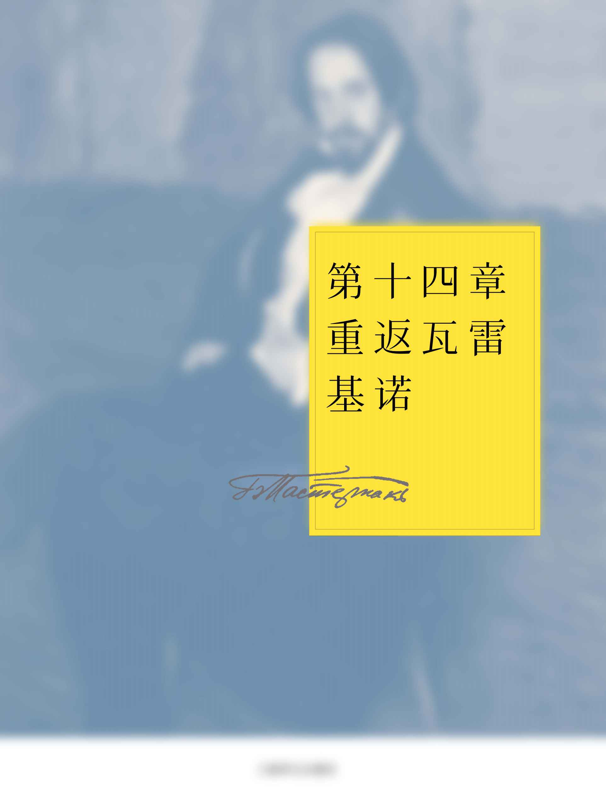

# 第十四章 重返瓦雷基诺

<h3 id="c193">一</h3>

冬天已经到了。外面大雪纷飞。日瓦戈从医院回到了家里。

“科马罗夫斯基来了。”出来迎他的拉拉，无精打采，声音嘶哑地说。两人站在过道上，她样子狼狈，仿佛挨人打了。

“来哪儿？找谁？在咱们这儿吗？”

“当然不在。他早晨来过，想晚上再来。他不久就会到了。他需要和你谈谈。”

“他来干什么？”

“我听他说，没有全弄明白。他好像说是去远东途中路过这里，特意拐个弯来尤里亚京看我们。主要是为了你和帕沙的事。他讲到你们两个，说了许多。他一再说，我们三人，也就是你、帕沙和我，有生命危险，只有他能救我们，如果我们能听他劝的话。”

“我出去。我不想见他。”

拉拉泪涌如注，要给日瓦戈医生跪下，抱住他的腿，把头贴到他身上。日瓦戈好不容易拦住了她。

“为了我，你留下别走，我求求你。从哪方面说我也不怕同他面对面相见，但这太令人难受了。别让我一个人同他见面吧。再说这个人讲实际，有阅历，也许他真能出点主意。你讨厌他是很自然的。但我求求你，克制一点吧。留下别走。”

“你怎么啦，我亲爱的？安静些。你这是干什么？别下跪，快起来。你放宽心吧。你得甩掉总叫你不安的邪魔。他弄得你一辈子心惊胆战。有我和你在一起呢。如果需要，如果你命令我，我就打死他。”

半小时之后就入夜了，天色全黑了下来。早在半年之前，屋里地板上的鼠洞就堵死了。日瓦戈留心观察，一发现新洞，都及时塞上。家里又养了只毛茸茸的大猫，总是呆着不动，神秘莫测、虎视眈眈地瞅着，屋子里还有耗子，只不过不如过去那样猖狂了。

在等科马罗夫斯基的工夫，拉拉把定量配给的黑面包切好，桌上摆了一个盘子，盛着几个煮土豆。他们决定在房主原来的厨房里接待客人，现在这也仍作厨房用。里面放着一张很大的橡木餐桌，还有一个很大很沉同样是深色橡木制的柜橱。餐桌上放着日瓦戈的手提蓖麻油灯，是一个插着根灯捻的小油瓶。

科马罗夫斯基从十二月的黑夜里走进门来，浑身落满街头飘舞的雪花。从他皮衣、帽子、套靴上掉下一团团白雪，融化在地板上淌成了一洼水。科马罗夫斯基过去是刮胡子的，如今留了起来；胡子和短髭沾雪变湿，看起来很像戏里的小丑。他身穿保存得很好的旧上衣和裤线清晰的条纹裤。在寒暄说话之前，他取出衣兜里的小梳子，理了好一会儿压扁了的潮湿头发，又拿手帕擦净理顺胡子和短髭。然后他意味深长地沉默着，同时伸出两只手，左手递给拉拉，右手递给了日瓦戈。

“咱们就算认识了，”他对日瓦戈说，“我和您的父亲可是非常要好的，这您一定知道。他是在我怀里咽气的。我仔细打量，看您哪点像父亲，可是看来您没随父亲。他是个生性开朗的人，爱冲动，急性子。您外表更像母亲。她是个性情温和的女人，喜欢幻想。”

“拉拉·费奥多罗夫娜要求我听您说说。据她说您找我有事。我只好听命。我们这次谈话是迫不得已的。我本意不想结识您，也不认为现在就是相识了。所以请您快谈正题。您想说什么？”

“好啊，我的朋友们！你们的一切，一切的一切，我完全感觉出来了，全部都明白。原谅我鲁莽，你们两个非常非常般配，是高度和谐的一对儿。”

“我不能不打断您。请您不要干预同您无关的事吧。没有人要求您的同情。您有点忘乎所以了。”

“年轻人，您别一下子就发火。不，看起来，您还是更像父亲。也是个火爆性子。好吧，那请允许我祝贺你们，我的孩子们。遗憾的是，不光我叫你们孩子，事实上你们也是什么都不知道、什么都不考虑的孩子。我到这儿才两天，听到有关你们的消息，比你们自己知道的还多。你们自己毫不意识到自己正走在悬崖边上。如果不设法防止危险，你们的自由日子，也许连你们的生命，都屈指可数了。

“现在存在某种共产主义方式。很少有谁符合这个标准。可谁也没有像您尤拉·安德烈耶维奇这样公然违背这种生活和思考的方式。我实在不懂，干吗要惹人发怒呢？您的所作所为，全是对这个世界的嘲笑、侮辱。这些要只是您心里的秘密还好。可这里有从莫斯科来的权威人士。您的心思，他们知道得一清二楚。你们两个都太不合这里法官大人的心意。安季波夫和季韦尔辛同志，对拉拉·费奥多罗夫娜和您，都恨得咬牙切齿。

“您是个男人，是个自由自在的人，或者还有别的什么叫法。当然您有神圣的权利可以任性胡来，拿生命当儿戏。可是拉拉·费奥多罗夫娜是不自由的。她是母亲，手里握着一个孩子的生命，女儿的命运。她可不能异想天开，不该想入非非。

“我劝说了她一个早上，劝她认真对待这里的形势。她不愿听我的话。您有威信，您对她施加些影响吧。她没有权利拿卡坚卡的安全开玩笑，她不应该无视我的这些考虑。”

“我一生中从来没有对任何人劝说过什么，强迫过什么。特别是对亲近的人。拉拉·费奥多罗夫娜听不听您的，由她自便。这是她的事。而且，我根本不知道您这里指的是什么。您所谓的自己的考虑的那些东西，我是一无所知。”

“噢，您越来越使我想起您父亲，也那么不好打交道。咱们说主要的吧。因为这是件非常复杂的事，你们可得耐着性子听。请你们听我讲，不要打断我。

“上面正酝酿着巨大的变革。确实不错，这消息的来源十分可靠，你们不用怀疑。他们将转到比较民主的轨道上来，实行普遍的法制，不久将付诸实施。

“然而，正因为如此，需要撤销的侦缉机关最后必然更为凶狠，更急于清算当地的恩怨。消灭您已提上日程，尤拉·安德烈耶维奇。您的名字列进了名单。我这不是说着玩的，我亲眼看到的，你们可以相信我的话。想想如何逃命吧，不然就完了。

“不过这些还只是开场白。下面我就讲讲本题。

“忠于被推翻的临时政府和被解散的立宪会议的残余政治力量，正在靠太平洋的滨海区聚集。来人中有杜马成员、社会活动家、过去地方自治者中最著名的人物、商业家、工业家。志愿部队的将军们，也在这里汇集自己的残余队伍。

“苏维埃政权对远东共和国的出现，睁只眼闭只眼。在边界地区存在这样一个共和国，作为红色西伯利亚和外界世界之间的一种缓冲，对苏维埃政权是有利的。共和国政府将由混合成分组成。一半以上席位，莫斯科相约要分给共产党人，目的在于到适当时机举事把共和国抓到手中。这意图昭然若揭，问题只在于如何利用仅剩的时间。

“革命前我曾经管过阿尔汉诺夫兄弟、梅尔古诺夫以及其他商业和银行家族在海参崴的事务。那里人们都知道我。组建中的政府派了密使，一半秘密、一半在苏维埃的正式许可下，给我送邀请柬，要我出任海参崴政府的司法部长。我同意了，现正赶往那里。所有这一切，如上边说过的，苏维埃政权都了解并得到它的默许，但不是十分公开的，所以不要声张出去。

“我可以把您和拉拉·费奥多罗夫娜带去，从那里很容易渡海去找家人团聚。您当然已经知道他们被逐的事。这事件很轰动，整个莫斯科全在议论。我对拉拉·费奥多罗夫娜许诺过，要设法使帕沙·安季波夫免遭危在旦夕的不幸。作为一个独立的被承认的政府的成员，我可以在东西伯利亚找到斯特列尔尼科夫，帮他转移到我们的自治区来，如果他逃不出来，我可以提议拿被盟国监禁的莫斯科中央政权至为重要的某个人物，作为交换人质。”

拉拉·费奥多罗夫娜费劲儿地听着这场谈话的内容，话里的意思常常一不小心就听漏了。但听到科马罗夫斯基最后讲到日瓦戈医生和斯特列尔尼科夫的安全时，她摆脱了漠然沉思的状态，立刻全神贯注，微微一红脸，插嘴说：

“你明白吗，尤拉，这些想法对你和帕沙可是非常重要呀。”

“你也太轻信了，我的朋友。不能把计划当成现实。我不是说维克托·科马罗夫斯基有意要把我们引入歧途。可这些全是纸上谈兵！现在，维克托·科马罗夫斯基，我代表自己说几句。谢谢您对我命运的关切，但您真以为我会把她交给您去安置吗？至于您对斯特列尔尼科夫的关心，拉拉倒是应该加以考虑。”

“问题归结到一点，我们是像他所建议的那样跟他走，还是不走。你十分清楚，没有你同行我是不走的。”

科马罗夫斯基不断地喝那掺了水的酒精。这是医生从门诊处带回来摆上餐桌的。他边喝边嚼土豆，渐渐有了醉意。

<h3 id="c194">二</h3>

时候已经不早了。偶尔，当手提灯的灯捻剪去黑灰时，火光一亮，啪的一声，照得屋里通明，随即又暗淡下来。两个主人想就寝，也需要单独谈谈。可科马罗夫斯基总不肯走。他坐在屋里使人感到压抑，正像沉重的橡木橱的样子，或屋外十二月寒冷的黑夜，令人不快。

他不望他们，而是越过他们的头，瞪着圆睁的醉眼，盯住远处的一点，睡意矇眬地嘟哝着，来来回回地叨叨着一件事。如今他的王牌是远东。他翻来覆去讲这个题目，向拉拉和日瓦戈医生发挥自己的看法，大谈蒙古在政治上的重要性。

日瓦戈和拉拉没有注意到，他是讲到什么地方一下扯起蒙古来的。正由于他们听漏了他是怎么换的题，这不着边际的题外话更显得无聊之极。

科马罗夫斯基说道：

“西伯利亚正如人们说的，确实像是一块新的美洲大陆，它有很大的发展前途。这是俄国伟大前程的摇篮，是我国民主繁荣、政治正常化的保证。未来的蒙古，具有更为吸引人的潜力，我是说外蒙这个我们远东的伟大邻国。你们了解它的什么呢？你们满不在乎地打哈欠，心不在焉地眨巴眼睛，可是那里有着一百五十万平方俄里的面积，没有开发的矿产，国家还处于史前的处女期。中国、日本、美国都向它伸出贪婪的手；这就损害了我们俄国的利益。然而在世界的这一遥远角落里每次划分势力范围时，所有盟国都是承认我们俄国的利益的。

“中国从蒙古封建和神权的落后状态中捞取好处，不断对喇嘛和大活佛施加影响。日本在那里依靠当地的贵族奴隶主，蒙语称做亲王。共产主义的红色俄国，找到了平民阶层，换个说法是蒙古起义牧民革命联盟，把它当做自己的盟友。至于我个人，我希望看到一个在自由选举的蒙古代表大会管理下的真正幸福的蒙古。至于你们，感兴趣的是：只要迈过蒙古边界，全世界就在你们的脚下了，你们就是自由的鸟儿了。”

科马罗夫斯基在这些与他们毫不相干的题目上，啰里啰嗦地高谈阔论，使拉拉忍无可忍了。她对来客久坐不走厌烦透了，就下了决心，向科马罗夫斯基伸出手去告别，同时毫不隐讳自己的不满，直截了当地说：

“很晚了。您该走了。我想睡觉。”

“我想您不会如此不客气，这么晚了把我赶出门外吧？我没把握，在没有灯火的外地城市是不是能认得出路来。”

“早该想到这些，别坐得这么久，谁也没留您嘛！”

“哎哟，您干吗对我这样厉害？您都没问一声，我在这儿是否有落脚的地方？”

“根本没那个兴趣。您还能吃亏呀？不是那种人嘛！您总会有办法的。如果您非要留宿，那我们同卡坚卡一起睡的房间里我无法安排，别的屋子老鼠会搅得不能安宁。”

“我不怕老鼠。”

“那随您的便吧。”

<h3 id="c195">三</h3>

“你怎么了，亲爱的？一连几夜你都不睡，坐到饭桌上什么也不吃，整天像疯了似的走来走去。你总是想啊想啊。是什么在折磨你？可不能忧虑过度。”

“看门人伊佐特又从医院到这里来了一趟。他同这里的洗衣女工要好。顺路来我这儿，安慰了几句。他说有个好吓人的秘密消息，说你免不了要蹲禁闭。还说等着瞧吧，不是今天就是明天要来抓人，随后就该轮到我这个倒霉人。我问伊佐特从哪儿打听来的。他说，他没弄错，是实行委员会里的人说的。你也许猜到了，他说的实行委员会，就是执委会代名词儿。”

拉拉和日瓦戈医生说着都笑了。

“他说的完全正确。危险已经迫在眉睫。要赶紧躲起来，问题是上哪儿去，去莫斯科没有考虑的余地，这得做复杂的准备，一定会引起人们的注意。要神不知鬼不觉地，谁也看不见。你猜怎么着，我的好人？恐怕咱们还是按你的意思办好。来个石沉大海，躲一阵子，就去瓦雷基诺那地方也可以。咱们去那儿住上两星期，个把月。”

“谢谢你，亲爱的，谢谢你。啊，我多高兴呀！我知道你内心是反对这样做的。我不是指你们家的房子。在那里生活，对你来说的确不可思议。房里凄凉的样子，内心的自责，触景生情，难道我不清楚吗？得把幸福建立在别人的痛苦上，践踏心中珍贵的和神圣的东西。我任何时候也不会同意你作出这种牺牲的。不过问题不在这里。你们家的房子损坏太厉害了，未必再能收拾住人。我是打算住到米库利齐恩留下的屋子里去。”

“这些都是实话。谢谢你的体贴。不过等一下。我一直想问你，可总是忘记。科马罗夫斯基在哪儿？他还在此地呢，还是走了？自从我和他争吵，把他从楼梯上撵下去，再没听到他任何消息。”

“我也什么都不知道。让他见鬼去吧。你问他干吗？”

“我越来越觉得，对他的建议咱们应该分别采取不同的态度。咱俩的处境不一样。你得抚养女儿。就算你甘心和我同归于尽，你也没权力这样做。

“现在来说瓦雷基诺。严冬季节在没有储备、没有体力、没有希望的情况下，钻到那个荒凉的角落里，纯粹是发疯的行为。可是，我的心肝，如果除了发疯再无出路，就让咱们发疯吧。咱们再低一次头，求萨姆杰维亚托夫借匹马。向他或是向他手下的投机商人借些面粉和土豆。我们要他答应我们，不要因为为我们做了件好事就去看望我们，希望他等到最后需要用马时再去找我们。让我们俩单独在那里住一阵。我们走吧，我的心肝。咱们省着够烧一年的柴禾，一星期就烧完它。

“我再一次，再一次地请你原谅我话里流露出的不安。我多么希望同你讲话时不带这些莫名其妙的感慨。可要知道，我们真的是别无选择了。随你怎么叫它，死亡确已在敲我们的门。我们的日子屈指可数了。让我们按照自己的意愿度过这些时光吧，以此来向生命告别，这是我们永别前的聚会。让我们来告别我们所珍惜的一切，告别我们习惯了的那些概念，告别我们理想中的生活和良心对我们的教导，告别一切希望，最后是你我相互告别。让我们俩再重温一下我们夜里的悄悄密语，那些伟大的话语，那些如亚洲大洋名字般的太平的话语。我内心隐秘的、犯禁的天使啊，你在战争和起义连绵不断的天空下陪伴我生命的最后时刻，不是无缘无故的。在我生命的初起时，同样是你出现在童年的和平的天空下面。

“那天夜里，你这个中学高年级学生穿着咖啡色制服，昏暗中站在屋里隔板的那边，神采和现在一模一样，都是那么惊人的美丽。

“在那以后的生活中，我始终找不到语言来形容你当时在我心中留下的美妙倩影的光彩，形容那渐渐暗淡的一线光芒和渐渐变低的一串清音。正是这光芒和声音从此一直伴随着我的生活，成了我深入理解世上其余的一切所不可少的钥匙，这都多亏了你。

“当你穿着学生裙，像影子一样从隔板背后走出来时，我这个对你还一无所知的男孩，从内心痛苦的反响中感受到：这个瘦弱的小姑娘如同带电一样，具有世上所能有的全部女性的温柔。如果走近她或用手指触动她，就会迸出火花照亮房间，要么把人击死，要么给人充上电，使他终生怀着磁铁般的向往和忧伤。我眼里充满了欲滴的泪水，整个心身仿佛在闪光，在哭泣。当时我是那么怜悯我自己，我这个男孩；但尤其是怜悯你，你这个女孩。我的整个身心在惊讶地问：如果爱一个人、吞进电去是这么痛苦，那么做女人、做电、引起人爱慕，多半会更加痛苦。

“你看，我终于把这些都说出来了。这一切简直可以使人发疯。我脑子里盘旋的全是这个。”

拉拉疲惫不堪地和衣躺在床边。她蜷缩着盖了一条围巾。日瓦戈挨床坐在一把椅子上，低声说着，中间不时有很长的停顿。拉拉有时抬起身子，用臂肘撑着床，手托着腮，张大嘴巴望着日瓦戈。一会儿又靠到他肩上轻轻地幸福地哭泣，自己却竟没感觉流泪。最后她从床上坐起扑到他怀里，兴奋地细语道：

“尤拉！尤拉！你多聪明啊！你什么都知道，你什么都理解得了。尤拉，你是我的堡垒，我的后盾，我的知音。啊，求上帝原谅我不自量力吧！我是多么幸福啊！咱们走吧，走吧，我亲爱的。到那我告诉你，是什么使我担心。”

他心想，她是暗示可能有了身孕，但这多半是错觉，于是说：

“我知道。”

<h3 id="c196">四</h3>

一个灰暗的冬晨，他们出了城。这是个平常的日子，街上的行人各自忙着自己的事。路上时常遇到熟人。在一些凹凸不平的十字路口，家里无井的妇女们，在旧水亭前排着长队，把水桶和扁担放在一边，轮流打水。日瓦戈医生驾着萨姆杰维亚托夫的黑鬃卷毛黄马，到这地方就勒住奔马，小心翼翼地绕过一群群家庭主妇们。雪橇飞快地从溅水结冰的马路边上滑过，有时冲上了人行道，横杆撞到街灯柱和短桩上一片乱响。

他们全速前进，超越了在街上走着的萨姆杰维亚托夫；擦身而过时也没回头看看他是否认出了他们和自己的马，是否从后面朝他们喊叫了什么。在另一处也如法炮制，没打招呼便赶马超过了科马罗夫斯基，意外地得知他还在尤里亚京。

格拉菲娅·东采娃隔着大街从对面人行道上大喊：

“人家都说你们昨天走的。他们的话真没法信呀。是去弄土豆吗？”然后一挥手，表示听不清答话，便挥挥手告别了。

为了见见谢拉菲玛，他们打算在高坡上停下，可这地方刹不住车。就是不停车，缰绳勒得紧紧的，还不时要遏制马跑呢。谢拉菲玛从上往下裹了两三条围巾，弄得身体像根圆劈柴。她僵直着腿迈步，走近马路中间的雪橇，同他们告别，祝他们一路顺利。

“等你们回来，我需要同你谈一谈，尤拉·安德烈耶维奇。”

他们终于出了城。虽说日瓦戈冬天也骑马走过这条路，但记得的大多是夏日的情景，现在竟认不出路来了。

装食物的几个袋子和其他物品，深深塞到雪橇前面的饲草里，再牢牢捆住。日瓦戈赶着马，不是跪在摇摇晃晃的宽大雪橇板上，就是侧身坐在雪橇边上，穿着萨姆杰维亚托夫毡靴的双脚垂放在外面。

时过正午，到日落本来还很早呢，可冬日的假象令人觉得马上要黑天。所以，日瓦戈狠狠地抽打起黄马来。马儿箭似的飞奔。雪橇像只小船上下起伏，贴着崎岖的大道穿行，卡坚卡和拉拉穿着皮大衣，行动很不便。遇上坑洼和路面两侧不平，她俩从雪橇这头滚到那头，像两个转动不灵的大布袋陷到草垛里，一边大呼小叫，咯咯笑得肚子疼。偶尔医生为了戏谑，故意把雪橇底下一根滑铁拉进路旁的雪堆里，雪橇侧翻倒但毫无伤害地把拉拉和卡坚卡甩到雪里。他自己拉起缰绳走上几步，让黄马停下，扶正雪橇。拉拉和卡坚卡捶他两下，抖抖身子，又好笑又好气地坐进雪橇里去。

“我要指给你们看，我被游击队劫走的地方。”离城相当远之后，日瓦戈医生说道。可是他没有做到。因为周围只是一片光秃的冬林，死般的寂静，空荡无物，简直认不出这是什么地方。过不久他喊道：“就是这儿。”其实他是把路边田里第一根钉着莫罗和韦钦金广告牌的路标，误认成林子里的第二根路标，他是在那儿被抓走的。可当他们进入萨克明岔口旁的林丛，驰过仍在原地的第二根路标时，他竟没有认出来。眼前闪烁的是浓霜织成的白网，霜把林子染成了银色，其中又泛着黑点。这样，第二根路标便没被发现。

驰进瓦雷基诺时，天色还亮。他们停到日瓦戈原来的住房前面，因为它最靠近大道，米库利齐恩的家要远些。过一会儿天就该黑了，他们匆匆闯进房去，好像是来打劫。房里已经昏暗不清。毁坏遭劫的情形，日瓦戈匆忙间只看到一半。家具有一部分还完好如初。瓦雷基诺空荡无人，没有人再来破坏了。家里的财物，日瓦戈丝毫也没找见。家人离去时他不在，所以也不知道他们带走了什么，留下了什么。这时听拉拉说道：

“得快点啦。天马上就要黑了，没工夫再琢磨。要住这儿，就得把马拉进柴棚去，吃的拿到走廊上，我们到这间屋里。不过我反对留在这儿。这事我们已经谈了不少。你会很难过，我也就会很难过。这是你们的卧室吗？不，是孩子住的。这是你儿子的小床。卡坚卡睡太小了。可是窗户都完整，墙壁和天花板没有缝隙。再说，有个很好的火炉，上次来时我就赞叹不已，如果你坚持要住在这儿，尽管我不同意，可是我会立即脱下大衣马上开始安置。头一件事就是生火。生火，生火，还是生火！开始这一天一夜，要不停地烧。你是怎么啦，我亲爱的？你怎么不回答？”

“等一等，没什么。请原谅我。不，你知道吗？最好还是去看看米库利齐恩家住的房子吧。”

他们又向前驶去。

<h3 id="c197">五</h3>

米库利齐恩家房子的门栓上挂了把锁。日瓦戈撬了好久，才连锁带门栓螺丝、木屑一起拔掉。像刚才一样，他们又是一拥而入，也不脱衣服，穿着皮大衣和毡靴，戴着皮帽，就往里屋走。

惹人注目的，首先是房中一些角落里物品摆得井井有条，米库利齐恩的书房就是如此。这里有人来住过，而且是不久以前。能是谁呢？如果是这家的主人们，或者是其中的一个人，那么人到哪里去了？为什么大门上不用暗锁，却加了一把挂锁？再说，要是主人们在这儿常住，应该打扫整套房子，不该只整理一部分。这些迹象告诉刚闯入这儿的日瓦戈和拉拉住在这儿的不是米库利齐恩家人。那可是谁呢？情况不明并没使日瓦戈医生和拉拉感到不安。他们不想再多费思量。如今，遗弃不管、被人盗得半空的住宅，还不比比皆是。受到追捕而隐藏起来的人，也不在少数。“定是某个被追踪的白军军官。”两人不约而同地这么想，“他要来了，也可以相处，可以商量嘛。”

同前次一样，日瓦戈愣愣地站在房门口，为窗旁那张宽大舒适的写字台惊叹不已。他又一次想到，如此整齐幽雅的环境，一定会唤起人们从事坚韧而富有成效的工作的愿望。

在米库利齐恩院里的杂用房中，紧贴着柴棚盖了一个马厩，门上插着销子。日瓦戈不知里面是什么情形。为了不耽误时间，他决定头一夜把马拴到没上锁、容易打开的柴棚里。他给黑鬃黄马卸下套，等牲口收了汗，用井里打上来的水给它饮了。日瓦戈打算从雪橇上拿些草喂它，可是料草被人压成了粉屑，已经无法喂马。幸好在柴棚和马厩上面的料草棚里、贴墙根和角落里还存有足够的草料。

夜里他们和衣而卧，上面压着皮大衣，睡得很沉，很香甜，十分惬意，好像奔跑打闹了一整天的孩子。

<h3 id="c198">六</h3>

大家起身之后，日瓦戈从清早就不断探头去看看那张诱人的写字台。想坐下写点什么，手都发痒了。但这个权利他给自己留到晚上，等拉拉和卡坚卡就寝之后再用。在这之前，哪怕只收拾出来两间屋子，活儿也足够干的了。

他向往晚上的工作，倒并无什么重大的目的。一种普通的写字欲望，对笔墨、对写作的倾心，控制了他。

他想胡乱涂点什么。开始他也只能满足于回忆和记述还没有记下来的某些往事，目的在于恢复因闲置而生疏、一时沉寂的才能。之后，他期望和拉拉在这里多留些时日，有足够的时间写点新的有分量的东西。

“你忙着吗？在干什么呢？”

“一直在烧炉火。有事吗？”

“把洗衣木盆给我。”

“要这样烧法，劈柴只够三天。得到过去我们日瓦戈家的柴棚去一趟，看那里是不是还有。要是还不少，我去几趟，把它们拖回来。明天就干这件事，你要木盆？你看，好像在哪儿看到了，可记不得了，真是怪事。”

“我也是。在哪儿看见了，可又忘了。一定摆得不是地方，所以才容易忘。随它去吧。别忘了，我可热了不少的水，准备打扫房子。剩下的我洗洗自己和卡坚卡的衣服。你把自己的脏衣服也一起给我。晚上等收拾完了，商量好最近的计划，咱们睡觉前都洗个澡。”

“我马上把内衣拿来。谢谢了。柜子和重东西，我都按你说的从墙旁挪开了。”

“好啦。没有木盆，我就用洗碗盆涮衣服吧。只是有油腻，得把盆边上的油腻洗净。”

“等炉火着旺了我关上炉门再去收拾剩下的抽屉。写字台和衣柜里，找一找就有新发现。有肥皂、火柴、铅笔、纸、文具。桌面上也到处是意想不到的收获，比如盛满煤油的小灯。这不是米利库齐恩家的，我认识。这是从别处拿来的。”

“真是太走运了！多亏了在这儿住过的那位神秘客人。像法国凡尔纳小说里的人物。啊，没什么好说的，确实如此。咱们又闲扯起来，白费工夫，我那桶水可烧开半天了。”

他们忙活起来，手里拿着东西在几间房里出出进进，有时两人撞个满怀或者碰到卡坚卡身上。这女孩站在道上，妨碍大人走路。她在屋子里一会上这儿，一会上那儿，妨碍打扫屋子。大人说她，她还噘嘴。孩子冻得难受，一个劲儿喊冷。

“现在的孩子多可怜呀，成了我们这种茨冈生涯的牺牲品，小小年纪，就毫无怨言地同我们一起流浪。”日瓦戈医生这样想，嘴里却说道：

“啊，亲爱的，对不起。别缩着脖子。你是瞎说，撒娇吧。哪会冷，火炉全烧红了。”

“炉子也许暖和了，可我冷。”

“那你忍耐一下，卡坚卡！晚上我再把它烧得通红通红的。妈妈说还要给你好好洗个澡，听见了吧？现在先给你这个，接着啊。”他说着把米库利齐恩家的旧玩具从冰冷的贮藏室取来堆了一堆，有完整的有弄坏的，有小砖块有积木，有车厢有机车，有打成方格的、出了图的编了号的硬纸片——那是玩筹码和骰子时用的。

“你怎么这样呀，尤拉·安德烈耶维奇。”卡坚卡像个大人似的抱怨说。“这都是别人的。又是小孩子玩的。我已经是大孩子了。”

可没过一分钟，她就在地毯中央舒舒服服坐好，各式各样的玩具在她手下全都变成了盖房的材料。卡坚卡用这些材料给从城里带来的玩具娃娃宁卡盖好一幢房子。这住房比起她随大人轮番借住的别家房舍，似乎还更合理，更能住得长久。

“瞧，她的这种持家的本能，那么迷恋小窝，井井有条，无论什么也改变不了。”拉拉从厨房望着玩耍的女儿说。“孩子是真诚的，不怕难为情，也不怕说出实话。可我们怕显得落后，就宁可出卖最珍贵的东西，夸赞令人讨厌的东西，附和我们并不理解的东西。”

“木盆找到了。”日瓦戈医生拿着木盆，从昏暗的走廊进了屋里，插嘴说。“的确放得不是地方。看样子，从秋天起木盆就放到漏雨的天花板下面了。”

<h3 id="c199">七</h3>

拉拉动用储备食物，一次做好了三天的午饭。这顿午餐空前地丰盛，有一道土豆汤和一道羊肉炸土豆。卡坚卡吃了还想吃，怎么也吃不够，又是笑又是淘气。后来吃饱了，身上热得发困，倒在沙发上盖着妈妈的羊毛花毯，进入甜蜜的梦乡。

拉拉由于守着炉火，感到劳累，出了身汗，和女儿一样昏昏欲睡；同时又很得意自己的烹饪杰作。她没急着收拾餐桌，却坐下来歇口气。看到孩子确已睡熟，她倚在桌上，一只手托着脑袋说：

“我绝不怕累，而且觉得这是一种幸福，只是要让我知道这不是白做，能够达到某种目的。你应该每时每刻提醒我，我们来这儿为的是两人能守在一起。你常给我鼓鼓劲，别让我清醒过来。因为严格地说，如果冷静地看看我们的所做所为，那我们是在干些啥呀？闯进别人住宅，破门而入，住到里面，还总是匆匆忙忙，为的是视而不见：这并不是生活，而是演戏；不是认真对事，而是像孩子们爱说的——‘闹着玩’；是一出令人发笑的木偶戏。”

“可是，我的天使，不是你自己坚持要来吗？你回想一下，我反对了好长时间，没有同意嘛。”

“对。我不争辩。我这已经犯了过错。你可以动摇犹豫，可以思索，我的行为必须是始终一贯的，符合逻辑的。咱们进了房子，你看到儿子睡的小床，心里难过，痛苦得险些晕倒。你有这个权利，可我却不能。为卡坚卡担心，考虑今后怎么办，这些都必须服从于我对你的爱情。”

“拉拉！我的天使！你清醒清醒吧！改变主意，放开决定，任何时候都不晚。我第一个劝你对科马罗夫斯基的话认真对待。咱们有马。你要愿意，明天咱们就回尤里亚京去。科马罗夫斯基还在那儿，没有走。要知道，我们乘雪橇从街上过来时，看见了他，而他依我看并没有注意到我们。我们回去很可能还见得到他。”

“我几乎什么都还没说，你的话音里已经带有不快。可你说说，我的话难道不对吗？我们躲藏在这里是不牢靠的，是盲目的，这和在尤里亚京差不多。要真想得救，那就非得有深思熟虑的计划，像那个虽令人厌恶却有见识、极清醒的人最后提出的办法。要知道，我们在这儿比任何别的地方更危险。这里是一望无际的平原，风雪无阻。我们又是孤身在这儿。大雪一夜就能把我们埋掉，早晨想爬也爬不出来了。还有常来这里的那位神秘客（对我们有所恩赐的人），一旦突然回来，又是个强盗，非把我们杀死不可。你连武器也没有呀。你看这处境。我担心的是你竟如此无忧无虑，而且也影响了我。我脑子里也乱成了麻。”

“那么你这个时候要怎么样呢？你要我怎么办呢？”

“我也不知道该怎么回答你。你时时刻刻管住我吧。你常提醒我点：我是爱你的盲从的不会思索的奴隶。啊，我要告诉你：我们的亲人，你的和我的，比我们好一千倍。可问题哪在好坏呀？爱情的天赋同其他天赋一样，它可能极伟大，但若没有得到祝福，爱情也难以表现。咱们俩好像是在天国时就被教会了相互亲吻，然后让我们同时降生为婴儿，仿佛为了互相试探亲吻的本事。我们像是最完美的结合，分不出你一方我一方，分不出等级差别，没有高也没有低，整个人是平等的，一切都构成欢快，一切都化为灵魂。但在这近乎野性的、时刻迸发的柔情中，有某种孩子般的固执，某种不容于人的东西。这是一股任性的破坏的力量，同家庭的宁静水火不容。我的义务，该是提防这种力量，不为它所左右。”

她双手搂住他的脖子，流着泪哽咽地说完：

“你明白吗？我们的处境不同。你能腾飞，展翅可以躲到云外，可我是女人，只能俯到地面，用翅膀护住雏鸟免遭危险。”

她说的一切，日瓦戈医生听得喜出望外，但他没有表露出来，免得有肉麻之嫌，尽量克制地说：

“我们的这种野营生活，的确有些自欺欺人，像绷紧的弦。你说得完全正确。可这不是我们发明的。发疯似的左冲右突，是所有人的共同命运，这很符合时代精神。

“我今天从清早起，想的差不多也是这个。我想尽一切努力，在这儿多呆些时候。我说不清自己是多么想干点活儿。我指的不是农活儿。有一次我们全家一起出去做农活儿，干得很不错。但我无力再重复那么一次。我脑里转的不是这个。

“生活从各个方面都逐渐在走上正轨。也许说不定什么时候，又要开始印书。

“我心里琢磨的是这么个念头。能不能同萨姆杰维亚托夫讲妥，照对他有利的条件由他供给我们半年的粮食，我保证在这个期间里写一本书，作为抵偿。比方写本医学指南，或是文艺方面的书，例如诗集。再不然，我动手翻译外国著名的、有世界意义的东西。我的几种外语都很好，不久前我看到彼得堡一家专出译著的大出版社的启事。这类的作品大概会有交换价值，可以变成钱。能干点这类的工作，我感到幸福。”

“谢谢你提醒了我。今天我也产生过类似的想法。不过我没有信心能在这儿久住。相反我有种预感，不久我们将不得不再次远走。好在目前能在这停留一阵子，我对你有个要求。今后几天夜里，你为我牺牲几个小时，把你在各个时候向我念过的诗全记下来。有一半已经散失，另一半还没写下来，我担心以后你会全忘记的，那就全完了。听你说，从前常有这种情况。”

<h3 id="c200">八</h3>

天黑前，他们用洗衣剩下的许多热水，洗了个痛快澡。拉拉给卡坚卡洗了澡。日瓦戈觉得全身清爽舒坦，坐在窗前的写字台旁，背对着拉拉的屋子。她一身幽香，披着浴衣，湿发用毛茸茸的手巾缠成高髻，正侍弄卡坚卡，自己也准备上床睡觉。日瓦戈想到即刻就可集中精力写作，感到无比的快意，看着眼前发生的一切，不由得格外感动，产生一种无所不包的关注。

已近午夜一点，一直装睡的拉拉果真睡着了。她和卡坚卡身上刚换的衬衣，还有床上摆着的内衣，干净平整，绣着花边，显得分外洁白。即使在那个年头，拉拉也还有办法给衣服上浆。

日瓦戈笼罩在一片令人神往的静谧中，充满幸福感，充满甜蜜的生意。油灯在白纸上洒下宁静的黄色灯光，在墨水瓶里映起浮动的点点黄斑。窗外是淡蓝色的寒冷的冬夜。日瓦戈走进隔壁一间没有灯光的冷屋，从那往外看得更清楚。他朝窗外望了望。月的光辉照在白雪覆盖的林间空地上，好像蛋青或是白色的乳胶，黏乎乎的似乎伸手能摸到。寒冬夜色，美得难以言传。日瓦戈医生心里涌起一片宁静。他转身回到光亮暖和的房里，提笔写起来。

他写时笔迹稀疏，为的是让字迹能传达出运笔的生动情致，并且不失去自己的书法特色。他静心缄口，边回忆边记录，采用逐渐润色加工而不同于当初的定稿。他把最为成熟的和记忆清楚的旧作写下来，像《圣诞之星》、《冬夜》，以及性质相近的相当多的其他诗作，后来这些诗作被遗忘丢失，谁也没有再发现。

他写下这些完成的、定型的作品后，就转而写过去只开了头就丢下的诗篇，情绪酝酿好便写起来，却并不指望马上完成。渐渐地他诗兴大发，像着了迷，又写起新的诗作来。

头两三节写得很顺利，出现了几个连他自己也感到惊讶的比喻；之后他凝神专注，感觉所谓的灵感要来了。左右创作的几种力量，它们的相互关系似乎本末倒置过来。占据首位的，不是人和他想表现的心境。语言这“美”和“意”的家乡与栖所，开始自己替人思索讲话，整个变成一种音乐，不是指诉诸听觉的外在声音，而是指内在的湍急强大的潜流。这时，如同汹涌浩大的河水冲刷河底的石块，转动磨坊的水轮，流淌的语言也受自身规律的驱使，自己沿途顺便就创造出节拍和韵脚，也创造出千百种更为重要而迄今未被发现、使用、命名的其他形式和手段。

每逢此刻，日瓦戈总觉得，主要的工作不是他自己完成的，而是某个高出于他、置身于他头上而支配着他的力量。这便是宇宙的思想和宇宙的诗情；这便是宇宙诗情在未来的历史发展中应迈出的下一步。而他自己不过是这诗情运动的中介和立足而已。

他不再自责，一时也不再觉得自满和自卑。他回头望望，又朝四周看了看。

他看到了睡梦中的拉拉和卡坚卡，两人的头枕在雪白的枕上。洁净的床褥，整洁的房间，她俩清晰的线条，同明净的夜和雪、星和月，汇合成同样洁净的细浪，流过他的心田。生活给人的庄严的纯洁感，使他忍不住要欢呼，要流泪。

“上帝啊！上帝啊！”他不禁想低声自语。“这一切，全是赐给我的！我凭什么得到这么多呀？你为什么让我接近了你，为什么让我来到你无价的大地上，来到你的星光之下，来到这个疯狂的、无怨言的、不走运的、看不够的女人身边？”

日瓦戈从桌上稿纸里抬起眼来，已经是夜里三点钟了。他从全神贯注、与世隔绝的状态中苏醒过来，回到了现实里，感到幸福、坚强、宁静。突然他听到一声凄凉的哀号从窗外寂寂的远方传来。

他走到隔壁无光的房间里，想朝窗外望一望。就在他坐着写作的几小时中，窗上结了很厚的霜，根本什么都看不清。日瓦戈把大门下卷放着的遮风的地毯挪开，披上皮大衣走到外边门廊。月光下的雪地，像燃着白色的火焰，刺得他眼花，起初他什么也不能细看，什么也没有发现。但过不一会儿，就听远处传来的悠长的哀嗥。这时他才发现沟谷对面一块空地边上，有四个长长的黑影，大小像标点里的连字符号。

几只狼朝着房子站成一排，仰脖嚎叫，不是冲着月亮，就是冲着米库利齐恩家闪烁银光的窗子。有几秒钟，它们伏身不动。日瓦戈刚明白过来这是一群狼，它们就像狗一样垂下尾巴，慢吞吞地离开林间空地，仿佛日瓦戈的想法传达给了它们。没等日瓦戈搞清楚它们的去向它们就消失了。

“又新添一件不愉快的事！”他心里想。“没它们就够呛了。难道附近不远真有狼窝吗？说不定就在山沟里呢。太可怕了！倒霉的是马厩里还有萨姆杰维亚托夫那匹黄马。大概是它们嗅出马味了。”

他决定不到时候一点也不对拉拉泄漏，免得吓着她。他进了屋，关好大门，掩上从冷屋到暖屋中间的门，堵上门缝和门洞，回到写字台旁。

油灯仍然燃得很亮，很可人意，但他却没心思写了。他平静不下来。脑子里尽转着狼群以及其他危险复杂的情况，别的全想不进去。再说他也累了。这时拉拉醒过来。

“你还点着灯呢，我的明亮的小蜡烛！”她用柔润的轻声说，睡得嗓音带点阻塞。“靠近来挨着我坐一小会儿。我讲给你听，我做了个什么梦。”

他于是把灯吹熄了。

<h3 id="c201">九</h3>

又一天在平静的惶惑中度过了。家里找到一个儿童用的小雪橇。小脸通红的卡坚卡穿着皮袄，大声笑着从结冰的小山坡顶，滑到花圃里没有扫雪的小路上。小冰山是日瓦戈医生用铁锨拍实之后，泼水浇成的。她总是乐呵呵，没完没了地返回来，用绳子拖着雪橇上坡。

寒气逼人，有增无已。院子里有太阳。雪地在午后阳光的照耀下变成了黄色。这蜜黄之中渐渐渗进早来的傍晚那种沉重的橘黄。

昨天拉拉又是洗衣又是洗澡，屋里积了许多潮气。窗上结出松松一层厚霜。从天花板到地板，发潮的墙纸上出现了一条条淌水似的黑道。房间里显得又暗又不舒适。日瓦戈往屋里抱劈柴、担水；还继续清理东西，不断有新的发现。拉拉从早到晚忙活，家务越来越多，也时常要他帮一把。

总在最忙的时候，两人的手碰到一起就握住不放了；抬起的重物没到目的地便搁到地上；一阵阵无法抵拒、令人眩晕的柔情，使他俩束手无策。又是什么事也做不成，什么思想都抛到了脑后。总是这样荒废了分分秒秒，积成了一个又一个时辰，天色竟又晚了下来。两人想起丢在一边的卡坚卡，没有饮水的黄马，才吃惊地清醒过来，拼命去补做耽误了的事情，心里感到十分内疚。

日瓦戈因为睡眠不足，脑子里昏沉沉的，像喝醉了酒一般，罩在一层甜丝丝的雾中；浑身酸疼、疲倦，却又感到舒畅。他迫不及待地盼着到晚上，好继续那中断了的夜间的工作。

他身上充满着那种梦幻般的朦胧感，已经替他完成了前一半的酝酿工作。周围一切变得朦胧。他的思想也变得朦胧。由此一切融合为浑然一体的迷蒙，迷蒙渐渐又在变，便成了最后准确清晰的前奏。一整天累人的欢快，犹如作品草稿的朦胧、迷蒙，正是入夜创作不可缺少的准备。

疲惫而又闲散，就无所不想，思想无孔不入。于是一切全起了变化，成了另个样子。

日瓦戈感到，自己在瓦雷基诺长住的希望是无法实现的，同拉拉分离的时刻已然不远，他无可挽回地要失去她，随之要失去对生活的欲念，也许要失去生命。忧伤袭上他心头。但令他更难忍受的是对夜晚的期待，是哭诉这种忧伤而且使任何人都黯然泪下的愿望。

他一整天都不能忘怀的野狼，此刻已然不再是月夜雪地上的野狼，而变成了豺狼主题，变成了一种敌对力量；这力量立志要害死日瓦戈医生和拉拉，或者把他们撵出瓦雷基诺。这种视狼为敌的念头不断发展，到了傍晚更十分地强烈，仿佛在舒基玛谷地真发掘出了远古怪物的遗骸，而沟谷中的确潜伏着神话般巨大的龙，正渴望吸到日瓦戈医生和拉拉的鲜血。

到了晚上，同昨天一样，日瓦戈医生点亮写字台上的油灯。拉拉和卡坚卡比前一天更早些便睡下了。

昨夜写的东西可以分成两类。一类是旧有的，经过修改誊清，用正规书法写得很整洁。新写的用简笔涂鸦，不少省略号，字迹非常潦草难辨。

日瓦戈医生读着紊乱的底稿，往往感到失望。昨夜里这些诗稿催他泪下，一些出乎意料的成功之笔令他惊讶。这时，恰是这些貌似不凡之笔，显得过于牵强造作，使他不快。

他一生都向往能达到一种不露锋芒的含蓄的新奇，隐藏在通用的习以为常的形式之下。他一生都在努力形成一种平淡朴实的文笔，要使读者和听众能把握内容而无须费神理解。他一生都在关注创造一种不惹人注目的风格，可每次都吃惊地发现，自己离这个理想境界还很远。

昨天打草稿时，他想用朴实得近乎低声细语的手法，用亲切得像摇篮曲的手法，来表现出自己复杂的情绪、情爱和恐惧、忧伤和勇气，要让情绪仿佛摆脱开语言自然而然地流露出来。

如今，过了一天重看这些试作，他发觉缺乏能把零散诗行连成一体的内容的脉络。他在涂涂改改写诗的过程中，渐渐地也用这种抒情笔调叙述起勇士叶戈里的传说来。起初，他取了容量很大的宽松的五音步节奏。这种诗行不管内容如何，本身的节奏便和谐悦耳。可日瓦戈医生觉得这种刻板空洞的咏唱格调叫人生厌。他抛弃了这个浮夸的带间歇的节奏，把诗行挤成四音步。就像在散文中同冗繁作斗争一样。这回写起来困难些，但更有吸引力。进展迅速了，然而用这一节奏同样出现了过分啰嗦的毛病。他强迫自己再缩短诗行。在三音步的节奏里，词语变得紧凑了，萎靡松散的痕迹从作者笔下一扫而光，他显得清醒而热烈。诗行短小的节奏，本身便提醒作者该填进什么词。诗句一叫出景物，物象就展现在这框架内，栩栩如生。他听到马在诗稿上踏步而行，正如在肖邦的一部叙事乐曲中听得见奔马失蹄一样。格里戈里·波别多诺谢茨乘马在广袤的草原上飞驰，日瓦戈在后面看着他一点点缩小远去。他走笔匆匆，好不容易才把来得非常贴切合宜的词语和诗行记录下来。

他没觉察拉拉怎么下床来到了写字台旁。她穿着拖到脚跟的睡衫，显得纤瘦，比实际更高了。当她站到身边时，日瓦戈由于突如其来，不禁打了个寒战。她脸色苍白，流露出惊惧，一只手向前伸着悄声问道：

“听见了吧？狗在叫。还是两只呢。这多么可怕呀，真是不祥之兆！快挨到天亮，咱们马上走，马上走，多一分钟我也不愿呆在这儿了。”

过一小时，在劝说许久之后，拉拉才安下心来又睡着了。日瓦戈出屋到门廊上。野狼比前夜离得更近了，躲得也更快。日瓦戈又没能看到它们逃跑的方向。它们有一群，他来不及数清数目。他的印象是比上次更多了。

<h3 id="c202">十</h3>

他们栖居瓦雷基诺已经是第十三天了，情况同开初没什么两样。昨夜，这一周中间消失了几天的野狼又来哀嗥。拉拉又当成是狗吠，给这种不祥之兆吓得失魂落魄，再次决心第二天一早就离开。她又同以前一样，一会儿心情平静，一会儿忧虑不安；这很自然，她是个喜爱劳动的人，不习惯从早到晚地剖白心迹，毫无节制地滥用柔情。

但一切仍照样重现，丝毫不差。所以，当第二周一天的早晨拉拉像此前多次那样准备收拾上路时，似乎根本不曾在这儿度过一周半的时光。

房子里又十分潮湿，由于天气阴沉灰暗，屋里很黑。寒意稍减，天上低沉的乌云马上就会抛下雪花来。长期缺觉弄得日瓦戈心力交瘁。他思绪紊乱，体力不支，由于软弱感到发冷，冷得缩肩搓手，在没生火的屋子里踱步，不知拉拉决定怎么办，也不知自己根据她的决定应该怎么办。

她的意图并不明确。如今她宁愿少活半辈子，也不愿再浑浑噩噩地闲呆着，生活应该有某种严格的经常的秩序；但愿他俩都能去上班，担任某种工作，能够理智地诚实地过活。

她起床后和往常一样收拾了床铺，打扫房间，给日瓦戈和卡坚卡端上早饭。然后她说收拾行装，求日瓦戈套上马。她要离开的决定，是坚决而不可改变的。

日瓦戈不想劝阻她。城里正处于捕人高峰，他们刚躲起来再返回去，简直是发疯。可是，在这可怕的严冬荒漠中，又充满了另一种威胁，他们孤零零地独处而没有武器，恐怕也真不够理智。

此外，日瓦戈从邻居柴棚里收集来的最后一捆劈柴，已快烧完，新的又无处去找。当然，如果确有可能在这儿长住，日瓦戈医生会到周围走走，设法补充些饲料和粮食。但因是暂住，前途未卜，不值得到处搜索。于是日瓦戈医生决心听之任之，走出去套马。

他套马本领不高。萨姆杰维亚托夫曾经教过他，可他忘了。虽说手不熟练，最终还是把马套上了。他用皮带包了铁皮缀着铜铃的一端，把轭固定在车辕上，再把带子在一根辕木上缠了几圈，打了个结。然后，他一脚蹬着马的腰部，将马轭的两端系紧，做完余下的事，便牵马来到门廊前，把马系在廊柱上，进屋告诉拉拉，可以上车走了。

他进来见她正处于极度慌乱失措之中。她和卡坚卡穿好了出门上路的衣服，东西也都收拾好了，可拉拉不停地掰着自己的手，忍着泪水求日瓦戈坐一会儿，自己却不停地坐进椅中马上又站起来，一边急促地说，快得前言不搭后语，而且时常用咏唱和哀诉的语调，高声插进一句：“难道不是这样吗？”

“这不能怪我。我自己也不知道结果会这样。现在这个时候难道能走吗？很快天就黑了，那时我们还在半路上呢。恰好又是在你出事的那个林子里。难道不是这样吗？我听你的命令啦，自己下不了决心。有个什么东西在阻止我。我没了主心骨。你看着办吧。难道不是这样吗？你怎么闭着嘴不说话呀？咱们瞎忙了一个早上，不知为啥耽误了半天的时间。明天不能再这样了，咱们得慎重些。难道不是这样吗？是不是再住一夜？明天早点起来，七点或是六点，天一亮就动身。你说怎么样？你把炉子生着，在这儿再写一个晚上，在这儿再过上一夜。这可是难得的机会，像个奇迹一样。你怎么什么也不回答？又是我这个不幸的女人做错了事吧？”

“你太夸张了。到天黑还早呢。时间根本不算晚。不过就照你说的办吧。好，咱们留下。只是你安静点。你看你多紧张。真的，咱们把东西放好，脱了大衣吧。卡坚卡不是说饿了吗？咱们吃点东西。你说得对，今天走没准备，太仓促。只是你别激动，别哭，看在上帝分上。我马上生火。不过既然马已套好，雪橇也在门口，我到日瓦戈家老房子的柴棚去一趟，把剩的一点劈柴拉回来，要不我这儿连一根木棍也没有了。你不要哭，我马上回来。”

<h3 id="c203">十一</h3>

柴棚前面的雪地上，有几圈雪橇走过的印迹，是日瓦戈前几回拉着马走进来和拐弯时留下的。棚子门边的雪地，在前天运柴时已经踩脏了。

清晨满天是云，这时云都散了，天空明净如洗，空气微寒。本来离这儿较远的瓦雷基诺公园，如今似乎逼近了柴棚，好像要望一望日瓦戈医生的面孔，给他提醒点什么。今年雪厚，没过了柴棚的门坎。门楣也仿佛下沉，棚子像弓起了腰。棚顶积起一个大雪堆，像个巨大的帽子，悬在日瓦戈医生头上，就在棚门的上方，挂了刚刚出现的镰刀般的新月，月牙仿佛扎在雪堆里，闪着灰色的光。

虽然是白日，天光很亮，日瓦戈医生却觉得自己的生命正处于傍晚黑暗的密林中。他心中是那样阴郁，那样忧伤。新月就如同离别的先兆，孤独的象征，悬在他面前，同他的头几乎一样高低。

日瓦戈感到十分疲惫，几乎要站不住了。他把劈柴从棚子里抛出，越过门坎扔到雪橇上。今天，每次劈柴抱得都比平时少。在寒天里抓取冰冻粘雪的圆木，虽说戴着棉手套，也疼痛难挨。他加快动作，身子还是暖不过来。他觉得内心有什么东西停止了，崩断了。他极力诅咒自己可悲的命运，乞求上帝保护这个俏丽忧愁、温顺忠厚的美人。月牙依旧挂在棚子上面，有光无热，泛着青色却不能照明。

突然，马儿朝着来的方向，抬起头开始喷鼻，先是低声胆怯的，而后变得大声而胆壮了。

“它是怎么啦？”日瓦戈医生心想。“有什么可高兴的呢？但不可能是由于恐惧。马儿害怕时是不喷鼻的呀，尽是胡想。要是它发觉狼来了，那它又不傻，怎么会嘶叫着让狼群发现自己呢。看它多高兴呀。大半是想家了，想回去了。等等，咱们马上就走。”

除去码起的劈柴，日瓦戈医生还在棚子里搜集到不少碎木，以及从劈柴上整个掉下来的皮靴筒般的大块生火用的桦树皮，用绳子把盖了层椴树皮的木柴横着捆好，跟在雪橇旁边步行，把劈柴送回米库利齐恩家的柴棚。

马儿又喷起鼻来，是响应远处清晰可辨的马嘶声。“谁的马呢？”日瓦戈医生吃了一惊。“我们以为瓦雷基诺是空无人烟的。这么说，我们想错了。”他怎么也没想到，是他家来了客人，马嘶正是从米库利齐恩家门廊前，从果园里传过来的。他牵着黑鬃黄马，绕道从背后走近工厂菜园的杂用小房，隔着小丘，看不见住房的正门。

他不慌不忙（他又何必着急呢？）把劈柴抛进柴棚。他把雪橇留在棚子里，给马卸了套，牵到隔壁空荡荡阴冷的厩房去。他把马带到角落里第一个单厩中，这里风小些；从柴棚抱来几把剩余的饲草，堆到倾斜的饲料架上。

他怀着不安的心情朝房子走去。台阶旁站着一匹肥壮的乌黑色牡马，套着农村那种宽大的雪橇，上面有舒适的车身。马儿旁边有一个相识的小伙子，穿件很好的紧腰长外衣，也同马一样光滑肥壮。他绕着马儿转，拍拍马的身子，察看马蹄上的簇毛。

屋里有人大声说话。他不屑偷听，也听不清什么，不由得放慢脚步，最后停下来愣住了。他听出了科马罗夫斯基、拉拉和卡坚卡的声音，虽然不辨说了什么。多半他们是站在头一间屋子靠门的地方。科马罗夫斯基和拉拉在争论什么。听她回答的话音，她很激动，在哭泣，一会儿斩钉截铁地反驳，一会儿又表示同意。日瓦戈根据某种难以言传的迹象，想到科马罗夫斯基此刻正好谈起他来，估计是说他这人靠不住（“一仆二主”——日瓦戈感觉他是用了这个词儿）；还难说谁对他最亲，是家庭还是拉拉；拉拉不能“脚踩两只船”，结果落个一场空。日瓦戈进了屋。

在头间屋子里，科马罗夫斯基站在那里，确实没脱衣服，皮大衣一直拖到地板上。拉拉扯着卡坚卡身上皮大衣的领口，想系上领子却扣不上领钩。她生了女儿的气，喊叫着不让女儿转动挣脱，可卡坚卡抱怨说：“妈妈，小点劲儿，你要把我给憋死啦。”三人都是出门上路的穿戴。等日瓦戈一进来，拉拉和科马罗夫斯基都赶紧朝他迎上来。

“你到哪去啦？我们正找你呢！”

“您好，尤拉·安德烈耶维奇！别看最后一次咱们互相伤了情面，您看我又不请自到。”

“您好。”

“你到哪儿去了这么久？你听他讲讲，快些替自己也替我决定吧。没有时间了。得赶快。”

“咱们干吗站着？坐吧，维克托·科马罗夫斯基。拉拉，什么我到哪儿去了？你不是知道我去拉劈柴了吗，后来又喂马。维克托·科马罗夫斯基，您请坐。”

“你不奇怪？你为什么这么平静？咱们不是曾经很遗憾，当时没有及时听从他的建议；现在他出现在你面前，你却那么平静。更惊人的是他带来的新闻。您给他讲讲，维克托·科马罗夫斯基。”

“我不知道拉拉·费奥多罗夫娜指的什么。我本人想说明这样一点。我故意在外面散布消息说我已经离开这里，实际上我却还要呆几天，给您和拉拉一些时间重新考虑咱们提到的问题，深思熟虑之后也许会做出不那么轻率的决定。”

“不能再耽搁了。现在走是最合适的时候。明天早晨……最好还是让他来对你说吧。”

“拉拉，你等一下。对不起，科马罗夫斯基。干吗咱们都穿着大衣站着？脱掉大衣坐下来嘛。事关重大，不能这么匆匆忙忙。请原谅，维克托·科马罗夫斯基。咱们的争吵，涉及某些微妙的感情。要分析这些感情，简直可笑，也不方便。我从来没考虑过要跟您走。拉拉是另一回事。只在极少有的情况下，当我们两人出现各自不同的忧虑，当我们记起我们不是一个人，而是两个各有自己命运的人，只在这时我感觉拉拉，特别为了卡坚卡，应该认真考虑您的计划。其实她一直是这么做的，一次又一次想到这个办法。”

“但非得有个条件，就是你也去。”

“我和你一样难以想象我们分手。但也许需要克制自己，承担这个牺牲。因为要我走是绝对不可能的。”

“可你还什么都不知道呢。你先听他讲完。明天早晨……维克托·科马罗夫斯基！”

“看来拉拉·费奥多罗夫娜是指我带来的那消息，我已经对她说了。尤里亚京的铁路线上，有一列远东政府的公务车已生火待发。它昨天从莫斯科开来，明天继续向前开。这列车是我们交通部的，一半是国际卧铺车厢。

“我必须乘这趟车走。还给我所邀请的同事们留下了座位。咱们一路上可以坐得很舒适。这种机会再不会有了。我知道您说话是算数的，不会改变拒绝和我们一起走的决定。您是个刚强的人，我知道。即使这样，请您为拉拉·费奥多罗夫娜委屈一下自己吧。您已经听见了，您不去她不肯走。跟我们一起去吧，如果不去海参崴，至少要去尤里亚京。那时看情形再说。如果这样就得赶紧了。一分钟也耽误不得。我带来个人，自己赶不好马。加上他咱们是五个，我的雪橇装不下。如果我没猜错，萨姆杰维亚托夫的马在你们这儿。您说是赶着它拉柴禾去了。马还没卸套吧？”

“不，我给卸了。”

“那请您快些再套好。我的车夫会帮您。其实您自己也会。要么算了吧，不用再拉一个雪橇了。将就着坐我那辆也可以回去。只是看在上帝分上快一些。上路只带手边最需要的东西就成了。房子就让它这样开着好了。要救孩子的性命，不是去找什么锁。”

“我不能理解，维克托·科马罗夫斯基。照您的说法，好像我同意走啦。如果拉拉愿意，你们自己走好啦。房子用不着您操心。我留下，你们走后我打扫好锁上门。”

“你在说什么呀，尤拉？干吗说这些，明摆着是瞎说嘛，你自己都不会相信的。说什么‘要是拉拉·费奥多罗夫娜决定了’。你自己明明知道，没有你参与，我也没有任何决定。既然如此，还说什么‘房子我来打扫，一切我来操心’呢？”

“这么说，您是心如铁石了。那我另有一个请求。如果拉拉·费奥多罗夫娜同意，我有两句话说，假如可能，想和您单独讲讲。”

“好吧。如果需要这样，咱们到厨房去。你不反对吧，拉拉？”

<h3 id="c204">十二</h3>

“斯特列尔尼科夫被捕，判了极刑，已经执行了。”

“太可怕了。这可是真的吗？”

“我听说是这样。我相信是真的。”

“不要对拉拉说。她会发疯的。”

“那还用说。为了这个我才把您叫到另一间屋子里来。枪毙之后，她和女儿已经直接面临危险。求您帮我救救她们。您是绝对不愿跟我们走？”

“我对您说过了。当然如此。”

“可是您不去，她也不会走。我简直不知如何是好。那么请帮另外一个忙吧。您在口头假装愿意让步，做出好像能被说服同意的样子。我不敢想象你们俩离别的情景——不论在这儿，或者在尤里亚京车站，如果您送我们去的话。应该想方设法让她相信，您也要走的。如果不是马上同我们一起走，就是过一段时间，等以后的机会，我会向您提供。您要保证一有机会就走。这就要您能假装对她发个誓。不过从我这方面说，这可不是一句空话。我以名誉担保，只要您愿意，我负责在任何时候都可以把您接到我那去，然后不管您想到哪去，也可渡海出去。要让拉拉·费奥多罗夫娜相信，您要送我们走。求您使她对这一点坚信不疑。比如说，您可装着要去套马，劝我们立刻启程不要等您，您套好马随后来，在途中可以赶上我们。”

“斯特列尔尼科夫被枪毙的消息，使我感到震惊，我已不能自持。刚才我强打精神听了您的一番话。但我同意您的想法。斯特列尔尼科夫被镇压以后，按照我们如今的逻辑，拉拉·费奥多罗夫娜和卡坚卡的生命，也处于危险之中。我们两人之中，总有一个人要失去自由，这样一来不管怎么说总得分开。既然如此，还是您把我们分开好，带她们远走高飞。现在，我说这个话的时候，反正事情也得按您说的办了。很可能我会承受不住，要不顾骄傲和自尊跪倒在您面前，乞求从您的手里得到拉拉，得到生命，得到去会家人的海路，也得到自己的生路。但得给我时间考虑这一切。我被痛苦压倒了，失去了思考和判断的能力。我这样屈从于您，我可能会犯一个致命的不可挽回的错误，一生都要感到心惊胆战。但痛苦使我无能为力，在晕眩中我目前唯一能做的，也只是对您机械地点头称是，软弱盲从地听命于您。既然如此，为了她我去骗她说，我立刻就去套马，随后去追你们。然后我一个人留下。只是还有一个具体问题。眼看到夜里了，你们现在怎么走法？要穿过林子，周围尽是野狼，你们可要小心。”

“我知道。我随身有步枪和手枪。您可以放心。顺便我还带了酒精，怕路上冷。有不少呢，可以给您点，想要吗？”

<h3 id="c205">十三</h3>

“我干了什么事呀？我干了什么事呀？我放走了她，我抛弃了她，拱手让给了别人。我应该追上去，赶上去追回来！拉拉！拉拉！

“他们听不见了。风是朝这边吹的。而且他们一定在高声讲话。她有一切理由高兴放心。她受了骗，却还不觉得自己上当。

“她现在大概是这样想的。她想，一切都再好不过了，如愿以偿。她的尤拉，这个固执的空想家，终于软化了，感谢造物主！他同她一道去一个可靠的地方，到比他俩更聪明的人们那里去，能得到法律和秩序的保障。即使他要坚持到底，固持己见，可能拗着劲儿，明天不搭她们这趟车，那科马罗夫斯基会派另一趟车接他，不要多久他还是会到她们那里。

“这会儿，自然他已经到了厩房，给黑鬃黄马上套；他的双手由于紧张和匆忙，一定在颤抖，手忙脚乱。然后他会拼命抽马追来，所以用不了进林子，在田地里就能赶上。

“这大概就是她的想法。所以他俩甚至都没好好地告别，日瓦戈只是摆摆手便转过身去，极力咽下仿佛冲到喉咙的一股泪水，好像一块苹果噎在了喉头。”

日瓦戈医生站在门廊上，一个肩头搭着皮大衣。没被大衣盖住的另一只手，狠命地攥住廊柱削细的柱尖，仿佛想把它掐死。他的全部意识都投向了远方空间的某一点上，那里在几棵孤零零的白桦树中间，显露出一小段上山的大路。此刻低沉的夕阳，恰好照在这块开阔地上。雪橇钻进了一条不深的沟谷，很快就会爬出来，进入这段夕照的大路。

“别了！别了！”日瓦戈医生没等雪橇露面，先就痴痴无声地从胸腔里挤出这几个音，吐到严寒的晚空中。“永别了，我唯一爱着的人，我永远失去的人！”

“上坡！上坡了！”他那变白的嘴唇，急促却干巴巴地低声唤着。这时雪橇箭一般从下面飞出来，越过一棵又一棵白桦，然后放慢了速度。噢，太好了，他们在最后一棵树旁停了下来。

他的心险些跳出来，两腿发颤，由于紧张整个身子瘫软无力，像从肩上滑掉的皮袄。“上帝啊，也许是你吩咐把她还给我？那儿出了什么事？在远处夕照的地方出了什么意外？这如何解释，他们为什么停下？不，全完了，又跑起来。这一定是她要求停一会儿，最后再看一眼房子。也许是她想证实一下日瓦戈是否已经上路，是否在后面追赶。走啦！走啦！

“如果他们走得快，如果夕阳不先沉没，他们还会再闪现一次。要是天黑下来，他可就辨不出来了。最后这一次应是出现在谷沟对面的林间空地上；前天夜里野狼就守在那里。”

终于，连这一刹那也倏忽而过。血红的太阳还留在雪堆蓝色的镶边上面，积雪贪婪地吸着夕照带来的菠萝的甜味。忽然他们出现了一下便飞驶而去。“永别了，拉拉！到另一个世界相会吧！再见，我心爱的人儿，我永远永远的欢乐！”他们又消失不见了。“我再也见不到你了，永远，永远，不能再看见你了。”

天色渐暗，雪地上夕阳洒下的一处处红铜斑点，迅速褪色熄灭了。淡灰的柔软的空际，很快弥漫在雪青的黄昏中，又渐渐转成淡紫。同这灰蒙蒙烟雾融成一体的，是以粉白色低空为背影的大路上那几棵白桦，树枝像纤细的笔画织成了花纹。

精神上的痛苦，使日瓦戈变得容易动感情了。对周围的一切，他感受要比从前强烈十倍。四周景物全像是独一无二的罕见的东西，就连空气也如此。冬日的傍晚，仿佛是个充满同情的见证人，透着前所未见的怜悯的情调。似乎迄今为止，还没有过这样的傍晚，今天是第一次降临，为的是来慰藉孑然一身的孤独客子。似乎丘陵上背靠地平线的半圆形森林，不单是此处的地貌，而是出于表现同情的需要，刚从地下走出来分布到各个丘陵上。

面对此刻伸手可探的美景，他像对待一大群令人厌烦的同情者一样，差不多要挥手让它离去；对照到他身上的落日余晖，他几乎轻声喊出：“谢谢，我不需要。”

他转身背对世界，脸朝关着的房门，在台阶上伫立良久。“我的明亮的太阳沉落了。”他内心有个声音这么重复着。喉咙在颤抖，在抽搐，使他无法连贯地说出这几个字。

他进了屋。这时内心展开了双重的两种性质的独白。对自己是干巴巴的故作镇静的独白，对拉拉是一泻无际的独白。他的念头是：“现在该去莫斯科了。头一件事，得活下来。不能再失眠。不是要躺下睡觉。夜里得工作，直到累得倒头就睡着。还有，马上得把卧室的炉子生着，免得夜里徒然受冻。”

同时他又这样自言自语：“我无法忘怀的好人呀！只要我的双臂还没有忘记你，只要你还在我的拥抱和亲吻中，我就继续同你依偎相处。我要把相思的热泪，留在配得上你的传世之作里。我要把对你的思念，融在柔肠寸断的描绘之中。我要留在这儿，直到把这件事做完。以后我自己也离开这里。我要这样描绘你。我把你的姿容印到纸上，就像可怖的暴风雨把海底掀起之后，力量最大溅得最远的浪头，在沙滩上留下的遗迹。大海把浮石、栓木、贝壳、水藻，以及它能从水底搅起的最轻的东西，全抛到岸上，连成一条断断续续的曲线。这便是最高的潮汐横扫海岸达到的绵绵无尽的边际。你就是这样被生活的暴风雨冲到我的身旁，我的值得骄傲的人儿啊！我就这样描绘你。”

他进了屋，锁好门，脱去大衣。他到了拉拉清早仔细打扫干净的房间，但一切又已在匆匆离去前翻腾得乱七八糟。他看到床褥不整，东西凌乱，扔得地板上椅子上到处都是，便像小孩子似的跪到床前，胸倚着床边，脸埋到羽毛褥垂下的一角里，呜呜哭了起来，哭得那么自然，那么悲苦。过了一会儿，日瓦戈站起身迅速擦去眼泪，疲惫无神、心不在焉地打量一下四周，拿起科马罗夫斯基留下的酒精瓶子，拔去塞斟了半杯，加上水又掺了把雪，慢慢地贪婪地喝起来。他感到一种快意，然而这种快意几乎同刚才洒下的并不给他任何慰藉的泪水一样。

<h3 id="c206">十四</h3>

日瓦戈身上，出现了和他极不相称的变化。他渐渐失去了常态。他还从来没有过这种奇特的生活方式。他把房子扔下不整理，对自己也不照料，把黑夜当成了白天，拉拉走后忘了记日子。

他只是喝酒，写纪念她的东西。然而，他诗里和札记中的拉拉，随着不断涂抹改写，离真正的原型，离卡坚卡活生生的妈妈，离那正与卡坚卡在旅途中的拉拉，竟越来越远了。

日瓦戈一再修改的目的，是要把拉拉描绘得更准确可信。这同样也符合他追求内在含蓄的要求，不愿过于直率地袒露个人的感受，披露个人的真实往事，免得伤害直接参与其事其情的当事人。这样一来，切肤之痛、仍然揪心的尚未平复的情感，便从诗中排挤了出去。诗中催人血泪、使人悲痛的内容被取代，出现了一种平和广阔的气度。于是个别事件被提升为人人熟悉的普遍性。日瓦戈医生并未刻意追求这广阔的气度，它自然而来，好似拉拉从途中亲自寄来的一种慰藉，好似她发自远方的问候，好似她出现在梦境中，或是她的手在他额头上抚摸。于是他很喜欢体现在诗作里的这一引人向上的特点。

在哭忆拉拉的东西写毕之后，他又把不同时期的草稿，包括各种杂咏，遍及大自然、日常生活等等，都续写完成了，和往常一样，与这一工作同时，有许多对个人生活和社会生活的见解，涌入他的脑海。

他再次想到，对历史、对所谓的历史进程，自己的理解完全不同于一般人；在他眼里，历史犹如植物世界的生活。冬天在雪的覆盖下，阔叶林的秃枝细瘦可怜，像老人赘疣上的毛发。到了春天，几日之内林木就改换了面貌，变得高耸入云，在树叶遮盖的林子深处可以藏身。这一变化是靠运动实现的，就其速度的疾迅来说不亚于动物的运动，因为动物成长不能像植物那样快，再说植物的运动又从来无法窥见。森林是不能移动的，我们看不到它改变位置。任何时候我们看它，它总是在原地不动。我们看永远在发展、永远在变化而演变又难以窥见的社会生活和历史，它们也同样是原地不动的。

托尔斯泰在否认拿破仑、统治者、统帅等的先锋作用时，没有把自己这一思想发挥到底。他所想的也正是这个，但没把它说透。谁也没能创作历史，历史是看不见的，正像看不见草怎样长大一样。战争、革命、沙皇、罗伯斯庇尔——这些是历史的自然刺激物，是它的酵母。进行革命的，都是善于行动的人，片面的狂热者，自我克制的天才。他们在几小时或几天之内能够推翻一个旧秩序。变革延续几周，有许多情况是延续几年，而后人们却连续几十年、几个世纪崇拜这一导致变革的克制精神，把它奉为神圣之物。

接着对拉拉的哭忆，他也哀哭过梅柳泽耶夫镇那个遥远的夏季。那时，革命简直是从天国降临人世的上帝，是那个夏天的上帝；每个人都照自己的意愿发了疯，每个人的生活都各行其是，而不是为证实最高政策的正确性所安排的说明和图解。

在修改润色这些复杂的作品时，他又一次检查发现，艺术向来是服务于美的，而美是驾驭形式的幸福，形式则是生存的必需契机。一切有生命力的东西，为了生存必须掌握形式。因此，艺术，其中包括悲剧艺术，都是表现生存幸福的故事。上述这类思考和札记，同样也给他带来了幸福感，充满泪水的悲剧性的幸福感。正由于胸间充溢着这一幸福，他不胜疲倦，觉得头疼。

萨姆杰维亚托夫来看他，也带来了酒，并且讲了拉拉带着女儿随科马罗夫斯基离开的情况。萨姆杰维亚托夫是乘铁路上的检道车来的。他责备日瓦戈医生对黄马照料不周，就牵走了，尽管日瓦戈医生求他再等三四天。不过他答应过些时候亲自来接日瓦戈医生，带他离开瓦雷基诺。

有时他工作入了神，写着写着突然十分清晰地回忆起离他而去的女人，一片柔情无以排遣，越发感到失去拉拉之痛。小时候，在夏季美妙的大自然里，他有时在百鸟啼啭中幻想听到了故去母亲的声音。和那相仿，他的听觉习惯了拉拉的声音，同它融成了一体，所以现在也时而使他产生幻听。他的听觉，有时仿佛捕捉到隔壁屋中唤他的喊声：“尤拉！”

这一周里，他还出现过另一种性质的错觉。周末的夜里，他梦见屋底下有个藏龙的深沟。做了这样一个可怕的怪梦之后，他睁开了眼睛。突然，谷底闪现一束火光，传来放枪的声响。奇怪的是，这一意外事件刚过一分钟，日瓦戈医生竟又沉沉入睡，翌日清早把这全当成了梦境。

<h3 id="c207">十五</h3>

不久以后的一天，发生了这样一件事。日瓦戈医生的理智终于苏醒了。他对自己说，如果决心要千方百计自戕，那么可以寻找更为有效而更少痛苦的方法。于是他暗自决定，只要萨姆杰维亚托夫一来，他马上离开这里。

黄昏之前，天色还亮，他听到有人吱嘎吱嘎踩雪的声音，响声很大。这人迈着坚定有力的步子，直奔这幢房子而来。

奇怪！这能是谁呢？萨姆杰维亚托夫来会骑马，过路的在瓦雷基诺一直没见过。“找我来的。”日瓦戈心想。“唤我回城，或是要求我回去。也许要逮捕我。可他们怎么把我带走呢？那也该有两个人呀。这是米库利齐恩。”他高兴地揣测着，似乎听出了来人的脚步声。暂时还费人寻思的来客，在门前没看到大锁头，发现门栓已被打掉，一时愣住了；然后他从容熟练地迈步进来，像主人似的打开一扇扇屋门，又细心地把门关好。

怪事发生时，日瓦戈医生正坐在写字台前，背对着房门。当他从椅上站起，转过脸来准备去迎接来客时，那人已站在门口，惊呆在那里。

“你找谁？”日瓦戈医生下意识地冲口而出，说不清是对谁说的，所以当那人没有回答时，他也并不觉得奇怪。

进来的是个魁梧壮实的人，面庞俊美，身穿短皮上衣、皮裤、暖和的羊皮靴，肩上挎了一支步枪。

只有陌生人出现时的这一瞬间，日瓦戈医生觉得意外，而他的到来，并非意外。屋里发现的什物和其他迹象，已使日瓦戈对此次邂逅有所准备。显然，来者便是房里储存的那些东西的主人。他的外貌，日瓦戈医生觉得见过、认识。看来客人也先有准备，知道房子有人住，表现得并不很惊讶。也许有人告诉了他，会在这儿看到什么人。也许他自己就认识日瓦戈医生。

“这是谁呀，这是谁呀？”日瓦戈医生绞尽脑汁在想。“上帝啊，我曾在哪儿见过他呀？这是真的吗？不记得是哪年，一个五月暖和的早上，在拉兹维利火车站上，那趟不吉利的政委的列车。那政委思想清晰，为人直爽，恪守原则，正直，正直，非常正直。是斯特列尔尼科夫！”

<h3 id="c208">十六</h3>

他们已经谈了许久，足有几个小时。只有在俄国的俄罗斯人，才会这么长谈，特别是那些担惊受怕和愁眉不展的人们，那些发狂和盛怒的人们。而在当时的俄国，所有人莫不如此。到了黄昏时分，外面天色变黑。

斯特列尔尼科夫和人谈话，和当时许多人一样总是兴奋地滔滔不绝。但这次他讲个不停，除那以外还有个人的原因。

他抓住日瓦戈医生，和他没完没了地谈着，害怕孤独的苦闷。他是怕良心的责备呢，还是怕萦回在脑海里的痛苦的回忆？也许是不满意自己而备受熬煎。这种不满使他厌恶自己，痛恨自己，恨不得羞愧而死。再不然，是他作出了可怕的不可改易的决定，他不愿总想着这个决定而孤身独处，于是借着同日瓦戈医生的长谈，尽可能推迟实现自己的决定。

不管什么原因，斯特列尔尼科夫隐瞒了令他不安的某种秘密，而在其余的一切方面，却不惜毫无节制地袒露心迹。

这是一种时代的病症，是一个时代的革命疯狂。所有的人，内心所想都不同于言辞和外在表现。谁也不是问心无愧的。每个人都有理由感觉自己一切全错了，是个隐蔽的罪犯，是个未被戳穿的骗子。只要一有机会，自我谴责就如潮水一般铺天盖地而来。人们搜索枯肠地诽谤自己，不仅出于恐惧，也由于有了一种破坏性的病态的嗜好，是出于自愿，像是生理上的沉迷状态，处于一种自我否定的狂热之中，一旦任这种狂热表现，便难以遏制。

想当初斯特列尔尼科夫作为高级将领，有时也是军事法官，读过许许多多这类死前的供状。如今他自己患上了类似的自我暴露的顽症，重新认识自己，重新清算一切，如同发烧胡说一样，把什么都歪曲得不像样子。

斯特列尔尼科夫讲得杂乱无章，从一件事突然跳到另一件事上。

“这是在赤塔城外。你看见我塞在这屋衣柜和抽屉里的稀罕东西了吧，感到奇怪吧？这都是红军占领东西伯利亚时，我们部队征用来的东西。当然，不是我一个人把这些东西弄来的。我的命不错，总有一些可靠的人，忠诚的人。这些蜡烛、火柴、咖啡、茶叶、文具等等，一部分是捷克的军用品，一部分是日本货和英国货。事情太离奇，难道不是这样吗？‘难道不是这样吗’是我妻子的口头禅，你大概发现了吧。我原来拿不准是不是马上对你说这些。现在我要讲给你听。我是来见她和女儿的。我得到她们在这儿的消息太晚了，所以来迟了一步。当我从谣传和情报中得知你同她接近时，当我第一次听到‘日瓦戈医生’这个名字时，我从这几年间见过的上千人里，不可思议地竟回忆起来有次带来审问的医生，他就是这个姓。”

“您很后悔没枪毙他吧？”

斯特列尔尼科夫没理会这句话。也许他都没听清楚对方打断他插了句话。他沉思着漫不经心地继续说下去。

“当然，那时我很妒忌您，而且至今如此。不可能不是这样嘛！我只是最近几个月才躲藏在这一带。东边离这很远的地方，我另有几个藏身处，都被发现了，才到这儿来。我因遭人诽谤，要送军事法庭审判，那结果是可想而知的。我不知自己有什么过错。我曾经抱有希望，情况顺利的话能够证实无罪，保全日后的名声。我决定在被捕前先躲起来，到处流浪，过隐居生活。说不定最后我本可以逃命的。是一个骗取了我信任的无赖青年坑了我。

“冬天，我穿过西伯利亚朝西逃走，一路东躲西藏，忍饥挨饿。晚上钻到雪堆里，在大雪覆盖下的列车中过夜。那时西伯利亚大铁路上，停着很长很长的列车，都埋在雪里。

“在这期间我碰上了一个流浪孩子，好像是游击队枪毙一批死刑犯时他没被打死。他说是从死人堆里爬出来的，等缓过气来躺了些时候，便同我一样到处找洞穴躲藏。至少他是这么说的。这孩子是个坏蛋，不学好又愚昧，是实科中学二年级学生，因为太笨被赶了出来。”

斯特列尔尼科夫讲得越细，日瓦戈医生就越感到这孩子是他认识的。

“他叫捷廖沙，姓加卢津吧？”

“对。”

“那他说的游击队枪毙人的事，全是实话。他并没有瞎编。

“这男孩唯一的优点，是十分爱他的母亲。父亲被当作人质下落不明。他听说母亲关在监狱里，要同父亲共命运，便决心不惜一切要救出母亲。他到县里的非常委员会去自首，并表示愿意立功赎罪；委员会同意饶恕他的一切罪过，条件是交代出某件大事。他告发了我躲藏的地方。我赶在他出卖之前，及时躲开了。

“我是尽了超乎常人的努力，经历了千百次危险，才通过西伯利亚，来到这里。此地人们对我了如指掌，因此估计我来这里的可能性最小，估计我没有胆量来这里。也的确，当我在城外这一带换着房子栖身的时候，他们还在赤塔附近搜捕了我好久。不过现在完了。我在这儿也被人发现了。您听我说。天黑了。我不喜欢的时候快到了，我失眠已经好久了。您知道吗？这是非常痛苦的事。要是您还没点完我的蜡烛——很漂亮的硬质蜡烛，对吧？——那我们就再聊一会儿。您只要还不瞌睡，咱们就谈下去，阔气点，通宵点上蜡烛。”

“蜡烛都在。只打开了一包。我在这儿找到了一盏煤油灯。”

“您这有粮食吗？”

“没有。”

“那吃的什么呀？其实不问也知道。是吃土豆，我知道。”

“对，土豆这里有的是。这儿的主人有经验，又会储存东西，知道怎么保管土豆。在地窖里土豆都保存得很好，没烂也没冻。”

突然，斯特列尔尼科夫讲起了革命。

<h3 id="c209">十七</h3>

“这一切和您都不相干，您是无法理解的。您是在另一个环境长大的。但还有个城市郊区的世界，铁路沿线和工人窝棚的世界。肮脏、拥挤、贫困，摧残劳动者，摧残妇女。娇生惯养的公子哥，大学生里的纨绔子弟，年轻商人却过着花天酒地、肆无忌惮的荒淫生活。他们对那些受抢劫、受屈辱、受诱骗者的血泪和控诉，嗤之以鼻，恼怒鄙视，这些难道只是一时的玩笑和冲动吗？这类寄生虫是何等的威风凛凛啊！可他们的不凡之处只是从来不劳动，不探索，不给世界创造任何东西，留下任何东西！

“可我们对待生活，是把它当作军事远征；我们为了自己热爱的人们，不惜移山负重。虽然除了痛苦，我们没给他们带来任何别的东西，却一丝一毫也没有欺压他们，因为我们比起他们来是更大的受难者。

“不过，在继续说下去之前，我觉得有责任先说件事。情况是这样。您得离开这里，如果还想活着，就别耽搁。对我的围捕，口袋越收越紧。不管结局如何，总要把您同我扯到一起，您同我谈话这个事实就说明有牵连。此外，这里狼很多，最近两天我还开枪自卫呢。”

“这么说是您打枪呀？”

“对，您多半听见了吧？我是到另一个隐蔽点去，还没到那儿，根据各种迹象就知道那里已经暴露，在那儿的人大概死了。我在这里不久呆，只住一夜，明早就走。现在，您要不反对，我继续往下说。

“难道说特韦尔大街、亚玛大街上那些歪戴帽、裤脚系套带、和姑娘一起乘华丽马车兜风的花花公子，仅仅在莫斯科有，仅仅在俄国有吗？那种大街，黄昏街，世纪的黄昏街，跑马，浪荡公子，到处都有。一个时代共同的东西是什么，什么东西使十九世纪构成一个历史阶段呢？是社会主义思想的诞生。爆发了一次又一次的革命，具有牺牲精神的青年人走上街垒。政论家冥思苦想，如何遏制金钱的恬不知耻的兽性，如何提高贫穷者的人的尊严。马克思主义出现了。它挖到了病根，找到了根治的手段。它成了这一世纪的强大力量。这一切便是这一时代的特韦尔大街和亚玛大街，是卑污和神圣的光辉，是纸醉金迷和工人窝棚的贫困，是传单和街垒。

“啊，她中学时是多么好的姑娘呀！您无法想象。她常到一个女同学家里去，那幢房子里住的都是布列斯特铁路员工，这条铁路原名是这样，后来又改过几次。我父亲，现在尤里亚京法庭的法官，当时是火车站的养路技工。我常去那幢房子，在那儿见过她。那时她还是小姑娘，是个孩子，但她脸上、眼神里已经看得出时代的忧思和焦虑。时代的一切课题，全部泪水和屈辱，它的一切动机，它全部的积忿和骄傲，都流露在她脸上和体态中，在她处女的羞涩和苗条大方的混合体中。完全可以用她的名义，通过她的嘴，对时代起诉。您会同意，这并非无足轻重的小事。这可说是某种特定的使命，是不同凡响之处。要能做到这一点，需要天生具有这种气质，获得这种权利。”

“您讲到她，说得太好了。我也是那个时候见到她的，正是您描写的样子。在她身上，体现了一个中学生和早熟的女主人公的结合。她的倩影映在墙上，显出一种无力自卫的紧张。当时我看到她就是这个样子，现在我所记得的她，也是这个样子。您讲得再好不过啦。”

“您当时就看到了她，现在也还记得吗？那您为此做了些什么呢？”

“这完全是另一个问题。”

“您看，就这样，整个十九世纪连同巴黎的几次革命，从赫尔岑开始的几代俄国流亡者，一切已付诸实施和未曾实施的刺杀沙皇的计划，全世界的工人运动，欧洲各国议会和大学中的全部马克思主义，整个新的思想体系及其论断的新颖和迅速，嘲笑的态度，为了怜悯而采取的辅助手段——无情，所有这一切都被列宁汲取为他所用，并且由他做出了概括的表现，目的是为了抨击旧世界，报复过去的一切罪恶。

“同列宁一道，崛起了一个令人难以忘怀的巨大的俄国形象。在全世界的眼里，俄罗斯如一盏明灯燃起，仿佛要补偿人类经受的一切苦难。可是，我对您说这些干什么呢？对您来说，这些都是响钹的叮当声而已，是无益的空话。

“为了这个女孩子，我进了大学。为了她，我当了教师，到这个我那时还不了解的尤里亚京来工作。我啃完了一大堆书，获得了许多知识，为了成为对她有用的人，如果她需要帮助，我可以就在她身边。我上了战场。目的是在结婚三年后再次赢得她的心。后来战争结束，我从俘虏营回来，利用人们认为我被打死这一情况，更名改姓，完全献身革命，为她所遭受的一切痛苦彻底报仇，目的是完全清除这些痛苦的回忆，使往事不再重演，使特韦尔和亚玛大街不再存在，也使她们，就是她和女儿，回到我身边，回到这里来！为了克制自己不去看望她们，不奔向她们，我付出了多么大的努力呀！但我那时还是想先把我一生的事业进行到底。啊，我现在宁愿付出一切代价，只要能看上她们一眼。从前每当她走进屋来，就仿佛窗扉大开，室内充满了阳光和新鲜空气。”

“我了解，她对您来说是多么宝贵。不过恕我冒昧，您知道她有多么爱您吗？”

“对不起，您说什么？”

“我是说，您可知道您对她是多么珍贵，她爱您胜过世界上任何人。”

“您这是从何说起？”

“她亲口对我说的。”

“她说的？对您说的？”

“对。”

“请原谅。我对您有个要求，虽然您是不会同意的。但倘若这还不算失礼，倘若您还办得到，请求您尽可能准确地告诉我，她是怎么对您说的。”

“非常愿意。她称您是人中楷模，能同您媲美的人她还没见过，说您的真诚坦荡是绝无仅有的。她还说，如果地球上再次出现她曾与您同栖的房子，哪怕是在天涯海角，她也要爬到那房子的门坎。”

“对不起。如果不是非分之想，请您回忆一下她是在什么情况下讲这些话的。”

“她在打扫这个房间时讲的。然后到外面的院子里抖地毯。”

“请问是哪块地毯，这有两块。”

“大些的。”

“她一个人拿不起这个来。您帮她了吧？”

“是的。”

“你们分别扯着两头。她身子后仰，像荡秋千似的双手高高扬起，脸朝后转去免得吃灰，眯起眼睛哈哈笑。是这样吧？您看我多了解她的习惯啊！然后你们走近，把沉重的地毯先叠成两折，再叠成四折，同时她说着笑话，想出各种花样的玩笑。是这样吧？是这样吧？”

两人都站了起来，各自走到一扇窗前朝不同方向眺望。一阵沉默后，斯特列尔尼科夫走到日瓦戈医生近前，抓起他两只手，贴到自己胸上，像刚才一样急促地继续说道：

“原谅我吧。我知道触及了最珍贵、最隐秘的东西。不过如果允许，我还想再细问问您。只求您别走，别抛下我一个人在这儿。很快我自己就会走的。您想想看，分别了六年，难以设想地坚持了六年。可我那时还觉得，并没有取得完全的自由。让我先争取到完全的自由，那时我就全属于她们了，我的手脚就全解放了。如今我这些设想全崩溃了。明天我就将被捕了。您是她亲近的人。说不定什么时候您还会见到她。唉，我这是要求什么呀？这简直是发疯。我被捕后，是不会让我申辩的。他们会马上扑上来，大喊大骂地把嘴堵上。我难道还不清楚这种事都是怎么干的吗？”

<h3 id="c210">十八</h3>

这回日瓦戈终于真的睡足了。许久以来，他第一次没有觉察到，怎么一躺下就进了梦乡。斯特列尔尼科夫留在他这儿过夜。日瓦戈安置他在隔壁房里睡下。夜里日瓦戈医生醒来翻身或提提滑到地板上的被子，在这短暂的瞬间里他感到睡得好给他增添了力量，接着又回到甜美的梦境。后半夜他接连做了几个短梦，都是童年旧事，情节清晰，细节丰富，很容易让人觉得是真事。

例如他梦见墙上那幅母亲作的意大利海滨的水彩画，突然摔落到地板上，玻璃破碎时砰的一声，惊醒了他。日瓦戈医生睁开了眼睛。不，这好像是别的声音。准是安季波夫，拉拉的丈夫帕沙，也就是斯特列尔尼科夫，像巴克斯说的，又在舒基玛谷地吓唬野狼呢。也不对，哪是他呀！当然还是墙上挂的画掉了下来。那不，玻璃碎片还在地上嘛。他又沉沉入睡，继续做他的梦。

他醒来头有些疼，因为睡得太久了，一时竟弄不清楚他是谁，在什么地方，在哪个世界上。

忽然他想起：“啊呀，斯特列尔尼科夫在我这儿住着。我已经起晚了，该穿衣服啦。他一定起床了。要还没起，我得喊醒他，煮点咖啡，一起喝杯咖啡吧。”

“帕沙·帕夫洛维奇！”

毫无回响。“就是说他还睡着，可也睡得太死了。”日瓦戈医生不慌不忙穿好衣服来到隔壁屋里。桌上摆着斯特列尔尼科夫的军官羊毛高帽，人却不在房里。“看样子散步去了。”日瓦戈医生想道。“也不戴帽子，还锻炼身体呢。其实今天应该结束在瓦雷基诺的逗留，回城里去。可是晚了，又睡过了头。天天早晨都是这样。”

日瓦戈医生点着炉火，拎上水桶到井边打水。离门廊几步远的地方，斯特列尔尼科夫，横趴在小径上，头埋在雪堆里，他开枪自杀了。左面太阳穴下流了一大摊血，染红的雪凝成了一块。溅向一边的小血滴，卷上雪滚成小红球，好像冻住了的花楸果。

